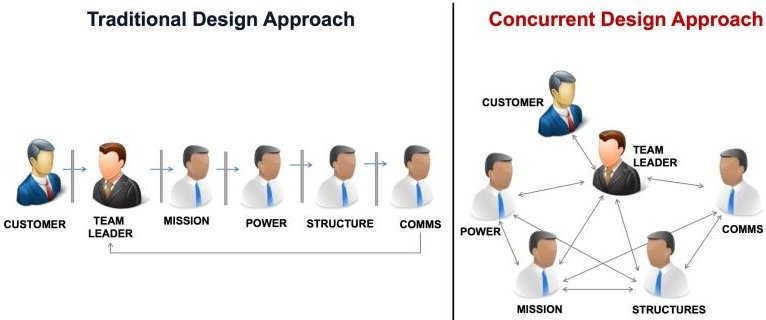
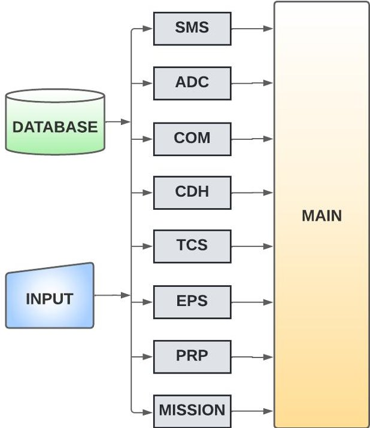
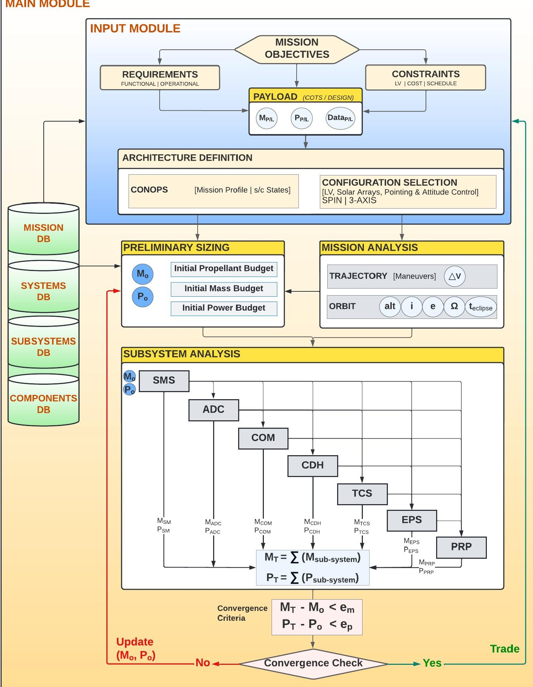
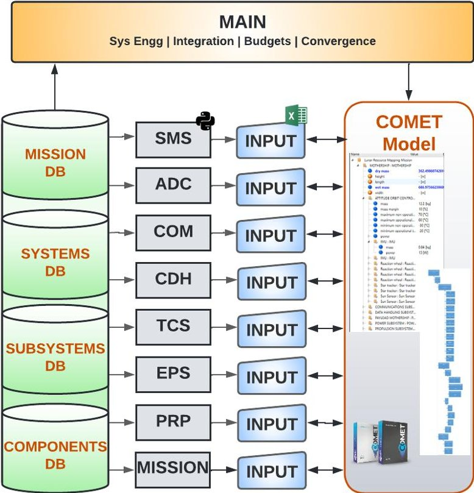
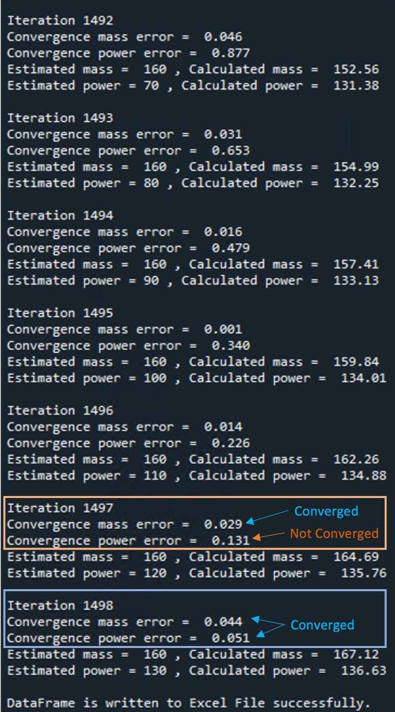
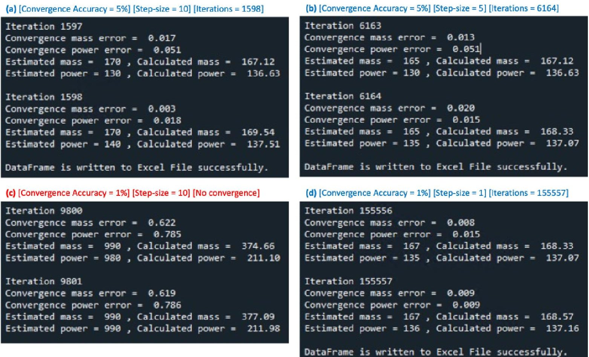
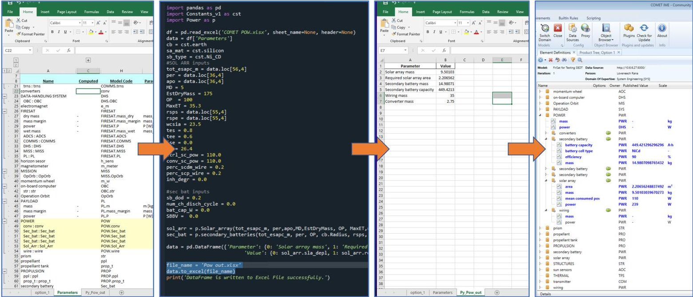

<!-- PDF_PAGE: 1 -->

IAC-22-D1,4B,7,x71344

<div align="center">

# INTEGRATED SPACECRAFT DESIGN: DEMONSTRATION OF A PROTOTYPE PROCESS AND PLATFORM FOR SATELLITE DESIGN APPLICATION

</div>

Dr. Loveneesh Rana SnT, University of Luxembourg, Luxembourg, loveneesh.rana@uni.lu

Vladyslav Bohlachov SnT, University of Luxembourg, Luxembourg

Prof. Andreas Hein SnT, University of Luxembourg, Luxembourg

Conceptual Design (CD) is one of the most critical life-cycle phases where crucial design decisions are taken and a baseline design is frozen. A traditional CD approach applies a parametric design process that analyses and integrates constituent subsystems into a system solution to satisfy the mission objectives. On the other hand, a more modern approach is to apply model-based systems engineering (MBSE) in a concurrent engineering framework where the design is driven by a system model that integrates subsystem analysis toward top-level mission requirements. Both approaches have their advantages and drawbacks. However, no process or platform exists that combines and takes advantage of both approaches. In this paper, we present a modular design process and framework that combine and extend both, the parametric design framework and concurrent design application.

keywords: spacecraft design, parametric methodology, concurrent design, modular, prototype,

## 1. Introduction

Conceptual Design (CD) is one of the most critical life-cycle phases where crucial design decisions are taken and a baseline design is frozen. The analysis conducted at this stage account for almost 80% of the total life-cycle cost and is responsible for major design decisions such as system configuration, technology, and mission operations. These decisions lead to a baseline design selection that is further refined and manufactured in subsequent life-cycle phases. A traditional CD analysis applies a design process that analyses various subsystems in a step-wise manner, one subsystem at a time. It integrates them into a system solution to satisfy the mission objectives. This approach implements a parametric framework and iterates the design process until a mathematically converged solution is achieved. On the other hand, a more modern approach is to apply model-based systems engineering (MBSE) in a concurrent engineering framework where the design is driven by a system model that integrates subsystem analysis toward top-level mission requirements. Both approaches have their advantages and drawbacks. However, no design framework or platform exists that can apply both these design approaches and takes advantage of both approaches.

In this paper, we present a modular and flexible design framework that can implement the traditional parametric method and also support the model-driven concurrent design approach. Our proposed method combine and extend both type of design approaches. This approach aims to support and automate the design engineer's activities while also providing a new parametric design process to automate trade studies and generate design solution space of feasible concepts. This allows to access a large number of solutions for the same mission objective and thus enables the selection of an optimal baseline design solution that other design methods might overlook.

Our modular platform implements a framework that integrates various modules in a valid design configuration following proof of design convergence. Each module can be used independently as a stand-alone platform and in parallel in concurrent design implementation. A validation case study is presented addressing a satellite design application to demonstrate the capability and features of the framework. The validation case study shows the application of the framework in both design approaches (parametric process and model-driven concurrent approach). The case study shows the implementation of mathematically robust convergence criteria that designs

<!-- PDF_PAGE: 2 -->





<div align="center">

Fig. 1: Spacecraft design approaches

</div>

multiple design solutions and provides a possibility of generating alternative system designs for the same mission objective. Together with our case study, this framework can act as a benchmark for future research on systems design modeling and analysis for space systems.

## 2. Spacecraft Design

Space systems design is a multidisciplinary task where constituting subsystems are designed and integrated into a system solution that can meet the mission objectives. The subsystem-level design is usually conducted using physics-based parametric analysis while their integration in a system design solution is done using specialized synthesis processes and tools. Generally speaking, the spacecraft design methods could be classified into two major categories as shown in Figure 1 and are discussed next.

## 2.1 Parametric Design Approach

The first category of design approach could be labeled as the parametric design approach. Most traditional design methods could be assigned to this category where the design process is executed in a sequential manner, from one design discipline to the next, one step at a time, passing the design from one disciplinary team to the next. These traditional design methods first emerged as manual design processes where calculations for each design discipline were conducted by hand and results were put together in a non-integrated manner. With the advent of modern-day computers, disciplinary analysis calculations were the first element to be done using high computation capabilities. The disciplinary integration and information management through the framework came last and is still an actively ongoing field of improvement. Examples of traditional design methods can be commonly found in classical design processes like those provided by Raymer $ ^{1} $ for aircraft design; K.D. Wood $ ^{2} $ for launch vehicle design; Rowell

and Korte's Launch Vehicle Design Process; $ ^{3} $ Hammond's space system design process $ ^{4} $ et al. Numerous space-system design tools such as SSSP (Space Shuttle Sizing Process); $ ^{5} $ PrADO-Hy; $ ^{6} $ AVDS; $ ^{7} $ FLOPS; $ ^{8} $ ModelCenter $ ^{9} $ etc implement such a parametric design process. Rana $ ^{10} $ and Chudoba $ ^{11} $ have also compiled comprehensive reviews of the traditional parametric design methods and tools applied in aerospace systems design.

## 2.2 Model-based Concurrent Design Approach

The second category is a more modern approach that applies model-driven concurrent engineering. In this approach, the design disciplines are executed in parallel to each other and thus, the information flow from one discipline to another is faster and more efficient than in traditional design processes. Massimo et al $ ^{12} $ provide the following definition: "Concurrent Engineering is defined as a systematic approach to integrated product development that emphasises the response to customer expectations. It embodies team values of co-operation, trust and sharing in such a manner that decision making is by consensus, involving all perspectives in parallel, from the beginning of the product life-cycle."

As opposed to the traditional methods, concurrent design favors a higher level of integration among design disciplines. The concurrent design approach applies the model-based system engineering (MBSE) where a model is at the center of the design process. Concurrent Engineering Centers (CEC) have emerged across the globe as specialized facilities where concurrent engineering is applied with the goal of generating space mission designs by enabling rapid design iterations. Rana $ ^{13} $ provides a detailed account of major CECs developed across the world. In a CEC, the design team uses a model of the system to define its constituent elements, integrate them in a system architecture, implement the relevant interfaces and manage the overall design architecture. In this regards a single model integrates all design information and concurrent modeling capability allows the design team to track the progress of the design and identify conflicts in real-time. Dedicated tools and platforms are required to enable such concurrent design execution. ESA's Open Concurrent Design Tool (OCDT) $ ^{14} $ and Rhea Group's COMET $ ^{15} $ are some prominent examples of such concurrent design platforms being applied in the European space industry today. Iwata et al $ ^{16} $ further provides an account of how MBSE is being applied in major concurrent design centers across the world.

<!-- PDF_PAGE: 3 -->

## 2.3 Challenges and Opportunities

A traditional design methodology is usually implemented in one stand-alone platform where each discipline is executed sequentially. This form of implementation leads to a long turn-around time meaning that the design process is slow and time-consuming. Another disadvantage of traditional design is that the interconnections and dependencies between design disciplines are hidden because all disciplines are executed under one platform and are sub-modules in a larger mainframe. These disadvantages are compensated in a concurrent design methodology where processing time is faster. While a traditional design method can be executed on one workstation, a concurrent design methodology requires multiple workstations (one for every design discipline) connected through a server. As a result, the concurrent design setup is more transparent in showing interdependencies within various subsystems and the impact of change in a subsystem at the system level.

In contrast to the above comparison, the traditional design approach does provide some advantages as well which could be difficult to implement in a concurrent design framework. In traditional parametric design methodologies, the design process is usually executed in one stand-alone platform which connects all subsystem analyses together. From a computational point, these design tools could be implemented on one workstation where integration of the system design could combine all subsystem analyses. This provides the capability to automate trade studies and execute iterations of the design process. This is a major advantage where automation can be applied more effectively than the concurrent design setup.

Different space systems require different design processes and toolsets. Compared to a typical launch vehicle design process, the design method applied for a satellite is not strictly a mathematical problem but rather a step-by-step process integrating the configuration of constituent subsystems into a system solution that would satisfy the mission objectives and requirements. The classical book Space Mission Analysis and Design (SMAD) $ ^{17} $ provides a well-adopted example of such a design process. References $ ^{18-22} $ are further similar examples of processes and tools developed to design satellites. All these methodologies provide a formalized process implementing a satellite configuration workflow to satisfy mission objectives and requirements. The above discussion demonstrates how the two design approaches differ from each other. An important aspect to consider here is that the two approaches have evolved over time and

different application scenarios. However, no single framework or tool is found that is developed to be applied in both settings. Developing such a hybrid design framework could leverage the advantages of both design approaches. Based on this philosophy, we have developed a modular design process and framework that combine and extend both, the parametric design framework and concurrent design application. The next section presents our design framework.

## 3. The Spacecraft Design Platform (SDP)

In this section, we present our solution concept, the Spacecraft Design Platform (SDP). Our primary goal with this solution is to develop a design capability that is applicable in both forms of implementation, in the concurrent design implementation supporting the model-based design approach and also as a stand-alone design platform that can be applied in the traditional parametric design approach. By doing this, our tool bridges the gap between the two design philosophies and takes advantage of both approaches.

The first subsection presents the overall composition of our framework and describes different modules of the framework. A general layout is provided summarizing how these modules connect to each other. The second subsection next describes how the SDP framework is applied in an integrated parametric design process. The last subsection presents the application of the SDP framework in concurrent design implementation.

## 3.1 SDP Framework

Our proposed solution is a modular and flexible framework that is composed of several standalone modules. These modules are developed in the python programming language environment to leverage the object-oriented features allowing higher modality at a microscopic level from a coding point of view. The modules are coded into classes representing different analyses and the sizing of individual hardware for the subsystem. All parametric equations, components, and materials are represented as class attributes. All objects created from analysis modules inherit their attributes from the parent class, thus enabling the generation of multiple solutions. This also allows reusability of the same class at multiple locations. The general layout of the framework is shown in Fig. 2 and provides a high-level conceptual idea of how these modules exchange information with each other. The modules can be grouped into the following major categories:

<!-- PDF_PAGE: 4 -->





<div align="center">

Fig. 2: SDP framework architecture

</div>

## 1. Input Module

## 2. Analysis Modules

## 4. Main Module

## 3. DataBase Module

Input Module: The input module is the first file that the user interacts with before starting the design process. Here the user can specify mission-specific parameters that are not calculated through parametric analysis. These parameters include top-level information such as the mission duration, selecting the central celestial body (eg. the Earth, or the Moon et al), launch vehicle, etc. Additionally, the input file also provides the user with the option to include subsystem-specific inputs, eg. the desired pointing accuracy for the Attitude Determination and Control Subsystem. The SDB framework currently does not address the payload design and hence payload is taken as an input for the design process. The input file thus also contains parametric characteristics of the payload including the payload mass, power, size, and data-rate consumption.

Analysis Modules: The analysis modules are stand-alone analysis files that include parametric analysis processes for seven spacecraft subsystems and mission analysis. These modules perform the calculation of required parameters based on parametric inputs from the Input Module. Each module is coded so that the user's input is prioritized.

The mission module performs the mission analysis part of the design process. It performs the astrodynamic analysis of possible mission trajectories and the calculation of orbit characteristics and their environment based on mission requirements. The seven subsystems are as follows; 1) SMS (Structures and Mechanism Subsystem), 2) ADC (Attitude Determination and Control), 3) COM (Communications Subsystem), 4) CDH (Command and Data Handling), 5) TCS (Thermal Control Subsystem), 6) EPS (Electric Power Subsystem), and, 7) PRP (Propulsion Subsystem).

Database Module (Past missions, systems, subsystems, components): The database module is composed of parametric data of past missions, space systems, subsystems, and technologies. It also contains multiple off-the-shelf commercially available components that are used and included within the subsystem files. In a manner, this module is implemented in the background to support other modules and is applied intrinsically in the analysis modules wherever needed. The database for past missions and spacecraft is also used to generate the initial estimates of the mass, power, and propellant budgets. Some constant properties, such as celestial body characteristics, are also included within the range of parameters of the Database Modules.

Main Module: The Main Module connects other modules and executes them in one file. It calls for selected classes in all modules and creates objects from analysis modules based on the user inputs. The structure of the main file defines the whole execution of the design process itself, implements the convergence check criteria, and iterates on the code until the convergence is achieved. Further, the main file can also implement automated trade studies once a converged solution is achieved.

## 3.2 SDP Parametric Design Implementation

The SDP solution framework is developed to be a modular design tool solution that can be implemented as an integrated stand-alone design platform. In this implementation, the SDP applies an iterative parametric process shown in Figure 3. The generic design process provided in SMAD $ ^{17} $ is taken as the reference starting point and is further modified. The SDP parametric process provides a robust parametrically integrated workflow in which subsystems are integrated into a system design solution. A unique key defining aspect of the SDP process is the mathematical convergence criteria that control the design iteration and provides the ability to automate system-

<!-- PDF_PAGE: 5 -->





<div align="center">

Fig. 3: SDP parametric design process

</div>

<!-- PDF_PAGE: 6 -->

level trades. These specifications are further demonstrated in the Case-Study Application section. Figure 3 shows the SDP parametric design process in several steps and how these are implemented through different modules of the SDP framework that are explained previously.

Payload Input: The process begins with the mission objectives that drive top-level requirements and constraints. The requirements and constraints are also inherently connected to the payload operations. The payload could be commercially available off-the-shelf equipment or could be designed if not available as a COTS unit. In either case, as mentioned earlier, the payload equipment is not currently analytically designed in our design process and is taken as the input for designing the rest of the spacecraft. The payload's physical characteristics and performance attributes such as its size, mass $ \left( \mathrm{M}_{PL} \right) $ , power consumption $ \left( \mathrm{P}_{PL} \right) $ , data rate et al are the first set of parametric inputs that drive the design of other subsystems of the spacecraft. If no information is available regarding the payload, the database of previous similar missions could be used to start with the first top-level estimates of the payload parameters.

Architecture Definition: Payload selection is followed by Architecture Definition. This step includes a definition of mission CONOPS (concept of operation) and selecting the overall configuration of the spacecraft. These decisions are not implemented by the SDP framework and are guided by the designer. The CONOPS includes defining the overall mission profile which determines what portion of the mission is conducted by the spacecraft and launcher specifically. This decision is influenced by the selection of the launcher and impacts the delta-V requirements and hence the overall size of the spacecraft. CONOPS also defined various spacecraft states that identify peak power requirements and extreme thermal conditions that the spacecraft would experience during its operational lifetime. Architecture Definition also addresses the spacecraft configuration selection based on the mission requirements, payload characteristics (mass, shape, power et al), and constraints of launcher fairing shape and size. Other factors such as pointing accuracy, attitude control methods, and solar arrays are other crucial configuration drivers. Typical configuration options include a spin-stabilized configuration, a 3-axis stabilized, or a specially customized configuration if none of the first two options are suitable. As shown in the figure, these first set of decisions, requirements, and constraints are all part of the Input Module of the SDP

framework.

Mission Analysis and Preliminary Sizing: Following the setup of the Input Module, the next step includes Mission Analysis and Preliminary Sizing. In the Mission Analysis block, we estimate the overall trajectory profile and operational orbit of the spacecraft. In the Preliminary Sizing block, we calculate three initial budgets, namely, Propellant Budget, Mass Budget, and Power Budget. The propellant budget is calculated by summing up all maneuvers coming from the trajectory portion of the Mission Analysis block and contains four major elements: velocity-control propellant, attitude-control propellant, margin, and residual propellant. The mass and power budgets are created based on the payload characteristics as the starting point where payload mass is a specific fraction of the total spacecraft dry mass. The initial power budget is estimated by adding the payload's power requirements to power estimates for the spacecraft bus subsystems. Similarly, to derive the first weight budget for the spacecraft, we add the payload weight to estimates for the spacecraft bus, including propulsion components and power components. These two budgets are a function of the two primary input parameters; Total Mass Estimate $ \left( \mathrm{M}_{0} \right) $ , and Total Power Estimate $ \left( \mathrm{P}_{0} \right) $ . These two parameters also act as the primary driver for the overall design process and the convergence criteria.

Subsystem Analysis: Following the preliminary sizing of the entire spacecraft, the next step addresses the detailed design and analysis of individual subsystems as shown in the block Subsystem Analysis. The design process for each subsystem is adopted from the SMAD subsystem design processes and each subsystem is coded in a separate python module. The subsystem analyses combine parametric sizing with COTS component selection based on each individual subsystem design process. For example, for the Attitude Determination and Control Subsystem (ADC), the design process includes parametrically calculating all the torque disturbances and pointing requirements and also includes a selection of corresponding sensors and actuators that fulfill the performance requirements. The subsystem design processes are further explained in the next section. The subsystems are processed in a sequential manner as shown in the Subsystem Analysis block, starting first with the Structure and Mechanism Subsystem (SMS) and ending with the Propulsion Subsystem (PRP). Each subsystem analysis calculates its total mass and power outputs which are summed together to calculate the final values for the total mass (wet mass) and total

<!-- PDF_PAGE: 7 -->

power consumption for the entire spacecraft. These values namely, $ \left( \mathrm{M}_{T} \right) $ and $ \left( \mathrm{P}_{T} \right) $ are the final output from one whole iteration of the SDP parametric process numerically combining all subsystems in a system solution.

Convergence Check: At the last step, a mathematical convergence criterion is implemented that checks the difference between the initial estimate inputs $ \mathrm{M}_{0}, \mathrm{P}_{0} $ , and the final calculated outputs $ \mathrm{M}_{T}, $ $ \mathrm{P}_{T} $ ).

$$
M _ {T} - M _ {0} < e _ {m}
$$

$$
P _ {T} - P _ {0} < e _ {p}
$$

In the above equation, $ \mathrm{e}_{m} $ and $ \mathrm{e}_{p} $ denotes the minimum error function and express the percentage change between initial and final values. The convergence criteria impose the mathematical condition that needs to be satisfied for a stable design solution. As shown in "Convergence Check" block, if this convergence criterion is not satisfied, the initial values $ \mathrm{M}_{0}, \mathrm{P}_{0} $ are updated and the entire design process is repeated for another iteration until the process convergences. Once the convergence criteria are met, the design process is complete resulting in a valid spacecraft design. After this, the entire parametric process can be repeated for an alternative set of inputs. This condition allows for trading on various inputs including a new payload or a different mission profile.

## 3.3 SDP Concurrent Design Implementation

In addition to the standalone parametric implementation, the SDP framework could also be applied within a model-driven concurrent design platform. In this implementation, we make use of the modular nature of our framework where we can apply SDP modules to support the concurrent design activities. We adopt the concurrent engineering platform, COMET, to design the design-model and implement the concurrent design workflow with our SDK framework. The COMET Integrated Modelling Environment (IME), developed by the RHEA Group, is an open source Concurrent Design desktop application and Microsoft Excel integration environment. It is an industry-standard software (ECSS-E-TM-10-25A complaint) that uses Systems Modeling Language (SysML) to enable model-driven concurrent engineering and is widely used in the European space industry including the ESA-ESTEC CDF. For all practical The COMET platform itself is broadly made up of two parts, a back-end server and a client facing front-end. The SDP framework interact directly with the front-end client application. Further details of COMET is found in its online user manual.





<div align="center">

Fig. 4: SDP Concurrent Design Implementation

</div>

Figure 4 shows implementation of the SDP framework in a concurrent design application. Unlike the SDP parametric design process, the concurrent approach is distributed. In the parametric process, the entire SDP framework is set up and executed on one workstation, in an integrated standalone platform that is completely executed in the python environment and can be run by one engineer. On other hand, in its concurrent design implementation, the SDP framework is applied in a fragmented setup where the framework is distributed on multiple workstations with multiple specialists working on different modules, integrating the workflow through the COMET-based design model. It must be noted that the COMET software provides system modeling and integration capabilities but does not provide any analysis capabilities inherently. The analysis is left to the disciplinary specialists who can choose their own tools for subsystem analysis and integrate their results into the design model in the COMET.

As shown in Figure 4, different subsystem modules act as the primary analysis modules for each disciplinary specialist. The design model is developed in the COMET environment where each subsystem and its corresponding components are defined as elements that are characterized by various parameters. The parameters are computed by individual specialists using the SDP subsystem modules. The python-based

<!-- PDF_PAGE: 8 -->

subsystem modules interact with the input files in the MS Excel file format (.xls) which then further interacts with the COMET model. All subsystem modules have access to the shared Database module. In this mode, the Main module file is primarily the systems engineer's responsibility where the preliminary sizing, configuration selection, and eventually the integration of all subsystems occur including mass and power budgets.

<table border="1"><tr><td>Subsystem Design Steps</td><td>Step Type$\cdot$</td><td>Decisions$\dagger$</td><td>Reference**</td></tr><tr><td>ADC</td><td></td><td></td><td></td></tr><tr><td>Requirements definition</td><td>Q</td><td>x</td><td></td></tr><tr><td>Define control modes</td><td>Q</td><td>√</td><td></td></tr><tr><td>Quatify disturbances</td><td>P</td><td>x</td><td>Sec.10.4.2,</td></tr><tr><td>Select attitude control type</td><td>Q</td><td>√</td><td>Sec.11.1</td></tr><tr><td>Select and size hardware</td><td>P</td><td>√</td><td></td></tr><tr><td>Define control algorithm</td><td>Q</td><td>x</td><td></td></tr><tr><td>EPS</td><td></td><td></td><td></td></tr><tr><td>Identify requirements</td><td>Q</td><td>x</td><td></td></tr><tr><td>Select power source</td><td>Q</td><td>√</td><td></td></tr><tr><td>Size power source</td><td>P</td><td>x</td><td></td></tr><tr><td>Select energy storage</td><td>Q</td><td>√</td><td>Sec.10.3,</td></tr><tr><td>Size energy storage</td><td>P</td><td>x</td><td>Sec.10.4.6,</td></tr><tr><td>Power distribution type selection</td><td>Q/P</td><td>√</td><td>Sec.11.4</td></tr><tr><td>Determine protection subsystem</td><td>Q/P</td><td>√</td><td></td></tr><tr><td>Determine electrical control subsystem</td><td>Q/P</td><td>√</td><td></td></tr><tr><td>Develop electrical bus voltage control</td><td>Q/P</td><td>x</td><td></td></tr><tr><td>COM</td><td></td><td></td><td></td></tr><tr><td>Identify requirements</td><td>Q</td><td>x</td><td></td></tr><tr><td>Determine freq&amp;reqb/w</td><td>Q/P</td><td>√</td><td></td></tr><tr><td>COM subsystem trades</td><td>P</td><td>x</td><td>Sec.10.4.3,</td></tr><tr><td>Subsystem trades coms&amp;other subsys</td><td>P</td><td>x</td><td>Sec.11.2,Ch13</td></tr><tr><td>Calculate performance parameters</td><td>P</td><td>x</td><td></td></tr><tr><td>Estimate mass and power</td><td>P</td><td>x</td><td></td></tr><tr><td>CDH</td><td></td><td></td><td></td></tr><tr><td>Identify function performed by CDH</td><td>Q</td><td>√</td><td></td></tr><tr><td>Identify requirements</td><td>Q</td><td>x</td><td>Sec.10.4.4,</td></tr><tr><td>Determine complexity of CDH Functions</td><td>Q/P</td><td>√</td><td>Sec.11.3,</td></tr><tr><td>Determine overall level of complexity</td><td>Q/P</td><td>√</td><td>Ch16</td></tr><tr><td>Estimate mass and power</td><td>P</td><td>x</td><td></td></tr><tr><td>THR</td><td></td><td></td><td></td></tr><tr><td>Identify requirements</td><td>Q</td><td>x</td><td></td></tr><tr><td>Determine thermal environment</td><td>P</td><td>x</td><td></td></tr><tr><td>Identify thermal challenges</td><td>Q</td><td>x</td><td>Sec.10.4.5,</td></tr><tr><td>Identify thermal control techniques</td><td>Q</td><td>√</td><td>Sec.11.5</td></tr><tr><td>Determine radiator and heater req</td><td>Q</td><td>x</td><td></td></tr><tr><td>Estimate mass and power</td><td>P</td><td>x</td><td></td></tr><tr><td>SMS</td><td></td><td></td><td></td></tr><tr><td>Identify requirements</td><td>Q</td><td>x</td><td></td></tr><tr><td>Develop packaging configurations</td><td>Q</td><td>x</td><td>Sec.10.4.7,</td></tr><tr><td>Select material(other design options)</td><td>Q</td><td>√</td><td>Sec.11.6</td></tr><tr><td>Choose test/analysis criteria</td><td>Q</td><td>√</td><td></td></tr><tr><td>Size primary structure</td><td>P</td><td>x</td><td></td></tr><tr><td>PRP</td><td></td><td></td><td></td></tr><tr><td>List applicable propulsion functions</td><td>Q</td><td>x</td><td></td></tr><tr><td>Determine ΔV budget and thrust level</td><td>P</td><td>x</td><td></td></tr><tr><td>Determine total impulse, thrust for ADC</td><td>Q/P</td><td>x</td><td>Sec.10.3,</td></tr><tr><td>Determine propulsion system options</td><td>Q</td><td>√</td><td>Sec.10.4.1,</td></tr><tr><td>Estimate key parameters for each option</td><td>Q/P</td><td>√</td><td>Ch17</td></tr><tr><td>Estimate mass and power for each option</td><td>P</td><td>x</td><td></td></tr><tr><td>Establish baseline propulsion subsystem</td><td>Q</td><td>√</td><td></td></tr></table>

$ ^{*} $ Q = Qualitative Analysis P = Parametric Analysis

$ \dagger $ Analysis step includes a design-decision to be made with user-input

** The reference sections are from 3rd Edition of SMAD textbook

<div align="center">

Fig. 5: Subsystems design overview

</div>

## 4. Subsystems Analysis

This chapter summarizes the high-level design process for each subsystem. The primary focus is on describing how the SDP framework implements individual steps and where the user input is required versus the steps executed through the SDP framework. Thus, we present a concise version of all subsystems' design processes. Since our focus for the SDP is to innovate at the system-level integration and design, we have adopted the design process for all the subsystems from the SMAD textbook. Figure 5 presents an overview of the major design steps for all seven subsystems. As seen, every design step is categorized as implementing a qualitative or a parametric analysis process. Additionally, some design steps also include making a decision to select from a given number of alternatives. The following provides an overview of the design process for each subsystem.

## 4.1 Attitude Determination and Control (ADC)

The ADC design process begins with the decomposing of system-level requirements into subsystem requirements corresponding to the pointing and control needs for the payload and entire spacecraft. These ADCS requirements are closely tied to mission needs and other subsystem characteristics and correspond with different mission phases and spacecraft states. The definition of control modes is closely linked to requirements as many requirements should be tailored to match the performance of the defined control modes. The next step includes determining external disturbance torques applied on spacecraft that the ADCS must tolerate. There are four significant disturbances: gravity-gradient effects, magnetic=field torques, impingement by solar radiation, and aerodynamic torques (in low orbits around the Earth). The selection of the type of attitude control is closely linked to the requirements of the mission and selected control modes. The ADCS control method, the class of sensors, and the number and kind of actuation devices are influenced by payload pointing requirements. The hardware for the ADCS can be split into 2 main groups: actuators and sensors. The selection and sizing of all actuators and sensors selection are dependent on the required pointing accuracy of the spacecraft either for communication or payload requirements. All control components need to be connected together into a cohesive system. The system designer should also consider the interacting effects of attitude control system loop gain, the capability of the attitude control system to compensate for disturbances, accuracy of attitude control, and control

<!-- PDF_PAGE: 9 -->

system bandwidth.

## 4.2 Electrical Power Subsystem (EPS)

For the power subsystem, the process of the analysis begins with identifying the requirements as well. The requirements for the power subsystem are closely linked to the power consumption of each spacecraft subsystem. Thus the critical consideration during the process is the average power consumption and peak power consumption of the whole spacecraft. In addition, since the source of the power generation and energy storage have inheritable degradation, it is also significant to consider the mission duration. Orbit characteristics will affect the power subsystem design and define the orbital period and amount of eclipses during the mission period. The selection of power source and energy storage are tailored according to the requirements of the subsystem. The sizing of the energy source must consider the beginning-of-life and end-of-life capabilities of the selected source as it must support the spacecraft till the end of its mission. Based on the orbital characteristics and mission duration, the energy storage capacity must be defined. The mass of the selected batteries must be sized according to the calculated required capacity for the spacecraft.

## 4.3 Communication Subsystem (COM)

The typical requirements selection for the communication subsystem includes the mission orbit, spacecraft geometry, minimum elevation angle, data rate, worst-case conditions, and bit-error rate. Once the primary subsystem requirements are established, the frequency and bandwidth selection is done to identify how spacecraft will communicate with the ground station. For the frequency and bandwidth selection, the data rate is the primary driver parameter which is influenced by the payload and CONOPS. For the selection of communication components, it is important to conduct trades between the receiver and transmitter, their noise temperatures, gains, and transmitter's power. The communication subsystem is closely linked to the design of other subsystems as well. Thus, it is important to do major system tradeoffs with other subsystems and communication before finalizing the design of the communication subsystem.

## 4.4 Command and Data Handling Subsystem (CDH)

The command and data handling subsystem is the main computer of the spacecraft that manages commands for how different subsystems are operated.

This subsystem works closely with the COM subsystem. The major driver for the CDH subsystem is the complexity of the commands and payload design. Orbital characteristics and access time for the communication of the system would affect the final selection of the components as well. There are no severe constraints on the CDH in terms of sizing apart from the data required to be stored, processed, and exchanged with other subsystems.

## 4.5 Thermal Control Subsystem (TCS)

The very first step in thermal subsystem design is to determine the thermal restrictions of components and determine the temperature limits of each component in the system. Environment estimation is the next step in subsystem design. It is necessary to understand the component selection and determine the techniques for the thermal subsystem that are needed to keep spacecraft running. The last and final step includes sizing and component selection and documenting the overall mass and power consumption of the thermal subsystem and continuing iteration.

## 4.6 Structures and Mechanisms Subsystem (SMS)

The structures subsystem is the main skeleton of the spacecraft that houses all the equipment and can sustain all the disturbances and vibrations during the system's entire lifetime. This includes considering not only the operations phase but also the test and launch phases. In this regard, the launch vehicle selection also affects structure design because the primary structure should sustain the vibrations during the launch. Additionally, key mechanisms responsible for the deployment of solar arrays, the pointing of arrays and antennas, etc are also included within this subsystem. The design process for SMS is composed of 5 major steps as shown in Figure 5. The requirements identification for the structure subsystem comes mostly from mission analysis. Packaging configuration that includes load distribution for the spacecraft, accessibility of the components, and producibility. The choice of construction type selection and material for the structure has a major impact on the stability of the spacecraft. Selection of test and analysis criteria to be certain in spacecraft survivability and finally in sizing of the structure subsystem. If the structure does not meet initial requirements the whole process needs to be reiterated. Once the requirements are met detailed design options must be documented.

<!-- PDF_PAGE: 10 -->

## 4.7 Propulsion Subsystem (PRP)

The propulsion subsystem in a spacecraft is primarily responsible for providing maneuverability capability in placing the spacecraft in its desired operational orbits and changing the orbits if required by the CONOPS. The design process begins with outlining the major functions to be performed by the propulsion subsystem. This provides an overall estimate of the delta-V budget for the mission. The next step determines the total impulse and thrust level needed in each maneuver. Once this information is available, the next steps access different propulsion systems options and calculate the total mass and power of each option that can meet the required propulsion capabilities.

## 5. Case-study Application

We now present a case study where we demonstrate the application of our SDP framework towards a satellite design use case. The main goal of this section is to demonstrate the modularity of our SDP framework applied in the two design implementations. The first subsection presents the mission selected for the case-study demonstration. The second subsection describes the SDP parametric process application where we demonstrate how the SDP framework is applied as a stand-alone iterative design platform. The third subsection describes the SDP concurrent design application with the COMET framework. For demonstration purposes, we focus the discussion mainly on the execution of the SDP framework in the two design applications, and the results are discussed only in terms of total mass and power at the subsystem and system levels.

## 5.1 Case-study Mission

We have selected the well-known FireSat case study from SMAD $ ^{17} $ as a reference mission to demonstrate the application and functionality of our proposed SDP framework. The primary mission objective of the FireSat is to detect, identify, and monitor forest fires throughout the United States, including Alaska and Hawaii, in near real-time. With this objective, the FireSat mission is designed in the SMAD textbook as a reference case study to illustrate the top-level steps for the SMAD design process starting from defining mission objectives, to formulating requirements, doing mission analysis, and finally designing the entire spacecraft and each subsystem providing with details of the selected components and materials for each subsystem. In this sense, FireSat is a very comprehensive case study. We have selected FireSatfor this same reason. It is a very welldocumented case study that provides detailed parametric information for its subsystem design analyses and for the design of the whole mission and spacecraft. FireSat also provides design decision inputs for each subsystem design and thus can be used also as a reference to measure our results in the two modes of design application.

<div align="center">

Table 1: FireSat case-study mission and spacecraft characteristics from SMAD $ ^{17} $

</div>

<table border="1"><tr><td>Parameters</td><td>FireSat</td></tr><tr><td>Mission:</td><td></td></tr><tr><td>Mission Duration</td><td>5 yrs</td></tr><tr><td>Parking Orbit</td><td>150km</td></tr><tr><td>Mission Orbit</td><td>LEO</td></tr><tr><td>Altitude</td><td>700km</td></tr><tr><td>Delta-V</td><td>526m/s</td></tr><tr><td>Payload:</td><td></td></tr><tr><td>Mass</td><td>28kg</td></tr><tr><td>Power</td><td>32W</td></tr><tr><td>Spacecraft:</td><td></td></tr><tr><td>Dry mass</td><td>140kg</td></tr><tr><td>Loaded mass</td><td>175kg</td></tr><tr><td>Average Power</td><td>110W</td></tr><tr><td>Solar array power</td><td>170W</td></tr><tr><td>Solar array design</td><td>Body-mounted omni array</td></tr><tr><td>Control approach</td><td>3-axis, nadir pointed</td></tr></table>

For the current study, the input module is set up following the data from the FireSat mission where its payload characteristics are used as the primary input. Further, we also apply the same choice of design decisions (such as selection of structural material, solar cell technology, etc) as made in the FireSat mission. Given a large number of design decisions and parametric inputs, it is not feasible to present all the subsystem-level analysis results in the current paper. Instead, we focus on the system-level results and application of the SDP framework in the two design approaches in the following subsections next.

## 5.2 SDP Parametric Process application

We now present the results of applying the SDP framework in its parametric process implementation toward the FireSat mission. Instead, we focus on the high-level system design and application of the SDP parametric process that is earlier explained in section three.

Following the discussion of the SDP parametric process from section three, we present the Main Module that implements the entire process of the system

<!-- PDF_PAGE: 11 -->

design. The python code is provided here next with comments identifying where different modules (Input Module and Analysis Modules) are called and executed in the Main Module.

As it can be observed from the code in Listing 1, the structure of the main module sets up the design process for spacecraft design. Initial modules for different subsystems analysis are called, and database constants are initialized (i.e., central body, structure material, etc.). Following this the Convergence criteria is implemented.





<div align="center">

Fig. 6: Iterative process results showing convergence criteria for 10 percent accuracy applied in

</div>

Variables e_m and e_p define the acceptable error between the initial estimate inputs $ \left( \mathrm{M}_{0},\mathrm{P}_{0}\right) $ , and

the final calculated outputs $ \mathrm{M}_{T}, \mathrm{P}_{T} $ . The iteration implemented in the loop for 'i' and 'j' variables represents a range of the first initial guessed values for $ \mathrm{M}_{0} $ and $ \mathrm{P}_{0} $ respectively, in a range from 10 to 1000. The further argument within the loop is a step size with which the whole process will perform analysis. For each $ \mathrm{M}_{0} $ , a $ \mathrm{P}_{0} $ is calculated. SC_Char is the function that creates an object of each subsystem with attributes of the corresponding class from the corresponding subsystem module. Variables for general outputs are then extracted, and Calculated mass $ \mathrm{M}_{T} $ and power $ \mathrm{P}_{T} $ are compared with the initial values $ \mathrm{M}_{0}, \mathrm{P}_{0} $ . If the error satisfies the convergence criteria set up from e_m and e_p, the loop breaks and records the final calculated data from the process to excel. In addition, each loop prints out convergence error and initial and calculated values for the satellite. Until these convergence criteria are satisfied, the iteration loop continues.

Figure 6 shows the instance where we set up the convergence criteria for an error function accuracy of 10%. As it could be seen the solver continues to do complete iterations of the whole SDP process until the convergence criteria is satisfied meeting the desired accuracy in both, mass and power values. It should be noted that each iteration is one complete spacecraft design integrating all subsystems into a system solution. The difference here is that the iterations before the convergence is achieved are design solutions that are not feasible. It is important to note that the higher accuracy with a smaller step requires more time to reach convergence as this condition is running more iterations. Additionally, higher accuracy in the error function will also demand a smaller step size for convergence because to converge with higher accuracy, the solver would require to a higher resolution. This effect can be seen in Figure 7 where four test cases are shown with different combinations of convergence accuracy and iteration step sizes. As can be observed, there is a difference in the final result depending on the accuracy and the step size. Cases (a) and (b) show how with the same accuracy of 5% but different step-size of 10 and 5, the convergence is achieved in different iterations. Case (c) of Figure 7 shows how accuracy of 1% and step-size of 10 cannot find a converged solution as the iteration loop resolution is not fine enough for the required accuracy. While case (d) with 1% accuracy converges when the step size is reduced to 1 thus increasing the resolution of the iteration loop. Another interesting point to note here is the difference in the final output results of the calculated mass and power values for each

<!-- PDF_PAGE: 12 -->





<div align="center">

Fig. 7: SDP parametric process with different convergence accuracy and iteration step-size conditions

</div>

case.

The mass and power consumption breakdown of the spacecraft for each subsystem is presented in table 2. These are the results from the final converged iteration obtained with an error function accuracy of 1% and step-size of one. The results also compare the FireSat estimates from the SMAD case study which shows how our results are in a similar range to the SMAD values. Although our total power consumption is on a higher end. Additionally, the spread of mass and power consumption at the subsystem level could also differ from the SMAD case study as the SMAD case study does not provide a similar detailed breakdown. These differences are most likely due to the fact that our subsystem modules are coded to consider details that might not be considered in the SMAD results. Nonetheless, our results are in the same ballpark range and provide a satisfactory system level design that meets the mission requirements.

## 5.3 SDP Concurrent Design Application

The SDP framework is also applied for the FireSat case study in concurrent design implementation. Here the SDP modules are applied with the concurrent engineering platform, COMET. A design model

<div align="center">

Table 2: FireSat case-study design results showing mass and power consumption for each subsystem and entire spacecraft. The results are for the converged iteration at a convergence accuracy of 1%

</div>

<table border="1"><tr><td></td><td>Mass(kg)</td><td>Power(W)</td></tr><tr><td>ADCS</td><td>13.35</td><td>21.25</td></tr><tr><td>PRP</td><td>26.39</td><td>29.39</td></tr><tr><td>EPS</td><td>60.98</td><td>11.91</td></tr><tr><td>COM</td><td>3.66</td><td>30.6</td></tr><tr><td>THR</td><td>0.14</td><td>0</td></tr><tr><td>SMS</td><td>33.53</td><td>0</td></tr><tr><td>CDH</td><td>2.5</td><td>12</td></tr><tr><td>Payload</td><td>28</td><td>32</td></tr><tr><td>Total</td><td>168.57</td><td>137.16</td></tr><tr><td>FireSat(SMAD)</td><td>175</td><td>110</td></tr></table>

of the FireSat spacecraft is first developed in the COMET where each subsystem and its constituent components are modeled as elements that are the building blocks of the design model. Every element is characterized by the definition of physical and performance parameters. The elements are then arranged in a hierarchical system architecture that defines and

<!-- PDF_PAGE: 13 -->

connect elements across system, subsystem, and component levels. The development of a design model in the COMET platform for a mission design study is a well-known process and is therefore not addressed here in further detail. Rather, we focus on demonstrating how we apply our SDP modules with the COMET-based design model and integrate the SDP framework in a concurrent engineering environment to support and improve the concurrent design activities. Readers are advised to refer to section 3.3 and Figure 4 where the generic process is described addressing how the SDP framework is applied within a concurrent design implementation.

```python

import pandas as pd

from Inputs import inp

import Constants as cst

#Subsystems Analysis Modules

import mission as mi

import Structure as s

import ADCS as a

import Comm as c

import Cdh as cd

import Power as p

import Thermal as t

import Propulsion as prop

cb = cst.earth

str_mat = cst.str_al_alloy

thr_mat = cst.al_alloy

surf = cst.al_tefl_2

sa_mat = cst.silicon

sc_char = m.SC_Char(inp.EstLoadMass)

pb = m.pb_mt(inp.esapc)

sb_type = cst.Ni_CD

TotMass = 0

#Error Function for convergence check

e_m = 0.05

e_p = 0.05

n = 0

#Convergence Criteria Iteration Setup

for i in range(10,1000,10):

    for j in range (10,1000,10):

#Subsystem Analysis Modules

    sc_char = SC_Char(i, j)

    ADCS_m = sc_char[0]

    ADCS_p = sc_char[1]

    POW_m = sc_char[2]

    POW_p = sc_char[3]

    PROP_m = sc_char[4]

    PROP_p = sc_char[5]

    COMM_m = sc_char[6]

    COMM_p = sc_char[7]

    THR_m = sc_char[8]

    THR_p = sc_char[9]

    STRUCT_m = sc_char[10]

    pload_m = sc_char[11]

    pload_p = sc_char[12]

    cdh_m = sc_char[13]

    cdh_p = sc_char[14]

    TotMass = sc_char[15]

    TotPow = sc_char[16]

#Convergence Check

conv_m = abs((TotMass-i)/i)

conv_p = abs((TotPow-j)/j)

n += 1

print('Number of satellite',n)

print('Convergence mass error = ',conv_m)

print('Convergence power error = ',conv_p)

print('Estimated mass = ',i,'', Calculated

mass = ',TotMass)

print('Estimated power =',j,'', Calculated

power = ',TotPow)

if conv_m < e_m and conv_p < e_p:

    break

else:

    pass

if conv_m < e_m and conv_p < e_p:

    break

else:

    pass

data = pd.DataFrame({'Parameter': {0: 'Total Mass', 1: 'Total Power', 2: 'ADCS Mass', 3: 'ADCS pow', 4: 'Prop Power', 5: 'Prop Pow', 6: 'Pow mass', 7: 'Pow Power', 8: 'Comm mass', 9: 'Comm pow', 10: 'THR mass', 11: 'THR pow', 12: 'Str Mass', 13: 'CDH Mass', 14: 'CDH Power', 15: 'Payload Mass', 16: 'Payload Power'},

    'Grade': {0: TotMass, 1: TotPow, 2:ADCS_m,

3:ADCS_p,4:PROP_m,5:PROP_p, 6:POW_m, 7:POW_p, 8:

```

```python

COMM_m, 9:COMM_p, 10: THR_m, 11: THR_p,12:STRUCT_m

,13:cdh_m,14:cdh_p,15:pload_m,16:pload_p}})

file_name = 'SC_Char.xlsx'

# saving final results to the excel

data.to_excel(file_name)

print('DataFrame is written to Excel File successfully.'

```

## Listing 1: Main Module python code

As explained previously in section 3.3, the Analysis Modules of the SDP framework are used by disciplinary specialists to perform parametric analysis and calculate characteristic parameters that define each element in the COMET model. This analysis is performed in the independent python scripts which update the calculated parameters in the Input Module that is set up here in the MS Excel environment. The pandas library is used for implementing this interface between python and excel environments. The Excelbased Input Module then interacts with the COMET model where it can read and write calculated parameters. This process is applied independently for each discipline in a separate workstation in our Concurrent Design Facility, the CDF-LU.

Figure 8 demonstrates this process for the Power subsystem as a template example for the workflow integrating SDP modules with the COMET design model. The first window shows the Excel-based workbook generated after the FireSat model is created in the COMET desktop application. The workbook itself is composed of several spreadsheets, some of which are created by the COMET desktop application, while another spreadsheet is created by the SDP modules. The highlighted cells in the first window represents the parameters listing corresponding to the elements belonging to the Power subsystem. The SDP analysis module (coded in python) for EPS subsystem reads the parameters from the excel workbook that are needed to perform the parametric analysis, calculates the output parameters, and feeds them back in the excel workbook shown in the third window. The excel workbook then update the COMET model shown in the last window of Figure 8. This process also enables reading parameters from the COMET model to the excel workbooks and back to the SDP python scripts which is typical in a concurrent design session to enable exchange of parametric information between different subsystems modules. The Main Module itself is handled by the system engineer where all the system level mass and power budgets are integrated. In this setting the Main Module can also make use of COMET features such as spacecraft states definition and different design options.

Since we need a team of specialists to conduct a concurrent design session where each specialist is re-

<!-- PDF_PAGE: 14 -->





<div align="center">

Fig. 8: SDP Integration with COMET for Power subsystem analysis

</div>

sponsible for a design discipline, we could not apply all the SDP modules in a live concurrent design session. We tested different subsystem modules individually in the workflow described above but were not able to integrate them in real-time concurrent design environment. This remains to be tested in a future design study as it requires a rather considerable amount to coordination effort which was not possible for the current study. We hope to implement this in near future and take full advantage of the modularity and flexibility of our SDP framework in a concurrent design environment.

## 6. Conclusion

In this paper, we have presented a novel design methodology, the Spacecraft Design Platform (SDP). It is a modular framework that is composed of several independent modules coded in python programming language. The SDP presents is a prototype methodology that can be applied in two distinct design implementations. In a purely parametric implementation, the SDP framework applies a novel design process that executes convergence criteria to finalize a feasible design iteration. This parametric design process also provides the capability to automate trade studies within the design process and produce design solution space. In addition to the traditional parametric implementation, we also demonstrated the application of the SDP framework in model-based concurrent design implementation. For both design implementations, we have presented an application logic that

shows how the generic SDP framework adopts and applies the process depending on the implementation approach. We have also demonstrated the application workflow in each mode of design implementation through the use of a case study.

Our proposed framework has a scope for a few feature improvements that are being worked upon currently. Our database module is in its early development stages and will be improved as more data is added. We also plan to apply our SDP framework in a live concurrent design study with a team of engineers. This application will hopefully provide us with better estimates of how our tool could be further improved to be used by engineers who are not the developers of the tool. Some of our subsystem analysis files also require further improvement which is currently a work in progress.

## References

[1] Daniel P Raymer. Aircraft Design: A Conceptual Approach. AIAA (American Institute of Aeronautics & Ast, 2006.

[2] Karl Dawson Wood. Aerospace Vehicle Design - Volume II: Spacecraft Design, volume 2. Johnson Publishing Company, 1964.

[3] Lawrence F Rowell and John J Korte. Launch vehicle design and optimization methods and priority for the advanced engineering environment. 2003.

<!-- PDF_PAGE: 15 -->

[4] Walter Edward Hammond. Design Methodologies for Space Transportation Systems, volume 1. AIAA, 2001.

[5] CONVAIR. Space shuttle synthesis program (SSSP) final report no. gdc-dbb70-002, 1970.

[6] Wolfgang Heinze. Ein Beitrag Zur Quantitativen Analyse Der Technischen Und Wirtschaftlichen Auslegungsgrenzen Verschiedener Flugzeugkonzepte Fur Den Transport Grosser Nutzlasten. PhD thesis, 1994.

[7] L. Rana and B. Chudoba. Demonstration of a prototype design synthesis capability for space access vehicle design. The Aeronautical Journal, 124(1281):1761-1788, 2020.

[8] LA McCullers. Flops: Flight optimization system. Proceedings of Recent Experiences in Multidisciplinary Analysis and Optimization, Hampton, Virginia, 1984.

[9] Phoenix Integration. ModelCenter Integrate: Model Based Engineering Software. https://www.phoenixint.com/product/modelcenter-integrate/. Accessed: 2021-06-30.

[10] L Rana. Space Access Systems Design: Synthesis methodology development for conceptual design of future space access systems. PhD Dissertation, The University of Texas at Arlington, 2017.

[11] B Chudoba and W Heinze. Evolution of generic flight vehicle design synthesis. Aeronautical Journal, 114(1159):549-567, 2010.

[12] M. Bandecchi, B. Melton, and B. Gardini. The esa / estec concurrent design facility. 2000.

[13] Loveneesh Rana. Vision of a next-gen concurrent design facility (cdf-lu). In International Astronautical Congress, Dubai, 25-29 October 2021. International Astronautical Federation, October 2021.

[14] ESA. Open Concurrent Design Tool. https://ocdt.esa.int/. Accessed: 2021-06-30.

[15] RHEA. CDP4 $ ^{\mathrm{TM}} $ : Explore the Full Potential of Collaborative Design. http://products.rheagroup.com/cdp4/. Accessed: 2021-06-30.

[16] Curtis Iwata, Samantha Infeld, Jennifer M. Bracken, Melissa McGuire, Christina McQuirck, Aron Kisdi, Jonathan Murphy, Bjorn Cole, and Pezhman Zarifian. Model-based systems engineering in concurrent engineering centers. In AIAA SPACE 2015 Conference and Exposition. American Institute of Aeronautics and Astronautics, August 2015.

[17] James Richard Wertz and Wiley J. Larson. Space Mission Analysis and Design (SMAD) 3rd Ed. 09 1991.

[18] Christina Aas, B.T.C. Zandbergen, Rob Hamann, and Eberhard Gill. Development of a system level tool for conceptual design of small satellites. 01 2009.

[19] Davide Di Domizio and Paolo Gaudenzi. A model for preliminary design procedures of satellite systems. Concurrent Engineering, 16(2):149-159, 2008.

[20] H. Stoewer, R. Hartmann, and Lutz Richter. An advanced methodology for the design process of a satellite. 2000.

[21] William Edmonson, Jules Chenou, Natasha Neogi, and Heber Herencia-Zapana. Small satellite systems design methodology: A formal and agile design process. In 2014 IEEE International Systems Conference Proceedings, pages 518-524, 2014.

[22] Holger Schumann, Axel Berres, Olaf Maibaum, and Alexander Röhnsch. Dlr's virtual satellite approach. In 10th International Workshop on Simulation on European Space Programmes (SESP 2008), 10 2008.