<!-- PDF_PAGE: 1 -->

ORIGINAL RESEARCH

# Toward integrating systems engineering with software engineering through Object-Process Programming

Ahmad Jbara $ ^{1,2,3} $ iD · Arieh Bibliowicz $ ^{1,4} $ · Niva Wengrowicz $ ^{1} $ · Natali Levi $ ^{1} $ · Dov Dori $ ^{1,5} $

Received: 31 October 2019/Accepted: 23 May 2020

$ \textcircled{c} $ Bharati Vidyapeeth's Institute of Computer Applications and Management 2020

Abstract Modern systems comprise hardware and software components that together provide value through enabling the functionality that the system is intended to provide. Systems engineering (SE) and software engineering (SwE) are therefore interdependent, tightly coupled, and complementary activities that must be carefully aligned and coordinated throughout the system development process. Yet, these two disciplines have historically grown quite separated from each other, with too little interaction and mutual learning. In this work, we develop and evaluate Object-Process Programming (OPP) as a proof-of-concept for a common framework that integrates SE and SwE based on ISO 19450—Object-Process Methodology. The ability of designers to use the same paradigm for engineering the software, the hardware, and the system as a whole, using the same concepts and principles and the same design environment, described and discussed in this work, is a major step towards the integration and streamlining of engineering new systems that feature significant hardware and software components. To evaluate OPP, we established a focus group and conducted

an experiment in which participants were asked to develop systems using OPP. Overall, the results were positive in terms of usability and understandability. In particular, the language and the environment were far superior in comparison to textual languages. OPP will contribute to the continuous endeavor to bridge the gap between SE and SwE by providing a seamless, easy-to-learn environment. Non-technical stakeholders can also benefit from OPP by improving their communication with technical stakeholders. The ideas underlying OPP have already served to augment OPM with computational capabilities.

Keywords Conceptual modeling·Software engineering· Systems engineering·Software modeling·Model-based systems engineering (MBSE)·Cyber-physical systems· Hardware-software co-design·Visual programming· Visual programming languages·Object-Process Methodology (OPM)·Object-Process Programming (OPP)

## 1 Introduction

Every modern human-made system is a complex combination of hardware and software modules, aimed to provide value to the system's beneficiaries. This has culminated in the emergence of the Internet of Things (IoT) and its glaring Industry 4.0 manifestation [4], a revolution that is taking place and is changing dramatically the way systems operate and the modes of human-system interaction. Increasingly, the IoT and System of Systems [69] paradigms are gaining momentum, along with the voluminous data they produce. In these systems, software components are embedded in the hardware components, control them, and communicate their state via the Internet, relieving humans from mundane operations and serving their

<!-- PDF_PAGE: 2 -->

personalized needs accurately and more efficiently. Systems developed currently are an amalgam of hardware and software, where software increasingly acts as the intelligent controller of the hardware for making decisions and communicating with the rest of the world.

As the trend of weaving software components into hardware ones accelerates, the need for a holistic approach and framework for end-to-end systems development becomes ever more apparent. Specifically, there is increasing demand for software whose production integrates more seamlessly and more tightly with the entire system which embeds the software, and which the software has to control.

In recent years, the recognition of conceptual models as the underlying source of knowledge about systems has become a pillar of systems engineering, giving rise to model-based systems engineering (MBSE). In MBSE, the model of the system is the evolving authoritative resource for reference about the system.

The increasing role of software in systems calls for a parallel change in the way systems and software engineers develop and test software components of these complex systems. Traditionally, systems engineers have not been software experts, and the development of the software in such systems with embedded software has been the role of specialized software engineers and programmers, whose primary, and often sole background is computer science and software engineering. Indeed, the current practice is that after conceptual design of a system by systems architects and engineers, the design is transferred to a different department, the software or IT department, whose personnel focuses solely on developing the software for the system. This has created a sequential chain of dependent activities, where systems engineers first defined the system, and only later could the development of the software modules be delegated to software engineers and programmers. When the software is developed, it has to be tested in its operating environment, revealing bugs and problems that have to be resolved. This puts the ball back in the court of the systems engineers, who must communicate effectively with the software engineers to report problems related to the software and how to fix them. Due to insufficient common grounds, this communication is often problematic, causing rework, delays, and cost overruns.

Rather than working in a sequence of creating the system's conceptual model first and then moving it to software experts for developing its software, our goal in this research is to create a new systems development environment. This environment shall cater to concurrent development of the intertwined web of hardware and software, and even include the human in the loop, early on in the system's architecting and design processes.

The concept of hardware-software co-design is not new (e.g., [38]), but it has been limited almost exclusively to "embedded systems" in the narrow sense of designing hardware digital circuits hand-in-hand with the associated software. In this regards, hardware-software co-design involves such issues as concurrent programming and fieldprogrammable gate arrays [64]. As the embedding of software within hardware in a sense that is much broader than electronic circuitry becomes ever more prevalent, the need for a paradigm change in the development of software intensive systems-practically covering advanced "smart" systems today, and probably most future systems-is also increasing. Thus, we aim at initiating a significant extension of the co-design paradigm of cyber-physical systems, where hardware is not just computer hardware, printed boards or logic circuits. Rather, it is any physical component of a technical or socio-technical system, such as engines of any kind, energy, communication and transportation systems, and the humans involved in or affected by the system.

This research is a first step in a paradigm shift of moving from separation between the development of the hardware and the software that controls it to a unified architecting development, execution and testing environment, in which systems engineers develop most, if not all, the software as an integral part of the early system lifecycle stages. To achieve this, we present a proof-of-concept implementation and evaluation of an Eclipse-based platform for Object-Process Programming (OPP)a visual programming language that builds on the principles of Object-Process Methodology (OPM)ISO 19450:2015.

OPP is the first step towards enabling systems engineers to develop a complete and detailed qualitative and quantitative system model as part of a comprehensive support framework for product lifecycle management. To this end, we leverage, develop, and combine ontology, conceptual modeling, executable models, and roundtrip engineering as the foundations of this framework.

To evaluate OPP we established a focus group of experts who positively ranked OPP in terms of usability and understandability. Further, using the same evaluation measures, we conducted an experiment where participants were asked to develop systems using OPP. They ranked the language and its integrated development environment (IDE) overall as medium. However, the language and the development environment, were far superior when compared to textual languages. As far as industrial applicability is concerned we developed a model of an industrial system using OPP and asked the focus group of experts for their evaluation.

In this article we focus on the development and evaluation of OPP. This has been a most valuable proof-ofconcept which demonstrated the viability of our hardware-

<!-- PDF_PAGE: 3 -->

software integration approach. As we discuss in the Conclusions section, we are already implementing a new OPM version that includes lessons learned from OPP. The implemented version is called OPCloud (https://www.opcloud.tech/). OPCloud is a real-time collaborative Webbased environment for Model-Based System Engineering that uses a superset of OPM ISO 19450. The major addition to ISO 19450:2015 is the computational part, which builds on conclusions drawn from experience with OPP, and is planned to be added to ISO 19450:2019.

The main contribution of this work includes:

- Development and evaluation of OPP as a new visual programming language.

- Foundations and principles for a new approach for integrating systems engineering and software engineering in a single conceptual qualitative-quantitative model.

- Major extension of the hardware-software co-design paradigm from electronic systems to systems in general.

The rest of this paper is organized as follows: Sect. 2 presents OPM as the underlying methodology of OPP, along with related work. Section 3 motivates this work and presents its research questions, while Sect. 4 introduces the research approach. OPP is presented in Sect. 5 and assessed in Sect. 6. We conclude in Sect. 7.

## 2 Background and related work

This section presents research in fields related to this work: visual programming languages (VPLs), model-driven software engineering, and OPM. Understanding OPM principles is key to understanding the framework this work proposes.

## 2.1 Visual programming languages

Visual programming has been defined as an activity where developers use more than one dimension to convey semantics [8,42]. VPL is a language that enables developers to manipulate program elements graphically [9].

Many VPLs have been developed throughout the years, yet most of them have not become mainstream for general purpose programming. Hosik [29] presents a list that contains more than 158 languages, including Sketchpad [67], Flowcharts [43], Statecharts [27], and many others [30,40,71].

Some researchers have found that VPLs are easier to understand than textual languages. A controlled experiment done by Scanlan [59] showed that structured flowcharts greatly outperformed pseudo-code in program

understanding, especially as complexity increased. A very similar result was found in an analysis performed by Whitely [72].

Despite these findings, VPLs have not yet revolutionized software programming. In the classical paper "No Silver Bullet", Brooks said that "a favorite subject for PhD dissertations in software engineering is graphical, or visual, programming. Nothing even convincing, much less exciting, has yet emerged from such efforts" [6]. The reasons he gives for this are that (1) computer screens are too small to show a seriously detailed software diagram, a problem that may have been solved with current large flat screen displays, and (2) software is difficult to visualize. But even while computer screens are now much larger than those from two decades ago, VPLs still require more space than textual languages to display the same amount of information, as was analyzed in [45], in which visual and textual languages were compared using token density. The conclusions were that visual languages are not viable for general purpose programming, since to achieve the same token density as textual languages, the VPL diagrams would need to become obscured and too complicated to understand, as measured by a "confusion count" rating. This can be seen as a confirmation of the so called "Deutsch Limit", which states that "The problem with visual programming is that you can not have more than 50 visual primitives on the screen at the same time" [37]. OPM, discussed in the sequel, solves this problem by controlling the level of detail and enabling the modeler to allocate a new Object-Process Diagram (OPD) when the number of graphical elements (equivalent to primitives or tokens) exceeds a perceived limit of cognitive overload.

Some research efforts that have focused less on complete visual languages and more on their parallel uses in software development suggest that visual languages help the developers create better mental representations of their programs [44] and to better understand code [28]. A study by Petre [56] showed that visual representations added value for experienced programmers, but only when the visualization was tailored for the users' task and goal.

Beyond the visual challenge, visual programming has to cope with diff/merge operations. OPP can overcome this challenge more easily as it is based on OPM, which has bimodal graphical and textual representations such that every visual element is represented by a textual counterpart. Hence, a possible solution of the diff/merge challenge in OPM/OPP is to take advantage of the textual representation of models in OPM by adopting solutions developed for the textual domain and adapting them for the graphical representation.

The role of visual and textual languages have been researched when learning to program. To answer the question of whether learning a visual programming

<!-- PDF_PAGE: 4 -->

language has any advantage over the traditional text languages, Noone et al. reviewed 53 papers in the field and concluded that visual programming language or hybrid programming language can have a positive effect on the retention of students in Computer Science. As for the question of whether the choice of the First Programming Language (FPL) makes any difference, the authors suggest Python for textual languages, Scratch for visual languages, or both if a hybrid language is of interest [46].

The research on VPLs is ongoing, and as development platforms and hardware improve, we expect to see new developments in this field. This work, while aimed at integrating software and systems engineering, is also a step in this direction of improving the value that VPLs can provide.

## 2.2 Model-driven software engineering

Modeling for software engineering was a topic of great interest in the 1980s with the use of computer aided software engineering (CASE) tools, which were promoted as "one of the solutions that will counter the problems of poor software quality" [65]. These tools promised a lot, yet most of the development of software systems is still done directly by programmers in 3rd or 4th generation programming languages.

There is renewed interest in this field, aimed at taming the complexity of the system and reducing some of the problems from which software system development suffers. These methodologies are called Model-Driven-X, or MDX: Model Driven Development (MDD), Model Driven Design (MDD), Model Driven Engineering (MDE) and Model Driven Architecture (MDA), the latter being a trademark of the Object Management Group (OMG) creators of UML—the Unified Modeling Language [50]. These approaches are based on the assumption that the software industry cannot continue creating ever more complex software systems without models to abstract the systems being developed.

The most accepted definition for MDX is MDA [49, 48], proposed by OMG [52]. MDA proposes a forward-engineering methodology, where systems are built using models and model transformations as follows:

1. A system is first described in a Computational Independent Model (CIM), which describes the system working environment and its interactions with it. This model, sometimes called the Domain Model, is usually created using a vocabulary that is natural to the practitioners of the domain to which the model adheres. The CIM is used to bridge the gap between the users of the system and its architects. The CIM requirements should be traceable from and to the

Platform Independent Model (PIM) and the Platform Specific Model (PSM), described below.

2. Based on the requirements defined in the CIM, a PIM is created. A PIM describes how a system is built without specifying the platform-specific details of its implementation.

3. The details that are related to a specific platform are added to the PSM. A platform can be a specific technology, a programming framework, a hardware platform, or some mix of them.

The idea behind MDA is that the PSM should be directly derived from the PIM using model mappings. A mapping provides a specification for transforming a PIM into a PSM for a particular platform. Elements in the model can be marked for specific interpretation by the transformation. MDA is said to provide the following added values:

1. New technologies are added to the model mapping.

2. Integration of existing technologies is done at the mapping level only.

3. The system maintenance becomes easier thanks to the availability of a machine-readable design.

4. Some of the testing and simulation tasks can be done faster if there is already a platform-specific mapping for these purposes.

OMG proposes UML as the vehicle for MDA modeling. While MDA proposes a novel and simple methodology for system development, one of its basic problems is that it is based on UML, a complicated modeling language. Indeed, the full infrastructure [50] and superstructure [51] definitions of UML add up to some 1000 pages of technical reading. This size and complexity has been shown to have quite a few negative aspects:

1. "UML 2.0 lacks both a reference implementation and a human-readable semantic account to provide an operational semantics" [70].

2. "UML diagrams are beset with duplications..." [25].

3. UML behavioral diagrams are not used because they are "not well understood by analysts" and had "insufficient value to justify the cost" [11].

4. Navigating the large UML 2.0 meta-model is a "time-consuming and frustrating task" [23].

5. "The numerous modeling concepts, poorly defined semantics, and lightweight extension mechanisms that UML provides make learning and applying it in an MDD environment difficult" [24].

6. "A major problem with UML is the size of its alphabet...It lacks system-theoretical ontological foundation...Lack of UML support for integrating structure and behavior in a single model puts the intellectually demanding burden of flipping back and forth between

<!-- PDF_PAGE: 5 -->

at least two diagram types entirely on the developer's shoulders” [13].

Another problematic aspect of MDA is that the model and the system are connected by forward transformations, after which the parts of the system that were not defined in the model are implemented manually by the software developers. As the implementation process continues, the model of the system becomes outdated, either because its maintenance cost is considered too high or because there is no methodology supporting roundtrip MDA [47]. When such divergence starts, the usefulness of the model decreases sharply, especially as a basis for creating future releases of the software system. As stated by Gueheneuc et al. [26], "A recurrent problem in the object-oriented software engineering community is the transition between a software design and its implementation, and vice versa, during the implementation and the maintenance phases."

While UML is the most well-known modeling notation in the software community in general, there are other modeling languages, tools and methodologies, including the following:

1. The AmmA modeling toolbox proposal [32] is a modeling platform designed for both forward and reverse engineering for MDD.

2. StateML+ [2] uses a modeling language based on state machines to generate executable, parallel and thread safe ADA code.

3. Fernandes et al. [22] integrated Data Flow Diagrams (DFDs) with UML using an MDD approach.

4. A general-purpose modeling language for systems engineering application that extends a subset of UML is called SysML [53]. The language has nine types of diagram and therefore it still suffers from difficulty in synchronization between its diagrams and duplication of information among them.

In view of the difficulties SysML has experienced being a "UML profile", on December 2017, OMG issued a SysML v2 RFP [68] which "is intended to improve the precision, expressiveness, and usability over SysML v1". This new SysML version "should enable improved effectiveness and broader adoption of MBSE." This is a direct acknowledgment of the low effectiveness and lack of an acceptable level of adoption of MBSE, which is often considered by practitioners to be a synonym of SysML. SysML is considered complex as Alvarez et al. clearly stated that "the main lesson learned from that work was the need to simplify or hide the language complexity in SysML" [3].

5. MECHATRONIC UML is a UML profile that aims at bringing model-based design and formal analysis to the mechatronic field. In particular, it is tailored towards

the modeling of mechatronic systems by restricting the use of certain UML diagrams and specializing these diagrams for modeling hybrid and self-adapting systems [60].

6. Domain-Driven Design (DDD) is another approach to software development aimed to define a domain model expressed only in the language of business domain experts, which the whole team agrees on. Based on this domain model, solutions can be rationalized [39]. This approach should be applied in complex domains, as it comes at a high cost due to the need of keeping the domain model isolated and encapsulated [39].

7. Lifecycle Modeling Language (LML) is a modeling language for systems engineering that supports the full lifecycle. One of its aims is to be easily understood, yet LML still defines many diagrams, three of which are mandatory [34].

Some of the aforementioned tools, languages and methods have been evaluated empirically. A survey of 227 LabView programmers gathered opinions about the visual aspects of LabView and its other features. Participants rated the value of visual aspects much higher than the value of other features. However, in their comments they also mentioned LabView's library, LabView's support for building GUIs, and others as possible sources of LabView's success [73].

SysML also has been empirically evaluated as a proposal for the modeling of industrial automation unit. One of the insights was that engineers who do not have a background in UML faced some difficulty as a few diagrams in SysML were borrowed from UML [35].

To compare SysML with other similar approaches, a work by Mousavi et al. investigated SysML, OWL, and BPMN as different approaches and languages for MBSE [41]. The authors applied these approaches in complex semiconductor manufacturing supply chain planning systems and concluded that BPMN is closer to simulation language when compared to OWL and it is easier to learn in comparison to SysML. However, it suffers from technical capabilities for supporting features of complex flow. BPMN is better in addressing complexity in conceptual modelling and it has the Reasoning engine for validation of the process flow.

A systematic mapping study after thirteen years of SysML concluded that SysML is still too generic for some domain-specific tasks and researchers customize it for there needs [74]. Another finding is that SysML lacks operational semantics.

There are yet other modeling languages, but since it is hard to find evidence of their use outside the research community, it appears that most MDD development in industry, to the extent that it exists at all, is done using UML and its profiles and derivatives, surveyed above.

<!-- PDF_PAGE: 6 -->

As we elaborate in the next subsection, the major advantage of OPM (and consequently also of OPP) over these languages and methods is due to its minimal ontology, diagram kind singularity, and mechanisms for managing systems complexity.

## 2.3 Object-process methodology

OPP is based on Object-Process Methodology (OPM). Hence, for understanding OPP foundations, in this subsection we provide a brief description of OPM. OPM [12, 15] is a conceptual modeling language and methodology for complex systems that integrates in a single view the functional, structural and procedural aspects of the modeled system using formal yet intuitive graphics that is translated on the fly to a subset of natural language.

OPM stands in sharp contrast to the UML and SysML family of languages in several aspects. First, it has a single kind of diagram, Object-Process Diagram (OPD), which combines all the structural and procedural system aspects. This in itself is most valuable, as it avoids the need to tackle the model multiplicity problem [55]. This problem is due to the cognitive load on the modeler, who is required to mentally fuse the multiple diagram kinds, each representing some aspect of the system using its own symbol set, syntax and semantics.

Second, OPM is bimodal: it is both graphical and textual, catering to humans' dual channel processing [36].

Third, OPM is founded of a minimal universal ontology of objects as things that exist or might exist physically or informatically, and processes as things that transform objects by creating or consuming them or by changing their states.

Fourth, OPM has built-in complexity management refinement-abstraction mechanisms that include in-zooming—out-zooming and unfolding—folding.

The basic principle underlying OPM is that both objects and processes are first class things. These are complementary essential conceptual building blocks that are equally needed to model a system holistically, representing the two major system aspects: structure and behavior. Objects and processes express the system's structure and behavior in a single kind of diagram—the Object-Process Diagram (OPD). For human-made systems, the third key aspect, the system's function, is also represented by showing the main process and the value-delivering operand—the object that the main process transforms, thereby delivering value to the system beneficiaries.

aspects of the system, a trait which "reinforces the user's ability to construct, grasp, and comprehend the system as a whole and at any level of detail" [57].

To model the behavior of the system, OPM uses procedural links that connect objects and processes to describe flow of control, information or material. Together, the objects, processes and links coexist in a single kind of diagram that integrates both the structural and procedural

To further help system comprehension, OPM provides three refinement-abstraction mechanisms to cope with and manage system complexity: in-zooming (with its inverse, out-zooming) refinement-abstraction mechanism provides for the refinement of complex things (primarily processes) by hiding their components (subprocesses and internal objects) at a high abstraction level and showing them at the next level of detail in a descendant OPD.

The second major refinement-abstraction mechanism, unfolding (and its inverse, folding), provides for modeling the structure of complex system things (primarily objects) separate from their behavioral aspects while still keeping them in the same model and even in the same diagram, if desired.

The third refinement-abstraction mechanism, state expressing and suppressing, enables the modeler to show or hide any subset of the states of an object as desired, so only states that are important in a certain OPD (e.g., because some processes change them), can be expressed, while the rest are suppressed.

These mechanisms enable the OPM modeler to specify and refine the system indefinitely to any desired level of detail without losing legibility and maintaining simplicity at every detail level. As noted above, a major deficiency of VPLs is their inferiority compared with textual programming languages in terms of the number of tokens they can express on a single screen. Hence, the "Deutsch Limit" of visual programming, which asserts that one should avoid putting more than 50 visual primitives on the screen at the same time [15]. OPM solves this problem by controlling the level of detail and enabling the modeler to allocate a new OPD when the number of graphical elements (objects, processes, and links; equivalent to primitives or tokens) exceeds a perceived limit of cognitive overload.

Another unique feature of OPM beside its diagram kind singularity, is its bimodal representation: an OPM model comprises both a graphical and an equivalent natural language textual representation of the model that the modeling environment automatically creates from the graphical representation on the fly in response to each significant graphic model editing operation. This bimodal representation allows for dual-channel processing [36] of the model, thereby improving model comprehension [14] and catering to both technically and engineering-oriented stakeholders, who, by and large, prefer to consult with visual models, and non-technical stakeholders, who, for the most part, are more comfortable relating to textual descriptions.

Due to its intrinsic integration of structure and behavior, OPM provides a solid basis for modeling complex systems,

<!-- PDF_PAGE: 7 -->

and it has been applied to model real-time systems [54], ERP [62], multi-agent systems [66], data warehouses [20], biological systems [63], and Web applications [58].

A metamodel is a model of modeling language which provides further understanding of the modeling language and provides a robust basis for code generation, model transformation and analysis. A reflective metamodel [57], i.e., a model that uses the same modeling language to specify itself, appears in Annex C of ISO 19450. The OPM metamodel defines both the structure and behavior of OPM. The structure specification starts with a whole OPM model all the way to single elements such as consumption and result links. The behavior specification starts with OPM process executing and determines the exact conditions under which an OPM process execution terminates normally. The OPM metamodel is fairly compact, and it is easy to extend and customize. The modeling syntax of OPM has also been formalized using graph-grammars and syntax checking algorithms [5]. OPM modeling has been supported by OPCAT [19], a collaborative modeling CASE environment. OPCloud is a new Cloud-based collaborative OPM modeling environment in which we are currently implementing lessons learnt from the development of OPP presented in this paper.

## 3 Motivation, research goal and questions

Software systems modeling helps coping with increasing complexity of systems, focusing primarily on the problem domain using some visual modeling language and tools to produce one or more visual models. At the next, implementation stage, programmers produce textual artifacts using some textual programming language. The visual system models are easier to comprehend compared with the textual implementation not only because they are closer to the problem domain, but also because of their visual representation [59, 72].

Over the years, much effort has been invested to visualize the textual part of the system, and many visual programming languages have been proposed [29]. However, no visual language can serve as a general purpose programming one, mainly due to space limitations [37, 45].

A major problem with the two-stage system development process of conceptual modeling followed by software developing is that as soon as the system architects and modelers provide the visual model to the programming personnel, departure from that visual model starts, and the gap between the original model and its coded implementation keeps growing, since only in rare cases the model is manually updated to reflect the implementation. Soon enough, the disparity widens to a "Grand Canyon" [17],

such that the visual model becomes useless and obsolete, and it is put aside, never to be referenced again.

A work by Akkaya et al. [1] uses aspect-oriented modeling techniques in MBD to segregate domains of expertise and cross-cutting concerns within the model. For example, they treat non-functional concerns as aspects in order to avoid entangling them with the core intended behavior. Aspects can indeed modularize cross-cutting concerns and they might be applicable in cyber-physical system, yet this work does not provide a common base for integrating the various system domains.

A motivational work by Broy [7] in the automotive domain mentioned that "Modeling and understanding of such systems lies in the center of software and systems engineering. What we need there is a comprehensive theory of modeling as a basis for capturing the functionality and the architecture." Broy continues "It has to contain a theory of functions, components, features, ..., hierarchical decomposition, ..., levels of abstractions, architectural layering, and interaction processes and how all these are connected on a conceptual basis which includes a notion of time."

OPM is a methodology and a language for conceptual modeling that is endowed with unique features that empower it to become a promising integrating language for different aspect of a system. Our research of extending OPM from a qualitative conceptual modeling language to also include a programming language component aims at eliminating this Grand Canyon problem by unifying the system modeling and system coding stages into one continuous seamless process, which enables integrating codesign and co-development of the hardware and software components of the system. In this paper, we focus on showing how OPM's ontology of stateful objects and processes that transform them has provided the methodological foundation for creating OPP, Object-Process Programming—a full-fledged VPL. OPP is a proof of concept to the viability of the aspiration to unify qualitative conceptual modeling and low-level computational aspects in a single frame of reference, with OPM as the underlying ontology for both.

The goal of the research we present here is to define a VPL that is based on OPM and to assess its usability for model-based software systems engineering.

To achieve this goal, we set up the following research questions:

- Can OPM, a conceptual modeling methodology and language, provide a good basis for a new VPL that can overcome current limitations of current VPLs and be part of an environment for end-to-end systems development, specifically:

<!-- PDF_PAGE: 8 -->

- Can an OPM-based VPL provide a solution to the problem of complexity management, i.e., how to reconcile the complexity of modern systems with the limited human ability to comprehend it both holistically and in a detailed manner, and

- Can this OPM-based VPL provide a solution to the limited size of systems that VPLs can handle?

We note that this research question entails first designing and constructing and implementing the VPL. Only then it can be investigated with respect to its usability and the extent to which it meets the goals we set up for it.

OPM as a methodology provides us with the conceptual aspect of the system. Deriving a visual language from OPM will provide us with programming capabilities, and together will enable bridging or at least narrowing the gap between systems engineering and software engineering. OPM has inherent refinement abstraction mechanisms that help to coping with systems' complexity. As OPP is derived from OPM we anticipate a VPL with better complexity management capabilities than those of current VPLs. These mechanisms are also expected to enable increasing the size of the problems that VPLs can handle.

- What is the contribution of the solution that OPP provides to advancing the domain of visual programming languages in the following aspects:

- What insights into the usability and understandability of OPP and its development environment can we gain from having beginner users program with OPP and monitor their reactions?

- How is OPP compared with standard generalpurpose programming languages and with Object-Process Methodology?

- What are the strengths and weaknesses of OPP and what future functional add-ons would improve its usability?

## 4 Research approach

In order to answer the research questions, we have taken the following steps:

- In order to demonstrate the feasibility of OPP and determine whether OPM can provide a good basis for a new VPL that can overcome current limitations of current VPLs, in Sect. 5, we describe the syntax and semantics of OPP and an operational visual programming environment we have developed in Eclipse that implements OPP.

- As a proof-of-concept, in Sect. 5.6 we present an OPP model of a real-life industrial example of an anti-locking braking system (ABS) with a level of granularity that one finds in programs of this kind. This example demonstrates the integration of the conceptual system design level with the lower level of detail that is characteristic of programs associated with controlling the hardware in such systems.

- To gain insights into the usability and understandability of OPP and its development environment, we asked novice users to program with OPP and analyzed their activity via a questionnaire. The results are described in Sect. 6.4.1

- To compare OPP with standard general-purpose programming languages and with Object-Process Methodology, we included in the questionnaire two related open questions, described in Sect. 6.4.2. Based on users' comments, we improved the usability of OPP.

- To elicit the strengths and weaknesses of OPP and gather future features that would further improve its usability, we assembled a focus group of systems engineering and software engineering experts. We conducted a two-hour discussion, which we describe in Sect. 6.4.4.

## 5 Research question 1: principles, syntax and semantics of OPP

In this section, we introduce the Object-Process Programming (OPP) language, its syntax and semantics, and their underlying principles. Overall, OPP is based on the graphical part of OPM, and its principles are derived from OPM. OPM has been successfully applied in various domains and has been recognized as ISO standard. It is therefore reasonable to expect that due to OPM's features introduced in this work, OPP has a good starting point and a basis for becoming a VPL that meets its expected goals. Hence, this section, which is constructive in nature, aims to lay down the foundation for answering our first research question.

While in this section we present OPP as a VPL, importantly, we also show how OPP implements textual programming principles on the basis of OPM, which is a conceptual modeling language. Consequently, a systems engineer who is familiar with OPM and uses it for building conceptual models, can naturally carry on seamlessly to the next stage of detailed modeling which involves quantitative and programming elements, and is likely to successfully build the whole system end-to-end, including its software part. This is where OPP provides the proof-of-concept that it is possible to overcome the gap between systems

<!-- PDF_PAGE: 9 -->

engineering and software engineering and to integrate them using the same language and same environment.

## 5.1 Language elements: OPDs, nodes, and links

This section describes the graphical building blocks of an OPP program: Object-Process Diagrams (OPDs), Nodes, and Links. Briefly, an OPP program is composed of a set of OPDs, each of which is composed of objects and processes (Nodes, called Things in OPM) connected by Links of different types.

## 5.1.1 The diagramming canvas

OPD is the canvas where OPP programs are defined and their elements are depicted. It is a blank two-dimensional area without a graphical representation. An OPD can contain two kinds of elements: Nodes and Links.

There are four kinds of OPDs: System OPD, which serves as an entry point for the program, Type OPD, which defines compound data types, Interface OPD for exposing the external interface of a process, and In-Zoomed OPD which provides the executable unit of the language. It is important to emphasize that the four kinds of OPDs use the same building blocks (Nodes and Links) to define different aspects of an OPP program. We elaborate more on these four kinds in the sequel.

## 5.1.2 Nodes—objects, processes, and states

Objects and processes are the nodes in an OPD. States are second-level nodes that can only exist inside Objects. The visual representation of these nodes is shown in Fig. 1.

Objects- define types and locations where data is stored in a program, depending on the type of the OPD. An object is represented by a green-bordered rectangle. Figure 33b shows examples of objects such as maximum pressure. It can have text inside it of the form [name][:type][[=]value], where elements inside the brackets （[' and ']） are optional. The name part is the name of the object, which can be any valid string in any language (including spaces), excluding the characters ':' and '='. The second part, type, is the type of the object, which can be one of the OPP language basic types: Number, String or Any, or a type that was defined in a Type OPD. The object identity is defined by its location in the OPD. Therefore, two objects in an OPD can have the same name, yet be considered different

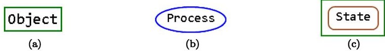

Fig.1 OPP nodes: Object, Process, and State

objects by the interpreter. An object that has neither a name nor a type is called anonymous. Examples of the naming possibilities are shown in Fig. 2.

The value part is used to initialize an object. OPP supports multiple ways to initialize an object at definition time. This includes initialization of basic types, complex types, and collections. Two examples of these are numbers and strings, as shown in Fig. 3.

When used as data stores, objects can have local or global scope. A locally-scoped object has a value that is accessible only in the OPD where it is defined. Conversely, a globally-scoped object has a value that can be accessed from any OPD in the system. A global object must have a name. Global objects are represented visually by adding a shadow to the object, as shown in Fig. 4a. $ ^{1} $

An object can be defined as a constant, in which case the value of the object cannot be changed during the execution of the program. An object can also be defined to contain a value, without having to name it or specify its type, and in this case, it is automatically constant. A constant object is represented visually by changing the border of the object to a dashed border, as shown in Fig. 4c, d. $ ^{2} $

An object can be both global and constant, in which case it is represented with a dashed border and a shadow, as shown in Fig. 4b.

Processes are the executable units of the language. A process is represented by a blue-bordered ellipse. Figure 33b shows examples of processes such as Number Comparing and Object Copying. A process can have a name, which can be any valid string in any language (including spaces). When a process is in-zoomed, the name of the process is the same as the name of the OPD where it is defined, and in this case the name of the process is not shown inside the process ellipse.

A process can be either abstract or concrete. A concrete process is a set of instructions that the interpreter can execute. An abstract process can define properties and parameters, which can later be implemented by one or more concrete processes. An abstract process can also be used to jointly represent concrete processes that conceptually have a common functionality. While a concrete process has a solid contour, an abstract process is represented by a dashed contour, as shown in Fig. 14.

<!-- PDF_PAGE: 10 -->

(a)

(b)

(c)

(d)

Fig. 2 Object naming examples. a Anonymous object. b Named object. c Anonymous typed object. d Named and typed object

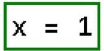

(b)

(c)

Fig. 3 Numeric and string initialized objects. a Numeric initialized object. b Numeric initialized object with exponent. c String initialized object

(a)

(b)

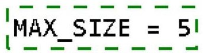

(c)

(d)

Fig. 4 a Globally-scoped object. b A global constant object example. c Named constant object. d Value constant

States represent possible situations that the object can be during its lifetime or values that an object can attain. States are used in conjunction with procedural links to control the flow of execution of an In-Zoomed OPD. A state is represented by a brown-or gold-bordered rounded rectangle. Figure 33b shows an object with two states, $ x > 0 $ and $ x < = 0 $ , where the left state participates (along with the maximum pressure object) in controlling the execution of the Number Comparing process. Specifically, Number Comparing will execute if the state of the object is $ x > 0 $ , i.e., $ x > 0 $ is satisfied. States are only valid inside an object that does not contain any parts and which is of a simple type (Number or String), as defined in Sect. 5.3. A state must contain text. If the object containing the state is typed, the text in the state must match the type of the object. An object is in a specific state if the current value stored in the object matches the value of that state. In Fig. 5a, the object x will be at state 5 when the value of the object is set to 5. Likewise, in Fig. 5b the object name will be in state "John" if the value of the object is set to the string "John".

States can have logical conditions defined by numerical and string relational operators, such as x<5. When using these operators, the letter x refers to the current value of the

object. The following numeric relational operators are supported in OPP: x < n, x < = n, x > = n, x > n, and x! = n, where n is any valid number. The example in Fig. 5c shows an anonymous object with the state x < 5, therefore the object will be in this state when its value is a number that is less than 5.

A state can also have a string comparison operator using regular expressions. A string comparison is defined by preceding the regular expression with the $ \sim $ character, as shown in Fig. 5d. In this example, the object will be at the specified state if it is a string, and if the regular expression contained in the state can be matched with the value of the string that is stored in the object, for example, the string "acb".

An object can be at one state at any given time. Therefore, while OPP might allow the definition of multiple states that can be satisfied at the same time (e.g., an object with value 4 and the two states x<5 and x<10), the execution of the program will result in an error if the interpreter detects that.

(a)

(b)

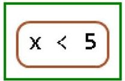

(c)

(d)

Fig. 5 State examples. a Numeric state. b String state. c Numerical condition state. d Regular expression state

<!-- PDF_PAGE: 11 -->

## 5.1.3 Structural and procedural links

Links visually connect the nodes (objects, processes, and states) in an OPD, expressing relations between them. There are two primary kinds of links: structural links and procedural links.

Structural Links define static relations between the nodes that they connect. They have one source and can have one or more targets. A pseudo-node (a visual node that represents the link but is not a node in the language) is used to denote a fork link [16], i.e., collect all of the targetbound links, and these links are differentiated by the visual representation of this pseudo-node. There are two kinds of structural links in OPP: aggregation-participation and generalization-specialization.

An aggregation-participation (aggregation for short) link defines a static whole-part relation between the source of the link (the whole in the relation, the parent) and the target of the link (the part in the relation, the child). Aggregation links are represented by a filled-in (black) triangle pseudonode, as shown in Fig. 6a. Aggregation links can have both objects and processes as sources and targets of the relation.

When used with objects, the programmer can abstract concepts by defining complex types. These complex types can later be used as regular objects, and their parts can be referenced whenever needed in the program. An example of an aggregation relation is a bank account: it contains an account number, credit cards, checkbooks, current balance, etc., as shown in Fig. 7c.

When used with processes, the aggregation relation shows which processes can be invoked by a process when it is executed. Furthermore, the aggregation relationship also shows the objects that are used by this process, both the parameters and the inner objects. For example, the in zoomed process "Hello World" in Fig. 7a can be represented using aggregation as shown in Fig. 7b.

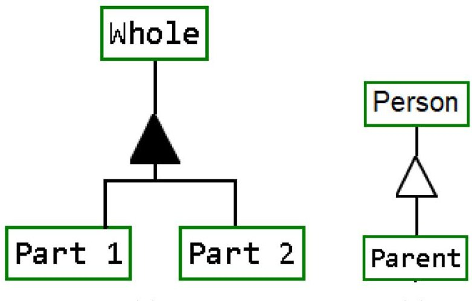

Fig. 6 Structural link types. a Aggregation link. b Specialization link

Object parts can be defined statically, as shown above, or dynamically, by using OPP built-in processes: Object Creating and Part Adding. When used dynamically, an object acts as a "Map" or "Dictionary" that stores keyvalue pairs.

A generalization-specialization (specialization for short) link defines a static relation, which induces inheritance from the source of the link (the general, the parent) and the target of the link (the specialization, the child). Specialization links are represented by a blank (white-filled) triangle pseudo-node, as shown in Fig. 6b. Specialization links are only allowed for the same kind of node on both ends: Both parent and child must be either objects or processes.

Inheritance is defined by Dictionary.com [10] as "something, as a quality, characteristic, or other immaterial possession, received from progenitors or predecessors as if by succession". When used between objects, the specialization link defines that the child object inherits all the parts that are defined in the parent object. For example, suppose a person has the attributes ID and gender as shown in the OPD in Fig. 8a. A student is a specialization of a person with an added list of courses she or he is taking. A teacher is also a specialization of a person with an added list of courses he or she is teaching. Instead of defining the ID and the gender in both student and teacher, they are defined in the person, and then both student and teacher inherit these attributes from it. The visual representation for this is shown in Fig. 8.

When used between two processes, a specialization relation defines that the specialization (the child process) inherits and therefore has the same interface, i.e., the same set of parameters (as explained in Sect. 5.4) as the general (the parent process), and in addition, the specialization can have one or more parameters that the parent does not have. The links connecting the parameters in the child process must be of the same kind as the links connecting the corresponding parameters in the parent process. In addition, if the parent process has defined pre-execution and post-execution processes, these processes are automatically defined also in the child process. An example of process inheritance, shown in Fig. 9, is the Sorting process, which can be defined generically: order a given set of objects by some internal object identifier, or specifically: Numerical Sorting-order a given set of objects numerically, and Lexicographical Sorting-order a given set of objects lexicographically. The child processes will have the same set of parameters as the parent process: the input parameter List, and the output parameter Sorted List.

Procedural links connect two nodes, source and target, in an OPD, denoting a dynamic relation between them. There are four kinds of procedural links: Agent, Instrument, Consumption, and Result.

<!-- PDF_PAGE: 12 -->

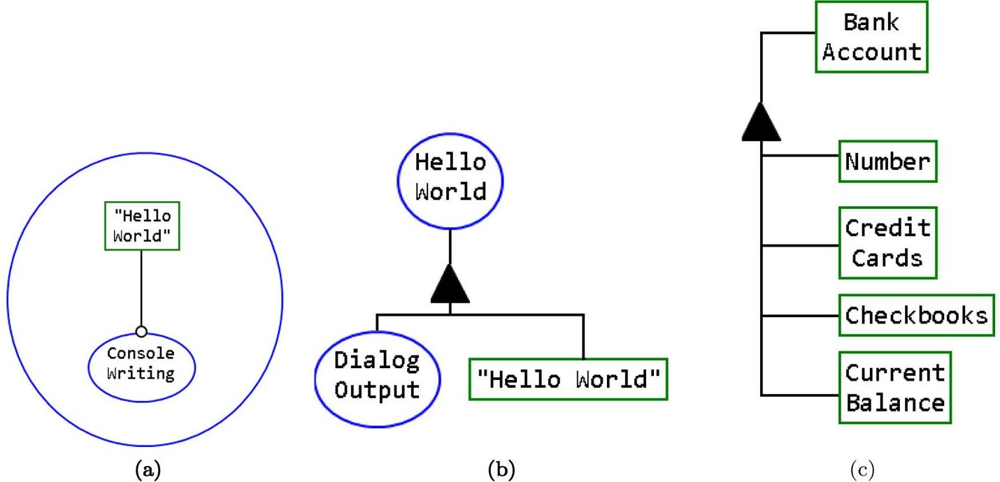

Fig. 7 a In-zoomed process "Hello World". b Aggregation link. c Object aggregation example

(c)

Fig. 8 Object specialization example

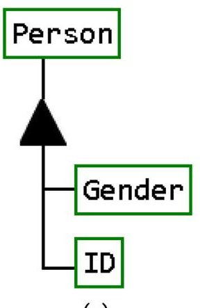

(a)

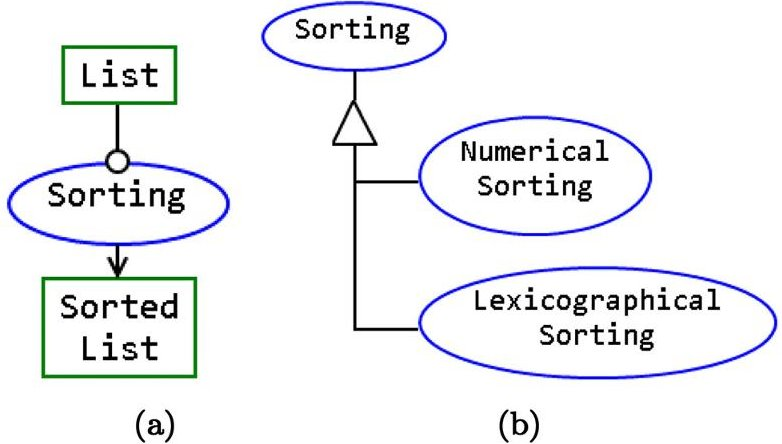

Fig. 9 Process specialization example

- An agent link defines a relation between an object or a state of an object and a process, where the source object is required by the process to start execution, but the

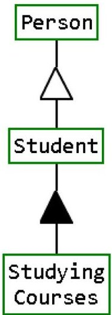

(b)

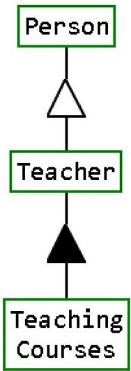

(c)

value of the object is not passed to the process. $ ^{3} $ If the source of the link is a state, the object must be in that state for the process to be able to execute. Agent links are represented by a connecting line between the two entities, with a closed black circle ("black lollipop") at the target process end of the link, as shown in Fig. 10. An instrument link defines a relation between an object (or a state in an object) and an object or process, where the value of the source object is required by the target object or process. If the source of the link is a state, then the object is required to be at the specified state for the object or process to use it. Instrument links are represented by a connecting line between the two entities, with a black circle ("white lollipop") at the target process end of the link, as shown in Fig. 11.

<!-- PDF_PAGE: 13 -->

Fig.10 Agent link with object and state source

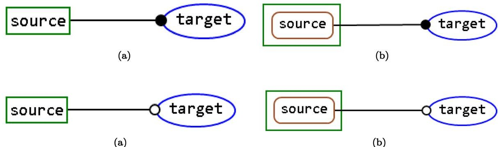

Fig.11 Instrument link with object and state source

(a)

A consumption link defines a relation between an object or a state of an object and a process, where the source object is consumed by the process. If the source of the link is a state, then the object is required to be at that state for the process to consume it. The semantics of consumption is that when the process is executed, the object ceases to have a value. Consumption links are represented by a connecting line between the two entities, with an arrow at the target process end of the link, as shown in Fig. 12.

A result link defines a relation between a process and an object, where the source process creates a new object. Result links are represented by a connecting line between the two entities, with an arrow at the target object end of the link, as shown in Fig. 24a.

Procedural links can be "decorated" with text at the center or at the target of the link, as shown in Fig. 13. The center decoration can be any text that does not include the "," (comma) character. The target decoration is called a control modifier, and it is a comma-separated list of letters that can be "c" (for condition), "e" (for event), or both "ce".

## 5.2 OPP program—systems programming with OPP

(b)

An OPP system is composed of (1) a set of processes that the system exposes, (2) a set of global objects that are available to all the system processes, and (3) a set of data types that the system uses. The processes that the system exposes show what the system can do. The aggregate of the states of all the global objects is the state of the system. The data types facilitate the understanding of the system by giving semantics to the data flowing in the system. All parts of the system are defined in the System OPD (called the System Diagram, or SD, in OPM). This System OPD is refined for each area of the system using other OPDs: the types are defined in Type OPDs, the interfaces of the external and internal processes are defined in Interface OPDs, and the executable semantics of the processes in the system are defined in In-Zoomed OPDs. Figure 14 shows system OPDs of a real software system that implements an

editor of OPP programs. The definition of a system starts with the System OPD. A system is defined as an abstract process, which consists of processes that implement the functionality of the system. Using the example of Fig. 14, the initial abstract process of this system is OPP Editing. OPP follows OPM convention of using the gerund form in process names.

According to Fig. 14a, the OPP Editing process consists of a number of abstract processes: User Managing, OPD Editing, and Model Managing. Furthermore, the system stores a set of its Users and a set of all Models in the system. The full system definition requires that all the leaf processes be concrete. Figure 14b shows the concrete processes of the refined abstract Model Managing process.

The definition of a system can be done in a single OPD, yet it is both possible and recommended to separate the definition of the system into a hierarchy of system OPDs, each one defining a set of related functionality. In our example, the system OPD in Fig. 14b is a child of the system OPD in Fig. 14a, in which Model Managing is defined.

## 5.3 OPP type—type OPD

The OPP language is gradually typed [61], which means that the type of the object can be defined and then validated during compilation, or it can be left undefined, in which case it is validated at runtime. This implies that errors can occur during program execution. As shown in Sect. 5.1.2, the type of an OPP object can be one of three primitive types: Number, String, and Any. An object of type Number can contain values that are decimal numbers. An object of type String can contain any sequence of Unicode characters. An object of type Any can contain any value, either of a primitive type or of a type defined in a specific OPP program.

A new object type is defined in a Type OPD. A Type OPD has a name, which is the name of the type. For implementation simplicity, type names must start with an English letter, followed by English letters, spaces, dashes, or underscores. A Type OPD must contain at least one object whose name is the same as of the OPD. In the Type

<!-- PDF_PAGE: 14 -->

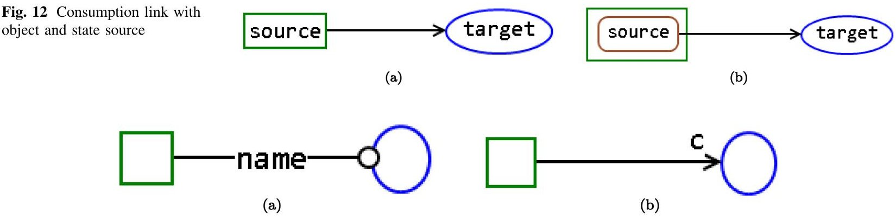

Fig. 13 Procedural link decorations. a Instrument link with a center decoration. b Consumption link with the target decoration "c" - a control modifier

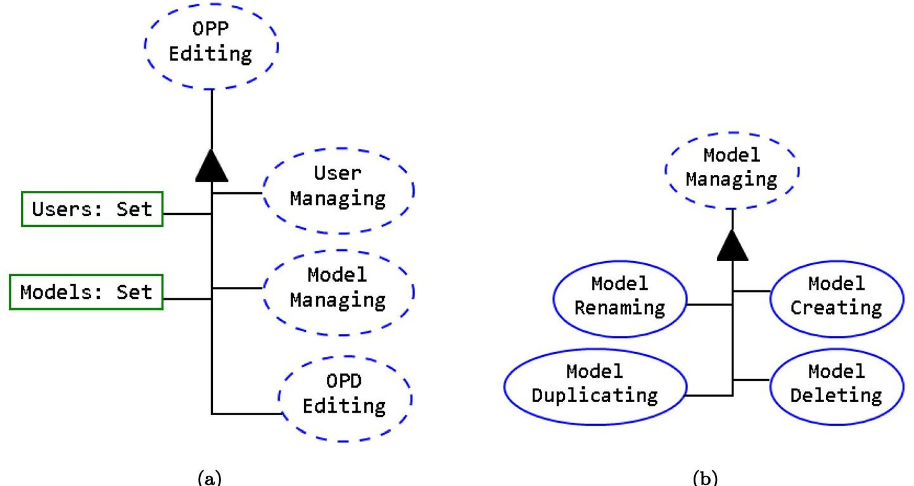

(a)

Fig. 14 a OPP Editing System OPD. b Model Managing System OPD

(b)

OPD, the developer can define the type by showing the parts of the new type, using Aggregation links. Continuing with the OPP editor example, Fig. 15a shows an initial definition of an OPP System type. In this case, the name of the Type OPD is "OPP System" (not shown) which matches the OPP System object contained in it.

## 5.3.1 Collection objects: list and set

OPP supports collection objects, each of which can contain any finite number of object instances. There are two types of collection objects in OPP: List and Set. List is an ordered collection of object instances, while Set is an unordered collection of object instances with no duplicate objects, as defined by the object's identity (defined below). The syntax for defining collection objects is shown in Fig. 16. Manipulation of collection objects is done using built-in processes such as Element Counting, First Element

Adding, and First Element Fetching. For the initial version of OPP, the language currently does not support typed collections, but this is a known requirement and will be added in the future. Using collection objects, the definition of OPP System is extended to include multiple System OPDs, Type OPDs, Interface OPDs, and In-Zoomed OPDs, as shown in Fig. 15b.

## 5.3.2 Object inheritance

The second key feature that can be defined in a Type OPD is object inheritance, which is done via the specialization relation. A specialized object (child) inherits all the defined parts of its general, another more general object (a parent or an indirect ancestor), if they are connected with a Generalization-Specialization link. An object can have multiple ancestors, giving rise to multiple levels of inheritance. If a part is defined in more than one ancestor (either

<!-- PDF_PAGE: 15 -->

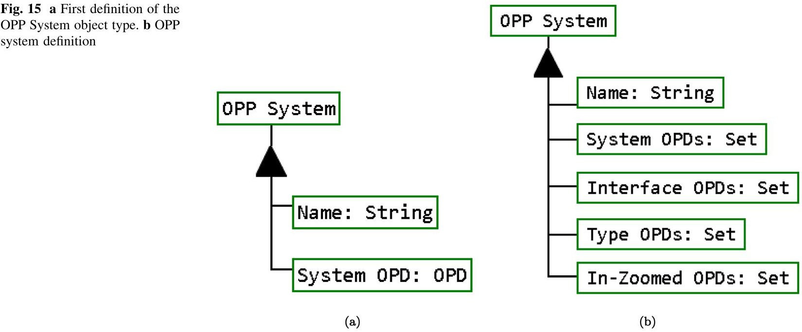

Fig. 16 List and Set objects

directly or indirectly via previous specializations) the OPP interpreter will check that this part is defined with the same type for all the ancestors. If this is not the case, the type will not be accepted by the interpreter at runtime, and execution of the system will be halted with an error message. Figure 17 shows an example of object inheritance for the OPP editor example. Conceptually, OPP objects and processes are similar in many aspects: they both have names, location in the OPD, width, height, etc. Capitalizing

on OPM, the definition of the shared properties can be done in a type called Thing, from which both Object and Process inherit.

## 5.3.3 Object identity

Each OPP object has a built-in identity, which is unique to the object, does not change, and can be accessed through the object's Id part, as shown in Fig. 18a. For objects of basic types such as Number and String, the Id of the object is the same as its value. When using Sets, the identity of an object is used to maintain the collection duplicate-free. Objects in OPP are immutable, meaning that every object

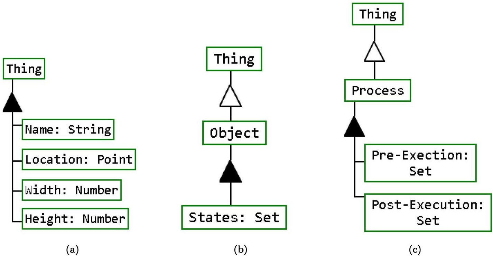

Fig. 17 Definition of Thing, Object and Process types, using object inheritance. a Thing type. b Object type. c Process type

<!-- PDF_PAGE: 16 -->

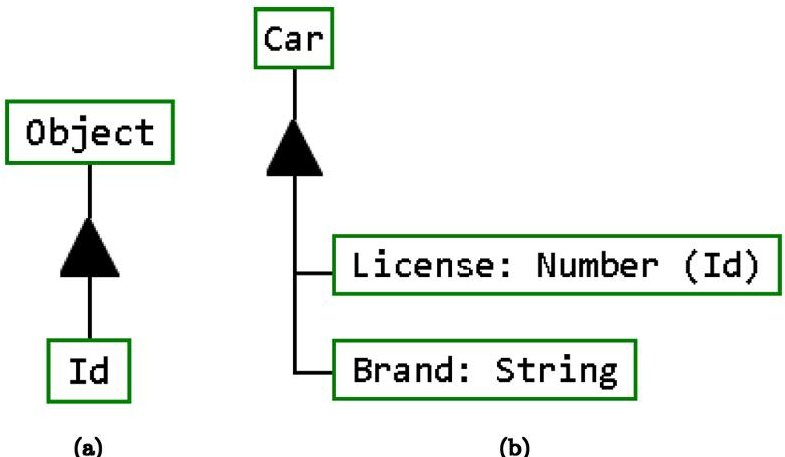

Fig. 18 a Object identity. b Object with custom identity

that is created is a new object, even if it has the exact same information as an existing object.

Principle 1: Objects are Immutable In OPP, all objects are immutable in the sense that every created object is a new one even if it is a clone of an existing one. The rationale behind this principle is to make parallelism feasible as mutable objects are inherently not thread-safe, and immutable objects cannot change their state and hence they are thread-safe since they are accessed for read-only purposes or otherwise cloned to a modified copy.

The default identity of an object can be overridden by defining a new part of the object as the identity. This is done by adding the text " (Id) " after the part definition. The Type OPD shown in Fig. 18b exemplifies this with the type Car which has the custom identity License.

## 5.4 OPP interface—interface OPD

An interface OPD defines the parameters of a process and the pre-processes (pre-execution processes) and post-processes (post-execution processes) to be executed before and after the process is executed, respectively. Interface OPDs can be thought of as mini-APIs (Application Programming Interface). A simple example of an Interface OPD is shown in Fig. 19. It contains a central process, the process for which the interface is defined, as well as procedural links to objects that define the parameters of the process. In this example, Adding has three parameters: two incoming instruments—a and b of type Number, and one outgoing result—c of type Number.

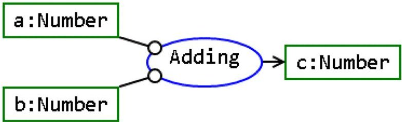

Fig.19 Basic interface OPD

A process definition can be augmented by adding pre-executing processes and post-executing processes. The OPD in Fig. 20a extends the definition of Process from Fig. 19 by adding the Parameter Logging process as both pre-executing and post-executing process. Parameter Logging logs the value of the parameters that were passed to Process and from Process to a pre-defined output. This is useful for debugging purposes. While not shown in the example, a process can have more than one pre-executing and post-executing process. However, if there is more than one, the order in which they will be executed is not guaranteed.

A process can be defined as a specialization of another process by using the generalization-specialization link, indicating that the specialization inherits from the general, ancestor process. Process inheritance is defined as follows:

## 5.4.1 Process inheritance

- The inheriting process includes all the pre-executing processes and post-executing processes from all its ancestor processes. If a process is defined more than once in the pre-executing processes or in the post-executing processes, it will be executed only once.

- The inheriting process inherits all the parameters defined for the ancestor process, and they are inherited with the same names. More parameters can be added to the inheriting process in addition to the ones defined in the ancestor process.

An example of using process inheritance, shown in Fig. 20b, c, is to define processes that have common prerequisites, such as authentication. We first define a common abstract process Authentication Requiring, which has Authenticating as a pre-executing process. Then we define the process Ordering as inheriting from Authentication Requiring, making Authenticating one if its pre-executing processes through the inheritance mechanism.

## 5.5 OPP program execution—in-zoomed OPD

An In-Zoomed OPD is the executable code of the language. It describes a set of execution steps using procedural and event-driven constructs. We provide an informal description of how In-Zoomed OPDs are executed, followed by a formal definition.

## 5.5.1 Informal execution semantics

An In-Zoomed OPD consists of a main process (the In-Zoomed process), which can contain processes, objects, and links that connect them. OPP objects are data stores: values can be stored in them and read from them. Links

<!-- PDF_PAGE: 17 -->

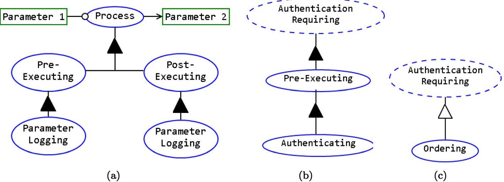

Fig. 20 a Pre-executing and Post-executing processes. b Parent process. c Inheriting process

define how values are passed to or from processes, or between objects. Objects provided to the In-Zoomed process or created by it, the Parameters of the process, are located outside that In-Zoomed process.

Figure 21a shows the In-Zoomed process Command Executing, which takes a command [57], and applies it to the current OPD to create a new OPD. The name of the process is not shown in the In-Zoomed process ellipse to reduce the number of visual elements shown in it, as it can be understood by the developer from the context. The large ellipse is the In-Zoomed process. This process has:

- Three parameters: Command, Current OPD, and New OPD.

- One internal object with one state named valid.

- Two inner processes: Command Validating and Executing.

The execution of an In-Zoomed OPD is initiated by the interpreter based on an external event, such as invocation by another process. When a process is invoked, it is assumed that all its input parameters (as defined in its API

or in the process itself) have values. Following the timeline OPM principle [12], execution of an In-Zoomed OPD is done, according to their placement in the diagram, from top to bottom. Hence, the first process to be invoked is Command Validating. This process requires the values of the parameters Command and Current OPD. Command Validating is executed, and its result is set in the anonymous object located inside the In-Zoomed process. Following the timeline (top-to-bottom process order), the process Executing is invoked next. Since Executing is connected to the state valid of the anonymous object with an agent conditional link (which is defined and explained later), it will be executed only if the object is in this state, otherwise it will be skipped. When the process finishes, the interpreter will set its result in the parameter object New OPD. If it is skipped, this object will have no value. After Executing finishes, the entire In-Zoomed Command Executing process finishes. If this process was invoked by another process P, P will get an event telling it that Command Executing has finished.

Fig. 21 a In-Zoomed OPD: command executing. b In-Zoomed process components

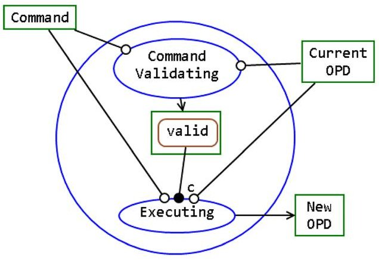

(a)

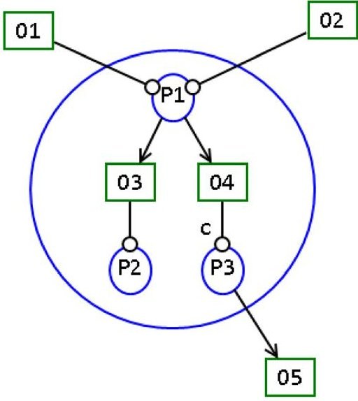

(b)

<!-- PDF_PAGE: 18 -->

## 5.5.2 Formal execution semantics

Having exemplified the execution of an In-Zoomed process informally, we turn to define the execution semantics formally.

Definitions—An In-Zoomed OPD is a tuple consisting of a set of object parameters, object variables, inner processes, and links:

$$
O P D _ {i n - z o o m e d} = \left(O _ {p a r}, O _ {v a r}, S, P, L\right)
$$

## Where

- $ O_{par} $ is the set of the input and output parameters of the In-Zoomed process, which are the objects located outside the In-Zoomed process ellipse.

- $ O_{var} $ is the set of variables of the In-Zoomed process, which are the objects located inside the In-Zoomed process ellipse.

- S is the set of all the states defined in $ O_{par}\cup O_{var}. $ The function object(s $ \in S $ ) returns the object that contains state s.

- P is the set of processes located inside the In-Zoomed process ellipse. In an In-Zoomed OPD no processes can be located outside the In-Zoomed process ellipse.

- L is the set of all procedural links in the OPD.

A link is a tuple

l = (s, t, kind, mod)

## Where

- s and t are the source and target entities of the link respectively.

- kind $ \in $ {Agent, Inst, Cons, Res} is the link kind, where the symbols inside the set stand for Agent, Instrument, Consumption, and Result, respectively. Structural links do not affect execution, and therefore they are not included in this set.

- mod is the set of control modifiers applied to the link. The OPP control modifiers are 'c' for condition link and 'e' for event link. Zero, one, or two control modifiers can be added to Agent, Instrument, and Consumption links.

To simplify the notation, we will use $ l_{s}, l_{t}, l_{kind} $ , and $ l_{mod} $ to identify the source, target, kind, and modifier set of the link, respectively.

Based on these definitions, we analyze the OPD in Fig. 21b as an example. More realistic examples will be presented in Sect. 5.6 as parts of this work case in point.

For simplicity, we use the names of the objects as their identifiers. While this is correct in this OPD, there can be more than one object in an OPD with the same name. Moreover, an object is not required to have a name, so this will not work in all cases.

- $ O_{par}=\{O1, O2, O5\}.$

- $ O_{var}=\{O3, O4\}.$

- $ P=\{P1, P2, P3\}.$

- $ L=\{(O1,P1, Inst, \emptyset),$

    $ (O2, P1, Inst, \emptyset), (P1, O3, Res, \emptyset),$

    $ (P1, O4, Res, \emptyset), (O3, P2, Inst, \emptyset),$

    $ (O4, P3, Inst, \{c\}), (P3, O5, Res, \emptyset)\} $

Execution of an In-Zoomed process is done in two steps:

Incoming and Outgoing Argument Transfer-When an OPP process is invoked, either directly by an external user operation or by another process, all its incoming parameters must have values. These values are the arguments that are passed in the invocation. The incoming parameters of a process are the objects that are connected to the process with an instrument or consumption link Agent links are used only to control process execution; they are not parameters of a process. The outgoing parameters of a process are the objects that are connected to the process with a result link. An example of this is shown in the Interface OPD in Fig. 22a.

Process P has three parameters: par1, par2, and par3. The first two, par1 and par2, are incoming parameters, while par3 is an outgoing parameter. The Interface OPD can be derived from the In-Zoomed OPD. Each object outside the In-Zoomed ellipse is a parameter to the process. Parameters connected to processes inside the In-Zoomed ellipse with an incoming procedural link are connected to the Interface process with an instrument link. Parameters yielded by processes inside the In-Zoomed ellipse are connected to the Interface process with a result link. If an object is connected in the In-Zoomed process to both an incoming and an outgoing procedural link, both links are also shown in the Interface OPD.

Interface OPDs use only instrument links because of the immutability of OPP objects. When an object is given to a process as a parameter, it is passed by value. This implies that a copy of the object is created to be used by the process. Because of this, it is not possible to define consumption from the perspective of an interface. Consumption can be used by the developer in an InZoomed process by replacing an instrument link by a consumption link. In this case, the object will be copied to the consuming process and will be deleted from the InZoomed process. As noted, OPP objects are immutable to provide for the parallelism that is built into OPP. Mutable objects are inherently not thread-safe, which would make the language more complex to implement and to use. When a process is invoked, a value is assigned to each one of its incoming parameters. These values are called the arguments of the process. The value of each incoming argument of the process is copied to the corresponding incoming parameter object defined in the process

<!-- PDF_PAGE: 19 -->

Fig. 22 a Process parameters. b Arguments passing with parameter names

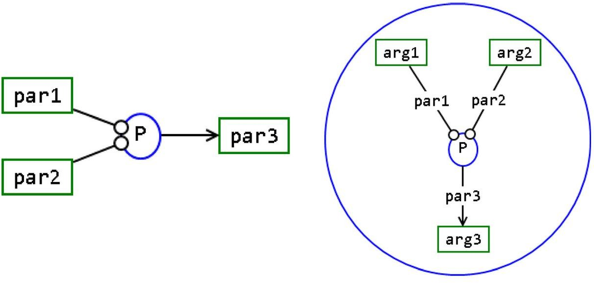

(a)

being invoked. When the process finishes executing, the value of the outgoing parameter is copied back to the argument defined in the called process. Using the Interface OPD from Fig. 22a, process P is now invoked by another process, as shown in Fig. 22b.

Process P is given two arguments, arg1 and arg2, as the values for parameters par1 and par2, respectively. When P finishes executing, the value of parameter par3 will be copied to arg3. In the example shown in Fig. 22b, the interpreter is provided with an explicit mapping between the arguments given by the calling process and the parameters of the process. This is done by stating the name of the parameter in the link that connects the argument with the called process. While necessary in some cases, having to write the name of the parameter in all the links is cumbersome and often redundant. To avoid this when possible, the interpreter has a set of rules which it applies to match arguments and parameters separately for each type of incoming and outgoing link of the process. These rules are specified below and are applied sequentially in the following order:

1. Named arguments When the link that connects the argument object to the invoked process has text located at its center, this text is used by the interpreter as the name of the parameter in the invoked process. If the parameter object is typed, the type of the argument object must match the type of the parameter, or inherit the type from the parameter.

2. Named objects and parameters matching If the name of the argument object matches the name of one of the parameters of the invoked process, and this parameter was not matched by the previous rule with another object, then the named object will be used as the parameter. As in the previous rule, if the parameter object is typed, the type of the argument object must

(b)

match the type of the parameter or inherit the type from the parameter.

3. Type matching if there are still parameters that do not have a matching argument, and there are available arguments that have not been matched, the interpreter will try to match for each available parameter that has a type an argument object that is of the same type or of an inherited type.

4. Everything else remaining arguments are matched to remaining parameters arbitrarily.

If after applying the rules above there are parameters without a value, the interpreter will not execute the invoked process and execution of the currently executing process will stop. Figure 23 is an example of the parameter matching rules.

Process P has four incoming parameters that are connected with an instrument link: par2, which is of type Type1, par1, par3, and par4, which have no defined type. Process P has two outgoing parameters (which can only be connected by a result link), par5, which is of type Type2, and par6, which has no defined type. Starting with the given incoming arguments when P is invoked, the first match is done using rule 1, the Named arguments rule, which checks for named arguments. Since the argument arg2 is connected with a link decorated with the text par1, it will be used as the value for parameter par1. As there are no more named arguments, rule 2, Named objects and parameters matching, is applied, searching for objects that are named as a parameter. Since par3 is the name of an argument that is the same as the name parameter par3, it is used as its value. Now, rule 3, Type matching, is applied, searching for type matches. We find that arg3 matches the type of par2, since both are of Type1, so they are matched, and the value of parameter par2 is assigned to arg3. Lastly, arg1 is matched with par4 as these are the only parameterargument pair left to match. The same set of rules is

<!-- PDF_PAGE: 20 -->

Fig. 23 Argument to parameter matching

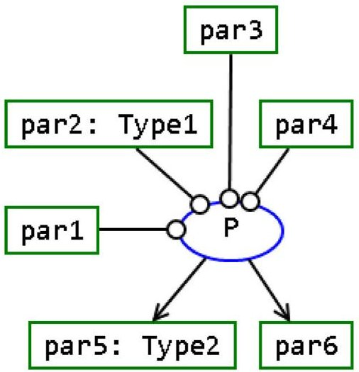

(a)

applied to the outgoing arguments, so that when the matching process finishes, the value the parameters par5 is assigned to the value of argument arg4, and the value of the parameter par6 is assigned to the value of the argument par6.

Top-Down Execution The default order of executing processes inside an In-Zoomed process is based on the vertical location of the processes relative to each other, based on the top-most point of the process ellipse. Processes are executed from top to bottom, using a program counter (PC). They are executed asynchronously, so multiple processes can be executed in parallel. When the In-Zoomed process starts executing, PC is initialized to the y coordinate of the top-most process inside the In-Zoomed process ellipse. An iterative loop is performed, and in each iteration, all processes whose top-most coordinate is at the PC are sent for execution. The interpreter then waits for a process to finish executing and tries to increment the PC to the top-most coordinate of the next process in the diagram below the PC, but this can only be done if the bottom-most coordinate of all executing processes remains above this point. In other words, the PC waits for all the processes whose bottom-most coordinate is above the next process to finish before invoking that process. Formally, using a coordinate system with y=0 at the topmost point in the In-Zoomed process ellipse and increasing downwards, let:

- $ p_{i}\in P $ be a process,

- top $ ( p_{i} ) $ and bottom $ ( p_{i} ) $ be the top and bottom coordinates of process $ p_{i} $ , respectively.

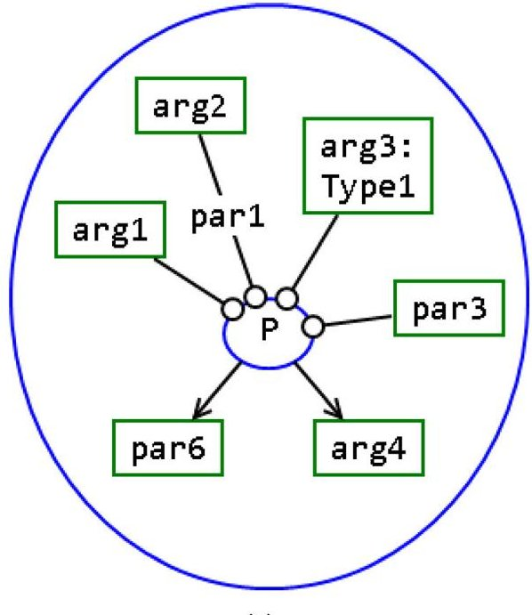

- PC $ \in $ $ \mathbb{N} $ be the program counter, and

- $ P_{executing} $ be the set of processes that are currently executing.

(b)

Principle 2: The OPP Execution Order Processes inside an In-Zoomed process are executed sequentially in a top-down order of their top-most ellipse point. Processes at the same vertical location are executed in parallel.

We define nextPC as the next coordinate that can be given to PC. This is also the top-most coordinate of the next process below the current PC, and it is defined using the following equation:

$$
\begin{array}{l} t o p M o s t = \max \left(\left\{t o p (p) \mid p _ {i} \in P\right)\right) \\ \mathrm {n e x t P C} = \left\{ \begin{array}{c c} \infty ; & , P C = t o p M o s t \\ \min \left(\left\{t o p (p) \mid p \in P \wedge t o p (p) > P C \right\}\right), P C < t o p M o s t \end{array} \right. \\ \end{array}
$$

We also define a Boolean helper function canAdvance(PC) that returns false if the PC cannot be incremented because there is at least one executing process whose bottom-most coordinate is above PC, and true otherwise. Additionally, there is a case where PC cannot be incremented because of waiting processes. More details are provided in the next paragraph on Data Dependencies.

Data Dependencies The data in an In-Zoomed OPD is stored in objects. An object can get a value in the following ways:

- Objects defined outside the In-Zoomed OPD are assigned values by the calling process when the process is invoked.

- An object can be initialized using value literals, as shown in Sect. 5.1.2.

- When a called process finishes executing, it may yield one or more results that are stored in objects.

An object can be connected to another object using an instrument link, so when the value of the source object changes, the value of the target object changes to the value of the source object.

<!-- PDF_PAGE: 21 -->

As previously stated, OPP objects are immutable, which means that when an object is passed as an argument to a process, the value of the object is copied to a new object created in the called process. The same happens when a process finishes executing—the value of any outgoing parameter is copied to the corresponding target object (argument) in the calling process. The same is valid for objects connected with instrument links: the value of the source of the link is always copied as the value of the target of the link. The execution of processes inside an In-Zoomed process is dependent on the objects they use in their execution. A process requires an object if it has an incoming procedural link that starts at the object or at one of its states and ends at the process. Let dep(p) to be the set of all entities on which process p depends:

$$
\begin{array}{l} d e p (p) = \left\{o \in \left(O _ {p a r} \cup O _ {v a r}\right) \wedge l \in L \wedge l _ {s} = o \wedge l _ {t} = p \right\} \\ \cup \left\{s \in S \wedge l \in L \wedge l _ {s} = s \wedge l _ {t} = p \right\} \\ \end{array}
$$

A process can be executed when all its dependencies are ready. The readiness of a dependency depends on its type as follows.

- If the dependency is on an object (i.e. there is an incoming link from an object to the process being executed), the dependency (object in this case) is ready when the object has any value.

If the dependency is on a state, i.e., there is an incoming link from an object's state to the process being executed, the dependency (state in this case) is ready when the object is at state s, as defined in Sect. 5.1.2.

Based on this, we define isReady(e) to return true if the entity is ready, and false otherwise.

When a process is not ready, its execution is postponed until it is ready. At the same time, the execution algorithm now must take into account that it cannot lower the PC below all executing or waiting processes. Based on this and the previous description we can now provide the definition of function canAdvance(PC):

$$
\begin{array}{l} c a n A d v a n c e (P C) \\ = \left\{ \begin{array}{l l} f a l s e & \exists p \in \left(P _ {e x e c} \cup P _ {w a i t i n g}\right), b o t t o m (p) < P C \\ t r u e & o t h e r w i s e \end{array} \right. \\ \end{array}
$$

Condition Link So far, if a process depends on an entity that was not ready, the process would be added to the waiting set and executed when the entities on which it depends become ready. Condition links provide a new degree of control of execution. They enable replacing wait semantics with skip semantics: if a process has a dependent entity that is connected with a condition link, and the dependent entity is not ready, the process is skipped instead of being waited upon to become ready. This means that condition links can be used as control statements like ifthen or switch in textual programming languages. The condition link control modifier can be used in Agent, Instrument, and Consumption links, and is represented by the letter "c" added to the target end of the procedural link, as shown in Fig. 24b.

To include condition links in the execution algorithm, using the notation $ l_{mod}(e,p) $ to denote the set of control modifiers that are applied to the link connecting entity e (object or state) and process p, we define the function isSkipped as follows:

$$
\begin{array}{l} i s S k i p p e d (p) \\ = \left\{ \begin{array}{l l} t r u e & e \in d e p (p) \wedge^ {\prime} c ^ {\prime} \in l _ {m o d} (e, p) \wedge \neg i s R e a d y (e) \\ f a l s e & o t h e r w i s e \end{array} \right. \\ \end{array}
$$

So far, processes that are executed in each iteration are always at the PC. With conditional links, it may be the case that all processes at the PC are skipped, which means that the PC must be lowered again to find processes to execute, and this can happen multiple times. To handle this case, we define a recursive function, called executeNextProcesses which updates the sets $ P_{waiting} $ and $ P_{executing} $ , as well as the PC as it performs the search.

function executeNextProcesses

$ P_{cand}\leftarrow \{p\in P\wedge top(p)=PC\} $

$ P_{skipped}\leftarrow \{p\in P_{cand}\wedge isSkipped(p)\} $

if $ P_{skipped}=P_{cand} $ then

$ PC\leftarrow nextPC $

NextProcesses

else

$ P_{exec}\leftarrow \{p\in P_{cand}\wedge p\notin P_{skipped}\wedge isReady(p)\}\cup \{p\in P_{wait}\wedge isReady(p)\} $

$ P_{wait}\leftarrow \{p\in P_{cand}\wedge p\notin P_{skipped}\wedge \neg isReady(p)\}\cup \{p\in P_{wait}\wedge \neg isReady(p)\} $

end if

end function

<!-- PDF_PAGE: 22 -->

Fig. 24 a Result link. b Instrument link with conditional link modifier

function executeCurrentProcesses

$$
\begin{array}{l} P _ {e x e c} \leftarrow P _ {e x e c} \cup \left\{p \in P _ {w a i t} \wedge \neg i s S k i p p e d (p) \wedge i s R e a d y (p) \right\} \\ P _ {w a i t} \leftarrow \left\{p \in P _ {w a i t} \wedge \neg i s S k i p p e d (p) \wedge \neg i s R e a d y (p) \right\} \\ \mathrm {e n d f u n c t i o n} \\ \end{array}
$$

Furthermore, we define the function executeCurrentProcesses as a function that is performed in case the PC is not advanced.

Event Links The last way in which the execution of OPP can be modified is by using event links. Any change to an object, such as assigning a value to it, changing its value, or removing a value from it (using a consumption link) is defined as an event. Event links break the default top-down execution model of the interpreter and allow the user to define a specific process to be executed when such an event occurs. An event link is akin to Jump and Goto statements in procedural programming, and can be used to create loops, and more generally, event-driven programs. The event link control modifier can be used in Agent, Instrument, and Consumption links and is represented by the letter "e" added to the target end of the procedural link, as shown in Fig. 25a.

Every time a process finishes and the values yielded by this process are assigned to objects in the In-Zoomed OPD, the

most recently invoked process. In case the event link originates from a state, the event is triggered only if that state is ready, i.e., the value of the object matches the state, as defined in Sect. 5.1.2. Because there is only one PC in OPP, only one event can be triggered after the execution of a process. If, at any stage, the interpreter detects that multiple events are triggered after a process finishes executing, it issues an error and stops the execution of the system. Event links can also be used to trigger the execution of one process when a process finishes. This is done by connecting the two processes with an agent link that has an event modifier, as shown in Fig. 25b. The behavior of the interpreter in this case is the same as if an object yielded by the source of the link triggered an event that is directed at the target of the link.

To handle event links, we define the function findInvoked(p), which is called after a process finishes executing. This function goes through all the result entities of process p in search of outgoing event links, and for each one found, it also checks if the target process of the event link should be skipped, in which case the event is disregarded. This can happen if a process has an incoming conditional link from an object that is not ready.

1: function findInvoked(p)

$$
2: \quad \text {R e s u l t} _ {p} \leftarrow \left\{o \mid l \in L \wedge l _ {s} = p \wedge l _ {t} = o \right\}
$$

$$
3: \quad P _ {i n v o k e d B y O b j e c t} \leftarrow \left\{p _ {i} \mid p _ {i} \in P \wedge o \in R e s u l t _ {p} \wedge^ {\prime} e ^ {\prime} \in l _ {m o d} \left(o, p _ {i}\right) \right\}
$$

$$
4: \quad P _ {i n v o k e d D i r e c t} \leftarrow \left\{p _ {j} \mid p _ {j} \in P \wedge l \in L \wedge l _ {s} = p \wedge l _ {t} = p _ {j} \wedge^ {\prime} e ^ {\prime} \in l _ {m o d} \left(p, p _ {j}\right) \right\}
$$

$$
5: \quad \mathbf {r e t u r n} \left\{p \in P _ {i n v o k e d B y O b j e c t} \bigcup P _ {i n v o k e d D i r e c t} \wedge i s R e a d y (p) \right\}
$$

6: end function

interpreter checks if there are any event links that originate at any one of these objects. If this is the case, it sets its execution mode to event mode and executes the target process of this link without delay. While still in event mode, the interpreter waits for all the executing processes to finish, after which it returns to the "business as usual" top-down execution mode, with the PC at the top of the process that is directly below the

Using the findInvoked function, we define the hasInvoked(p) function, which yields true when the execution of a process triggered an event either by changing an object or by a direct invocation:

$$
\mathrm {h a s I n v o k e d} (p) = \left\{ \begin{array}{l l} \mathrm {t r u e} & \mathrm {f i n d I n v o k e d} (p) \neq \emptyset \\ \mathrm {f a l s e} & \mathrm {o t h e r w i s e} \end{array} \right.
$$

Fig. 25 a Instrument link with an event link control modifier. b Process invocation using agent link with event modifier

<!-- PDF_PAGE: 23 -->

Normally, the interpreter is in the TopDown mode, in which it uses the global PC. When execution of a process is triggered by an event, the interpreter switches to Event mode, where the use of the PC changes. Because of this, two changes related to event links are needed before updating the execution algorithm:

- An additional version of nextPC is provided, which receives an argument to be used as the current location of the PC instead of the global PC. This nextPC version is used when execution returns to TopDown mode. As this change is simple, it will not be further elaborated.

During the calculation of the dependencies of a process, agent event links are ignored by the algorithm. The reason for this is that the primary goal of agent event links is to control execution of processes, so counting them as dependencies complicates event-driven programs and can be a source of errors. This change is reflected in the new version of the dep(p) function.

function dep(p)

$ L_{dep}=\{l\in L\wedge(l_{kind}\neq Agent\vee(l_{kind}=Agent\wedge^{\prime}e^{\prime}\notin l_{mod}))\} $

$ D_{obj}=\{o\in(O_{par}\bigcup O_{var})\wedge l\in L_{dep}\wedge l_{s}=o\wedge l_{t}=p\} $

$ D_{state}=\{s\in S\wedge l\in L_{dep}\wedge l_{s}=s\wedge l_{t}=p\} $

return $ D_{obj}\bigcup D_{state} $

end function

The OPP execution algorithm, shown in OPPExecution function also stores Mode, the execution mode that is currently being performed, which is either TopDown or Event.

1: **function** OPPExecution

2: $PC \leftarrow \min(\{top(p) \leftarrow p \in P\}), P_{wait} \leftarrow \{p \in P \land top(p) = PC\}$

3: $P_{exec} \leftarrow \{p \in P_{wait} \land isReady(p)\}, Mode \leftarrow TopDown$

4: $P_{wait} = P_{wait} \setminus P_{exec}$

5: **while** $P_{exec} \neq \emptyset$ **do**

6: Wait for $p \in P_{exec}$ to finish

7: $P_{exec} \leftarrow P_{exec} \setminus \{p\}$

8: **if** $hasInvoked(p)$ **then** $Mode \leftarrow Event, p_{inv} \leftarrow p$

9: **if** $Mode = TopDown$ **then**

10: $PC_{cand} = nextPC$

11: **if** $canAdvance(PC_{cand})$ **then**

12: executeNextProcesses

13: **else**

14: executeCurrentProcesses

15: **end if**

16: **else**

17: **if** $hasInvoked(p)$ **then**

18: $P_{exec} \leftarrow P_{exec} \bigcup findInvoked(p)$

19: **else if** $P_{exec} = \emptyset$ **then**

20: $Mode \leftarrow TopDown, PC \leftarrow bottom(p_{inv})$

21: executeNextProcesses

22: **end if**

23: **end if**

24: **end if**

25: **end while**

26: Error if $P_{waiting} \neq \emptyset$

27: **end function**

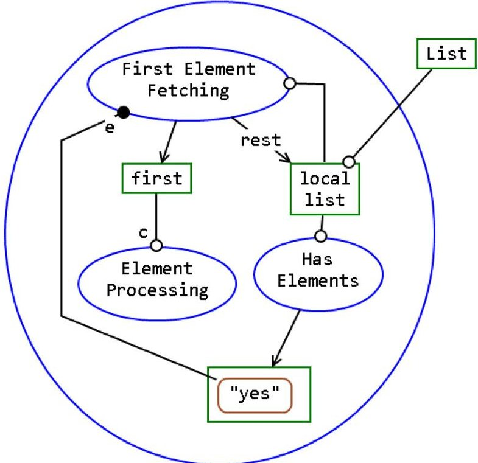

Fig. 26 Example In-Zoomed OPD with event links

We demonstrate the execution of the OPPExecution algorithm on the In-Zoomed OPD shown in Fig. 26. In this demonstration we focus on the event-driven parts.

The first process to be executed is First Element Fetching, which has only one dependency—local list. Note that the second incoming link to the process is an agent event link, so it does not count as a dependency. Assume that local list is a list that has at least two elements, and that process Has Elements finishes executing before Element Processing (line 4). Since local list has elements, the result of Has Elements is yes, so Mode $ \leftarrow $ Event (line 8). This means that execution continues in line 16, and because a new process, First Element Fetching, was invoked, it is added to the executing set (lines 17-18), finishing the iteration. After the next process, which can be either First Element Fetching or Element Processing, finishes executing, it is removed from the execution set. We know that no processes are invoked, the execution mode is Event, and there is one process in $ P_{exec} $ , so the interpreter starts a new iteration, waiting for the next process to finish. It is either First Element Fetching or Element Processing, depending on which one finished in the previous iteration. After this process finishes $ P_{exec}=\emptyset $ , entering the condition in lines 19-22: the PC is set to the process that immediately follows the invoked process, the execution mode return to TopDown, and a new set of processes is executed, based on the top-down execution model, so Element Processing and Has Elements are executed again.

<!-- PDF_PAGE: 24 -->

Fig. 27 a ABS System Diagram in OPM. b ABS Process in OPP

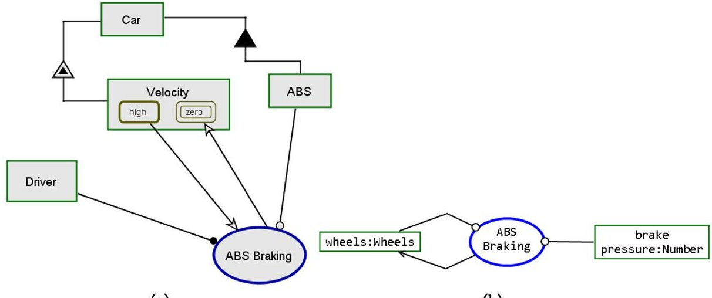

(a)

## 5.6 The ABS system model as a case in point

(b)

In this section we present a partial implementation of an Anti-lock Braking System (ABS) in OPP. Initially, we define the system's requirements, then we present its OPM conceptual model, and finally we extend the conceptual model to be fully executable. ABS is a safety system used in automobiles and aircrafts, which prevents wheels from locking up while braking and helps avoid vehicle skidding. Figure 27a shows the ABS system diagram as it is modeled in OPM.

When development of the system moves from the conceptual phase to the implementation phase, the ABS Braking process is created in OPP, as shown in Fig. 27b.

Already at this stage, the difference between the conceptual model and the implementation is apparent. The conceptual model deals with how the system works from the perspective of the system's stakeholders, in this case the Driver and the Car. In contrast, the implementation looks at what data is required to perform the process, and

what data is created by the process. The Driver in the conceptual model is replaced by the brake pressure parameter, as this is the way the driver indicates the need to brake. The ABS and Velocity of the Car are replaced by the wheels, which are the actual objects affected by the braking, and from which all other required information can be fetched. The Wheels and Wheel types used in the model are shown in Fig. 28. As previously stated, types are not required by OPP, but they make the system easier to understand and reduce type errors throughout the program.

The ABS Braking process works as follows: the desired pressure is stored in each wheel, and then the real pressure that must be applied to the wheels is calculated, based on the speed of the wheel compared to the speed of the other wheels. This calculated pressure is then set on each of the wheels. To simulate the process, the velocity of the wheels is updated based on the applied pressure and the current velocity of the wheel. This process is shown in Fig. 29a. In the real system, this last step would be removed, as the

Fig.28 Wheels and Wheel OPP types

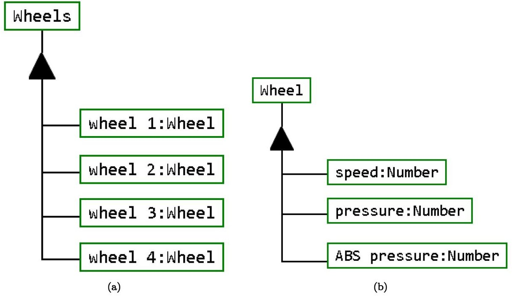

<!-- PDF_PAGE: 25 -->

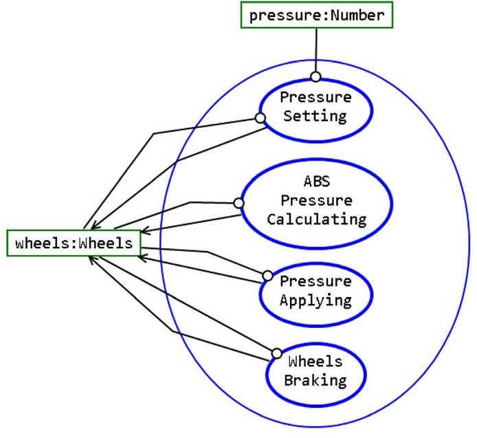

(a)

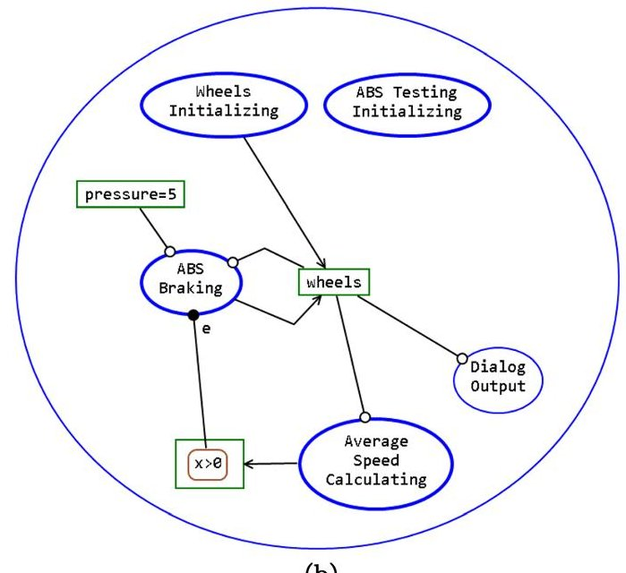

(b)

Fig. 29 a ABS braking in-zoomed process. b ABS braking testing in-zoomed process

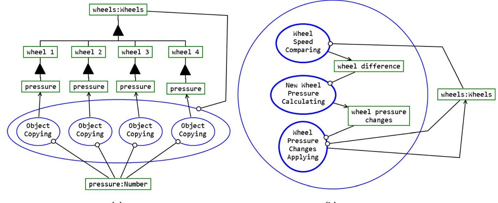

(a)

(b)

Fig. 30 a Pressure Setting in-zoomed process. b ABS Pressure Calculating in-zoomed process

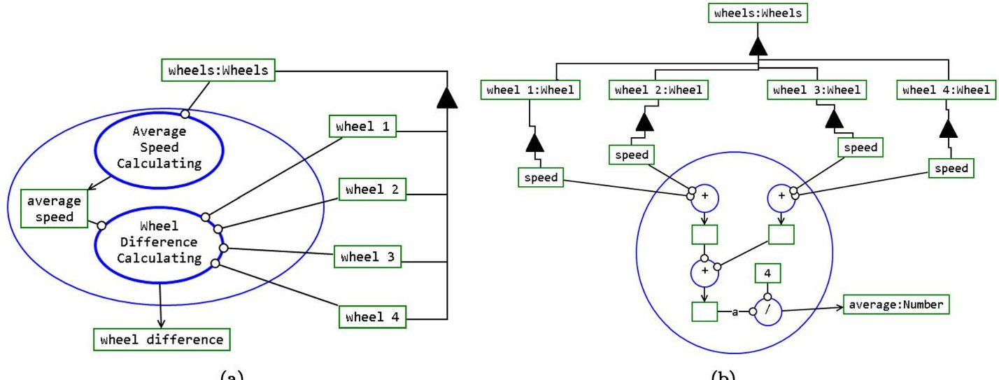

(a)

(b)

Fig. 31 a Wheel Speed Comparing in-zoomed process. b Average Speed Calculating in-zoomed process

<!-- PDF_PAGE: 26 -->

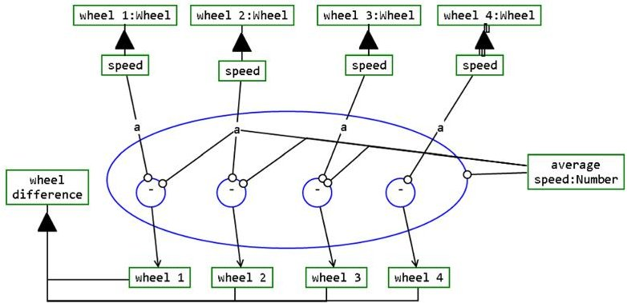

Fig. 32 Wheel Difference Calculating in-zoomed process

wheels are constantly braking based on the pressure that is applied to them in the previous steps.

Drilling down into the inner processes, Pressure Setting takes the pressure that the driver applies and stores it in each one of the four wheels, as shown in Fig. 30a.

Following Pressure Setting, ABS Pressure Calculating which is the heart of ABS, is invoked. When a wheel in the car becomes locked, its velocity changes rapidly relative to the velocity of the other wheels. In this case, the braking pressure for this wheel must be changed so that it does not lock. ABS Pressure Calculating does this by calculating the average speed of all wheels, comparing each wheel with this velocity and generating a specific pressure for each wheel, as shown in Fig. 30b.

Zooming in Fig. 31a into Wheel Speed Comparing, we see that it calculates the average speed of all the wheels and then the difference between each wheel and the average. Note here the lack of type for wheel difference, demonstrating that typing in OPP is optional. The actual calculation of the average speed is done in Average Speed Calculating, shown in Fig. 31b, summing the speed of the wheels and then dividing the sum by 4. While this calculation is trivial, it is shown here to illustrate how OPP can go from high-level programming to low-level programing with basic mathematical operations, such as addition and division.

In a similar way, Wheel Difference Calculating in Fig. 32 shows the execution of multiple processes that can be executed in parallel—in this case calculating the different between the speed of every wheel and the average speed of all wheels.

Going back to ABS Pressure Calculating, it is of interest to zoom into Wheel Pressure Changes Applying. In this process, the actual pressure to be applied to each wheel is calculated, as shown in Fig. 33a.

It is also interesting to inspect Fig. 33b, where the Wheel Pressure Changing process is in-zoomed. This OPD demonstrates the use of logical operations and execution flow that determines the final pressure to be applied to the wheels by the ABS System. The use of global objects is also shown here with maximum pressure, which is a

parameter of the system that limits the pressure that can be applied to any wheel. The rest of the in-zoomed processes comprising the system are of similar nature. The full example system is posted in the repository of the editor and interpreter for reference. $ ^{4} $ To test that the ABS program works, we wrote a test process that initialized the ABS system, provided initial values to the wheels, and performed a loop of ABS braking executions until all wheels stopped. The ABS Braking Testing process is shown in Fig. 29b.

The wheels were initialized with speed 50, except for one wheel with initial speed of 30, to trigger the ABS braking. The pressure applied to each wheel after the braking happens as a function of time is shown in Fig. 34a.

As can be seen in the graph, during the first 5 time units, the system applies to wheel 1 a different pressure than to the other three wheels, as it has detected that its speed is much smaller that the speed of the other wheels. This effect can be seen in Fig. 34b, where the speed of the wheels as a function of time is shown after the braking process is executed.

While this model is a simplified version of how an ABS system actually works, it does provide a good proof-of-concept to the seamless continuity from high-level, abstract conceptual modeling to concrete detailed design that talks the language of programming concepts. The ability to create an executable model of the system and then test it by executing it and inspecting the results shows the power of OPP as a tool for the development of complex systems, especially in the early stages of the development, when there is no physical prototype and initial simulations can be done "in silico".

## 6 Research question 2: assessment of OPP

In this section, we provide answers to the second research question presented in Sect. 3.

## 6.1 Participants

The evaluation process consists of two parts. We performed the first part of the evaluation with 104 students in an undergraduate Information Systems Analysis and Design course in the faculty of Industrial Engineering and Management at the Technion—Israel Institute of Technology. The participants - 46 females and 58 males learned the semantics of OPM, and had also taken at least one undergraduate programming course. The programming languages known by the students of the course are shown

<!-- PDF_PAGE: 27 -->

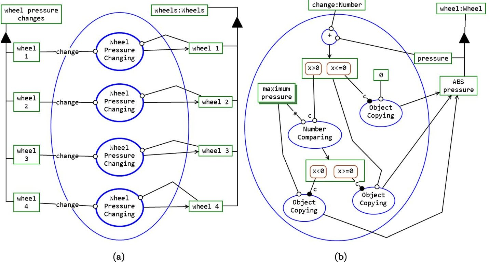

(a)

(b)

Fig. 33 a Wheel Pressure Changes Applying in-zoomed process. b Wheel Pressure Changing in-zoomed process

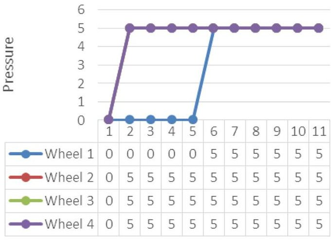

(a)

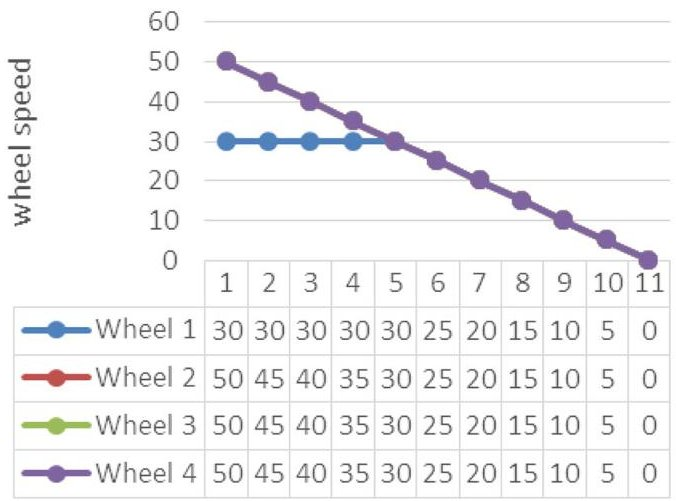

(b)

Fig. 34 a Pressure applied to each wheel over time since braking. b Wheels speed as a function of time

in Table 1. Only languages known by more than 5 students are shown in this table.

About 79% of students were familiar with one programming language only and the rest (N=22) reported familiarity with two to five programming languages. 12 out of the 104 students (11%) considered themselves professional developers, with an average of 2.5 years of experience. 33 students reported that they have no programming experience at all.

## 6.2 Evaluation setup

We evaluated OPP in two parts—the first was carried out around the middle of OPP development, when not all the concepts were finalized, and the second part was carried

out in the end of the process, when OPP was fully defined an operational. The first part was done with a group of students who received a short one-hour tutorial on OPP and a full online tutorial. They were asked to program very simple systems using the first version of OPP and its development environment. The students were divided into groups of 2-3 students who implemented one of the systems. After completing the programming task, each student was asked to respond to an online questionnaire. Both the exercise and the survey could be submitted within one week. The task was performed in the tutorial hours of the class, in 5 different classes. In preparation for the experiment, each tutorial group was given a 30-minute introduction to OPP and the main differences between OPM and OPP. The students were also shown how to develop with

<!-- PDF_PAGE: 28 -->

Table 1 Programming languages known by undergraduate students

<table border="1"><tr><td>Programming language</td><td># students</td></tr><tr><td>C</td><td>59</td></tr><tr><td>C++</td><td>52</td></tr><tr><td>C#</td><td>9</td></tr><tr><td>Python</td><td>18</td></tr></table>

the OPP development IDE, Eclipse, which differs from OPCAT [18], the program used by the students to create OPM models. A full online tutorial of OPP was also made available to the students for reference during their work. Each group of 2-3 students was given one out of 5 different systems, and was given one process to implement in one of the systems. The following 5 systems were given to the students:

Movie Ratings: a system where users rate movies.

- Car Wash: a system to manage the business of a carwash.

- Bakery: a system to manage the business of a bakery.

- E-Shop: an electronic shopping system.

- Grading: a system to manage student grades.

All the systems have similar processes which update objects in the system and calculate values based on the objects that existed in the system. The E-Shop system is presented here as example. The description given of the students of the system was: "the system is used by a seller to sell items to buyers through the Internet. The system is composed of the following parts (not all are shown):", followed by the System OPD, which is shown in Fig. 35a.

The students were then given the Interface OPD of each one for the processes and the Type OPD for Buyers and Items, parts of which are shown in Fig. 35—Type and Interface OPDs in the E-Shop system. To support the visual representation, a textual description of the types and processes was also provided.

The second evaluation part was initiated in the end of OPP developing process in order to get an expert's view of the OPP language. A focus group with ten professional developers and system engineers from the Technion's Enterprise Systems Modeling Laboratory $ ^{5} $ were asked to discuss the implications of using OPP. The session began by an explanation of the differences between OPM and OPP, followed by a presentation and a demonstrated execution of the ABS System use case described in Sect. 5.6. After this, each member of the focus group gave a summary of her or his view of the language, its strengths and

weaknesses, as well as comments related to comparison with other languages.

## 6.3 Research tools

We used two research tools in order to evaluate OPP and meet the evaluations goals. The first tool was a novice perceptions questionnaire regarding OPP understandability and usability, and the second tool was an experts' focus group.

The OPP understandability and usability questionnaire was developed for the first evaluation part of this study. It consists of three sections as can be seen at "Appendix". The first section includes three programming background questions, the second includes 13 close-ended questions regarding the understandability and usability of the OPP IDE and language, and the third section includes four open-ended questions regarding the positive and negative aspects of OPP compared to other programming languages and OPM. The 13 close-ended questions are divided to 4 factors: requirement understanding, OPP understanding, OPP IDE usability, and OPP language usability.

Students were asked to rate their level of agreement with each item on a 5-point Likert scale from 1- disagree at all to 5- agree most. Cronbach's alpha consistency reliability tests results for each factor are presented in Table 2.

Four measurements were calculated based on averaging the items in each of the four factors. The items of the first three factors were formulated in a positive manner, while the items of the fourth factor were formulated in a negative manner. Before averaging the fourth factor we re-coded its items so high scores in each factor means high understandability/usability respectively.

Experts' focus group—an open discussion regarding OPP that was audio-taped, summarized and analyzed. Each of the focus group members was asked to summarize her or his view of the language, its strengths and weaknesses, as well as comments related to comparison with other languages. The focus group meeting lasted 1.5 hours.

## 6.4 Results

## 6.4.1 Insights into the usability and understandability of the Object-Process Programming (OPP) language and its development environment

Of all the groups that participated in the course, 36% developed a system that conformed to the requirements, 60% developed a system that implemented only part of the requirements, and the remaining 4% returned an empty or completely incorrect program. Each student was associated to one of three task's grades based on her or his group

<!-- PDF_PAGE: 29 -->

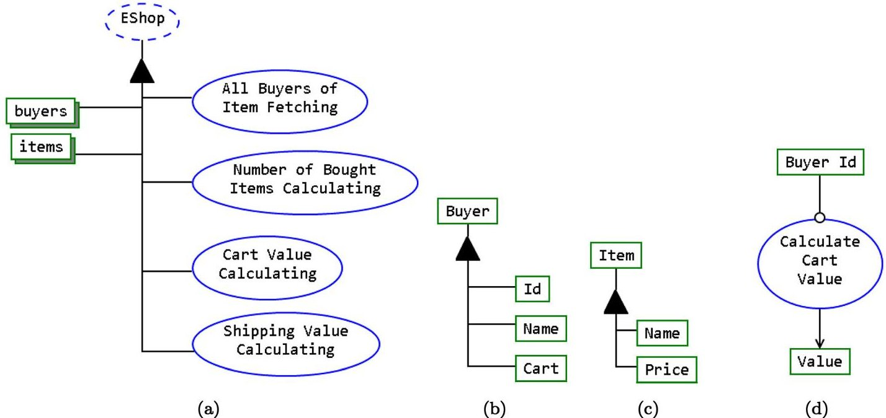

Fig. 35 Type and Interface OPDs in the EShop system a EShop System OPD. b Buyer Type OPD. The global buyers object contains Buyer objects. The Cart contains Items. c Item type OPD. Items are

contained in a cart. d Calculate Cart Value Interface OPD. The process calculates the total cost of all items in a Buyer's Cart

performance—excellent for system that conformed to the requirements; fair for system that implemented only part of the requirements; and fail for empty or completely incorrect system. Table 3 presents the participants' distribution by programing experience and OPP task grade.

Chi square test, which aimed to test the relations between students programming experiences (no experience, basic experience, and professional) and the level of student's OPP task grade (fail, fair, excellent), revealed no significant relation $ \chi^{2}(4)=4.40,p>.05 $ , implying that the programming experts had no advantage over the beginners or vice versa while using OPP for first time. The usability and understandability factors ranges, means and standard deviations are presented in Table 4.

Factors means described in Table 4 suggest that the students agree that the requirements of the programming task were understood and the IDE is usable (means are higher than 3 - the middle of the scale). However, there was less agreement on understanding the OPP and the level of its usability. Figure 36 displays the agreement level distribution within each factor.

From Fig. 37 we can learn that most of the students rated the level of understanding the requirements as 3 or higher (75%) and 69 out of 104 (66%) rated the OPP IDE is usability as 3 or higher. However, about 87% rated the OPP understandability level as 3 or lower and 92% rated the OPP language usability as 3 or lower. These results suggest that students had problems with understanding OPP and find OPP not so usable for programming.

For analyzing whether understandability and usability of OPP and its IDE are related to experience in programming, we performed four one-way analyses of variance (ANOVA)

tests. The independent variable in each test was the level of experience in programming (no experience; basic experience; professional) and the dependent variable was one of the four factors-another factor each time. The groups by experience level means, standard deviations and the F value, probability level and partial eta squared for each factor are presented at Table 5-means, standard deviations, F value, probability level and partial eta squared for each factor.

No significant differences were found between the three groups as can be seen in Table 5. Yet, the professionals' requirement understanding and OPP understanding were the highest. The picture changes when it comes to the OPP IDE usability and even flips in the OPP language usability, as presented in Table 5, indicating that although experts understand more, they find the text programming more usable and the benefits of OPP usability are more evident in less experienced groups.

Analysis of the open questions provided more insights into the positive and negative aspects of OPP. We perform manual analysis of the answers (originally in Hebrew) to extract the main themes written by the students in these answers.

## 6.4.2 Comparing of OPP with textual programming languages

When asked "Compared with programming languages that you have used previously, what are the positive aspects of OPP", many students (35) said that OPP is easier to understand than a textual programming language, especially for non-programmers. A large number (23) also said that the visual representation of OPP makes it more usable.

<!-- PDF_PAGE: 30 -->

Table 2 Cronbach's alpha consistency reliability tests results

<table border="1"><tr><td>Factor</td><td># of items</td><td>Example</td><td>Cronbach&#x27;s alpha(α)</td></tr><tr><td>Requirement understanding</td><td>3</td><td>I understood the requirements of the process that I had to develop</td><td>.84</td></tr><tr><td>OPP understanding</td><td>3</td><td>I understand how the OPP interpreter handles data</td><td>.86</td></tr><tr><td>OPP IDE usability</td><td>4</td><td>Having multiple ways to perform an operation,such as adding objects and links,simplifies the interaction with the OPP environment</td><td>.86</td></tr><tr><td>OPP language usability</td><td>3</td><td>OPP cannot be used for real programs because you have to work a lot to develop a simple program</td><td>.72</td></tr></table>

Table 3 Distribution by experience in programming and OPP task grade

<table border="1"><tr><td rowspan="2">OPP task</td><td colspan="3">Experience in programming</td></tr><tr><td>No experience</td><td>Basic experience</td><td>Professional</td></tr><tr><td>Fail</td><td>6</td><td>5</td><td>1</td></tr><tr><td>Fair</td><td>20</td><td>31</td><td>6</td></tr><tr><td>Excellent</td><td>7</td><td>23</td><td>5</td></tr></table>

Table 4 Usability and understandability factors: ranges, means and standard deviations

<table border="1"><tr><td>Factor</td><td>Range</td><td>Mean</td><td>Standard deviation</td></tr><tr><td>Requirement understanding</td><td>1-5</td><td>3.35</td><td>1.01</td></tr><tr><td>OPP understanding</td><td>1-5</td><td>2.84</td><td>1.03</td></tr><tr><td>OPP IDE usability</td><td>1-5</td><td>3.06</td><td>.97</td></tr><tr><td>OPP language usability</td><td>1-5</td><td>2.65</td><td>.82</td></tr></table>

Other topics that came up in the answers where the ease of use of the language and its IDE, its simplicity, and its readability. Eighteen students found no positive aspects of OPP compared to textual programming languages. When asked "Compared to programming languages that you have

used previously, what are the negative aspects of OPP", most students (31) thought that building real programs with OPP would be too much work, and that they would be too complicated to maintain (23). Other topics mentioned in the answers were the time spent making "beautiful" diagrams, the time needed to learn the language, and that it was not intuitive. Twelve students said the IDE of the language was not mature or stable enough.

## 6.4.3 Comparing OPP with OPM

When asked "Please list differences that make OPP better than OPM", a large number of students (41) stated that the IDE developed for OPP was a great improvement over the current OPM IDE, in many factors such as stability, usability, and performance. Another positive aspect of OPP is its exact semantics (20) and its executability (12). Some students saw the language as simpler than OPM and others also liked the pre-defined functions that came with the language. Eight students saw nothing better in OPP over OPM. When asked "Please list differences that make OPP worse than OPM", most students (12) stated that the language was more complex than OPM, that the IDE was less user friendly than the current OPM environment (12), and that the lack of a textual representation (OPL) in OPP was something they missed a lot from

Fig.36 Distribution of agreement level with each factor

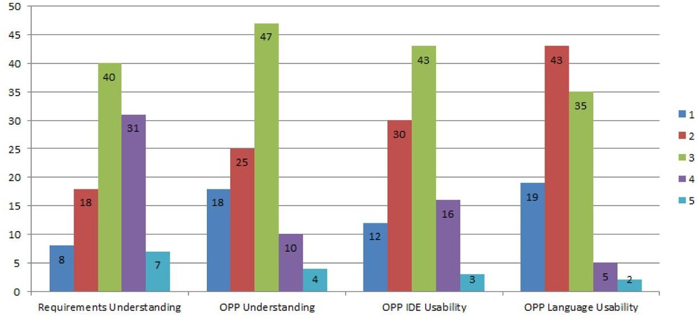

<!-- PDF_PAGE: 31 -->

Fig. 37 Factors by experience level description

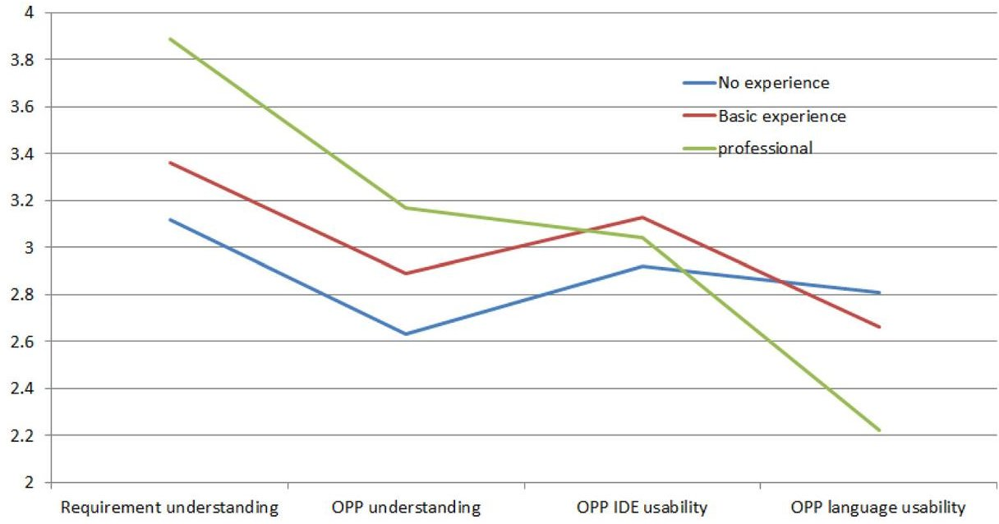

Table 5 Means and standard deviations by experience level F value, probability level and partial eta squared for each factor

<table border="1"><tr><td></td><td colspan="3">Experience mean(sd)</td><td rowspan="2">F(2,101)</td><td rowspan="2">P</td><td rowspan="2">$\eta^{2}$</td></tr><tr><td>Factor</td><td>No</td><td>Basic</td><td>Professional</td></tr><tr><td>Requirement understanding</td><td>3.12(1.04)</td><td>3.36(1.01)</td><td>3.89(.79)</td><td>2.62</td><td>.08</td><td>.05</td></tr><tr><td>OPP understanding</td><td>2.63(.98)</td><td>2.89(.99)</td><td>3.17(1.28)</td><td>1.401</td><td>.25</td><td>.03</td></tr><tr><td>OPP IDE usability</td><td>2.92(.95)</td><td>3.13(.91)</td><td>3.04(1.32)</td><td>.498</td><td>.61</td><td>.01</td></tr><tr><td>OPP language usability</td><td>2.81(.85)</td><td>2.66(.81)</td><td>2.22(.67)</td><td>2.324</td><td>.10</td><td>.04</td></tr></table>

OPM (9). Some students said that its software-focused semantics limited it usefulness, and that this required them to do very low level modeling that they did not do in OPM. Twelve students saw nothing worse in OPP than OPM. Based on the questionnaire finding, an improved user interface was implemented as elaborated below. Finally, most of the students thought that OPP cannot be used for real-world programming, as even simple programs require a lot of work to implement.

1. The OPP version used in this experiment did not have different types for List, Set, and Complex Object types, but only one Complex Object type, which was used for all of them. This confused the students. Therefore, we created specific types for each.

2. The experiment raised a number of usability issues in the OPP editor, including the following: (1) selecting procedural links was difficult because they had to be clicked with caution because of their very thin width; (2) OPDs could not be renamed; (3) Manipulation of structural links was complex and took much effort to make them look good. A new version of the editor, created after the experiment, fixed many of these usability problems.

3. Using Eclipse as the platform where OPP programs are developed creates user friction as non-technical users are intimidated by the complexity of the platform, which is targeted mainly to software developers.

## 6.4.4 Experts focus group insights

The focus group discussed the OPP upgraded version at the end of the developing process and the insights that emerged from analyzing their discussion are listed below:

- One of the interesting properties of OPP (and of VPLs in general) is that one can clearly see structures in the program that are hard to see in code. Regularity in code [31], like clone detection, is something that is difficult to identify. A graphical pattern that repeats itself is detected much faster by the brain, because the visual elements are the same or very similar.

- Since OPP has a very small set of building blocks, it may be easy for new programmers and young programming students to start developing a system, compared to the syntax of textual programming languages. This point was raised by multiple members of the focus group, and it is an interesting research subject that should be pursued in the future.

- As the language already has a visual representation, creating a "visual map" of the program that enables one to navigate between processes could highly improve the usability and understandability of the language.

- OPP can be useful for system engineers that want to look at a big system and how it behaves. The closer the user is to the final implementer of the system, OPP seems less useful. The strengths of OPP are in the

<!-- PDF_PAGE: 32 -->

possibility of seeing a full system that is also executable, for initial testing and validation, but less so for the low-level implementation of each process, where depicting each arithmetic operation becomes tedious. Indeed, programming low level processes in OPP is not optimal. Multiple participants expressed this opinion. There is an optimal point at which one should switch from visual to textual programming. If the OPP environment can be enhanced with the option to do this switch, it would greatly enhance its usability. When to make this transition is yet another domain for future research.

- There is much value in using OPP for programmers who are learning a new system, as the understanding of many separate parts of textual code is harder than looking at the system in OPP.

- The ability to define the boundaries of the system in a clear-cut way is very appealing. The high-level diagrams that shows what processes the system executes, and what data flows to and from the system is straightforward in OPP, but it is not clear in textual programming languages in spite of it being a very important aspect of any system.

- Generating code from OPP programs could be useful as a starting point for rapid application prototyping and testing.

The focus group also gave suggestions for developing certain future features that should be added to the language and editor to make them more usable and appealing. These include:

- Automatic layout: since OPP (like OPM) attributes semantics to the location of some of the visual elements in the diagrams, constrained automatic layout algorithm may be applicable as the amount of layout options is limited.

- Runtime visualization: showing how the system is executing, what processes are active, and what values are in the objects of the system could greatly improve the understanding of what the system does.

## 7 Conclusion and future work

Our ultimate goal is to bridge the gap between the system architecting and design stage, where the system's conceptual model is developed, and the successive software engineering stage, where the software part of the system is implemented primarily to control the hardware of the system. This hardware-software design integration is even more important in view of emerging fields, such as IoT and Industry 4.0, where hardware and software are coupled and intertwined more than ever. The vision is to generate the

code parts of the system automatically from the model, simulate the combined hardware-software model, and gradually replace hardware model parts by physical ones while ensuring the correct and robust operation of the software parts. Using OPCloud, we have started to develop a proof-of-concept of this approach.

In this work—a first step in achieving this vision—we introduced OPP, a new visual programming language that is based on the principles of OPM—the ISO 19450 conceptual modeling language and methodology. OPM's two main strengths employed in OPP are (1) its single kind of diagram, which uses a universal minimal ontology, and (2) its built-in refinement abstraction mechanisms, which are mandatory for effective complexity management.

OPP with its implemented Eclipse-based IDE platform constitutes a proof-of-concept of fusing the design of hardware and software of complex socio-technical systems.

In a unified hardware software design environment such as this, systems engineers will be able to develop complete system models in the system's early stages without the need to separate the design of the system as a whole and the implementation of its software components.

This concurrent development becomes possible thanks to the visual nature of OPP, which relieves the modeler from the need to engage in textual programming, where low-level programming and correcting syntax errors might consume time.

To assess the viability of our approach, we conducted an experiment and a focus group, in which overall participants positively ranked OPP in terms of usability and understandability, and pointed to issues that need to be improved.

In our ongoing follow-up work, we are pursuing two complementary research directions: Enhancing OPM with computational capabilities and roundtrip engineering. These two parallel efforts take part in the framework of developing OPCloud (https://www.opcloud.tech/). These ongoing efforts have yielded Methodical Approach to Executable Integrative Modeling (MAXIM). MAXIM is a framework that integrates computational and execution capabilities into OPM and has been applied in the aerospace engineering domain [33].

We apply computational capabilities on OPM processes nodes: Rather than elaborating the model to a very high degree of resolution, which adds more nesting levels and clutters the model, the modeler can provide simple mathematical formulae and tie them to specific processes. Alternatively, one can provide executable code segments to be invoked during model execution. Another option we enable is to have the model communicate with external software modules, such as computer aided engineering (CAE) tools, which receive parameters from the running OPM model, execute on their own, and return the output to

<!-- PDF_PAGE: 33 -->

the running model for continued execution. This makes the OPM model an umbrella manager, which orchestrates the entire simulated execution of a complex system prior to and during its construction.

In the roundtrip engineering research direction, we aim to enable bidirectional code and model updates of both the static and dynamic model aspects. OPM-based models, and hence OPP programs, combine in one diagram the static and dynamic aspects of the system, providing a basis for preserving the model and the source code fully synchronized. The ability to also include the dynamic code aspect, and thus complete roundtrip engineering, is made possible due to the integration of structure and behavior in the single diagram kind, a trait that is unique to OPM.

Lessons learned from this research have been and are being implemented in OPCloud, which is already used by several Fortune 500 companies as the platform of choice to model their systems with OPM ISO 19450. In this regard, the OPP research project has proved to be a great success.

Table 6 Student questionnaire

## Compliance with ethical standards

Conflict of interest The authors declare that they have no conflict of interest.

## Appendix

See Table 6.

<table border="1"><tr><td></td><td>#</td><td>Question</td><td>Answer type</td></tr><tr><td rowspan="3">Background questions</td><td>1</td><td>How much programming experience do you have</td><td>1-3(1-basic,3-professional)</td></tr><tr><td>2</td><td>How many years of programming experience do you have</td><td>Number of years</td></tr><tr><td>3</td><td>Which programming languages have you learned</td><td>List and option to add more</td></tr><tr><td rowspan="3">Understanding of requirements</td><td>4</td><td>I understood the description of the system described in the assignment</td><td>1-5(1-disagree at all,5-most agree)</td></tr><tr><td>5</td><td>I understood the different behaviors that the system exposes</td><td>1-5(1-disagree at all,5-most agree)</td></tr><tr><td>6</td><td>I understood the requirements of the process that I had to develop</td><td>1-5(1-disagree at all,5-most agree)</td></tr><tr><td rowspan="3">Understanding of OPP</td><td>7</td><td>My knowledge of the OPP language was sufficient to perform this assignment</td><td>1-5(1-disagree at all,5-most agree)</td></tr><tr><td>8</td><td>I understand how OPP executes an In-Zoomed OPD</td><td>1-5(1-disagree at all,5-most agree)</td></tr><tr><td>9</td><td>I understand how the OPP interpreter handles data</td><td>1-5(1-disagree at all,5-most agree)</td></tr><tr><td rowspan="4">Usability of the OPP IDE</td><td>10</td><td>I had no problem interacting with the OPP development environment</td><td>1-5(1-disagree at all,5-most agree)</td></tr><tr><td>11</td><td>I think non-experienced users can use the OPP environment</td><td>1-5(1-disagree at all,5-most agree)</td></tr><tr><td>12</td><td>Having multiple ways to perform an operation,such as adding objects and links,simplifies the interaction with the OPP environment</td><td>1-5(1-disagree at all,5-most agree)</td></tr><tr><td>13</td><td>Having automatic sizing of language elements improved the interaction with the environment</td><td>1-5(1-disagree at all,5-most agree)</td></tr><tr><td rowspan="3">Usability of OPP language</td><td>14</td><td>While developing the program,I invested a lot of time arranging the elements in the diagram in order for it to look good</td><td>1-5(1-disagree at all,5-most agree)</td></tr><tr><td>15</td><td>OPP requires a large number of OPDs to build a simple program</td><td>1-5(1-disagree at all,5-most agree)</td></tr><tr><td>16</td><td>OPP cannot be used for real programs because you have to work a lot to develop a simple program</td><td>1-5(1-disagree at all,5-most agree)</td></tr><tr><td rowspan="2">Comparison with other programming languages</td><td>17</td><td>Compared to programming languages that you have used previously,what are the positive aspects of OPP</td><td>Free text</td></tr><tr><td>18</td><td>Compared to programming languages that you have used previously,what are the negative aspects of OPP</td><td>Free text</td></tr><tr><td rowspan="2">Comparison with OPM</td><td>19</td><td>Please list differences that make OPP better than OPM</td><td>Free text</td></tr><tr><td>20</td><td>Please list differences that make OPP worse than OPM</td><td>Free text</td></tr></table>

<!-- PDF_PAGE: 34 -->

## References

1. Akkaya I, Derler P, Emoto S, Lee EA (2016) Systems engineering for industrial cyber-physical systems using aspects. Proc IEEE 104(5):997-1012. https://doi.org/10.1109/JPROC.2015. 2512265

2. Alonso D, Vicente-Chicote C, Pastor JA, Alvarez B (2008) StateML + : from graphical state machine models to thread-safe Ada code. Springer Berlin Heidelberg, Berlin, Heidelberg, pp 158-170. https://doi.org/10.1007/978-3-540-68624-8_12

3. Alvarez JL, de Koning HP, Fischer D, Wallum M, Metselaar H, Kretzenbacher M (????) Best practices for model based systems engineering in ESA projects. https://doi.org/10.2514/6.2018-5327, https://arc.aiaa.org/doi/pdf/10.2514/6.2018-5327

4. Baur C, Wee D (2015) Manufacturing's next act. https://www.mckinsey.com/business-functions/operations/our-insights/manufacturings-next-act. Accessed 31 Oct 2017

5. Bibliowicz A, Dori D (2012) A graph grammar-based formal validation of object-process diagrams. Softw Syst Model 11(2):287-302. https://doi.org/10.1007/s10270-011-0201-4

6. Brooks FP Jr (1987) No silver bullet essence and accidents of software engineering. Computer 20(4):10-19. https://doi.org/10.1109/MC.1987.1663532

7. Broy M (2006) Challenges in automotive software engineering. In: Proceedings of the 28th international conference on software engineering. ACM, New York, NY, USA, ICSE '06, pp 33-42. https://doi.org/10.1145/1134285.1134292, http://doi.acm.org.ezlibrary.technion.ac.il/10.1145/1134285.1134292

8. Burnett MM (1999) Visual programming. Wiley, New York, pp 275-283. https://doi.org/10.1002/047134608X.W1707

9. craft AI (????) The maturity of visual programming. https://www. craft.ai/blog/the-maturity-of-visual-programming. Accessed 12 Feb 2020

10. Dictionary (n.d.) Inheritance. http://www.dictionary.com/browse/inheritance?s=t. Accessed 29 Apr 2016

11. Dobing B, Parsons J (2006) How UML is used. Commun ACM 49(5):109-113. https://doi.org/10.1145/1125944.1125949

12. Dori D (2002a) Object-process methodology—a holistic systems paradigm, 1st edn. Springer-Verlag Berlin Heidelberg. http://link.springer.com/book/10.1007/978-3-642-56209-9/page/1

13. Dori D (2002b) Why significant UML change is unlikely. Commun ACM 45(11):82-85. https://doi.org/10.1145/581571. 581599

14. Dori D (2008) Words from pictures for dual-channel processing. Commun ACM 51(5):47-52. https://doi.org/10.1145/1342327. 1342337

15. Dori D (2016a) Model-based systems engineering with OPM and SysML, 1st edn. Springer Publishing Company, Incorporated. http://www.springer.com/gp/book/9781493932948

16. Dori D (2016b) Model-based systems engineering with OPM and SysML. Springer, New York

17. Dori D, Goodman M (1996) On bridging the analysis-design and structure-behavior Grand Canyons with object paradigms. Rep Object Anal Des 2(5):25-35

18. Dori D, Reinhartz-Berger I, Sturm A (2003) Opcat—a bimodal case tool for object-process based system development. In: ICEIS

19. Dori D, Beimel D, Toch E (2004) OPCATeam—collaborative business process modeling with OPM. Springer Berlin Heidelberg, Berlin, Heidelberg, pp 66-81. https://doi.org/10.1007/978-3-540-25970-1_5

20. Dori D, Feldman R, Sturm A (2008) From conceptual models to schemata: an object-process-based data warehouse construction method. Inf Syst 33(6):567-593. https://doi.org/10.1016/j.is. 2008.02.002

21. ESML (n.d.) OPCloud - a web-based modeling language and methodology. https://opcloud-client.firebaseapp.com/, accessed: 2017-12-09

22. Fernandes JM, Lilius J, Truscan D (2006) Integration of DFDs into a UML-based model-driven engineering approach. Softw Syst Model 5(4):403-428. https://doi.org/10.1007/s10270-006-0013-0

23. France R, Rumpe B (2007) Does model driven engineering tame complexity? Softw Syst Model 6(1):1-2. https://doi.org/10.1007/s10270-006-0041-9

24. France RB, Ghosh S, Dinh-Trong T, Solberg A (2006) Model-driven development using UML 2.0: promises and pitfalls. Computer 39(2):59-66. https://doi.org/10.1109/MC.2006.65

25. Gelbard R, Teeni D, Sade M (2010) Object-oriented analysis: Is it just theory? IEEE Softw 27(1):64-71. https://doi.org/10.1109/MS.2009.151

26. Guéhéneuc Y, Albin-amiot H, Douence R, Cointe P (2002) Bridging the gap between modeling and programming languages. Tech. rep

27. Harel D (1987) Statecharts: a visual formalism for complex systems. Sci Comput Program 8(3):231-274. https://doi.org/10. 1016/0167-6423(87)90035-9

28. Hendrix TD, Cross JH II, Maghsoodloo S, McKinney ML (2000) Do visualizations improve program comprehensibility? Experiments with control structure diagrams for java. SIGCSE Bull 32(1):382-386. https://doi.org/10.1145/331795.331890

29. Hosick E (2014) Visual programming languages—snapshots. http://blog.interfacevision.com/design/design-visual-progarm ming-languages-snapshots/

30. Instruments N (n.d.) Labview. http://www.ni.com/labview/

31. Jbara A, Feitelson DG (2017) How programmers read regular code: a controlled experiment using eye tracking. Empir Softw Eng 22(3):1440-1477. https://doi.org/10.1007/s10664-016-9477-x (Invited extended journal version)

32. Jouault F, Bézivin J, Barbero M (2009) Towards an advanced model-driven engineering toolbox. Innov Syst Softw Eng 5(1):5-12. https://doi.org/10.1007/s11334-009-0082-7

33. Li L, Soskin NL, Jbara A, Karpel M, Dori D (2019) Model-based systems engineering for aircraft design with dynamic landing constraints using object-process methodology. IEEE Access 7:61494-61511. https://doi.org/10.1109/ACCESS.2019.2915917

34. Lifecyclemodeling (2015) Lifecycle modeling language specification. http://www.lifecyclemodeling.org/?page_id=66. Accessed 12 Feb 2020

35. Linhares MV, da Silva AJ, de Oliveira RS (2006) Empirical evaluation of sysml through the modeling of an industrial automation unit. In: 2006 IEEE conference on emerging technologies and factory automation, pp 145-152. https://doi.org/10.1109/ETFA.2006.355190

36. Mayer RE (2009) Multimedia learning, 2nd edn. Cambridge University Press, New York

37. McIntyre DW (1998) comp.lang.visual frequently-asked questions (faq). http://www.faqs.org/faqs/visual-lang/faq/

38. Michell GD, Gupta RK (1997) Hardware/software co-design. Proc IEEE 85(3):349-365. https://doi.org/10.1109/5.558708

39. Microsoft (2010) Architectural patterns and styles. https://docs.microsoft.com/en-us/previous-versions/msp-n-p/ee658117(v= pandp.10). Accessed 29 Aug 2018

40. MIT (2014) Scratch. http://scratch.mit.edu/

41. Mousavi BA, Azzouz R, Heavey C, Ehm H (2019) A survey of model-based system engineering methods to analyse complex supply chains: a case study in semiconductor supply chain. IFAC-PapersOnLine 52(13):1254-1259. https://doi.org/10.1016/j.ifa col.2019.11.370. http://www.sciencedirect.com/science/article/ pii/S2405896319313497, 9th IFAC conference on manufacturing modelling, management and control MIM 2019

<!-- PDF_PAGE: 35 -->

42. Myers BA (1986) Visual programming, programming by example, and program visualization: a taxonomy. SIGCHI Bull 17(4):59-66. https://doi.org/10.1145/22339.22349

43. Nassi I, Shneiderman B (1973) Flowchart techniques for structured programming. SIGPLAN Not 8(8):12-26. https://doi.org/ 10.1145/953349.953350

44. Navarro-Prieto R, Cañas JJ (2001) Are visual programming languages better? The role of imagery in program comprehension. Int J Hum Comput Stud 54(6):799-829. https://doi.org/10. 1006/ijhc.2000.0465

45. Nickerson JV (1994) Visual programming: limits of graphic representation. In: Proceedings of 1994 IEEE symposium on visual languages, pp 178-179. https://doi.org/10.1109/VL.1994. 363624

46. Noone M, Mooney A (2018) Visual and textual programming languages: a systematic review of the literature. J Comput Educ 5(2):149-174. https://doi.org/10.1007/s40692-018-0101-5

47. Nugroho A, Chaudron MR (2008) A survey into the rigor of UML use and its perceived impact on quality and productivity. In: Proceedings of the second ACM-IEEE international symposium on empirical software engineering and measurement. ACM, New York, NY, USA, ESEM '08, pp 90-99. https://doi.org/10.1145/1414004.1414020

48. OMG (2001) Model driven architecture

49. OMG (2003) MDA guide version 1.0.1

50. OMG (2011a) OMG unified modeling language (OMG UML) version 2.4.1, infrastructure

51. OMG (2011b) OMG unified modeling language (OMG UML) version 2.4.1, superstructure

52. OMG (n.d.a) Object management group. www.omg.org

53. OMG (n.d.b) What is SysML. http://www.omgsysml.org/what-issysml.htm. Accessed 12 Feb 2020

54. Peleg M, Dori D (1999) Extending the object-process methodology to handle real-time systems. JOOP 11:53-58

55. Peleg M, Dori D (2000) The model multiplicity problem: experimenting with real-time specification methods. IEEE Trans Softw Eng 26(8):742-759

56. Petre M (2010) Mental imagery and software visualization in high-performance software development teams. J Vis Lang Comput 21(3):171-183. https://doi.org/10.1016/j.jvlc.2009.11.001

57. Reinhartz-Berger I, Dori D (2005) A reflective meta-model of object-process methodology: the system modeling building blocks. In: Green PF, Rosemann M (eds) Business systems analysis with ontologies, pp 130-173

58. Reinhartz-Berger I, Dori D, Katz S (2002) OPM/Web—objectprocess methodology for developing web applications. Ann Softw Eng 13(1):141-161. https://doi.org/10.1023/A: 1016597410642

59. Scanlan DA (1989) Structured flowcharts outperform pseudocode: an experimental comparison. IEEE Softw 6(5):28-36. https://doi.org/10.1109/52.35587

60. Schäfer W, Wehrheim H (2010) Model-driven development with mechatronic UML. Springer Berlin Heidelberg, Berlin, Heidelberg, pp 533-554. https://doi.org/10.1007/978-3-642-17322-6_23

61. Siek J (2014) What is gradual typing. http://wphomes.soic.indiana.edu/jsiek/what-is-gradual-typing/. Accessed 12 Feb 2020

62. Soffer P, Golany B, Dori D (2003) ERP modeling: a comprehensive approach. Inf Syst 28(6):673-690. https://doi.org/10. 1016/S0306-4379(02)00078-9

63. Somekh J, Choder M, Dori D (2012) Conceptual model-based systems biology: mapping knowledge and discovering gaps in the mrna transcription cycle. PLoS ONE 7(12):1-21. https://doi.org/ 10.1371/journal.pone.0051430

64. Staunstrup J, Wolf W (2012) Hardware/software co-design: principles and practice. Springer

65. Stobart SC, Thompson JB, Smith P (1991) Use, problems, benefits and future direction of computer-aided software engineering in United Kingdom. Inf Softw Technol 33(9):629-636. https:// doi.org/10.1016/0950-5849(91)90035-A

66. Sturm A, Dori D, Shehory O (2003) Single-model method for specifying multi-agent systems. In: Proceedings of the second international joint conference on autonomous agents and multi-agent systems. ACM, New York, NY, USA, AAMAS '03, pp 121-128. https://doi.org/10.1145/860575.860595

67. Sutherland IE (1964) Sketch pad a man-machine graphical communication system. In: Proceedings of the SHARE design automation workshop. ACM, New York, NY, USA, DAC '64, pp 6.329-6.346. https://doi.org/10.1145/800265.810742

68. SysML (n.d.) SysML v2: The next-generation systems modeling language. http://www.omgsysml.org/SysML-2.htm. Accessed 13 Sep 2018

69. Tannahill BK, Jamshidi M (2014) System of systems and big data analytics—bridging the gap. Comput Electr Eng 40(1):2-15. https://doi.org/10.1016/j.compeleceng.2013.11.016 (40th-year commemorative issue)

70. Thomas D (2004) MDA: revenge of the modelers or UML utopia? IEEE Softw 21(3):15-17. https://doi.org/10.1109/MS.2004.1293067

71. University CM (n.d.) Alice. http://www.alice.org/

72. Whitley K (1997) Visual programming languages and the empirical evidence for and against. J Vis Lang Comput 8(1):109-142. https://doi.org/10.1006/jvlc.1996.0030

73. Whitley K, Blackwell AF (2001) Visual programming in the wild: a survey of LabVIEW programmers. J Vis Lang Comput 12(4):435-472. https://doi.org/10.1006/jvlc.2000.0198. http:// www.sciencedirect.com/science/article/pii/S1045926X00901988

74. Wolny S, Mazak A, Carpella C, Geist V, Wimmer M (2020) Thirteen years of sysml: a systematic mapping study. Softw Syst Model 19(1):111-169. https://doi.org/10.1007/s10270-019-00735-y

