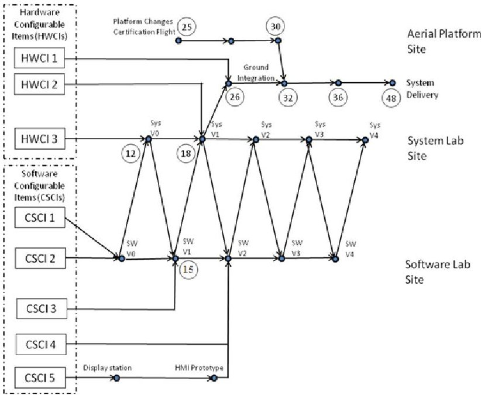
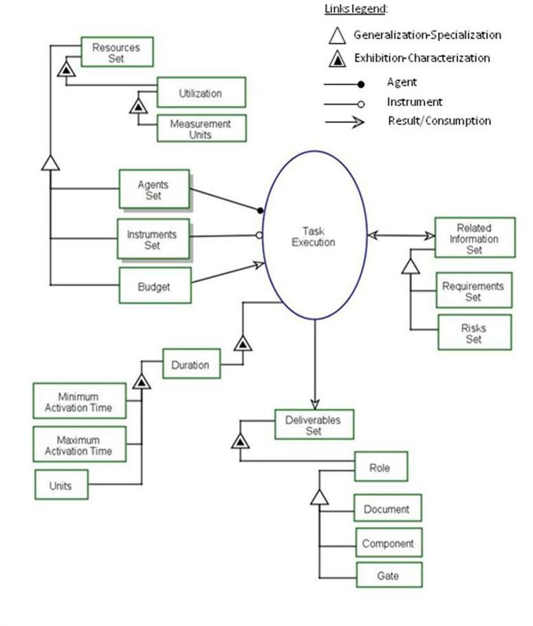
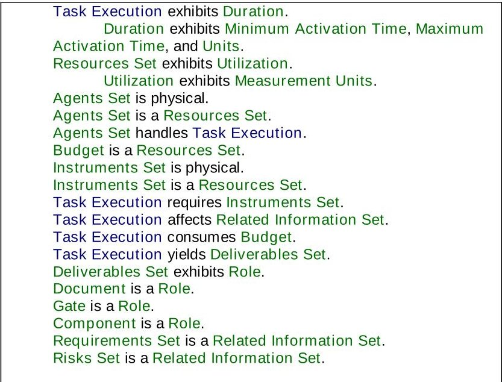
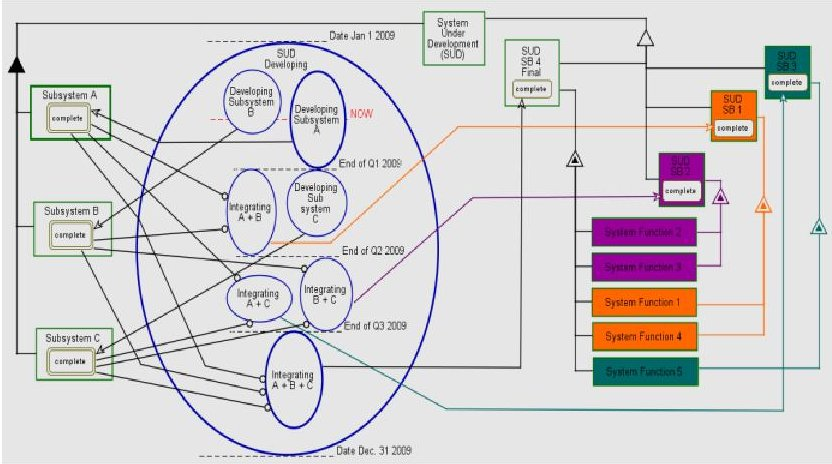
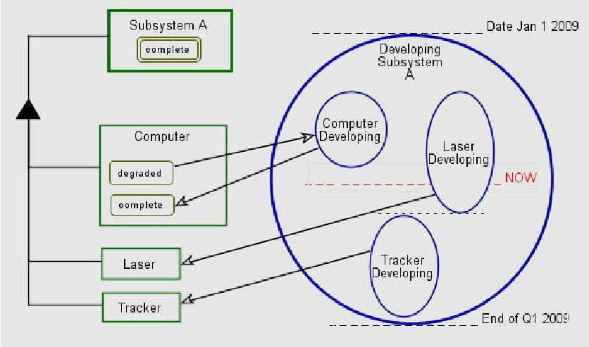

<!-- PDF_PAGE: 1 -->

# Integrating the Project with the Product for Applied Systems Engineering Management

Amira Sharon* , Dov Dori**

* Technion, Israel Institute of Technology, Haifa 32000, Israel (Tel: +972503662466; e-mail: amirash@technion.ac.il).

** Technion, Israel Institute of Technology, Haifa 32000, Israel, and Massachusetts Institute of Technology, Cambridge, MA (e-mail: dori@mit.edu)}

Abstract: Systems engineering planning and control are the essentials of systems engineering management. While the project management is concerned with such concepts as tasks, milestones, and budget, systems engineering is concerned with the product, requirements is needs to meet, its architecture, and its performance. In spite of the clear difference in the ontology used, both managers and engineers are equally required in order for the project-product ensemble to succeed. This underlines the need for a language and model as common bases for communication between managers and engineers. Based on this observation, we propose Project-Product Lifecycle Management (PPLM) as a combined model-based approach for planning project-product ensembles. Utilizing Object Process Methodology (OPM), the PPLM model integrates the project domain with the product domain via shared ontology that explicitly relates project to product entities within a unifying frame of reference.

Keywords: Systems Engineering Management, Complex Systems, Project Planning, Work Breakdown Structure, Model-Based Planning.

## 1. INTRODUCTION

Systems engineering planning and control are the essentials of systems engineering management. The project management is concerned with issues related to executing and delivering the end product, such as tasks, milestones, and budget. Systems engineering and its management are concerned with the technical aspects of both the project and the product, including meeting product requirements, designing the product architecture for optimal performance, testing the product at all levels, and deploying it. In order for a project to become successful, project managers and systems engineers must bridge the gap between management and engineering. This gap has been discussed by Schein (1997), who identified managers and engineers as forming two distinct, separate organizational sub-cultures, each acting according to its own specific goals, which are not necessarily aligned. Nevertheless, both managers and engineers are equally required in order for the project-product ensemble to succeed, underlining the need for a common language and model as a basis for synergy between managers and engineers.

The fundamental premise underlying the combined projectproduct methodology is that it is possible to simultaneously express the required information from both the managerial project domain and the engineering product domain within a single integrated model-based framework. The motivating vision is the development and assessment of a complete

model-based methodology for joint project-product lifecycle management, which can lead to higher quality management of both the system engineering of the product and the project or program delivering it. The integrated framework can support the needs of both systems engineers and project managers by providing for a reliable planning process of the technical parts of the project plans. This, in turn will help decrease the need for repeated changes and corrective actions, leading to higher quality and shorter time-to-market.

## 2. THE LINKS BETWEEN PROJECT AND PRODUCT WITHIN SYSTEMS ENGINEERING MANAGEMENT

To demonstrate the tight links between the product and the project, consider the integration activities of a complex system in the aerospace area. What needs to be developed, tested, and delivered is determined by the product requirements, its architecture, and design. When each component should and can be developed and tested is stated in the project plan. Usually, the integration starts with initial integrations, which focus on verifying the performance of individual software and hardware components, followed by integration of large subassemblies, proceeding to sub-systems integrations, and continues with the longitudinal process of the entire operational system integration. Fig. 1 presents a realistic, though simplified, integration process plan for an imaginary avionics system. It contains three sites: (1) a software lab site, in which Computer Software Configurable Items (CSCIs) are integrated and tested, (2) system lab site,

<!-- PDF_PAGE: 2 -->

in which integration and testing of combined configurations of CSCIs with Hardware Configurable Items (HWCI) is conducted, and (3) aerial platform site, in which the entire operational system is integrated and tested, either on ground or in testing and verification flights.

The small circles in Fig.1 denote event nodes, while the arrows indicate the flow of the plan. The circled numbers denote elapsed time in months from project start. Following the events according to the arrows, together with the given time, reveals the integration plan logic. There are five CSCIs and three HWCIs to be integrated in the system. Five software versions are planned to be integrated and tested at the software lab site. These are defined by software version index i, as in SW Vi. Each software version is a configuration composed of specific CSCIs, as defined by the integration plan logic. The first integration event, planned at the software lab site (bottom part of Fig.1), is the integration of CSCI 1 with CSCI 2 in the SW V0 configuration. This configuration is then combined with HWCI 3 into the first planned system version - Sys V0 - to be tested at the first integration event planned at the System Lab Site, 12 months after project start.

CSCI 3 in planned to be tested together with CSCI 1 and CSIS 2, at the second event in the Software Lab Site, defined as SW V1 integration version 15 months after project start. The same CSCI triplet is combined with HWCI 3 and tested in the second integration event at the System Lab Site, 22 months after project start and 6 months after the preceding integration event in the System Lab Site. This integration plan illustrates how the what and the when are combined.

Fig. 1. Integration process plan for an example avionics system

CSCI 5 is planned to be tested separately in two integration events, denoted "Display station" and "HMI Prototype" at the bottom of Fig.1. CSCI 5 is then integrated with CSCI 4 I CSCI 1, CSCI 2, CSCI 3, HWCI 2, and HWCI 3 in the third integration event at the System Lab Site. The basic rationale is that software versions are tested prior to system versions,

since a system version is a configuration of combined software and hardware items.

The integration process plan is dynamically re-estimated, reevaluated, and re-planned, depending on parameters such as the project progress compared with the plan, resource availability, risks, and technological breakthroughs. Both the what (the product aspect) and the when (the project aspect) are the systems engineering manager's responsibility. Systems engineering managers must therefore combine technical skills and management principles.

Commonly accepted approaches to project management distinguish between the project execution processes and the product delivered by the project (Cook et al., 2003). At the same time, some initiatives advocate developing project processes to concurrently support the produced products. However, concrete techniques for merging a project execution process and the product it delivers are not described by current approaches. Even when product-related processes are mentioned, these are separate from the processes of the project management. Hence, current systems engineering management makes use of traditional project management tools, such as Gantt and PERT.

This observation calls for a fresh look at the methods and tools used by systems engineering managers in an attempt to bring the product issues and the project issues together under the same conceptual model of a combined project-product system ensemble. This is the premise of the Project-Product Lifecycle Management (PPLM) research, aimed at developing a conceptual model and software tool environment for fusing the product to be developed with the project. The approach facilitates associating concepts from both domains, such that the resulting comprehensive model and supporting software will enhance systems engineering management within large-scale projects aimed at developing complex systems. This integrating framework can bridge project management and systems engineering within enterprises, potentially yielding significant cuts in time-to-market, project risks, and product malfunctions.

## 3. THE PROJECT-PRODUCT LIFECYCLE MANAGEMENT FRAMEWORK

While Product Lifecycle Management (PLM) is a concept that has been around for two decades, our Project-Product Lifecycle Management (PPLM) approach (Sharon et al., 2008, 2009) calls for constructing a comprehensive product-project model. This model integrates the project domain with the product domain via a shared ontology, utilizing OPM Object Process Methodology (Dori, 2002). Potential users of our PPLM framework would come from a wide range of disciplines and user profiles, including enterprise, project, and systems engineering managers. The notation, while being formal, must therefore also be simple and intuitive, so all the potential users and stakeholders can relate to the model as it evolves.

A careful comparison of four candidate modeling languages UML, xUML, SysML, and OPM - led to selection of OPM

<!-- PDF_PAGE: 3 -->

as the underlying conceptual modeling language and paradigm for PPLM.

OPM is a holistic, integrated approach to the design and development of systems in general and complex dynamic systems in particular. A formal yet intuitive paradigm for systems architecting, engineering, development, lifecycle support, and evolution, OPM has been used for modeling both natural and artificial complex systems, where artificial ones might comprise humans, physical objects, hardware, software, regulations, and information. As its name suggests, the two basic building blocks in OPM are (stateful) objects things that exist (at some state), and processes-things that transform objects by creating or destroying them, or by changing their state. Objects and processes are of equal importance, as they complement each other in the model specification, which is represented in a single type of diagram that is translated on the fly to basic English. Links, the OPM elements that connect entities, are of two types: structural and procedural. The generic OPM elements make OPM suitable for modeling complex systems that comprise technology and humans. This definition is equally suitable for modeling the product system to be delivered and the project system that aims to deliver the product system. Moreover, these two can be easily viewed as two facets of a larger, overarching system, in which the project is just the first several phases in the lifecycle of the project.

OPM notation supports conceptual modeling of systems using a single type of diagram to describe the functional, structural and behavioural aspects of a system. An OPM model consists of a set of hierarchically organized Object- Process Diagrams (OPDs) that alleviate systems' complexity. Each OPD is obtained by in-zooming or unfolding of a thing (object or process) in its ancestor OPD. OPCAT (Dori et al., 2003), an OPM-based conceptual modeling software environment, features an accessible API, a basic animated class-level execution module, and integration with files of various formats, e.g., XML and CSV, reducing the development effort.

OPM is currently in the process of becoming an ISO standard for enterprise standards (Blekhman, 2011). When completed, this endorsement will enable accelerated dissemination of OPM as a basis for enterprise standards in general and for PPLM in particular.

Using OPM, the combined project-product model ultimately contains the activities or tasks (processes) and the deliverables or products (objects). Activities and tasks are OPM processes at various detail levels required for completing the product. Deliverables are product components, resources, and informatical objects, such as documents and approvals. Having all this information embedded consistently in the same PPLM model eventually yields all the specific structural relations (among objects) and procedural relations (between objects and processes). Understanding the product's structure hierarchy hand-in-hand with the project activities and progress provides the basis for the technological process order and timing. With this understanding, the project planner can model the rationale for

ordering the project activities—the model processes-by identifying the flow of objects into and out of each process.

## 4. THE COMBINED PROJECT-PRODUCT METHODOLOGY

## 4.1 The Generic Project Construct

The PPLM model is constructed using a designated template called the Generic Project Construct (GPC), which is presented in Error! Reference source not found. 2. The GPC comprises the process Task Execution, which takes an expected duration and is aimed at achieving a specific Deliverables Set, using a Resources Set that specializes into Agents Set, Budget, and Instruments Set. Agents Set is a set of required human enablers, Instruments Set is a set of required non-human enablers, and Budget is a consumed monetary input. Although Budget could have been considered to be member of the Instruments Set, it has been assign its own dedicated object, since it is a universal generic resource that enables attainment of all the other resources, and all other resources consumption can be expressed by or converted into units of Budget.

Each resource type is utilized as defined by its Utilization attribute, which is measured using specified Measurement Units. The Task Execution process has an associated Duration attribute, which is defined by Minimum Activation Time, Maximum Activation Time, and Units. Related Information Set is linked to each specific Task Execution process, pertaining to specific Requirements Set and Risk Set. The Deliverables Set, which is the outcome of each Task Execution, may include deliverables such as product components, documents related to derived requirements, approvals, simulations, analyses, specifications, and other types of reports. These deliverables are classified under three roles: document, component, or gate. Each one of the deliverables results explicitly from a specific process and is used in a subsequent process, either as an instrument (usually if it is an informational object), or as a consumee (a physical object that is consumed by or embedded into a larger component). The Resources Set and the Deliverables Set are described and exemplified in Table 1.

Current methods apply traceability mechanism to track project concepts, such as task and milestone, to product concepts, such as requirements, functions, and components. Conversely, the GPC facilitates and streamlines the modeling of the entire project-product complex, as it provides a means for checking all the possible deliverables that can be generated by each activity and are required by one or more subsequent activities. The time for obtaining each deliverable can be calculated from the relevant process durations. The resulting project plan incorporates the product to be designed, manufactured, delivered, used, serviced, and disposed of, with the project, including all its significant deliverables, such as resources and their allocation, timetable, limits and milestones, evaluation of project constraints, and assertions related to its cost and duration.

<!-- PDF_PAGE: 4 -->

Rather than serving traceability, the concepts in the GPC are common to the project domain and the product domain.

## 4.2. System Builds

Planning the complete combined project-product includes the definition of Systems Builds (SBs), i.e., specific configurations of the system, planned to be achieved along the project lifecycle span. The methodology enables the planner to plan for a specific functionality (which is related to a set of requirement) or even a specific single requirement to be achieved in a certain SB.

There are two known strategies which are related to our proposed SBs approach: the incremental strategy and the evolutionary strategy. The incremental strategy (Mil-Std-498, 1994), called "Pre-planned Product Improvement" (DODI 2008), determines user needs and defines the system requirements with focus on software. It then performs the rest of the development in a sequence of builds. The first build incorporates part of the planned capabilities; the next build adds more capabilities, and so on, until the system is complete. The "evolutionary" strategy (DODI 2008) also develops a system in builds, but it differs from the incremental strategy in acknowledging that the user need is not fully understood and all requirements cannot be defined up front. Following this strategy, user needs and system requirements are partially defined up-front, and then refined in each succeeding build. Our proposed SBs strategy resembles the incremental strategy, with one major difference: while in the "incremental" strategy the capabilities are built up on top of each other for each build, the SBs strategy facilitates the planning of capabilities to be achieved not necessarily in an cumulative manner, but rather in a way that best serves the technological order and risk mitigation in each project.

Fig. 2. The Generic Project Construct (GPC) of the Model-Based Project Plan

The number of SBs planned for a project depends on the planner's technical experience and judgment. The SBs planning is derived from the system requirements, functionality, and architecture, accounting, as noted, for technological capabilities and risk mitigating. Some SBs may be planned to achieve certain functionality to be demonstrated due to binding milestones, while other SBs may be planned for mitigating technological risks along the development of the system to be delivered. In any case, the last SB is the complete product to be supplied by the project. The Product to be delivered is the unification of all the capabilities proven successful in previous SBs, reflecting all the system requirements and functions that were realized in the entire set of System Builds. SB-related definitions for the combined Product-Project methodology are listed in Table 2.

Table 1. Classification of objects in the OPM project plan

<table border="1"><tr><td colspan="3">Symbol</td><td>Description</td><td>Examples</td></tr><tr><td rowspan="3">Deliverables(Roles)</td><td colspan="2">D</td><td>document-a recorded definition of anything related to the product or the project delivering it expressed via an informational object</td><td>Requirements Document,Design Document,Engineering Drawing,Testing ProcedureDocument</td></tr><tr><td colspan="2">G</td><td>gate for required approval</td><td>Approval of a key document or a physical artifact, often related to a milestone,such as a requirements document,a design document,a prototype</td></tr><tr><td colspan="2">C</td><td>component</td><td>System or product part:Engine,Payload,Software</td></tr><tr><td rowspan="2">Resources</td><td rowspan="2">Inputs</td><td rowspan="2"></td><td>Budget</td><td></td></tr><tr><td>Consumables Set</td><td>Raw materials,Energy,Utilities,Un-saved data</td></tr></table>

<!-- PDF_PAGE: 5 -->

<table border="1"><tr><td colspan="3">Symbol</td><td>Description</td><td>Examples</td></tr><tr><td rowspan="2"></td><td rowspan="2">Enablers</td><td>A</td><td>Agent-a human enabler</td><td>System Engineer, Software Engineer, Engine Designer, Test Engineer, Technician,</td></tr><tr><td>I</td><td>Instrument-a non-human enabler</td><td>Design Tool, CAD System, Telemetry Equipment, Laboratory</td></tr></table>

Fig. 3 depicts the OPM view of the PPLM model for a general Developing process. The Developing process is aimed to produce the three subsystems Subsystem A, Subsystem B, and Subsystem C, each in its complete state. All three subsystems comprise the System Under Development (SUD), which exhibits five System Functions. The SUD is planned to be accomplished by four SBs: (1) SUD SB 1, planned for obtaining System Function 1 and System Function 4, (2) SUD SB 2, planned for obtaining System Function 2 and System Function 3, (3) SUD SB 3, planned for obtaining System Function 5, and (4) SUD SB 4, which is the final build, namely the complete delivered system, which has all five required System Functions.

The Developing process starts on January 1 2009 and ends on December 31 2009. It begins with two simultaneously starting processes: Developing Subsystem B and Developing Subsystem A. The latter takes longer and ends at the end of the first year's quarter. When Developing Subsystem A ends, it transforms Subsystem A to its complete state, and when Developing Subsystem B ends, it transforms Subsystem B to its complete state. The complete states of both of these subsystems are required for Integrating A + B to start. Integrating A + B starts simultaneously with Developing Subsystem C, at the end of the first year's quarter, as they are both related to Developing Subsystem A in a Finish-to-Start relationship, as denoted by the horizontal dashed line. When Integrating A + B ends, the first system build - SUD SB 1 - is completed, having System Function 1 and System Function 4 both achieved according to the plan. The dashed red line denoted as NOW indicates the current time.

Table 2. The SB-related definitions for the combined Product-Project Methodology

<table border="1"><tr><td></td><td>Term</td><td>Definition</td></tr><tr><td>1</td><td>Product (originally defined)</td><td>The final system as delivered to the customer.</td></tr><tr><td>2</td><td>Functionality</td><td>The set of requirements and their corresponding allocated set of functions.</td></tr><tr><td>3</td><td>Product Functionality</td><td>The functionality that needs to be realized in the delivered product.</td></tr><tr><td>4</td><td>System Build (SB)</td><td>A variant of the product (possibly also the delivered product), which realizes a certain subset of the product functionality, and has a lifecycle as a system in its own right.</td></tr></table>

<table border="1"><tr><td></td><td>Term</td><td>Definition</td></tr><tr><td>5</td><td>System Build Functionality</td><td>The subset of Product Functionality that is realized by the System Build.</td></tr><tr><td>6</td><td>System Build Set</td><td>The set of all the SBs,the union of the functionalities of which realizes the product functionality.</td></tr><tr><td>7</td><td>Product (redefined with SB)</td><td>The ultimate SB,which embodies the union of the individual SB functionalities,such that it delivers the product functionality.</td></tr></table>

Integrating B+C starts immediately when Integrating A+ B ends, at the end of the second year's quarter, as denoted by the horizontal dashed line. For Integrating B+C to start, both Subsystem A and Subsystem B must be in their complete states. When Integrating B+C ends, the second system build - SUD SB 2 - is complete, exhibiting System Function 2 and System Function 3 according to the plan. Having the information of both the product and the project in the combined plan enables the following observation: Since Integrating B+C requires complete Subsystem A and complete Subsystem B, without them being integrated there is actually no need for the Integrating B+C to be executed after Integrating A+B ends. It can be planned to start earlier.

Fig. 3. PPLM model of a SUD Developing process

Integrating A + C floats within the duration of Integrating B + C (second year's quarter). Integrating A + C requires that both Subsystem A and Subsystem C be in their complete states. When Integrating A + C ends, the third system build - SUD SB 3 - is completed, exhibiting System Function 5.

In this example each system build is planned for obtaining specific functions in a non-cumulative manner, i.e., it is not based on an incremental strategy.

Integrating A+B+C is planned to be executed as soon as Integrating B+C ends, at the end of the third year's quarter, as denoted by the horizontal dashed line. Integrating A+B+C start requires that all three Subsystems be complete. When Integrating A+B+C ends, the final system build SUD SB 4 is completed, exhibiting all five System Functions.

Fig. 4 presents the in-zoomed view of Developing Subsystem A, which is planned to be executed at the

<!-- PDF_PAGE: 6 -->

beginning of the Developing process shown in Fig 3. Subsystem A consists of a Computer, a laser, and a Tracker. The process of Developing Subsystem A begins with the simultaneous start of Computer Developing together with Laser Developing. The end of Computer Developing transforms the state of Computer from degraded to complete. When Laser Developing ends, it yields the Laser, just as Tracker is generated when Laser Developing ends.

The timing of the entire Developing Subsystem A process in Fig.4. PPLM plan Developing Subsystem A

is coherent with the upper level presented in Fig. 3. PPLM model of a SUD Developing process

3. The current time of the project, indicated by the dashed red line denoted as NOW, is also compatible with upper level of this PPLM model.

The entire project is modeled through concurrent hierarchical decomposition of processes and objects involved in these processes as inputs, enablers, or deliverables. Using this approach, the model ultimately contains (1) the activities and tasks, which are processes at various detail levels (task is the most detailed, non-decomposable process), required for completing the product, (2) the artifacts (model-based deliverables) created during the project process, and (3) the different resources, including agents (humans), budget, and instruments (facilities and other inanimate resources). Embedding this information consistently in the same unifying model yields all the structural relations—relations between any two objects, and procedural relations—relations between any object and any process.

Fig. 4. PPLM plan Developing Subsystem A

## 4. CONCLUSIONS

Model-based project planning is part of the joint Project- Product Lifecycle Management (PPLM) approach. The joint project-product OPM-based model combines the project's activities and timing with the product's structure in a single conceptual model. This integrated model simultaneously expresses the function, structure and behavior of the two domains—the project and the product—via the same ontological foundations, making it possible to directly and precisely link entities in one domain to those in the other,

thereby attaining a holistic view of the highly complex and intricate project-product ensemble. The underlying conceptual model will potentially serve as a solid basis for supporting systems engineering management and providing an integrated project and product lifecycle support environment.

## REFERENCES

Blekhman, A., Dori, D. and Martin, R. Model-Based Standards Authoring. Proc. 21st INCOSE International Symposium, Denver, CO, USA, June 19-23, 2011.

Cook S.C., Kasser J.E., and Ferris T.K.J., "Elements of a Framework for the Engineering of Complex Systems, "in Proc. 9th ANZSYS Conference, Systems in Action, Melbourne, Australia, 2003, Paper 3000079.

DODI 5000.02, Department of Defense Instruction, 2008.

Dori D., Object-Process Methodology - A Holistic Systems Paradigm. Springer Verlag, Berlin, Heidelberg, New York, 2002.

Dori D., Reinhartz-Berger I., and Sturm A., Developing Complex Systems with Object-Process Methodology using OPCAT. Industrial Presentation in Proc. 22nd International Conference on Conceptual Modeling (ER 2003), Chicago Illinois, October 13-16, 2003. http://www.opcat.com/

Eppinger S. and Salminen V., "Patterns of Product Development Interactions, " in Proc. International Conference On Engineering Design, ICED01, Glasgow, August 21-23, 2001, pp 283-290.

Sharon A., Perelman V., and Dori D., A Project-Product Lifecycle Management Approach For Improved Systems Engineering Practices. Proc. INCOSE 18th Annual International Symposium, 6th Biennial European Systems Engineering Conference, Utrecht, the Netherlands, 2008.

Sharon A., Dori D., and de Weck O., "Is there a Complete Project Plan? A Model-Based Project Planning Approach, "Proc. $ 19^{\mathrm{th}} $ Annual International INCOSE Symposium, Singapore, 2009.

Shein A., Organizational culture and leadership. Jossey Bass, 1997.

Software Development and Documentation, Military Standard Mil-Std-498 AMSC NO. N7069-1994.