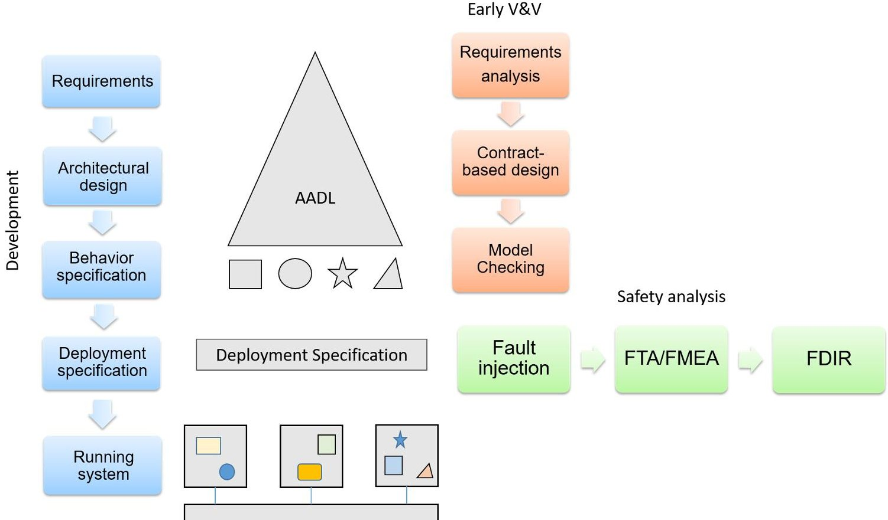

<!-- PDF_PAGE: 1 -->

# COMPASTA: Integration of the COMPASS and TASTE toolsets $ ^{*} $

Marco Bozzano Roberto Cavada Massimo Nazaria

Alessandro Cimatti Alberto Griggio Stefano Tonetta

Fondazione Bruno Kessler {bozzano,cavada,cimatti,griggio,mnazaria,tonettas}@fbk.eu

COMPASS is a toolset for model-based System-SW Co-Engineering developed in a series of ESA studies from 2008 to 2016, which is based on formal verification techniques. TASTE is a development environment dedicated to embedded, real- time systems, developed in 2008 under the initiative of ESA, consisting of various tools such as graphical editors, visualizers, code generators and middlewares that support the development of embedded systems within a model-based design approach.

COMPASTA is an ESA study, started in April 2021, which aims at integrating the formal verification capabilities of the COMPASS and TASTE toolsets, providing a harmonized workflow the covers the functionalities provided by the two tools, and bridging the gap between architectural level design and system implementation and deployment. The novelty of the projects consists in providing a full end-to-end coherent toolchain covering system design, HW/SW implementation, deployment and testing. We think that this integration will significantly foster the adoption of the COMPASS/ TASTE toolsets, and the use of consolidated technology that can be shared between ESA and ESA contractors, to build embedded SW for future missions.

## 1 Introduction

The COMPASTA project is an ESA study that started in April 2021. The goal of COMPASTA is to integrate formal verification functionalities of the COMPASS toolset [1,2,3], which are based on model checking, into TASTE [4,5,6]. The integration is based on the COMPASS $ ^{*} $ idea, namely a view where the COMPASS back-ends are split from the COMPASS front-end and integrated directly into the TASTE front-end. In this way, the COMPASS functionalities are made available in TASTE, to support the analysis of specifications written in different input languages and for different purposes. The integration of COMPASS and TASTE has the goal to bridge the gap between the architectural level design and the system implementation and deployment, harmonizing the functionalities for system design and system implementation into a coherent tool chain.

## 2 Background

COMPASS [1,2,3] is a toolset for System-SW Co-Engineering developed in a series of ESA studies from 2008 to 2016. It is based on a dialect of AADL and provides a full set of verification and validation techniques, based on model checking, including requirements analysis, faults extension, functional correctness, safety assessment and dependability, FDIR and performability analysis. COMPASS frontend provides a GUI that offers access to all the analysis functions of the toolset, as well as command-line

<!-- PDF_PAGE: 2 -->

scripts. The back-end tools are invoked by the toolset automatically. COMPASS is based on the concept of model extension, i.e., the possibility to automatically inject faults into a nominal model, by specifying error models and a set of fault injections. The extended model is internally converted into a symbolic model amenable to formal verification, whereas properties are automatically translated into temporal logic formulas.

TASTE [4,5,6] is a development environment dedicated to embedded, real-time systems. Developed in 2008 under the initiative of the European Space Agency, it consists of various tools such as graphical editors for models, visualizers, code generators and middlewares that support the development of embedded systems within a MBD approach. The key technologies involved are AADL for architecture definition, ASN.1 for data modelling and SDL for behavior specification. The standard modeling workflow in TASTE includes: the definition of data models using ASN.1 and ACN encoding rules; the definition of the functional logical architecture using an Interface View description in AADL; the definition of the behavior of each functional block, e.g. in SDL; the definition of the physical architecture using a Deployment View description in AADL. The physical architecture binds the functional blocks and logical connections to the hardware nodes and devices, to enable the code generation and building for the target platforms. Code generation in Taste is supported in the OpenGeode editor and tools such as the QGen code generator (for Matlab-Simulink models).

## 3 Objectives of COMPASTA

The objective of the integration of COMPASS and TASTE is to provide an integrated and coherent tool chain, filling the gap between the architectural level design and the system implementation and deployment, harmonizing the functionalities for system design and system implementation. The integration aims to harmonize the models and input languages provided by COMPASS (SLIM, a dialect of AADL) with the ones available in TASTE (in particular, different flavors of AADL and SDL) for the specification of system architecture, component behavior and interaction, system implementation and deployment. At the technological level, the envisaged solution consists in the integration of the COMPASS back-ends and functionalities, including the fault injection/ model extension step, into the TASTE front-end.

The functionalities provided by COMPASS are complementary with respect to those available in TASTE. Specifically, COMPASS enables the possibility to perform System/SW co-engineering, i.e. specify the system architecture comprising both HW and SW components, and perform verification and validation using formal techniques. Moreover, COMPASS enables the specification of the functional behavior of HW components, both nominally and in presence of faults, and the verification, fault tolerance evaluation and dependability assessment of the resulting model. TASTE, on the other hand, provides the possibility to specify the system architecture and the behavior of SW components. Moreover, it enables the implementation of the SW components (possibly using code generation) and the deployment of the SW on the target HW. Finally, TASTE provides the possibility to test the final implementation. Such functionality can be supported by COMPASS via the re-execution and validation of such traces in the formal model.

In summary, the new extensions will add the following capabilities to TASTE:

- Specify and validate a set of system requirements specified in a formal language.

- Use contract-based design and refinement to model the system architecture in an iterative manner.

- Model the system architecture, including HW components and their functional behavior, using an extension of AADL to specify state machines.

<!-- PDF_PAGE: 3 -->

Figure 1: Functionalities of the integrated TASTE+COMPASS toolset.

- Model HW faults and automatically inject them into the system model, affecting the functional behavior of the HW components.

- Perform formal verification, fault tolerance evaluation and dependability assessment of the extended model.

- Perform formal verification, fault tolerance evaluation and dependability assessment of the extended model, including the FDIR component(s).

- Re-execute a trace generate by TASTE testing functionality in the formal model, and validate the trace via property checking.

Existing TASTE functionalities will be used to specify the implementation of SW components (e.g., FDIR components and SW controllers), perform code generation, deploy the SW components on the target HW, and test the final system.

Figure 1 pictorially illustrates the envisaged functionalities of the integrated TASTE+COMPASS toolset, in correspondence of the different development phases. The envisaged typical workflow is based on the following development phases:

- Requirements specification.

- Architectural design.

- Behavioral specification.

- Deployment: (physical vs logical deployment).

These phases will be supported by various functional analyses for early verification and validation:

<!-- PDF_PAGE: 4 -->

- Requirements analysis.

- Contract-based design.

- Model checking.

Moreover, the modeling will be enriched with faults injection and model extension that will enable further safety analyses:

- Fault Tree Analysis, Failure Modes and Effects Analysis

- FDIR analysis.

## 4 Conclusions

The output of the COMPASTA project is an extended version of the TASTE and COMPASS toolsets and a harmonized workflow the covers the functionalities provided by the two tools. The objective of the integration is to bridge the gap between architectural level design and system implementation and deployment in MBSE. We think that this integration will significantly foster the adoption of the COMPASS/ TASTE toolsets, which have been developed for over a decade. Finally, this project could pave the way to a direct connection between Capella/SysML and TASTE and to the industrial exploitation of the integrated tool chain.

The benefit consists in the possibility to design and test embedded SW for future missions using a comprehensive, end-to-end toolchain that covers system design, implementation, deployment and testing. The project results will create a digital continuity from the architectural functional design and systemlevel safety analysis to the deployment of the embedded software. In the intended use case, system, safety, and software engineers work on the same models in an iterative process supported by various analyses that increase the confidence in the internal and external consistency of the system.

We think that COMPASTA may reduce design and development time and costs, increase reliability and assurance, and foster the use of consolidated technology that can be shared between ESA and ESA contractors, to build embedded SW for future missions.

## References

[1] M. Bozzano, H. Bruintjes, A. Cimatti, J.-P. Katoen, T. Noll & S. Tonetta (2019): COMPASS 3.0. In: Proc. TACAS 2019.

[2] M. Bozzano, A. Cimatti, J.-P. Katoen, P. Katsaros, K. Mokos, V.Y. Nguyen, T. Noll, B. Postma & M. Roveri (2014): Spacecraft Early Design Validation using Formal Methods. Reliability Engineering & System Safety 132, pp. 20-35.

[3] M. Bozzano, A. Cimatti, J.-P. Katoen, V.Y. Nguyen, T. Noll & M. Roveri (2011): Safety, Dependability and Performance Analysis of Extended AADL Models. Computer Journal 54(5), pp. 754-775, doi:10.1093/comjnl/bxq024.

[4] J. Hugues, L. Pautet, B. Zalila, P. Dissaux & M. Perrotin (2008): Using AADL to build critical real-time systems: Experiments in the IST-ASSERT project. In: Proc. ERTS.

[5] TASTE web page. Available at https://taste.tools/.

[6] Qualifiable code generation backend for TASTE, ESA Contract No. 4000118510/16/NL/CBi.