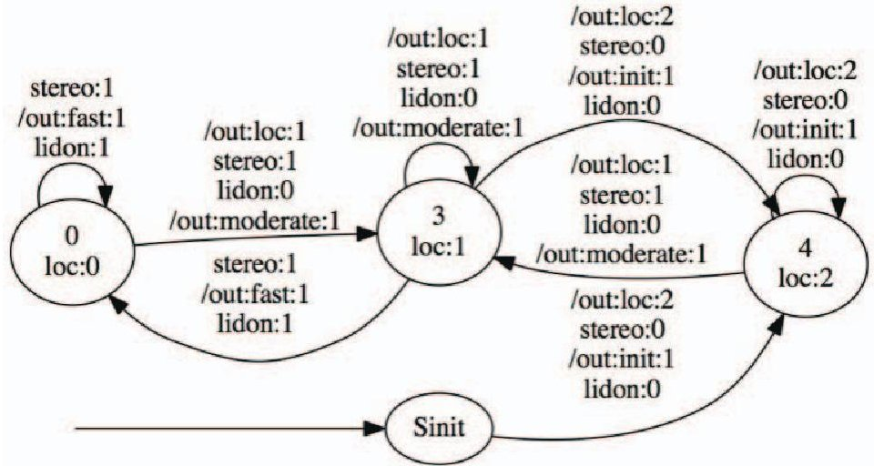
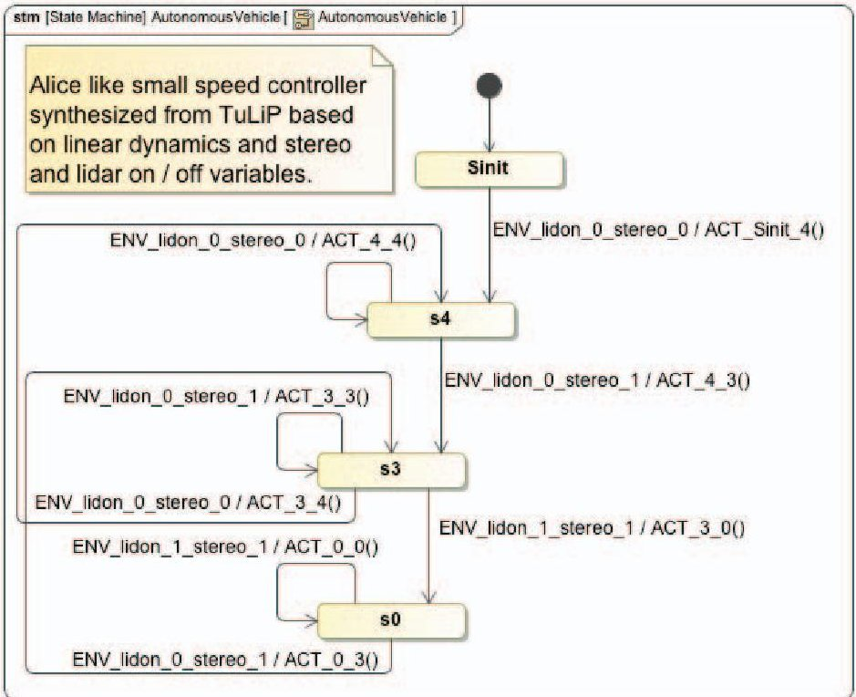
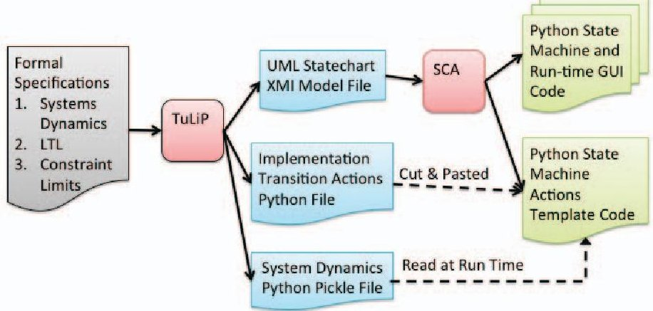
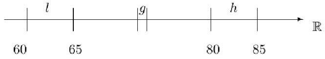
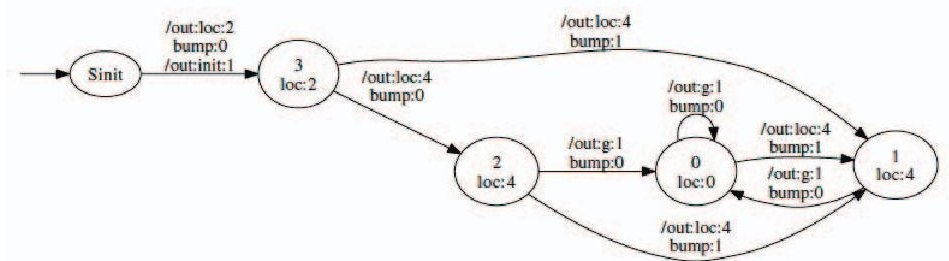
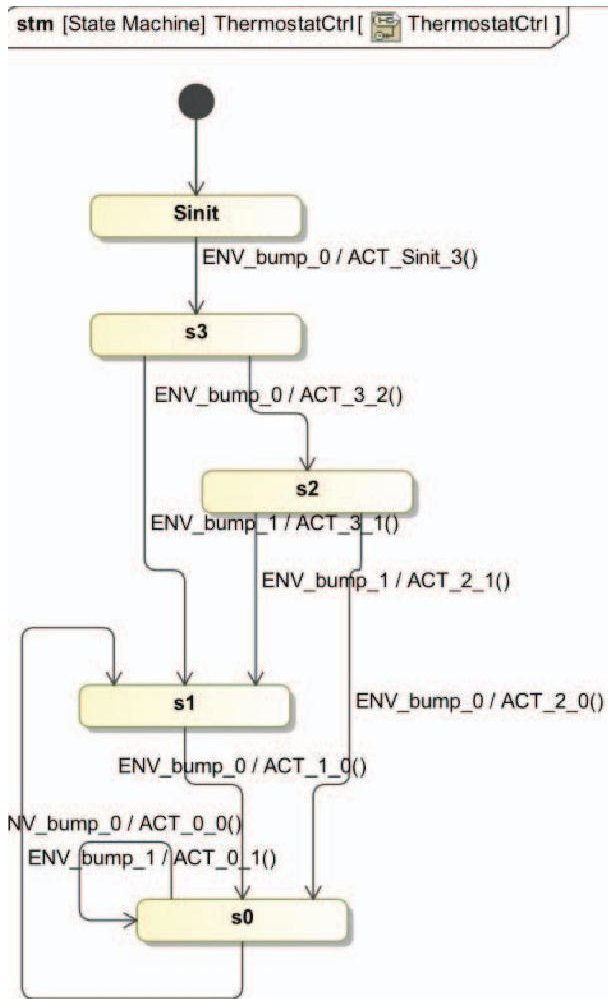
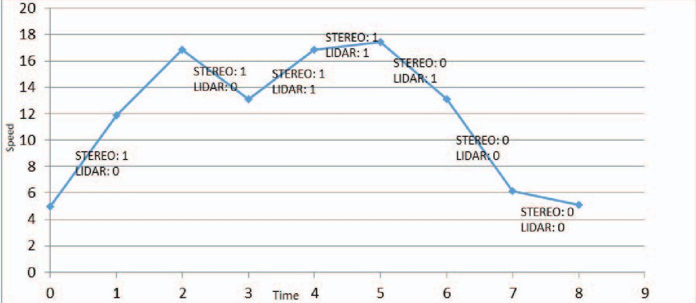
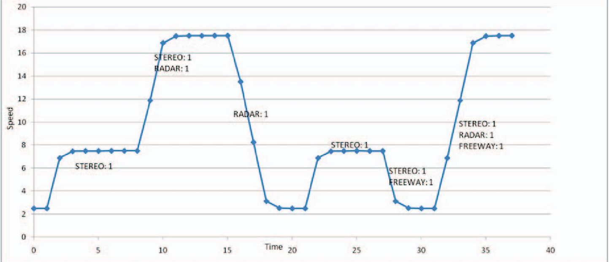

<!-- PDF_PAGE: 1 -->

# Interfacing TuLiP with the JPL Statechart Autocoder: Initial progress toward synthesis of flight software from formal specifications

Sumanth Dathathri California Institute of Technology sdathath@caltech.edu

Scott C. Livingston California Institute of Technology slivingston@cds.caltech.edu

Richard M. Murray

California Institute of Technology murray@cds.caltech.edu

Leonard J. Reder Jet Propulsion Laboratory Leonard.J.Reder@jpl.nasa.gov

Abstract—This paper describes the implementation of an interface connecting the two tools: the JPL SCA (Statechart Autocoder) and TuLiP (Temporal Logic Planning Toolbox) to enable the automatic synthesis of low level implementation code directly from formal specifications. With system dynamics, bounds on uncertainty and formal specifications as inputs, TuLiP synthesizes Mealy machines that are correct-by-construction. An interface is built that automatically translates these Mealy machines into UML statecharts. The SCA accepts the UML statecharts (as XML files) to synthesize flight-certified $ ^{2} $ implementation code. The functionality of the interface is demonstrated through three example systems of varying complexity a) a simple thermostat b) a simple speed controller for an autonomous vehicle and c) a more complex speed controller for an autonomous vehicle with a map-element. In the thermostat controller, there is a specification regarding the desired temperature range that has to be met despite disturbance from the environment. Similarly, in the speed-controllers there are specifications about safe driving speeds depending on sensor health (sensors fail unpredictably) and the map-location. The significance of these demonstrations is the potential circumventing of some of the manual design of statecharts for flight software/controllers. As a result, we expect that less testing and validation will be necessary. In applications where the products of synthesis are used alongside manually designed components, extensive testing or new certificates of correctness of the composition may still be required.

## TABLE OF CONTENTS

1. INTRODUCTION...1

2. INTERFACE SPECIFICS...2

3. PRELIMINARIES...2

4. CASE STUDIES...3

5. CONCLUSION AND SUMMARY...7

ACKNOWLEDGMENTS...8

APPENDICES...9

REFERENCES...9

BIOGRAPHY...10

## 1. INTRODUCTION

Though algorithms for synthesizing controllers from formal specifications have been proposed in the hybrid systems research literature, the direct synthesis of implementation code

from formal specifications is still a nascent area. This paper presents a demonstration of controller synthesis and code generation that yields implementations that are representative of flight software.

Finite-state machines (FSMs) are devices for sequencing systems that proceed in discrete steps. FSMs provide the conceptual basis for many constructions used across disciplines, including deterministic finite automata that recognize formal languages [1], transition systems used in model checking [2], and transducers that map a countable sequence of inputs to a sequence of outputs [3]. The present work is about the synthesis of controller designs for embedded systems, especially for applications such as flight software. One salient feature of this domain is reactivity, which intuitively means that the controller reacts to the occurrence of special events and never terminates. Typically in practice these FSMs become large and complex for practical flight applications so they are modeled and implemented as hierarchical state-machines rather than flat FSMs. An industry standard[4] for representing hierarchical state-machines is UML [5] stored in XMI files,[6]. More specifically the hierarchical state-machines are represented as Harel UML Statechart diagrams [7]. At JPL, the current, widely used tool for manual construction of UML Statecharts is MagicDraw [8] which enables the user to create UML Statechart diagrams and save them as XMI files.

Today, in projects at JPL, human engineers receive a list of requirements that must be achieved by the final product. As part of the design process and consistent with so-called modelbased software engineering, UML Statecharts are manually constructed in MagicDraw to capture the discrete-event interactions of the various components that will later have concrete implementations. Given a UML Statechart composed in MagicDraw, the JPL Statechart Autocoder (SCA) is a software tool that automatically generates implementations in Python, C, C++, and other target languages from XMI file input [9]. The state machine implementation code generated includes infrastructure for all parts of the execution, including processing of signal events and transitioning among states. Though these mechanisms are nontrivial, especially for large hierarchical state machines, the implementation provided by SCA is not complete in the sense that an engineer must still provide implementations for the various routines invoked during execution of a state chart, e.g., evaluating guards and taking actions on transitions, and performing the entry and exit-methods for each state.

The above process of an engineer manually mapping natural language written requirements to UML Statechart diagrams is

<!-- PDF_PAGE: 2 -->

labor intensive, tedious and the final UML design may contain subtle errors. An approach to eliminate this is to express requirements formally (i.e., as mathematical equations) and synthesize designs. It is demonstrated that it is possible to (1.) automate the generation of the UML Statechart designs, and (2.) generate low-level, physical control generation (e.g., implementation of actions within the state-machine).

Synthesis algorithms have been realized in the software TuLiP (Temporal Logic Planning Toolbox) [10]. A basic capability provided by TuLiP is construction of a FSM that ensures a given formal specification is met, i.e., it is correctby-construction. TuLiP provides methods based on current research for automatic state-machine synthesis from linear temporal logic (LTL) specifications, along with routines for control input computation for several classes of dynamical systems, e.g., linear time-invariant with disturbances. In the present work, an interface was developed between TuLiP and SCA that provides the automation promised above. The interface is used to demonstrate that a real-world controller example (someday suitable for flight software applications) can be fully synthesized from formal specifications to implementation code. No additional manual code need be developed as with our current techniques.

The technique of synthesizing state-machine based hybrid controllers from formal specifications is demonstrated utilizing simple controller examples: a simple thermostat, and autonomous vehicle speed controllers. The demonstrations here are inspired by the problem of logic-planning based on faults in the sensor system for 'Alice', the autonomous vehicle developed by Caltech for the 2004-2007 DARPA Grand Challenge [11]. Given a set of sensors and their healths: A Stereo Camera, Lidar and Radar with some health state of True (Healthy) or False (Faulted), our controller must be synthesized to adequately react by changing driving mode and adjusting speed range. Although Alice was a terrestrial research autonomous vehicle, there are significant similarities in behavior and logic-planning requirements (or other control functions) between terrestrial autonomous vehicles and space rovers. Thus, making the speed controller developed here a prototypical example for controllers in space/flight systems.

These examples demonstrate the feasibility of combining TuLiP control synthesis with the SCA code generation techniques to synthesize implementation code for a controller directly from formal specifications. Future work could involve experiments to demonstrate feasibility on simple real-time embedded systems. In this paper we will explain the interface between TuLiP and SCA, present the formal specifications developed for the examples, discuss the results of the synthesis, and conclude with a summary of the significance of this demonstration.

## 2. INTERFACE SPECIFICS

This section briefly introduces the mapping between the Mealy machines synthesized by TuLiP to the UML statecharts that serve as an input to the Statechart Autocoder. Every state in the Mealy machine is mapped to a state in the UML statechart. The labels on the transitions, which have guards that correspond to environmental inputs to the system, are used to generate signal events. These events are triggered when the corresponding matching inputs are supplied by the environment. Each signal-event has a corresponding currentcell (based on the system state and the path through which it arrived to that state) and a target-cell (the next system

state). Inside the signal-events, a TuLiP routine determines the control-action that transfers the system from the currentcell to the target-cell. This control-action is then implemented on the system. To update the current-cell given the new state, another look up is performed from the stored partitioning of the state-space and system dynamics. Then, the next targetcell is decided based on the signal, and a trajectory to it is computed, and so forth. Figures 1 and 2 demonstrate the mapping.

Figure 1 is a Mealy machine synthesized by TuLiP for the simple-autonomous vehicle example. It is mapped to generate the UML state chart (visualized using MagicDraw) in Figure 2. The transition-edge from Sinit to node-4, which has inputs stereo:0 and lidon:0, is mapped to the signalevent ENV_lidon_0_stereo_0 in the statechart where the action ACT_Sinit_4() is implemented (this is where the controlaction is implemented). Such a correspondence exists between every edge in the Mealy machine to edges in the UML statechart. TuLiP uses a convex optimization package [12] to generate a systems dynamics table used by the action transition code for the continuous control updates of the system. Figure 3 explains the file-based workflow.

## 3. PRELIMINARIES

Linear Temporal Logic (LTL) is used to formally specify the desired properties of the system. A basic introduction to the LTL terminology and notations is provided in this section. LTL formulae have atomic propositions as the basic building block and are grown using Boolean and temporal operators. An LTL formula is constructed inductively as:

$$
\varphi ::= a | \neg \varphi | \varphi_ {1} \vee \varphi_ {2} | \bigcirc \varphi | \varphi_ {1} \mathbf {U} \varphi_ {2}
$$

where 'a' is an atomic proposition, $ \bigcirc $ is the next operator, U is the until operator $ \varphi $ , and $ \varphi_{1},\varphi_{2} $ are LTL formulas. The conjunction operator, $ \land $ can be derived as, $ \varphi_{1}\wedge\varphi_{2}=\neg(\neg\varphi_{1}\vee $ $ \neg\varphi_{2} ). $ Similarly, other crucial operators like $ \rightarrow $ (implication), $ \leftrightarrow $ (bi-implication), $ \diamond $ (eventually), $ \square $ (always) can be derived from $ \neg $ (negation), $ \bigcirc $ (next) and U(until).

LTL formulas are useful because they have the inherent notion of time. This lets us specify desired properties for the desired system over time. The LTL specification (formula) is a mathematical representation of some desired physical property or specification for the system. For a LTL formula, the synthesis problem is to design a control protocol for a given system whose execution would result in the satisfaction of the LTL formula. In abstraction based synthesis, the synthesis problem is solved by abstraction (breaking up the problem space into finite-discrete spaces based on the propositions and the dynamics). A finite-state model for the system is then used to design the protocol that satisfies the specification. A review of correct-by-construction control protocol synthesis techniques that utilize tools from formal methods and control theory can be found in [14]. Synthesis for the fragment of LTL known as Generalized Reactivity(1) (GR(1)) is computationally tractable, i.e., it has polynomial time complexity in the number of states; however, the number of states scales exponentially with the number of variables, so some care should be taken when considering complexity of particular problem instances.

<!-- PDF_PAGE: 3 -->

Figure 1: Finite-state machine synthesized by TuLiP for the simple autonomous vehicle demo. Edges are labeled with particular valuations of input and output variables according to the template name:value, with a possible prefix of /out: to indicate outputs. For example, the edge from node 0 to itself represents the transition in which the inputs stereo and lidon both have the value 1, and the controller assigns 1 to the output variable fast.

Figure 2: The result of converting the state-machine shown in Figure 1 to a UML Statechart as visualized in MagicDraw

GR(1) formulas have the following syntax:

$$
\begin{array}{l} \varphi := \left(\Theta^ {\mathrm {e n v}} \wedge \bigwedge_ {k = 1} ^ {K} \square \diamond \varphi_ {k} ^ {\mathrm {e n v}} \wedge \square \varphi^ {\mathrm {e - s a f e t y}}\right)\rightarrow \\ \left(\Theta^ {\mathrm {s y s}} \wedge \bigwedge_ {j = 1} ^ {J} \square \diamond \varphi_ {j} ^ {\mathrm {s y s}} \wedge \square \varphi^ {\mathrm {s - s a f e t y}}\right) \\ \end{array}
$$

The intuition with regards to the syntax is that this is a specification for a reactive-process. The controlled system must satisfy certain properties in the presence of an adversarial environment that must, in turn, follow certain assumptions. The algorithm for abstraction used in this work is described by Wongpiromsarn [13] and [15, 16] provides a detailed description of the GR(1) syntax and synthesis algorithm. For the example case-studies, we write general LTL specifications which are then represented by equivalent GR(1) specifications for which the synthesis problem is solved. TuLiP synthesizes these finite-memory strategies represented as mealy machines.

## 4. CASE STUDIES

## Example 1: Thermostat

The first example is that of a thermostat, i.e., a device that drives ambient temperature to some desired reference value. We model the temperature system as having the discrete-time dynamics of

$$
x _ {t + 1} = x _ {t} + u _ {t} + w _ {t},
$$

where time t is a nonnegative integer. The range of temperatures is assumed to be a real closed interval $ \mathrm{X}\subset\mathbb{R} $ . For each time t, $ x_{t} $ is assumed to take a value in X, i.e., $ x_{t}\in\mathrm{X} $ Similarly, the control input $ u_{t}\in\mathrm{U} $ and disturbance $ w_{t}\in\mathrm{W} $

<!-- PDF_PAGE: 4 -->

Figure 3: File based workflow used in producing hybrid controller designs with TuLiP and mapping them to implementation Python code by the JPL Statechart Autocoder (SCA). TuLiP inputs shown in grey box on left. TuLiP output files shown in blue and SCA generated code shown in green. TuLiP generates XMI (XML Model Interchange Format File) that SCA uses to generate code. TuLiP produces Implementation Transition Actions in Python that are normally manually coded. All Python code generated is for demonstration and easily mapped to C or C++ flight code.

Both U and W are bounded real intervals. As the names of the various parts of this problem suggest, we are to select a sequence of inputs $ u_{0}, u_{1}, u_{2}, \dots $ , so that no matter what sequence of disturbances $ w_{0}, w_{1}, w_{2}, \dots $ occurs, the desired behavior is achieved. For a thermostat, we regard $ u_{t} $ as physically being heat or cooling action, whereas $ w_{t} $ models deviations from expected output, e.g., due to people moving through the room.

System specifications: Making the system described above concrete, we choose:

1) State domain is $ \mathrm{X}=[60,85] $ , where temperature is in degrees Fahrenheit

2) Continuously valued controls are from $ \mathrm{U}=[ -1,1] $

3) Disturbance is from $ \mathrm{W}=[ -0.1, 0.1] $

4) The task is to repeatedly reach 73 F(our goal, g) within a tolerance of 1 degree F

5) The initial temperature is in the range 68 to 78; and

6) Temperatures below 65 or above 80 must never occur.

An input labeled bump is introduced, which serves to model sudden large changes of temperature to somewhere outside the specified tolerance of the goal temperature. To ensure a small finite-state machine for instructional purposes, the range of possible initial temperatures is restricted to 76-78 deg. F. We solve this task in two steps. First, the finite transition system is created that provides so-called discrete abstraction of the full dynamics. The finite transition system is essentially an abstract machine that consists of sets of states and transitions between states. Second, the finite transition system is combined with the LTL formula 4 given below, referred to as the specification, and formal synthesis is performed for the resulting problem. The meaning of the LTL subformula $ \Box \neg h \wedge \Box \neg l \wedge \Box \diamond g $ is saying "always never" enter l and h and "eventually always" get to the goal temperature,

e.g.,

$$
\begin{array}{l} (\square b u m p \rightarrow \bigcirc \neg b u m p) \rightarrow \\ \left(\left(\square b u m p \rightarrow \bigcirc \neg g\right) \wedge \square \neg h \wedge \square \neg l \wedge \square \diamond g\right) \\ \end{array}
$$

Formulae like that above are usually regarded as consisting of two parts: an assumption, which is to the left of the central implies-operator $ (\rightarrow) $ ; and a guarantee, which is to the right. The left side is saying when always $ (\square) $ a bump implies that the next state $ (\bigcirc) $ will not be a bump. And the right side has a safety conditlon that "always" a bump implies "next state" will not be at goal, g in addition to the subformula described earlier. The above problem was expressed and solved using TuLiP. The resulting finite-state machine that provides part of a strategy is shown in 5. There are two steps for making this and the low-level controller available as an implementation. First, our interface automatically generates a UML Statechart (XMI file representation) that can be parsed by the JPL Statechart Autocoder (Figure 6).

Second, our interface creates implementation code for transition actions that manages control inputs (small increments of heating or air-cooling) into the dynamical system (eq. (3)) . These action transitions are typically manually coded by the developer and inserted into an implementation file generated by SCA, but in this technique the needed code was automatically produced by TuLiP. The code for interface and the thermostat example with instructions is temporarily available here [17]. Following the inclusion of the code and documentation for the same into TuLiP, it will be available amongst the export routines of TuLiP [10,18].

## Example 2: Simple Autonomous Vehicle

A simple autonomous vehicle is used for the second example case. The vehicle has multiple sensors (Lidar and Stereo), and different driving modes (Stop/Reboot,Cautious- Moderate Drive, Fast Drive). It assumed that a healthy Stereo

<!-- PDF_PAGE: 5 -->

Figure 4: The temperature range considered. It is treated as a labeled interval X, which is also called the "state domain," on the real line. 1 and h indicate regions of unsafely low and high temperatures, respectively, and g is the goal temperature(including tolerance).

Figure 5: Finite-state machine providing the supervisory part of control. The "bump" signal indicates the occurrence of a disturbance that moves the temperature out of the goal region.

Figure 6: The result of converting the state-machine shown in Figure 4 to a UML Statechart. The above depiction is obtained from MagicDraw after running the built-in automatic layout routine, which organizes the states, transitions, and labels so as to be visually appealing.

<!-- PDF_PAGE: 6 -->

camera can make accurate short-range measurements while a functional Lidar can make accurate long-range measurements. Each mode had a hypothetical speed range associated with it: Stop/Reset is 0 to 10, Moderate is 10 to 15, and Fast is 15 to 20. Based on the sensor health, the vehicle is required to determine the control action for the vehicle to transition to a drive-mode that is safe with regard to the current sensor health. Dynamics similar to the previous example govern the speed variation, but with different bounds on the control action and noise. Here the control action is a finite change in velocity applied in the form of acceleration over an interval of time.

## System Specifications:

a) Domain for speed of the vehicle is $ X=[0,2 0] $ , where speed is in miles/hr

b) Continuously valued controls are from $ \mathrm{U}=[-2,2] $

c) Disturbance is from $ \mathrm{W}=[ -0.01, 0.01] $

d) The vehicle is initially at the Stop/Reboot state

e) Initially all sensors are off (or are not functional)

f) Two sensors do not come up or go down at the same time

g) Short-range sensing does not fail before long-range sensing

h) If both long-range and short-range sensing is healthy, the vehicle must drive fast

i) If short-range sensing is not healthy, the vehicle must immediately stop

$$
\varphi = \left(\left(\neg l i d o n \wedge \neg s t e r o n\right) \wedge \left(\left(l i d o n \rightarrow \bigcirc l i d o n\right) \vee \right.
$$

$$
(steron \rightarrow \bigcirc steron)) \wedge ((\neg l i d o n \rightarrow \bigcirc \neg l i d o n) \vee
$$

$$
(\neg s t e r o n \rightarrow \bigcirc \neg s t e r o n)) \wedge (l i d o n \rightarrow s t e r o n)) \rightarrow
$$

$$
(init \wedge ((lidon \wedge stereo) \rightarrow \bigcirc fast) \wedge
$$

$$
\begin{array}{l} (\neg s t e r o n \rightarrow \bigcirc i n i t) \wedge ((\neg l i d o n \wedge \neg s t e r o n) \rightarrow \\ \bigcirc (\neg f a s t \wedge \neg i n i t))) \\ \end{array}
$$

Here, items g and h are 'assumptions' about the behavior of the environment. Specifications of safe operation were defined utilizing a GR(1) (eq. (5)) formula. Here $ ((\neg lidon \wedge \neg steron) \wedge ((lidon \rightarrow \bigcirc lidon) \vee (steron \rightarrow \bigcirc steron)) \wedge (\neg lidon \rightarrow \bigcirc \neg lidon) \vee (\neg steron \rightarrow \bigcirc \neg steron) \wedge (lidon \rightarrow \bigcirc stereo)) $ is the set of environmental assumptions (specifications e,g and h). The part to the right of the environmental assumption in the formula (after the $ \rightarrow $) is the set of specifications for the desired behavior of the system (specifications i,j and d). Notice that this specification already fits into the GR(1) syntax specified above.

Most of the environments behavior has been restricted here to prevent state-explosion and simplify the synthesized state-machine for better understanding.

## LTL Specification:

A full set of specifications was defined, subsequently a SPIN model was developed that enabled the LTL to be checked for correctness prior to synthesizing the demonstration. Here, the speed of the vehicle is an internal system parameter and the sensors-health is controlled by the environment. Most of the environments behavior has been restricted here to prevent state-explosion and simplify the synthesized result. The synthesized Mealy (FSM) state machine is shown in Figure 1, and the corresponding UML Statechart is in Figure 2.

Here, again the space for the speed is broken into polytopes accompanied with possible sensor states. These partitions are

states that have transitions between reachable states. This abstraction and the LTL formula are then used to perform the synthesis.

The synthesis and autocoding for this set of specifications is done and the controller is simulated. For a sequence of actions from the environment, the resulting speed is recorded and plotted. We can observe that the controller ensures that the specifications are satisfied as desired. Initially, the car is at stop/reboot state and the speed is 5miles/hour. First the stereo is turned on by the environment, as we can see in Figure 2, the system takes the edge leading into the moderate state and the routine-determines the update control action. The control action accelerates the vehicle to 12.5miles/hour which is in the moderate-driving zone, meeting the specification. Next, the lidar is turned healthy, responding to which the vehicle accelerates to 17.5miles/hour. Figure 7 shows a plot of the variation in speed vs time with inputs labeled across the line-segments in the graph.

## Example 3: More-complex Autonomous Vehicle

For a demonstration that is more like a real world controller we expand the small Alice-like speed controller to a more complex one by expanding the number of sensors. The controller still has stereo camera and Lidar sensors but now we add: a Radar - responsible for long range sensing, and a map-element (i.e. Freeway Boolean)- indicates if the vehicle is on the freeway (True) or not (False). A new 'Slow' driving mode is introduced and the speed ranges are further divided as: Stop/Reset is 0 to 5, Slow is 5 to 10, Moderate is 10 to 15, and Fast is 15 to 20. Presence of the map-element adds more complexity to the problem, as the control strategy must make sure that the vehicle does not continuously travel in slow drive mode. The assumption about the failure-order for the sensors has also been relaxed. The assumption that no two sensors fail at the same time is however retained but the assumption that no two sensors come up at the same time has been relaxed.

## System Specifications:

a) Domain for speed of the vehicle is X = [0,20], where speed is in miles/hr

b) Continuously valued controls are from $ \mathrm{U}=[-2,2] $

c) Disturbance is from $ \mathrm{W}=[-0.01,0.01] $

d) The vehicle is initially at the Stop/Reboot state

e) Initially all sensors are off (or are not functional)

f) If short-range sensing is on, the vehicle must not stay stopped unless its unsafe to drive

g) Two sensors do not go down at the same time

h) If both long-range and short-range sensing is healthy, the vehicle must drive fast or moderately fast unless the vehicle loses sensing

i) If all sensors fail, the vehicle must come to a stop eventually unless a sensor comes back up that allows you drive safely

j) If on a freeway, the vehicle must eventually drive fast or moderately fast or stop and try to reboot

Here, the full LTL formula turns out to be more involved than the earlier set up and has not been presented for the sake of brevity. The formula itself does not turn out to be one in the GR(1) format, even with the introduction of auxiliary variables. A new formula $ (\varphi_{new}) $ is conceived through manual-inspection such that the satisfaction of the new formula will imply satisfaction of the formula directly resulting from the specifications. The synthesis problem is then solved with this new formula. A brief description of the new formula can be found in the appendices section.

<!-- PDF_PAGE: 7 -->

Figure 7: Variation of the speed of the vehicle over based on a sequence of inputs. Inputs are mentioned over the line-segments.

<table border="1"><tr><td>Alice Demo</td><td>Number Of States</td><td>Number Of Transitions</td><td>Time to Synthesize</td><td>Time to Generate State Machine Code</td></tr><tr><td>Small</td><td>4</td><td>8</td><td>4.242</td><td>6.3 sec.</td></tr><tr><td>Large</td><td>994</td><td>13437</td><td>14.949 sec.</td><td>8 hrs 41 min.</td></tr></table>

Table 1: Table indicating number of states and transitions synthesized for both the small and large Alice-like speed controller demonstration cases.

Within TuLiP a state for the system corresponds to the following five variables speed, Stereo health, Lidar health, Radar health, and on Freeway or not. For example, a state for the vehicle would be a speed (eg. 4.5miles/hr), Lidar - good health (True), Radar-failed (False), Stereo good health (True), Freeway - on a freeway (True). TuLiPs abstraction mechanism divides the whole space then into proposition preserving regions and searches for a solution that will satisfy the system linear dynamics in eq. (3), the set of LTL specifications (defining sensor health and speed safety requirements), and any other constraints specified. The synthesis determines the control inputs required to transition between states of both discrete and continuous control regions and also the states. However, generating this demonstration controller now required a little over 8 hours on a Caltech 8 3Ghz core cluster workstation and close to 1000 states and about 13500 transitions were synthesized and subsequently code generated due to state space explosion, although an improvement in performance is not expected with multiple cores since the computation does not exploit the concurrency. Table 1 shows a comparison of synthesized states, transitions and execution times for the two demonstration controllers. Typically in practice these FSM based controllers become large and complex so they are modeled and implemented as hierarchical state-machines rather then flat FSMs. TuLiP currently has no state optimization or ability to generate hierarchical state-machines.

Figure 8 shows the execution of a sample scenario for the synthesized controller. States that are turned on are indicated

over the line-segments. Initially when stereo is turned on, the vehicle accelerates to the slow-mode from the stop-mode. On turning on radar, since both long-range and short-range sensing is turned on, it further accelerates to the fast-driving mode. On subsequently turning off stereo, the vehicle comes to a stop. On turning stereo back on while switching radar off at the same time, the vehicle starts driving slow. Then the vehicle enters a freeway which then causes the vehicle to stop because it has no long range sensing. The vehicle waits till long-range sensing is turned back on and then begins to drive-fast as soon as both long and short range sensing is available. This scenario demonstrates the functionality of the synthesized controller is as desired.

## 5. CONCLUSION AND SUMMARY

Three demonstration examples were created that successfully show the generation of implementation code for hybridcontrollers from formal specifications. Initially a very simple temperature thermostat controller was developed that motivated the initial implementation of the TuLiP to SCA file based interface. Next, two autonomous vehicle speed controllers where successfully synthesized and demonstrated. These speed controller examples provided an opportunity to further refine and mature the TuLiP to SCA interface.The more complex speed controller (i.e. containing Lidar, Stereo, Radar, and Freeway environmental inputs) showed that coupling the tools was feasible even with very large numbers of synthesized states generated. For all demonstrations, implementation code was entirely automatically generated based on formal specifications - no manual code development was required as is done with our traditional manually designed UML Statechart approach.The task proved that TuLiP (for controller design synthesis) interfaced with SCA (for statemachine implementation code generation) produces hybridcontrollers that are potentially suitable for real-world flight applications.

There are inherent problems that exist with regard to using synthesizers like TuLiP in their current form. State space explosion results in large numbers of states executing in certain synthesized controllers as the environmental input state space increases. The current state of the art produces designs

<!-- PDF_PAGE: 8 -->

Figure 8: Variation of the speed of the vehicle (complex demo) over time based on a sequence of inputs. Inputs are mentioned over the line-segments.

that are not optimal: states and transitions are not minimized, and no synthesis of hierarchy into the automated product is attempted. The input formal specifications, utilizing LTL, can be daunting and intricate to use for specifying a complex system, as well. Utilizing LTL for the typical flight software or controls engineer currently presents a steep learning curve with vary complex equations that must be developed. Thus the technology must be further developed for real-world flight applications.

Automatic code generation from various manually designed UML Statechart representations have been successfully demonstrated for over a decade on various JPL projects (e.g. InSight, SMAP, MSL, Electra-Radio, Deep Space One, Keck Interferometer, etc.). The technique has significantly reduced development time, improved robustness, and increased maintainability, but the design of state machines is still subtle and error-prone. Currently the process involves interpretation of informal system requirements, and the manual translation of these into UML Statecharts, which are then automatically mapped to implementation software. TuLiP produces designs that are provably correct-by-construction (i.e. satisfy a specification) and presents them as UML Statecharts. Thus logical bugs that may exist within Statechart designs resulting from poor translation of requirements can be eliminated. The traditional steps of requirements, design, and then implementation, could someday be reduced to formal requirements specification followed by automated mapping to implementation FSW, thereby circumventing entirely or partially the error prone manual design phase. The new capability to synthesize correct Statecharts could further automate development of FSW, allowing engineers to focus on meeting requirements and improving performance, rather than design subtleties, increasing quality and decreasing design effort will be achieved.

This task is a small initial step towards work in the domain of inter-planetary spacecraft or rover development. The demonstration speed controllers, although not optimal, illustrate the promise for future work in the direction of fully automated synthesis of real-world controllers for flight applications and FSW.

Future work could involve attempting code generation from

specifications for increasingly sophisticated systems. In pursuing this, we can expect challenges to arise that motivate basic research, e.g., robustness or time semantics for distributed modules. It would also be of interest to attempt to synthesize and test the implementation code for real-world applications with challenges like real-time constraints, coordination amongst asynchronous processes, uncertainty about physical aspects such as rover location or an occupancy grid map. The synthesis of FSMs that are optimal (with respect to a desired cost function) and satisfy a specification is also a relevant basic research problem. This could minimize the number of states, thereby reducing memory needed for storage or other desired objective functions.

Another interesting direction for future work is to explore how automatically synthesized flight software can interact with modules that are manually constructed by human engineers at JPL. A more likely near future scenario is the partial automation of synthesis, where only some pieces that are sufficiently small or well understood are synthesized. This might give rises to scenarios where we might want to consider known methods of distributed synthesis.

## ACKNOWLEDGMENTS

The idea to interface TuLiP to the JPL Statechart Autocoder for hybrid-controller implementation synthesis came originally from discussions with Dr. Necmiye Ozay (U. Mich.) and Dr. Huan (Mumu) Xu(U. Maryland) during the Keck Institute For Space Studies Workshop titled "Engineering Resilient Space Systems: Leveraging Novel System Engineering Techniques and Software Architectures," 2012 of which the PIs were co-leads [19].

This work is funded by the NASA, Jet Propulsion Laboratory, Technology Program Office through a Spontaneous Research and Development award to demonstrate the feasibility of utilizing TuLiP and SCA for creating flight-like controllers from formal specification.

<!-- PDF_PAGE: 9 -->

## APPENDICES

This appendix contains more details about the formula used to synthesize the FSM for the third example. As described earlier, the formula used for synthesis is not a direct translation of the specifications written above but is more conservative. The translated specifications before being converted to GR(1) are as follows:

- Environment Initial: ( $ \neg l i d o n \wedge \neg s t e r o n \wedge \neg f r e e w a y \wedge $ $ \neg r a d o n $ )

- System Initial: Init

- Environment Safety: $((lidon \rightarrow \bigcirc lidon) \vee (steron \rightarrow \bigcirc steron)) \wedge ((lidon \rightarrow \bigcirc lidon) \vee (radon \rightarrow \bigcirc radon)) \wedge$ $((steron \rightarrow \bigcirc steron) \vee (radon \rightarrow \bigcirc radon))$

- System Safety 1: $((lidon \vee radon) \wedge steron) \rightarrow$ $((\diamond \square (moderate \vee fast \vee init)) \vee (\diamond \neg ((lidon \vee radon) \wedge steron)))$

- System Safety 2: $((\neg steron)) \rightarrow ((\diamond \square (init)) \vee (\diamond steron))$

- System Safety 3: freeway $ \rightarrow $ $ ((\diamond \Box(init\vee moderate\vee fast))\vee(\diamond \neg(freeway)) ) $

$$
\begin{array}{l} \left(\diamond \neg \left(\operatorname {s t e r o n} \wedge \neg f r e e w a y\right)\right)) \\ \end{array}
$$

Note that this set of specifications as is cannot be manipulated into GR(1) because of the presence of blocks of $ \diamond $ (compare with GR(1) syntax above to see the difference). To resolve this, we construct a formula that can be manipulated into the GR(1) form and satisfying that formula will ensure that this formula is satisfied. The reader must take note that the above specifications are not strictly 'safety' specifications as in the GR(1) framework, but are specifications that must always be satisfied by the environment and the system.

The new set of specifications are:

- Environment Initial: ( $ \neg l i d o n \wedge \neg s t e r o n \wedge \neg f r e e w a y \wedge $ $ \neg r a d o n $ )

- System Initial: Init

- System Safety 1: init -> ((○init) ∨ steron)

- System Safety 2: (steron $ \wedge $ $ \neg $ (radon $ \wedge $ lidon)) $ \rightarrow $

$\diamond$ ((slow $ \wedge $ $ \neg $ freeway) $ \vee $ (freeway $ \wedge $ init))

- System Safety 3: (moderate $ \vee $ fast) $ \rightarrow $ $ ((\bigcirc(moderate \vee fast)) \vee \neg((lidon \vee radon) \wedge steron)) $

$$
\begin{array}{l} \cdot \text {S y s t e m S a f e t y 4}: \left(\left(\text {i n i t} \wedge \text {f r e e w a y} \wedge \left(\neg \left(\left(l i d o n \vee r a d o n\right) \wedge \right. \right.

- System Safety 5: $((slow \wedge (\neg((lidon \vee radon) \wedge steron)))) \rightarrow (\bigcirc(slow \vee init)))$

- System Safety 6: $((lidon \lor radon) \wedge steron) \rightarrow$

$\diamond (moderate \lor fast \lor \neg((lidon \lor radon) \wedge steron)))$

- System Safety 7: ( $ \neg steron \rightarrow \diamond(init \vee steron) $ )

- System Safety 8: freeway $ \to $ $ \diamond $ (moderate $ \vee $ fast $ \vee $ init $ \vee $ ( $ \neg $ freeway)

Though this is not directly in the GR(1) form, it can be converted into GR(1) form by introducing auxillary variables (as done in the example in the "Discrete State Robot Motion Planning" example on the TuLiP documentation page [10]). Let $ \varphi_{new} $ be transformed formula in the GR(1) form with the auxillary variables. For this new formula it is easy to see,

$$
\varphi_ {n e w} \rightarrow \varphi
$$

## REFERENCES

Once synthesis is done with $ \varphi_{new} $ , the FSM generated is guaranteed to satisfy $ \varphi. $

[1] J. E. Hopcroft and J. D. Ullman, Introduction to Automata Theory, Languages, and Computation., 1979: Addison-Wesley.

[2] C. Baier and J. P. Katoen, Principles of Model Checking, MIT Press, 2008.

[3] E. A. Lee and S. A. Seshia., Introduction to Embedded Systems - A Cyber-Physical Systems Approach, http:// LeeSeshia.org, 2015.

[4] ISO/IEC 19501:2005, Information technology - Open Distributed Processing - Unified Modeling Language (UML) Version 1.4.2, http://www.iso.org/iso/catalogue_detail.htm?csnumber=32620 [Accessed 4 January 2016]

[5] "Unified Modeling Language," http://www.omg org/spec/UML/[Accessed 24 October 2015].

[6] "XML Metadata Interchange,"http://www.omg org/spec/XMI/[Accessed 24 October 2015].

[7] D. Harel,"Statecharts: a visual formalism for complex systems," Science of Computer Programming, vol. 8, p. 231-274, 1987.

[8] No Magic, Inc., "MagicDraw," http://www. magicdraw.com. [Accessed 24 October 2015]

[9] L. J. Reder, "SMAP Python Statechart Code Generator Tool Users Guide (UG)/Software Operators Manual," Jet Propulsion Laboratory, 2010.

[10] "TuLiP (Temporal Logic Planning Toolbox)," http://tulip-control.org.[Accessed 24 October 2015]

[11] J. W. Burdick, N. du Toit, A. Howard, C. Looman, J. Ma, R. M. Murray and T. Wongpiromsarn, "Sensing, Navigation and Reasoning Technologies for the DARPA Urban Challenge," Technical report, DARPA Urban Challenge Final Report, 2007.

[12] M. S. Andersen, J. Dahl and L. Vandenberghe, "CVX- OPT: A Python package for convex optimization," 2012. http://cvxopt.org/ [Accessed 24 October 2015]

[13] T. Wongpiromsarn, "Formal methods for design and verification of embedded control systems : application to an autonomous vehicle," Dissertation (Ph.D.), California Institute of Technology, 2010.

[14] T. Wongpiromsarn, U. Topcu and R. M. Murray, "Synthesis of Control Protocols for Autonomous Systems," Unmanned Systems, pp. Vol. 01, No. 01, pp. 21-39, 2013.

[15] Y. Kesten, A. Pneuli and N. Piterman, "Bridging the gap between fair simulation and trace inclusion." Information and Computation, pp. 200: 35-61, 2005.

[16] R. Bloem, B. Jobstmann, N. Pitermann, A. Pneuli and Y. Saar, "Synthesis of Reactive(1) designs," Journal of Computer and System Sciences, pp. 78: 911-938, 2012.

[17] http://vehicles.caltech.edu/tmp/tulipsca.tar.gz [Accessed 26 January 2016]

[18] TuLiP GitHub Repository, https://github.com/tulip-control/tulip-control [Accessed 26 January 2016]

[19] Engineering Resilient Space Systems: Leveraging Novel System Engineering Techniques and Software Architecture, Workshop, California Institute of Technology, 2012. http://kiss.caltech.edu/ workshops/systems2012/index.html

<!-- PDF_PAGE: 10 -->

## BIOGRAPHY

Sumanth Dathathri is a graduate student in Mechanical Engineering at the California Institute of Technology. He received his undergraduate degree in Mechanical Engineering from IIT Madras in 2014 and has been at Caltech since. His research interests span robotics, control theory, formal synthesis and robust control.

Scott C. Livingston is a PhD student at Caltech.

Leonard J. Reder returned to JPL in 1999, as a Senior Real-Time Software Engineer to work on the Keck Interferometer Project. He was the lead developer of model based automatic code generation tools for the Flight Software of the Mars Science Laboratory. He has worked in various software domains at JPL including: machine learning, Rover Analysis, Modeling and Simulation, mission systems simulation and flight software. Currently he works on DoD funded projects and was the Co-PI for this task. His interests include software synthesis techniques and design patterns, embedded real-time image and DSP processing, spacecraft autonomy, and software development processes. Reder earned an MSEE degree from the University of Southern California and a B.S. in Electronic Engineering from Cal Poly University at San Luis Obispo.

Richard M. Murray received the B.S. degree in Electrical Engineering from California Institute of Technology in 1985 and the M.S. and Ph.D. degrees in Electrical Engineering and Computer Sciences from the University of California, Berkeley, in 1988 and 1991, respectively. He is currently the Thomas E. and Doris Everhart Professor of Control & Dynamical Systems and Bioengineering at Caltech. Murray's research is in the application of feedback and control to networked systems, with applications in biology and autonomy. Current projects include analysis and design biomolecular feedback circuits; specification, design and synthesis of networked control systems; and novel architectures for control using slow computing.