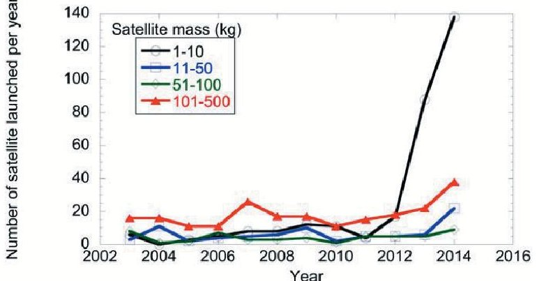
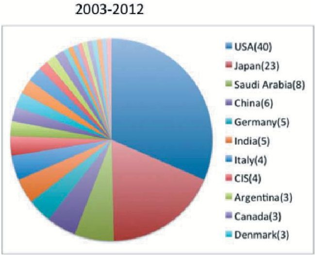
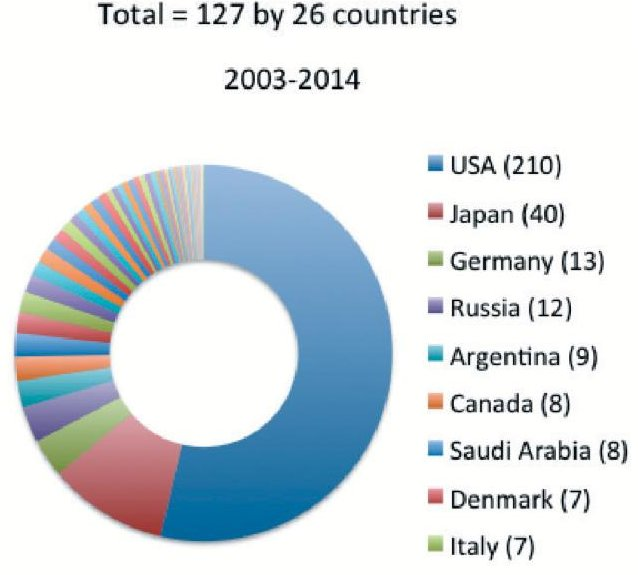
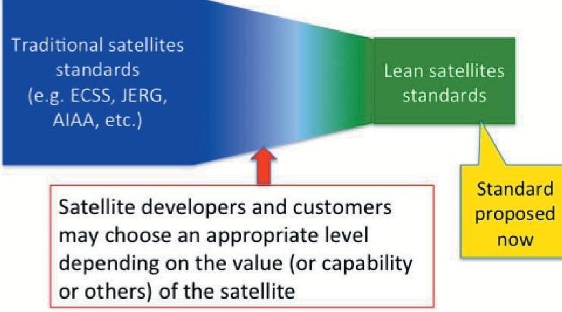
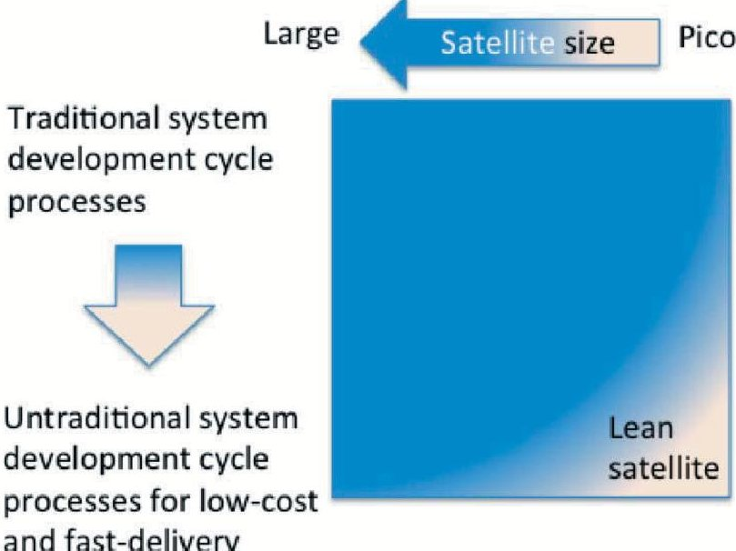

<!-- PDF_PAGE: 1 -->

# International Standardization on Lean Satellites; Definition and Requirements

By Mengu Cho $ ^{1)} $ and Filippo Graziani $ ^{2)} $

$ ^{1)} $ Laboratory of Spacecraft Environment Interaction Engineering, Kyushu Institute of Technology, Kitakyushu, Japan $ ^{2)} $ G.A.U.S.S. Srl, Rome, Italy

(Received May 15, 2015)

There is increasing demand of small satellite development and utilization worldwide. The recent explosive growth of the small satellite launch has caused significant concerns among traditional space sector. Peaceful coexistence of the traditional sector and the emerging sector is crucial. There is a need to define "what is a small satellite" and lay out the requirements of small satellites. In 2014, an activity started to make an ISO standard to describe definition and requirements of small satellites. In parallel, a new study group was initiated at International Academy of Astronautics. The study group intends to make an important input to the ISO standard. Definition of small satellite was discussed extensively in the study group. The majority of the opinions were that mass nor size is not suitable for definition of small satellites and they should be defined by the philosophy of design, manufacturing, mission, program management and others. The workshop came to conclusion that "lean satellite" is the most suitable word to describe a satellite that utilizes untraditional risk-taking development approaches to achieve low-cost and fast-delivery with a small number of team. This paper provides the recent update on the lean satellite standard.

Key Words: Lean satellites, Small Satellites, International Standard

## 1. Introduction

There is increasing demand of small/micro/nano/pico satellite development and utilization worldwide. Figure 1 shows the recent launch trend of satellites less than 500kg. We see explosive growth of satellites of less than 10kg. In 2014, the number of less-than-50kg satellites launched exceeded 160. This launch trend is expected to grow for the near future. Development of small/micro/nano/pico satellites also proliferate worldwide. Figure 2 shows the number of countries who launched satellites less than 50kg. Up to 2012, the number was 26. It became 35 in 2013 and 45 in 2014, respectively, showing the steady pace of increase.

These satellites have possibility to strengthen the basis of space sector and revolutionize space application, which benefits not only to people in the space sector, but humankind and society. Accroding to a market research [1], the market size of micro/nano (less than 50kg) satellites is 702 MUS$ worldwide in 2014 and expected to grow to 1,887 MUS$ in 2019. The actual number in 2019 may exceed even this number if mega-constellations proposed recently are realized [2]. To promote the growth further, their environment needs to be improved in various areas such as launch, satellite technology, ground station, development and testing infrastructure, international standard, investment promotion, and so on.

Launch trend of satellites less than 500kg. (Source: Kyushu Institute of Technology)

Currently there are several international standardization activities in progress at ISO. Those include CubeSat ISO/CD/17770), testing ISO/CD/19683) and capability-based safety, dependability, and quality assurance ISO/CD/18667). The recent explosive growth of the small satellite launch has caused significant concerns among traditional space sector that utilizes space for business purpose [3]. In the past, small satellites, especially the smaller ones, have been used for educational or experimental purposes. Nowadays, however, even commercial CubeSats are envisioned. Indeed among 138 less-than-10kg satellites launched in 2014, 64 satellites were 3U commercial CubeSats of Planet Labs. Peaceful coexistence of traditional sector and the emerging sector is essential for the growth of space sector as a whole. There is a need to define "what is a small satellite and lay out the requirements of small satellites.

In 2014, an activity started at ISO/TC20/SC14 to make an ISO

<!-- PDF_PAGE: 2 -->

standard to describe definition and requirements of small satellites. Figure 3 depicts the relationship between the existing space standards and the standard being proposed. It is impossible to divide any satellite to either "traditional" or "lean". Any satellite should fall in between the two extremes. Satellite developers and customers choose an appropriate level between the two. An important thing is that the sellers and the customers have a common idea of what a lean (small) satellite is.

Total = 127 by 26 countries

Total = 391 by 45 countries

Number of coutrines who owns satellites less than 50kg (Source: Kyushu Institute of Technology)

Relaitionship with existing standards

Although the ISO activity is intended for commercial satellites, satellites of educational or academic purpose may be affected by this standard. Inputs from the communities related to small satellites, especially university satellites and emerging countries to the ISO activity are highly sought-after. Under these circumstances, a new study group was initiated at International Academy of Astronautics (IAA). The study group intends to examine the definitions of small satellites and differentiate the requirements every satellite should follow regardless its size from the requirements small satellites should have separately from the traditional satellites to keep their nature of low-cost and fast-delivery. The study group final report will become an important input to the ISO standard.

The purpose of the present paper is to give update on the IAA study as well as the ISO activity and obtain the feedback from the community.

## 2. Lean Satellite

In the International Workshop on Small-Scale Satellite Standardization $ \left( \mathrm{I W S}^{4} \right) $ held at Kitakyushu in November 2014, definition of small satellite was discussed extensively. Before the workshop, 28 people contributed their opinion through an e-mail list. The majority of the opinions were that mass nor size is not suitable for definition of small satellites and they should be defined by the philosophy of design, manufacturing mission, program management and others. The workshop came to conclusion that "lean satellite" is the most suitable word to describe a satellite that utilizes untraditional risk-taking development approaches to achieve low-cost and fast-delivery with a small number of team. The smallness is merely the result of the approaches.

Historically, the word of "lean" originated from Toyota Production System (TPS) [4] introduced by a world best-seller book, "The Machine That Changed the World" [5]. According to Toyota official Website, the objective of TPS is "making the vehicles ordered by customers in the quickest and most efficient way, in order to deliver the vehicles as quickly as possible" [6]. Changing the word of vehicles to satellites fits to philosophy of making small satellites.

In Ref.[7] Molnau et al. introduced lean satellite production, taking an example from Iridium program that was made of a constellation of 77 satellites. From 1990s to 2000s, Lean Aerospace Initiative (LAI) program existed at Massachusetts Institute of Technology. The program later became Lean Advancement Initiative. It was a consortium of academia, industry and government. In LAI, mostly aircraft sector was deal with, but several researches were also conducted on space sectors [8]. Nowadays, the idea of "lean" has expanded from "lean manufacturing" to "lean development" and "lean enterprise" [9,10,11,12].

Lean satellites seek to deliver the value to the customer and other stakeholders at minimum cost, in the shortest possible

<!-- PDF_PAGE: 3 -->

schedule by minimizing waste. The important key words are value and waste. The value depends on the customers and the stakeholders. For an example, TV broadcasting satellites provide amusement and/or information to their end-users and provide sales revenue to the satellite operators. There may be some differences in terms of customers, stakeholders, end-users and their values between traditional satellites and lean satellites. But the basic scheme that the value is created by satellites orbiting in space and delivered from space to ground via radio wave is the same. The difference from the traditional satellites is that the lean satellites put more emphasis on low-cost and fast-delivery rather than other things.

A lean satellite is a satellite that utilizes untraditional risk-taking development and management approaches to achieve low-cost and fast-delivery. The satellite size is small merely as a result of seeking low-cost and fast delivery. To achieve these two points, the satellite design relies on the use of non-space-qualified COTS units and the satellite size inherently becomes smaller. The design accepts a certain level of risk associated with the use of COTS. The number of team members also becomes smaller.

Approaches taken for lean satellites are different from the ones used for traditional satellites where the reliability often supersedes the cost and schedule as shown in Fig.4. It is meaningless to limit the scope of the small satellite standard based on specific categories of satellite size such as small-, micro-, nano- and pico-. Therefore, the wording "lean satellite" is used to better represent the satellite philosophy.

Traditional satellites and lean satellites

At the end of workshop in November 2014, homework was distributed through e-mail list. The homework consisted of three parts. The first part asked listing questions or criteria to define a lean satellite. The second part asked listing requirement each people had to comply with before his/her lean satellite was launched, such as regulation, law and treaty. The third part asked listing future tasks to promote the idea of

lean satellites further. By March 2015, 22 people and group responded.

Table 1 lists some of the questions collected for the first part of the homework. Each question has multiple answers associated with score from 0 to 3. By summing all the scores multiplied by each weight, which is TBD at this moment, we get a total score of lean satellite scale. Currently there are 84 such questions. By fall 2015, the questions will be narrowed down to 10 to 15 independent questions through discussions over mailing list of IAA study group.

Table 1. Example of questions to define lean satellite scale. SC: Satellite characteristics, SE: systems engineering, PJ: project management

<table border="1"><tr><td>Category</td><td>Weight</td><td>Question</td><td>Scale</td><td>Score</td></tr><tr><td rowspan="4">SC</td><td rowspan="4">TBD</td><td rowspan="4">Total satellite cost excluding launch and operation,A MUSD</td><td>A≥10</td><td>0</td></tr><tr><td>5≤A&lt;10</td><td>1</td></tr><tr><td>2≤A&lt;5</td><td>2</td></tr><tr><td>A&lt;2</td><td>3</td></tr><tr><td rowspan="4">SC</td><td rowspan="4">TBD</td><td rowspan="4">Time from the contract to delivery,B years</td><td>B≥3</td><td>0</td></tr><tr><td>2≤B&lt;3</td><td>1</td></tr><tr><td>1≤B&lt;2</td><td>2</td></tr><tr><td>B&lt;1</td><td>3</td></tr><tr><td rowspan="2">SC</td><td rowspan="2">TBD</td><td rowspan="2">Is the satellite insured?</td><td>Yes</td><td>0</td></tr><tr><td>No</td><td>1</td></tr><tr><td rowspan="4">SC</td><td rowspan="4">TBD</td><td rowspan="4">Number of satellite operators at the ground station,AE</td><td>AE≥10</td><td>0</td></tr><tr><td>5≤AE&lt;10</td><td>1</td></tr><tr><td>2≤AE&lt;5</td><td>2</td></tr><tr><td>AE=1</td><td>3</td></tr><tr><td rowspan="2">SE</td><td rowspan="2">TBD</td><td rowspan="2">Mission down time is allowed</td><td>No</td><td>0</td></tr><tr><td>Yes</td><td>1</td></tr><tr><td rowspan="4">SE</td><td rowspan="4">TBD</td><td rowspan="4">Percentage of COTS parts usage,D</td><td>D≤10%</td><td>0</td></tr><tr><td>10&lt;D≤50%</td><td>1</td></tr><tr><td>50&lt;D≤90%</td><td>2</td></tr><tr><td>90%&lt;D</td><td>3</td></tr><tr><td rowspan="2">SE</td><td rowspan="2">TBD</td><td rowspan="2">Manufactured by non-space qualified processes</td><td>No</td><td>0</td></tr><tr><td>Yes</td><td>1</td></tr><tr><td rowspan="2">SE</td><td rowspan="2">TBD</td><td rowspan="2">Non-space material is used extensively</td><td>No</td><td>0</td></tr><tr><td>Yes</td><td>1</td></tr><tr><td rowspan="4">SE</td><td rowspan="4">TBD</td><td rowspan="4">Satellite design life,E years</td><td>E≥5</td><td>0</td></tr><tr><td>3≤E&lt;5</td><td>1</td></tr><tr><td>1≤E&lt;3</td><td>2</td></tr><tr><td>E&lt;1</td><td>3</td></tr><tr><td rowspan="4">PJ</td><td rowspan="4">TBD</td><td rowspan="4">Percentage of project team members who have experiences of satellite-development,AF%</td><td>AF=0%</td><td>0</td></tr><tr><td>0&lt;AF≤50</td><td>1</td></tr><tr><td>50&lt;AF&lt;100</td><td>2</td></tr><tr><td>AF=100</td><td>3</td></tr><tr><td rowspan="2">PJ</td><td rowspan="2">TBD</td><td rowspan="2">All the project team members located in the same room?</td><td>No</td><td>0</td></tr><tr><td>Yes</td><td>1</td></tr><tr><td rowspan="4">PJ</td><td rowspan="4">TBD</td><td rowspan="4">Number of satellites developed by the project team before,AA</td><td>AA=0</td><td>0</td></tr><tr><td>AA=1</td><td>1</td></tr><tr><td>AA=2</td><td>2</td></tr><tr><td>AA=3</td><td>3</td></tr><tr><td>PJ</td><td>TBD</td><td>Percentage of personnel</td><td>AB≥51</td><td>0</td></tr></table>

<!-- PDF_PAGE: 4 -->

<table border="1"><tr><td rowspan="3"></td><td rowspan="3"></td><td rowspan="3">to be replaced throughout the project lifetime, AB%</td><td>21≤AB&lt;50</td><td>1</td></tr><tr><td>1≤AB&lt;20</td><td>2</td></tr><tr><td>AB=0</td><td>3</td></tr><tr><td rowspan="5">PJ</td><td rowspan="5">TBD</td><td rowspan="5">Time required to find necessary documents, material, photographs etc. related to satellite development and manufacturing, V minutes</td><td>V≥10</td><td>0</td></tr><tr><td>5≤V&lt;10</td><td>1</td></tr><tr><td>1≤V&lt;5</td><td>2</td></tr><tr><td>V&lt;1</td><td>3</td></tr><tr><td rowspan="4">PJ</td><td rowspan="4">TBD</td><td rowspan="4">Number of people engaged in satellite development, C persons</td><td>C≥30</td><td>0</td></tr><tr><td>20≤C&lt;30</td><td>1</td></tr><tr><td>10≤C&lt;20</td><td>2</td></tr><tr><td>C&lt;10</td><td>3</td></tr></table>

Regarding the second part of homework, experience of Japan, Brazil, Germany, Israel, India, Korea, and UK were collected. There were many things in common. All the satellites were required to demonstrate less-than 25 years orbital decay time by analysis. Frequency coordination through IARU for the case of amateur radio band was common. The international frequency coordination was also common. Registration of space object with the UN was also required in all the countries. Because so far all the lean satellites were launched as piggyback, compliance with safety regulation imposed by the launch provider was necessary. One common example was that radio emission was allowed only after 200 seconds or later from the satellite separation. As a part of IAA study group activity, we will collect experience of more countries.

## 4. Conclusion

On March 23, a study group meeting was held at IAA headquarter in Paris. At the meeting, the homework results were reviewed and future timeline as well as the draft content of IAA study group report was confirmed.

From July to October, the next round of homework will be circulated to the mailing list, to gather comments on the weighting of each question. A preliminary draft of IAA study group report will be discussed at $ 6 6 ^{th} $ IAC in Jerusalem in October. On December 4, a detailed discussion will be done through a round table discussion at the International Workshop on Lean Satellite Standardization to be held jointly with 3rd IAA Conference on University Satellite Missions and CubeSat Workshop in Rome.

In parallel to IAA study group activity, an activity at ISO/TC20/SC14 is also planned. In June 2015, at ISO/TC20/SC14 plenary meeting, a presentation on lean satellite standard will be made. An official proposal will be made jointly by Japanese and French delegation to ISO to register a new work item, "Space Systems - Lean Satellites". The standard will incorporate the scale and requirements of lean satellite from the IAA study group report, although the quantitative part of the lean satellite scale will be removed. The study group report will be used as an informative reference of the ISO draft. The ISO standard draft is expected to be complete after the December workshop. It will be circulated for comments and subsequent voting as Committee Draft. The targeted date of completion of ISO standard is spring 2017. Along with these activities, lean satellite testing standard (ISO/DIS/19683) is targeted to be an ISO in the middle of June.

Those who are interested in this activity should contact one of the authors. They will be added to the mailing list to discuss the lean satellite related standards.

## References

1) Y. Seri, KIT Satellite Project, H. Masui, M. Cho, Mission Results and Anomaly Investigation of HORYU-II, SSC13-X-8, Small Satellite Conference, August, 2013.

2) http://spacenews.com/spacex-opening-seattle-plant-to-build-4000-b roadband-satellites/

3) http://spacenews.com/news-from-the-itu-symposium-on-small-satelite-regulation/

4) Taichi Ohno, "Toyota Production System: Beyond Large-Scale Production", Productivity Press, 1988

5) J. P. Womack, D. T. Jones, D. Roos, "The machine that changed the world", Harper Perennial, 1991

6) http://www.toyota-global.com/company/vision_philosophy/toyota_ production_system/

7) W. M. Molnau, J. Olivieri, C. Spalt, "Designing Space Systems for Manufacturability", in Space Mission Analysis and Design, J. R. Wertz and W. J. Larson, ed., Third Edition, Springer, 1999, Chap.19.1

8) A. L. Weigel, "Spacecraft System-Level Integration and Test Discrepancies: Characterizing Distributions and Costs", Massachusetts Institute of Technology, 2000

9) E. Murman et al., "Lean Enterprise Value", Palgrave Macmillan, 2002

10) J. P. Womack, D. T. Jones, "Lean Thinking", 2nd Ed., Free Press, 2003

11) D. G. Reinertsen, "The Principles of Product Development Flow", Celeritas Publishing, 2009

12) A. C. Ward, K. Durward, II Sobek, "Lean Product and Process Development", Lean Enterprises Inst Inc., 2014