<!-- PDF_PAGE: 1 -->

# Interplanetary CubeSats:

# Opening the Solar System to a Broad Community at Lower Cost

Robert L. Staehle, $ ^{1} $ Brian Anderson, $ ^{2} $ Bruce Betts, $ ^{3} $ Diana Blaney, $ ^{1} $ Channing Chow, $ ^{2} $ Louis Friedman, $ ^{3} $ Hamid Hemmati, $ ^{1} $ Dayton Jones, $ ^{1} $ Andrew Klesh, $ ^{1} $ Paulett Liewer, $ ^{1} $ Joseph Lazio, $ ^{1} $ Martin Wen-Yu Lo, $ ^{1} $ Pantazis Mouroulis, $ ^{1} $ Neil Murphy, $ ^{1} $ Paula J. Pingree, $ ^{1} $ Jordi Puig-Suari, $ ^{4} $ Tomas Svitek, $ ^{5} $ Austin Williams, $ ^{4} $ Thor Wilson $ ^{1} $

Final Report on Phase 1 to NASA Office of the Chief Technologist 2012 December 8

Interplanetary CubeSats could enable small, low-cost missions beyond low Earth orbit. This class is defined by mass < 10 kg, cost < $30 M, and durations up to 5 years. Over the coming decade, a stretch of each of six distinct technology areas, creating one overarching architecture, could enable comparatively low-cost Solar System exploration missions with capabilities far beyond those demonstrated in small satellites to date. The six technology areas are: (1) CubeSat electronics and subsystems extended to operate in the interplanetary environment, especially radiation and duration of operation; (2) Optical telecommunications to enable very small, low-power uplink/downlink over interplanetary distances; (3) Solar sail propulsion to enable high $ \Delta V $ maneuvering using no propellant; (4) Navigation of the Interplanetary Superhighway to enable multiple destinations over reasonable mission durations using achievable $ \Delta V $; (5) Small, highly capable instrumentation enabling acquisition of high-quality scientific and exploration information; and (6) Onboard storage and processing of raw instrument data and navigation information to enable maximum utility of uplink and downlink telecom capacity, and minimal operations staffing. The NASA Innovative Advanced Concepts (NIAC) program in 2011 selected Interplanetary CubeSats for further investigation, some results of which are reported here for Phase 1.

Submitted to Journal of Small Satellites (JOSS) On-line for peer review and potential publication at http://www.jossonline.com/Default.aspx

$ \textcircled{c} $ 2012. All rights reserved.

<!-- PDF_PAGE: 2 -->

## I. Introduction

Interplanetary CubeSats could enable small, low-cost missions beyond low Earth orbit (LEO). $ ^{1} $ This class is defined by mass $ < \sim $ 10 kg, cost $ < $ 30 M, and durations up to 5 years. Over the coming decade, a stretch of each of six distinct technology areas, creating one overarching architecture, can enable comparatively low-cost Solar System exploration missions with capabilities far beyond those demonstrated in small satellites to date. Six technology developments can be integrated to form a highly versatile Interplanetary CubeSat Architecture:

1. CubeSat electronics and subsystems extended and improved from their low Earth orbit implementations in order to operate in the interplanetary environment, with particular attention to surviving increased radiation and duration of operation.

2. Optical telecommunications to enable very compact, low-power uplink/downlink over interplanetary distances.

3. Solar sail propulsion to enable major maneuvers and rendezvous with multiple targets using no propellant.

4. Navigation of the Interplanetary Superhighway to enable multiple destinations over reasonable mission durations with achievable $ \Delta\mathrm{V} $

5. Small, highly capable instrumentation (such as a miniature imaging spectrometer) enabling acquisition of highquality scientific and exploration information.

6. Onboard storage and processing of raw instrument data and navigation information to enable maximum utility of uplink and downlink telecom capacity, and minimal operations staffing.

Interplanetary CubeSats build on the existing Earth-orbiting CubeSat architecture. Target spacecraft volume is $ 1 0 \times 2 0 \times 3 0 $ cm (6U in CubeSat parlance, where $ 1 \mathrm{U}=1 0 \times 1 0 \times 1 0 \mathrm{c m} $ ). 2U are reserved for the payload, which is mission specific. The solar sail occupies 2U and deploys to form a $ 6 \times 6 $ m or larger square. The solar sail is based on the Planetary Society/Stellar Exploration LightSail $ ^{\mathrm{TM}} $ $ ^{1,2} $ plus electrochromic tips for attitude control. A two-way optical communications terminal occupying 1U is based on JPL laser telecommunications developments, with a link capacity of 1-4 kbps at 2 AU Earth-spacecraft distance. The final 1U is used for spacecraft housekeeping (C&DH, power, attitude determination) and based on CalPoly CP7 and JPL CubeSat On-board processing Validation Experiment (COVE) avionics. $ ^{3} $

Though many different missions would be possible with this architecture, the potential missions initially considered under NASA Innovative Advanced Concepts (NIAC) sponsorship are:

1. Mineral Mapping of Asteroids [Small Body Science]

2. Solar System Escape Technology Demonstration [Tech Demo]

3. Earth-Sun Sub-L1 Space Weather Monitor [Heliophysics and Terrestrial Applications]

4. Phobos Sample Return [Planetary Science]

5. Earth-Moon L2 Radio Quiet Observatory [Astrophysics]

6. Out-of-Ecliptic Missions [Heliophysics]

The objectives and technology drivers of each of these missions illustrate the broad spectrum of missions enabled by advancing the CubeSat state of the art beyond LEO.

Fundamental to this capability and its low cost is the ability to volumetrically pack the diverse capabilities common to any independent interplanetary spacecraft into a CubeSat standard launch container, in this case 6U, that can ride to geostationary Earth orbit (GEO) or higher launch energies along with a primary payload.

Paramount among the spacecraft capabilities is the ability to operate a useful payload aboard the Interplanetary CubeSat. While a simple camera might be adequate to satisfy minimalist objectives, highly complex instrumentation is possible within 2U volume. As an example existence proof, we examined an imaging spectrometer capable of mapping the surface composition of near-Earth asteroids, to which the spacecraft could be propelled by its solar sail. An obvious requirement driven by the payload is to return substantial data sets. For a given aperture, optical downlinks can deliver dramatically larger amounts of data than are possible at RF, and the technology is finally approaching an ability to package within 1U a laser communications terminal that receives uplink and transmits downlink. For many types of data, including that acquired by an imaging spectrometer, significant data processing is typically performed in multiple steps on the ground in order to generate a useful information product. With high computing capacity now available in a flyable field-programmable gate array (FPGA) package, initial steps of data processing, beyond simple image compression, can be performed onboard a CubeSat within a relatively modest power budget, reducing data downlink requirements by factors of 10 to 100, so this becomes an important element of a high-capability mission architecture.

<!-- PDF_PAGE: 3 -->

Finally, all the normal "housekeeping" functions of an interplanetary spacecraft must be provided, including command and data handling (C&DH), power, attitude control, thermal control, plus the structure to hold everything together, and the mechanisms to deploy selected elements.

## II. Technical Approach

## A. Configuration

Perhaps the greatest advantage for users of the CubeSat standard is the availability of frequent, low-cost launches as secondary payloads, using launch mass capability not required by the primary payload. Unlike numerous secondary payloads before them, CubeSats gain their low-cost advantage because certain launch vehicle manufacturers and their customers have accepted analysis and testing of standardized CubeSat launch containers, such as the Poly-Picosatellite Orbit Deployer (P-POD), $ ^{4} $ as constituting the greatest part of the payload-unique launch vehicle integration process. As a result, only relatively inexpensive analysis and testing need be conducted on an individual CubeSat, assuring that it indeed meets the "CubeSat standard," and can be carried inside its launch container and later deployed in orbit with minimum hazard to the primary payload and its mission.

The initial concept of an Interplanetary CubeSat, with independent propulsion and telecommunications, became plausible only when all the functions of a useful interplanetary spacecraft could clearly in the future be packaged within a CubeSat launch container. During the foreseeable future, the sum of equipment to provide such functionality far from Earth does not appear feasible within the original LEO-bound CubeSat volumetric envelopes up to 3U $ ( 1 0 \times1 0 \times3 0 $ cm). This conclusion became quite different when $ 6 \mathrm{U}^{5} $ $ ( 1 0 \times2 0 \times3 0 $ cm) envelopes came under serious consideration. The first conceived Interplanetary CubeSat volumetric allocation, including independent propulsion and telecommunications, opened the possibility of numerous missions within the inner Solar System, well beyond Earth, and without dedicated launch to their specific destination: $ ^{1} $

1U Spacecraft Housekeeping

2U Solar Sail Propulsion (or electric or other high $ \Delta\mathrm{V} $ alternatives)

1U Telecommunications (optical, or RF at lower data rates out to 1+ AU)

2U Scientific or Other Payload

6U Total

Variations on this combination are of course possible, and will likely be optimal for some specific missions. For example, cislunar missions can operate within the next 2 years using proven RF hardware and tracking techniques. Lower $ \Delta V $ missions may sometimes be better performed using electric propulsion, taking advantage of the ease with which the thrust vector can be moved in three-dimensional space. Close-in examination of asteroids may be better achieved with electric propulsion as either an augmentation to a solar sail (where the sail is used for the long haul, and electric propulsion close-in), or as an Interplanetary CubeSat's exclusive propulsion mechanism. Some space- physics missions with simple instrumentation may not require the onboard processing horsepower needed to enhance the utility of an imaging spectrometer and other high-data-volume instruments. Figure 1 illustrates a nonoptimized, "existence proof" configuration for an Interplanetary CubeSat.

## B. CubeSat Bus and Subsystems

CubeSat capabilities and commercial off-the-shelf (COTS) solutions continue to expand at a rapid pace, spurred on by increased launch opportunities. As the market grows competitively, the demand for lower-power, morecompact, and reliable solutions grows with it. For basic satellite bus functionality, Tyvak offers a complete avionics solution including power, UHF communications, and a Linux computer running 400 DMIPS, all requiring less than 300 mW of average power, and taking up the volume of a slice of bread. An attitude determination and control system (ADCS) package sold by Berlin Space Technologies $ ^{6} $ provides full three-axis control to better than 1 degree with 30 arcsec knowledge at $ 3\sigma $ consuming only 0.5 W. The package includes a star tracker, reaction wheels, and magnetic torquers, and is about the size of three slices of bread. The ExoPlanetSat CubeSat $ ^{7} $ is proposed to use a two-stage pointing system, where two-axis fine pointing is provided by a piezo-electric stage down to a few arcseconds at $ 3\sigma $

<!-- PDF_PAGE: 4 -->

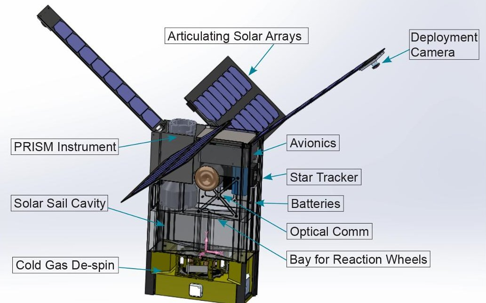

Figure 1. A nonoptimized configuration for an Interplanetary CubeSat to map the surface composition of near-Earth asteroids includes 2U-worth of volume for solar sail stowage and its deployment mechanism, 2U for the CubeSat adaptation of the Portable Remote Imaging Spectrometer (PRISM-on-a-CubeSat), 1U for the optical telecommunications flight terminal, and 1U for C&DH, attitude sensing and control, and power management housekeeping functions. Steerable solar panels provide power up to ~70 W at 1 AU. The solar sail (not shown) deploys in a plane perpendicular to the long axis of the CubeSat structure. This configuration includes 4400 mAh battery capacity.

For this Interplanetary CubeSat architecture, the driving requirement for pointing knowledge of $ \pm4 $ mrad $ (\sim\pm0.23^{\circ}) $ at 2 $ \sigma $ comes from the optical communications system. This level of pointing is possible with current CubeSat technology, though using the sail as the momentum control mechanism, rather than using reaction wheels, is a key technology development. Aside from the volume, mass, and power savings, removing the reaction wheels eliminates the need for periodic momentum dumps from wheel saturation, which, for interplanetary missions, is challenging without a local magnetic field. The key challenges for the avionics design do not lie within the ADCS capability, but rather in matching current capabilities with a lower-power, more compact solution. Reducing power requires the use of modern COTS components, which necessitates a robust system design to handle radiation-induced events.

## 1. Power Generation, Energy Storage, and Avionics Power

The current state of the art for commercially available solar cells is 29.5% efficiency. A variety of deployable array designs exist; they are currently capable of around 48 W peak power in a 3U configuration in LEO. $ ^{8} $ However, the deployable sail constrains deployable solar panel designs, and the reflective material may keep the panels warmer than desired. For an interplanetary mission, the distance from the Sun (up to 2 AU), and the long missions both significantly impact the power generation capabilities because of lower solar irradiance, and solar cell degradation from prolonged radiation exposure on the order of 3 to 5 years. Solar cells for interplanetary application (as opposed to LEO) will require increased cover glass thickness for missions beyond ~6 month durations in order to reduce the degradation in their power output from radiation exposure. Actual thickness will depend on mission duration, desired performance margins, and the anticipated level of solar storm activity.

Quantum dot solar cell technology holds promise for raising the potential efficiency of cells to greater than 50% and also appears less susceptible to radiation degradation. $ ^{9} $ Storing the generated power in Li-Ion batteries is commonly done, and today's battery technology can support an interplanetary mission provided the batteries only cycle during key phases of the mission (i.e., science campaigns). The development of an ultra-low-power avionics system capable of providing basic computing, spacecraft health monitoring, attitude determination and control, and optical communications capable of running off end-of-life (EOL) solar power is a difficult, but a clearly defined, and solvable problem over the next decade. A reasonable power requirement for such a system by the 2020 time frame is 7 W of average power, where 5 W powers the optical communication terminal, with 2 W for the remaining C&DH ADCS, and electrical power system (EPS). Accomplishing that requires a component-driven avionics architecture

<!-- PDF_PAGE: 5 -->

designed to facilitate the implementation of new devices, without significant redesign of the overall system. Utilizing the Linux operating system is a significant step toward accomplishing that goal by abstracting away lowlevel hardware interfaces, and allowing component replacement with minimal software changes. The goal is a satellite avionics architecture designed to keep pace with Moore's Law.

## 2. Radiation Effects and COTS Avionics

The only way to meet a 7 W average power, three-axis-controlled system with laser communications at up to 2 AU from the Sun is to use modern commercial electronics. While this allows for a clear roadmap to solve the power requirement issue, it raises the radiation problem. However, these components tend to work better, and longer in orbit, than most people anticipate. University of Tokyo launched their CubeSat XI-IV on June 30, 2003, into an 820 km Sun-synchronous orbit; it has passed its 9-year anniversary of reliable operations.

Higher single-event upset rates are expected, and are dealt with using latchup-immune parts (having Linear Energy Transfer (LET) $ >\sim 35-70 $ MeV/mg $ cm^{2} $ ) robust software, $ ^{10} $ and periodic power cycles to the system. Total Ionizing Dose (TID) tolerance levels are lower for commercial electronics, but simple shielding techniques are sufficient since interplanetary radiation environments are generally more benign than those in GEO (see Fig. 2). Lastly, part-to-part radiation performance variability is a major challenge, because the same parts from different fabrication runs can have very different radiation performance characteristics. Additional robustness is achievable using asymmetric connections among different CubeSat functions and processors as has been implemented on University of Michigan CubeSats.

Figure 2. With a few mm of shielding, it is possible to reduce TID on CubeSat electronics in GEO to levels little above the TID experienced by numerous successful LEO CubeSats. For Interplanetary Cube Sat missions that start beyond GEO, the dose accumulation rate is significantly less than in GEO, where part of the time the orbit is within Earth's upper radiation belts.

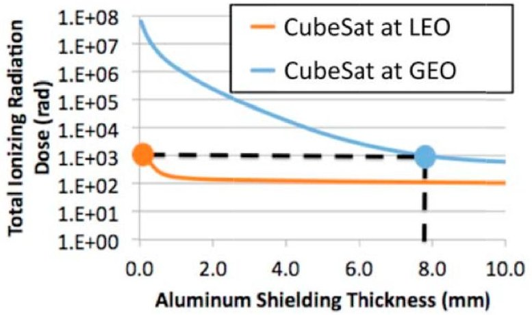

## C. Optical Telecommunications

Optical communications, due to its small aperture size, uniquely presents CubeSats not only with a powerful communications tool, but the opportunity for the first and relatively inexpensive interplanetary lasercom demonstration. The NIAC Phase I study showed that all components and assemblies required to develop an interplanetary lasercom are commercially available, most at Technology Readiness Level 6 (TRL6) maturity. The primary challenges are packaging so that the entire flight lasercom payload can be accommodated within a 1U of the 6U spacecraft; to minimize mass; and to minimize power. The terminal's optical assembly consumes the most volume, and the laser transmitter is the power consumption driver. Link analysis was used to strike a balance between the aperture diameter and laser power, with the goal of minimizing the impact of both. Innovative optical systems were explored to minimize volume, and the most compact and yet high peak power lasers were identified in conjunction with an optimized modulation scheme to meet the specifications identified by the link analysis while optimizing electrical-to-optical efficiency and minimizing size.

High-level assumptions include:

- Volume: 1U $ (1 0 0 0 \mathrm{c m}^{3}) $ , mass: 1.8 kg, DC input power: 5 W; and

- A body-mounted flight terminal without coarse pointing gimbal.

- During communications, the spacecraft maintains its attitude toward Earth with an accuracy of $ \pm4 $ mrad $ (\sim\pm0.23^{\circ}) $ $ 2\sigma $ (for telecom, legacy deep-space spacecraft typically point the RF antenna to $ < 3 $ mrad).

The flight terminal uses the spacecraft Earth pointing as its coarse pointing, while its optical assembly includes components to achieve microradian-level fine pointing.

<!-- PDF_PAGE: 6 -->

## 1. Link Analysis

Given a laser transmitter with average and peak powers of 0.5 W and 160 W, respectively, 11 kHz pulse-repetition-frequency, serially concatenated, pulse-position-modulation (SCPPM) with PPM order of 256 and code rate of 0.56, a 6-cm transmit/receive aperture, 10- $ \mu $ rad pointing accuracy, ground aperture diameters of 11.8 m and 5 m (Large Binocular Telescope (LBT) and Hale Telescope at Palomar Mountain Observatory), a superconducting nanowire detector with 50% quantum efficiency, 6-cm atmospheric coherence length, 4-dB link margin, and 2-AU link range: we calculate nighttime data rates of 62.5 kb/s with LBT and 4 kb/s with Hale, and 1.2 kb/s daytime data rate with LBT. Table 1 Summarizes the link budget under best, nominal, and worst conditions. Note that a clearline-of-sight atmospheric condition is assumed (adequately low level of cloud coverage so that the conditions are good enough for a lasercom link).

Table 1. Link budget summary for daytime or nighttime link conditions. The 5-m Hale telescope is assumed as the ground receiver.

<table border="1"><tr><td>Daytime</td><td>Worst</td><td>Nominal</td><td>Best</td></tr><tr><td>Pointing stability(μrad)</td><td>25</td><td>20</td><td>10</td></tr><tr><td>Detector efficiency(%)</td><td>50</td><td>60</td><td>70</td></tr><tr><td>Sky radiance(W/cm2/sr/nm)</td><td>9.70E-04</td><td>2.60E-04</td><td>2.60E-04</td></tr><tr><td>Daytime Sun-Earth-Probe(SEP)angle(°)</td><td>50</td><td>60</td><td>60</td></tr><tr><td>Zenith angle(°)</td><td>75</td><td>55</td><td>55</td></tr><tr><td>Atmospheric coherence lengthr0(cm)</td><td>3</td><td>4</td><td>6</td></tr><tr><td>Data rate(kb/s)</td><td>~0.003</td><td>0.4</td><td>3.6</td></tr><tr><td>Nighttime</td><td>Worst</td><td>Nominal</td><td>Best</td></tr><tr><td>Pointing stability(μrad)</td><td>25</td><td>20</td><td>10</td></tr><tr><td>Detector efficiency(%)</td><td>50</td><td>60</td><td>70</td></tr><tr><td>Sky radiance(W/cm2/sr/um)</td><td>0</td><td>0</td><td>0</td></tr><tr><td>Zenith angle(°)</td><td>75</td><td>55</td><td>55</td></tr><tr><td>r0(cm)@500nm@zenith</td><td>4</td><td>6</td><td>8</td></tr><tr><td>Data rate(kb/s)</td><td>~0.039</td><td>1.1</td><td>8.7</td></tr></table>

The Earth-based 5-kW beacon laser aimed at the flight terminal to assist with acquisition and tracking and accomplishing precision laser beam pointing will be modulated to provide uplink data to the spacecraft. Due to the small (6 cm) aperture diameter, and constrained available DC power at the spacecraft (5 W), a simple acquisition and tracking focal plane array is assumed. With these constraints, an uplink data rate of $ >\sim1 $ kb/s can be achieved.

## 2. Flight Terminal

The flight terminal incorporates a $ 1^{\circ} $ (17.5 mrad)-class field-of-view (FOV) camera that can acquire an Earth beacon laser signal in the presence of the $ \pm4 $ mrad disturbance (peak-to-peak). A 1000-pixel CCD array, for example, would have a FOV of 17 milliradians. With adequate beacon signal signal-to-noise ratio, we expect a centroid accuracy of $ \sim1/10 $ th pixel. Depending on the disturbance spectrum of the CubeSat platform, a fast-steering mirror (FSM) would be incorporated into the flight terminal to keep the downlink beam pointed back to Earth with mispoint of 10-20 microradians (i.e., 3-6 microrad rms).

## 3. Optics Assembly

Trades on highly compact optics assembly architectures led to down-selection of three entirely different approaches that need to be further analyzed to identify the most appropriate approach (Fig. 3). As shown schematically in Fig. 3, these include (I) a conventional, but highly compacted transmit/receive optical design where fine beam pointing is accomplished with the aid of a two-axis mirror; (II) an array of laser transmitters and receivers behind a transmit/receive aperture, where beam pointing is accomplished by activating a specific laser in the array; and (III) a nearly monolithic optical system using holographic optical grating elements, where fine beam pointing is achieved via a two-axis mirror. Fig. 4 shows one possible packaging arrangement.

<!-- PDF_PAGE: 7 -->

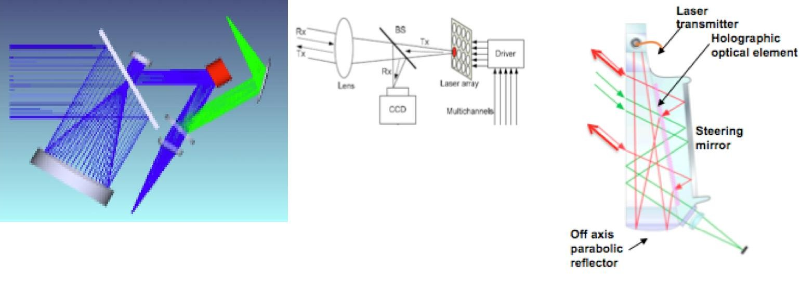

Figure 3. Three highly compact optical architectures of the flight lasercom terminal.

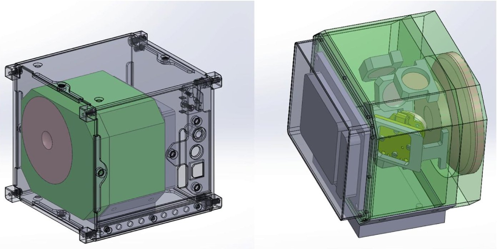

Figure 4. Monolithic optical transceiver designed for CubeSat 1U form factor.

## 4. Laser Transmitter

The required laser transmitter is commercially available in a highly compact form factor, in the form of a master- oscillator fiber-amplifier and with efficiency on the order of 10%. Improvements of the laser's wall-plug-efficiency will be required in order to meet the 5 W available power constraint at the spacecraft. Figure 5 shows the candidate laser and its key characteristics.

<!-- PDF_PAGE: 8 -->

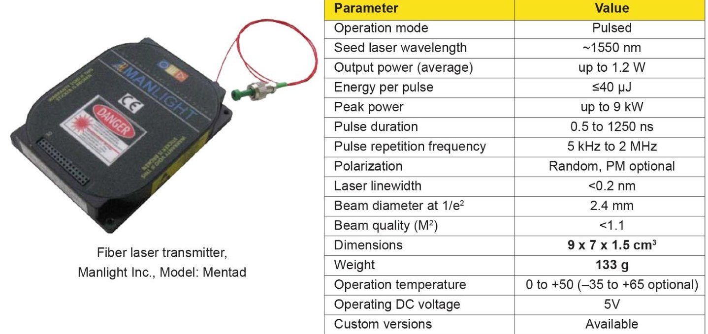

Figure 5. COTS-packaged version of the currently baselined laser and its key characteristics. Improvements in the electrical-to-optical output conversion efficiency of this or a similar laser will be required in order to meet the 5-W power allocation.

## 5. Electronics Assembly: Modem, Processor, Controllers, Power Converter

Using flight-grade parts, JPL has developed several generations of modems / processors / controller electronics specifically for laser communications from deep space. A subset of these boards (shown in the middle and right-hand-side of Fig. 6) would be adequate, low power, and small enough to meet the CubeSat requirements. Again, power efficiency has to improve to meet the 5-W allocation. A second JPL-developed board (shown on the left-hand side of Fig. 6) has flown recently on a CubeSat $ ^{3} $ and will be adequate to meet the majority of the electronics function of the flight lasercom terminal.

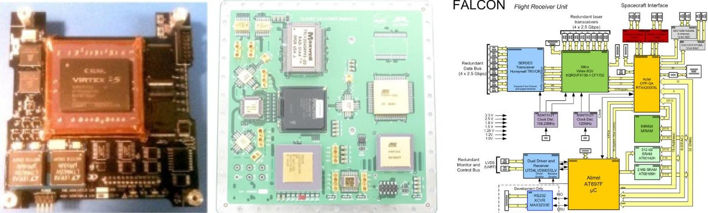

Figure 6. Flight-grade electronics boards developed at JPL that are suitable to meet the modem / processor / control functions of the flight terminal.

## 6. Ground Receiver and Transmitter Telescopes

The larger the ground receiver telescope diameter, the higher the achievable downlink data rate. Viable options include the 5-m Hale telescope at Palomar Mountain, California, and the 11.8-m effective diameter Large Binocular Telescope (LBT), in Arizona. JPL and Caltech together have 75% time on the Hale telescope, which is relatively inexpensive to rent. The LBT is significantly more expensive to rent. For the uplink beacon/commanding to a spacecraft, JPL owns a 1-m diameter telescope, the Optical Communications Telescope Laboratory (OCTL), located near Wrightwood, California. This telescope is dedicated to lasercom and is capable of pointing to small （<10 $ ^{\circ} $ ） Sun-angles. The backend electro-optic receiver and demodulator/decoder electronics have already been developed

<!-- PDF_PAGE: 9 -->

and tested by the JPL Optical Communications Group and will be available to this project in the event of a flight demonstration. Figures 7A and 7B show the Hale and the LBT telescopes, respectively; Figure 7C shows the 1-midiameter OCTL telescope.

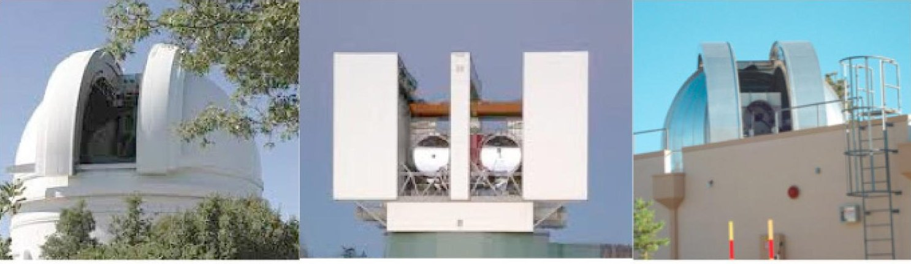

A

B

C

Figure 7. Candidate ground receiver telescopes: (A) 5-m Hale, (B) 11.8-m (effective aperture) LBT, and (C) the uplink telescope, the 1-m OCTL.

## D. Interplanetary CubeSat Solar Sail

## 1. Description

While other propulsion techniques are clearly capable of propelling Interplanetary CubeSats to worthwhile destinations, solar sails offer the combination of high performance capability with high technology readiness. Indeed, some lower $ \Delta V $ missions might be closer to optimal using electric propulsion. Our investigation focused on solar sail propulsion. Large, deployable, compactly packaged solar sails compatible with CubeSats will enable capable and inexpensive interplanetary missions for CubeSats. This NIAC investigation shows that a moderate-size deployable solar sail that will enable CubeSat interplanetary travel is readily scalable from the LightSail-1 $ ^{TM} $ Solar Sail CubeSat (Fig. 8), currently at TRL6.

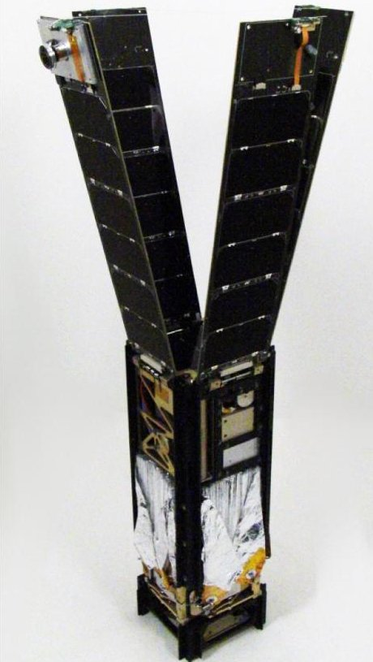

Figure 8. LightSail-1 $ ^{\mathrm{TM}} $ , a 3U CubeSat solar sail demonstration mission.

<!-- PDF_PAGE: 10 -->

LightSail-1 $ ^{\mathrm{TM}} $ , a project of The Planetary Society, $ ^{11} $ is a 3U CubeSat that stows and deploys a $ 3 2-\mathrm{m}^{2} $ solar sail (Fig. 9). The spacecraft uses the Air Force Research Laboratory (AFRL) - developed Triangular Rollable and Collapsible (TRAC) boom to unfurl the aluminized Mylar $ ^{\mathrm{TM}} $ stowed in four separate cavities machined into the main structure. The boom deployer provides an 80:1 pre- to post-deployment ratio. LightSail-1 $ ^{\mathrm{TM}} $ 's mission is to demonstrate solar sail deployment and positive orbit energy change in LEO.

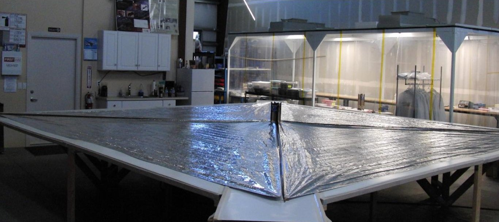

Figure 9. LightSail-1 $ ^{\mathrm{TM}} $ fully deployed at Stellar Exploration.

## 2. Solar Sail Design

In order to scale up the LightSail-1 $ ^{\mathrm{TM}} $ sail module design, several design variables needed to be investigated. The most important include the boom and sail film thickness, and packaging efficiency. This is critical for achieving enough sail area and therefore enough $ \Delta V $ to escape Earth orbit. Also, for an Interplanetary CubeSat, the sail film material lifetime limitation must be addressed. Therefore, aluminized Kapton $ ^{\mathrm{TM}} $ was baselined instead of the aluminized Mylar $ ^{\mathrm{TM}} $ used for LightSail-1 $ ^{\mathrm{TM}} $ , since Kapton $ ^{\mathrm{TM}} $ has a much longer lifetime than Mylar $ ^{\mathrm{TM}} $ during solar ultraviolet exposure. Following this, the thickness and packaging efficiency of both the booms and sail film were considered. It was determined that the minimum boom thickness commercially available from Elgiloy (same material as LightSail-1) was 0.003", which is 25% thinner than the boom material used on LightSail-1 $ ^{\mathrm{TM}} $ . Because the same type of boom (TRAC boom) would be used as compared with LightSail-1 $ ^{\mathrm{TM}} $ , a similar packaging efficiency was assumed ( $ \sim 80\% $ ). An additional advantage of the thinner material is that a smaller spindle diameter can be used without exceeding the maximum strain limit of the boom material. From this, the boom length to be packaged within a 10 cm $ \times $ 10 cm cross section is $ \sim $ 25 m ( $ \sim 6.25 $ m per boom), a 56% increase in packaged boom length compared with LightSail-1 $ ^{\mathrm{TM}} $ . The boom deployer assembly is shown in Fig. 10.

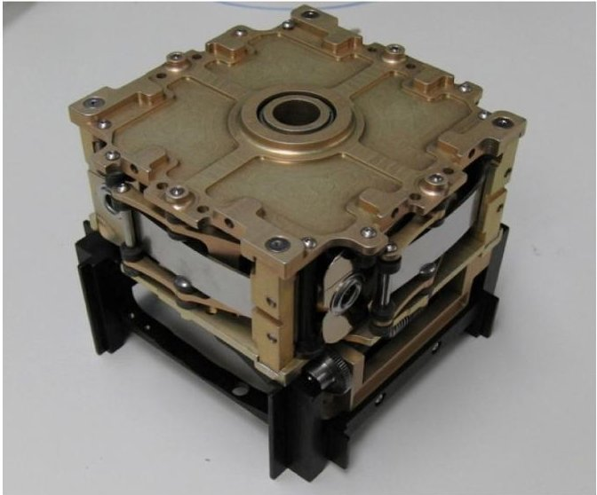

Figure 10. LightSail-1 $ ^{\mathrm{TM}} $ boom deployer assembly.

<!-- PDF_PAGE: 11 -->

The aluminized Mylar $ ^{\mathrm{TM}} $ used for LightSail-1 $ ^{\mathrm{TM}} $ has a thickness of 4.6 $ \mu\mathrm{m} $ and is reinforced with a 0.5" $ \times $ 0.5" scrim reinforcement. The aluminized Kapton $ ^{\mathrm{TM}} $ film availability investigation led from a current "off-the-shelf" thickness of 7.6 $ \mu\mathrm{m} $ to a newly available 5- $ \mu\mathrm{m} $ thickness film now being planned as part of a NASA Technology Demonstration Mission. It was determined that the spacecraft could stow the required amount of sail film using the 7.6- $ \mu\mathrm{m} $ -thickness material for the $ 78\mathrm{m}^{2} $ sail. This was determined after performing an initial layout of the spacecraft using CAD models of all the systems and components needed to meet the requirements of the Interplanetary CubeSat. The spacecraft packaging CAD model is shown in Fig. 11.

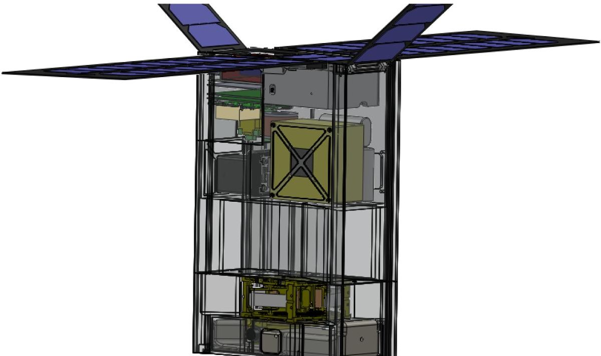

Figure 11. Spacecraft packaging CAD model.

The 6U form factor spacecraft would have four deployable solar arrays, two of which will be $ \sim 2 5 \times 3 2 $ cm with the other two being $ \sim 1 0 \times 3 2 $ cm. The larger of the solar arrays would be independently single-axis gimbaled to provide for de-saturation of the reaction wheels, when these are used (Fig. 12). The other axis is a passively controlled spring-actuated deployment. The smaller arrays are also deployed this way with no second-axis gimbal incorporated.

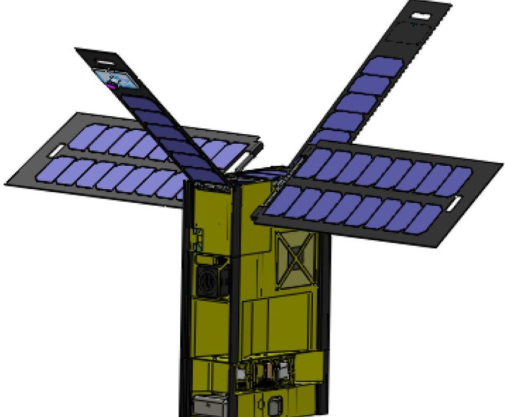

Figure 12. Spacecraft shown with actuated single-axis gimbal on solar cell arrays.

<!-- PDF_PAGE: 12 -->

The spacecraft would meet the 6U tab requirements as specified for the Planetary Systems Corp. (PSC) 6U CubeSat deployer. $ ^{5} $ This includes two tabs running the length of the spacecraft for the satellite release mechanism interface. Minimal recesses would be cut into the tabs primarily for clearance with the sail material and booms to deploy; this has been addressed and is generally accepted by PSC. Other deployers may also be suitable.

Figure 13 illustrates the stages of deployment. After release and detumble, the spacecraft releases the deployable arrays, and following this the sail is deployed.

During deployment, cameras mounted to the tips of the smaller solar array panels will image the sail deployment. The images taken during deployment are one indication of successful deployment.

System qualification testing would be conducted the same way LightSail-1 $ ^{\mathrm{TM}} $ was qualified. Deployment tests can take place on an off-loading table to verify deployment and observe boom and sail dynamics. Deployment tests would need to be conducted before and after random vibration and thermal vacuum (TVAC) testing to ensure reliability of deployment.

Canted tips with individually controlled stationary electrochromic vanes can be used to enable three-axis photon pressure attitude control without moving parts, eliminating the need for any consumables or moving parts after sail deployment.

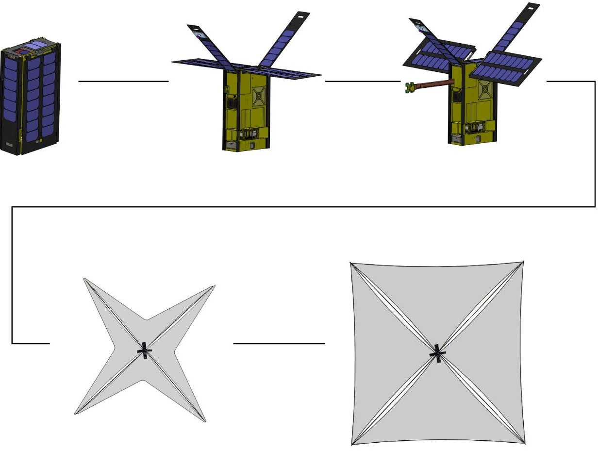

Figure 13. Spacecraft deployment sequence.

<!-- PDF_PAGE: 13 -->

## E. Launch and Navigation of the Interplanetary Superhighway

## 1. Getting to Earth Escape

As of the date of this report, no CubeSat has been launched above low Earth orbit (LEO). Before an Earth- originating mission can be truly "interplanetary," it must first escape Earth orbit. (We also include in the "interplanetary" class cis-lunar missions, because the same challenges of radiation environment and long communications distance compared with LEO CubeSat missions apply as with missions truly beyond Earth escape.) The easiest way to accomplish this is to get a ride as a secondary payload aboard a mission or launch vehicle that is already going to Earth escape in order to satisfy the objective of the primary payload. Such missions depart from time to time, such as to Mars, the Moon, and other destinations. Launch mass margins are usually such that a 10 kg 6U CubeSat plus its $ \sim 5 $ kg launch container and attachment hardware can be accommodated, although such margin may be closely-guarded by the primary customer until a few months before launch. Several such launches in the past have had sufficient mass margin for two or more CubeSat-class secondary payloads.

If a convenient launch to Earth escape cannot be made available, another option is to ride as a secondary payload aboard a launch to geostationary Earth orbit (GEO; sometimes called Clarke orbit). Several such launches occur every year, and are likely to continue into the forseeable future. Some communications satellites have volume and mass capability available to carry secondary payloads, and their manufacturers and operators are offering this to "hosted payloads" and CubeSats. $ ^{12} $ If an Interplanetary CubeSat incorporates a solar sail the size of that aboard LightSail-1 $ ^{TM} $ (5.6 m on a side) with a similar spacecraft mass (<5 kg), then Earth escape from GEO can be achieved in a little over 3 years. Extending the sail size to 10 m on a side, the approximate limit to which the LightSail-1 $ ^{TM} $ -type sail, spars and deployment mechanism can be extended for a modest cost increase, could enable escape with a 10 kg, 6U CubeSat in under 2.5 years. We believe that by $ \sim 2 0 3 0 $ , utilizing thinner sail material, advanced booms, and printing photovoltaics and perhaps other functionality onto the sail surface, that a sail 20 m on a side will be possible, still fitting within $ \sim 2 $ U of 6U Interplanetary CubeSat with a total mass of 10 kg. If this prognosis turns out to be correct, then such an Interplanetary CubeSat will be able to reach Earth escape from a GEO departure less than a year earlier.

The trajectories plotted in Figure 14 were calculated using a maneuvering algorithm designed to increase the eccentricity of the orbit. They are not fully optimized, and do not take advantage of the Moon's gravitational influence or the Interplanetary Superhighway; thus we expect somewhat superior performance may be realizable. Optimization will of course depend on specifics of a sail, achievable attitude rates, and the final destination for a particular mission, but these examples serve as an approximation sufficient to assess performance available for a range of sail size and spacecraft mass.

Thus, even absent a launch slot to Earth escape, multiple Interplanetary CubeSats every year would be able to reach a variety of lunar, asteroidal, and interplanetary destinations by riding along with telecommunications or other GEO satellites.

Launches may be more commonly available aboard launch vehicle upper stages to geosynchronous transfer orbit (GTO) than all the way to GEO. While drop-off in GTO can be attractive from a trajectory and time-to-escape point of view, if the Interplanetary CubeSat employs low thrust to get from GTO to Earth escape, its trajectory will result in high radiation exposure, which is likely to drive costs higher.

<!-- PDF_PAGE: 14 -->

(A)

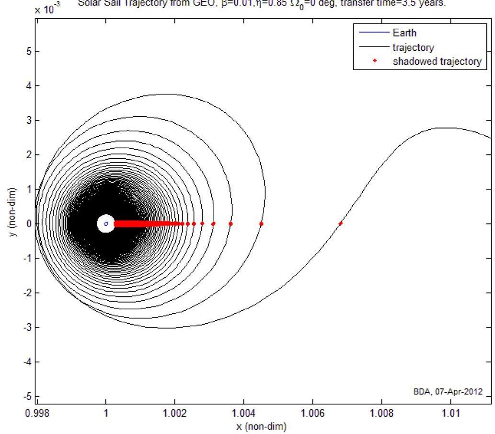

(B)

$ \times10^{-3} $ Solar Sail Trajectory from GEO, $ \beta=0.015,\eta=0.85\Omega_{0}=0 $ deg, transfer time=2.35 years.

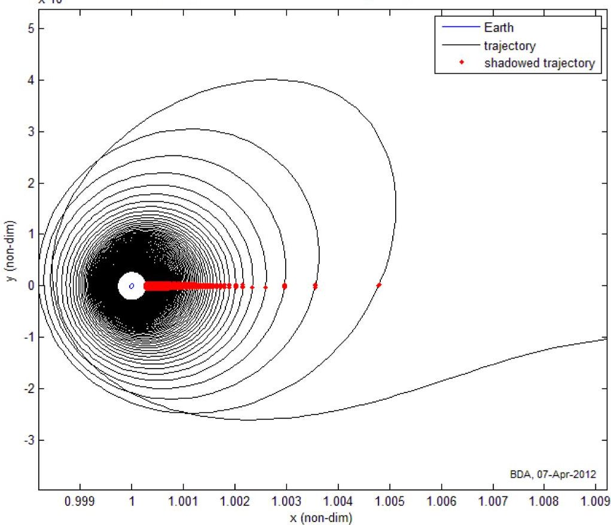

<!-- PDF_PAGE: 15 -->

(C)

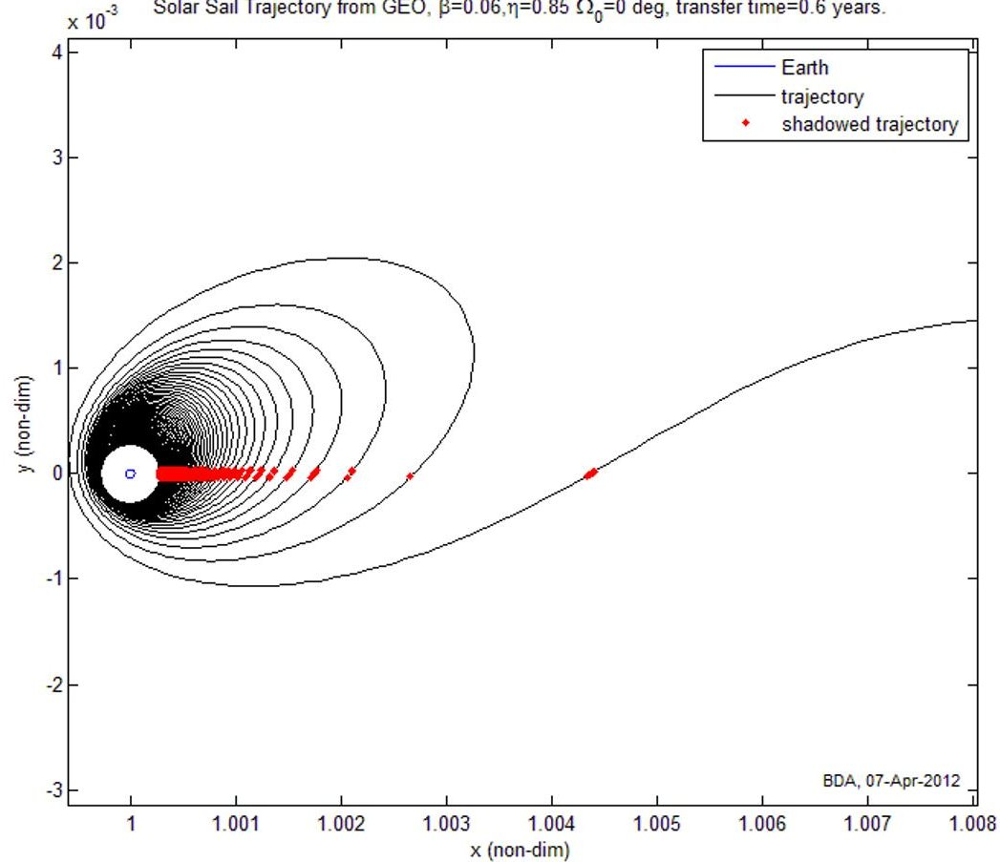

Figure 14. Example trajectories to Earth escape from geostationary Earth orbit (GEO), with 85% sail efficiency. These do not include effects of the Moon and fourth-body effects, which can serve to modestly reduce time-to-escape. (A) 5.6 m on a side square sail, 4.6 kg total spacecraft mass. (B) 10 m on a side square sail, 10 kg total spacecraft mass. (C) 20 m on a side square sail, 10 kg total spacecraft mass.

## 2. Navigating the Interplanetary Superhighway

For Interplanetary CubeSats to be most broadly applicable, they require a self-contained propulsion mechanism. Because solar sails can provide large $ \Delta V $ 's without exhausting a finite propellant supply, we chose this technology to be able to probe the limits of the most demanding mission concepts. Many interplanetary missions can be enhanced by utilizing the inherent natural realities of the complex multibody gravity field that creates the Interplanetary Superhighway. Combining sunlight-driven propulsion with the complex mathematics describing the Interplanetary Superhighway offers the greatest advantages in mission design for maximum performance, and also some of the greatest analytical challenges in order to make the most of this combination. Other propulsion mechanisms, such as electric thrusters, may be a better choice for some missions. And the benefits of utilizing the Interplanetary Superhighway will be nonessential for some applications. But we seek to set the groundwork for the combination of the two in order to illustrate the largest possible mission envelope for Interplanetary CubeSats over the next two decades. Among the first elements of groundwork required is a set of tools to conceive, analyze, and design such trajectories.

Solar sail trajectory design and navigation using the Interplanetary Superhighway provide a unique set of challenges. Since propulsion requires the sail to face the Sun, attitude control of the sail is a critical function. Acceleration provided by the thrust from solar photons is extremely small, typically on the order of 0.1 mm/sec $ ^{2} $ at 1 AU. Thus, large sail sizes are highly desirable. But this makes the control of the sail difficult, especially near a planet where the sail creates a relatively large gravity gradient torque. Occultation blocking sunlight from the sail becomes a problem when the spacecraft is near a planet. In general, sail attitude control rates need to be small. Another issue, "turning the sail off," is a nontrivial matter. When the spacecraft is in a low-energy trajectory environment created by the Three-Body Problem, the nonlinearity and sensitivity of the dynamics create additional

<!-- PDF_PAGE: 16 -->

complexity that must be addressed. The Interplanetary Superhighway is precisely such an environment. However, this also offers a unique opportunity to combine the low thrust control of the sail with the sensitive dynamics of the Interplanetary Superhighway to provide mission design options not available with conic orbits. With the slightest adjustments of the sail, we can target a large family of nonlinear trajectories with vastly different properties and behavior. But, in order to exploit these dynamics, new tools are needed, which we describe below.

Solar sail trajectories (see Grebow 2010 $ ^{13} $ , Grebow and Lo 2012 $ ^{14} $ ), in general, do not have closed-form solutions even in the Two-Body Problem. This is because the addition of the continuous low thrust from the Sun on the sail changes the trajectory optimization problem from a finite dimensional problem to an infinite dimensional problem. Instead of optimizing over a finite number of impulsive burns with rockets, the continuous thrust needed for sails is a function. Thus, the optimization process now lives in function spaces that are infinite dimensional. The calculus of variations was one of the first methods used to optimize these trajectories, also called the "Indirect Method." In general, indirect methods are based on necessary optimality conditions such as Pontryagin's Maximum Principle. This presented a problem since the optimization is generated by the Lagrange multiplier function, also known as the PrimeR Vector. Unfortunately, there is no known way of easily generating such a function, not even for a good initial first guess for such a function. Moreover, this optimization algorithm is highly unstable and the basin of attraction (a neighborhood of the initial first guess which would result in convergence) is small. In the regime of the Interplanetary Superhighway (i.e., the chaotic regions of the Three-Body Problem), the instability of the algorithm makes the convergence of solutions extremely difficult.

We propose an alternate approach, called Collocation, also called the "Direct Method." In general, direct methods approximate the original problem by a finite dimensional optimization problem through discretization. Collocation discretizes the trajectory (and control) into a finite set of nodes. A family of base functions such as polynomials of a fixed degree are used to interpolate the nodes to produce a continuous trajectory. The nonlinear cost function is minimized using nonlinear programming methods by adjusting the nodes. The formulation of the problem is straightforward and the optimization can take advantage of powerful modern nonlinear optimizers such as SNOPT or IPOPT. Moreover, collocation methods have a wider basin of attraction and are thus much less sensitive to errors in the initial guess solution. This also permits the use of implicit methods of integration and such schemes are much simpler to parallelize. Since our interest is in exploiting the sensitive trajectories in the Interplanetary Superhighway, Collocation. with its more robust convergence capability, is the method of choice.

A second component that is also critical to any trajectory optimization scheme is the ability to generate good initial guess solutions. Without a good guess, optimizers have a difficult time producing good solutions, if they can at all. Particularly in the case of the Three-Body Problem, where there are a vast number of local minima, this is a key issue. Aside from convergence, another issue is the ability for the trajectory designer to be able to quickly come up with an initial design before optimization. A highly desirable capability is to be able to produce a robust initial design, which, when optimized, still keeps the main characteristics of the initial design. For example, if the initial orbit design goes around the Moon twice, the final optimized design must also do the same. If this is true, then for advanced studies and for proposal work, one could just use the robust initial design as a starting point to design the architecture and missions as preliminary point designs. For conic orbits, the method of patched conics provides such a solution. By using Lambert's Theorem, any two points in space around a central body have at least one conic arc connecting the two points for any given flight time. By patching the Lambert arcs from point to point, one is then

able to produce an end-to-end trajectory design very quickly. The introduction of $ \mathrm{C}_{3}, $ $ \mathrm{V}_{\infty} $ , and the pork-chop plots further enhanced our capability to design planetary flybys, orbits, and landings.

For the Three-Body Problem, such tools are missing. This is because Lambert's Theorem is no longer true in the Three-Body Problem. This is where the Interplanetary Superhighway comes to the rescue. Even though we are no longer able to produce arcs connecting arbitrary points in space, the Three-Body Problem provides an alternative solution that is more complicated. Nevertheless, asteroids, comets, Kuiper Belt objects, and meteroids have been navigating these "alternative" paths for billions of years and we do well to emulate them where we can. This alternative solution is Poincaré's Dynamical Systems Theory. He discovered that the key to understanding the dynamics of a system such as the Three-Body Problem is to find all of its periodic orbits. The unstable periodic orbits in the Three-Body Problem have a unique property: they possess two families of asymptotic trajectories forming tubes called invariant manifolds around the periodic orbit. Figure 15(a) shows the two families of tubes around a Lyapunov orbit around the L1 Lagrange points. The red trajectories, called the unstable manifold of the periodic orbit, are unstable (with respect to the periodic orbit) and depart the periodic orbit into other regions of space. The green trajectories, called the stable manifold of the periodic orbit, are stable (with respect to the periodic orbit) and are attracted to the periodic orbit. It is these tubes that now replace the Lambert arcs connecting different regions of space. Hence, we need to map out the connections from one periodic orbit to the next and this web of

<!-- PDF_PAGE: 17 -->

connecting orbits is what forms the Interplanetary Superhighway. They also are typically chaotic orbits which means that with very small controls (maneuvers), we can effect very large changes in the final trajectory. This is the source of the low-energy orbits that we so prize for space mission applications (see Koon, Lo, Marsden, Ross, $ 2 0 0 0^{1 5} $ ). Figure 15b shows an artist's concept of the Interplanetary Superhighway in the Earth-Moon neighborhood where the Sun-Earth manifolds intersect the Earth-Moon manifolds. This could be used, for example, to bring telescopes from halo orbits around Sun-Earth L2 back to the Earth-Moon L1 or L2 with almost no propulsion cost (less than 1 m/s deterministic maneuver) where astronauts can service the telescopes.

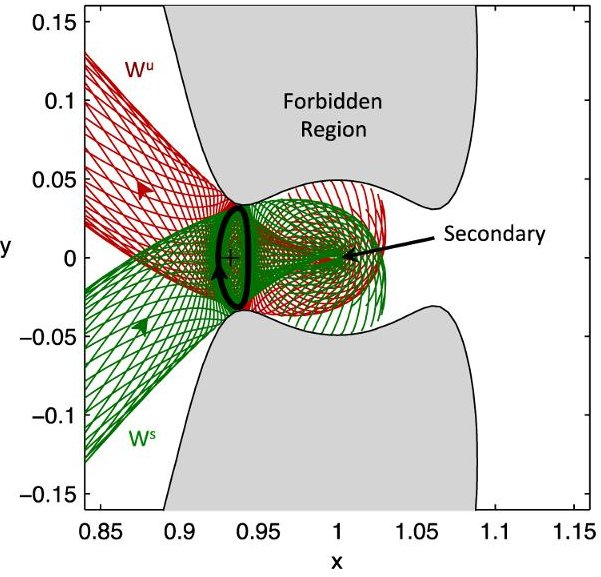

(a)

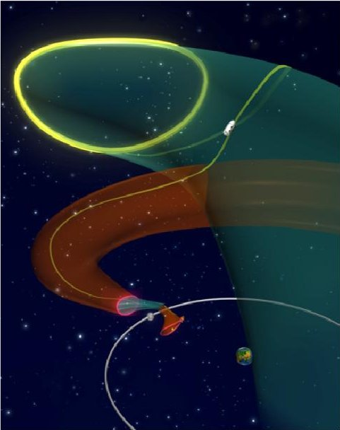

(b)

Figure 15. Invariant manifolds in a rotating coordinate system with the Sun-Earth line on the X-axis. (a) The periodic orbit (black) around L1 generates trajectories that wind around the orbit and then extend out. The green trajectories approaching the periodic orbit form the Stable Manifold. The red trajectories departing from the periodic orbit form the Unstable Manifold. Earth is the dot at the middle of the plot with the label for the "Secondary" body of the Three-Body Problem. The Sun (Primary body in this case) is toward the left, off the page. The grey region is the forbidden region at this energy level. (b) Artist's (Cici Koenig) concept of the manifolds of the Sun-Earth system intersecting the small manifolds of the Earth-Moon system creating low-energy transfers between the Sun-Earth Lagrange points and the Earth-Moon Lagrange points. This could be used to bring telescopes around the Sun-Earth L2 to the Earth-Moon L1 or L2 for astronauts to service them.

Unfortunately, the Three-Body Problem, as simple as it is, does not possess analytical solutions. Even its five equilibria, the Lagrange Points, must be computed numerically, as must their associated invariant manifolds. Although the methods for computing some of these objects are known and some catalogs of periodic orbits of the Three-Body Problem exist, there is no catalog of the invariant manifolds for any general family of periodic orbits. In order to take advantage of these low-energy trajectories, we must first produce catalogs of the periodic orbits and their invariant manifolds. Once the periodic orbits and their manifolds have been mapped, we need to develop methods and algorithms to analyze the manifolds for mission design analogous to tools for analyzing Two-Body

trajectories and missions using $ \mathrm{C}_{3}, $ $ \mathrm{V}_{\infty} $ , and the pork-chop plots. For the Three-Body Problem, these capabilities are largely missing since the whole field of low-energy trajectories is still so young and we are still figuring out how to use them for space missions. Of the many known families of periodic orbits, mainly those around the Lagrange points, the Halo and Lissajous orbits are the only ones that have been used for mission design. The rest have not been analyzed to any extent except sporadically when a particular orbit was discovered for a particular mission. For example, for our High Solar Inclination Constellation mission concept, we came upon one of the vertical orbits (see Fig. 16) that can orbit to the poles of the Sun. At the moment, we do not know how to get into such an orbit from Earth or how long this may take. We do not even know what invariant manifolds it possesses, or whether they could be used for transfer from Earth's vicinity.

<!-- PDF_PAGE: 18 -->

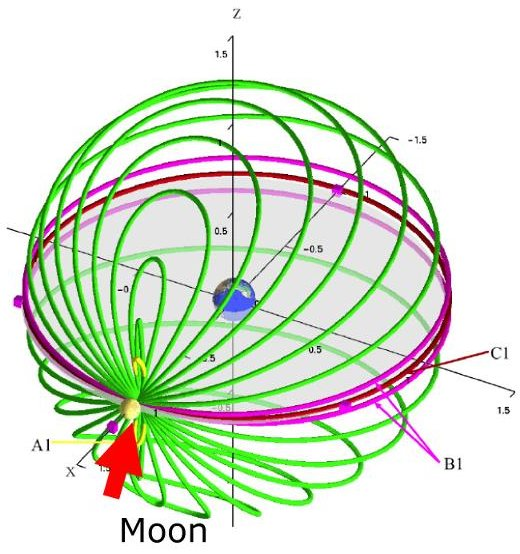

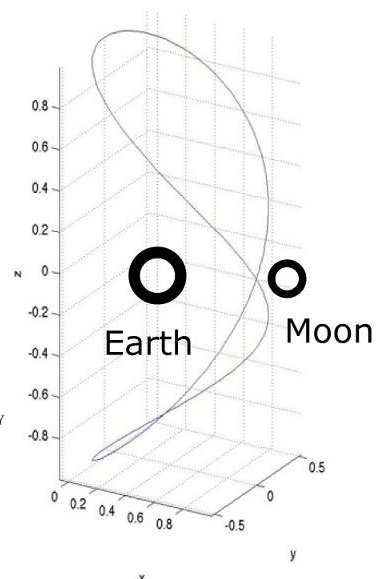

(a)

(b)

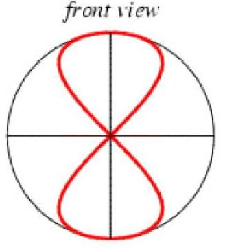

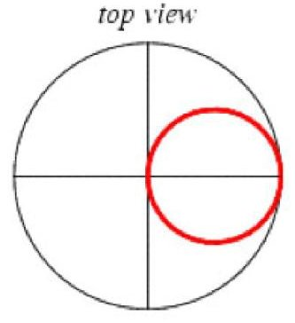

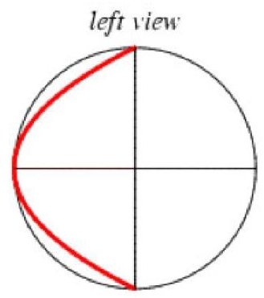

(c)

Figure 16. Vertical orbits around L1. (a) This shows the family of vertical orbits (figure 8 shape) at all inclinations for the Earth-Moon system; Earth is at the center. (b) A vertical orbit over Earth at 90-deg inclination. (c) Front, top, and side views of the vertical orbit in (b). These orbits are useful for studying the polar regions. In the case of the Sun-Earth system, they can be used to study the pole of the Sun, such as for the High Solar Inclination Constellation concept. Note: There are vertical orbit families with polar-viewing orbits for each of the Lagrange points, L1, L2, ... L5.

We should clarify here that although we refer only to "periodic orbits" only in the text, we actually also include quasiperiodic orbits by this terminology to simplify the discussion. A quasiperiodic orbit, such as Lissajous orbits, never closes on itself, and generates a torus. They also have invariant manifolds that form so-called "whiskered tori." These manifolds are 3D tubes that are difficult to visualize. They actually exist on a 5D energy surface.

For complex missions exploiting the nonlinear dynamics of the Interplanetary Superhighway by solar sail, a catalog of the invariant manifolds is the minimum starting point for designing an initial guess solution for an optimization tool to produce the final solution. One would construct such a guess by putting together pieces of invariant manifolds from one periodic orbit to the next, thereby creating a "patched manifold solution," mimicking the "patched conic" approach that has been so successful for planetary flyby missions. Actually, the patched manifold solution has been well tested by missions such as Genesis (see Howell, Barden, $ \mathrm{L o}^{1 6} $ ) or the postulated Lunar Sample Return Mission (see Lo and Chung $ ^{1 7} $ ), Gravity Recovery and Interior Laboratory (GRAIL) as flown, and Artemis. All of these missions are based on the invariant manifolds of halo-type orbits, a very small set of possible orbits in the Three-Body Problem.

The algorithms by which we patch these manifold solutions together depend highly on the nature of the mission design problem and the type of periodic orbits being used. The actual engineering of such algorithms is one of the key technologies that needs to be developed in order to fully exploit low-energy orbits. For instance, the resonant

<!-- PDF_PAGE: 19 -->

flybys used for the Cassini Tour Design are very different from those for approaching and landing on Europa, although in both instances, invariant manifolds are used. In the Tour Design, mostly manifolds of resonant orbits are used. But for approaching Europa, in addition to the manifolds of resonant orbits, the manifolds of libration orbits and periodic orbits closer around Europa play the most significant role for the End Game. Not only do the algorithms to find these different periodic orbits differ, the methods by which we use their manifolds are also completely different for these two problems.

Figure 17 is a "subway map"-like illustration of some of the periodic orbits in the Three-Body Problem generated by the five Lagrange points. This was produced by the AUTO program (see Doedel, et al. $ ^{1 8} $ ), which uses Collocation to integrate its trajectories as we are proposing to do. Each point along the curve represents a periodic orbit. Each of the curves represents an entire family of periodic orbits. The blue Halo orbit families are the only ones to have been used for space missions to date. The rest of the curves on the map have not been analyzed or used for any missions. Beyond this map, there are still uncountable families of periodic orbits waiting to be discovered and applied. Figure 18 shows some of the orbital families from the subway map of Fig. 17. All of the trajectories are plotted in the rotating frame standard to the Three-Body Problem.

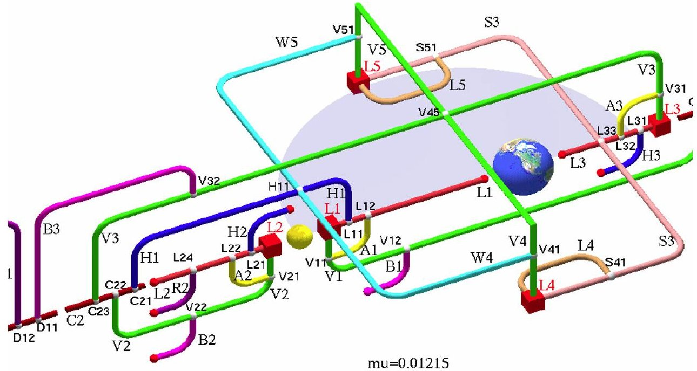

Figure 17. "Subway map." This is a "bifurcation diagram" generated by AUTO (from Doedel et al.; see reference in text). Each point on the various colored lines represents an orbit. This is for the Earth-Moon system. The Moon is the yellow sphere near the middle of the plot. The red cubes represent the Lagrange points. See Fig. 18 for a plot of some of the orbital families.

To develop the technology behind the Interplanetary Superhighway, we propose a series of steps.

1. First and foremost, map the Interplanetary Superhighway. This means to map the periodic orbits and their invariant manifolds. Of course, since there are so many orbital families, not all of which may be useful for space missions, part of this step is to categorize the orbital families and select the potentially most useful families for space missions for mapping and analysis. Collect the orbits and their manifolds into catalogs.

2. Analyze the cataloged orbits. This means to characterize the orbits for potential applications. Find transfer trajectories to and from the orbit from Earth.

3. Develop a Manifold Lambert Solver. By this we mean a tool that will produce a patched manifold solution between any two points in space and a flight time. This tool can be used to produce good initial guess solutions for many trajectory optimization tools such as LTool, Mystic, CATO, and our solar sail trajectory optimization tool.

<!-- PDF_PAGE: 20 -->

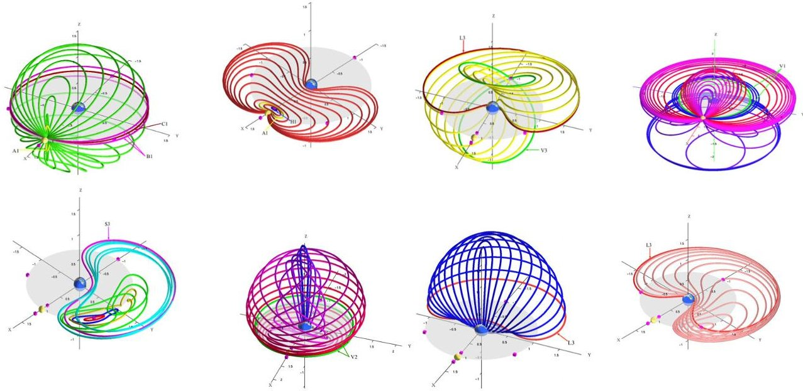

Figure 18. Orbital families. Here are eight representative families of orbits in the Earth-Moon system from the bifurcation diagram in Fig. 17. From left to right, top to bottom, the eight families are: (1) V1 vertical $ \mathrm{L}_{1} $ family, (2) L1 Lyapunov family, (3) A3 family, (4) the northern B1 family which includes the "backflip orbit" $ \mathrm{(C.Uphoff}^{19}) $ ,(5) L4 planar long-period family, (6) B2 family, (7) northern halo H3 family, (8) planar shortperiod S3 family. (From Doedel et al.; see reference in text.)

These tools are the starting point for developing the Interplanetary Superhighway. More research and development is required to understand how to create algorithms and tools for producing robust initial guess solutions suitable for advanced concept work without full optimization. Since the patched manifold guess trajectories do not include any low-thrust approximations, while they are good first guess solutions for trajectory optimizers, we don't think they are robust enough to be used as preliminary designs for proposal work or advanced studies. But they are a necessary first step to start the process for generating a good initial first guess solution for the optimizers. We still need to figure out on a case-by-case basis exactly how to solve this problem. This is because, at the moment, we don't have a good general mathematical theory for optimizing trajectories with continuous thrust.

Maps of the periodic orbits and their manifolds have many more uses besides trajectory design and optimization. They are a critical component for automating the trajectory design process as well as the navigation process. We often forget that what makes GPS navigation possible is the fact that we have a good set of maps that GPS can point to for the navigation algorithm to work. In the same way, in order for autonomous navigation to work in space, we must have a map of where all the paths and orbits are. This is provided by the periodic orbits and invariant manifolds.

Some preliminary work for automating the navigation in the Interplanetary Superhighway has been done through a technique called "LiAISON" navigation (Linked Autonomous Interplanetary Satellite Orbit Navigation, coined by Keric Hill, see Hill, Lo, Born, $ 2 0 0 6^{2 0} $ ). The basic idea is to exploit the asymmetry in gravity fields in order to precisely pinpoint the location in space. This works particularly well in the Three-Body Problem away from Earth. But recent developments have shown that even for near Earth, LiAISON works well (see Villac, Chow, Lo, Hintz $ 2 0 1 2, $ $ ^{2 1} $ Chow $ 2 0 1 2^{2 2} $ ).

## F. Small, Highly Capable Instruments: Imaging Spectrometer Example

Small, highly capable instrumentation far beyond simple cameras has been demonstrated by several implementors aboard LEO CubeSats. One specific application of Interplanetary CubeSats could be reconnaissance of near-Earth asteroids. Surface composition maps are of particular interest for scientific understanding of their formation and evolution within the Solar System, and as potential targets of future human exploration. We identified a path from the airborne Portable Remote Imaging Spectrometer (PRISM) $ ^{23,24} $ weighing tens of kilograms, and the Moon Mineralogy Mapper (M3) weighing 8.5 kg, to an instrument compatible with 2U of a

<!-- PDF_PAGE: 21 -->

CubeSat form factor, 2 kg, with performance capable of mapping the minerals on the surface of an asteroid, and with spatial resolution of a few meters or less, depending on approach distance while in orbit. For each pixel across a 14-deg image swath, this instrument samples 120 bands, 10 nm wide, from 450 to 1650 nm (violet into shortwave IR, where many mineral-specific spectral features exist). The detector is clocked to sample the along-velocity dimension in approximately square pixels by matching the cross-track spatial dimension. Imaging spectroscopy analysis techniques developed for terrestrial applications, and used at the Moon on Chandrayaan-1/M3, $ ^{25} $ can quantify from the data to a few-percent accuracy the subpixel surface extent of each of the most common minerals in each pixel, starting from their known laboratory spectra, Apollo lunar samples, meteoroid samples, and principal components analysis. This capability is vastly superior to multispectral imaging with its few broad bands. If desired, standard RGB images or other computed filter selections can be derived by combining subsets of the data, either onboard the spacecraft or on the ground using downlinked full-spectrum data.

Small instruments are nothing new to the CubeSat world. Many of the same approaches that apply to instruments for LEO can be applied to Interplanetary CubeSats. In the case of the imaging spectrometer, the fundamental change was switching from the Offner optical path used in the M3 instrument to a Dyson optical layout (Fig. 19), which shrinks the volume required for the optical path by a factor >10. The detector can remain the same, although advances are expected in pixel size, pixel count, IR sensitivity, dark current, and other relevant parameters. Instrument electronics likewise are expected to continue shrinking and having lower power needs in concert with ongoing commercial forcing functions.

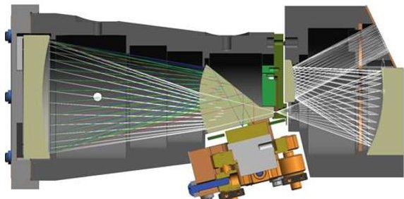

Figure 19. Optomechanical design of a compact Dyson F/1.4, 33 imaging spectrometer.

## G. Onboard Storage and Data Processing

## 1. Introduction

Our NIAC work focused on determining the most promising technology developments to enable interplanetary CubeSats that can function in the modest radiation environment, downlink maximum information content within a limited data rate, and function with enough autonomy to be operated by a few individuals on a part-time basis. The onboard storage and data processing element for Interplanetary CubeSat missions will leverage the design and development path of the CubeSat On-board processing Validation Experiment (COVE) $ ^{26,3} $ that featured the Xilinx V5QV FPGA and phase change memory (PCM) devices (Fig. 20). M-Cubed/COVE was launched as a secondary payload with the NPOESS Preparatory Project (NPP) mission on October 28, 2011. Due to an on-orbit anomaly, M-Cubed could not establish commandability and therefore the COVE payload could not be powered on to perform its in-flight validation operation. JPL gained design, fabrication/assembly, and test experience with the new V5QV FPGA as a result of this task. NASA's Earth Science Technology Office has approved funding for an M-Cubed/COVE-2 reflight, and the rebuild of the payload is nearly complete.

<!-- PDF_PAGE: 22 -->

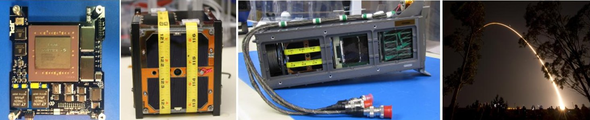

Figure 20. (L) to (R): the JPL COVE Payload featuring the Xilinx V5QV FPGA; U. Michigan's M-Cubed CubeSat with COVE integrated; M-Cubed integrated into the Poly-PicoSatellite Orbital Deployer (P-POD) along with CubeSats from Montana State and Auburn University; NASA/NPP launch with CubeSat secondary payloads on a Delta-II from Vandenberg AFB on Oct. 28, 2011.

## 2. FPGA Processing

The Xilinx Virtex-5 FPGA is reprogrammable and offers highly desirable processing elements such as digital signal processor (DSP) blocks, high-speed clocking resources, and embedded block RAM (BRAM). The Virtex-5 provides the capability to accommodate detector data acquisition and onboard processing via algorithms designed to optimize data collection within the onboard memory storage and system downlink capability.

In 2011, Xilinx released its first high-density, Single-event Immune Reconfigurable FPGA (SIRF) for space applications. $ ^{27} $ The V5QV rad-hard design dramatically reduces redundancy and configuration management concerns of previous radiation-tolerant devices while experiencing high TID and no latch-up. The reconfigurable nature of the device means that design changes and updates can be made without changes to the hardware, providing an unparalleled ability to accommodate last minute changes in the development of flight hardware without major risk to project schedule and cost. The V5QV provides the highest performance available (up to 450 MHz) with a big improvement over the previous generation V4QV device. The closest competitor to Xilinx lags far behind and is not reconfigurable. The high density of this device (up to 130,000 logic cells) allows designers to realize more complex and capable applications and systems than with rad-hard application-specific integrated circuits (ASICs). The radiation-hardened-by-design (RHBD) features of the V5QV are backed by an unprecedented level of in-beam testing, equivalent to millions of device years in space radiation environments. The device is available off-the-shelf and is pin-compatible to the commercial-equivalent Virtex-5 FPGA enabling prototyping solutions on development systems before flight hardware designs are mature. Anticipated space-capable Virtex 7 class devices will enable 50- 70% power savings in highly complex multichip avionics and related processing systems, but are currently available only in commercial-grade.

## 3. Memory/Storage Devices

In the COVE board design, the primary method of transferring processed payload results to the CubeSat bus is via a shared phase-change memory (PCM) device. Flash devices trap electrons to store information; therefore, they are susceptible to data corruption from radiation. However, PCM exhibits higher resistance to radiation so this is an advantage for space applications. $ ^{28} $

The COVE board is also populated with nonvolatile Magnetoresistive Random Access Memory (MRAM) for use as additional instruction and data storage for the FPGA. This device was selected for its small package size, nonvolatile storage, better radiation tolerance, and previous spaceflight. $ ^{29} $

## 4. Onboard Processing (OBP) Algorithms

Interplanetary CubeSat instrument payloads will require massive data processing and complex integration of functions enabled by high-performance FPGAs such as the Xilinx V5QV. In 2008, the NASA Earth Science Technology Office (ESTO) selected a proposal to develop an onboard processing algorithm for the Virtex-5 FPGA to optimize the imaging system for the Multispectral Polarimetric Imager (MSPI, with PI David Diner/JPL), an instrument under development at JPL targeting the Earth Science Decadal Survey Aerosol-Cloud-Ecosystem (ACE) mission. $ ^{26,30} $ MSPI has proposed 9 cameras, each of which must eventually process a raw video signal rate around 95 Mbytes/s over 16-20 channels for spaceflight. A computationally intensive algorithm was developed to perform roughly a 2-order-of-magnitude data reduction for video processing of the signal output from the photodetector array. These data reductions were performed (without sacrificing the information content of the camera product for science) based on how the calculations are implemented for digital signal processing in the Xilinx Virtex-5FXT FPGA. The technology developed within this task is required to enable this process to occur in real time, with the speed necessary

<!-- PDF_PAGE: 23 -->

to keep up with the MSPI data throughput. This example provides a proof-of-concept of the capabilities of the Virtex-5 FPGA to support the on-board processing requirements of future Interplanetary CubeSat missions.

## 5. Future Capabilities

3D Silicon will be the single biggest innovation in the IC industry in the next 10 years with capacity, bandwidth, and power efficiency improvements and the ability to mix different technologies in the same package. This will allow developers to manage and enable incredibly complex systems for multiple buses, complicated clock distribution networks, and multitudes of control signals.

Nonvolatile memory is the main scaling driver with Flash memory now smaller than dynamic random access memory (DRAM) memory. Multilevel Flash memory is now the same density as hard drives, but the reliability of these devices is a critical limitation. Any charge-based memory device will always have significant radiation limitations (< 30 krad). The evolution of memory devices including nonvolatile memory, multilevel flash memory, phase-change memory (PCM), resistance change metal-insulator-metal (MIM)based cells, etc., needs to be tracked. Reliability of these devices is application-dependent and may include radiation limitations. High-density (>1 Gb) rad-hard nonvolatile memory will be a fundamental breakthrough for all space applications, including Interplanetary CubeSats.

Breakthrough Cubesat mission capabilities will be enabled by rad-hard FPGA processing and advancements in memory capacity, both leveraging small packaging (mass/volume), low power consumption, and increased reliability through application and implementation decisions.

## III. Mission Applications

Fundamental capabilities of the proposed Interplanetary CubeSat architecture enable a variety of focused, lowercost missions beyond Earth. Some of those considered in our initial NIAC investigation include:

- Mineral Mapping of Asteroids for Solar System Small Body Science $ ^{31,32} $

- Rapid Solar System Escape as a Technology Demonstration

- Earth-Sun System Sub-L1 Space Weather Monitor for Space Physics and Heliophysics and Operational Solar Storm Warning

- Phobos Sample Return for Solar System Science

- Earth-Moon L2 Radio-Quiet Observatory for Astrophysics

- High Solar Inclination Constellation for Space Physics and Heliophysics

## A. Mineral Mapping of Asteroids

The 2011 Planetary Science Decadal Survey by the National Research Council identified a large number of asteroids as important targets for understanding presolar processes recorded in the materials of primitive bodies; to study condensation, accretion, and other formative processes in the solar nebula; to determine the effects and timing of secondary processes on the evolution of primitive bodies; and to assess the nature and chronology of planetesimal differentiation. For this mission, an Interplanetary CubeSat is carried aboard another launch to GEO, or to Earth escape. The solar sail propels the spacecraft, capable of $ \sim1 $ km/s/yr using realistic duty cycle and pointing inefficiency, with a sail less than 10 m on a side. The spacecraft is navigated to the first target asteroid for either rendezvous or a slow flyby. The example imaging spectrometer described performs calibrated visible to shortwavelength infrared (VSWIR) spectroscopy, a proven technique to determine composition. Using bulkier instruments, this technique has been used successfully to study asteroids from Galileo, NEAR, Cassini, and Rosetta. Key minerals have diagnostic features in the 450-1600-nm wavelength region covered by the instrument, which samples across this wavelength range in internals of 10 nm, and angular sampling of 0.5 mrad, yielding a surface sampled distance of 5 m at a 10 km flyby distance, across a 14-deg field of view, or 2.4-km swath. Mafic minerals (e.g., olivine and pyroxene) have strong bands around 1 $ \mu $m, which are related to iron minerals. In the 1400-nm region, water bands can be used to determine if hydrated minerals are present. These features can be used to investigate asteroidal differentiation and evolution. The spectrometer (shown in Figure 19) is a miniaturized version of the compact Dyson design form developed at JPL. $ ^{24} $ Operationally, data volume is a major hurdle. For instance, our example spectrometer has a spatial IFOV of 0.5 mrad and would provide spatial sampling of the surface ranging from 0.5 m to 10 m depending on the encounter range.

<!-- PDF_PAGE: 24 -->

A telecommunications analysis shows that this instrument is compatible with the data downlink capabilities of this example mission. The data volume for a range of asteroid sizes from 10-1000 m and flyby distances in a range of 1-20 km is estimated to be 0.66-5300 Mbits (uncompressed). The size of the image cube is assumed to have 115 wavelengths with 250 rows times the number of spatial elements needed to completely sample the asteroid. If the asteroid fills more than 250 rows, additional rows are included to reach complete coverage. To accommodate this large data volume, all data would need to be stored on board, then trickled back to Earth over weeks to months. For instance, a 5300-Mbit science data set of image cubes, assuming 2:1 compression factor, would take 7 days of constant downlink to return the data using a 4 kbit/s rate. Actual data return time could be much longer if trajectory requirements to the next destination dictate a small communications duty cycle fraction interleaved with sail orientation requirements to provide the required propulsion. Further stretching out of the data return period depends on whether the Interplanetary CubeSat is in the night or day sky as observed from Earth, weather conditions at the receiving station(s), angular separation of the Earth from the Sun as seen from the spacecraft, and other factors.

## B. Rapid Solar System Escape

Rapid solar system escape is enabled by an Interplanetary CubeSat flying inward to a low perihelion and receiving a large $ \Delta V $ both from the increased thrust resulting from greater sunlight intensity, and from the application of this thrust at the perihelion of the conic orbit enabling the osculating ellipse to become a hyperbola. A low-perihelion trajectory from Earth can be achieved either directly with sufficient high-energy boost from Earth, or more gradually by spiraling in toward the Sun with gravity assist(s) from Venus and Earth. Tradeoff studies of escape speed vs. perihelion distance and spacecraft parameters have begun. $ ^{34} $ Mission applications include fast trips for particular measurements of fields and particles in outer-planet environments, gravity model testing using long duration ballistic trajectories, special purpose observations of outer planet atmospheric and moon phenomena, reconnaissance of the Kuiper Belt, and interstellar precursors to the edge of the Solar System.

## C. Earth-Sun System Sub-L1 Space Weather Monitor

Geomagnetic storms caused by solar variability are an increasing threat as our society becomes ever more dependent on advanced technology and the power grid. Currently, spacecraft such as Wind and Advanced Composition Explorer (ACE), located at the Earth-Sun L1 Lagrange point at ~0.01 AU from Earth, provide an hour or less warning of approaching interplanetary shocks, compressed solar wind streams, and coronal mass ejections (CMEs), all of which can cause geomagnetic storms. The most damaging geomagnetic storms are caused by fast CMEs, and for CMEs moving at >1000 km/s, the warning time is < 30 mins. Both NASA and NOAA have recognized the need for a spacecraft on the Earth-Sun line significantly closer to the Sun than L1, far enough to increase the warning time to give adequate time for technical systems (spacecraft, power grid transformers, etc.) to shut down or otherwise prepare for major geomagnetic storms.

Stationkeeping on the Sun-Earth line sunward of $ \sim0.1 $ AU from Earth, while technologically challenging for standard spacecraft (on the order of hundreds of kg), becomes feasible using an Interplanetary CubeSat sailcraft as described above. Only two low-mass in situ instruments are needed to make the critical measurements for predicting geomagnetic storm intensity: a magnetometer and a plasma instrument, and both can be accommodated together within a 1U form factor. The magnetometer measures the magnetic field vector and the plasma instrument measures the solar wind plasma velocity vector, density and pressure. With this information, the Disturbance Storm Time (DST) index, which is an estimate of the magnetic field change at the Earth's magnetic equator due to a ring of electrical current at and just earthward of GEO, can be predicted accurately. $ ^{35} $

## D. Phobos Sample Return Mission

A novel two-spacecraft combination concept, both Interplanetary CubeSats, might enable a low-cost Phobos or Deimos sample return (Fig. 21). The two similar spacecraft would depart Earth's vicinity and arrive in Mars orbit, and then rendezvous with Phobos, together. One spacecraft would serve primarily as the interplanetary transfer vehicle hovering at the target body (e.g., Phobos) to receive the retrieved sample and bring it back to the vicinity of Earth (exactly where is to be studied). The second spacecraft would serve as the as the sample retriever by landing (more like docking) on the surface while grabbing $ \sim 500 $ g of regolith/dust in a sample canister. This canister would then receive a spring-loaded or propulsive boost beyond Phobos' escape velocity, into Mars orbit. (Other sampling schemes are possible, such as hover low and use a sampling mechanism, e.g., sticky tether, to retrieve a surface sample.) Using pulsed plasma thrusters for fine translation and rotation, the first spacecraft then chases the sample canister/beacon to rendezvous and capture it in Mars orbit. Using its solar sail, this first spacecraft then escapes Mars orbit and returns to Earth vicinity, for the sample to be retrieved by another vehicle and brought to Earth, or to a receiving facility in orbit. If this concept proves feasible in future studies, multiple sample returns from different sites and different celestial

<!-- PDF_PAGE: 25 -->

bodies, including Main Belt and near-Earth asteroids, would be possible for a fraction of the cost traditionally associated with sample return missions.

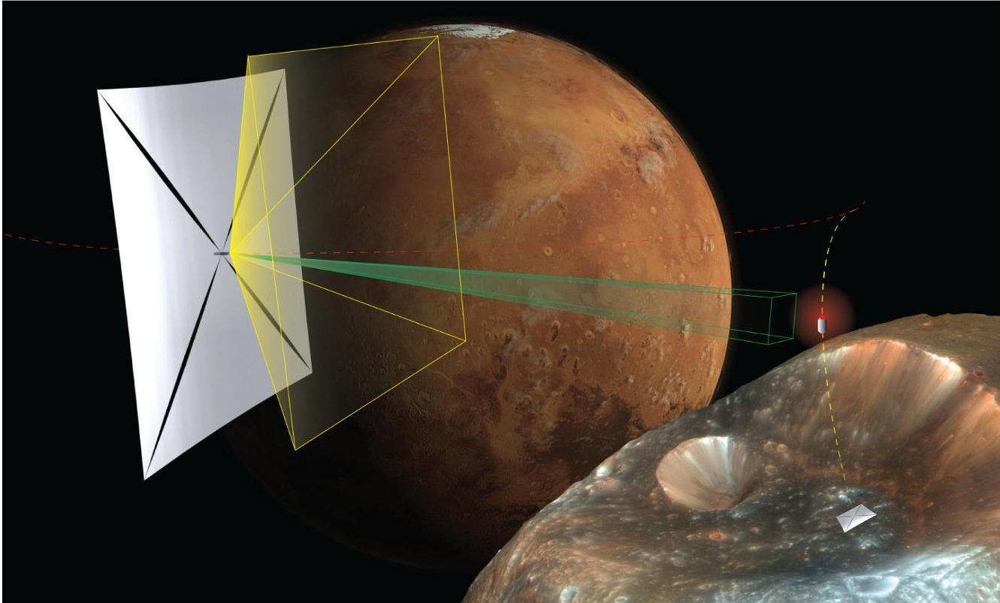

Figure 21: Two Interplanetary CubeSats are conceived to return a sample from Phobos or Deimos. In this artist's view, the Landing and Sample Acquisition CubeSat (LSAC, not to scale, see lower right) has landed at a few cm/s in a designated area, using its slow impact speed to push a sample collector into the regolith. Final descent and impact is recorded by one or more cameras aboard the LSAC for distant context imaging and close-up characterization before impact on the sample site. A container folds itself around the sample, which is then launched out the top of the LSAC at $ \sim12 $ m/s, slightly greater than Phobos escape velocity. A high-res video camera aboard the LSAC tracks the launch; onboard software computes the speed and direction from star positions and photogrammetric patterns on the container using exposures for the first $ \sim10 $ -100 meters. This information is sent to the Sample Capture and Return CubeSat (SCRC), which has had its orbit adjusted so that its position and velocity approximate what is expected to match the launched sample canister. The SCRC then makes maneuver adjustments based on the velocity data from the LSAC. Cameras aboard the SCRC then acquire the beacon on the canister, and the rendezvous pursuit begins, followed by capture, which could require several orbits of Mars. (Art: Ryan Sellers/Cal Poly-SLO Aerospace Engineering student.)

## E. Radio-Quiet L2 (RAQL) Mission

"What were the first objects to light up the Universe and when did they do it?" was identified as a science frontier question in the recent New Worlds, New Horizons in Astronomy and Astrophysics Decadal Survey (NWNH). $ ^{36} $ Entitled "Cosmic Dawn," understanding the epoch when the first stars formed and tracking the growth of large-scale structure in the Universe will be a key aspect of astronomy in this decade and beyond. The Radio Astronomy Quiet Lunar (RAQL) CubeSat is a mission concept for a single CubeSat orbiting the Earth-Moon Lagrange 2 point designed to assess the extent and usability of the radio-shielded volume above the far side of the Moon for future radio astronomy missions.

Following recombination at a redshift of $ z\approx 1100 $ (approximately 370,000 years after the Big Bang), the Universe entered a largely neutral state in which neutral hydrogen (H I) was the dominant baryonic component of the intergalactic medium (IGM). $ ^{37} $ By a redshift of $ z\sim 7 $ (approximately 1 billion years after the Big Bang), observations with a combination of ground- and space-based telescopes are showing that the precursors of modernday galaxies exist and are beginning to reionize their surroundings. $ ^{38} $ Analysis of data from the Wilkinson

<!-- PDF_PAGE: 26 -->

Microwave Anisotropy Probe (WMAP) suggests that the reionization process is likely to be extended, $ ^{39} $ potentially beginning as early as $ z\sim12 $ (approximately 350 million years after the Big Bang). Neutral hydrogen is the raw material for star formation, and the H I atom has a spin-flip hyperfine transition at the (rest) wavelength of 21 cm (rest frequency of 1420 MHz). This 21-cm H I line produces a signal that is potentially detectable over the redshift range of approximately 6-100, allowing astronomers to track the evolution of the Universe during Cosmic Dawn.

However, because of the expansion of the Universe since the Cosmic Dawn epoch, this H I line is redshifted significantly, to longer wavelengths or lower frequencies ( $ \sim $ 100 MHz). Today, the H I line from Cosmic Dawn will be received at frequencies in the high-frequency (HF) and very-high-frequency (VHF) bands of the radio spectrum. These bands are heavily used by both civil and military transmitters, which are billions of times stronger than the H I line signal.

Detecting the H1 line signal from Cosmic Dawn requires either observations at a significant distance from the Earth (>4 AU) or a telescope on or above the far side of the Moon. The lunar farside, and the volume above it, known as the shielded zone of the Moon (SZM), is recognized by the International Telecommunications Union (ITU-R RA.479) as a unique location for conducting sensitive astronomical observations below 300 MHz. Observations by the Radio Astronomy Explorer 2 have shown that the Moon is an effective shield from terrestrial radio interference. $ ^{40} $

Concepts for radio telescopes on the lunar far-side surface have been developed. An alternate approach to access the SZM for radio astronomy would be a constellation of CubeSats, each equipped with a small radio antenna. A key parameter for designing any such future mission, or even assessing its feasibility, is the actual volume of the SZM. The RAQL CubeSat would be a single-CubeSat mission designed to map out the extent of the SZM. Utilizing a solar sail for navigation and propulsion, it would be in a halo orbit around the Earth-Moon L2 point. By changing its orbit, RAQL would dip in and out of the SZM, at a variety of altitudes above the Moon and determine the usable extent for any future CubeSat constellation. It may also be possible to use the solar sail as the substrate for the radio antenna. $ ^{41} $

## F. High Solar Inclination Constellation (HSIC) Mission

One long-term goal of NASA's Heliophysics Program is to place a spacecraft above the ecliptic to provide a high-latitude perspective of both the Sun and the inner heliosphere. Placing in situ and remote sensing instruments at high heliographic latitude enables a wealth of new heliophysics measurements not possible from an ecliptic viewpoint. The HSIC mission concept addresses the goal of NASA's Heliophysics Program to explore the polar regions of the Sun and inner heliosphere. HSIC achieves these goals by using a constellation of low-cost Interplanetary CubeSat sailcraft, each carrying one or more small, highly capable instruments. The use of multiple spacecraft to achieve distributed measurements provides a significant improvement in science performance over a single dedicated spacecraft. The sailcraft may achieve high inclination orbits ( $ \geq 4 5^{\circ} $ ) by using a new family of vertical orbits discussed in Section II.E. The new perspective provides views of the polar regions of the Sun and high-latitude views of solar wind transients such as coronal mass ejections as well as in situ sampling of the high-latitude solar wind. Measurements enabled and instruments needed include the following:

- Measurements of the polar magnetic field and its temporal evolution (Magnetograph/Doppler imager) to understand the reversal of the solar magnetic fields and to better determine the three-dimensional structure of the solar magnetic field.

- Monitoring of Earth-directed coronal mass ejections from high latitudes (heliospheric imager/coronagraph) for use in space weather predictions.

- Measurements of the variation in the magnetic fields, solar wind, and solar energetic particles (SEPs and cosmic rays) with latitude (plasma, magnetometer, energetic particle, cosmic ray) to understand the three-dimensional structure of the solar wind and its transients and to study the transport of energetic particles.

- Measurements of the time-varying flows, differential rotation, and meridional circulation in the polar regions of the Sun, down to the tachocline (limited by data rate available to the Magnetograph/Doppler imager) to understand the solar dynamo.

- To make these measurements, the proposed constellation consists of six 6U Interplanetary CubeSats, each with its own instrumentation. Three of the spacecraft carry in situ instruments (two per spacecraft), and two others each carry a remote-sensing instrument. (The payload for the constellation's sixth spacecraft can be a duplicate of any of the others, and may be useful in making simultaneous measurements from two different locations.) The instruments and their needed form factor, mass, and power are:

- In situ payloads 1, 2 and 3:

—IS-1: plasma + magnetic field, utilizing 1U, 1.5 kg, 5 W

—IS-2: energetic particles + magnetic field, utilizing 1U, 1.5 kg, 4 W

<!-- PDF_PAGE: 27 -->

—IS-3: cosmic rays, utilizing 1U, 1.5 kg, 3 W

- Remote sensing payloads 1 and 2:

RS-1: magnetograph/Doppler imager, utilizing 1.5U, 2 kg, 10 W

RS-2: coronagraph/heliospheric imager, utilizing 1.5U, 2 kg, 10 W.

All of these require some level of development in order to provide high performance within the volume, mass, and power limitations inherent in CubeSats. In general, the in situ instruments require less development than the remote sensing instruments to reach the performance levels necessary to provide high science value.

Data rates can vary widely, but we can assume a survey rate as low as 20 bits/s from IS-1, IS-2, and IS-3 and burst rates of ~100 times this.

The remote sensing instruments would often operate at much higher rates. For RS-1, we are assuming one magnetograph every 2 hours, yielding 4 kbit/s, and a comparable rate for RS-2.

## IV. Conclusion and Potential Impact of Interplanetary CubeSats

Through our NIAC-sponsored work, we have developed a low-TRL concept showing that spacecraft/payloads useful for Solar System exploration, astrophysics, space physics, and heliophysics can utilize a new Interplanetary CubeSat architecture, enabling lower-cost, up-close measurement of distant destinations, including Mars, asteroids, comets and the Moon.

The earliest Interplanetary CubeSats, venturing to cis-lunar space and beyond to ~1 AU distance from Earth, should be feasible in the near future. Later, missions to Mars, the asteroid belt, and high heliocentric latitudes will be possible. Continuing advancements of the noted technologies would enable a much broader set of missions than heretofore thought possible with low launch mass, and at comparatively low cost.

## Acknowledgments

Work described herein was performed at the Jet Propulsion Laboratory—California Institute of Technology, CalPoly San Luis Obispo, Stellar Exploration, and The Planetary Society, under contract with the National Aeronautics and Space Administration, as part of the NASA Innovative Advanced Concepts (NIAC) program within the Office of the Chief Technologist.

<!-- PDF_PAGE: 28 -->

# Author Affiliations as of 2012 July

At Jet Propulsion Laboratory—California Institute of Technology, Pasadena, CA 91109

<table border="1"><tr><td>Robert L. Staehle</td><td>Principal Investigator and NIAC Fellow for Interplanetary CubeSats, Assistant Manager for Advanced Concepts, Instruments and Science Data Systems Division</td></tr><tr><td>Diana Blaney</td><td>Deputy Project Scientist, Mars Exploration Rover</td></tr><tr><td>Hamid Hemmati</td><td>Principal Staff and Optical Communications Group Supervisor</td></tr><tr><td>Dayton Jones</td><td>Principal Scientist, Deep Space Tracking Systems Group</td></tr><tr><td>Andrew Klesh</td><td>Mission Architect, Mission Concepts Section</td></tr><tr><td>Paulett Liewer</td><td>Manager, Astrophysics and Space Sciences Section</td></tr><tr><td>Joseph Lazio</td><td>Principal Scientist, Tracking Systems and Applications Section</td></tr><tr><td>Martin Wen-Yu Lo</td><td>Technologist, High Capability Computing and Modeling Group</td></tr><tr><td>Pantazis Mouroulis</td><td>Senior Research Scientist, Optical Technology Group Supervisor</td></tr><tr><td>Neil Murphy</td><td>Manager, Strategic University Research Partnership Program</td></tr><tr><td>Paula J. Pingree</td><td>Flight Instrument Electronics and Small Spacecraft Technology Group Supervisor</td></tr><tr><td>Thor Wilson</td><td>Electronics Engineer I, Flight Instrument Electronics and Smallsat Technology</td></tr></table>

At California Polytechnic University, San Luis Obispo, CA 93407

Jordi Puig-Suari: Professor of Aerospace Engineering Austin Williams: Graduate Student, Aerospace Engineering

At Stellar Exploration Inc., San Luis Obispo, CA 93401

Tomas Svitek: President/CEO

At The Planetary Society, Pasadena, CA 91105

Bruce Betts: Director of Projects

Louis Friedman: Executive Director Emeritus

At University of Southern California, Los Angeles, CA 90089

Brian Anderson: Graduate Student, Astronautical Engineering Channing Chow: Graduate Student, Astronautical Engineering

<!-- PDF_PAGE: 29 -->

$ ^{1} $Robert Staehle, Diana Blaney, Hamid Hemmati, Martin W. Lo, Pantazis Mouroulis, Paula J. Pingree, Thor Wilson, Jordi Puig-Suari, Austin Williams, Bruce Betts, Louis Friedman, Tomas Svitek, "Interplanetary CubeSats: Opening the Solar System to a Broad Community at Lower Cost," CubeSat Developers Workshop, Logan, Utah, 2011 August 7.

$ ^{2} $Tomas Svitek, Bill Nye, James Cantrell, Bruce Betts, "The Voyage Continues — LightSail-1 $ ^{TM} $ Mission by The Planetary Society," Paper IAC-10.D1.1.10, International Astronautical Congress 2010, Prague, Czech Republic.

$ ^{3} $Dmitriy L. Bekker, Paula J. Pingree, Thomas A. Werne, Thor O. Wilson, Brian R. Franklin, "The COVE Payload - A Reconfigurable FPGA-Based Processor for CubeSats," in Proceedings of the 25th Annual AIAA/USU Conference on Small Satellites, Logan, UT, August 2011.

$ ^{4} $Jordi Puig-Suari, Roland Coelho, Riki Munakata, and Alexander Chin, "The CubeSat: The Picosatellite Standard for Research and Education," AIAA Space 2008 Conference and Exhibition, 2008.

$ ^{5} $ Walter Holemans, Drawing #2002063, "6U Payload Canister," Payload Systems Corp., 2303 Kansas Ave., Silver Spring, MD 20910, 2011.

$ ^{6} $ T. Segert, S. Engelen, M. Buhl, and B. Monna, "iADCS-100 — An Autonomous Attitude Determination and Control Subsystem Based on Reaction Wheels and Star Tracker in 1/3U Package," The 4S Symposium 2012.

$ ^{7} $ M. Smith, S. Seager, C. Pong, J. Villasenor, G. Ricker, D. Miller, M. Knapp, G. Farmer, and R. Jensen-Clem, "ExoplanetSat: Detecting Transiting Exoplanets Using a Low-Cost CubeSat Platform," Proc. SPIE 7731, 2010.

$ ^{8} $ T. Jaeger, and M. Ciffone, "Mayflower, The Next Generation CubeSat Flight Testbed," 2011 Small Satellite Conference, August 9, 2011.

$ ^{9} $A. Fedoseyev, M. Turowski, A. Raman, E. Taylor, S. Hubbard, S. Polly, and A. Balandin, "Investigation and Modeling of Space Radiation Effects in Quantum Dot Solar Cells," IEEE PVSC, 2010.

$ ^{10} $ Greg Manyak and John Bellardo, "PolySat's Next Generation Avionics Design," IEEE SMC-IT, 2011.

$ ^{1 1} $Tomas Svitek, Bill Nye, James Cantrell, and Bruce Betts, "The Voyage Continues — Lightsail-1 Mission by The Planetary Society," Paper IAC-10.D1.1.10, International Astronautical Congress 2010, Prague, Czech Republic.

$ ^{12} $David Lackner, Space Systems Loral, private communication to Robert Staehle, 2011 June 23.

$ ^{13} $Daniel J. Grebow, "Trajectory Design in the Earth-Moon System and Lunar South Pole Coverage," PhD Thesis, Purdue University, 2010.

$ ^{14} $Daniel J. Grebow, and Martin W. Lo, "Tools for Designing Optimal Low Energy Solar Sail Orbits," white paper, JPL Interoffice Memorandum, Jet Propulsion Laboratory, Pasadena, August 2012.

$ ^{15} $ Wang Sang Koon, Martin W. Lo, Jerrold E. Marsden, and Shane D. Ross, "Heteroclinic Connections Between Periodic Orbits and Resonance Transitions in Celestial Mechanics," Chaos 10(2), 427-469, 2000.

$ ^{16} $ Kathleen C. Howell, Brian T. Barden, and Martin W. Lo, "Application of Dynamical Systems Theory to Trajectory Design for a Libration Point Mission," JAS 45(2), April-June 1997.

$ ^{17} $Martin W. Lo, and Min-Kun J. Chung, Lunar Sample Return Via the Interplanetary Superhighway, AIAA-2002-4718, AIAA Astrodynamics Specialist Meeting, Monterey, CA, August 2002.

$ ^{18} $ E. Doedel, V. Romanov, R. Paffenroth, H. Keller, D. Dichmann, J. Galan-Vioque, and A. Vanderbauwhede, "Elemental Periodic Orbits Associated with the Libration Points in the Circular Restricted 3-Body Problem," International Journal of Bifurcation and Chaos, 17(8):2625-2677, 2007.

$ ^{19} $ Chauncey Uphoff, "The Art and Science of Lunar Gravity Assist," AAS 89-170, AAS/GSFC International Symposium, April 1989.

$ ^{20} $Keric Hill, Martin W. Lo, and George H. Born, "Linked, Autonomous, Interplanetary Satellite Orbit Navigation (LiAISON)," Advances in the Astronautical Sciences, 123, Part III: 2353-2367, 2006.

$ ^{21} $Benjamin Villac, Channing Chow, Martin W. Lo, and Gerald R. Hintz, "A Dynamical System Approach to Orbit Down- Selection of Earth-Moon Autonomous Navigation Constellations" Journal of Astronautical Sciences (accepted), 2012.

$ ^{22} $Channing Chow, "Autonomous Interplanetary Constellation Design," PhD Thesis, University of Southern California, Los Angeles, May 2012.

$ ^{23} $Pantazis Mouroulis, Robert O. Green, and Daniel W. Wilson, "Optical Design for a Coastal Ocean Imaging Spectrometer," Opt. Express 16(12), 9087-9096, 2008.

$ ^{24} $Pantazis Mouroulis, Byron E. Van Gorp, Victor E. White, Jason M. Mumolo, Daniel Hebert, and Martin Feldman: "A compact, fast, wide-field imaging spectrometer system", Proc. SPIE 8032, 80320U (2011).

25 C. M. Pieters, J. N. Goswami, R. N. Clark, M. Annadurai, J. Boardman, B. Buratti, J.-P. Combe, M. D. Dyar, R. Green, J. W. Head, C. Hibbitts, M. Hicks, P. Isaacson, R. Klima, G. Kramer, S. Kumar, E. Livo, S. Lundeen, E. Malaret, T. McCord, J. Mustard, J. Nettles, N. Petro, C. Runyon, M. Staid, J. Sunshine, L. A. Taylor, S. Tompkins, and P. Varanasi, "Character and Spatial Distribution of OH/H2O on the Surface of the Moon Seen by M3 on Chandrayaan-1", Science 326, pp. 568, 2009 October 23.

$ ^{26} $Thomas Werne, Dmitriy Bekker, and Paula Pingree, "Real-Time Data Processing for an Advanced Imaging System using the Xilinx Virtex-5 FPGA," Proceedings of the 2010 IEEE Aerospace Conference, March 2010.

$ ^{27} $Virtex-5QV FPGA Product Brief, Xilinx, Inc., http://www.xilinx.com/publications/prod_mktg/virtex5qv-product-brief.pdf $ ^{28} $Phase-change memory; see Wikipedia, http://en.wikipedia.org/wiki/Phase change memory

$ ^{29} $ Angstrom Aerospace uses Everspin MRAM, http://www.everspin.com/technology.php?qtype=11

<!-- PDF_PAGE: 30 -->

$ ^{30} $Thomas Werne, Dmitriy Bekker, and Paula Pingree, "Validation of Real-Time Data Processing for the Ground and AirMSPI Systems," Proceedings of the 2011 IEEE Aerospace Conference.

$ ^{31} $ Diana Blaney, Robert Staehle, Bruce Betts, Louis Friedman, Hamid Hemmati, Martin Lo, Pantazis Mouroulis, Paula Pingree, Jordi Puig-Sauri, Tomas Svitek, Thor Wilson, and Austin Williams, "Interplanetary CubeSats: Small, Low-Cost missions Beyond Low Earth Orbit," (Poster) Lunar and Planetary Science Conference, Houston, Texas, March 19, 2012.

$ ^{32} $ L. Johnson, L. Alexander, L. Fabinski, A. Heaton, J. Miernak, R. Stough, R. Wright and R. Young, "Multiple NEO Rendezvous Using Solar Sail Propulsion," IAF/AIAA Global Space Exploration Conference, Washington, DC, May 22-24, 2012.

$ ^{33} $National Research Council, Visions and Voyages for Planetary Science in the Decade 2013-2022, ISBN-13: 978-0-309-20954-0.

$ ^{34} $ Louis Friedman, Darren Garber, and Tom Heinsheimer, "Evolutionary Lightsailing Missions for the 100-Year Starship," Journal of the British Interplanetary Society (to be published).

$ ^{35} $ R. M. Young, "Updated Heliostorm Warning Mission: Enhancements Based on New Technology," AIAA 2007-2249 48th AIAA/ASME/ASCE/AHS/ASC Structures, Structural Dynamics, and Materials Conference 23-26 April 2007, Honolulu, Hawaii, 2007.

$ ^{36} $Committee for a Decadal Survey of Astronomy and Astrophysics; National Research Council, New Worlds, New Horizons in Astronomy and Astrophysics, The National Academies Press, Washington, DC. ISBN-10: 0-309-15799-4, 2010.

$ ^{37} $ S. R. Furlanetto, S. P. Oh, and F. H. Briggs, "Cosmology at Low Frequencies: The 21-cm Transition and the High-Redshift Universe," Phys. Rep., Vol. 433, Issue 4-6, pp. 181-301, 2006.

$ ^{38} $ X. Fan, C. L. Carilli, and B. Keating, "Observational Constraints on Cosmic Reionization," Ann. Rev. Astron. and Astrophys., Vol. 44, Issue 1, pp. 415-462, 2006.

$ ^{39} $ E. Komatsu, K. M. Smith, J. Dunkley, et al., "Seven-year Wilkinson Microwave Anisotropy Probe (WMAP) Observations: Cosmological Interpretation," Astrophys. J. Suppl., Vol. 192, Issue 2, pp. 18-65, 2011.

$ ^{40} $ J. K. Alexander, M. L. Kaiser, J. C. Novaco, F. R. Grena, and R. R. Weber, "Scientific Instrumentation of the Radio-Astronomy-Explorer-2 satellite," Astron. and Astrophys., Vol. 40, No. 4, pp. 365-371, 1975.

$ ^{41} $ J. Lazio, C. Carilli, J. Hewitt, S. Furlanetto, and J. Burns, "The Lunar Radio Array (LRA)," UV/Optical/IR Space Telescopes: Innovative Technologies and Concepts IV, edited by H. A. MacEwen and J. B. Breckinridge, Volume 7436, Proceedings of the SPIE, Bellingham, WA, pp. 74360I-74360I-11, 2009.