<!-- PDF_PAGE: 1 -->

# “Interplanetary CubeSats: Summary of the Current Thinking, Approaches and Lessons Learned” White Paper Proceedings of the ASU Deep Space Summit

April 25,2022

SSDS

SPACE SYSTEMS DESIGN STUDIO

Interplanetary Initiative

Arizona State University

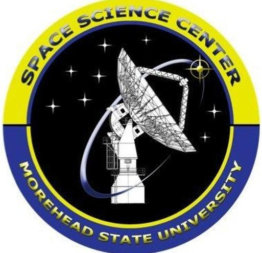

Published in Part By: Cornell University Space Systems Design Studio Arizona State University Interplanetary Initiative Morehead State University Space Science Center

<!-- PDF_PAGE: 2 -->

## Abstract

We are on the threshold of a new era of sustainable exploration and development of Earth's Moon and the solar system at large. Programs such as NASA's Artemis, Commercial Lunar Payload Services, Lunar Gateway, and other commercial lunar landers and orbiters continue to be announced. As a result, rideshare opportunities for cubesats and other small spacecraft or "smallsats" to reach cislunar space and other interplanetary targets will be unprecedented. CubeSat missions to these environments have already been manifested, with additional mission concepts continuing to be proposed. New organizations that have never sent spacecraft beyond Earth orbit are now designing spacecraft that aim to do so. The challenge that is still being addressed by the earliest developers of Interplanetary cubesats is how to meet high priority science and technology demonstration requirements while limited by the resources available to missions constrained by the cubesat paradigm (low cost-cap, relative compactness, higher risk, with rapid development, lean operations, shared tools and essential science measurements or demonstrations for highly focused goals). This paper presents the findings of the ASU Deep Space Summit, where representatives from interplanetary cubesats development teams presented and discussed and/or were interviewed on the specific challenges faced and solutions implemented by their missions. The participants also addressed the general challenges of missions of this type and their impact on development, factors that promote or inhibit mission success and recommendations for dealing with these factors. The 16 missions covered by this study represent a mixture of pathfinders, technology demos and science missions. Further information was gathered from the participants of the Summit (representing 11 teams) and all other interplanetary cubesat missions that are currently Post-Phase-D (or equivalent) in development (5 additional teams) using several methods including interviews and a literature review. From this information, significant and shared lessons learned, and recommendations were gathered and assessed. Key findings include the need for: early launch and schedule constraints; creating a cost-capped mission baseline development framework, a corps of system engineers and project managers experienced in cost-capped missions; sharing facilities, software and hardware toolkits, and templates to deal with non-scalable costs; implementation of space architectures to address severe navigation, propulsion, and communication constraints; utilization of moderately larger formfactors to alleviate identified engineering challenges; and streamlining governmental certification and licensing processes amongst others. The aim is that future and ongoing interplanetary smallsat mission developers and their stakeholders can leverage the knowledge gathered in this study to lower risks and costs and increase the likelihood of successful mission completions.

## Authors

Aaron P. Zucherman (apz24@cornell.edu) is a Matthew Isakowitz Commercial Space Fellow and Systems Engineering Ph.D. Candidate with the Space Systems Design Studio at Cornell University. His research spans the mission management, agile spacecraft development, risk and cost analysis, and the application of systems engineering methodologies to complex Earth orbiting and interplanetary smallsat missions. This paper is done in partial completion of Aaron's dissertation.

Dr. Pamela Clark (p.clark@moreheadstate.edu) is the current Science PI for the Lunar Ice Cube mission, convener and organizer of the annual Lunar Cubes workshop, member of the staff and director of the star theater of the Space Science Center of Morehead State University, where she also teaches aerospace engineering courses. She previously worked at both GSFC, where she led the concept development team for the Lunar Ice Cube mission, and JPL.

Brodie Wallace [brodie.wallace@colorado.edu] is a National Science Foundation Graduate Research Fellow and Ph.D. student at the University of Colorado Boulder (CU Boulder). Brodie's research interests include small satellites, communication systems, radar systems, and the use of multiple small satellites to enable new scientific missions. Brodie has served as Systems Engineer and Project Manager for the CU Boulder Earth Escape Explorer cubesat mission since 2018 and also has experience on several other cubesat missions, including CIRBE, SWARM-EX, and MAXWELL.

<!-- PDF_PAGE: 3 -->

Joe DuBois (jdubois2@asu.edu) has 30 years of experience in small satellite design and development. Starting in 1990, he helped grow the startup Spectrum Astro for 10 years and 5 spacecraft developments. His work at Spectrum Astro and later Honeywell earned him 7 patents for spacecraft architecture and components. In 2017, DuBois joined ASU to lead the development of the LunaH-Map cubesat. He is now at the ASU Interplanetary Initiative managing the cubesat Laboratory.

In Person Deep Space Summit Participants

<table border="1"><tr><td>Mission</td><td>Organization</td><td>Presenter</td><td>Email</td></tr><tr><td>ArgoMoon</td><td>ArgoTech</td><td>Valerio Di Tana</td><td>valerio.ditana@argotecgroup.com</td></tr><tr><td>Capstone</td><td>Advanced Space</td><td>Tom Gardner</td><td>gardner@advancedspace.com</td></tr><tr><td>Cislunar Explorers</td><td>Cornell University</td><td>Aaron Zucherman</td><td>apz24@cornell.edu</td></tr><tr><td>CU-E3</td><td>CU Boulder</td><td>Brodie Wallice</td><td>brodie.wallace@colorado.edu</td></tr><tr><td>EQUULEUS</td><td>JAXA</td><td>Dr. Ryu Funase</td><td>funase.ryu@jaxa.jp</td></tr><tr><td>LunaH-Map</td><td>ASU</td><td>Dr. Craig Hardgrove</td><td>chardgro@asu.edu</td></tr><tr><td>Lunar IceCube</td><td>MSU</td><td>Dr. Pamela Clark</td><td>p.clark@moreheadstate.edu</td></tr><tr><td>LunIR</td><td>Lockheed Martin Space</td><td>Dr. Joseph Shoer</td><td>joseph.p.shoer@lmco.com</td></tr><tr><td>NEA Scout</td><td>JPL</td><td>Julie Castillo-Rogez</td><td>julie.c.castillo@jpl.nasa.gov</td></tr><tr><td>OMOTENASHI</td><td>JAXA</td><td>Dr. Tatsuaki Hashimoto</td><td>hashimoto.tatsuaki@jaxa.jp</td></tr><tr><td>Team Miles</td><td>Team Miles</td><td>Wes Faler</td><td>wes@miles-space.com</td></tr></table>

## Additional Participants

<table border="1"><tr><td>Mission</td><td>Organization</td><td>Point of Contact</td><td>Email</td></tr><tr><td>BioSentinel</td><td>NASA Ames</td><td>Sergio Santa Maria</td><td>sergio.r.santamaria@nasa.gov</td></tr><tr><td>CuSP</td><td>SWRI</td><td>Dr. Don George</td><td>degeorge@swri.edu</td></tr><tr><td>LICIACube</td><td>ArgoTech</td><td>Valerio Di Tana</td><td>valerio.ditana@argotecgroup.com</td></tr></table>

## Acknowledgments

A special thanks to the Arizona State University's Interplanetary Initiative Deep Space Summit for providing the venue and accommodations for the Deep Space Summit. Thanks to Cornell University's Space Systems Design Studio and Morehead State University's Space Science Center for the contributions of their students and staff. Thanks to all the participants for their hard work, openness and dedication to future mission success.

<!-- PDF_PAGE: 4 -->

## Table of Contents

1. Introduction...4

2. Background...5

3. Lessons Learned Overview...5

4. Data and Reference Missions...8

5. Programmatic Lessons Learned...11

5.1. Mission Design Lessons Learned...12

5.2. Launch Provider and Integrator Considerations...14

5.2.1. Observations/Recommendations for Launch Providers/Integrators...14

5.2.2. Observations/Recommendations for SmallSat Developers...15

5.3. Supervision and Team Management...16

5.4. Documentation...17

5.5. Infrastructure and Facilities...18

5.6. Cost and Schedule Analysis...19

5.7. Integration and Testing...20

6. Spacecraft Design and Development Lessons Learned...22

6.1. Systems Engineering...23

6.2. COTS Component and Subsystem Selection...23

6.3. Payloads and Instruments...25

6.4. Attitude Determination and Control Systems...26

6.5. Navigation and Position Determination...27

6.6. Thermal Analysis/Control Systems...28

6.7. Flight Communication Systems...29

6.8. Ground Operations and Data Management...31

6.9. Propulsion Systems...32

6.10. Electrical Power Systems...33

6.11. Flight Software...34

6.12. Structures and Mechanisms Design...35

6.13. Radiation Shielding and Resiliency Design...36

7. Regulations and Policy Compliance...36

8. Conclusions...37

9. Bibliography...38

10. Appendix 1: Mission Backgrounds...39

<!-- PDF_PAGE: 5 -->

## 1. Introduction

With the launch of NASA's Mars Cube One (MarCO) $ ^{1} $ as part of the InSight mission and the secondary payloads on the Artemis-1 mission, $ ^{2} $ interplanetary cubesat and smallsats have gone from proposals to real missions. The expectation is that by utilizing spacecraft or 'smallsats', the costs for future missions to cislunar, deep space and other beyond Earth orbit (BEO) targets could be reduced by orders of magnitude, as is now the case for science and commercial missions in low Earth orbit (LEO). With cost savings driven by each spacecraft's aggressive reduction in size and mass as well as a greater acceptance of risk. $ ^{3} $ Additionally, advances in miniaturized electronics, high performance subsystems and science instruments will enable missions with challenging interplanetary/BEO science objectives to reach more destinations (Moon, small bodies, planets) with new, novel, and targeted mission concepts and planetary science investigations. $ ^{4} $

However, it is important to remember that during the initial adoption of the cubesat for LEO missions, longtime space industry stakeholders found that traditional models, architectures, and management processes did not accurately predict or control the costs and risks associated with this new generation of smallsats. Additionally, new spacecraft developers (mostly commercial and academic) lacked a suitable body of relevant engineering and management knowledge (including engineering practices, architectures, and models) that could be applied to lowcost, high-risk smallsat missions. As a result, many cubesat programs operated with ad-hoc management and design approaches that did not significantly leverage established spacecraft engineering practices. The consequences of this were low mission success rates and some organizations unable to significantly lower costs. For example, from 2003-2013 the yearly cubesat successes rates for academia and industry were $ \sim 45\% $ and $ \sim 77\% $ respectively. $ ^{5} $ The shared body of knowledge to develop smallsat missions reliably and cheaply have made strides in recent years' missions by quantifying the realities of the new types of stakeholders, higher risk profiles, and other distinguishing mission factors.

While this new body of knowledge for smallsats has been successfully used to raise the success rate for the latest LEO smallsat missions, $ ^{5} $ mounting evidence shows these new tools will initially prove inadequate and require maturation for the new class of BEO smallsat missions, just as they did for LEO assets. $ ^{6} $ The goal of this paper is to accelerate the adoption and maturation of the cubesat paradigm for BEO missions. With the aim to minimize cost overruns and to avoid the high failure rates experienced by the first generations of LEO cubesats. This paper will point out particular challenges faced by specific payload and organization types, while also attempting to generalize challenges and suggested solutions whenever possible. Note that interplanetary, deep space and BEO are used interchangeably in the context of the operating domains in this paper.

Acknowledging the need to start developing a focused body of knowledge for interplanetary smallsats, the Arizona State University (ASU) Interplanetary Initiative's Deep Space Summit, was held on October 29-30, 2021. The goal was to engage the principal investigators, system engineers, and other stakeholders from the teams developing BEO cubesat missions, to gather their lessons learned during development. The summit focused on engaging teams from missions that were Post-Phase D (or equivalent) in their development. Each team was given a query prompt designed by Aaron Zucherman of Cornell University for his dissertation work to guide discussion. The questions in the prompt were based on interviews with cost and risk analyzers, mission developers and mission funding program directors from organizations including The Aerospace Corporation, JPL, and NASA's Ames Research Center and HQ. During the Summit, each team presented an in-depth examination of lessons learned during the development of their mission. Presented under Chatham House Rules, participants were free to use the information discussed, but neither the identity nor the affiliation of the speaker's specific comments may be revealed. This approach was selected to enable frank and honest discussions. Teams that did not attend the conference live were asked to fill out the query prompt, then a follow up interview was conducted to gain as much insight as possible. The hope is that this information can help future and ongoing interplanetary smallsat missions avoid the mistakes and leverage the success of past missions. The 16 cubesats covered by this paper, referred to as the "reference missions", represent a mixture of technology demos and science missions. The "reference developers" span the government, commercial and academic institutions.

<!-- PDF_PAGE: 6 -->

## 2. Background

Beyond Earth Orbits (BEOs) are a broad class of orbits typically considered further out than Geostationary Orbit (GEO) at 42,164 km (26199.5 miles) or require a change into a heliocentric (sun-centered) orbit as part of a journey. Interplanetary typically means traveling between planets, with a focus area for planets between the sun and asteroid belt. Deep Space normally refers to areas beyond the asteroid belt. Cislunar Space is generally considered the spherical volume of space making up the top orbits for earth, moon, and everything between, covering any lunar orbits and extending out to beyond the L2 Lagrange point (~277,500 miles). $ ^{4} $

Spacecraft are generally grouped according to their mass. The category of smallsats is divided into minisatellites with a mass of 100-500 kg, microsatellites with a mass of 10-100 kg, nanosatellites with a mass of 1- 10 kg, and picosatellites with a mass 0.01-1 kg. $ ^{4} $ BEO/interplanetary smallsats are typically defined as having a mass of <~15 kg, a cost of <~$30M, and a mission duration of up to five years. $ ^{4} $ cubesats are a low-cost subclass of smallsats, made of standard units (U) volumes, where 1 U is a 10cm $ \times $10cm $ \times $10cm cuboid and weights ~1.33kg as shown in Figure 1.

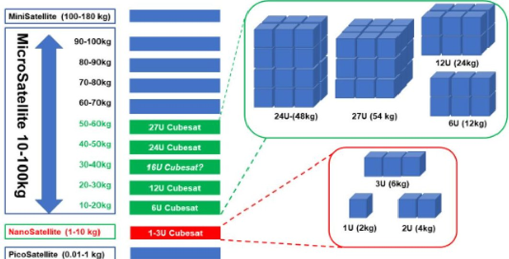

Figure 1 SmallSat Scales and Typical CubeSat Configurations. Image Courtesy of NASA

The 'cubesat paradigm' is the overarching term for the agile space development enabled by smallsats and the introduction of the cubesat standard. Where spacecraft are low cost by embracing short schedules, cost caps, commercial technology, relative compactness, higher risk, lean operations, shared tools and other approaches. $ ^{7} $

We assume that future interplanetary smallsats will be "Rideshares" or "Secondary Payloads", affordable options for lower resourced missions. The small satellites will be transported to their destinations on a launch vehicle whose main purpose is either 1) at present, transport a primary spacecraft for a selected mission to a final destination, or 2) as the rideshare technology matures, to manifest and transport a number of secondaries for a selected mission or missions requiring a common destination. In case 1, the primary selects the date and time of launch and the orbital trajectory and subsidizes the launch cost for the secondaries. In case 2, destinations and costs are negotiated with a service provider (for launch, transportation, and perhaps communication and navigation as well) by the secondaries, or NASA on behalf of the secondaries.

Pathfinders are missions with the purpose of evaluating a new approach a mission, including management, design or operations, with the goal of meeting specific technical goals achievable with higher risk and lower cost. Technology demo missions are those with the main purpose of testing specific technologies so they can be used for future space missions. To date, the single platform selected science mission model, with the purpose of performing a more comprehensive scientific inquiry, has been the more typical approach. However, flying multiplatform missions, facilitated by the use of cubesat paradigm spacecraft, which are now thought of just as single 'pathfinders,' could greatly expand the number of scientific inquiries to targets all over the solar system.

## 3. Lessons Learned Overview

The representatives attending the Deep Space Summit were in general agreement about the programmatic and project planning challenges faced by the teams and proposed several solutions for future Deep Space and Interplanetary cubesat missions. Many were discussed throughout this paper, but the critical findings are summarized here:

<!-- PDF_PAGE: 7 -->

1) Lack of availability of system and discipline engineers experienced in working on small scope space missions. It is acknowledged that for the most part the reference developers are part of the creation of a first-generation small scope interplanetary smallsat mission cadre, and that in many cases their efforts are creating opportunities for training next generation deep space mission developers. There is no clear path for future missions to leverage those who contributed to these reference missions for their own success.

Solution: It is recommended that NASA build on the already developing core of engineers and managers/mentors and established processes at proposing institutions ranging from NASA centers to small start-ups and universities and use them simultaneously on future projects of this nature. This approach will help to alleviate turn over induced at government or corporate organizations by experienced personnel being subsumed in larger projects or at academic institutions by time constraints of student availability. This issue can also be mitigated by the involvement of members of larger missions with mutual benefit in some cases. Special attention should be given to solving this issue for critical leads in small package/payload systems engineering, mission operations and ground data systems managers, and thermal design engineering.

2) Interplanetary Mission development culture not initially set up with infrastructure to support small scope, cost-capped opportunities. NASA has recently recognized the programmatic need for a greater number of cost-capped, small package opportunities along with the availability of technologies needed to support these opportunities, but the development of approaches most suitable for these opportunities are still in the experimental stage or non-existent.

Solution: We recommend creating a lower cost, higher risk, 'small scope mission' line of business operating in parallel with conventional one-of-a-kind missions. This option would incorporate shared toolkits and facilities and streamlined automated documentation and review processes and risk assessment (analogous to JPL airborne or GSFC/WFF suborbital/balloon programs). Institutions utilizing this option would need to identify, support as infrastructure, and facilitate the reuse of facilities for calibration, environmental testing of standard packages for several payload types.

3) Large scale Standardization not realizable in this 'first generation' of spacecraft. The reference teams did not reach an agreement as to what degree of standardization is or would ever be appropriate for interplanetary smallsats.

Solution: It was acknowledged that different payloads imply different subsystem requirements, or at least different configuration of subsystems. The question at hand was: How to embrace 'diversity' of payloads, while encouraging the use of COTS and standardization? The summit discussed the development of several reliable deep space proven COTS subsystems with hardware lines and software tools matched with most frequently visited targets and different payload types (e.g., particle analyzer, spectrometer, field detectors) for adequately standardized external constraints (volume, mass, power) to accommodate a range of payloads. It was also agreed that larger form factors such as 12U were much better suited to standardization.

4) Non-scalable costs for systems of comparable or greater complexity than conventionally sized exploration missions. Typically, all costs have scaled with total mission costs for conventional, one-of-a-kind missions, but this is not the case for the cubesat paradigm or for cost-capped missions where 'reuse', COTS components, and standardization are assumed.

Solution: NASA should continue to encourage the use of shared software tools (for modeling, testing, data production), shared build and test facilities, several reliable deep space subsystem choices (computer and operating systems, power, communication, power, and active control systems) and to use incentives, including funding opportunities, to facilitate the creation of such tools and approaches. It must be acknowledged that many of these tools will differ from tools already developed for Earth orbiting smallsats and will be dedicated and designed to serve smallsat missions that also leave Earth's orbit.

5) Limitations of 6U volume for BEO missions. Because of the fundamental physics that dictate the thermal conditions and need for active control systems not required in Earth orbit (for propulsion and pointing), the Moon is an especially challenging target for 6U spacecraft. The result is a spacecraft with as much as twice the density

<!-- PDF_PAGE: 8 -->

of a conventional spacecraft and limited external area and thus with far greater challenges for heat dissipation, subsystem configuration, and unhindered field of view.

Solution: Future innovations may relieve some of the problems, but they will remain a design issue. The expansion of the 'standard' deep space cubesat bus from 6U to 12U would have an even greater impact, alleviating the factor of two greater packing density than conventional spacecraft for 6U deep space cubesats, and thus the removal of waste heat from power hungry propulsion and communication systems. In addition, more surface area and unrestricted field of view would be available for power, communication, thermal control, and uncontaminated fields of view for subsystem and payload optics.

6) Uncertainties in schedule associated with Launch Services severely impacted mission development. The Artimis-1 reference development teams found the uncertainty in the schedule of the SLS launch was highly disruptive for planning.

Solution: For future opportunities, an initial commitment to a date with allowable slip agreed upon in advance is advisable. It is assumed that in the near future, launch service will be far more likely provided by proven vehicles. In that case, launch service alternatives could be made available in a service comparable to that offered by the NASA's CubeSat Launch Initiative. This would standardize rideshare and delivery to target opportunities.

7) Missions must deal with severe navigation and tracking constraints during and post-deployment. The lack of availability of navigation and tracking assets greatly increases risk of mission loss for BEO secondary payloads, which aggravates the constraint imposed by the lack of onboard resources for trajectory correction, data processing and storage on 6U cubesats.

Solution: Few options are available in the short term other than the enhancement of cislunar communication assets, many already planned, should be implemented as soon as possible to reduce this 'bottleneck'. This includes upgrades to the DSN and commercial ground stations.

8) Assessing risk through trade space study in the design approach for small scope, cost-capped missions. The trade space for selecting and configuring features for small, cost-capped, limited scope spacecraft is complex. Solution: It is recommended that early risk assessment through trade studies of approach cost, schedule, physical resources, and impact of modification to meet threshold and baseline requirements be conducted.

9) Uncertainties in requirement scope associated with launch services. The Artemis-1 reference development teams found that many safety requirements imposed were out of scope with what was communicated when the flight opportunity was announced. The requirements imposed were orders of magnitude more difficult to comply with compared to both the initial scope and to traditional LEO payload program requirements.

Solution: It is recommended that using the existing ISS safety requirements as a model for incorporating costcapped packages on human-rated launch opportunities.

) Incorporation of state-of-the-art technologies along with reasonable COTS are essential but not yet fully supported. The cubesat paradigm, while relying on COTS for supporting subsystems to reduce costs and to preclude 'reinventing the wheel', should be well suited for technology demonstration missions due to more allowable risk, and will therefore be able to push forward state of the art, offer improved measurement capability, and improve benefit to cost ratio for any missions.

Solution: It is recommended that future opportunities that allow R&D project flexibility to push the state of the art forward while also acknowledging that state of art components (rather than preexisting >10-year-old spares) for critical (payload) subsystem can lower costs in the long run. To avoid the issue of dealing with 'black boxes' from commercial vendors, we recommend NASA require ICDs and transparency from vendors (and continuation of the NASA Electronic Parts Program) to allow the team to plan for and mitigate any impact on the payload. In addition, it is recommended that NASA develop and test models for 'batch' parts selection and testing and payload calibration to supply to future missions.

11) Limited in-flight internal and external resources available to many single small platform missions. External resources, such as communication, navigation and tracking through the DSN which must serve many

<!-- PDF_PAGE: 9 -->

missions, as well onboard power, propulsion, and communication systems for small, cost-capped missions, will continue to be an issue with current architectures.

Solution: We recommend that NASA facilitate the utilization of architectures that make cubesat paradigm useful beyond single 'pathfinders' missions which made up the bulk of the reference missions. Potential solutions include the development of BEO communication and navigation infrastructures that aim to enable these activities with lower resource needs from the individual spacecraft. Additionally, the paradigm where a spacecraft would deliver multiple smallsat platforms to their target trajectory or target environment would relax the needs for internal resources for propulsion, communication, navigation, and tracking.

12) Difficulties in dealing with first generation miniaturized high performance radio systems. The options for high performance RF communication and ranging systems that were compatible with the DSN were limited. Many of the 'facility' X-band radios exceeded the estimates for the resources they required. Additionally, several teams experienced difficulties with dealing with changes to software and hardware as the systems were developed in parallel with the spacecraft.

Solution: More development is need for these systems with customer support needed to make them viable COTS solutions for large numbers of future missions. Additional support for the development of competing systems would enable more flexibility for future missions.

13) Difficulty in dealing with large scale shutdowns. All the secondary payload teams, many of whom continued to operate on at least a limited basis during the extended shutdown, found the shutdowns very disruptive, particularly when NASA was a major partner.

Solution: While acknowledging the extraordinary nature of the COVID-19 Pandemic, in the case of NASA (government) shutdowns, NASA should plan and agree to provide supplementary support for the use of alternative (off-site) facilities and personnel.

14) Environmental Requirements out of scope for secondary payloads. The design of the reference mission's mission requirements (driven by science and technology goals) was not regarded in developing environmental requirements in launch environment. This was a particular challenge to the missions on the Artemis-1 launch.

Solution: It is recommended that maintaining a 'payload bay' with active environmental controls in future missions where multiple secondary payloads are deployed.

15) Difficulty in dealing with licensing and certifications by US government and international agencies. Clearly these delays were aggravated by the shutdown.

Solution: It is recommended that the process of frequency licensing and EAR/ITAR reviews needs further streamlining.

## 4. Data and Reference Missions

This paper examines a diverse collection of cubesats performing an array of science missions and technology demonstrations developed by a variety of different government, academic and commercial organizations. Table 1 contains an overview of the missions, referred to as the "Reference missions" throughout the paper, included in this study. The core of missions covered by this paper are the secondary payloads on the first flight of NASA's SLS Rocket on the Artemis-1 (formally EM-1) Mission. $ ^{2} $ Three of these cubesats (Cislunar Explorers, CU-E3, and Team Miles) are the winners of the CubeQuest Challenge, part of NASA's Space Technology Mission Directorate (STMD) Centennial Challenge Program. $ ^{9} $ The other missions include three (NEA Scout, BioSentinel, Lunar Flashlight) through the Human Exploration and Operations Mission Directorate, two (CuSP, LunaH-Map) through the Science Mission Directorate, two through NASA's NextSTEP program (Lunar IceCube and LunIR) and three (ArgoMoon, EQUULEUS, OMOTENASHI) from submissions by NASA's international partners.

Two of the three missions that did not make delivery to Artemis-1 (Cislunar Explorers and CU-E3) had been assembled and completed final structural verification through a fit-check with the flight dispenser. However, they experienced late-stage hardware failures that required extensive disassembly to diagnose

<!-- PDF_PAGE: 10 -->

and repair, causing them to miss their deadline for delivery. More information on the organizations that developed the missions (aka "reference developers") , their partners and other background info, see Appendix 1: Mission Backgrounds.

Table 1: Reference Mission Overviews

<table border="1"><tr><td></td><td>Mission Description</td></tr><tr><td>ArgoMoon</td><td>Based off Argotec&#x27;s HAWK deep space cubesat bus, ArgoMoon will be the first cubesat to be released during the Artemis-1 launch and will support the collection of mission data, historical records, and outreach for the SLS rocket. The mission will demonstrate advanced proximity operations around the secondary stage of the SLS by means of advanced image processing and autonomous tracking and navigation technologies. Satellite maneuvering is actuated by the propulsion system using green mono-propellant and cold gas thrusters to provide orbital transfer and attitude control. After this it will maneuver into a geocentric highly elliptic orbit, whose apogee is high enough to allow flybys and imaging of the Cislunar environment.10</td></tr><tr><td>BioSentinel</td><td>Developed by NASA Ames Research Center, BioSentinel is a space biology mission in a heliocentric orbit that uses yeast to detect, measure, and compare the impact of cosmic and solar radiation on living organisms over long durations for beyond earth orbit missions to estimate and reduce the risk associated with long-term human exploration. BioSentinel will thus permit the first direct, time-resolved, in situ correlation of measured biological responses with physical radiation dosimetry and spectroscopy in deep space.11</td></tr><tr><td>CAPSTONE</td><td>Cislunar Autonomous Positioning System Technology Operations and Navigation Experiment(CAPSTONE) mission is a 12U cubesat that will serve as the first spacecraft to enter a near rectilinear halo orbit(NRHO).It is a commercial mission developed by Advanced Space and funded through NASA SBIR Phase III(~$18 million) as part of the Cislunar Autonomous Positioning System(CAPS).The launch vehicle and services are to be provided in 2022 by Rocket Lab under a commercial launch contract(~10M) funded by NASA ESMD and managed by KSC-LSP.The mission aims to reduce risk for future spacecraft by validating its CAPS navigation technology and the dynamics of this halo-shaped orbit.The CAPS navigation system will measure the spacecraft&#x27;s position relative to NASA&#x27;s Lunar Reconnaissance Orbiter without relying on earth-based ground stations.12</td></tr><tr><td>Cislunar Explorers</td><td>One of three missions that took part in the NASA Cube Quest Challenge for the Artemis-1 Mission.Developed by a student lead team of researchers and students from Cornell University&#x27;s Space Systems Design Studio.The mission is a technology demo that separates into a set of near identical~3U smallsats that will demonstrate the viability of low-cost enabling propulsion and navigation technologies for Deep Space smallsats.Leveraging commercial terrestrial components,each spacecraft contains a water electrolysis propulsion system and a low-cost interplanetary optical navigation system capable of autonomously determining its attitude and position.Each spacecraft will aim to use these systems to reach lunar orbit and maintain it for as long as possible.The mission is also hosting two different Neutron Detectors as instrument flight demos.One of the missions to miss the integration window to fly on Artemis-1.In the process of finding an alternative ride to the Moon.13</td></tr><tr><td>CU-E3</td><td>The CU Earth Escape Explorer(CU-E3 or CU-E3) is one of the missions competing in the NASA&#x27;s Cube Quest Challenge.Its primary goal being to demonstrate long-distance communications from a cubesat while in heliocentric orbit.Its mission utilizes a low-cost X-band transmitter, deep space Code Division Multiple Access(CDMA) downlink,and a high gain, deployable X-Band reflectarray antenna.One of the missions to miss the integration window to fly on Artemis-1 and is in the process of finding an alternative ride to the Moon.14</td></tr><tr><td>CuSP</td><td>Developed by the Southwest Research Institute(SwRI),Solar Particles(CuSP) will study the ion populations that impact the Earth and the dynamics of particles and magnetic fields that stream from solar and interplanetary sources as a proof of concept for the feasibility of a network of stations to track space weather.The mission is instrumented for measuring ion populations that impact the Earth using two miniaturized sensors while in heliocentric orbit:The Suprathermal Ion Spectrograph(SIS) is built by the SwRI to detect and characterize low-energy solar energetic particles and the Miniaturized Electron and Proton Telescope(MERiT) that will return counts of high-energy solar energetic particles.The spacecraft also has the Vector Helium Magnetometer(VHM) instrument to measure the strength and direction of magnetic fields for contextual measurements of solar wind structures and scientific understanding of the particle data.15</td></tr></table>

<!-- PDF_PAGE: 11 -->

<table border="1"><tr><td>EQUULEUS</td><td>EQUilibriUm, Lunar Earth point 6U Spacecraft (EQUULEUS), main objectives are to demonstrate trajectory control techniques to reach an Earth-Moon libration orbit and image Earth&#x27;s plasmasphere to study the radiation environment around Earth. The Spacecraft also has three scientific observation missions. One is to observe Earth&#x27;s plasmasphere using a small telescope named PHOENIX (Plasmaspheric Helium ion Observation by Enhanced New Imager in eXtreme ultraviolet). The 2nd is to observe lunar impact flashes by an instrument named DELPHINUS (DEtection camera for Lunar impact PHenomena IN 6U Spacecraft). The last science mission is to observe micrometeoroids environment in the cis-Lunar region by using this instrument named CLOTH (Cis-Lunar Object detector within THermal insulation). One of the novel technologies installed in the propulsion system, AQUARIUS (AQUA ResIstjet propUlsion System), that uses water propellant resistojet thrusters.16</td></tr><tr><td>LICIACube</td><td>One of two reference missions to have flown by the time of this paper&#x27;s publication. The Light Italian cubesat for Imaging of Asteroids (LICIACube), uses Argotec&#x27;s HAWK cubesat bus. As part of the NASA DART mission launched on Nov 24,2021 its aim is to i) document the DART probe&#x27;s impact&#x27;s effects on the secondary member of the Didymos binary asteroid system, ii) characterize the shape of the asteroid target, and iii) perform dedicated scientific investigations on it. LICIACube will be hosted by the DART probe during the interplanetary cruise, then is released 10 days prior to the probe&#x27;s impact, and autonomously guided along its fly-by trajectory. The LICIACube payload includes the LEIA (Liciacube Explorer Imaging for Asteroid), a narrow Field of View (FoV) camera, and LUKE (Liciacube Unit Key Explorer), a wide FoV imager with an RGB Bayer pattern filter.17</td></tr><tr><td>Lunar IceCube</td><td>One of two Artemis-1 missions selected through NASA&#x27;s NextSTEP for Exploration Partnerships and developed by the Morehead State University&#x27;s Space Science Center. Lunar IceCube is a lunar orbiter with the mission to prospect, locate, and measure volumes and composition of water deposits (in its ice, liquid and vapor states) on the Moon by using an infrared spectrometer, the Broadband Infrared Compact High-resolution Exploration Spectrometer (BIRCHES) in support of future exploitation by robots and human explorers. Contains many high-performance COTS systems flying for the first time including a 120W solar array, instrument cryocooler and Busek BIT-3 Iodine engine18</td></tr><tr><td>Lunar Flashlight</td><td>Lunar Flashlight is a lunar orbiter for exploring the composition, quantity, distribution, and forms of water and other volatiles and map its concentration in the permanently shadowed regions (PSRs) of the lunar south pole. It utilized many COTS components for its primary subsystems. The spacecraft carries an active laser illumination system and a multiband optical receiver to measure surface reflectance in the PSRs. One of the missions to miss the integration window to fly on Artemis-1 and is in the process of finding an alternative ride to the Moon. No information or feedback was directly provided by the Lunar Flashlight Team for this paper by the time of publication.19</td></tr><tr><td>LunarH-Map</td><td>Lunar Polar Hydrogen Mapper (LunaH-Map) is a lunar orbiter that will map hydrogen at the Moon&#x27;s South Pole within the permanently shaded regions. It will use a neutron and gamma-ray detector, the Miniature Neutron Spectrometer (Mini-NS), to measure the energies of neutrons that interacted with the lunar regolith.20. The neutron maps produced by LunaH-Map will be used to determine if water-ice enrichments are confined to permanently shadowed regions, or if they extend into the subsurface in illuminated or partially illuminated regions. Estimated at 15.5 million$, funds came from NASA SMD.22</td></tr><tr><td>LunIR</td><td>The Lunar InfraRed Imaging (LunIR), formerly known as SkyFire, is designed to perform a lunar flyby followed by a heliocentric orbit where it will test technology solutions to issues related to transit and long-duration missions. Additionally, during its flyby it will collect spectroscopy and thermography data using a miniature high-temperature Mid-Wave InfraRed (MWIR) for lunar surface characterization. The MWIR sensor uses integrated micro-cryocooler and a high temperature nBn based 1 Megapixel focal plane. The mission also includes a visible wavelength camera that will be used for on-board navigation processing using the moon.21</td></tr><tr><td>MarCO</td><td>The first cubesats to operate beyond Earth orbit, the two 6U Mars Cube One (MarCO) cubesats launched 5 May 2018 alongside NASA&#x27;s InSight Mars lander mission. The ~$18.5 million mission is comprised of two identical cubesats that acted as communications-relays for the InSight mission. The twin MarCO spacecraft, MarCO-A and MarCO-B (aka WALL-E and EVE) were ejected from the launch vehicle and flew independently to Mars performing a synchronized flyby. The MarCO spacecraft performed a series of trajectory correction maneuvers throughout the cruise to Mars. It tested a number of miniaturized high performance communication subsystems including a high gain folding reflectarray antenna and the IRIS X-Band transponder. No feedback was directly provided by the MarCO Team for this paper the time of publication.22</td></tr></table>

<!-- PDF_PAGE: 12 -->

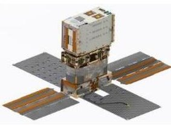

The Near-Earth Asteroid (NEA) Scout mission will demonstrate the capability of a small and relatively inexpensive spacecraft to perform reconnaissance of an asteroid using a low-thrust solar sail propulsion system. The mission will perform reconnaissance and proximity imaging with a high-resolution monochromatic camera to characterize the physical properties of an asteroid. To have resiliency against launch delay, the NEA Scout team has been working with the astronomy community to identify new targets that can accessed based on launch date, time of flight, and ephemeris uncertainty. NEA Scout

is a partnership between NASA Marshall Space Flight Center and the Jet Propulsion Laboratory and is an extension of the solar sail technology developed and flown by the NASA Marshall Space Flight Center 3U cubesat, NanoSail-D in 2010. $ ^{23} $

OMOTENASHI The Outstanding MOon exploration TEchnologies demonstrated by Nano Semi-Hard Impactor (OMOTENASHI) mission contains the smallest lunar lander to date and instruments to observe the Lunar radiation environment. The cubesat provides attitude control and thrust to maneuver itself into a Lunar intercept trajectory. The mission uses a novel approach to landing, having no initial orbit it impacts straight to the surface after deployment. Before reaching the surface, the cubesat spins up and deploys the 0.7 kg surface probe featuring an airbag and a solid rocket motor. The airbag is expanded to act as an antenna and just before impact the solid rocket motor is fired to decrease its velocity. Then the probe performs a semi-hard landing on the Lunar surface. On the lunar surface the probe is designed to survive for at least 6 minutes to downlink impact data. $ ^{24} $

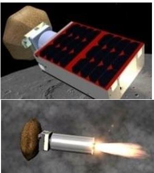

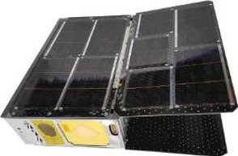

Created by an all-volunteer, non-profit group of citizen scientists and engineers (Miles Space, LLC) that initially came together through Tampa Hackerspace in Tampa, Florida. The only one of three cubesats taking part of the NASA Cube Quest Challenge that made delivery in time for the Artemis-1 launch. The mission will demonstrate long-distance communications and deep space navigation techniques while in heliocentric orbit. It utilizes a Constant Q Model H hybrid electrostatic thruster ion thruster and will demonstrate low-thrust trajectory control techniques. $ ^{25} $

## 5. Programmatic Lessons Learned

A major programmatic takeaway the developers agreed on was that mission development culture is not adequately set up (effectively or economically) to support small scope, cost-capped mission opportunities. NASA has recently recognized the programmatic need for a greater number of cost-capped, small package opportunities along with the availability of technologies needed to support these opportunities, but the development of approaches most suitable for these opportunities are still in the experimental stage or non-existent. The reference developers concluded that creating a lower cost, higher risk 'small scope mission' line of business operating in parallel with conventional one-of-a-kind missions could be an effective way forward for many organizations. This option would incorporate shared toolkits and facilities and streamlined automated documentation and review processes and risk assessment (analogous to JPL airborne or GSFC/WFF suborbital/balloon programs). Institutions utilizing this option would need to identify, support, and facilitate the reuse of facilities for instrument calibration and environmental testing of standard packages for several payload types.

Most smallsats, whether they orbit earth or not, tend to not follow traditional development paths, technically or programmatically. In contrast to traditional requirements-driven missions (e.g., requirements decomposition and verification, NASA's Class A-D classification, and associated assurance practice) development frameworks, where meeting science or technology requirements is the primary metric of success. $ ^{26} $ Cubesat missions are more constraints-driven, where higher risk and a more flexible baseline are tradable to maintain cost and schedule constraints. These missions are also referred to as "cost-capped" as their costs are "capped" to a maximum value. "Sub-class D" is where mission requirements are considered less than those dictated in NASA's class D missions' category. However, as it has acknowledged for some time, the practice of simply assigning all cubesat/smallsat missions as sub-class D approach does not work. As a result, the "Small Spacecraft Technology Program Guidebook for Technology Development Projects" was created to provide recommended practices for the research and technology development projects sponsored by NASA's Space Technology Mission Directorate's (STMD) Small Spacecraft Technology Program. $ ^{27} $ While not published in time to help shape the development of the reference missions (August 2021), many of the developers acknowledge it as offering superior guidance for

<!-- PDF_PAGE: 13 -->

efficiency, best practices, and improved success of smallsat missions. Many of the recommended practices derive from lessons learned by small spacecraft developers over the course of many past projects.

"How Satellites are Moving Beyond the Class System: Class Agnostic Development and Operations Approaches for Constraints-Driven Missions, $ ^{28} $ is one approach for tailoring constraints-driven missions. It defines a Constraints-Driven Mission as: "A mission where schedule and budget are equal to, or prioritized above, the objectives / scope. The objectives / scope is traded with, or bounded by, schedule and budget and all three may evolve as the system is defined, designed, tested, and operated." It also defines a Requirements-Driven Mission as: "A mission where objectives drive the schedule and budget and where objectives are typically prioritized over schedule and budget." A hybridized model for low-cost missions equally driven by requirements and constraints is evolving.

It is of the opinion of most of the reference mission developers that to take full advantage of limited BEO ridesharing opportunities these missions must be approached as resource-constrained constructs. In "How Satellites are Moving Beyond the Class System: Class Agnostic Development and Operations Approaches for Constraints-Driven Missions," the authors maintain that tradition, "big space" organizations and missions tend to focus on highly robust and reliable systems. Robustness drives complexity and cost, and reliability requires characterization and evolved trust over time (normally developed through flight heritage). smallsats as resource-constrained missions enable faster and cheaper evolution at the cost of lower reliability. They can also take advantage of newer hardware that provides significant performance improvements over the traditional space heritage process, but which lacks space heritage. These attributes are NOT considered bad but instead provide an alternative venue for expanding and performing space-based operations and experiments.

It is inevitable that even if they are considered resource constrained missions, BEO smallsats will require significantly larger investments to ensure mission success than earth orbiting smallsats of similar mass and volume. This is due to the jump in complexity and minimum performance requirements to operate in BEO environments. This paper will explore this dynamic where relevant.

It is important to note that the COVID-19 pandemic presented significant issues to the development of every reference mission surveyed. From 2019 onward, many of the teams had to operate on a limited and remote basis, (in some cases teams were locked out of their facilities entirely for months) during the extended shutdowns. Additionally, pandemic related issues would lead to part supplier/vender issues, cost over runs, schedule delays, team turnover and other problems. In many cases this was during critical integration and testing periods. This paper attempts to separate the effect of the pandemic from the lessons learned that are discussed.

While acknowledging the unprecedented nature of the pandemic, a possible solution to a similar situation in the future, in the case of future shutdowns, would for teams to plan to have their (or plan to have back-up) facilities that have policies in place that would allow for continued use with personal protection plans (such as Personal Protection Equipment, Social distancing, etc.) in the event of a public health crisis. Another solution would be for NASA to agree to provide supplementary support for the use of alternative facilities and personnel in the event of a shutdown of partner facilities.

## 5.1. Mission Design Lessons Learned

As a spacecraft moves further away from Earth, mission design gets more challenging. The large distance from Earth can cause significant challenges for interplanetary mission operations. These difficulties include:

- Larger solar distances and Earth distances limit the telecom and power subsystem capabilities.

- Large delta-V requirements drive the propulsion subsystem to reach far away targets.

- Few grounds station options for high data rate communications with BEO spacecraft.

- Likely have only one (or less) communication opportunities with the spacecraft per day.

- Long communication delays require greater spacecraft autonomy.

<!-- PDF_PAGE: 14 -->

- Long duration in deep space with relatively short encounters with target.

- Limited availability of navigation support for position determination.

- The following considerations were noted by the reference developers as being particularly impactful to the development of their missions:

- Efforts to design and maintain correct trajectory does not scale to the smaller size. Even small satellites require a trajectory design and navigation team(s) with a similar or even greater scope of work to larger exploration missions. Missions still must have a full flight dynamics team for trajectory design, exactly as for a much bigger spacecraft.

- The reference missions that will attempt to achieve lunar capture and future missions that want to achieve capture to other celestial bodies must use complex low energy trajectories that require significant effort to design. Constraints on the trajectories and total Delta-V available to smallsats limit the types of feasible orbital transfers that will encounter the target body with the necessary ballistic capture energy and orbit orientation. These efforts are outside the scope of what typical LEO smallsat developers will have done in the past and does not scale with the size of the spacecraft, as mentioned in the point above.

- Software that can map low energy trajectories simply and quickly will be vital for future Cislunar smallsat missions. Often designing low energy trajectories dissolve into circular restricted three-body problems with large (and in many cases not bounded by a reliable launch date) with current methods are very time consuming. Most teams performed these analyses using combinations of ATD, GMAT, and STK Trajectory as no single program provided enough fidelity and/or capability to finalize a trajectory design. These efforts had to be repeated every time the launch date was changed.

- Due to trajectory constraints and the requirements to be powered-off during launch, spacecraft wake up lost in space and lost in time, not knowing where it is relative to Earth. Missions should be designed to tolerate large pointing error and not knowing the position of itself or of Earth after powering on. Additionally, the lack of availability of navigation and tracking assets greatly increases risk of mission loss for interplanetary smallsats, which aggravates the constraint imposed by the lack of onboard resources for trajectory correction, data processing and storage on smallsats. As a solution, it is proposed that the enhancement of cislunar communication assets already planned should be implemented as soon as possible to reduce this 'bottleneck'.

- Limited capability of current attitude control systems that were designed for LEO cubesats. Particularly for missions with critical maneuvers or imaging requirements. Systems with greater attitude control presentation and autonomy are needed for future missions.

- Difficulty dumping reaction wheel momentum. Most Earth orbiting smallsats that have advanced attitude requirements (due to pointing and skewing needs) rely on reaction wheels. As Earth orbit has the presence of a magnetic field, a spacecraft can employ magnetorquers (also known as torque rods) to transfer angular momentum to Earth through its planetary magnetic field. In the absence of a magnetic field, most reference missions used a propulsion system to create a counteracting torque on the spacecraft. This process requires much more planning and adds complexity to the mission design. It also requires reserving repellent and/or power for this purpose.

- Design to overcome initial tumbling. Compounded by the issue above, every small satellite tumbles at some point in its mission, typically right after deployment. Designing the power system and communications system (near omni-directional antenna pattern, baud rate scaling) to be operational in the majority of potential tumble orientations greatly increases survivability in off-nominal cases.

- Lifetime issues are target dependent, particularly related to longer term radiation exposure in deep space, because these missions require many months to reach the Moon or the asteroid via low energy trajectories.

<!-- PDF_PAGE: 15 -->

- Not knowing the exact deployment trajectory early on in the mission development is highly problematic because several critical aspects of the mission depend on launch date. As secondary payloads many smallsat Missions may not have set launch dates (which was the case for the Artemis-1 reference missions), deployment trajectories can vary wildly. Launch windows drastically affect the needed trajectory correction maneuvers (and the associated fuel as a key resource), eclipse time and durations (for thermal and power calculations) and ground station availability (for communication and tracking). These all affect basic spacecraft design requirements. Potential solutions for this are greater

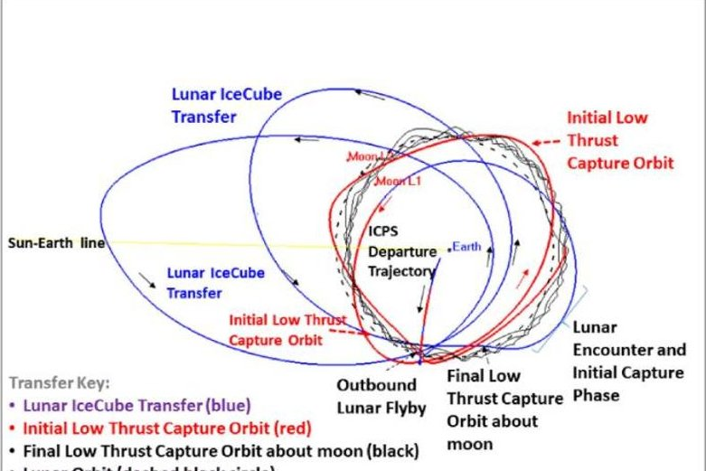

Figure 2: Approximation of Lunar IceCube transfer trajectory $ ^{1 8} $

communication between the primary mission and secondary payloads where a number of launch windows are committed to or having very high design margins.

The reference mission developers noted that performing a flyby vs an orbital capture significantly lowers the engineering challenges of this mission type and overall represent lower risk missions. A flyby is a path a spacecraft follows past a celestial body to get information about it. In a flyby, the spacecraft passes close, but isn't "captured" into an orbit by gravity. During a flyby, a spacecraft must use its instruments to observe the target as it passes, changing the aim of the instruments as it passes. While spacecraft in a flyby has a limited opportunity to gather information, the reference missions show that advanced science and mission support capabilities with smallsats is still possible. The scope and challenge of many engineering tasks are lowered by the more reasonable performance requirements of propulsion (with LunIR being able to complete its science mission without a propulsion system) and shorter mission life. Early interplanetary smallsat missions might benefit if they focus on flyby mission architectures. With architectures that rely on swarms of smallsats performing multiple single flybys probably being both lower cost and lower risk then mission designs that rely on orbital capture.

## 5.2. Launch Provider and Integrator Considerations

This section focuses on the lessons learned by the developers of the reference missions that have to do with the launch and integration services. All spacecraft large or small are subject to requirements set forth by the organization(s) providing their ride into space to interface with and minimize risk to their launch vehicle. Additional requirements may be imposed by funding organizations, third party integrators and government regulatory bodies. Note that all the reference missions are rideshares, except the CAPSTONE mission (which will have a dedicated launch vehicle). For launch opportunities to beyond earth orbit to be practical, expectations and requirements for flight must be clear and implementable. Additionally, missions must be prepared to meet them by reserving significant time, budget and other resources.

## 5.2.1. Observations/Recommendations for Launch Providers/Integrators

The Artemis-1 rideshare reference missions reported that there were significant and unexpected design, testing and verification burdens imposed due to NASA Human Rated (Class A+) driven health and safety requirements. These requirements were generally considered out of scope, not just compared with LEO secondary payload/rideshare requirements, but with the expectations communicated when the flight opportunity was announced. Additionally, Safety requirements were poorly defined initially and changed throughout the process and had significant increase in time and budget.

Solutions: Well-defined interplanetary rideshare ICDs need to be provided with opportunity announcements. Additionally, programs should model their ICDs on the simplified and less stringent safety and interface requirements that are used on other human space missions that have proven effective. The reference developers

<!-- PDF_PAGE: 16 -->

point to programs launching cubesats from the International Space Station (ISS) as a possible reference for more reasonable requirements when incorporating cost-capped cubesat Missions on human-rated facilities for future BEO smallsats. These include deployment from the NanoRacks operated airlocks and cubesat deployers. These requirements/ICDs can be found here:

- ISS Safety Requirements Documents (SSP 51721)

https://ntrs.nasa.gov/api/citations/20210009936/downloads/SSP%2051721-Baseline.pdf

- NanoRacks ISS documents

o nanoracks.com/products/iss-launch/

Reference missions reported that a great number of tasks had to be repeated or augmented as launch windows slipped and conditions changed, and scope increased. Uncertainty in schedule (both pandemic and development delay driven) was incredibly disruptive for planning for all the teams. As time dragged out, availability of personnel became more limited and task completion slipped.

Solution: For future opportunities, an initial commitment to a date with allowable slip agreed upon in advance would be advisable. Generally, it was concluded that launches that have schedules that have high risks of change do not make for effective candidates for ride share hosts. Of course, there is the assumption that soon, launch services would be more likely to be provided by a tested vehicle, as opposed to one in development such as the SLS for the Artemis-1 launch. In that case, launch service alternatives could be made available as a more regular service like those offered by NASA's cubesat Launch Initiative. Taking this course would standardize ride share and delivery to targets of opportunities.

An issue encountered by the reference developers on the Artemis-1 mission was shifting environmental requirements (e.g., the environment the cubesats were kept in before deployment). The cubesat missions' requirements (driven by science and technology goals) were not regarded in developing environmental requirements of the launch environment. In the case of the SLS, due to the evolving development of the second stage where the cubesats are stowed, these requirements would shift through the life of the program.

Solution: The developers recommend maintaining a 'payload bay' with active environmental controls in future missions where multiple secondaries are deployed. This will be critical for limiting both the costs of the secondary payload but also in limiting the risks to the primary mission payloads in the future.

## 5.2.2.Observations/Recommendations for SmallSat Developers

While it may be common sense, future interplanetary smallsat missions must be prepared to meet the requirements of their launch vehicles and launch service providers both reasonable and forthcoming in accommodating in formulating these requirements. In some cases (as discussed in the previous sub section) the scope of these requirements was not pervaded, but certain expectations must be understood by future missions. These include:

- Missions must be prepared for long term storage by the integrator or on the launch vehicle. Storage of cubesats without charging or health checks can be a possible source of failure before launch and must be considered.

- Missions must be prepared for significant time stored on the host spacecraft before deployment. Such as the Artemis-1 missions on the SLS's Interim Cryogenic Propulsion Stage or future missions where cubesats can be hosted on propulsive ESPA rings or other "tug" spacecraft.

- A mission's requirements (driven by science and technology goals) are not regarded in developing environmental requirements in launch environment

- The reference missions identified basic launch parameters that developers need to analyze basic feasibility conditions on launch:

- Is the spacecraft provided power by the launch vehicle, and if so when (on the launch pad or in space)?

- Does the spacecraft need to be powered off?

<!-- PDF_PAGE: 17 -->

- Nominal state vector (and ranges/uncertainties)

- Nominal position (and ranges/uncertainties)

- Nominal deployment time (and range)

- Eclipse conditions

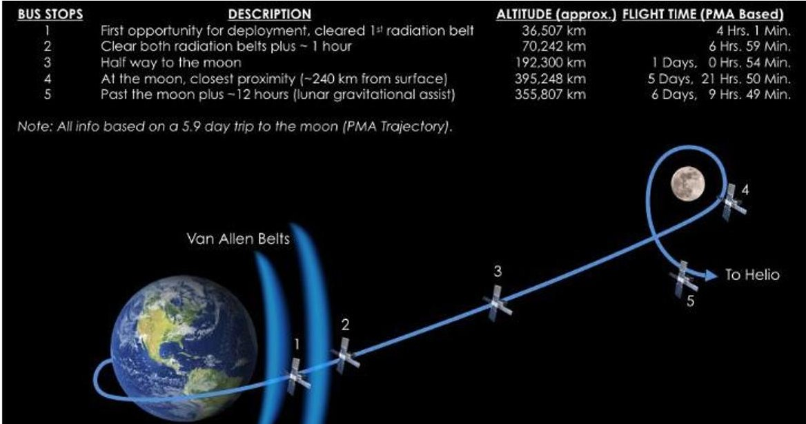

Figure 3: Representative Secondary Payload Jettison "Bus Stops" for the SLS Artimis-1 mission. Courtesy of NASA

More specific design considerations due to launch and integration requirements are discussed in their relevant sections later in the paper.

## 5.3. Supervision and Team Management

Team management issues to consider when developing and managing a team to develop an Interplanetary cubesat:

- For the academic reference mission team turnover was the single biggest cause of delays and problems. This is a well-documented issue common for many academic cubesat missions. $ ^{29} $ However, the issue becomes more acute with interplanetary missions because of how much longer their development takes. The academic reference missions had high turnover (~30-20%) semester to semester. Team sizes would also drop significantly during summers (~70% of original size).

- Turnover can cause unnecessary repeated work and periods of uncertainty over past design, requirements, and trade decisions. These "Second system" solutions would brake continuity, complicate the onboarding process for new team members and have long-lasting negative effects on productivity.

- Turnover caused inventory management issues for some teams due to the difficulty of maintaining basic knowledge such as component storage location.

- Turnover difficulties were amplified by having a specific launch date with schedule slip. Most academic payloads can continue to develop, test, and integrate until they are ready to deliver, then find a launch opportunity. The selection by Artemis-1 pushed some teams to focus recruitment on developing small teams for final testing and integration, when larger teams could have better used the academic environment advantages (primarily lower cost labor) given the extended development time provided by launch vehicle schedule slips.

- Some general observations made by the reference missions on what made successful teams:

- Developers agreed that it is critical to have a spacecraft or systems engineer, who is guaranteed to be part of the team for a long period, have strong system engineering and development cycle knowledge and have strong expertise to work with multiple subsystems.

- Having a dedicated Safety Team or Safety Engineer was important in managing requirements verification documentation as well as maintaining communication with the launch vehicle and integrating

<!-- PDF_PAGE: 18 -->

organizations. For many of the reference missions the Program Manager or Principal Investigator filled this role and it was found to be an oversize drain on their time and focus.

- Flight Software requires someone with expertise to lead and plan development. This is especially a difficult thing for Academic missions where the traditional computer engineering curriculum does not cover the specialized knowledge needed for developing flight software for space missions. Many Reference developers also reported a lack of understanding of the scale of the software engineering tasks as well as having difficulty capturing all of the software requirements at the beginning of development.

- How the team is managed must include plans to maintain the pipeline of knowledge. To minimize turnover disruption, avoid single system experts, emphasize the creation of sub-teams and one-to-one mentorship for new and old team members to share system knowledge. Documentation must capture the rationale behind major design choices.

It was agreed that there is a problem with the lack of available system engineers experienced in working on small scope cost capped space missions. We appreciate the fact that for the most part we are part of the creation of a first-generation small scope deep space mission cadre, and that in many cases our efforts are creating opportunities for training next generation small scope deep space mission developers.

Solution: In the future, it is recommended NASA builds on the already developing core of engineers and managers/mentors at proposing institutions ranging from NASA centers to small start-ups and universities and use them simultaneously on projects of this nature. This approach will help to alleviate turn over induced at government or corporate organizations by experienced personnel being subsumed in larger projects or at academic institutions by time constraints of student availability. This issue can also be mitigated by the involvement of members of larger missions with mutual benefit in some cases. Special attention should be given to solving this issue for critical leads in small package/payload systems engineering, mission operations and ground data systems managers, and thermal design engineering.

## 5.4. Documentation

Something that was a significant draw on the teams' times was that documentation requirements for flying on human rated and planetary exploration launches were orders of magnitude greater in detail than typical earth orbiting missions. The reference missions identified Critical documentation that were vital for maintaining critical information and tracking design margins (to be discussed in more detail in section 6. Spacecraft Design and Development). These documents should be kept up to date as authoritative sources of design knowledge. It should be noted that while many LEO missions implement these documents most of them require significantly more detail for BEO missions. They include:

- Requirements Development and Management process consistent with programmatic goals of major stakeholders, baseline scope and concept of operation. Even with heavily constrained missions, there are programmatic stakeholder- based goals, such as ability of propulsion or communication systems, or a water detection instrument, to meet a minimum performance level set in the announcement of opportunity. Good system engineering practices are crucial in identifying where inevitable changes, such as substituting components that have failed or are not available, could potentially impact the performance of other subsystems, and test or modify them accordingly.

- Power Budgets: This defines the power generation and draw for each component. The Power budgets for BEO missions are much more complex than those for Earth orbiting missions as they must account for the irregular eclipse times and constantly changing relative orientation to the sun and earth. This document must evaluate the total power generation overtime, this often-requiring input from the navigation and trajectory team. It also must outline the available usage in different operational modes and mission operation timeline to ensure battery depth of discharge remains above a required value.

- Communication/Link Budgets: Defines the link performance and margin for all system communication links. Driving factors include transmitter power, antenna gain, operating range, modulation scheme, and data

<!-- PDF_PAGE: 19 -->

rate. For beyond Earth orbit missions, the highly varying range throughout the mission introduces significant link margin complexities.

- Thermal Budget: Tracks heat sources and sinks, with the goal of ensuring all components will remain within operational and/or storage temperatures for each phase of the mission. Many BEO smallsats missions experience minimal eclipse, biasing the systems towards a higher temperature than many Earth orbiting small satellites. Some missions had to plan cool down times with minimal systems running to allow spacecraft to radiate excess heat due to analysis showing that the spacecraft risks failure due to overheating. Many found power budgets helpful in designing their thermal budgets.

- Master Mission Operations Plan: All the reference missions had evolving mission operation plans due to changes in trajectory, changes in sub system performance parameters as they were developed. The mission operation plans mainly evolved around the trajectory, communication opportunities, power availability, thrusting requirements, and science targets. The mission operation plans are tied closely to the communication/link, power, and thermal budgets.

- Mass Budget: Defines component and assembly mass estimates and measurements. Fidelity of the mass budget increases as mission design is refined and margins are reduced. Some mass budgets include information on material type, specification, and operating environment, similar to a Material Information and Usage List.

- Electrical Interface Document: This document can evolve but ultimately forms the basis for the wiring/harnessing for the spacecraft and keeps track of the power and data connection needs of the different components of the spacecraft. As designs had to be iterated due to safety considerations and analysis, this document is critical for maintaining interoperability for COTS systems with very specific interface requirements. Given the limited internal volume of interplanetary smallsats, having early considerations for harnessing can save significant effort during testing and integration. These documents should include data types, voltage, and current needs/parameters to and from devices, and connector and wire types.

- Successful documentation strategies included:

- Use of version-controlled cloud repositories for documentation. The use of a central repository for flight software with the facility for version control and commenting, such as GitHub, for key schematics, documents, and codes. This was particularly important when pandemic related shutdowns made access to onsite networks impractical.

- Maintain single evolving authority sources of up-to-date design knowledge. While common practice for larger missions, academic organizations noted that having a single authority for document organization and accuracy was critical and not always followed from the mission onset. This authority should be responsible for configuration control when changes in design or implementation must be consistent with baseline concept, scope, and primary goals.

- Do not rely on NASA/Integrator/Customer safety documentation for your authority's source of design information. Many teams reported that they leaned on deliverable flight safety documentation as their source of authorities for design information.

- Documentation provides structure and continuity to missions, but too much documentation can limit mission progress and delay the overall schedule. Multiple Artemis-1 missions reported that the safety documentation requirements required significant budgetary and schedule resources to complete, well beyond the experience of many Earth orbiting small satellite missions

- In the future, model-based design process may be key for minimizing documentation effort.

## 5.5. Infrastructure and Facilities

Several reference missions were able to share facilities and hardware resources. For the Artemis-1 missions, the common formfactor of a 6U cubesat, and common dispenser (PSC' CSD dispenser) made sharing the equipment exceedingly easy. Several missions were able to share:

<!-- PDF_PAGE: 20 -->

- Test fixtures for Thermal Vacuum (TVAC) testing and vibration testing

- Test deployers for fit check and mechanism deployment

- Testing cables for TVAC testing, mechanism deployment and vibration testing

Given the high-performance capabilities of interplanetary smallsats, the developers also noted that few academic and other non-government organizations had the range of equipment and specialized knowledge needed to do the full range of environmental and functional testing.

However, it was noted that the reference developers could have taken greater advantage of common infrastructure. Two of the reference developers, Morehead State University' Space Science Center and the Arizona State University Interplanetary Initiative Lab, have testing facilities available to other labs. These facilities are capable of a full suite of environmental testing and extensive experience testing smallsats.

Additionally, it was noted that if more ambitious science missions are to be attempted while at the same time enabling the largest number of developers (academic, first-time space users) at the lowest cost, specialized testing capabilities should be developed and made available, including facilities for:

- Camera Characterization

- Antenna and other RF systems testing

- ACS sensor and actuator polarity testing

- Metrology for alignment including star camera alignment

It was proposed that launch programs can save costs by consolidating testing (with the option for missions to choose their own facilities). A subscription model to use common facilities may also be a solution to maintaining and guaranteeing access to specialized and general testing equipment and specialized knowledge.

Cost saving can also be achieved using common shipping services. A common carrier could stop at several developers and transport all the spacecraft as a stage 0 service of the launch provider.

All developers were delayed due to covid restrictions. In some cases, the integration and testing facilities were no longer available. Teams that had, or found, access to alternative facilities were not as affected. Having contingency plans for integration, testing and operations facilities is required to meet schedules. The other approach is to have alternative launch options that can relieve schedule.

Compatibility testing with NASA (or commercial) ground receivers is critical for testing communication systems.

## 5.6. Cost and Schedule Analysis

The use of smallsats have seen a huge growth in the last decade, but interplanetary missions come with unique challenges which can make it difficult to anticipate costs. Overall, it was agreed that the primary drivers of cost and schedule for Interplanetary and Deep Space cubesats are significantly different from both non-cubesat interplanetary missions and LEO cubesats. These reasons include:

- Lack of full and transparent cost and schedule mission data broken down by work breakdown of past missions.

- Today's smallsat cost and schedule models do not predict interplanetary type missions well. $ ^{3} $ In fact it was observed that costs were largely untethered from traditional model metrics of mass and volume.

- The following challenges and observations were made by the reference missions. Recognizing them at the earliest stages of cost formulation are vital for accurate cost and schedule estimates for future missions:

- Effort and time to complete program management, systems engineering, flight software development and systems integration tasks, do not scale down with the size of the mission from larger exploration missions.

- Like larger spacecraft it was found that science instruments and propulsion systems were typically the greatest drivers of mission costs for the reference missions.

Additional costs for implementing complex and state of the art instrument technologies are often overlooked and underestimated.

<!-- PDF_PAGE: 21 -->

Big science goals on small spacecraft does not lead to reduction in total mission costs. Similar costs for scientists and engineers to meet ambitious science goals will still be incurred.

- Hardware components were inexpensive compared to traditional hardware, but core engineering needs are roughly similar or in some cases greater.

- Interplanetary small satellite missions need longer schedules than typical Earth orbiting smallsats.

- Most small satellite vendors do not currently have experience in this mission type, so additional support is often needed, driving up costs.

- The inverse linear relationship between the TRL of a system and its cost remains for these missions.

- The reference mission developers determined the following steps should be taken to control and anticipate costs on future Interplanetary smallsats missions:

- Cost estimating, evaluating costs, and cost validation will be a challenge for interplanetary mission as data is inconsistent and limited.

o Proposal writers and reviewers should get input from experienced project managers and experts. While there are a limited number of such personnel as of this writing (with a significant portion of them being in the acknowledgments of this paper) but nonetheless their insight will be invaluable.

o Traditional cost and schedule models made for larger missions are not appropriate.

O A clear understanding of the unique requirements vs. capabilities for a unique mission needs to be better defined and detailed out BEFORE schedules and budgets are estimated and agreed to.

- Tight development schedule and low available costs: the development of novel deep space technology requires significantly more time and budget compared to equivalent LEO smallsat systems. In many cases, design of certain subsystems became more difficult as the limited volume and mass made the subsystems more complex.

- The small form factor of the final produced system should be not a driver for the schedule and budget assessment.

- Carry large cost reserves, especially on new technologies. Budget needed to allow for replacements due to damage and errors in testing and integration.

- Project costs of member load should be factored into the beginning budget. Flexibility on budget based on manpower was ultimately a much-needed feature for most of the reference mission.

- Sponsors and projects should not assume the cost of engineering effort scales linearly with the cost of the hardware.

- Cost due to launch date shifts should be accounted for and expected.

Non-scalable costs for systems of comparable or greater complexity than conventional large spacecraft. Typically, all costs have scaled with total mission costs for conventional, one-of-a-kind missions, but this is not the case for the cubesat paradigm or for cost-capped missions, where 'reuse', COTS components, and standardization are assumed.

Solution: NASA should continue to encourage not just the use of but also the sustainment of shared software tools (for modeling, testing, data production), shared build and test facilities, several reliable deep space subsystem choices (computer and operating systems, power, communication, power, and active control systems) and to use incentives, including funding opportunities, to facilitate the creation, distribution and training of such tools and approaches. Collaboration among NASA, industry, and universities to enhance the smallsat state of the art in technologies and implementation approaches will be critical.

## 5.7. Integration and Testing

A Generic I&T Flow Baseline can be found in "NASA's Small Spacecraft Technology Program Guidebook for Technology Development Projects" Figure 1 (not in this paper). $ ^{27} $ Most of the reference missions followed similar processes developed independently. Adhering to a traditional "Test as you fly, fly as you test" philosophy, where

<!-- PDF_PAGE: 22 -->

a mission attempts to accurately screen for hardware and software issues while simulating flight-like conditions and outcomes, has both advantages and disadvantages for this mission type. It does help ensure that the testing campaign and planned operations are commensurate with one another and the expected environments, increasing the likelihood of success. However, the level of testing done required to reach a high level of confidence for operations in a BEO environment is not conducive to low cost and short development timelines.

For a successful I&T campaign the reference mission developers recommended that:

- Having a comprehensive plan for how to do each step in of the assembly, testing, and integration is critical to save total time and effort. Ensuring things such as: clearance for tools when installing fasteners, room for wire harness installation, access to electrical ports for testing and other considerations must be accounted for. Developing these plans are enabled by robust systems engineering processes.

- Design for disassembly is important. Often overlooked by missions is having a plan if the spacecraft needs to be disassembled for unforeseen issues. Especially when spacecraft use adhesive, plans that enable the majority of functional testing to be done before final.

- Hardware in the Loop (HITL) testing is extremely important to verify the hardware/software interfaces, finding any performance issues, as well as discover hardware "quirks" that may require operational or design changes to work around.

- Remote access for HITL for software development proved to be incredibly important. Especially with covid lock down and academic holidays, having remote access to development hardware allowed for software development and testing to continue uninterrupted.

- Having spares of all flight components on hand is critical. Several Reference teams experienced late-stage hardware failures during testing and integration. The teams that had no spares on hand, in some cases had to wait months to get replacements. This requires budgeting for extra hardware.

- Significant schedule and budget margin and contingencies should be planned for each test to ensure sufficient time and budget are available in the case of unexpected test results. It is vital to understand that tests are meant to detect problems; neglecting contingency plans may result in schedule and budget problems.

Some of the above suggestions may be beyond the resources of university and small commercial operations. As such funding organizations such as NASA should be prepared to support these activities and suggest larger funding margins in their partners' missions. Forming a consortium of developers to provide mutual support might be another solution.

The paperwork required for the human rated Artemis-1 to provide proof for safety and launch vehicle requirements verification and certification proved to be a massive burden on all the participating reference teams.

Solution: A baseline set of tests to be identified to meet the launch service provider requirements needs to be agreed upon at the beginning of the mission. These should establish the minimal acceptable risk posture of the program. These tests also need to be provided templates for verification artifacts by the project as well as specific processes for requesting waivers in some circumstances.

The General Environmental Verification Standard (GEVS) for GSFC Flight Programs and Projects (GSFC-STD-7000) is frequently used for flight projects but is overkill for low-cost high-risk missions. The Mission Success Handbook for cubesat Missions (GSFCHDBK-8007) also includes a version of the GEVS that is tailored for cubesats in Appendix A "Environmental Test for CubeSats". The reference missions believe these tests to be excessively conservative for small spacecraft technology demonstration flights and developers

Solution: Missions or even better launch providers, must tailor the environment and test plan appropriately for the scope and risk profile of the flight project. Even though a conservative approach on launch loads and environments is often justified in order to preserve the greatest set of launch opportunities, lower testing thresholds should be accepted and communicated to mission developers. Additional tests can be identified to

<!-- PDF_PAGE: 23 -->

lower risk but should be acknowledged as activities that will be eliminated if schedule or cost margin needs to free up.

## 6. Spacecraft Design and Development Lessons Learned

The development of a smallsat for a deep-space mission mixes the requirements of reliability, radiation hardness, and high autonomy traditionally used by big spacecraft with the constraints of size, mass, cost, and development time of the cubesat segment.

The reference missions are an example of cubesats using the latest technology that enables performance. However, it needs to be acknowledged that technical challenges (large $ \Delta\mathrm{V} $ , large Earth/solar distances) on interplanetary missions drive systems toward larger volumes/areas than traditional cubesats have attempted. This can lead to misalignment of resources when developing the spacecraft's different subsystems. In order to avoid this misalignment, the reference developers made the following observations:

- For the development of the various subsystems of the reference missions, developers agreed on the criticality of taking one of two approaches: 1) The use of high reliability COTS or 2) Design for Reliability. Note that both these approaches are constrained by cost and schedule and are meant to fit within cubesat standard (minimal volume and mass). This allowed teams to minimize testing by proving designs were resilient analytically.

- Leaving at least 33% of power and 25% of mass and volume available as margin for design changes or even late-breaking opportunities. Mass and or margin drawdown plans might be warranted as many reference designs required significant mass reductions and power re-budgeting.

- The spacecraft should have a finite set of well-defined features (with assured margin) coming out of PDR that are fiercely defended against change. The addition of more features during even during the very beginnings of the design process, should be resolutely fought against. Many missions suffered from requirements creep causing redesigns and delays.

- Early attention to wiring and interface requirements is critical. Mandate engineering work by defining interfaces before most other decisions. Enforce the interfaces by accepting inefficiencies in layout, possible due to reserved space.

- Several reference missions were able to successfully leverage terrestrial grade electronics and components. These were for the most part used for, low to moderate pressure piping and fittings, avionics, and peripheral electronics. When using terrestrial components, the reference missions noted that:

o As it is common practice for LEO smallsats the use of space-rated conformal coating applied to electronics and items of uncertain materials protects the electronics from environmental interaction due to vacuum and extreme temperatures.

- Reliability and temperature resilience should be known. Standards such as AEC-Q100 Grade 4/automotive rated parts were used successfully by some of the reference teams.

- Missions successfully leveraged hobbyist and developer electronics where components are essentially "breakout boards" with the parts with their electronic peripherals mounted on PCB with terminals that can accept hook-up wires for clean and easy interface and testing. Using these components tends to be lower cost, more reliable and have faster turnaround than larger "all-in-one system". Experience has shown the components to be:

o Rugged, allowing the inexperienced to use them incorrectly and not damage them.

o Resilient to electrostatic discharge (ESD) damage.

Easy to use outside a lab for testing and development without risk of damaging test parts.

<!-- PDF_PAGE: 24 -->

o Consolidating these "breakout boards" onto larger "host" PCBs can enable easy testing by providing test terminals, simplify integration, and provide additional surface area for thermal dissipation. An example of this approach is shown in Figure 4.

Limited in-flight internal and external resources available to many single small platform missions. External resources, such as communication, navigation and tracking through the DSN

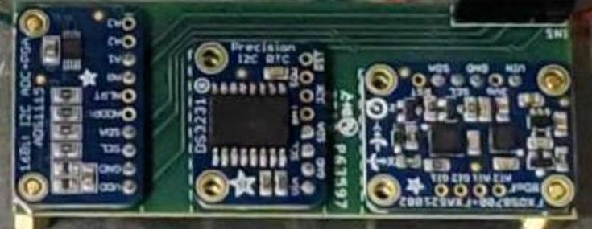

Figure 4: Stacked Hobbyist Electronic Breakout board on consolidated PCB Board on Cislunar Explorers.

which must serve many missions, as well onboard power, propulsion, and communication systems for small, costcapped missions, will continue to be an issue with current architectures.

Solution: The reference developers recommend that NASA facilitate the utilization of architectures that make cubesat paradigm useful beyond single 'pathfinders.' cubesat paradigm spacecraft would be particularly useful if delivered as multiple platforms to their target trajectory by a 'bus' which would then operate in the target environment to preclude the need for external or internal resources for communication, navigation and tracking (bandwidth), power (driven by onboard propulsion need) systems. In addition, we recommend that NASA develop and test models for 'batch' parts selection and testing and payload calibration for multiple platform missions.

Limitations of 6U volume outside of Earth orbit. Because of the thermal conditions and need for active control systems not required in Earth orbit (for propulsion and pointing), the Moon is an especially challenging target for 6U spacecraft. The result is a spacecraft with as much as twice the density of a conventional spacecraft and limited external area and thus with far greater challenges for heat dissipation, subsystem configuration, and unhindered field of view.

Solution: For the foreseeable future increasing the 'typical' lunar cubesat size to 12U or larger will ease development and lower risks for missions going forward.

## 6.1. Systems Engineering

Interplanetary missions are driven technically by mission objective, power, telecommunications, and propulsion requirements. Understanding and having clear and specific requirements for these performance metrics going into a project is key to its success. Given that interplanetary cubesats aim to be high-risk and low-cost, when full implementation of traditional space-focused systems engineering processes (such as those found in NASA/SP-6105 NASA Systems Engineering Handbook) were attempted (or attempted in part) by some of the reference missions it was found that in many cases there were specific determinants maintaining low costs and staying on schedule. On the other hand, the reference missions did suffer predictable consequences from the omission of standard systems engineering processes such as risk management, configuration management, and quality assurance. Academic organizations in particular lacked experienced system engineering expertise and had themselves in the possession where the PIs or managers would take on the role of systems engineers.

Assessing risk through trade space study is the design approach for small scope, cost-capped missions. The trade space for selecting and configuring features for small, cost-capped, limited scope spacecraft is complex.

Solution: It is recommended early risk assessment through trade studies of approach cost, schedule, physical resources, and impact of modification to meet threshold and baseline requirements. Correction of errors requiring expensive post-machining can become too far out of scope to correct in some cases.

## 6.2. COTS Component and Subsystem Selection

This first generation of interplanetary cubesats heavily leveraged the state-of-the-art capabilities of commercial off-the-shelf (COTS) solutions. For this discussion components and subsystems are divided into two categories:

<!-- PDF_PAGE: 25 -->

COTS, items that are products available on the market, or custom designs flying for the first time (or flying with major modifications). COTS are traditionally favored for their advantages in: Reduced lead-time and costs and Reduced set of environmental tests as they are performed or guaranteed by the supplier. $ ^{2} $ But at the same time, they suffer from:

- "Black Box" issue (especially for US-supplied units) where the exact oppertain or components making up a of a device or subsystem is not shared with the mission.

- Higher risks or failure (possible late anomaly detection/use of low-Rel EEE).

- Modifying COTS cannot easily be used to gain back margin (mass and power) without replacement.

- Change in COTS subsystem requirements resulting from system or mission changes might not be actionable.

- However, several reference missions experienced significant issues with COTS providers that lead to unexpected increase in costs and delayed schedules:

- COTS components can be subject to discontinuation or change without warning, resulting in changes in system design, interfaces or requirements that might not be easily actionable. This becomes a higher risk the longer the development period of a mission is. Several reference developers experienced both packaging and electrical interface changes due to updates in products. The effects of these ranged from minor changes in structures to significant changes in electrical interfaces and the addition of peripheral electronic components to compensate. To reduce overall risk, close monitoring of the supply chain is necessary. However, it is acknowledged that most smallsat developers have limited control over their supply chain.

- Space COTS is not always consistently priced.Many "New Space" developers will advertise set prices on their website. Several developers report using the advertised price of components for budgeting but when attempting to purchase them found that these prices would only be honored in narrow circumstances (such as bulk purchases) or not at all.

- Some Space COTS systems need modification to make them suitable for interplanetary missions. Reference missions reported that although they used COTS components and subsystems advertised as space rated, almost all of them required some sort of modification to meet their mission needs. The reason for these changes included:

The need to gain back engineering margins such as mass, volume, and power.

- Greater thermal performance. Either a need to survive in a thermal environment greater than standard or a need to produce less heat.

General need for higher performance.

Only a few commercial smallsat COTS vendors are willing to do custom products and services, but when they do it comes with high non-recurring engineering costs and time. These costs in addition to the uniqueness of technology deters most companies from developing one-of-a-kind technology due to unpopular demand. This might be a consideration for NASA to support the sustainment of these technologies, not just their initial development. An interesting note is that no team reported doing any modifications to give their electronics greater radiation resiliency.

- Some COTS components used by reference missions were found to have quality issues, with vendors struggling to deliver quality components. For this reason:

- Early hands-on testing and verification is needed to catch said issues.

Critical components need to be certified and guaranteed by supplier.

- While lead times can be significantly less than custom hardware, long lead items for some COTS hardware remain and drove schedule delays and cost increases.

- Having a good understanding of vendor capabilities, heritage and past performance is important prior to contract award and execution. Smaller, lower cost vendors often underestimate or underbid the costs and scope of the required work, and this leads to difficulties and delays when inevitable problems arise.

- The reference developers also noted that:

- Conformal coating of COTS components is vital for their survival.

<!-- PDF_PAGE: 26 -->

- Thermal environment survivability was the single greatest concern of COTS systems, leading to high-risk concerns or requiring modification. Both the extreme colds and heat experienced (and the length of time systems are subjected to those extremes) by interplanetary smallsats during pre-deployment and during flight were beyond those experienced by LEO smallsats.

- COTS that are designed for the radiation environment of GEO may be adequate for interplanetary requirements.

Widespread standardization was not realizable in this 'first generation' of interplanetary smallsats. The reference developers had extensive discussions as to what degree of standardization is or could ever be appropriate. However, a consensus was not established. The teams acknowledge that different payloads imply different subsystem requirements, or at least different configuration of subsystems. The question outstanding was how to embrace 'diversity' of payloads, while encouraging the use of COTS and standardization. Systems that were common to several reference missions are discussed later in the paper.

Incorporation of state-of-the-art technologies along with reasonable COTS are both essential but not yet fully supported. The cubesat paradigm, while relying on COTS for supporting subsystems to reduce costs and to preclude 'reinventing the wheel', should be well suited for technology demonstration missions, due to more allowable risk, and thus be able to push forward state of the art, offer improved measurement capability, and improve benefit to cost ratio for any missions.

Solution: We recommend future opportunities that allow R&D project flexibility to push the state of the art forward. We are also aware that state of art components (rather than preexisting >10-year-old spares) for critical (payload) subsystems can lower costs in the long run. To avoid the issue of dealing with 'black boxes' from commercial vendors, we recommend project organizations require ICDs and transparency from vendors (and continuation of the NASA Electronic Parts Program) to allow the team to plan for and mitigate any impact on the payload.

The Reference developers were split on the suitability of standard or common buses for future missions. Both ArgoMoon and LICIACube use a common bus (known as the HAWK-6 platform shown in Figure 5) with the only difference being the instruments that they use. A common bus will most likely take significant penalties in mass and volume as the subsystems will need to be designed to be available to the largest number of payloads and propulsion capable of reaching and operating in the diverse targets of interplanetary space. However, if several common bus designs can be developed that would enable a greater diversity of users to attempt missions of this type and potentially save money as well. The teams discussed the feasibility and possible advantages and disadvantages to developing several reliable interplanetary proven COTS subsystems with hardware lines and software tools matched with most frequently visited targets and different payload types (e.g., particle analyzer, spectrometer, field detectors) for adequately standardized external constraints (volume, mass, power) to accommodate a range of payloads. No single view was ultimately settled on. However, it was agreed that if these

systems are developed, they will most assuredly take efficiency penalties in mass and volume and possibly power and other very limited resources compared to bespoke systems. To enable more standardization for early missions larger formfactors (12U was identified as possibly to be sufficient) may be required. The ability to "mix and match" COTS that have common interfaces and open software architectures may be the best compromise.

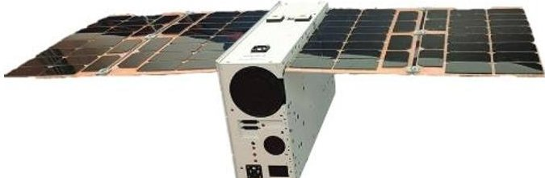

Figure 5: ArgoTech HAWK-6 Platform

## 6.3. Payloads and Instruments

The reference cubesat missions contained payloads ranging from spectrometers to impactors that had to operate in different cislunar and beyond target environments as discussed in Table 1 and Appendix 1; newly demonstrated payloads included an in situ biological experiment, navigation, attitude, propulsion, and communication systems,

<!-- PDF_PAGE: 27 -->

particles and fields instruments, cameras, spectrometers, and laser sources. The reference missions that reported the least number of unexpected issues during development all used instruments that had flight heritage to LEO on another smallsats with minimal design changes. The missions that used "New" instruments, instruments that had been adapted from larger spacecraft missions or instruments that needed significant modification from previously flown versions almost universally experienced significant delays and cost overruns.

Most of the reference missions faced challenges when developing their payloads including:

- Most of the instruments requiring science payloads found meeting the mass and volume constraints of a 6U cubesat challenging. Greater volume and mass (such as 12U cubesats) should be considered as the baseline for future missions.

- Thermal control became a major issue for many mission payloads as they:

- Sensitive Science instruments (such as Spectrometers and lasers) have narrow operational temperature ranges

- Had to meet conflicting thermal control requirements for certain instruments vs. other subsystems (Example: cold instruments vs moderate batteries)

O Have limited mass for absorbing heat without significant temperature change.

Have limited surface area for conducting and radiating heat away.

The use of cryocoolers

See section 5.6. Thermal Analysis/Control Systems for more information

- Testing and verification of performance represented a significant cost and resource burden on many of the reference missions. Emphasis on instruments that require minimal calibration (or come from a vender pre-calibrated) can save significant time and effort for future missions.

- Use of first-generation micro-propulsion systems, limited by limited available volume for fuel and onboard power.

- Radiation exposure of payload parts flown in LEO still required additional analysis and development when adapted by the reference missions. See 6.13 Radiation Shielding and Resiliency Design for more information.

- Payloads that had optics and biological components were highly susceptible to contamination during the secondary payload and integration handling environments of their given launch. However, they had few options to mitigate these risks after delivery and in most cases had to "bite the bullet" and accept the risk.

- The data collection capabilities for many of the science instruments aboard the reference missions were constrained by the limited availability of ground stations capable of BEO communications (such as the DSN). Futures missions will need to pay early attention to how it can minimize bandwidth needs. Techniques such as data compression and AI identification to send greater data volume of measurements of significance were used by some of the reference mission, but it should be noted this represented additional complexity and costs for the missions. It also drove the need for higher performance C&DH systems.

## 6.4. Attitude Determination and Control Systems

BEO smallsat missions have significant attitude determination and control (ADCS) challenges relative to Earth orbiting missions including limited effective hardware due to vastly different operating spaces and a lack of guaranteed Earth relative attitude and professional knowledge.

- SmallSat missions to Earth orbit have employed horizon sensors, magnetometers, sun sensors, and reaction star trackers for attitude determination. However, most BEO missions are unable to employ magnetometers or horizon sensors given the lack of a strong magnetic fields or close horizons for significant portions of their mission. $ ^{30} $

- Magnetorquers are not viable for use outside of Earth's magnetic field, limiting the reference missions to utilize propulsion systems and reaction wheels for attitude control and reaction wheel desaturation. Although reaction wheel momentum desaturation is typically completed by magnetorquers on Earth orbiting small

<!-- PDF_PAGE: 28 -->

satellites, BEO missions using reaction wheels had to employ already highly constrained propellant reserves or solar radiation pressure over a significant timespan to desaturate the wheels.

ADC systems employed by the first BEO small satellites fall into two categories: COTS systems and internally develop systems.

- The XACT is a COTS attitude determination and control system provided by Blue Canyon Technologies (BCT), with flight heritage both in LEO and in deep space flight heritage on the MarCO mission. The XACT as shown in Figure 6, was selected for use by 10 of the reference missions. The system consists of an inertial measurement unit, reaction wheels, and a star tracker packaged into a $ < 1 $ U volume and external sun sensors, has a spacecraft pointing accuracy of $ 0.003^{\circ} $ . The systems are scalable with multiple reaction wheel sizes for additional momentum storage.

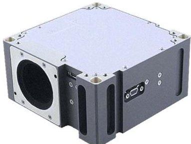

OMOTENASHI used a modified XACT for ADCS but developed its own control software running on its flight computer. $ ^{24} $

- CAPSTONE uses a COTS ADCS system developed by Tyvak, consisting of reaction wheels, star tracker, and sun sensors. It provides pointing accuracy of $ 0.014^{\circ}. $ $ ^{11} $

- CisLunar Explorers operates through a spin stabilized Attitude control concept of operations, relying on water propellant sloshing providing damping for spin stabilization and an internally developed water thrusters and CO2 cold gas thrusters for active attitude control. Its attitude determination is accomplished through celestial body triangulation from inexpensive optical cameras. $ ^{12} $

- Team Miles developed and integrated an ADCS consisting of separate COTS components, including the Sinclair star tracker, gyroscopes, accelerometers, and infrared cameras for sun sensors. Sinclair offers standalone star trackers with attitude determination accuracies greater than $ 0.015^{\circ} $ , and a Sinclair star tracker. Additionally, to reduce complexity, Team Miles will be spin stabilized and employs a water vapor thruster for attitude control. $ ^{13} $

## 6.5. Navigation and Position Determination

Determining where in space and time a spacecraft is a significant challenge for interplanetary missions no matter the size of the spacecraft, but one of great importance. Smallsat missions may in fact face more (not less) difficulties than larger missions when implementing navigation schemes. Specific difficulties they face include:

- As discussed in Section 6.4 Attitude Determination and Control Systems, BEO smallsats cannot utilize systems that rely on the intrinsic properties of the Earth (such as its magnetic field and close horizons).

- Interplanetary missions cannot leverage existing infrastructure that enables navigation and position tracking such as GPS.

- As secondary payloads with uncertain launch dates, the Earth relative attitude is unknown at deployment and compounded by moving launch dates.

Given all these restrictions, many of the reference missions are demonstrating new technologies to enable navigation and position determination capabilities. All of them leverage their ADC systems (discussed in the previous section) in some way to aid in obtaining relative position determination knowledge. The most widespread approach by the reference missions was to use their optical sensors employing camera data to determine position. The spacecraft with the XACT and other star tracker systems use images of celestial bodies to determine absolute position. $ ^{30} $ Similarly, LunIR and Cislunar Explorers are employing camera-based systems to complete Earth-Sun-Moon relative attitude estimation. $ ^{12,18} $ LICIACube and ARGOMOON are using optical camera systems for relative attitude determination and navigation by using other spacecraft, the DART probe and Dimorphous asteroids and the SLS's Intermediary stage respectively. $ ^{9,16} $

Traditional larger exploration missions' navigation systems can also benefit from traditional ground-based tracking which can providing radiometric observables to estimate the position and velocity of the spacecraft.

<!-- PDF_PAGE: 29 -->

smallsats on the other hand may not benefit from this and if they do the availability of tracking data may be limited due to both to the limited available network time (limited by both by capacity and cost to mission) and the limited link budget the smallsat can maintain.

Many of the reference missions utilize their communication systems to provide radiometric tracking and ranging functionality. Multiple ranging and positioning techniques, including one-way tracking, two-way tracking, $ \Delta $ DOR and CDMA ranging is available depending on both spacecraft communication system and ground station capabilities. $ ^{14} $ The orbit determination difficulty is amplified by limited ground station capabilities and/or access time available for deep space missions, as discussed in the ground station section 6.8. Adding ranging and orbit determination capabilities to a communication system can require significant software changes and potentially the addition of separate RF hardware, such as ultra-stable oscillators. As an example, the Iris leverages JPL and DSN's significant flight heritage for radiometric ranging and orbit determination, and multiple upgrades to the Iris ranging capabilities have been made since MARCO launched, including the addition of $ \Delta $ DOR functionality. Many ranging techniques require high oscillator stability, which has resulted in the inclusion of low volume ChipScale Atomic Clocks (CSAC) on missions such as OMOTENASHI, EQUULEUS and CAPSTONE to characterize their performance in deep space and potential application for high accuracy radiometric ranging moving forward. $ ^{11,15,23} $

The reference developers noted that future missions must consider:

- Efforts to design and implement a navigation scheme does not scale with the spacecraft size. Even small satellites require a navigation team with a similar or even greater scope of work to larger exploration missions. Missions still must have a full flight dynamics team for navigation, exactly as for a much bigger spacecraft. In addition, the complexities of using low energy trajectories may increase the scope of work a dynamics team needs to perform.

- To enable and increase the future capabilities of interplanetary smallsat missions, the performance of attitude determination and control systems need to be increased. Future missions can potentially employ gimbaled deployable and optimized center of mass location to enable higher efficiency solar radiation pressure reaction wheel desaturation to reduce propellant constraints as demonstrated by the MarCO mission. $ ^{22} $

## 6.6. Thermal Analysis/Control Systems

The thermal design of the spacecraft turned out to be a significantly greater effort for the reference missions than initially anticipated, with one mission reporting it was a major contributor to its initial failure of its CDR before being rectified. The two primary factors that were reported to contribute to issues with development of the thermal system are payload/instrument requirements and access to engineering support.

The first issue with the thermal design of these missions is the basic physics of having large power systems in small volumes to contain it and small surface area to dissipate that heat via radiation. Most of the reference missions were 6U cubesats and those with deployable solar arrays were able to collect solar power on the order of ~100W (with 120W being the greatest). A great portion of that power needs to be dissipated over a surface area of 0.22 $ m^{2} $ with many cases where 0.6 $ m^{2} $ faces the sun. An additional complication being that portions of the external surfaces are not available for use as a radiator due to being used by sensor/payload apertures, antenna, thrusters, and other components.

Somethings to note about the thermal environment of interplanetary smallsats are:

- They experience extreme thermal environments both hot and cold, including concerns surviving the cold predeployment environment and hot lunar orbit environment.

- It is not as regular as those in Earth orbit as eclipses and the general position of celestial bodies change depending on its trajectory. In many cases teams designed to the theoretical max and min thermal environment which proved to be difficult.

- Lunar orbits are generally hotter that Earth orbits due to the moon's high albedo and shorter eclipse times.

<!-- PDF_PAGE: 30 -->

- The reference spacecraft with less demanding thermal requirements (such as the lunar flyby or heliocentric missions) were able to meet requirements with either a completely passive design, or a cold biased design with heaters.

- For the design and analysis of the thermal systems the reference missions noted that:

- In all cases by the end of a mission's development the thermal design required a dedicated (or at minimum access to an) experienced thermal engineer. Some missions did not start with or initially budget for such an engineer.

- Missions that used water as their propellent noted that their propellent tanks acted as very effective heat sinks, minimizing their risk and required analysis.

- Some missions had to use exotic and expensive space rated high emissivity paint and coatings not typically used by LEO smallsats. Some missions did not initially plan to use these finishes. The use of some of these finishes requires specialized knowledge, training, and equipment that many small and academic organizations don't typically have access to. Outsourcing finishing processes was an unexpected expense for some missions.

- Missions that require cold imaging sensors or very stable payload conditions had difficulty with the limited surface area and volume of the 6U form factor. It was suggested that for missions that have extreme thermal control requirements, the 12U form factor, even without increasing the launch mass of the spacecraft, would alleviate much of the difficulty by providing additional surface area for radiators.

- Many missions reporting wanting to use dedicated deployable radiators to control their thermal environment, but only 2 missions ended up including them due to volume and mass restrictions

- Early definition of the thermal environment is necessary. The Artemis launch provider supplied trajectory information to secondary payloads for the purpose of analyzing safety impacts to the Orion spacecraft, rather than for secondary payload mission design. In one provided trajectory, there was a 3-hour eclipse that would have been prohibitively expensive in terms of spacecraft resources for one CubeSat team to handle by design. Rather than try to re-design, or re-scope the mission, the team assessed the provided trajectory data and determined that it likely did not include all constraints and parameters governing the primary Artemis mission. The solution was to derive the project's eclipse requirement by adding reasonable assumptions to the Artemis-provided trajectory data.

## 6.7. Flight Communication Systems

The second most problematic subsystem during development for most of the reference missions was their communication systems. Communication systems for interplanetary cubesat missions present significant challenges relative to Earth orbiting missions.

- As radio frequency (RF) communication path loss is dictated by an inverse square law, moving from Low-Earth Orbit (LEO) (>250 km) to CisLunar (>2.5E5 km) and deep space (>3E6 km) radically alters link budgets and limits the application of flight heritage cubesat communication systems. A link budget equation looks like: Received power (dB) = transmitted power (dB) + gains (dB) - losses (dB).

- Interplanetary cubesat communication systems must provide orbit determination capabilities through radiometric tracking and ranging, introducing added complexity. Estimation for data volume needed for ranging and tracking.

- Small formfactors create a significant antenna gain and volume tradeoff. The large communication distances for deep space missions require significant antenna gains for even modest data rate telecommunications.

- The significant volume constraints and communication distance challenges have led to the development of multiple novel small satellite communication systems. The four primary approaches used by the reference missions to develop deep space small satellite radio systems were:

- Miniaturizing larger spacecraft communication systems and employing heritage LEO communication systems can provide improved reliability. It can also allow for the rapid development of hardware to adhere

<!-- PDF_PAGE: 31 -->

to primary mission launch schedules. The EQUULEUS and OMOTENASHI missions utilized a miniaturized version the communication system of PROCYON, a 50 kg deep space small satellite mission, for X-Band uplink, downlink, and ranging. $ ^{31} $

- Leveraging LEO cubesat hardware heritage. The CisLunar Explorers is leveraging the AX5043 Transceiver chip for UHF phase modulated communications, building from the successes of university cubesats in the amateur RF bands. $ ^{13} $ The CU-E $ ^{3} $ mission employs a Li-2 UHF receiver with significant earth orbiting cubesat flight heritage (MinXss, CSSWE, DEMI) in conjunction with a student designed and developed down mixer for uplink at C-Band. $ ^{14} $

- Development of novel radio systems. The Bluefin is a University of Colorado Boulder developed low-cost X-Band transmitter with CDMA capabilities that can be leveraged for simultaneous downlink from multiple cubesats operating in proximity or for high processing gain and further distance communication. $ ^{14} $ The Team Miles uplink and downlink radio system was developed through GNU Radio, an open source SDR software for additional flexibility, and operates on a custom Linux version. The Team Miles and CU-E $ ^{3} $ radios are inexpensive systems developed for low-budget missions.

- Utilizing the IRIS X-Band Transponder. Only 6 of the 16-reference mission did NOT use the IRIS system for their main radio. The Iris radio is a small form factor (<1U) software defined radio developed by the Jet Propulsion Laboratory (JPL) and manufactured at Space Dynamics Laboratory (SDL). $ ^{32} $ The IRIS is a higher budget system with deep space flight heritage from the MARCO mission and is flying on 8 of the other reference missions. The alternate systems used by the reference missions are listed in Table 2.

Table 2: Communication System that do not use the IRIS Overview

<table border="1"><tr><td> Mission</td><td>Uplink Comm System Description</td><td>Uplink Band</td><td>Downlink Com System Description</td><td>Downlink Band</td></tr><tr><td>Cislunar Explorers</td><td>AX5043 Transceiver</td><td>UHF</td><td>AX5043 Transceiver</td><td>UHF</td></tr><tr><td>CU-E3</td><td>Li-2 UHF Receiver with Downmixer</td><td>C</td><td>Bluefin Transmitter</td><td>X</td></tr><tr><td>EQUULEUS</td><td>Miniaturized PROCYON</td><td>X</td><td>Miniaturized PROCYON</td><td>X</td></tr><tr><td>LICIACube</td><td>X-Band Transponder</td><td>X</td><td>X-Band Transponder</td><td>X</td></tr><tr><td>OMOTENASHI</td><td>Miniaturized PROCYON</td><td>X</td><td>Miniaturized PROCYON</td><td>X</td></tr><tr><td>Team Miles</td><td>GNU Radio Based SDR</td><td>S</td><td>GNU Radio Based SDR</td><td>S</td></tr></table>

In general, most of these deep space communication systems have been optimized for high frequency and low data rates to establish robust communication links. As deep space small satellite missions are highly volume constrained, most projects employ flat body mounted or deployable antennas that fit within the volume restrictions of secondary payload dispensers, such as high gain patch arrays and reflectarray antennas. Fortunately, the efficiency of high frequency communication systems for large ranges has shifted many communication systems for deep space to low wavelengths which require smaller antenna dimensions relative to lower frequency systems such as UHF antennas used by many LEO cubesats. Examples of low volume antennas that can be stored outside of the spacecraft volume but within the dispenser requirements are presented in Figure 7.

For smallsats to move into deep space, communication systems need significant development to move into higher frequency bands and operate at lower data rates. The refence developers agreed that:

- Development of higher-efficiency communication systems is necessary. Additional needed capabilities include more efficient X-band power amplifiers to reduce telecommunication temperature stress, small satellite Ka-band communication systems for increased data rates, higher gain antennas that fit within the deployable space of deep space deployers, intersatellite links for small satellite swarm missions, and increased ranging and orbit determination performance.

- High power communication systems are significant drains on power, volume, and thermal margins.

- Designing and debugging small high performance comms systems require specialized knowledge.

Difficulties in dealing with the IRIS X-band radio. The 'facility' X-band radio exceeded the estimates for resources it required, including power. Several teams experienced difficulties with the software and hardware and

<!-- PDF_PAGE: 32 -->

correct 'versions' of the 'facility' radio, especially as IRIS no longer has a response team at JPL, the original developer.

Solution: We recommend that 'facility' subsystems not exceed requirements published in the description of opportunities by more than a reasonable margin.

## 6.8. Ground Operations and Data Management

Development of the Mission Ground Segments required a huge effort and time from most reference mission developers. Interplanetary smallsats face significant challenges in ground station technical capabilities, availability, and frequency licensing. In addition, network connection and Mission Control Systems were either developed from scratch or based on commercial or open-source software, with limited possibility for customization (for mission specific usage) to provide proper real-time connection, data storage, telemetry collection and telecommands deployment.

The two primary ground station options for BEO small satellites are the Deep Space Network (DSN) or commercial ground stations. The DSN provides the highest performance, with ground station apertures and power amplifiers significantly larger than most commercial ground

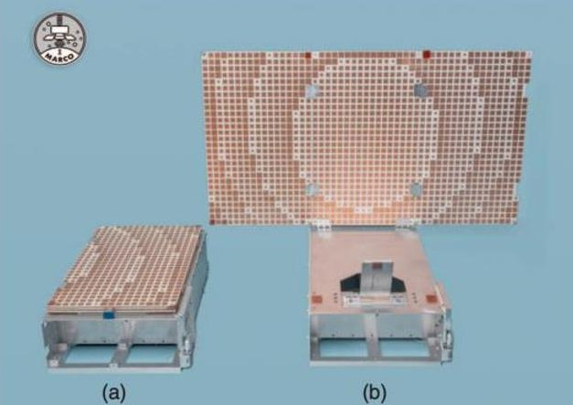

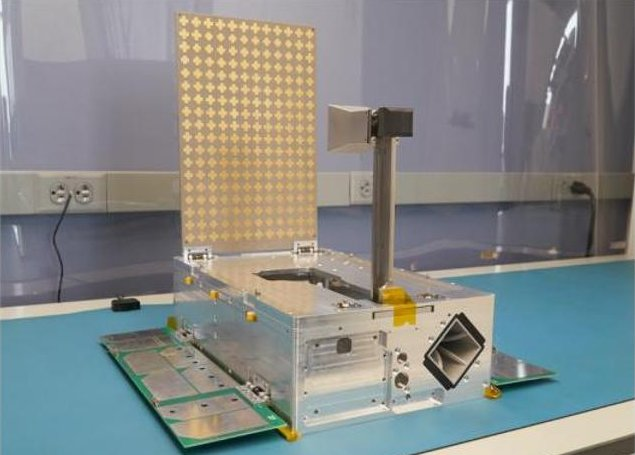

Figure 7: High Gain Antenna from top: MarCO Deployable Reflectarray and Patch Fee. $ ^{33} $ and CUE3 Deployable Feedhorn and Reflectarray. $ ^{13} $

station options but has limited capacity for low priority missions. $ ^{32} $ The limited DSN ground station availability is primarily an issue for missions seeking critical event support, repeated tracking/ranging support, or long ground station passes. Nine of the ARTEMIS-1 secondary payloads are employing the DSN, with two others planning to employ DSN assets for a limited quantity of ranging passes. The limited availability of DSN assets immediately after secondary payload deployment reduces SLS secondary payload's ability to complete orbit determination and begin trajectory maneuvers. Commercial ground station providers such as ATLAS, KSAT, and Amazon Web Services have deployed worldwide ground stations with S-Band uplink/downlink and X-Band downlink capabilities, and three ARTEMIS-1 secondary payloads plan to primarily rely on commercial ground stations.

It is important to note for interplanetary smallsat missions that:

- Commercial ground stations have greater availability but four primary limitations relative to the DSN: antenna gain and RF amplifier power, pass planning software design, acquisition and tracking loop bandwidth optimization, and licensing challenges.

- Two-Line Elements (TLE)s are not capable of describing deep space orbits and therefore commercial ground stations must move to different pass planning techniques. Commercial ground stations are primarily designed to support earth orbiting satellites. Therefore, commercial ground station assets have limited gain and the pass planning software typically emphasizes TLE and a single receiver configuration [202]. As BEO missions can have a highly varied distance from earth, ground stations must be able to store multiple receiver configurations to accommodate changes in the link budget and data rate.

- Most reference missions operate in the X frequency band. The classic UHF/amateur radio band traditionally employed by experimental cubesats in LEO restrict missions to low data rates in Cislunar space and have negligible application for deep-space missions. Ground stations capable of operating at deep space frequencies such as X-Band and Ka-Band are primarily limited in either availability or performance.

- Commercial comms and data handling solutions that had multinational partners had serious cyber security implications. Significant time and effort were required to design data management and the rest of the Mission Ground Segment due to security assessment required by NASA.

<!-- PDF_PAGE: 33 -->

- Most missions noted that their ground system requirements and operations were often not well defined, and the complications related to developing these systems can drive schedule and costs that were not well considered. Plugging into existing ground architectures is not as simple as it is often advertised and the complexities of interface testing with those systems is often underestimated.

Developing Data handling systems for BEO science missions has a greater scope of effort than traditional LEO smallsats. The Artemis-1 Reference missions had limited budgets for data management but were required to deliver data to a formal archive as required by NASA. The Planetary Data System (PDS)/ JPL Advanced MultiMission Operations System/Multi-Mission Ground System (AMMOS/MMGS) has made a light version of mission operations tools (AIT) for extracting instrument measurements and engineering data from telemetry. Individual missions must then write their own code to produce data products. Lunar IceCube specifically used a python-based code for producing raw or level 0 data to create Experiment Data Records. Other tools developed for the streamlined AMMOS PDS Pipeline Service (APPS) include label design and verification, bundling into agreed upon archive structure, PDS delivery, and report generation. Each mission then had to write data product, archive structure, and software interface specification documents. Lunar IceCube also developed a simplified template that it shared with other missions to produce level 1 and above data products (calibrated spectra, waterrelated feature maps). One area that has not been addressed for these cost constrained missions is the derivation of important geometry and illumination condition information (latitude and longitude, field of view, phase angle, spacecraft pointing angle). NASA subsidized the development of streamlined (pipeline) toolkits for creating corrected and calibrated measurements from the payload (science) measurement data for cost-constrained missions, but not for streamlining the use of its NAIF/SPICE system for deriving target, spacecraft, and source geometry needed for each data point from spacecraft navigation and attitude data (positioning and pointing) data. The NAIF/SPICE package is universally used by those studying solar system objects and thus is essential for creating archivable data for solar system object,

To increase the capabilities of future small satellite missions, commercial and government ground station capabilities will need to be upgraded.

Solution: Commercial ground stations need to develop larger apertures, higher power RF amplifiers, X-band and higher frequency uplink capabilities, continued software updates to optimize pass planning for deep space missions, and the expansion of ranging/orbit determination capabilities. The Deep Space Network will need to continue to expand simultaneous downlink and tracking/ranging capabilities between multiple spacecraft to maximize access to the highest performance ground station assets. Separate from existing ground stations, the development of laser communication ground stations can increase the operational data rates of future BEO small satellite missions. NASA PDS needs to make pipeline processes available for the translation of positioning and pointing information into important target condition information, as it already has for the data correction and calibration process.

## 6.9. Propulsion Systems

Propulsion more than any other subsystem caused the greatest difficulty for the most reference missions. All propulsion development programs reported development issues that caused unforeseen increased cost and schedule. Development issues related to propulsion systems would cause several missions to initially fail PDRs and CDRs. Three reference missions would end up switching their selected propulsion systems past their PDR. CU-E3, which had no propulsion system, reported that their original mission goals were changed due to the lack of propulsion systems that could meet their requirements in a small enough formfactor. LunIR can achieve its objectives without its propulsion system.

These systems are split between Primary and Secondary Propulsion Systems. Primary Propulsion is used for trajectory changes and orbital maintenance. Any secondary propulsion is used as actuators for attitude control to

<!-- PDF_PAGE: 34 -->

change the orientation of the spacecraft. It is also important to note that some of the reference missions use its primary propulsion for both trajectory changes and attitude control.

Earth Orbiting (EO) and BEO missions have fundamentally different needs for propulsion as EO missions can:

- Be co-manifested with other missions in the same or similar orbits and the launch vehicle takes care of the delta V requirements.

- Rely on the Earth's magnetic field for pointing and momentum dumping.

- Complete most of its mission duration can be achieved even without station keeping or periodic orbit raising permitting missions without propulsion.

- BEO missions may have considerable requirements for both primary (trajectory correction) and secondary (momentum control) propulsion. This is because:

- The launch vehicle does not insert the spacecraft into a stable orbit or into an optimal trajectory.

- the spacecraft must use propulsive or solar pressure to dump momentum or accept that the mission has a limited amount of momentum build up available.

- BEO missions often have increased pointing requirements due to their high gain antenna.

Of the 16 reference missions, 5 had propulsion systems with direct flight heritage, 2 had no propulsion, the rest required new development. Of the new developments, 2 missions relied on a vendor and the rest developed the propulsion system in house. The primary thruster technologies are, 4 ion, 2 monopropellant, 1 solid rocket, 1 electrolysis, 1 resistojet, and 1 solar sail. For the secondary propulsion systems, 6 missions used a separate cold gas system, and 9 missions used the same system for both primary and secondary. One of the reference missions opted to use a solar sail. A summary of the reference mission propulsion system manufacturers, system types, and propellants are provided in Table 3.

Table 3: Propulsion System Overview

<table border="1"><tr><td>Mission</td><td>Manufacturer/Name</td><td>Description</td><td>Propellant(s)</td></tr><tr><td>ArgoMoon</td><td>VACCO MiPS</td><td>1 monopropellant and 4 cold-gas thrusters</td><td>LMP-103S&amp;R134a</td></tr><tr><td>BioSentinel</td><td>Lightsey Space Research</td><td>7 nozzles,3D printed cold-gas thruster</td><td>Hexafluoropropane</td></tr><tr><td>CAPSTONE</td><td>Stellar Exploration Inc.</td><td>Four monopropellant thrusters</td><td>Hydrazine</td></tr><tr><td>Cislunar Explorers</td><td>Cornell University</td><td>Water electrolysis thruster</td><td>Water</td></tr><tr><td>CU-E3</td><td>N/A</td><td>N/A</td><td>N/A</td></tr><tr><td>CuSP</td><td>VACCO MiPS</td><td>4 Cold-Gas thrusters</td><td>R236fa</td></tr><tr><td>EQUULEUS</td><td>University of Tokyo</td><td>Resistojet</td><td>Water</td></tr><tr><td>LICIACube</td><td>VACCO MiPS</td><td>4 Cold-Gas thrusters</td><td>LMP-103S&amp;R134a</td></tr><tr><td>Lunar IceCube</td><td>Busek BIT-3 Iodine Engine</td><td>Gridded ion thruster</td><td>Iodine</td></tr><tr><td>Lunar Flashlight</td><td>Georgia Tech and MSFC</td><td>Cold-Gas thruster</td><td>LMP-103S/LT or AF-315M</td></tr><tr><td>LunaH-Map</td><td>Busek BIT-3 Iodine Engine</td><td>Gridded ion thruster</td><td>Iodine</td></tr><tr><td>LunIR</td><td>N/A</td><td>N/A</td><td>N/A</td></tr><tr><td>MarCO</td><td>VACCO MiPS</td><td>Cold-Gas thruster</td><td>R236fa</td></tr><tr><td>NEAScout</td><td>NEXOLVE/MSFC</td><td>Colorless Polymer-1 Solar Sail with translation stage</td><td>Solar Radiation Pressure</td></tr><tr><td>OMOTENASHI</td><td>VACCO MiPS</td><td>8 Cold-Gas thrusters</td><td>R236fa</td></tr><tr><td>Team Miles</td><td>Team Miles</td><td>12 Electrostatic thrusters</td><td>Water</td></tr></table>

Primary and secondary propulsion systems will continue to drive program risk, cost and schedule until standardized options with flight heritage are available. Additionally, propellant selection will continue to be partially driven by launch vehicle safety requirements and procedures.

## 6.10. Electrical Power Systems

The basic architecture and operation of Electronic Power Systems (EPS) for BEO smallsat missions differ minimally from earth orbiting smallsat missions, with similar power generation, storage, and routing components and system designs. The primary differentiator between BEO and earth orbiting small satellite mission EPS is perpetual sun exposure, and therefore power generation, for smallsats operating or traveling through interplanetary space and a general need for greater power generation for high performance subsystems.

<!-- PDF_PAGE: 35 -->

All 16 reference missions use solar cells to produce electricity. Of these missions, fourteen are folded during launch and deployed in flight. Of the fourteen deployed arrays, 6 are also articulated in one axis to track the sun. No missions have dual-axis articulation. The deployed and articulated arrays were all purchased from vendors and not fabricated in-house by the teams. Of the non-articulated arrays (surface-mounted), the design and fabrication were split between in-house and purchased arrays. For the in-house designed arrays, the decision was more often based on cost and not on reliability. Although teams that did in-house design and fabrication did report that the effort took longer, and the raw materials were more expensive than expected no teams reported that they would have changed their design or procurement decision around their arrays for reasons other than budget.

Most of the reference missions used Panasonic 18650 Li-Ion cells for their batteries. For the Artemis-1 missions, these cells were available, pre-qualified, from NASA for free. The availability of these cells decreased risk, saved cost, and greatly reduced battery safety testing requirements for each individual team. The reference missions used both systems designed in house and COTS to contain their batteries and provide the required safety/protection, distribution and charging and discharging electronics.

CuSP and OMATENASHI were the only Artemis-1 missions that deviated from the provided 18650 cells, with OMATENASHI employing an 18 Wh Li-MnO2 (LM17500) battery pack for its surface probe payload and CUSP selected the 80 Wh Clyde Space (now AAC Clyde Space) lithium-ion-polymer (LiPo) flex pouches. OMATENASHI selected their battery due to the smaller size requirements to fit on their surface probe, which the 18650 cells could not meet. CuSP selected theirs for their flight heritage, high power density, and especially for its low self-discharge rate. Despite both battery design having flight heritage on human rated launches (namely to the International Space Station), the Artemis-1 SLS safety team project declined to accept the testing program used for the ISS. So, to use those batteries, they required additional testing and analysis to certify the batteries for flight. These tests were extensive and incurred additional engineering and administrative costs due to the unforeseen requirements creep during the certification process. While there were problems associated with the LiPo choice, the benefits of the available power will allow operation of the IRIS radio for extended periods while off-pointing from the Sun during post-Lunar operations.

There are unique constraints levied by the Artemis I launch provider that are not specific to BEO missions. Specifically, a major driver in EPS systems co-manifested on Artemis I, is the requirement of the battery charging system to have no electrons flowing during storage. To complicate this requirement, ground power is available during storage for charging. In order to use this ground power within the requirements of the launch vehicle, the battery would need to be physically disconnected from the power system. This is contrary to standard spacecraft design and, in itself, increases mission risk. At least one mission chose to not accept ground power during storage. Additionally, due to the risk of prolonged secondary payload storage, multiple Artemis-1 missions focused on minimizing battery pack self-discharge.

Because the power systems for the reference missions are remarkably similar, this is an area where standardized solar arrays fitting the cubesat form factor, as well as standardized Li-Ion battery charging, power conversion and distribution, can greatly reduce costs, improve reliability, and lower risk for future missions. There are a small number of vendors already pursuing this.

## 6.11. Flight Software

When developing the flight software that controls the operations of their spacecraft, the reference missions could be generally divided into two groups. The first group has heritage flight software developed by professional engineers and the second group has students and volunteer engineers developing systems new to them. The experienced group had a good understanding of the scope and complexity of the software development. Many of the issues with this group had to do with resource availability and lack of early interface definition. The inexperienced group had mixed results because developing the flight software of these missions was significantly more difficult than a typical cubesat mission.

<!-- PDF_PAGE: 36 -->

The reference mission developers noted the following for flight software development campaigns:

- Software development efforts did not scale with traditional LEO smallsats. Development of software solutions to mission operations including advanced navigation, autonomous operations, and radiation recovery required significantly more effort than anticipated. Typical academic smallsat software development teams with just a handful of members is not adequate. Many teams also did not adequately scope the requirements and capabilities early.

- Software requires someone with expertise developing flight software for complex spacecraft to lead. While difficult to maintain for academic missions, dedicated software leadership is important. Someone who can architect the system (before implementation) in a way that is easily testable and able to change quickly is one of the most important factors in maintaining cost and schedule for software development. Having clear interface and specification management is vital as well and is enabled by experienced leadership.

- The freedom and flexibility to modify the firmware is important but COTS systems do not always accommodate this. Some Reference missions noted that they either had their COTS system's vendors write their software or used "premade" software developed by them. They noted and found that this initially sped up the process by relying on the vendor's experience level, but later slowed the process when changes were needed late in the development.

- Early Hardware-In-The-Loop (HITL) testing and software validation decreased risk. Additionally having multiple copies of the hardware platforms available to the software developers and having that hardware remotely accessible significantly decreases risk and speeds development.

- HITL test results can become invalid as the software gets iterated. Automated tests that can verify software subsystems work as intended (and making sure that software subsystems are testable) save tremendous time. These tests should aim to have real time interaction, and extraction of data in a timely fashion.

- While some teams were able to successfully implement open-source software frameworks, one academic team abandoned their effort to use it due to the complexity and a limited user base. They found that using the system required dedication from the institution to have those resources available internally. While not the experience of the other reference missions the challenges they experienced were:

- Building within such a framework is not a core part of a typical computer science or software engineering curriculum. The team remarked that it seemed to shift development complexity from things students understood to things they did not.

- Open-source frameworks that have operating-system-like features for running directly on microcontrollers proved to be redundant for most fight computers that have native operating systems. This can be a point of complexity and inefficiencies.

These issues should become less of a factor when more users develop and test more interfaces.

## 6.12. Structures and Mechanisms Design

While the design process for the structures and mechanism does not deviate from the design of other cubesats the following was noted by the reference developers:

- In many cases the reference spacecraft used the maximum dimensions allowed by the deployer was used without margin. This was due to the need to fit all the required subsystems. This made some spacecraft use ad-hawk techniques to pass their fit check, including but not limited to sanding and filing parts and the heads off machine screws. Including some amount of volume margin is important to account for error in fabrication.

- Separating mechanisms from structural components is advisable. Integrating many mechanical features on single parts and mechanical parts on to structural components is something typically done to save weight and mass for cubesats. However, given the number of deploying structures the spacecraft had and limited margin for volume the teams found it difficult to fix tolerancing issues and verifying the operation of deploying structures.

<!-- PDF_PAGE: 37 -->

- "Fixing" 3D printed metal parts can complicate integration. Cislunar Explorers in particular had difficulty integrating their metal 3D printed propulsion and structural components. Parts made using metal 3D printing that end up requiring post print fixing or modification can be very expensive (and lead to schedule delays) because it requires either reprinting or specialized and professional post machining.

- Magnesium and titanium alloys were used to replace more commonly used aluminum and stainlesssteel alloys in many references mission to save weight. The fabrication of parts from these materials are both more costly and time consuming, not just in terms of purchasing stock price but also the required specialized and professional machining.

## 6.13. Radiation Shielding and Resiliency Design

Ensuring systems are resilient or tolerant of radiation effects has many direct and indirect costs to a mission:

- Radiation hardened parts making up said systems tend to be expensive.

- Radiation hardened parts are often less capable, larger, and use more power than state-of-the-art terrestrial COTS components.

However, terrestrial COTS part-to-part radiation performance is highly variable because the same parts from different fabrication runs can have vastly different radiation performance characteristics. Even flight heritage cannot be relied on without lot control, as part performance can vary between manufacturing lots. As discussed in "Radiation effects and COTS parts in smallsats", $ ^{34} $ there are three approaches missions can take and that was found to be true for the reference missions:

1. Selection of electronics without considering radiation effect. Despite the skepticism, this approach has proven effective for many low-cost LEO smallsat missions. This is because many modern electronic parts can be quite robust against radiation effects, and so a mission which does no mitigation can succeed. Leveraging shielding can also make this approach viable at low risk.

2. A careful COTS approach, where components and subsystems are tested, screened, and/or shielded. In this approach, key components are screened and tested, while the rest of the spacecraft is designed in such a way that radiation-induced failures have a limited impact on the mission.

3. Full radiation-hardened design with specially designed and tested parts. This is the most expensive but effective option. For the most part it is impractical for smallsat missions.

The reference developers noted that:

- Only one reference team, Team Miles, reported performing radiation testing on components and subsystems used in their spacecraft themselves. It is the view of the developers that these tests are too expensive and the decrease in risk they bring is minimal. Generally, no mission that has a low-cost, high-risk profile can justify doing these tests.

- Sample shielding techniques should be sufficient for most missions since interplanetary radiation environments are generally more benign than those in GEO.

- When the reference developers had to undergo mass drawdowns to meet requirements, radiation shielding was often the first to be removed. A proposed solution included starting with greater mass margin for radiation shielding.

- Most teams planned on leveraging robust software techniques and periodic power cycles to their flight computer systems to increase robustness. Reference developers noted the importance of developing "Safe modes" where spacecraft can recover from anomalies like those induced by radiation.

## 7. Regulations and Policy Compliance

Many of the reference missions found that that the regulations and policy compliance process for BEO missions were far more extensive than they have experienced in the past and were expecting. Multiple government agencies, who often don't communicate with each other, are involved in getting final launch approval. Items like Planetary Protection, Orbital Debris, Range Safety requirements for launch, and transport requirements for an

<!-- PDF_PAGE: 38 -->

overseas launch are not well understood by most USA based development teams and require significant oversight by project management.

Frequency approval for Cislunar and other BEO missions is often an unexpected labyrinth of requirements and approvals that require extensive attention to detailed requirements and time to receive full approval. Getting a license or approval to use a frequency through either the FCC or other agencies might hinge on successfully completing the ITU's coordination process takes months to years (there is a case of one reference mission taking 4 years to get approval), so missions should start working on the application and submittal as early as possible.

All NASA launched or funded missions which might carry Earth organisms or organic constituents to other solar system bodies must be compliant with: NPD 8020.7, Biological Contamination Control for Outbound and Inbound Planetary Spacecraft. NASA's planetary protection requirements are controlled by the Office of Planetary Protection. Additionally depending on the specific to the type of mission and planetary bodies visited, space craft may be subject to requirements laid out in: NPR 8020.12 Planetary Protection Provisions for Robotic Extraterrestrial Missions, NID 8715.128 Planetary Protection Categorization for Robotic and Crewed Missions to the Earth's Moon and NID 8715.129 Biological Planetary Protection for Human Missions to Mars. Other requirements may be levied by NASA's PPO at their discretion. Careful mission design and planning are essential elements when considering planetary protection requirements, and consultations with the Planetary Protection Officer (PPO) during mission development is critical in ensuring compliance with NASA policy. $ ^{35} $

The USA Orbital Debris Mitigation Standard Practices (ODMSP) document does not specifically address debris mitigation requirements in cislunar or interplanetary space. However, NASA has required the first generation of interplanetary cubesats on Artemis-1 to follow standard policies for debris mitigation. These policies are laid out through the documents: NPR 8715.6 Procedural Requirements for Limiting Orbital Debris and Evaluating the Meteoroid and Orbital Debris Environments and NS 8719.14 Process for Limiting Orbital Debris. While these policies are focused on orbital debris mitigation in the near-Earth space environment, several requirements are applicable to interplanetary missions. The Requirements in NPR 8715.6 that are directly applicable for interplanetary missions include 4.4-1, 4.4-2, 4.4-3, 4.4-4, 4.5-2, 4.6-1, 4.8-1. It should be noted that the current position of NASA's Office of Safety and Mission Assurance (OSMA) is that cubesats 3U or smaller are automatically considered compliant with Req. 4.4-1 and 4.4-2. $ ^{35} $

In the USA, NOAA is responsible for licensing any spacecraft that has the theoretical capability to image the Earth. The USA based Reference Missions all had to receive licenses or license exceptions from NOAA. However, in 2020 the newly amended CFR Title 15 Part 960 rules specify that any spacecraft orbiting bodies other than the Earth are not required to obtain a license even if they contain instruments theoretically capable of producing Earth-surface imagery. However, it is never upon a private entity to determine if they need a license and Interplanetary cubesat missions must still reach out to the NOAA Commercial Remote Sensing Regulatory Affairs (CRSRA) office to get a license determination. $ ^{35} $

## 8. Conclusions

Some of the lessons learned discussed in this paper may represent knowledge that is universal and relevant to smallsats in LEO and/or larger formfactors going to BEO targets. However, they were still included in the paper as they represent significant issues or solutions proposed/implemented by the reference mission developers. Furthermore, issues that are known to exist for the development of Earth orbiting smallsats that also effect interplanetary may not have the same solutions.

Most of the reference development teams believe that many of the development issues discussed in this paper could be alleviated by using universally applicable solutions in 'next generation' cubesat mission architectures for deep space. These includes next generation infrastructure as well as standards, supporting subsystems and components. A robust transportation system designed to deliver multiple small payloads or packages to the lunar

<!-- PDF_PAGE: 39 -->

surface or orbit, could alleviate the need for more capable onboard propulsion systems on compact spacecraft to achieve their orbit or landing, and thus most or all their needs for delta V. Available delta V could then be used for maintenance or maneuvering in orbit. Longer mission durations needed for low energy trajectories would no longer be necessary. Assets delivered to lunar orbit via this transportation system could also be used to meet navigation and communication requirements for a growing number of space missions, including cubesats, in the cislunar neighborhood, allowing more accurate position determination and greater bandwidth availability.

## 9. Bibliography

[1] Schoolcraft, J.; Klesh, A.; Werne, T. "MarCO: Interplanetary Mission Development on a CubeSat Scale." In Space Operations: Contributions from the Global Community, 2017.

[2] Robinson, Kimberly F., et al. "Space Launch System Artemis I CubeSats: SmallSat Vanguards of Exploration, Science and Technology." 2020.

[3] Cappelletti, Chantal, Simone Battistini, and Benjamin Malphrus, eds. CubeSat Handbook: From Mission Design to Operations. Academic Press, 2020.

[4] Staehle R., et al, "Interplanetary CubeSats: Opening the Solar System to a Broad Community at Lower Cost," CubeSat Developers Workshop, 2011.

[5] Venturini, Catherine, et al. "Improving mission success of CubeSats." AEROSPACE REPORT NO. TOR-2017-01689. 2017.

[6] Villela, Thyrso, et al. "Towards the thousandth CubeSat: A statistical overview." International Journal of Aerospace Engineering 2019 (2019).

[7] Saing, Michael. Austin, Alex, "Progress and Challenges with Interplanetary Small Satellite Missions" NASA Cost and Schedule Symposium. 2021.

[8] Welle, Richard P. "The CubeSat Paradigm: An Evolutionary Approach to Satellite Design." 32nd Space Symposium, Technical Track (2016).

[9] Hyde, Liz, and Jim Cockrell. "NASA's Cube Quest Challenge-From Ground Tournaments to Lunar and Deep Space Derby." AIAA SPACE and Astronautics Forum and Exposition. 2017

[10] Simonetti, Simone, et al. "ArgoMoon: Italian CubeSat Technology to Record the Maiden Flight of SLS Towards the Moon." (2020).

[11] Ricco, Antonio J., et al. "BioSentinel: A 6U Nanosatellite for Deep-Space Biological Science." IEEE Aerospace and Electronic Systems Magazine. 2020

[12] Gardner, Thomas, et al. "CAPSTONE: A CubeSat Pathfinder for the Lunar Gateway Ecosystem." (2021).

[13] Zucherman, Aaron, et al. "Cislunar Explorers: Lessons Learned from the Development of an Interplanetary CubeSat." 2020.

[14] Wallace, Brodie T., Scott E. Palo, and John Sobtzak. "The University of Colorado Boulder Earth Escape Explorer CubeSat: Mission Overview and Status." AIAA SCITECH 2022 Forum. (2022).

[15] Epperly, M., et al. "CuSP: The CubeSat Mission for studying Solar Particles." American Astronomical Society Meeting Abstracts # 235. Vol. 235. 2020

[16] Funase, Ryu, et al. "Mission to Earth-Moon Lagrange point by a 6U CubeSat: EQUULEUS." IEEE Aerospace and Electronic Systems Magazine. 2020

[17] Dotto, Elisabetta, et al. "Liciacube-the light italian CubeSat for imaging of asteroids in support of the nasa dart mission towards asteroid (65803) didymos." Planetary and Space Science 199 (2021): 105185.

[18] Clark, Pamela, et al. "Nature of and lessons learned from Lunar Ice Cube and the first deep space cubesat'cluster'." CubeSats and NanoSats for Remote Sensing II. Vol. 10769. International Society for Optics and Photonics, 2018.

[19] Cohen, Barbara A., et al. "Lunar Flashlight: Illuminating the Lunar South Pole." IEEE Aerospace and Electronic Systems Magazine 35.3 (2020): 46-52.

[20] Hardgrove, Craig, et al. "The lunar polar hydrogen mapper CubeSat mission." IEEE Aerospace and Electronic Systems Magazine 35.3 (2020): 54-69.

[21] Martinez, Andres. "Advanced Exploration Systems (AES) Small Spacecraft Missions." Simposium Innovación e Inteligencia Artificial CONALEP 2021., 2021.

[22] Klesh, A., Baker, J., and Krajewski, J. "MarCO: Flight review and lessons learned." IEEE SmallSat Conference. 2019.

[23] Lockett, Tiffany Russell, et al. "Near-earth asteroid scout flight mission." IEEE Aerospace and Electronic Systems Magazine 35.3 (2020): 20-29.

[24] Hashimoto, Tatsuaki, et al. "Nano semihard moon lander: OMOTENASHI." IEEE Aerospace and Electronic Systems Magazine 34.9 (2019): 20-30.

[25] Faler, Wesley, et al. "Team Miles: a CubeQuest deep space mission by citizen inventors" 2017

[26] Hirshorn, Steven R., Linda D. Voss, and Linda K. Bromley. Nasa systems engineering handbook. No. HQ-E-DAA-TN38707. 2017.

[27] Cockrell, James J. "Small Spacecraft Technology Program Guidebook for Technology Development Projects." (2021).

[28] L. Jasper, and B. Braun, " How Satellites are Moving Beyond the Class System: Class Agnostic Development and Operations Approaches for Constraints-Driven Missions," IEEE SmallSat Conference, 2020

[29] Chanen, Cassandra, et al. "Inspiring the Next Generation: Challenges and Strategies for Onboarding and Retention in an Undergraduate CubeSat Design Team." (2021).

[30] Dahir, Andrew Russell. Lost in Space: Autonomous Deep Space Navigation. Dissertation. University of Colorado at Boulder, 2020.

[31] Kobayashi, Yuta, et al. "Low-cost and ultimately-downsized X-band deep-space telecommunication system for PROCYON mission." 2016 IEEE Aerospace Conference. IEEE, 2016.

[32] Duncan, Courtney, Amy Smith, and Fernando Aguirre. "Iris transponder-Communications and navigation for deep space." (2014).

[33] Hodges, Richard E., et al. "The Mars Cube One deployable high gain antenna." 2016 IEEE International Symposium on Antennas and Propagation (APSURSI). IEEE, 2016.

[34] Sinclair, Doug, and Jonathan Dyer. "Radiation effects and COTS parts in SmallSats." AIAA/USU Conference on Small Satellites (2013).

<!-- PDF_PAGE: 40 -->

10. Appendix 1: Mission Backgrounds

<table border="1"><tr><td></td><td>Lead Developer</td><td>Lead Org Type</td><td>Sponsor/Funding Organization</td><td>Partners</td><td>Planned Launch</td><td>Mission Category</td><td>Mission Destination</td></tr><tr><td>Argo Moon</td><td>Argotec</td><td>Commercial</td><td>Italian Space Agency/Agenzia Spaziale Italiana(ASI)</td><td>VACCO, JPL</td><td>Artemis-1</td><td>Tech Demo/Mission Support</td><td>Proximity Ops with the ICPS,Lunar orbit</td></tr><tr><td>BioSentinel</td><td>NASA AMES</td><td>Government Research Center</td><td>NASA Advanced Exploration Systems(AES)</td><td>NASA Johnson Space Center&#x27;s Radworks Group</td><td>Artemis-1</td><td>Space Biology Science</td><td>Heliocentric orbit via Lunar flyby</td></tr><tr><td>CAPSTONE</td><td>Advanced Space</td><td>Commercial</td><td>A Phase III of NASA&#x27;s SBIR program</td><td>NASA&#x27;s STMD,NASA Launch Services Program Advanced Exploration Systems,NASA Ames Small Spacecraft Office,Tethers Unlimited,Steller Exploration,Space Dynamic Lab,JPL,Tyvak,Astra</td><td>Rocket Lab Electron(March 2022)</td><td>Tech Demo</td><td>Near rectilinear halo orbit</td></tr><tr><td>Cislunar Explorers</td><td>Cornell University&#x27;s Space Systems Design Studio</td><td>Academic</td><td>NASA Cube Quest Challenge(CQC),sponsored by NASA&#x27;s STMD Centennial Challenges Office(CCO)</td><td>National Space Society,Los Alamos National Labs,</td><td>TBD</td><td>Tech Demo</td><td>Lunar orbit</td></tr><tr><td>CU-E3</td><td>University of Colorado Boulder</td><td>Academic</td><td>NASA CQC,sponsored by STMD CCO,NASA&#x27;s Internal Strategic University Research Partnerships(SURP)</td><td>Blue Canyon Technologies,AstroDev,JPL</td><td>TBD</td><td>Tech Demo</td><td>Heliocentric orbit</td></tr><tr><td>CuSP</td><td>Southwest Research Institute</td><td>Private Research Center</td><td>NASA StMD</td><td>NASA Goddard,JPL,Blue Canyon Technologies,VACCO,Clyde Space</td><td>Artemis-1</td><td>Heliophysics Science</td><td>Heliocentric orbit</td></tr><tr><td>EQUULEUS</td><td>University of Tokyo</td><td>Academic</td><td>Japan Aerospace Exploration Agency(JAXA)</td><td>NASA JPL,Nihon University,The University of Electro-Communications,Chiba Institute of Technology,Hosei University</td><td>Artemis-1</td><td>Lunar Science</td><td>Earth-Moon L2 point</td></tr><tr><td>LICIA Cube</td><td>Argotec</td><td>Commercial</td><td>Italian Space Agency/Agenzia Spaziale Italiana(ASI)</td><td>SCS space,Politecnico di Milano group,INAF,University of Bologna,JHU APL,VACCO,JPL</td><td>NASA DART(Nov 24,2021)</td><td>Tech Demo/Mission Support</td><td>Asteroid rendezvous</td></tr><tr><td>Lunar IceCube</td><td>Morehead State University</td><td>Academic</td><td>NASA NextSTEP</td><td>NASA JPL,NASA Goddard,BUSEK,Blue Canyon Technologies,PUMPKIN,Space Micro</td><td>Artemis-1</td><td>Lunar Science</td><td>Lunar orbit</td></tr><tr><td>Lunar Flashlight</td><td>JPL</td><td>Government Research Center</td><td>NASA AES</td><td>JHU Applied Physics Laboratory,University of California,Los Angeles,MMA Design LLC</td><td>TBD</td><td>Lunar Science</td><td>Lunar orbit</td></tr></table>

<!-- PDF_PAGE: 41 -->

<table border="1"><tr><td>LunarH-Map</td><td>Arizona State University</td><td>Academic</td><td>NASA SMD</td><td>AZ Space Technologies, JPL, BCT NASA Ames Research Center, Radiation Monitoring Devices, MMA Design LLC, KinetX Aerospace, Qwaltec, Inc., Los Alamos National Laboratory</td><td>Artemis-1</td><td>Lunar Science</td><td>Lunar orbit</td></tr><tr><td>LunIR</td><td>Lockheed Martin Space</td><td>Commercial</td><td>NASA NextSTEP and Lockheed Martin Space</td><td>Tyvak Nano-Satellite Systems, Inc., SpaceMicro, Santa Barbara Focalplane</td><td>Artemis-1</td><td>Tech Demo</td><td>Heliocentric orbit after Lunar flyby</td></tr><tr><td>MarCO</td><td>JPL</td><td>Government Research Center</td><td>NASA JPL</td><td>VACCO, Blue Canyon Technologies, AstroDev, University of Michigan</td><td>InSight (May 5, 2018)</td><td>Tech Demo/Mission Support</td><td>Heliocentric orbit after Mars flyby</td></tr><tr><td>NEAScout</td><td>NASA Marshall</td><td>Government Research Center</td><td>NASA AES</td><td>JPL, NASA MSF, NASA LRC, NASA GSFC, NASA JSC, Blue Canyon Technologies, Mountain Man Aerospace, VACCO, NeXolve Holding Corporation</td><td>Artemis-1</td><td>Small Body Science</td><td>NEA within ~1.0 AU of Earth</td></tr><tr><td>OMOTENASHI</td><td>JAXA&#x27;s Institute of Space and Astronautica I Science (ISAS)</td><td>Academic</td><td>JAXA</td><td>Kawasaki Heavy Industries, NOF Corp, Sharp, Addnics Corp, Digital Spice, The National Institute of Advanced Industrial Science and Technology (AIST) Blue Canyon Technologies, VACCO, SAFT, ENDEVCO, Koiwai</td><td>Artemis-1</td><td>Lunar Science</td><td>Lunar surface and Lunar transfer orbit</td></tr><tr><td>Team Miles</td><td>Miles Space, LLC</td><td>Private Non-Profit</td><td>NASA CQC, sponsored by STMD CCO</td><td>ATLAS Space Operations, Destination Space, Yosemite Space</td><td>Artemis-1</td><td>Tech Demo, STEM education</td><td>Heliocentric orbit</td></tr></table>