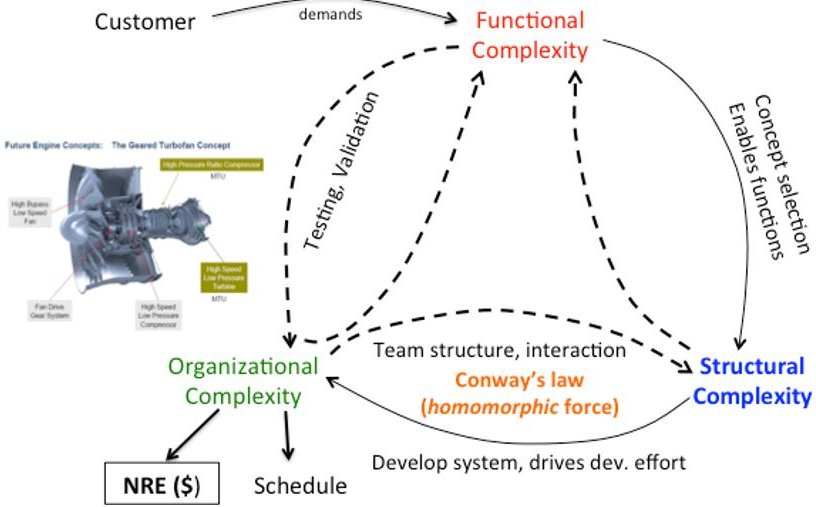
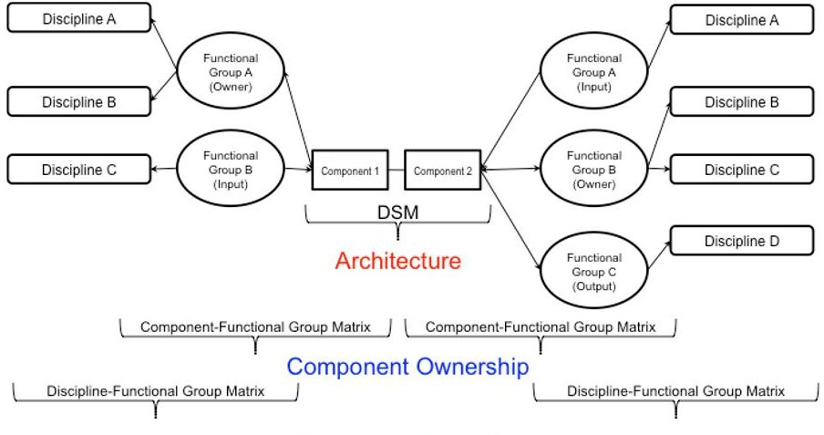
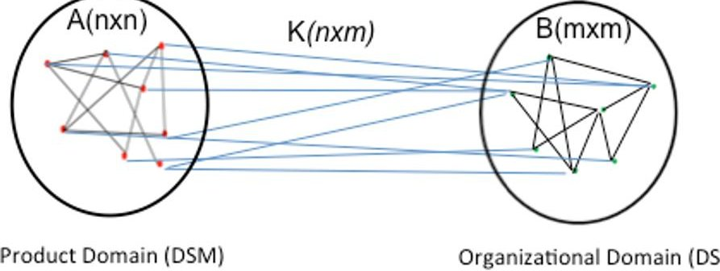

<!-- PDF_PAGE: 1 -->

# $ 1 4^{ \mathrm{TH}} $ INTERNATIONAL DEPENDENCY AND STRUCTURE MODELLING CONFERENCE, DSM'12 KYOTO, JAPAN, SEPTEMBER 13-14, 2012

# Interplay between Product Architecture and Organizational Structure

Kaushik Sinha $ ^{1} $ , Denman James $ ^{2} $ , Olivier de Weck $ ^{1} $

## ABSTRACT

The design and development of large-scale engineered systems is a highly integrated process, and requires the integration of efforts of large numbers of individuals from many design specialties. In the case that there are significant architecture changes due to technology insertion, customer requirements or component configuration for performance, integration of design efforts become more challenging. We seek to understand to what degree the novelty of the product architecture causes potential inefficiencies in the product development organization and existence of engineering standard work documents that are used as guides to interface management and as objects that helps cross discipline boundaries. The impact of novelty of the new product architecture on the existing product development organization was estimated by quantifying the number of new connections that need to be handled both within component integrated process teams and well as across them. It was found that 55 new cross-team interactions appear to be required (+25%) and 38 new interactions within teams appear necessary. A close interplay between the product architecture and organizational architecture of the product development team in a feedback sense has been demonstrated for a real-world, large, complex engineered system.

Keywords: Design Structure Matrix (DSM), Conway's law, Multi-domain Networks, organizational impact, novelty.

## 1. INTRODUCTION

With much improved performance and functional features come increased complexity in engineered complex systems. This complexity manifests in many forms and in different domains. The main components of complexity in engineered systems are (i) structural complexity coming primarily due to the physical architecture of the system stemming from the number of physical components, and their interaction structure; (ii) dynamic complexity due to interaction structure and associated uncertainties in function/behavior space and (iii) organizational complexity due to the product development process itself. It is widely believed that these three components of complexity are strongly correlated amongst themselves. This correlation is captured in famed Conway's law [6] (see fig.1). Conway's law states that given an organizational structure, the resulting product architecture would resemble the organizational structure of the development team [6]. Complex engineered systems are designed by large teams of individuals, which are organized based on various business goals and legacy experience with system design. When significant changes are made to the product architecture, changes may also need to be made to the work processes as well as organizational re-alignment to reflect the changes. It is often observed that work processes and organizational alignment often lag behind major technical changes. While organizational changes can be mapped to management criteria, connection of the organizational alignment to the product architecture would provide benefits to both the technical aspects of the product, as well as to the business through reduced cycle times and earlier discovery of conflicts. This alignment of organization to product architecture would also allow the organization to most efficiently meet both technical and business goals. The main challenge is that product architectural models, functional performance models as well as organizational work process diagrams often exist separately from each other such that misalignment issues are not easily detected. The later this detection occurs, for example during qualification testing or even worse - during operations when the engine is already in operation, the more costly the misalignment becomes. The complexity of

<!-- PDF_PAGE: 2 -->

product architecture is important from a number of standpoints in the product domain, but the impact of complexity on the organization and the ability to successfully develop and integrate the product is critical for the business. In particular, a complex system such as a gas turbine engine involves the integration of multiple domains of expertise and specialization of the individuals engaged in the design of that component. The role of the engineering organization is to couple the engineers in different disciplines together to produce novelty. The knowledge is created inside of that team, and then is used by other teams to integrate and define the complex system. The transfer of this knowledge during the design and development process must be adequately managed through boundary objects [2,4]. Examination of the intersection of the organization and the product architecture through a Domain Mapping Matrix (DMM) [1] help to locate the boundaries between functional groups in the organization (with domain specific knowledge) relative to the component boundaries. A two-pronged approach is adopted here in studying the interplay of product and product development organization structure. At first, we look at the organizational interfaces and concentrate our attention to the DMM's linking components to development organization based only on existing internal documents and work process [2,4]. Subsequently a large-scale survey of the product development organization is undertaken to study and identify patterns and other important features like plausible misalignment of product and development organization, inadequacy of boundary objects in resolving emerging organizational interfaces, etc.

## 2. ORGANIZATIONAL IMPACT OF NEW PRODUCT ARCHITECTURE

Successful management of the project, integration of the multiple domains and the resulting product follows the trajectory of locating and resolving latent problems in the design process. Successful completion of this process requires adequate integration of the different domains to minimize the gap between apparent and actual design knowledge at a given point in the design cycle. In the study of the new gas turbine engine architecture, we seek to understand where the domain boundaries are, and how the boundaries of the expertise align with the organizational and functional boundaries on the product. Linkage of the product DSM with the organizational linkage maps for the engines allows analysis, measurement and then comparison of the architecture's impact on the organization and process. The DSM representation of the architecture and functional connections of the machine provides the opportunity to map the physical architecture onto the organization. Connectivity maps based on the Domain Mapping Matrix (DMM) were developed based on the current organization's roles and responsibilities, and the key technical disciplines [2,4]. A primary responsible functional group was associated with every component in the DSM to provide a mapping of the hardware onto the organization itself. This is not a one-to-one mapping, but a one to many mapping (i.e. a group can be responsible for multiple components but not the other way around). This provides the key connectivity between components and people responsible for the design of those components. This connectivity can be shown on the Component-Functional group DMM. Each component may have multiple groups that interact with it, either requiring it as an input or output to their own design process. However, the group with primary design responsibility for the component is the only one currently utilized in the mapping, because it is assumed that the functional connectivity of the DSM will contain all of the critical interactions with other groups. In the DMM of functional groups and technical disciplines, each functional group was also associated with a primary technical discipline. A component design team will likely consist of multiple technical disciplines such as mechanical design, aerodynamics, structures, etc. In this study, only the primary or core discipline is considered. For example, the group that works with the low pressure turbine is assumed to be primarily an "aero-thermodynamic" group for the purposes of the study, and does not reflect that the group will also very likely have dedicated structural analysis, mechanical design, drafting and other support functions inside of the group. This grouping assumes that the primary "language" spoken and understood by the members of this group will be "aero-thermodynamic", and that their working environment is particularly attuned to working in that domain. This assessment was made through expert interviews. With the assumption that the same organization will be responsible for the design and development of both engines, it is assumed that the mapping of technical discipline to functional group remains the same for both engines. Combination of the DSM [2], the functional group to component map, and the functional group to technical discipline map then provides multiple views of the organization and engine architecture as shown below. The roles of the three matrices are: (i) mapping of component to component is the function of the DSM, (ii) mapping of the Component to Functional Group is the

<!-- PDF_PAGE: 3 -->

Component-Functional Group Matrix, (iii) mapping of the Functional Groups to their respective technical disciplines is the Discipline-Functional Group Matrix (see fig. 2). Utilizing the architecture data (DSM) [2] and organizational responsibility for the components in the DSM, a new matrix was created to show the total number of connections between organizations for both engines studied. The two matrices, one representing the organizational linkages for the older engine the other representing new engine, were then subtracted using two methods to locate the changes in organizational connectivity (see fig. 3). This shows the aggregate level of connectivity changes in the organizational interactions, and is shown in fig.3. From a business perspective, any increase in connectivity will likely increase the amount of engineering effort in person hours, communications, and the increases are highlighted in red. A decrease in aggregate connectivity would imply fewer interactions between functional groups for the given architecture. The analysis of the aggregate changes in functional group connectivity suggests that there is an aggregate increase in functional group interconnections by 55 connections (25% increase) as well as an increase in self-connections (an increase of 38 or 57%). A significant impact to the effectiveness of communications and the discovery of latent issues and communication of novelty is the rise of connections between functional groups that do not have a prior connection in the design and development process. In these instances, precedence or tools for effective communication between groups may not be present. The "new" connectivity is assigned a positive sign and "deleted" connectivity a minus sign in the following representation (see fig. 4). It is very interesting that most significant changes in the organization by both the aggregate and novel connections method are to connectivity with groups that do not hold the traditional "core" disciplines of the gas turbine industry - the design of the engine "core" - but are with groups that perform a supporting role to the primary value delivery of the engine. This may reflect a potential trend in advancements in engine technology and performance coming from non-traditional areas of the supporting subsystems, and not directly from the traditional sources of performance. The new engine architecture reflects a significant leap in engine performance with respect to fuel efficiency and noise, and the most significant changes appear to be in subsystem integration [4].

## 3. SURVEY OF NEW ORGANIZATIONAL ARCHITECTURE

The next level of analysis is about deciphering real gap in organizational structure or the degree of misalignment between product architecture and organizational structure. A survey is being conducted across the development organization to ascertain the interrelationships at the level of functional groups. The survey is being conducted at the level of individuals and then the data is analyzed to at the level of functional groups. An engineer's version of relational database tool was developed in MATLAB $ ^{\mathrm{TM}} $ environment to facilitate the data organization and analysis procedure. The tool structure greatly facilitated the data mining process and provided much needed flexibility in terms of quick data mining and presentation. The following analysis is based on a preliminary survey that has been conducted within the product development organization. The sample size was 118. One thing to notice is that the top groups in terms of component ownership do not include groups that are related to perceived 'core' components like compressors, combustor or turbines in a jet engine. We observe that people who "own" large numbers of components may not decide many design parameters and ones with high number of design parameter "ownership" may "own" only few components. This is expected since design and integration group is responsible for system design and integration while system analysis group is responsible for propulsion system analysis, which account for most design parameters that relate to the main functional requirements. The finding reiterates the importance of the supporting components in the system architecture. From survey data, we observe three different frequencies of communication between groups: (i) daily, (ii) weekly and (iii) monthly. As one would expect, the number of connections increases as we include lower frequencies of communication. We observe that daily communication across groups is rather sparse. This is expected since daily communication would typically happen between people within the same group, while weekly and monthly interactions are more likely across groups. Lower frequency communications might also reflect relatively 'non-critical' interactions between groups. The design component 'ownership' information from the survey is used to build the domain-mapping matrix (DMM). The DMM has serious implications if we are to predict the organizational interaction structure based on the physical system architecture. The ownership of physical components through DMM drives the desirable organization structure that mimics the system architecture. We can ask whether the ideal organizational structure implied by the physical architecture indeed maps to the self-reported actual

<!-- PDF_PAGE: 4 -->

organizational architecture. The mismatch between the two is a measure of organizational misalignment, given the product architecture and the DMM. This can be explained and analyzed rigorously using multi-domain network representation. The overall system can be represented as a partitioned matrix [5].

$$
\Lambda = \left[ \begin{array}{c c} A & K \\ K ^ {T} & B \end{array} \right] _ {(n + m) ^ {*} (n + m)}
$$

This matrix can be augmented with additional layers in the network model. For example, once we have the connectivity map across functional parameters, we can build a functional domain to the existing system matrix. Once we have the physical architecture and the DMM linking system components to organizational entities, we can compute a predicted B matrix [5]. The computation is based on the notion that if two components are connected and owned by different organizational entities, then the organizational entities developing or "owning" them should also communicate and therefore forge a link in the B matrix. The predicted B matrix can be computed as:

$$
B = u n i t i z e \left(K ^ {T} A K\right)
$$

The density comparison between the actual B matrix from the survey and the predicted B matrix is based on the group interaction matrix including daily and weekly interactions. There are 20 missing edges in the actual B matrix in this case, considering daily and weekly interactions. This may also be related to paucity of data since the sample size was small. A complete survey with adequate number of valid responses would give us a much clearer picture about possible misalignments between the real organizational structure vis-à-vis that dictated by the system architecture and component ownership responsibilities. A potential mismatch between the actual and predicted organizational interaction map indicates (i) additional interactions at the organizational level that is not mandated by the product architecture, or (ii) missed interactions in product architecture representation.

## 4. CONCLUSIONS AND FUTURE WORK

The impact of novelty of the new product architecture on the existing product development organization was estimated by quantifying the number of new connections that need to be handled both within component integrated process teams and well as across them. It was found that 55 new cross-team interactions appear to be required (+25%) and 38 new interactions within teams appear necessary. The two groups are observed to have the most significant increases in connectivity. These changes are reflective of the increase in architectural complexity of the secondary flow system and by the addition of components in supporting the insertion of new technology [2]. Our initial results suggest that the most significant changes in the organization by both the aggregate and novel connections method are due to connectivity with groups that do not "own" the traditional "core" disciplines of the gas turbine industry - the design of the engine "core" components such as fans, compressors and turbines but are with groups that perform a supporting role to the primary thrust generation of the engine. This may reflect a potential trend in advancements in engine technology and performance coming from non-traditional areas of the supporting subsystems, and not primarily from the traditional sources of performance. This may have implications for future allocations of resources and integration/test efforts in engine development programs. With the linkage between the product architecture and functional groups made, the potential impact of the architecture on the organization and integration effort can be assessed. We analyzed the impact of physical architecture on the organizational interactions. Preliminary analysis showed that this resulted in an increase in functional group connectivity overall, and most importantly, resulted in significant novel connections between functional groups that did not require interfacing on the older architecture. This indicates a close interplay between the product architecture and organizational architecture of the product development team in a feedback sense. A significant novelty in the product architecture is likely to prompt an organizational change to make the product development process more efficient. Use of pilot survey data also illustrates critical teams are those linked to development of supporting systems and not to functionality generators or 'core' components of the engine. A close interplay between the product architecture and organizational architecture of the product development team in a feedback sense has been demonstrated for a real-world, large, complex engineered system. Significant novelty in the new

<!-- PDF_PAGE: 5 -->

product architecture exists and should prompt organizational changes to make the product development process more efficient. Survey data also illustrates that groups that are linked to development of supporting systems are becoming increasingly critical. A generic multi-layered system representation was demonstrated that includes multiple domains involved during the product engineering.

## REFERENCES:

[1] Danilovic, M., & Browning, T. R. (2007), "Managing complex product development projects with design structure matrices and domain mapping matrices", International Journal of Project Management, 25(3), 300-314.

[2] Denman J., Sinha K., de Weck O., "Technology Insertion in Turbofan Engine and assessment of Architectural Complexity", 13th International DSM Conference, Cambridge, MA, September 14-15, 2011

[3] Eun Suk Suh, Michael R. Furst, Kenneth J. Mihalyov and Olivier L. de Weck "DSM Model Building Instructions”- working paper, 2009.

[4] James, Denman, "Influence of System Architecture Changes on Organizational Work Flow and Application to Geared Turbofan Engines", Master Thesis, System Design and Management, Massachusetts Institute of Technology.

[5] Lindemann, U, Maurer, M. and Braun, T. "Structural Complexity Management - An Approach for the Field of Product Design" - Springer, 2009.

[6] MacCormak A. et al, "Exploring the Duality between Product and Organizational Architectures: A Test of the "Mirroring" Hypothesis", Working Paper, http://www.hbs.edu/research/pdf/08-039.pdf

[7] Riegler, C., and Bichlmaier, C., "The Geared Turbofan Technology - Opportunities, Challenges, and Readiness Status," 1st CEAS European Air and Space Conference, 10-13 September 2007, Berlin, Germany.

[8] Ulrich K. T., "The role of product architecture in the manufacturing firm", Research Policy, 24, 1995, pp. 419-441.

## FIGURES

Fig.1: Representation of interplay between three dimensions of complexity in PD context and Conway's law involving the structural (i.e., product architecture) and organizational domain.

Knowledge Domains

<!-- PDF_PAGE: 6 -->

Fig. 2: Mapping of disciplines to functional groups and groups to components, and components to components (DSM)

<table border="1"><tr><td></td><td>Air Systems Design and Integration</td><td>Airframe Integration</td><td>Combustors Augmentors and Nozzles</td><td>Controls</td><td>Engine Dynamics and Loads</td><td>Fan/LPC</td><td>HPC</td><td>HPT</td><td>Hamilton Sundstrand</td><td>LPT</td><td>Mechanical Systems</td><td>Nacelle/Aero</td><td>Thermal Management</td><td>Net Change</td></tr><tr><td>Air Systems Design and Integration</td><td>12</td><td>0</td><td>-1</td><td>-1</td><td>0</td><td>-1</td><td>-2</td><td>1</td><td>2</td><td>-2</td><td>0</td><td>-1</td><td>1</td><td>8</td></tr><tr><td>Airframe Integration</td><td>0</td><td>0</td><td>0</td><td>-1</td><td>0</td><td>-1</td><td>0</td><td>0</td><td>-1</td><td>0</td><td>1</td><td>-1</td><td>1</td><td>-2</td></tr><tr><td>Combustors Augmentors and Nozzles</td><td>0</td><td>0</td><td>9</td><td>0</td><td>0</td><td>0</td><td>0</td><td>0</td><td>0</td><td>0</td><td>0</td><td>0</td><td>-1</td><td>8</td></tr><tr><td>Controls</td><td>-1</td><td>-1</td><td>0</td><td>0</td><td>0</td><td>0</td><td>1</td><td>0</td><td>0</td><td>3</td><td>1</td><td>3</td><td>-3</td><td>3</td></tr><tr><td>Engine Dynamics and Loads</td><td>0</td><td>0</td><td>0</td><td>1</td><td>2</td><td>-1</td><td>0</td><td>0</td><td>0</td><td>0</td><td>2</td><td>0</td><td>0</td><td>4</td></tr><tr><td>Fan/LPC</td><td>-1</td><td>-2</td><td>0</td><td>0</td><td>0</td><td>4</td><td>0</td><td>0</td><td>1</td><td>2</td><td>-1</td><td>7</td><td>0</td><td>10</td></tr><tr><td>HPC</td><td>0</td><td>0</td><td>1</td><td>2</td><td>0</td><td>1</td><td>2</td><td>1</td><td>3</td><td>0</td><td>2</td><td>0</td><td>0</td><td>12</td></tr><tr><td>HPT</td><td>-1</td><td>0</td><td>0</td><td>0</td><td>0</td><td>0</td><td>0</td><td>-1</td><td>0</td><td>2</td><td>2</td><td>0</td><td>0</td><td>2</td></tr><tr><td>Hamilton Sundstrand</td><td>2</td><td>-1</td><td>0</td><td>0</td><td>0</td><td>1</td><td>3</td><td>0</td><td>-12</td><td>0</td><td>1</td><td>3</td><td>-3</td><td>-6</td></tr><tr><td>LPT</td><td>-1</td><td>0</td><td>0</td><td>3</td><td>0</td><td>2</td><td>0</td><td>1</td><td>0</td><td>2</td><td>3</td><td>0</td><td>1</td><td>11</td></tr><tr><td>Mechanical Systems</td><td>0</td><td>1</td><td>0</td><td>1</td><td>2</td><td>-1</td><td>2</td><td>2</td><td>1</td><td>3</td><td>12</td><td>0</td><td>4</td><td>27</td></tr><tr><td>Nacelle/Aero</td><td>-1</td><td>-1</td><td>0</td><td>3</td><td>0</td><td>4</td><td>0</td><td>0</td><td>3</td><td>0</td><td>0</td><td>6</td><td>-1</td><td>13</td></tr><tr><td>Thermal Management</td><td>1</td><td>1</td><td>-1</td><td>-3</td><td>0</td><td>-1</td><td>0</td><td>0</td><td>-3</td><td>1</td><td>4</td><td>2</td><td>2</td><td>3</td></tr><tr><td>Net Change</td><td>10</td><td>-3</td><td>8</td><td>5</td><td>4</td><td>7</td><td>6</td><td>4</td><td>-6</td><td>11</td><td>27</td><td>19</td><td>1</td><td></td></tr></table>

Fig. 3: Aggregate Number of Connectivity Changes Between Functional Groups and Self-Connections Inside of a Functional Group.

<table border="1"><tr><td></td><td>Air Systems Design and Integration</td><td>Airframe Integration</td><td>Combustors Augmentors and Nozzles</td><td>Controls</td><td>Engine Dynamics and Loads</td><td>Fan/LPC</td><td>HPC</td><td>HPT</td><td>Hamilton Sundstrand</td><td>LPT</td><td>Mechanical Systems</td><td>Nacelle/Aero</td><td>Thermal Management</td><td></td><td>New Connections</td><td>Deleted Connections</td></tr><tr><td>Air Systems Design and Integration</td><td></td><td></td><td>-1</td><td></td><td></td><td></td><td></td><td></td><td>2</td><td></td><td></td><td>-1</td><td></td><td></td><td>2</td><td>2</td></tr><tr><td>Airframe Integration</td><td></td><td></td><td></td><td>-1</td><td></td><td>-1</td><td></td><td></td><td>-1</td><td></td><td>1</td><td>-1</td><td></td><td></td><td>1</td><td>4</td></tr><tr><td>Combustors Augmentors and Nozzles</td><td></td><td></td><td></td><td></td><td></td><td></td><td></td><td></td><td></td><td></td><td></td><td></td><td>-1</td><td></td><td>0</td><td>1</td></tr><tr><td>Controls</td><td></td><td>-1</td><td></td><td></td><td></td><td></td><td></td><td></td><td></td><td>3</td><td></td><td>3</td><td></td><td></td><td>6</td><td>1</td></tr><tr><td>Engine Dynamics and Loads</td><td></td><td></td><td></td><td>1</td><td>2</td><td></td><td></td><td></td><td></td><td></td><td>2</td><td></td><td></td><td></td><td>5</td><td>0</td></tr><tr><td>Fan/LPC</td><td></td><td>-2</td><td></td><td></td><td></td><td></td><td></td><td></td><td>2</td><td></td><td></td><td></td><td></td><td></td><td>2</td><td>2</td></tr><tr><td>HPC</td><td></td><td></td><td></td><td></td><td></td><td></td><td></td><td></td><td>3</td><td></td><td></td><td></td><td></td><td></td><td>3</td><td>0</td></tr><tr><td>HPT</td><td>-1</td><td></td><td></td><td></td><td></td><td></td><td></td><td></td><td></td><td></td><td>2</td><td></td><td></td><td></td><td>2</td><td>1</td></tr><tr><td>Hamilton Sundstrand</td><td>2</td><td>-1</td><td></td><td></td><td></td><td></td><td>3</td><td></td><td></td><td></td><td></td><td>3</td><td></td><td></td><td>8</td><td>1</td></tr><tr><td>LPT</td><td></td><td></td><td></td><td>3</td><td></td><td>2</td><td></td><td></td><td></td><td></td><td>3</td><td></td><td>1</td><td></td><td>9</td><td>0</td></tr><tr><td>Mechanical Systems</td><td></td><td>1</td><td></td><td></td><td>2</td><td></td><td></td><td>2</td><td></td><td>3</td><td></td><td></td><td>4</td><td></td><td>12</td><td>0</td></tr><tr><td>Nacelle/Aero</td><td>-1</td><td>-1</td><td></td><td>3</td><td></td><td></td><td></td><td></td><td>3</td><td></td><td></td><td>6</td><td>-1</td><td></td><td>12</td><td>3</td></tr><tr><td>Thermal Management</td><td></td><td></td><td>-1</td><td></td><td></td><td></td><td></td><td></td><td></td><td>1</td><td>4</td><td></td><td></td><td></td><td>5</td><td>1</td></tr><tr><td></td><td></td><td></td><td></td><td></td><td></td><td></td><td></td><td></td><td></td><td></td><td></td><td></td><td></td><td></td><td></td><td></td></tr><tr><td>New Connections</td><td>2</td><td>1</td><td>0</td><td>7</td><td>4</td><td>2</td><td>3</td><td>2</td><td>8</td><td>9</td><td>12</td><td>12</td><td>5</td><td></td><td></td><td></td></tr><tr><td>Deleted Connections</td><td>2</td><td>5</td><td>2</td><td>1</td><td>0</td><td>1</td><td>0</td><td>0</td><td>1</td><td>0</td><td>0</td><td>2</td><td>2</td><td></td><td></td><td></td></tr></table>

Fig. 4 Matrix for Functional Group mapping highlighting new and deleted connections between functional groups

Fig. 5 Two inter-domain networks A and B connected by intra-domain edges

<table border="1"><tr><td>Organizational DSM(B matrix)</td><td>Density</td></tr><tr><td>Bweekly</td><td>89%(162)</td></tr><tr><td>Bdesign(predicted)</td><td>100%(182)</td></tr></table>

Table 1: Difference in density for real B matrix from pilot survey (162 edges) and predicted B matrix (182 edges) using product architecture (A matrix) and design ownership information from survey data (K matrix).

