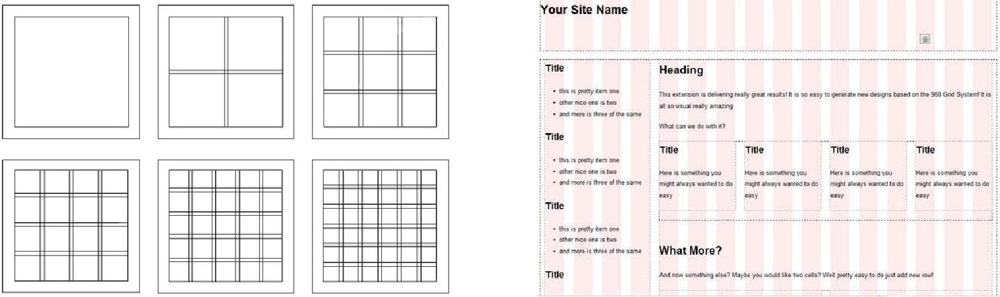
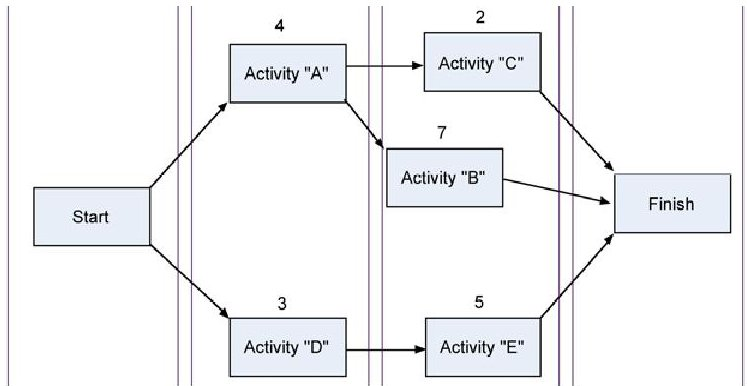
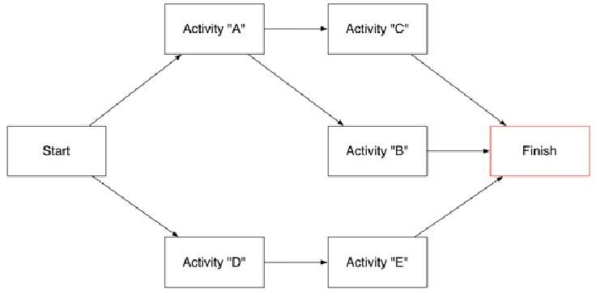
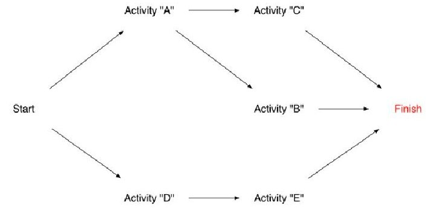
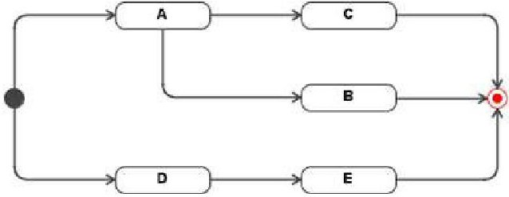
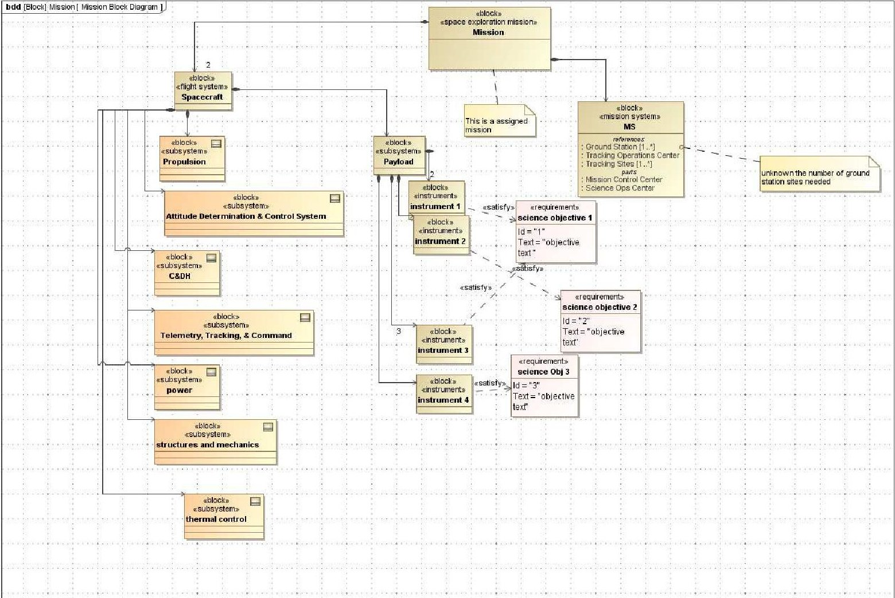
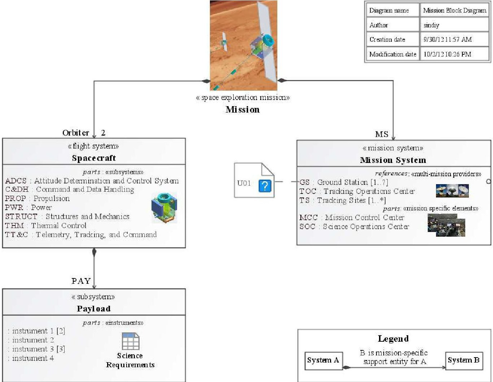
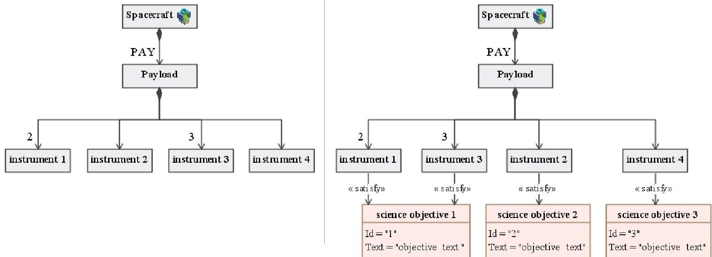

<!-- PDF_PAGE: 1 -->

Conference on Systems Engineering Research (CSER'13) Eds.: C.J.J. Paredis, C. Bishop, D. Bodner, Georgia Institute of Technology, Atlanta, GA, March 19-22, 2013.

# Introduction to Information Visualization (InfoVis) techniques for Model-Based Systems Engineering

Oleg Sindiy $ ^{a} $ , Krystof Litomisky $ ^{a} $ , Scott Davidoff $ ^{a} $ , and Frank Dekens $ ^{a} $

$ ^{a} $Jet Propulsion Laboratory, California Institute of Technology 4800 Oak Grove Drive, Pasadena, CA 91109 USA

## Abstract

One of the barriers to the success of Model-Based Systems Engineering (MBSE) efforts is realizing effective communication of the output diagrams-i.e., modeling views—that address the concerns of, and inform, a broad spectrum of customer stakeholders. Abstracting and implementing the visual presentation of views-as products of very complex system models-is nearly as important to the effectiveness of these efforts to inform decision-making as the technical competency and completeness of those models. However, the information visualization of data from complex system models is often treated second to the technical considerations.

This paper introduces high-level guidelines for visual presentation of MBSE efforts. These insights are presented such that they conform to numerous system modeling languages/representation standards. The insights are drawn from best practices of Information Visualization as applied to aerospace-based applications. For example, the paper presents how modelers can take advantage of functionality in existing modeling notions and software tools that implement them, and also the importance of keeping in mind the final presentation media, presentation venues, and historically accepted viewpoint styles. The paper also presents a concept for how to move beyond traditionally static outputs; in turn, allowing users to dynamically manipulate the output views within the context of their real-time concerns to answer specific questions about the modeled system(s).

$ \textcircled{c} $ 2013 The Authors. Published by Elsevier B.V. Selection and/or peer-review under responsibility of Georgia Institute of Technology

Keywords: model-based systems engineering; information visualization.

## 1. Introduction

One of the lingering barriers to the success of Model-Based Systems Engineering (MBSE) efforts is realization of effective communication of the generated diagrams that straightforwardly inform a broad spectrum of customer stakeholders based on their respective concerns and questions about the modeled system(s). In fact, abstracting and implementing the visual presentation of the views—a set of visual outputs from very complex system models—is nearly as important to the effectiveness of these efforts to successfully inform decision-making as the technical competency and completeness of the models. However, the visual presentation of system models is often treated second to its technical considerations (and at times, even ignored). When technically competent MBSE work is hidden behind sub-par visual presentation, the work loses its ability to communicate that technical competency. Effectively, low quality visualization can function as the Achilles' heel of otherwise technically competent MBSE efforts. At issue here are not any

<!-- PDF_PAGE: 2 -->

shortcomings of representation languages for MBSE or the tools used to implement them, but rather how MBSE practitioners do not always take full advantages of the provided languages and tools to polish their visual products.

To address this problem, we recommend the use of techniques from information visualization—InfoVis for short. InfoVis is an established discipline that stands at the intersection of computer graphics, graphic design, and interaction design. InfoVis offers many guiding technique, where the intention is to encourage MBSE practitioners to use these techniques to improve the quality of their outputs; in turn, improving the delivery of their message to their audience. We have combined these basic principles with a number of examples drawn from previous work in aerospace and related engineering disciplines, and have applied them to problems that are representative of outputs from Systems Modeling Language (SysML) [1] and Unified Modeling Language (UML) [2] standards for representation of systems and software.

More precisely, the paper will demonstrate guidelines for structuring the layout, content, aspect ratio, colors, and many other visual features of MBSE diagrams. It will also discuss how to take advantage of pre-build functionality in existing modeling notions and stress the importance of keeping in mind human cognition concerns that also include considerations for historically/culturally accepted viewpoint styles of the stakeholders and the final presentation media and venue(s). It will also present a concept for how to move beyond static and traditional outputs/products from the very dynamic and rich models, such that customer users can themselves manipulate the outputs of the models to address their real-time needs to answer specific questions about the modeled system(s).

## 1.1. MBSE views for architecture description-an overview

To support the development of the complex systems, many systems engineers are applying formal model-based systems engineering techniques, where MBSE is about "elevating models in the engineering process to a central and governing role in the specification, design, integration, validation, and/or operation of a system" [3]. In this process, the tried-andtrue systems engineering practices are realized (and often improved) via formal modeling approaches. The application of the MBSE allows for representing key aspects of the system architecture with a rich set of views extracted from a common model-based repository, which provide a single authoritative source of the system architecture description. Each view serves as a representation of a whole system from the perspective of a related set of concerns, and conforms to a viewpoint which is a specification of the conventions for constructing and using a view [4].

## 1.2. InfoVis - a rich field of study to pull from for MBSE

Information Visualization is the study of (interactive) visual representations of abstract data, both numerical and nonnumerical, to reveal patterns in data that would be otherwise difficult to find. The intention of this section is to briefly introduce InfoVis as a field of study and then encourage the MBSE community to explore and learn from this rich field.

## 1.2.1. History of InfoVis

The following history is intended to provide pointers to major contributors from the various disciplines whose convergence resulted in modern InfoVis. The list is not intended to be comprehensive, but rather, to allow those who are interested to see the long history from which we draw, in linking InfoVis to MBSE.

Modern infographics trace their origins to the first quarter of the $ 1 8^{\mathrm{th}} $ century, where many historians credit political economist W. Playfair [5] and mathematician J.H. Lambert [6] with the creation of the field. Even with their vastly different backgrounds, Playfair and Lambert each arrived at the identical conclusion that they could understand their complex data if they could develop disciplined ways to translate continuous values into graphical dimensions. In the $ 1 9^{\mathrm{th}} $ century, French scientists J. Minard [7] and E.J. Marey [8] created the first infographics that were not created entirely by hand. Marey, for example, was able to use the new field of high speed photography to take pictures of a horse in full gallop. He then published the images side-by-side, in one of the first examples of the technique now called "small multiples." In the $ 2 0^{\mathrm{th}} $ century, modern computer graphics expanded the quantity of data that could be captured and examined, and allowed for the customization of techniques to match the needs of various data types. George Furnas, for example, demonstrated that a fish-eye lens might be used to provide an area of focus, while maintaining the larger context in which the image resides [9].

<!-- PDF_PAGE: 3 -->

## 1.2.2. InfoVis Resources

While developments in computing have enabled substantial changes to the discipline and methods of InfoVis, the contributions from the fundamentals of graphical design have maintained of value, and many are still used as the standard texts in academic settings. The principles of modern Typography, for example, were codified in 1928 by J. Tschichold, whose text [10], remains the universal standard on the principles that govern the creation and use of fonts. Similarly, J. Muller-Brockman' seminal work on the organizing principle of the grid, [11] also speaks with a clearly modern voice, and its influence can be seen in nearly every modern print production, from the newspaper's column layout, to the ways they display stock prices, and baseball statistics. J. Tukey [12] contributed many of the standard plots that form the basis for all charting in software like Microsoft Excel, and individuals like E. Tufte have organized this diverse history into a more explicable set of principles [13, 14, 15], many of which we draw on in this paper to provide a higher-level perspective on infographics, and R. Spence provides an overview of basic practices and principles [16].

Modern InfoVis provides a very dynamic and rich field of content to draw from. In this field, IEEE InfoVis [17] is considered a top tier research conference that produces 40 research publications annually. Online sources like the InfoVis Wiki [18] and Information Aesthetics [19] digest, organize, and present to a more research audience, while the EYEO festival [20] combines research experiments with cutting edge artistic practice, to create an interdisciplinary forum. MBSE community merely needs to explore and infuse from this field to improve the quality of its output products.

## 2. InfoVis patterns for MBSE

This section provides an example set of guiding patterns for visualization of output views from MBSE efforts, along with references to example case studies. These patterns follow Robert Rasmussen's mantra for MBSE practices, including diagram generation: "a good pattern adheres strongly to aesthetics, experience, and fundamental principles."

## Scope and context of viewpoint abstraction for view generation:

Every MBSE viewpoint must provide a template for answering some small set of core questions about the system for the customer stakeholders, which could not be otherwise easily answered. That is, a viewpoint must identify and meet the needs of the target audience and their specific concerns. Each viewpoint must be well scoped (at times, even carefully limited in amount and type of data presented) so as to make the generated views easy to draw inferences from. This is not simple, but if well thought out, can bring much needed order to chaos.

In generating the viewpoints, a search of historically similar efforts will often reveal the expected viewpoints which will address the needs of various stakeholders and their concerns. At times, the viewpoints may not align with the MBSE practitioners preferred way of representing and displaying data, but as long as the technical correctness is maintained, the target audience's expectations/comfort should be given higher priority. If historical viewpoints do not exist for a particular data set and stakeholder's concern, then the viewpoints should be designed in collaboration with the target audience.

Careful consideration must also be given for separating related but different data that answers different questions. Such consideration will drive the number of viewpoints that need to be abstracted and how to present the relationships between the content of those viewpoints, as each viewpoint provides a targeted look into the description of the system architecture.

## Presentation media and venue:

Based on whether the presentation media will be electronic and/or hardcopy, or is for reports versus presentation, or stand alone or part of a larger package, will drive some of the visual presentation properties of the generated views. These include but are not limited to properties such as font size and type, aspect ratio of the diagram (e.g., landscape vs. portrait orientation), amount of text versus symbols and images, and so forth. This also includes considerations that there are cases when the same views may need to modified for different venues. A case study example of this is presented in Section 5.

## Consistency:

Albeit often impossible to completely achieve, consistency from view to view and within views is highly desired. Consistency can apply to minute details such as uniform application of a font type across all of the elements within a diagram to the larger issues of the number of levels of decomposition to be shown for each decomposition.

## Diagram information:

Each diagram is a vessel for maintaining and delivering its contents to the target customers. Maintaining the integrity of the vessel is vital to the integrity of the contents inside it. As such, diagram information such as title, type, authorship,

<!-- PDF_PAGE: 4 -->

revision, status, dates, and so forth should not be overlooked in abstracting viewpoints as templates for views. Of note: equal thought should be given to what information about the diagram is needed to convey the message and what information is superfluous; especially when some of it is auto generated and placed as a default by the software tool of choice. Additionally, the modeling team should consider whether the diagram information content should be configured globally for the entire modeling project; if applied, this would provide consistency by ensuring that each diagram has the required basic information for the viewer.

A very special case of diagram information is a diagram legend. Most modeling tools support for a mini-diagram within a diagram; that is, a view within a view. This allows modelers to create diagrams that are displayed on other views as legends. One benefit of using such functionality is when the template or style for a given viewpoint is changed, the Legend views dynamically change on all of the implementation views that they clarify, and as such, legends do not get stale or need to be changed on all applicable views.

## Use a grid system for alignment and more:

Grid systems are commonly employed to layout technical content because they provide visually appealing organization and/or symmetry. There are a variety of very simple grid systems that can be used to organize the basic content of a diagram, as shown in Fig. 1. Grids contain two basic elements: content space and gutters. Gutters separate and organize content spaces. The most basic grids use a symmetrical pattern, where columns and rows are of equal sizes, and gutters separate them by a fixed size. For example, in Fig. 2 when done correctly, even the basic web layout with a site banner on top, and left-side navigation conforms to a grid. Fig. 2 shows how in a more complex grid, information can flow across columns and rows. Even these complex structures still conform to the basic principle that content should avoid gutters, and that symmetry is easier for human perception to parse.

Fig. 1. Example grid systems, including gutters

Fig. 2. Application of a grid system to web design

We can use the simple systems diagram below to illustrate how to enforce the basic principles of graphic design, so that the system that is modeled can be communicated in a more mature and clean way. While this example will demonstrate a very basic application, the same principles can scale to more complex diagrams. For example, Fig. 3 violates the basic grid by placing information in the gutters of both rows and columns. This disorganization leads to a diagram that is hard to read because there is no natural visual composition. By conforming to the basic principles of the grid, however, this diagram can easily and formulaically attain a simple but elegant, and more powerful composition. Though a number of grids could be applied here, we focus on a 4-column format, which maps most simply to the current layout, as shown in Fig. 3. Though row lines are not shown to simplify the diagram, their geometric format would follow the same basic principles.

The grid allows us to align each of the graphical elements on the page. We can re-align the blocks left-justified, though center or right would also be correct, as long as they are applied consistently. Activities "A" and "D" can then be moved into a single column. The same is true for Activities "C", "B", and "E." Activities "B" and the Start and Finish are also aligned into a single row. The grid aligned diagram, along with other patterns, is illustrated in Fig. 4.

<!-- PDF_PAGE: 5 -->

Fig. 3. An example for violating basic grid layout and implementation of a 4-column grid to help align the data

## Proportionality:

In the Fig. 3 example all of the boxes are of the same height and width, and the lines are of the same weight. This use of proportionality introduces visual order that compliments the structured functional decomposition of this diagram.

## Font - type and size:

Use of fonts should adhere to simple patterns throughout the views and the products they are used in (e.g., reports, websites, presentations, etc.). The simplest rule is to use the same font type within and across all diagrams. More advanced patterns include: using hierarchy of type, where the size of the font is proportional to the significance of the content; using the same font for headlines; matching diagram font type to the products they are employed in; having no fonts smaller than 7 pt. Many of these patterns can be often configured within the software tools being employed to produce the views based on predefined viewpoint templates/styles.

## Use color sparingly and with intent:

It is recommended to use a muted color palette, and to use color selectively, so that it brings key information into focus, as illustrated in Fig. 4. It is recommended to stay away from color that does not provide meaning. For example, in the original example shown in Fig. 3, since all the boxes were the same color, it added little to the diagram. Despite the capabilities of most graphing software, the ability to use color is a decision, and not an obligation. While elements like shadows, gradients, and reflection can increase the visual sophistication when used correctly, they can also increase clutter when used incorrectly, especially when used in abundance. In general, it is a good idea to err on the side of parsimony.

We must also keep in mind some of the audience may be color blind. Hence when using colors, for example for different connections, we should also try to use different line styles along with it, such as dashed or dotted. This will also help if some of the versions end up in non-colored products—e.g., when black and white photo-copies are made.

## Focus on the information, not the form:

Draw attention to the information, not the form. In our example, since this diagram is about a small number of relationships, and the shape of the box is not meaningful, the box adds little to the communication value of the design. Since the meaning of this diagram is not the boxes but their relationship, Tufte would argue to remove the boxes so that their relationships become clearer, as shown in Fig. 5. Similar rules apply to careful exclusion of meta-data of represented entities; as such, in some cases it may be prudent to even exclude "Activity" from these boxes, if the title of the diagram already implies a functional activity flow.

Fig. 4. An example use of color

Fig. 5. An example of drawing attention to content, not the form

<!-- PDF_PAGE: 6 -->

Graphical representations - images and icons:

Addition of images to represent the physical systems can be of great advantage in setting the context of many diagrams. However, the same mantra of using color sparingly must be observed for images. Images are particularly useful in MBSE when icons that are places on certain model elements. These icons have to be easy to identify and meet a standard among the community. Abundant examples can be found in computer-aided design and drafting diagrams, circuit schematics, and propulsion system schematics. By using the same icons that are standard for that domain, the diagrams become easier to understand by the intended audience. One of the core values of the emerging representation languages (like SysML and UML) is they provide a common standardized representation methodology for use across a breadth of modeling practitioners. In Fig. 6, the example activity flow is reimagined to the viewpoint style of an UML Activity Diagram.

Fig. 6. Visual reconfiguration of the example activity flow into a UML Activity Diagram

In Fig. 6, most notably, the Start and Finish buttons are replaced with UML icons for start and finish, "Activity" text is removed as UML boxes with rounded corners imply these are activities/actions, and we optionally selected to use rectilinear path style rather than oblique option.

## Abbreviations and acronyms:

In larger organizations and projects, use of abbreviations and acronyms is omnipresent. While a list of abbreviations and/or acronyms is often provided for the content in the text of documents, such considerations are often overlooked for diagrams. Ensuring that the audience can easily discern all abbreviations and acronyms within a diagram can play a larger role toward understanding the content of a view, and as such considerations should be given to this concern.

## 3. Auto Diagram and Report Generation

The implementation of patterns described in the previous section does not need to be very manual and time consuming task. Many of today's MBSE tools already include capabilities to implement some of the discussed patterns by using functionality on existing toolbars and/or through user defined "style sheets" for each viewpoint. However, the existing automation capabilities still fall short of being able to automatically generate complete diagrams and as such, some manual user interaction is still required and needs to be planned for.

Additionally, progress has been made in using MBSE products to dynamically generate the required reports. The purpose of such capabilities is to minimize the amount of time engineers must spend on report or presentation generation via investment in automation of such products as outputs of MBSE efforts. One excellent example of such efforts is described by M. Jackson in Ref. [21]. In Jackson's paper, the document is treated as another type of a modeled system, which then queries the data (e.g., diagrams, tables, etc.) from the model of the technical system to populate the report.

## 4. A case study in applying InfoVis patterns for MBSE diagram aesthetics

Using a block definition diagram from SysML, Fig. 7 presents a decomposition of a space exploration mission where the majority of the InfoVis patterns described in Section 2 are violated. Although this diagram was produced by the authors to demonstrate a point for this paper, it draws from many observed instances of MBSE products.

<!-- PDF_PAGE: 7 -->

Fig. 7. Example diagram which is technically correct but violates basic diagramming patterns for view generation

At issue in block view of Fig. 7 is not the technical competency of the content but how it is presented. In response, by applying the majority of the patterns of Section 2, the authors generated three equivalent views—Fig. 8, Table 1, and Table 2—which present the same technical content as Fig. 7 but arguably in much more aesthetically pleasing and scope appropriate manner.

Notably, the authors generated two additional non-diagram views-i.e., tables—that separate the science requirements satisfaction mapping to the specific instances of science payload instruments and the unknown comment into a list of a comments. This was done to limit the scope of the Mission Block Diagram view to a hierarchical decomposition of key elements/blocks and present related content as complimentary data outputs in separate views. Additionally, the comment with the text "this is an assigned mission" was removed from the new views and was instead placed into the description property of the "Mission" block, which can be accessed separately, as it did not appear to be appropriate to the scope of what the diagram view needed to convey-i.e., a hierarchical decomposition of core mission elements.

An example of how some of these patterns have been applied to a space exploration application problem—description of the end-to-end information system of the Orion Multi-Purpose Crew Vehicle's Exploration Flight Test 1—can be found in Ref. [22]. Sindiy et al., provides an example of how careful attention to viewpoint abstraction and views generation has enabled an MBSE effort to inform a wide and distributed set of program stakeholders about a complex design problem.

<!-- PDF_PAGE: 8 -->

Fig. 8. Example of an improved diagram, using the diagraming patterns, with the same technical content as Fig. 7

Table 1. A mapping of mission science requirements/objectives to the instances of science instrument types that satisfy them

<table border="1"><tr><td>Requirement ID</td><td>Requirement Name</td><td>Requirement Text</td><td>Satisfying Element(s)</td></tr><tr><td>1</td><td>science objective 1</td><td>[objective text]</td><td>two instances of instrument type 1 and three instances of instrument type 3</td></tr><tr><td>2</td><td>science objective 2</td><td>[objective text]</td><td>one instance of instrument type 2</td></tr><tr><td>3</td><td>science objective 3</td><td>[objective text]</td><td>one instance of instrument type 4</td></tr></table>

Table 2. An example list of a centralized database view of mission architecture comments

<table border="1"><tr><td>Comment ID</td><td>Type</td><td>Text</td></tr><tr><td>U01</td><td>unknown</td><td>It is currently unknown how many ground station sites are needed for this mission; further analysis is required.</td></tr></table>

## 5. MBSE via SysML - a proposal case study with two output venues/products

The patterns from Section 2 can be employed for purposes across the span of a project life cycle—from proposal through system decommissioning. For example, when creating a MBSE model for a proposal using SysML, there are two main audiences: the reviewers and the proposal team. Therefore, there are two types of diagrams that must be created to represent the same data. First, there were the ones seen by the reviewers which had to be contained within the proposal document. Here the need was to adhere to the same font style as the rest of the proposal images. For easy of reading and clarity, all extra information such as diagram info, element stereotypes, etc. were removed. The size of images was chosen such that it would be easily viewed when making it the page width. By contrast all of the views for the proposal team were to be printed on a plotter and were hung on the walls of the war room. Their main purpose was to keep everyone on the proposal team using the same naming conventions, and make sure everyone is aware of the current technical baseline.

<!-- PDF_PAGE: 9 -->

## 6. Dynamic selection of MBSE output views - a case study in moving beyond pre-defined outputs

There are scenarios where the time necessary to produce the desired number of different views for the modeled system exceeds the ability of MBSE practitioners to produce such views, as the availability of modelers and their time is insufficient to meet the customer stakeholders' demand for extracting information from the model-based architecture descriptions. Regardless of whether this information has already been generated or needs to be generated in real-time, the customer stakeholders must be able to extract the desired views that address their immediate needs on their own. Here, the customer stakeholders would generate the views based on either a predefined set of viewpoints or, if technically capable of doing so, venture as far as defining their own viewpoints based on the existing data in the models. A caveat to such a capability is that any dynamic manipulation of the resulting outputs should guard against manipulation of the source data.

For users who are not highly proficient at MBSE, this requires the development of graphical user interfaces to intuitively automate the translation of the data stored in the databases of centralized, single-source-of-truth models. We have developed an application plugin towards this end. This plugin automatically generates hierarchical diagrams based on the background specification matrices or models. The plugin is highly interactive, allowing the customer to select or remove components easily and regenerating the diagram(s) to show only items that are of immediate interest. This approach has the potential to transform the relationship between the customers and the architects/engineer/modelers by allowing customization with immediate feedback through an interface that is easy to use for technical and non-technical users.

To illustrate the utility of implementing dynamic view generation, suppose we have a large, hierarchical database of tools, where each tool has dependencies on additional model elements. Suppose further that for each of the many users, a different subset of those tools is relevant. When trying to understand the relevant subset of the tools using traditional approaches, a customer stakeholder has two options: first, the user can make a mental effort to ignore the elements that are not of interest. This approach is of limited value, since the irrelevant elements will inevitably impede the communication of the relevant technical information. The second option is to manually remove the irrelevant elements, which will typically necessitate a redrawing of the diagram/view. This option is time-consuming, potentially prohibitively so. Auto layout features attempt to alleviate the problem of redrawing the diagram, but from our experience their results are unpredictable and often unsatisfactory. However, auto-layout features address only half of the problem, since the user must still manually create or remove elements as desired.

If we have prior knowledge about the structure of the model, and if we can use that knowledge to create some simple rules governing the placement of objects in a diagram, we can automate the drawing process. Even further, we can use this knowledge to automatically add elements to the diagram as well as to remove them from it, ultimately allowing the users to interact with the model at a high-level. An example of such interaction could be "add to the diagram all of the requirements satisfied by block A," or "remove from the diagram all the components of block B". Naturally, the diagram should be automatically redrawn after each operation so as to show the information in a manner consistent with the principles of generating diagrams that communicate effectively. As such, interacting with the model in this way allows customer stakeholders to rapidly create effective views that are suited to their immediate needs. An additional advantage of this approach is that it enables users to swiftly modify diagrams without any danger of corrupting the underlying model.

Our prototype of such a system allows users to add or remove elements from a diagram through high-level commands, either one at a time or in logically-organized batches. It allows the user to hide and show details of components, both as additional blocks and as information within existing blocks. A diagram generated using this process is shown in Fig. 9. Compared with generating the same document manually, as had been done previously, this dynamic view generation approach reduced the time it takes to generate views from the days to minutes while making the process less error-prone.

## 7. Conclusion

We introduced guiding patterns for Information Visualization of model-based systems engineering products. We presented a brief introduction to MBSE for generation of views that can be employed to address stakeholder concerns by answering specific questions about the modeled architecture description, a brief history and resources of Information Visualization, guiding visual representation patterns for view generation, and a concept for allowing non-modeling experts to dynamically generate custom views.

<!-- PDF_PAGE: 10 -->

Fig. 9. Examples of real-time user customized views generated using a handful of high-level commands.

## Acknowledgements

The work described in this paper was based on tasks managed out of the Jet Propulsion Laboratory, a division of the California Institute of Technology, under a contract with the National Aeronautics and Space Administration.

## References

1. OMG Systems Modeling Language (SysML) Specification, Object Management Group (OMG), Version 1.2, 1 June 2010.

2. OMG Unified Modeling Language (UML) Specification, Object Management Group (OMG), Version 2.1.2, 4 November 2007.

3. J. A. Estefan., Survey of Model-Based Systems Engineering (MBSE) Methodologies, Rev. B, INCOSE MBSE Initiative (2008), 10.

4. ISO/IEC Standard for Systems and Software Engineering - Recommended Practice for Architectural Description of Software-Intensive Systems, ISO/IEC 42010 IEEE Standard 1471-2000, 1st Ed. (2007).

5. W.H. Playfair, The Commercial and Political Atlas: Representing, by Means of Stained Copper-Plate Charts, the Progress of the Commerce, Revenues, Expenditure and Debts of England during the Whole of the Eighteenth Century, (1786).

6. J.H. Lambert, Mémoire sur quelques propriétés remarquables des quantités transcendentes circulaires et logarithmiques. Histoire de l'Académie (Berlin) XVII: 265-322 (1768).

7. C.J. Minard, Carte Figurative des pertes successives en hommes de l'Armée Française dans la campagne de Russie, (1869), 1812-1813.

8. E.J. Marey, Études physiologiques sur les caractères graphiques des battements du cœur (1865).

9. Furnas, G.W (1986). Generalized fisheye views. SIGCHI Bull. 17(4):16-23.

10. J. Tschichold, Die neue Typographie, Ein Handbuch für zeitgemäss Schaffende, Berlin, Verlag des Bildungsverbandes der Deutschen Buchdrucker (1928).

11. J. Muller-Brockmann, Grid systems in graphic design. Verlag Niggli AG, Zurich, Switzerland (1996).

12. R.B. Blackman, and J.W. Tukey, The measurement of power spectra from the point of view of communications engineering. Dover Publications (1959).

13. E.R. Tufte, Envisioning Information. Graphics Press, Cheshire, Connecticut, USA (1990).

14. E.R. Tufte, Visual explanations: Images and quantities. Evidence and narrative. Graphics Press, Cheshire, Connecticut, USA (1997).

15. E.R. Tufte, The visual display of quantitative information. Graphics Press, Cheshire, Connecticut, USA (2001).

16. R. Spence, Information Visualization, A. Press, (2000).

17. IEEE Conference on Scientific and Information Visualization, http://visweek.org/

18. InfoVis wiki, online reference, http://www.infovis-wiki.net, (2012).

19. Information Aesthetics, online reference, http://infosthetics.com/ (2012).

20. EYEO Festival, online reference, http://eyeofestival.com (2012).

21. M. Jackson, Dynamic Gate Product and Artificat Generation from System Models, IEEE Aerospace Conference, Big Sky, MT (2011).

22. T.I. McVittie, O.V. Sindiy, and K.A. Simpson, Model-Based System Engineering of the Orion Test Flight 1 End-to-End Information System, IEEE Aerospace Conference, Big Sky, MT (2012).