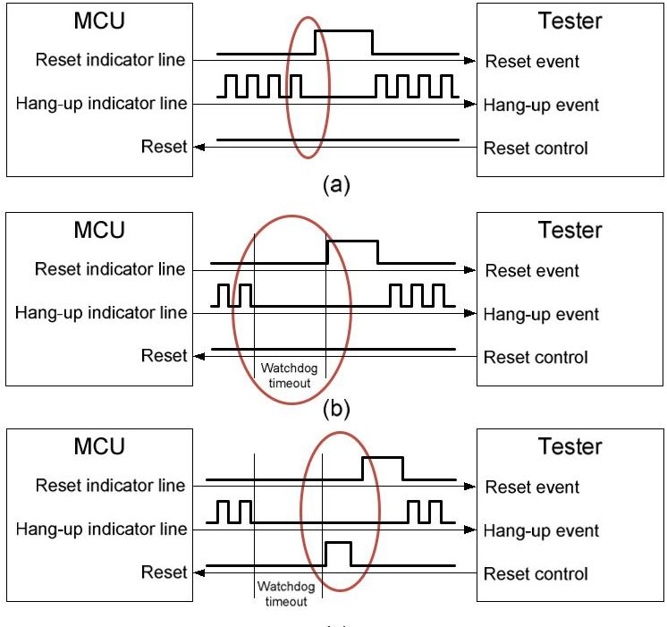
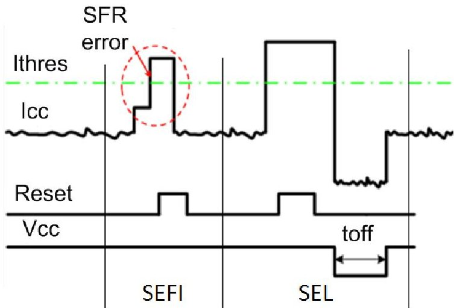
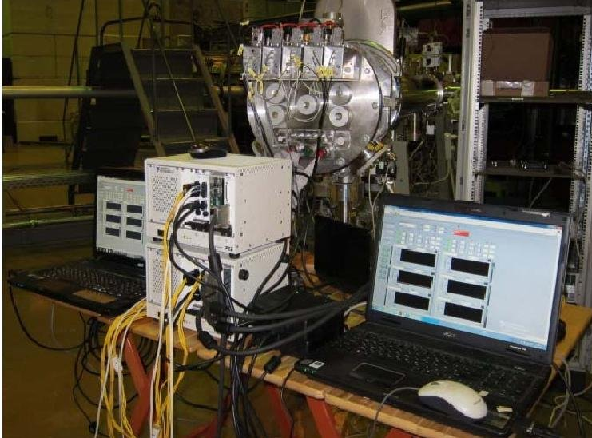
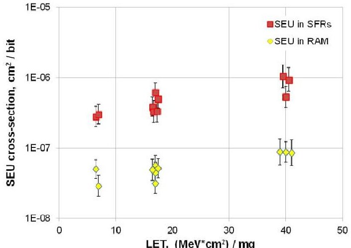
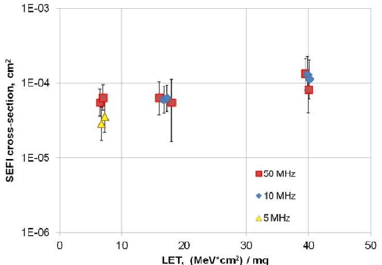
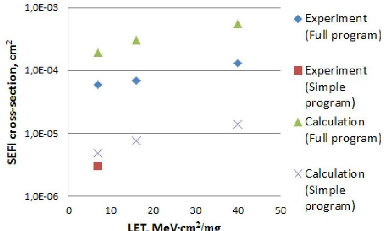

<!-- PDF_PAGE: 1 -->

# Investigation of Single Event Functional Interrupts in Microcontroller with PIC17 Architecture

Pavel V. Nekrasov, Andrey B. Karakozov National Research Nuclear University MEPhI Moscow, Russia pvnek@spels.ru

Abstract — the article is devoted to the study of single event functional interrupts in microprocessors and microcontrollers. SEFI detection method is discussed. The influence of supply voltage, operating frequency and program code on SEFI cross section is examined. In addition the new simplified method of SEFI cross-section calculation based on critical memory space estimation is presented.

Keywords— SEFI, SEU, microprocessor, microcontroller, heavy ionized particles, HIP.

## I. INTRODUCTION

The most common single event effects in microprocessors (MPU) and microcontrollers (MCU) under heavy ionized particles exposure are single event latchups (SEL), single event

upsets (SEU) and single event functional interrupts (SEFI) [1, 2]. The behavior of ICs during SEU and SEL on a program level is quite simple and well studied and there are a number of accurate methods of SEU and SEL cross-section calculation [3, 4]. However SEFI control procedure is relatively hard due to diverse MPU behavior. SEFI arises as a result of data corruption in control registers and program memory or disturbance signal on MPU's internal control line which leads to program execution failure. The number of critical bits in control registers that can cause SEFI amounts up to 103...104, and errors in different bits can lead to different types of MPU's malfunction. This complicates SEFI registration and control methods during experiment.

In this work we discuss SEFI types and methods of their detection in MPUs and MCUs, SEFI and SEL distinguishing procedure. We also propose a simplified method of SEFI cross-section calculation based on separate critical RAM and special function registers cross-section characterization.

The usual approach of single event effect (SEE) detection during experiment uses a test unit which sets up operating mode of a device under test (DUT), measures critical parameters, runs functional control tests and registers SEEs [5, 6]. A brief description of test setup which was used in this work to control SEFIs as well as SEUs and SELs during exposure is given in part 3.

## II. SEFI TYPES AND DETECTION METHODS

We consider three types of SEFI in MPUs and MCUs:

Dmitry V. Bobrovskyi, Vladimir A. Marfin Specialized Electronic Systems Moscow, Russia

1. Spontaneous restart (reset) after which MPU continues execution;

2. Execution stopping (hang-up) that can be handled by hardware reset;

3. Full or partial program data loss, causing MPU malfunction. In this case device restores operation after reprogramming.

To detect spontaneous restart (reset) MPU generates an impulse in a specified GPIO line ("Reset indicator line") or sends a data message via some standard interface every time after reset. The test unit reads this impulse or data message, analyses the cause of reset and increments SEFI counter if needed. The common reset causes are:

- Spontaneous reset caused by SEFI (Fig. 1a);

- Power-on reset (which usually fires after SEL handling);

- Watchdog timer reset after IC's hang-up (Fig. 1b);

- External hardware reset via MPU's Reset line, which is usually used in SEL handling procedure or during hang-up (Fig. 1c).

Fig. 1. SEFI types in MPUs: spontaneous reset (a), hang-up handled by watchdog timer (b), and hang-up handled by external reset (c).

<!-- PDF_PAGE: 2 -->

Fig. 1. SEFI types in MPUs: spontaneous reset (a), hang-up handled by watchdog timer (b), and hang-up handled by external reset (c).

Other reset events are handled individually for particular MPU or MCU.

To control execution stopping (hang-up) events, MPU should generate a periodic signal in a specified IO line ("Hang-up indicator line") or a periodic data message (Fig. 1). The test unit treats the absence of this periodic signal within the required timeout as a hang-up event. There are several ways to restore MPU functioning after hang-up: external interrupt, non-maskable external interrupt, reset due to watchdog timer, hardware reset and finally power cycle[7].

Program data loss can be caused by a SEFI in a programming (erasing) unit or by SEU in a critical bit of program memory. In this case, reset and power cycle can't handle the SEFI and device restores operation only after reprogramming.

1. Run hardware reset of MPU (MCU);

One of the major issues of MPU's SEE testing is to distinguish SELs and those SEFIs which is resulting in current consumption increase. To do these we suggest the following procedure:

2. Measure current consumption of DUT after reset;

3. If the measured current exceeds SEL threshold value, the SEE is qualified as a SEL;

The diagram illustrating this procedure is presented in Fig.2

4. If current consumption restores to normal level, the SEE is qualified as a SEFI.

Fig. 2. SEFI and SEL distinguishing using hardware reset

## III. TEST AND EXPERIMENTAL SETUP

As a test unit, we used an open system hardware and software solution based on PXI modular instruments provided by the National Instruments (NI) (Fig. 3) [8]. The developed setup consists of: PXI-1033 5-slot chassis; two programmable 3-channel power supplies PXI-4110 (channel 1: 6 V; channel 2: 20 V; channel 3: -20 V; 1 A each); analog and

digital IO board PXI-7841R with FPGA Virtex-5R, 96 bidirectional digital ports, 8 analog inputs and 8 analog outputs. The apparatus was controlled by LabVIEW software.

Fig. 3. Test setup based on PXI modular instruments and LabVIEW software.

Experiments were conducted at the Roscosmos facility based on the ion accelerator «U-400M» (JINR, Dubna, Russia). Heavy ion beams properties are presented in Table 1. During exposure we registered SELs, SEFIs and SEUs.

TABLE I. HEAVY ION BEAMS PROPERTIES

<table border="1"><tr><td>Ion</td><td>Energy, MeV/nucleon</td><td>LET, MeV·cm2/mg</td><td>Fluence, cm-2</td></tr><tr><td>$^{20}Ne$</td><td rowspan="3">2,3-3,5</td><td>7</td><td>4.2E+07</td></tr><tr><td>$^{40}Ar$</td><td>17</td><td>5.5E+06</td></tr><tr><td>$^{84}Kr$</td><td>41</td><td>1.4E+06</td></tr></table>

## IV. DEVICE UNDER TEST

For the experiment we used an 8-bit MCU with PIC17 command set manufactured with 0.18 um CMOS process. The MCU's maximum operating frequency was 50 MHz. The DUT MCU has 8Kx16 internal program RAM, 902 bytes of data RAM, 18 special function registers (SFR), 8x8 hardware multiplier, timers-counters and UART and SPI controllers.

## V. EXPERIMENTAL RESULTS

Under all conditions no SELs were observed during ion exposure with fluences listed in Table 1.

Two different firmwares were designed to test SEFI crosssection dependence on MCU program code:

1. Full functional control program that included the following tests: ALU (arithmetic and logic command set execution); GPR, SFR and RAM tests (SEU control), UART (receive and transition a series of data messages), interrupts controller (correct interrupt handling).

2. Simplified program that included only control of GPIO.

For the exposure by Ne ions with LET = 7 MeV $ \cdot $ cm $ ^{2} $ /mg, the cross-sections for full and simplified programs differ in 20

<!-- PDF_PAGE: 3 -->

times; the experimental results are presented in Table 2. The data show the drastic influence of firmware code and number of internal functional units used on SEFI cross-section.

We controlled SEU in SFR bits (distributed trigger cells), general purpose registers (GPR) and program RAM (both 6 transistor block memory cells). The experimental results are presented in Fig.4; the SFR SEU cross-section per bit was 10 times more than the RAM SEU cross-section.

TABLE II. SEFI CROSS-SECTION FOR DIFFERENT PROGRAM CODE

<table border="1"><tr><td>LET, MeV·cm2/mg</td><td>Program type</td><td>SEFI cross-section,cm2</td></tr><tr><td>7</td><td>Full</td><td>6.0E-05</td></tr><tr><td>7</td><td>Simplified</td><td>3.0E-06</td></tr></table>

Fig. 4. SEU cross-section for SFRs and RAM memory cells.

We analyzed SEFI cross-section dependence on several parameters: operating frequency, supply voltage and program code.

Fig. 5. SEFI cross-section for different frequencies.

SEFI cross-section dependence on LET was obtained for operating frequency of 5,10 and 50 MHz.. The experimental results are shown in Fig. 5. The cross-section distinction between different operating frequencies is small (less than 2

times) and shows up only at 5 to 50 MHz comparison. It should be also noted that SEFI cross-section dependence on operating frequency arises only when full functional control is performed.

The results of investigation of SEFI cross-section dependence on supply voltage are presented in Table 3. The exposures were performed at 3 supply voltages: high (1.98 V/ 3.6 V), normal (1.80 V/ 3.3 V) and low (1.62 V/ 3.0 V). No substantial affect of supply voltage on SEFI crossection was found; the maximum difference was about 2 times.

TABLE III. SUPPLY VOLTAGES DEPENDENCE OF SEFI CROSS-SECTION

<table border="1"><tr><td>LET, MeV·cm2/mg</td><td>Supply voltages</td><td>SEFI cross-section,cm2</td></tr><tr><td>17</td><td>1.62V/3.0V</td><td>6.3E-05</td></tr><tr><td>17</td><td>1.98V/3.6V</td><td>5.8E-05</td></tr><tr><td>41</td><td>1.62V/3.0V</td><td>1.0E-04</td></tr><tr><td>41</td><td>1.80V/3.3V</td><td>1.1E-04</td></tr><tr><td>41</td><td>1.98V/3.6V</td><td>5.3E-05</td></tr></table>

## VI. SEFI CROSS-SECTION EVALUATION METHOD

As the analysis shows the number of critical SFR and GPR memory cells capable of causing SEFI for full program is 43 bits and 16 bits, respectively. For simplified program, it is 16 bits and 0 bits. The full program size is equal to 5120 bit, and the simplified version is - 48 bit.

This leads to a simple model that can be used to roughly evaluate SEFI cross-section using know SEU cross-sections and number of critical memory bits:

$$
\sigma_ {\mathrm {S E F I}} = \mathrm {N} _ {\mathrm {S F R}} \cdot \sigma_ {\mathrm {S F R}} + \mathrm {N} _ {\mathrm {G P R}} \cdot \sigma_ {\mathrm {G P R}} + \mathrm {N} _ {\mathrm {P R O G}} \cdot \sigma_ {\mathrm {P R O G}}
$$

where $ \mathrm{N}_{\mathrm{SFR}} $ $ \mathrm{N}_{\mathrm{GPR}} $ and $ \mathrm{N}_{\mathrm{PROG}} $ are the total numbers of critical bits in different memory spaces and $ \sigma_{\mathrm{SFR}} $ $ \sigma_{\mathrm{GPR}} $ and $ \sigma_{\mathrm{PROG}} $ are the corresponding SEU cross-sections per bit. The experimental and the evaluated data are presented in Fig. 6.

Fig. 6. Experimental data and estimated SEFI cross-sections.

As we can see on Fig.6, this method gives us conservative evaluation of SEFI crossection due to taking into account total number of critical bits. For SFRs and GPRs, number of critical

<!-- PDF_PAGE: 4 -->

bits can be calculated more precisely taking into consideration what internal blocks and variables are used in firmware code. For complicated programs, $ \mathrm{N}_{\mathrm{SFR}} $ and $ \mathrm{N}_{\mathrm{GPR}} $ tend to include all SFR and GPR memory spaces. As for critical bits in program memory, the precise calculation of critical bits is rather complex for the following reasons: it is hard to predict whether the single bit upset in a command word will lead to MPU hang-up or reset, and also capacity of program memory is rather huge to analyze carefully. The calculation, however, becomes simpler if the program term is ignored in (1) due to low SEU cross-section.

## VII. CONCLUSION

In this work we discussed problems of SEFI investigation in MPUs and MCUs and presented practical ways for different SEFI types detection and distinguishing between SEFI and SEL. We presented an automated test setup for functional and parametric control of MPUs and MCUs during SEE testing. Experimental results of 8-bit MCU with PIC17 architecture showed that SEFI cross-section drastically depends on program code complexity, but the dependencies on supply voltage and operating frequency are relatively weak. We also presented a simple method of SEFI cross-section estimation based on evaluation of the number of critical bits in different types of memories which can affect to program flow provided that SEU cross-section of those bits are known.

## REFERENCES

[1] M. S. Gorbunov B. V. Vasilegin, P. N. Osipenko, G. I. Zebrev, V. S. Anashin, V. V. Emeliyanov, A. I. Ozerov, R. G. Useinov, A. I. Chumakov, A. A. Pechenkin, and A. V. Yanenko,"Analysis of SOI CMOS microprocessor's SEE sensitivity: Correlation of the results obtained by different test methods," in Proc. 12th European Conf. on Radiation and its Effects on Components and Systems, RADECS-2011, Sevilla, Spain, pp. 665-668, Sept. 19-23, 2011.

[2] A. I. Chumakov, "Evaluation of multibit upsets in integrated circuits under heavy charged particles," Russian Microelectronics, vol. 43, no. 2, pp. 91-95, 2014.

[3] M. S. Gorbunov, P. S. Dolotov, A. A. Antonov, G. I. Zebrev, V. V. Emeliyanov, A. B. Boruzdina, A. G. Petrov, and A. V. Ulanova, "Design of 65 nm CMOS SRAM for Space Applications: A Comparative Study," IEEE Trans. Nucl. Sci., vol. 61, no. 4, pp. 1575-1582, 2014.

[4] P. N. Osipenko, A. A. Antonov, A. V. Klishin, B. V. Vasilegin, M. S. Gorbunov, P. S. Dolotov, G. I. Zebrev, V. S. Anashin, V. V. Emeliyanov, A. I. Ozerov, A. I. Chumakov, A. V. Yanenko, and A. L. Vasil'ev, "Fault-tolerant soi microprocessor for space applications," IEEE Trans. Nucl. Sci., Vol. 60, no. 4, pp. 2762-2767, 2013.

[5] D. V. Bobrovskii, O. A. Kalashnikov, and P. V. Nekrasov, "Anestimate of the FPGA sensitivity to effects of single nuclear particles," Russian Microelectronics, vol. 41, no.4, pp. 226-230, 2012.

[6] A. B. Boruzdina, N. G. Grigor'ev, and A. V. Ulanova, "Effect of topological placement of memory cells in memory chips on multiplicity of cell upsets from heavy charged particles", Russian Microelectronics, vol. 43, no. 2, pp. 96-101, 2014.

[7] M. P. Pagey, D. Czajkowski, P. Samudrala, and D. Strobel "SEFI Mitigation Technique for COTS Microprocessors: Demonstration Using Proton Irradiation Experiments", 2004 Military Aerospace Programmable Logic Devices Conference, September, 2004.

[8] A.B. Karakozov, P.V. Nekrasov, D.V. Bobrovsky, V.A. Marfin, "Advanced hardware-software complex for single event effects testing in integrated circuits under heavy charged particles explosion", 2015 International Siberian Conference on Control and Communications (SIBCON). Proceedings.(to be published).