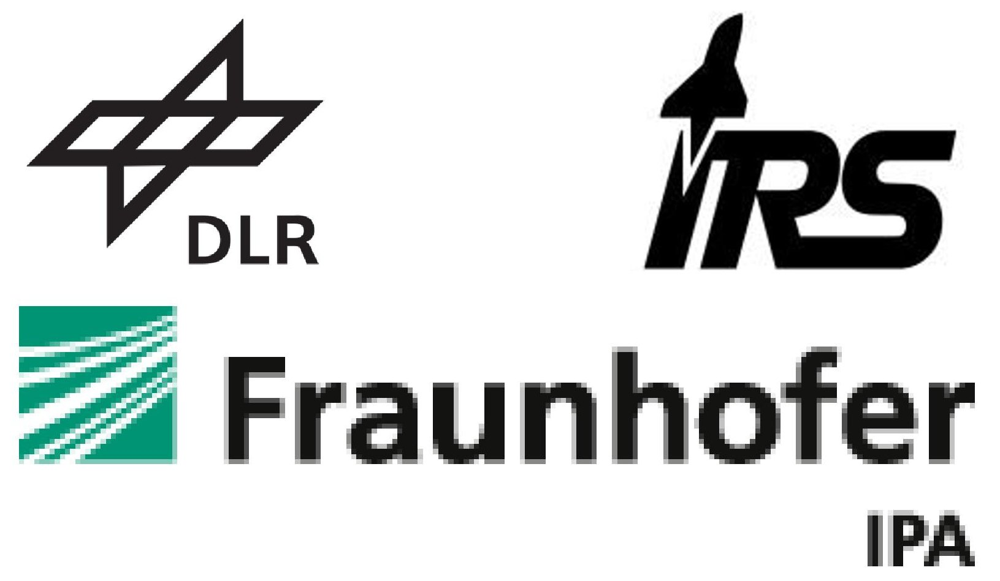
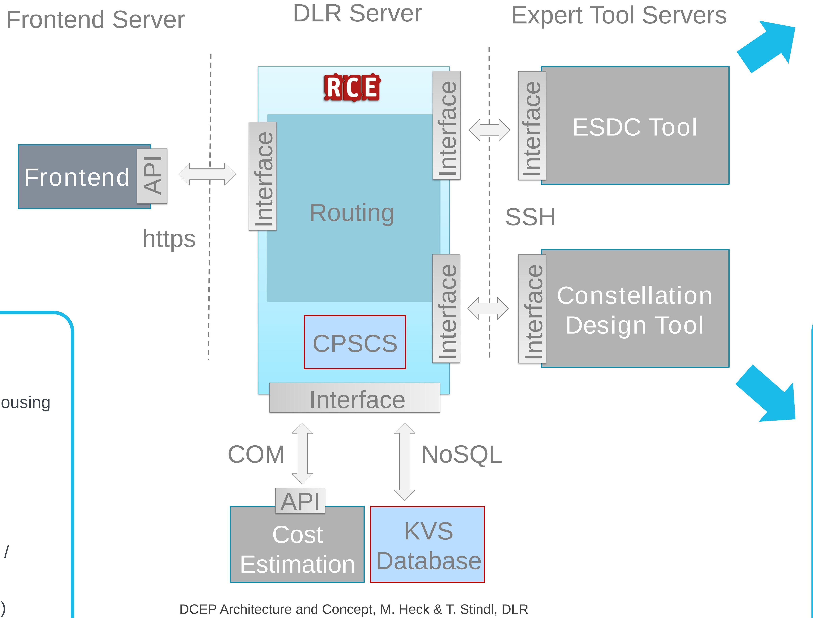
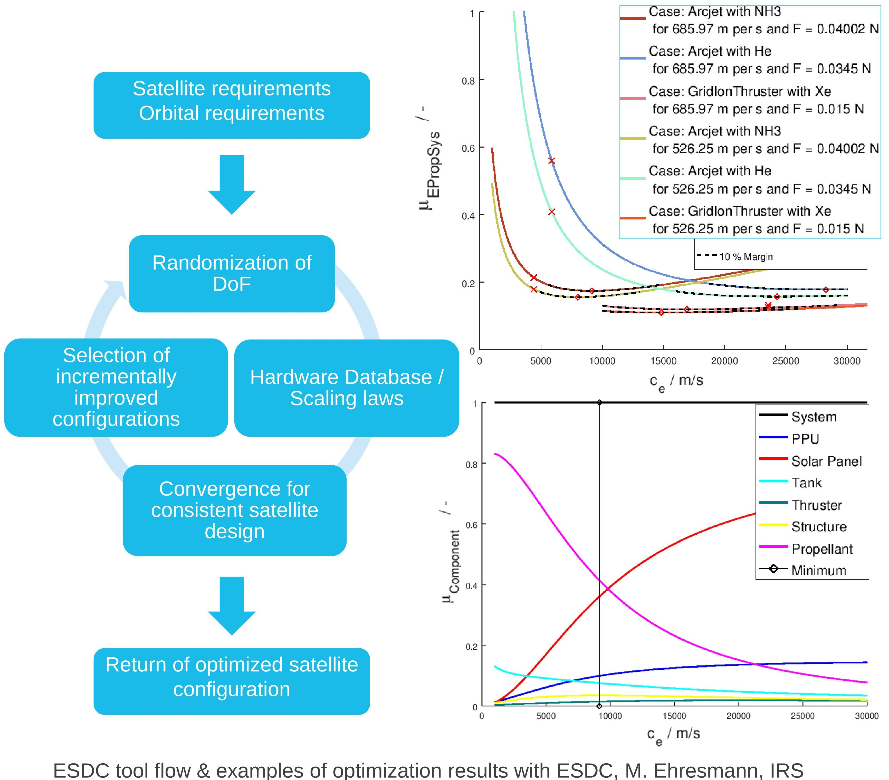
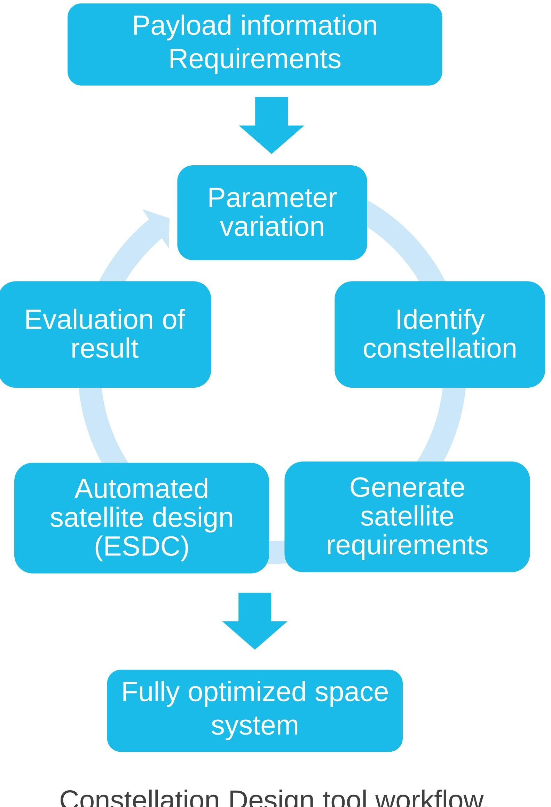

<!-- PDF_PAGE: 1 -->

## University of Stuttgart Institute of Space Systems

Martin Fugmann, M.Sc.

fugmann@irs.uni-stuttgart.de

Institute of Space Systems

Pfaffenwaldring 29, D-70569 Stuttgart

## The Digital Concurrent Engineering Platform (DCEP)

Satellite design is often done using concurrent engineering facilities where specialists for all disciplines meet in one place to build a preliminary design. These specialists will mostly rely on tools they have developed and used in previous projects. We develop the DCEP as a software-based distributed engineering platform to replace these conventional approaches.

## Flexible:

- Users & tool servers can be located anywhere

- Standardized XML-based data management & exchange

- Any software can be used, only an XML interface is needed

## Secure:

- Use of secure protocols

- No intellectual property accessible via DCEP central server

## Agile:

- No additional software required at user workstations (Valispace browser interface)

- Quick evaluation of design changes

- Easy estimation of satellite & constellation cost and performance

Martin Fugmann

Manfred Ehresmann

Jonathan Skalden

Georg Herdrich

Stefanos Fasoulas

Sabine Klinkner

Manuel Heck

Torsten Stindl

Tina Stäbler

## The Integrated Research Platform for Affordable Satellite (IRAS) Project

## Distributed Collaboration

Funded by the Baden-Wurttemberg Ministry of Economics, Labor and Housing Development of new technologies for low-cost satellites

IRS (Institute of Space Systems / University of Stuttgart)

Fraunhofer IPA (Institute for Manufacturing Engineering and Automation / Fraunhofer Society)

Cooperation between industry and academia

DLR-BT (Institute of Structures and Design / German Aerospace Center)

## Project Partners:

Low-cost automotive electronics for spaceflight

New electric propulsion systems

## Topics beside the DCEP:

Topology optimization & function integration.

The Baden-Wurttemberg space industry

Additive manufacturing for polymers, metals and ceramics

IRAS DCEP: Automated and Distributed Satellite and Constellation Design

Central XML data set Easy integration of design tools & commercial software Browser-based user interface Automated satellite design Constellation optimization

## Planned Features:

- 3D visualization using VR glasses

- IP protection with blockchain technology

- Integration of DLR-developed "Virtual Satellite" Frontend

## Satellite Design & Optimization

ESDC (Evolutionary System Design Converger) Generate an optimized preliminary satellite design Origin: identification of electric propulsion system type and parameters that lead to lightest combination of propulsion & power system Use of databases & generic scaling models for various thruster types Extension to represent all subsystems

## Subsystem mass estimation using: - Simple scaling laws

- Databases of existing components

- Sophisticated models supplied by DCEP users themselves

ESDC tool flow & examples of optimization results with ESDC, M. Ehresmann, IRS

## Constellation Design

- Calculate missing constellation or payload parameters

- Derive satellite design requirements & preliminary budgets (Analysis, Simulation with Astos, Literature data)

- Automatic optimization using ESDC

- Iteration using open input parameters

- Identify best overall solution from large solution space

Payload parameters: Field-of-View $ \eta $ Minimum elevation $ \varepsilon $ Ground Resolution Coverage requirements

"How many satellites in which constellation are needed with a given payload? "

## Constellation parameters: Altitude H

No. of orbital planes n $ _{Planes} $ No. of satellites per plane n $ _{Sats} $ Walker-Star / Walker-Delta?

## ,What satellite

characteristics are needed for a given constellation?“

Constellation Design tool workflow, M. Fugmann, IRS