<!-- PDF_PAGE: 1 -->

IRAS: Low-cost Constellation Satellite Design Electric Propulsion and Concurrent Engineering

Manfred Ehresmann $ ^{a, *} $ , Jonathan Skalden $ ^{a} $ , Martin Fugmann $ ^{a} $ , Nicholas Harmansa, Stefanos Fasoulas $ ^{a} $ , Sabine Klinkner $ ^{a} $ , Isil Sakraker $ ^{b} $ , Tina Stäbler $ ^{b} $ , Simon Humbert $ ^{b} $ , Oliver Refle $ ^{c} $

$ ^{a} $ Institute of Space Systems, University of Stuttgart, Pfaffenwaldring 29, 70569 Stuttgart, Germany, ehresmann@irs.uni-stuttgart.de , fugmann@irs.uni-stuttgart.de , skalden@irs.uni-stuttgart.de , harmansa@irs.uni-stuttgart.de , herdrich@irs.uni-stuttgart.de , fasoulas@irs.uni-stuttgart.de , klinkner@irs.uni-stuttgart.de

$ ^{b} $ DLR (German Aerospace Center), Germany, simon.huembert@dlr.de , isil.sakraker@dlr.de , tina.staebler@dlr.de

$ ^{c} $ Fraunhofer Institute for Manufacturing Engineering and Automation IPA, Germany, oliver refle@ina fraunhofer de

oliver.refle@ipa.fraunhofer.de

* Corresponding Author

## Abstract

The Integrated Research Platform for Affordable Satellites (IRAS) is a joint research project by DLR, Fraunhofer, IRS, and industry partners aimed at developing cost-reducing technologies for satellites. This paper describes the various contributions of the IRS to IRAS, such as development of a reference satellite constellation for implementation and demonstration of new technologies. The digital concurrent engineering platform as an IRAS subproject is being described with regards to the envisioned aim and future application for unifying engineering tools from multiple stakeholders. It allows to create an efficient design toolchain to reduce development time and costs. The evolutionary system design converger is a contribution on the level of electric propulsion systems to the platform. It is given as a subsystem example of the capabilities of the digital concurrent engineering platform. Additional examples of analysis and outputs are given for the IRAS use case. Gridded ion thrusters with xenon as propellant are likely to be able to provide an electric propulsion system with the lowest total system mass, whereas an ammonia based arcjet system will allow for the fastest regeneration of the constellation at a reasonable mass fraction. Additive manufacturing with its significant potential for space hardware cost reduction, while maintaining or increasing system performances due to function integration, is explained. An arcjet nozzle with integrated regenerative cooling channels has been identified as promising component. It is being manufactured from tungsten powder through selective laser melting. The advantages of using the know how of the automotive industry and translating it into space is described.

Keywords: systems engineering, constellation, additive manufacturing, electric propulsion, IRAS

<table border="1"><tr><td colspan="2">Nomenclature</td><td>EP</td><td>Electric Propulsion</td></tr><tr><td>$c_{e}$</td><td>$-effective exhaust velocity</td><td>ESDC</td><td>$-Evolutionary System Design Converger</td></tr><tr><td>$E_{0}$</td><td>$-solar constant</td><td></td><td></td></tr><tr><td>$e$</td><td>$-Euler number</td><td>GPS</td><td>$-Global Positioning System</td></tr><tr><td>$I$</td><td>$-Impulse</td><td>IPA</td><td>$-Institute for Manufacturing Engineering and Automation</td></tr><tr><td>$\eta$</td><td>$-efficiency</td><td></td><td></td></tr><tr><td>$F$</td><td>$-thrust</td><td>IRAS</td><td>$-Integrated Research Platform for Affordable satellites</td></tr><tr><td>$\Delta v$</td><td>$-velocity increment</td><td></td><td></td></tr><tr><td>$m$</td><td>$-mass</td><td>IRS</td><td>$-Institute of Space Systems University of Stuttgart</td></tr><tr><td>$\mu$</td><td>$-mass fraction</td><td></td><td></td></tr><tr><td>$P$</td><td>$-electrical power</td><td>PPU</td><td>$-Power Processing Unit</td></tr><tr><td>$\rho$</td><td>$-density</td><td>PV</td><td>$-Photovoltaics</td></tr><tr><td>$t$</td><td>$-time</td><td>RAAN</td><td>$-Right Ascending Node of Ascension</td></tr><tr><td></td><td></td><td>SLM</td><td>$-Selective Laser Melting</td></tr><tr><td colspan="2">Acronyms/Abbreviations</td><td>SLS</td><td>$-Selective Laser Sintering</td></tr><tr><td>BOL</td><td>$-Beginning of Life</td><td>SSH</td><td>$-Secure Shell</td></tr><tr><td>DCEP</td><td>$-Digital Concurrent Engineering Platform</td><td>XML</td><td>$-Extensible Markup Language</td></tr><tr><td>DLR</td><td>$-Deutsches Zentrum für Luft- und Raumfahrt</td><td></td><td></td></tr><tr><td>EOL</td><td>$-End of Life</td><td colspan="2">1. IntroductionThis paper presents the contribution of the Institute of Space Systems (IRS) to the Integrated Research Platform</td></tr></table>

<!-- PDF_PAGE: 2 -->

for Affordable Satellites (IRAS). The IRS is the designated supplier of an optimized satellite design and a dedicated suitable propulsion system [2] . IRAS aims for capability building for the production of low-cost function integrated components.

As a reference mission for demonstration purposes, an Internet-of-Things application has been selected [1]. Its objective is to provide a communications service for globally distributed, autonomous, miniaturized lowpower sensors (e.g. tracking, security, monitoring), which signals are to be received and forwarded to costumers in near-real time. A constellation of up to 100 satellites in polar orbits at 800 km altitude was designed to fulfil this goal.

The low-cost satellite requirement will be met by considering innovative production processes like additive manufacturing to be able to consistently employ rapid prototyping or achieve small series production of components of arbitrary complexity. The utilization of components with strong heritage in the automotive industry will be considered to achieve better in space performance, when compared to conventional space components. It can be expected that mass and volume budgets for respective subsystems will decrease, while simultaneously a higher performance is possible. The comparison of a conventional satellite design to a novel design based on automotive components is one aim of the IRAS project.

The propulsion system of the typical IRAS satellite is assigned to multiple tasks. It shall be able to raise its orbit to the designated circular 800 km orbit; it shall be able to perform space debris collision avoidance manoeuvres as well as perform station-keeping tasks. Further, it shall be able to deorbit the satellite after 7 years to avoid the generation of space debris.

To this end, the strong heritage of the IRS with respect to electrical propulsion systems is utilized.

An arcjet is generally capable of producing relatively high thrust and a sufficient specific impulse in comparison to other electric propulsion. A 150 to 300 W Arcjet fed by ammonia is recommended for an IRAS constellation satellite, which will be partly 3D printed. However, also other EP systems, like radiofrequency ion thrusters (RIT), are considered as potential propulsion systems. It is of special importance for constellations to rely on multiple suppliers for each subsystem to overcome production shortages. To be able to cope with changes of the satellite baseline an automated parametric design tool of the electric propulsion system is currently in development and will be presented.

This tool will be integrated into the Digital Concurrent Engineering Platform (DCEP) of IRAS, which will allow for an agile and rapid development process as design information are exchanged with the DCEP and remote use of external tools is permitted.

A technology demonstration precursor mission on a CubeSat is currently in the planning stage.

## 1.1 Constellation design

The constellation is a Walker-Star-type i = 89°: 84/12/11 constellation with circular orbits, with altitude of 800 km above Earth's surface.

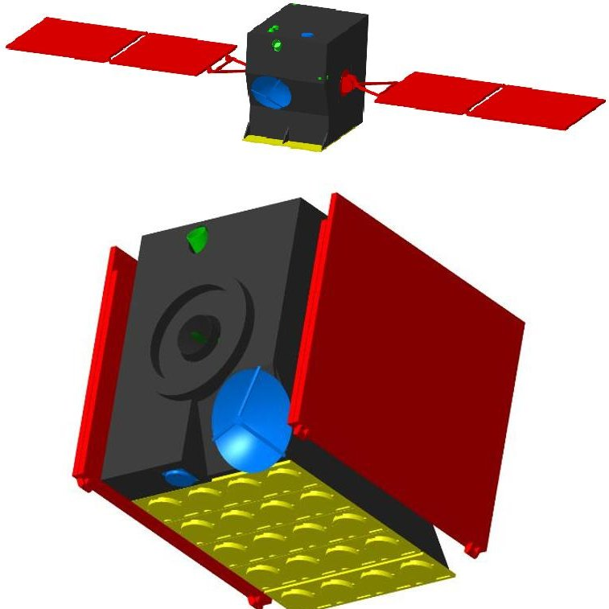

Figure 1: The IRAS reference satellite in operational (top) and launch configuration (bottom)

This translate to an inclination of 89°, 12 orbital planes, spaced by 15° RAAN. Seven satellites are equally spaced along each orbital plane, making up a total constellation number of 84 operational satellites.

This constellation allows for a minimum number of orbital planes as the maximum permitted payload height is used, which is a major constellation cost driver. At the same time global availability is ensured due to the high inclination of the orbital planes, while a maximum coverage gap of 15 min is given by the 7 satellites per plane. To reduce the amount of ground stations, intersatellite link is used within each orbital plane to forward data to the satellite that will have contact next. One ground station close to the poles (e.g. located at Svalbard) thus is sufficient for the whole constellation. The orbital height selected ensures that inter-satellite communication is possible.

While the constellation still fulfils the coverage requirement if one satellite fails, constellation regeneration in case of additional failures has to be considered. This can be done either by storing spare satellites in dedicated spare orbits in space (concept A), or by storing them on the ground and launching satellites on demand using micro launchers (concept B). For Concept A, a circular orbit at 759 km and inclination of

<!-- PDF_PAGE: 3 -->

87. 24° with at least one spare orbit per one of the 12 orbital planes is considered. As the RAAN drift is different for spare and operational orbit, a window for boosting a satellite from spare orbit to operational orbit exists every 70 days.

For Concept B launch by a microlauncher into an elliptical insertion orbit of 400 by 800 km is assumed, where the remaining transfer has to be handled by the onboard propulsion system. This concept is likely to be able to faster regenerate the constellation, while a lower $ \Delta v $ is required by the propulsion system. Both concepts avoid placing a new satellite directly into its operational orbit, so that satellites that fail during launch or commissioning pose no hazard to the operational constellation.

## 1.2 Conventional satellite design

The payload consists of two arrays of patch antennas for communicating with sensors on the ground, one for receiving and one for transmitting signals. The reference satellite design is given in Fig.1. The receiving antenna consists of 16 patches, the transmitting antenna of 4. Two redundant transceivers are also part of the payload. In total, the payload requires 41 W of electrical power, and weighs 14.7 kg. It also requires constant nadir pointing and generates 800 kB of data per minute.

As the IRAS constellation is not sun-synchronous, variable illumination conditions are present, which makes two axis tracking solar arrays a necessity to produce the power required. Maximum power demand of the satellite is estimated to be 312 W continuously, which requires a solar array power of 558 W. This makes an area of 2.4 m $ ^{2} $ of solar panels necessary.

The satellite'systems require 214 Wh of energy for eclipse phases, which is stored in space-qualified MPS cells by Saft batteries. In total, the battery has a capacity of 800 Wh to achieve a depth of discharge below 30% at a nominal bus voltage of 28 V.

The IRAS satellite determines its attitude and orbit position by a combination of a redundant GPS system, magnetometers, gyroscopes, sun sensors and star trackers. Sufficiently high accuracy in determining attitude and position is necessary to operate the propulsion system efficiently.

Attitude control is provided by reaction wheels (Blue Canyon Tech RW1) with a momentum storage of 1.5 Nms each, and magnetorquers by ZARM to desaturate the wheels.

On-board data handling is based the LEON3FT spacequalified fault-tolerant processor flying on the Flying Laptop, which is a small satellite of the Institute of Space Systems University of Stuttgart currently in-orbit [3].

The communication system has two distinct functions: ground to space and inter-satellite communication.

For the former two redundant Syrlinks EWC29 transceivers and patch antennas are used, which will handle telemetry and payload data.

The latter requires a custom developed solution. Two parabolic antennas target the leading and trailing satellites on the same orbital plane, which shall communicate in the C-band.

The bus structure will mainly be constructed from aluminium sandwich panels, which are made from sheet metal and honeycomb structures, which matches the requirements of the payload antenna. Some outer structural panels, as well as the panels holding the solar arrays are made from carbon fibre sheets with an aluminium honeycomb core.

Total mass of the IRAS satellite is estimated to be approximately 155 kg, and the body has a size of 600 x 900 x 810 mm.

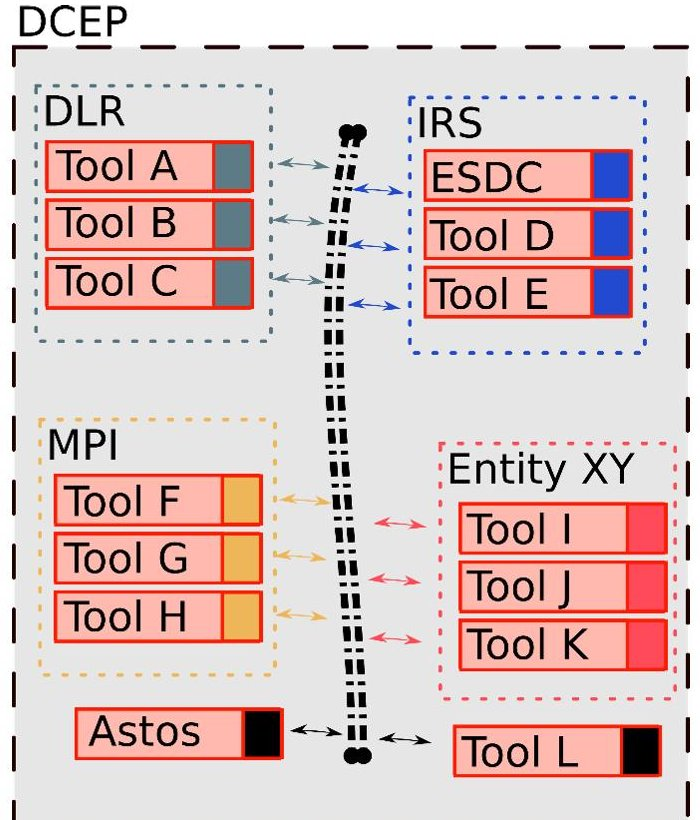

Figure 2: Network schematic of the DCEP. Individual organization servers are indicated b dotted large boxes.

## 2. Digital Concurrent Engineering Platform

The constant demand for fast development and effective designs lead to the principals of concurrent engineering. Here the parallelisation of engineering tasks are performed, while respective design interfaces are integrated to achieve a suitable solution fast.

To achieve a productive concurrent engineering workflow is a challenge in itself. As interfacing different (software) tools and design approaches requires additional work and in most cases expert knowledge of tool use lies is tangled to specific persons. Additionally, no single entity has a complete set of tools for designing the ideal spacecraft for any case imaginable.

The Digital Concurrent Engineering Platform aims for mitigating these issues and expanding the applicability of concurrent engineering in general.

<!-- PDF_PAGE: 4 -->

Individual tools are embedded in software wrappers (red boxes).

## 2.1 Structure

The structure of the DCEP is a loose network of software tools as depicted in Fig. 2. Multiple entities, for example IRS, DLR and the Fraunhofer IPA, can contribute their software tools to the DCEP, which allows their utilization for any authorized user.

When properly implemented, this allows avoiding publishing proprietary source code and intellectually protected data, while still allowing a fast workflow by directly providing design solutions.

A user accessing the DCEP provides his specific inputs in the form of requirements. This will activate corresponding software tools. In-turn this will produce derived sub requirements and call respective tools for providing a solution. This tool chain can then be used to iterate top level input requirements and obtain an optimal or at least satisfying solution. Iteration loops of refined design are to be as automated as possible.

## 2.2 Interfaces

In a space systems design institute, such as the IRS, the number of available software tools increases naturally. Either through self-written software of staff or students or through the procurement of third-party software.

This software abundance does not necessarily lead to better engineering as lack of internal communication often leads to unawareness of the existence of certain software solutions. Furthermore, most self-written software has a specific niche application, which makes reuse for similar purposes challenging.

## 2.2.1 Wrappers

To avoid the effort of rewriting software solutions for the DCEP completely an additional abstraction layer is introduced.

This abstraction layer is called a 'wrapper'. By this the inputs and outputs from and to the DCEP are handled which is of no concern for the main software author of the internal software.

If at all, the software tool needs to be adapted to read some form of variable input parameters, which are provided and formatted by the respective software wrapper.

## 2.2.2 Data exchange

As data exchange format XML files are utilized [4]. The extensible markup language is a human and machine-readable format for highly structured data.

This allows a human user to input design cases in an intuitive way, when provided with example files. Automated use is equally possible, as a well-designed

computer program can edit and write XML files for iterating one or multiple solutions.

For the current main DCEP contribution of the IRS, the evolutionary system design converger (ESDC), the folder structure shown in Fig. 3 has been implemented for interfacing [5].

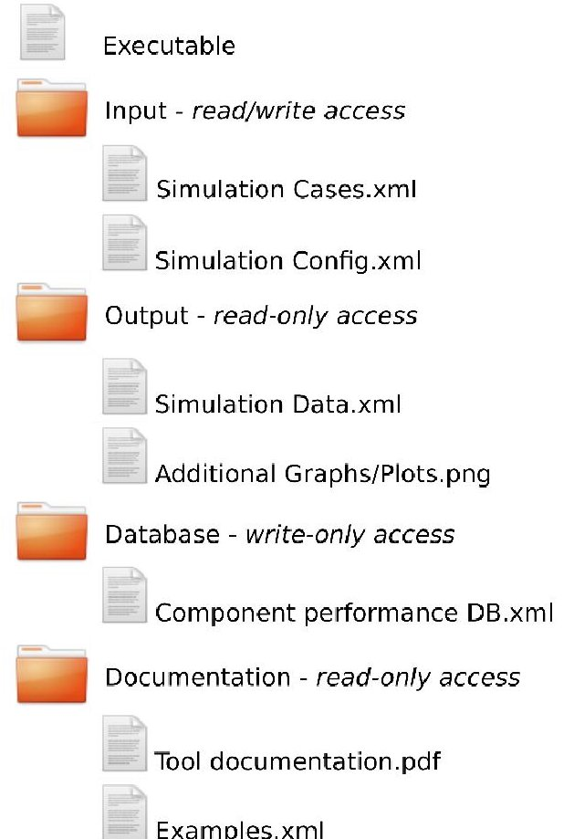

Figure 3: Generic DCEP tool interface concept with indicated access permissions of individual directories.

The function of this interfacing structure is explained in the following.

## Input:

The ESDC Input Folder contains two XML-files. The first is an input file, which defines case specific parameters. For example required $ \Delta v $ or spacecraft mass as well as propulsion specific parameters such as thruster type (i.e. gridded ion thruster or arcjet), propellant type and available power supply.

The second file in the input folder defines the configuration of the analysis. For example, what analysis types and corresponding output plots are to be produced by the software? For this specific software, it is also used for defining the permitted variation space of variable parameters.

For a standard user access to this directory has a read/write permission, to be able to submit new input cases and copy previous cases for reference for minor input changes.

## Output:

<!-- PDF_PAGE: 5 -->

The output directory of ESDC contains one large XML file that contains all result data of the performed analysis structured according to the input parameters.

As intuitive field names are used, a user can directly read and interpret this file.

Additionally, supplementary outputs that are generated from the software tool are stored in the output directory. These are for example graphs or charts generated from the data that is present in the XML output file.

For increasing the speed of automated design iteration, the generation of graphs can be suppressed until a final converged solution is achieved.

This folder is fully readable to enable a user to download and analyse its contents.

## Reference database:

A dedicated directory for reference data exists in the form of the reference database. Here XML files with explicit spacecraft performance parameters are stored. Thus, it is likely that proprietary data is present, which dictated that only write permission is given to a standard user, to allow for adding additional self-owned reference data without being able to access foreign third party data.

## Documentation:

A documentation is a critical and in most cases a neglected part of any (software) project.

First, the overall purpose of the tool is explained. It will give answers to what outputs can be expected and what respective inputs are required for operation.

All software-accessed fields of XML input and output fields have to be documented, including their explicit names, data types and if applicable units.

Additionally, the XML-fields for tool configuration options have to be explained with respect to their influence for the output that is generated.

In the case of non-XML based data generation these have to be explained. For example, the layout and setup of graphs have to be explained and additional info for understanding plotted data as well as potential limitations have to be stated.

Further, the setup and function of the reference database will be explained in this documentation, with a limitation to non-proprietary data at the digression of the data owner.

Besides the main documentation file, a number of example XML-files will serve as documentation of functioning inputs and reference outputs.

This folder is fully readable to enable a new user to access its contents and learn quickly how the tool works, what inputs are required and which ones are optional as well as what outputs to expect.

This interfacing structure will be implemented for additional software tools that are envisioned as a DCEP

contribution of the IRS and is recommended for other entities to follow as well.

The software tool itself is accessible for a common user with executable permissions. Thus, no reading or modifying of source code is permitted here.

Besides the clear division of read/write and execution permissions for various parts this standardized interface allows for adaptive creation of work chains. As any different tool for system and (sub-) system design can then be accessed individually.

## 2.3 General Data Protection Regulation

At the 25 of May 2018 the European Union law on the 'Regulation on the protection of natural persons with regard to the processing of personal data and on the free movement of such data, and repealing Directive 95/46/EC' became effective [6] and is colloquially known as GDPR.

This is critical to any organization, which processes data of persons that are not a staff member of itself. In the case of the DCEP, where multiple organisations form a network to solve an engineering problem. This network is in some form accessed by a user with a dedicated account.

This would mean that personal information would be (temporarily) stored on the external server the user accesses, which would trigger a number of legal requirements to be met to be allowed to process such requests. Formulating and signing data protection agreement would not necessarily mitigate this issue, as current legal uncertainties with respect to implementing the law correctly do exists.

As a solution, for avoiding contact with personal information, a system is currently in the implementation stage.

Individual servers of the DCEP will communicate with SSH protocol with each other [7]. SSH is short for Secure Shell and is a cryptographic network protocol, based on asymmetric public-key encryption.

This means that a server has a public encryption key stored, while the private key resides with the owner. When an authorized owner tries to access an SSH server it will issue a cryptographic challenge, which can be easily solved with the owners private key. If successful, the remote server access link is established.

Individual servers of the DCEP can communicate with each other via an SSH connection. The owner of the private key might be a user account or another server that has been authorized.

By sharing public SSH keys of authorized persons and servers beforehand - so called pre-shared keys - and not storing the respective personal data of those keys on external servers the legal uncertainties of the GDPR can be avoided and the DCEP can function as intended.

<!-- PDF_PAGE: 6 -->

Personal data correlated to authenticated SSH keys might reside within the authorizing organizations of the DCEP. Establishing the server communication via SSH comes with the additional benefit that read/write and execution permission can be directly linked to the installed SSH on the server and differing groups with privileges and permission can be handled.

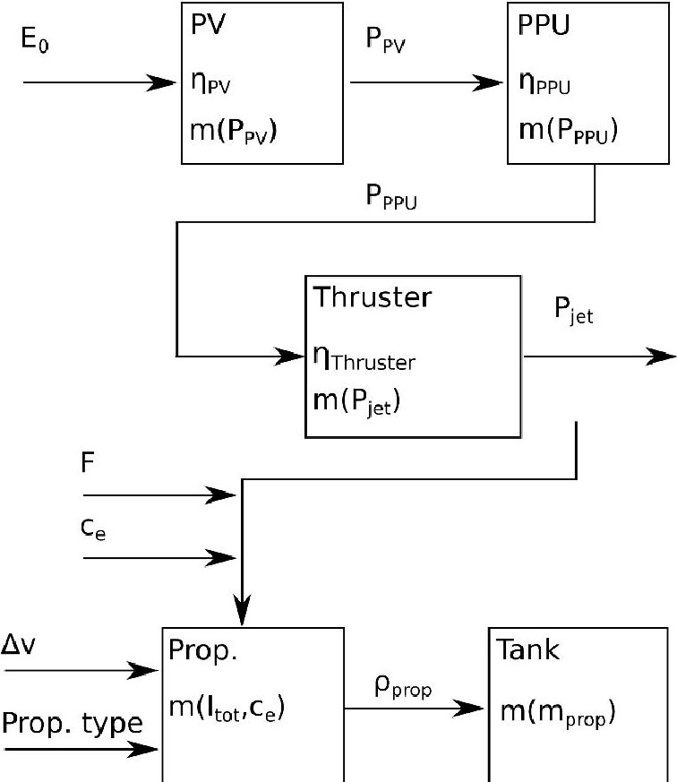

Figure 4: Logical decomposition of the generic electric propulsion system component mass scaling with relevant physical parameters given.

## 3. Evolutionary system design converger

In this section, the ESDC software tool is described as it an illustrative example of the purpose of the DCEP on the level of electric propulsion system design [5].

The evolutionary system design converger (ESDC) is currently in development at the IRS, with the final aim of optimizing spacecraft design in general by considering the holistic scaling of respective subsystems.

This is achieved by the use of an evolutionary algorithm, which uses incremental random mutation of input parameters and subsequent selection of advantageous variants for further mutation.

Due to the strong heritage of the IRS to electric propulsion systems, the current version of the ESDC is able to scale arcjet and grid ion thruster propulsion systems as well as related components to calculate a conservative mass estimation for the full EP system.

## 3.1. Electric propulsion system modelling

propellant tank as well as the propellant and an estimate of the required structural mass.

The current EP system model considers the mass of the thruster, power processing unit, photovoltaic units,

Thus, the mass of the electric propulsion system $ \mathrm{m_{EP}} $ is calculated by summing up the EP system components i:

$$
\mathrm {m} _ {\mathrm {E P}} = \sum m _ {i}.
$$

To make calculated EP system masses better comparable to each other, the EP system mass fraction is introduced as:

$$
\mu_ {\mathrm {E P}} = \frac {m _ {E P}}{m _ {0}},
$$

where $ m_{0} $ is the initial dry mass of the spacecraft, before any manoeuvres. A $ \mu_{\mathrm{E P}} $ of 0.3 thus means that the total mass of thruster, power processing unit, photovoltaics, propellant tank, propellant and structure makes up 30 % of the total initial spacecraft mass.

Generally, a low $ \mu_{\mathrm{E P}} $ is a desirable feature, as it frees up mass for other spacecraft systems. Ideally, a minimal $ \mu_{\mathrm{E P}} $ leads to a maximized payload mass of the spacecraft.

For the ESDC $ \mu_{\mathrm{E P}} $ is the objective selection criteria to determine whether a child variant is advantageous over its parent design variant.

The logical decomposition of the modelled EP system shows that scaling illustrated in Fig. 4. As input parameter, the mission required velocity increment $ \Delta v $ can be seen as constant, while other parameters like thrust F, effective exhaust velocity $ c_{e} $ and propellant type are degrees of freedom for optimization.

By this, the jet power $ P_{jet} $ becomes defined, which defines the mass of the respective thruster $ m_{thruster}. $ When considering the efficiency of the thruster $ \eta_{thruster} $ the required output power $ P_{PPU,out} $ of the power processing unit (PPU) can be calculated to scale the mass of the PPU $ m_{PPU}. $ By considering the PPU efficiency, $ \eta_{PPU} $ the required input power for the PPU $ P_{PPU,in} $ defines the output power of the photovoltaic system $ P_{PV,out} $ , which mass $ m_{PV} $ scales with the area specific input power of solar irradiation E. As a LEO case is considered here $ E_{0}=1362\mathrm{W / m^{2}} $ [8].

Propellant mass $ m_{prop} $ on the other hand is mainly dependent on the required velocity increment $ \Delta v $ and considered effective exhaust velocity $ c_{e} $ as well as the satellite initial mass $ m_{0} $ with the density of the considered propellant $ \rho_{prop} $ and the resulting propellant volume and the tank mass $ m_{tank} $ can be defined. For the structural mass a fixed $ m_{struct} $ is assumed, as the structure mainly will have to bear launch loads, which is independent from the performance of the EP system.

The scaling laws for individual components are derived from actual hardware data [5].

<!-- PDF_PAGE: 7 -->

For components with electrical power utilization (i.e. PV, PPU and thruster), linear interpolation with proportionality to the produced or consumed electrical power is used to estimate the respective total mass. Data points of actual hardware is used to keep the estimates as realistic as possible.

In the case of arcjets, a wide range of power classes from 150 W up to several kW at the IRS is available for the scaling law derivation [9].

The propellant mass $ m_{\mathrm{prop}} $ is calculated by the Tsiolkowski equation:

$$
m _ {p r o p} = m _ {0} \left(1 - \mathrm {e} ^ {\frac {\Delta v}{c _ {e}}}\right).
$$

It is recommended that a reasonable margin be applied for the $ \Delta v $ input, to maintain a conservative estimation for the propellant mass.

The tank mass is interpolated to the 2/3th power of the propellant volume, which is mainly depended on the storage density of the considered propellant $ \rho_{prop} $ Explicit scaling factors are derived from public available data on common pressure vessels for spacecraft [REF_tankDB].

An optimal EP system configuration is then found by considering either a variation of thruster specific parameters, within given constraints. These are for example the effective exhaust velocity $ c_{e} $ , the produced thrust F, the type of propulsion principle (i.e. arcjet or grid ion thruster), the type of propellant (i.e. helium, ammonia or xenon) or the available power to be supplied to the EP system $ P_{EP} $ .

The variation of these parameters is the mutation part of the evolutionary algorithm, while the scaling of the EP system results in a new EP system mass fraction. If it is smaller or equal to the value of the previous generation, it will be selected for further mutation.

It helps the search for an optimal solution, when also system configurations of equal $ \mu_{EP} $ or permitted. As this expands the design space for finding beneficial mutations.

## 3.2. Outputs

Here exemplary of the ESDC solver are given for cases relevant to the IRAS project. As a baseline a total satellite mass of $ m_{0}=1 5 5 $ kg is assumed. While two distinct cases for transfer from the insertion orbit to the operative orbit are considered. The concept A transfer requires an inclination change, which will result a $ \Delta v $ demand of 686 m/s. Concept B requires only a change of the semi-major axis and requires 526 m/s of $ \Delta v $ to achieve the operative orbit.

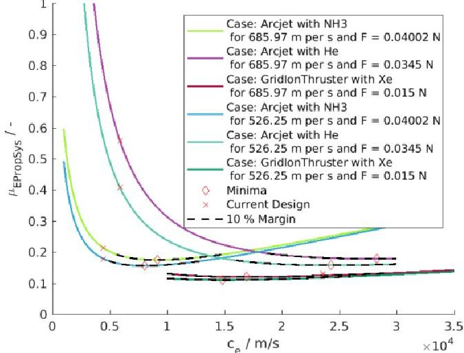

Figure 5: Example ESDC output with EP system mass fraction for six different input cases for constant nominal thrust. Theoretical optima and current hardware design points are indicated.

## 3.2.1 Full system comparison

As a first example, an analysis for constant thrust of the respective thruster is performed For VELARC this is 40 mN, when operated with ammonia and 35 mN for helium [9]. While the reference thruster for the grid ion thruster RIT 10 EVO produces 15 mN of thrust [10].

When considering a variation of the operated effective exhaust velocity $ c_{e} $ the jet power $ P_{jet} $ changes, which also changes demands for PPU and PV components. With a changed $ c_{e} $ the propellant mass and the mass of the required tank changes as well.

The result of this scaling is graphed in Fig. 5. It is evident by the minima of the shown curves, that maximizing $ c_{e} $ does not necessarily lead always to a lower overall system mass. Power supply and generation systems have to scale up to cope with the rising demand of the EP system, leading to a heavier system than necessary.

It is evident that a grid ion thruster based system offers the lowest $ \mu_{EP} $ , with a comparable flat progression over the complete considered $ c_{e} $ span. This flat progression around the depicted optima is present in all cases, which is indicated by the dashed line in Fig. 5. This means that achieving an optimal or near optimal $ \mu_{EP} $ comes with a considerable margin on the operative $ c_{e} $ and respective jet power.

It has to be noted that in the considered case the optimal $ c_{e} $ for operating the grid ion thruster is lower than the $ c_{e} $ of the current design. Although this difference is small, it is present and should not be neglected when a most efficient design is desired.

For arcjets the helium based system offers the highest $ \mu_{EP} $ and would perform better than an ammonia based system only for $ c_{e} $ above 15 km/s and is therefore considered unsuitable for this application.

As a second example an analysis that takes the IRAS satellite baseline propulsion system power supply of

<!-- PDF_PAGE: 8 -->

202. 9 W into account is performed. Thus, the jet power is constant and the produced thrust changes, when a variation of $ c_{e} $ is made.

The results are shown in Fig. 6. When limiting the electrical power supply the overall rule of decreasing the EP system mass through maximizing the effective exhaust velocity $ c_{e} $ holds true.

The progressions of all line converges to approximately 10 % EP system mass for $ c_{e} $ beyond 30 km/s, which is not feasible for ammonia and helium based arcjets. The $ \Delta v $ difference for identical propulsion systems and propellant types is even less pronounced in Fig. 5 than in Fig. 5.

The blacked dashed line in Fig. 6 that represents the 10 $ \% \mu_{\mathrm{E P}} $ margin around the theoretical optima is even flatter than in Fig. 5, which means that near optimal solutions can be achieved with appreciable distance to the optimal result for the ideal $ c_{e} $ . This also means that a significant increase in $ c_{e} $ would result only in a very limited gain for the respective $ \mu_{\mathrm{E P}} $ .

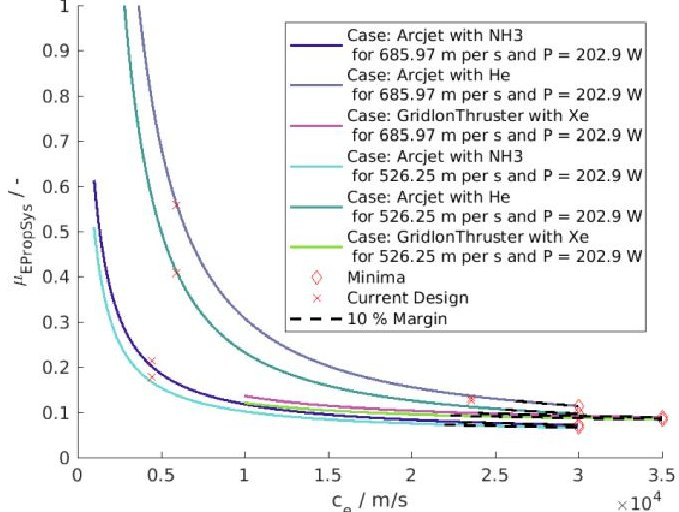

Figure 6: Example ESDC output with EP system mass fraction for six different input cases for constant nominal EP system power supply. Theoretical optima and current hardware design points are indicated.

## 3.2.2 Component contribution comparison

As the ESDC does scale individual components of the EP system, the contributions of these to the total system mass can be utilized as output to produce subsystem requirements (i.e. mass expectations). Additionally an analysis for understanding the EP system configuration for this and similar cases better can be made.

For this $ \mu_{EP} $ is normed to one, so that relative mass contributions of all considered cases become comparable to each other.

In Fig.7, an example of the individual relative mass contributions of the subcomponents is given at the example of an ammonia based arcjet system.

Here for a $ c_{e} $ of up to 10 km/s the relative propellant mass itself is the main contributor of the EP system, which is a desirable feature.

The second largest contributor to an ammonia fed arcjet system is the required PV system relative mass to generate electrical power, which is approximately equal in mass to the relative propellant mass at around 10 km/s. The tank mass plays a minor role with contributions of less than 10 % of the system mass.

For large $ c_{e} $ the PV system relative mass becomes the main system mass contribution. This means that any improve in PV efficiency makes an ammonia fed arcjet system at higher $ c_{e} $ much more efficient, as in the current model the PPU and propellant mass progression become nearly horizontal here.

Thruster and structural relative mass are negligible over the full span. Thus, development to reduce mass here is not effective for the aim of achieving a more efficient EP system. Developments that focus on an increase electrical power to jet power efficiency does directly affect power transferring system relative masses such as PPU and PV.

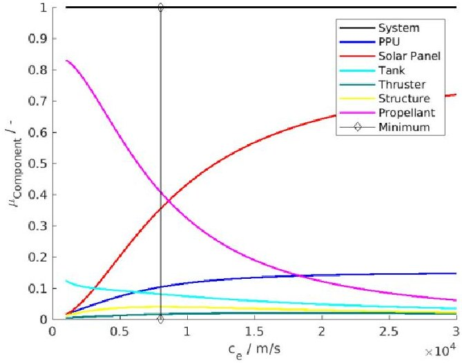

Figure 7: Example ESDC output with normed EP system mass fraction for the case of NH3 arcjet, $ \Delta v=5 2 6 $ m/s and thrust F=40 mN. Contribution of individual EP system components is shown for their relative mass. Vertical line indicates lowest $ \mu_{EP} $ and the optimal solution.

## 3.2.3. Additional features: Transfer time

For operating a constellation such as IRAS additional features beyond the EP system mass are relevant. This can for example be the time for transfer from insertion to operational orbit is critical for a constellation, when full service upkeep is relevant.

This time is directly correlate to regenerate the constellation in case of satellite failure or replacement. The results the transfer are given in Fig. 8. For the ammonia fed arcjet - case one and four - a maximum total manoeuvre time of 30.4 and 23.4 days is possible. If helium is considered a maximum of 35.3 and 27.1 days is required for the manoeuvre of case two and five respectively.

<!-- PDF_PAGE: 9 -->

The grid ion thruster requires in case three up to 81.2 days or for case six up to 62.5 days to achieve its target orbit. These numbers are highly relevant for a robust and flexible satellite constellation, as the failure of a satellite will require a replacement satellite either to the operative orbit or to a spare orbit.

In both cases an EP system with relevant thrust allows for quick regeneration of full operative capability. Thus, an ammonia based arcjet is highly recommended and might be favourable over the lower mass fraction a gridded ion based system offers, as operative costs in this aspect are expected to be lower.

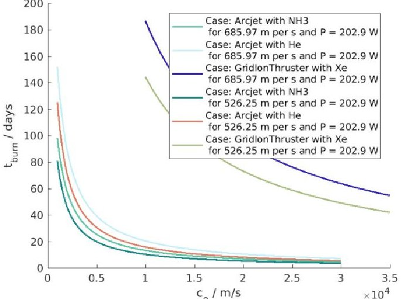

Figure /: Example ESDC output for resulting manoeuvre times for six different input cases at constant power supply.

## 3.2.3 Multidimensional optimization

The previous given examples of ESDC outputs are of simple nature, as at least one aspect of the EP system is assumed as constant (i.e. thrust or power) and explicit assumptions with regards to type of propulsion (i.e. arcjet or grid ion thruster) and propellant type are made.

This is a limitation for finding optimal solution. The current version of the ESDC is being reworked to not require these assumptions and being able to optimize within the resulting multidimensional design space.

An example of this behaviour of the ESDC can be seen in Fig. 9. The two horizontal axes make up the thrust and effective exhaust velocity span. While the visualization of propellant type is indicated by the provided mesh. Purple represents points, where helium arcjets would be ideal, while green are ammonia arcjets.

An interesting demarcation line between the two propellant types exist, which might give an indication for an optimization law.

This design space is seeded with 18 random design points, which are then mutated and selected by the ESDC for finding optimal solutions.

Mutation and selection takes place for 1000 generations. Random mutations in the system configuration are visible by squiggly lines, which conforms to the unguided nature of evolutionary algorithms.

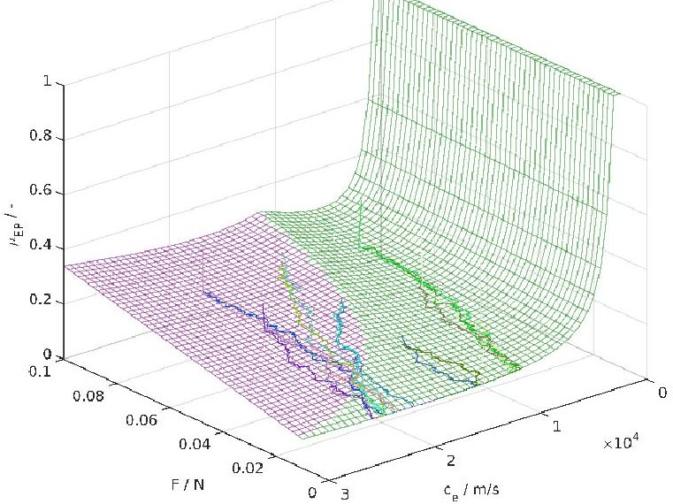

Figure 9: Example ESDC output for multidimensional optimization in a thrust, effective exhaust velocity thruster type, and propellant type design space. 18 seed points evolved for 1000 generations of arcjet designs are shown.

## 3.3. Planned features

As the ESDC is an on-going software project, the list of planned features is long.

First, a full-scale adaptive implementation of the evolutionary algorithm for arbitrary EP systems is required. This also includes the development of carefully implemented mutation laws for mutate able parameters. As well as the definition of proper evolutionary convergence and the optimal handling of design generations for the efficient use of computing power.

Additionally the reference database of actual hardware needs to be extended in a way that a system with as many COTS components can be designed and configured by the ESDC.

This does also include the clustering of thrusters and other components that can, in principle, be stacked on a spacecraft. Hybrid propulsion system designs are a possibility onwards from here.

Successively additional electric propulsion systems will be added to the database and respective interaction with the spacecraft power system implemented. Such propulsion systems are for example pulsed plasma thrusters [11] or magnetoplasmadynamic thrusters.

## 4. Additive Manufacturing

The advent of additive manufacturing processes is currently a vast number of production methods, including the aerospace sector.

The main advantage of the method is that components of nearly arbitrary complexity can be generated, without additional costs.

<!-- PDF_PAGE: 10 -->

Production time is mainly correlated to the box volume of the part to be produced and the material used.

As the IRAS constellation envisions 84 satellites in orbit and several spares at the ready production number will be in the lower hundreds.

Such numbers are too low for the development of high throughput mass production machines any component should be simplified to the maximum extend to lower production time and costs, which would either mean an increase in mass, which lowers the efficiency of the satellite or a decrease in performance.

With additive manufacturing methods it is possible to achieve high efficiency through highly complex and fully integrated parts, while keeping production time and costs comparatively low. Especially the ability to modify parts is vital to adapt quickly to changing requirements allowing for a flexible production flow.

## 4.1 Additive manufacturing methods

Two generative methods are of particular interest for space applications, as these capable to process spaceflight relevant metals.

These are selective laser sintering (SLS) and selective laser melting (SLM).

Both methods use laser power to locally heat a bed of powder material to harden the cross section of a part to be manufactured. After completing one layer another fine layer of powder is applied to successively generate a volume body.

If a sufficiently strong laser is utilized, metals of high melting temperature (e.g. tungsten) can be processed.

The main difference between SLS and SLM is the laser power applied and the state of the locally heated point.

SLS requires lower laser power and heats the powder below the melting point to enable sintering of the individual grains. In principle this method allows for the processing of alloys, state changes occur only on grain boundaries. A disadvantage of SLS is that an inherently porous body is generated, as gaps between sintered grains will exist.

SLM applies sufficiently high laser power to locally melt grains and produce a small pool of liquid material, which solidifies after a short cooling time. Densities of more than 99 % of the bulk material can be achieved this way, which negates issues related to porosity. The main disadvantage is that mainly elemental materials can be processed. As an alloy with materials of differing melting points would decompose into its constituent during liquefaction.

Limitations exists for all additives manufacturing methods as high temperatures involved minimal wall thicknesses should be used. Part geometries that are prone to warping from thermal tensions should be avoided.

Additionally, outer surface quality is always rough due to the surrounding powder bed of heated spots. This makes

post processing of surfaces for fittings and sealings mandatory, which needs to be regarded in during the design process.

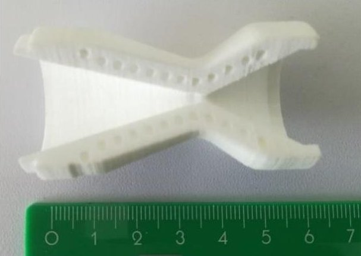

Figure 10: Example of additive manufactured arcjet nozzle cut out MARC-6 with integrated cooling channels made from laser sintered polyamide.

## 4.2 Promising arcjet components

The ideal component for additive manufacturing is a highly complex component, which allows it to achieve high performance (e.g. function integration). At the same time it would be very challenging or impossible to produce with conventional means, while production time and costs are within reasonable levels.

A method which assess the criteria: performance improvement, lightweight design and cost efficiency has been developed and applied at the IRS [12].

It concludes that the nozzle of an arcjet is an optimal candidate for additive manufacturing.

As it is the hottest part of an arcjet, it has to be manufactured from the refractory metal tungsten, making up a large mass fraction of the thruster. When complexity is of no concern, integrated regenerative cooling channels as well as swirl injection holes can be integrated, which will likely increase the efficiency of the thruster.

Additionally injector, housing, gas inlet and the thruster itself could be manufactured as a single part instead of multiple ones, reducing the number of required parts. This will likely reduce the total thruster mass as heavy interfaces are no longer required.

An example of such a component is given in Fig. 10 with the MARC-6 nozzle made from laser sintered polyamide, where three helices for regenerative cooling are integrated. The production of such a nozzle made from tungsten with the selective laser melting method is currently ongoing.

In a first step approach, the materials suitability for electric arc application shall be investigated and the effect of the regenerative cooling evaluated. To allow proper comparison, the internal nozzle geometry is identical to the conventional manufactured MARC-6 nozzle.

<!-- PDF_PAGE: 11 -->

An important parameter for additive layer manufacturing is the reproducibility of parts. For arcjet application, this is even more crucial, since cavities near the constrictor could easily drop performance or cease operation completely. A series of identical nozzles will be produced and their performance measured to understand the significance of this matter.

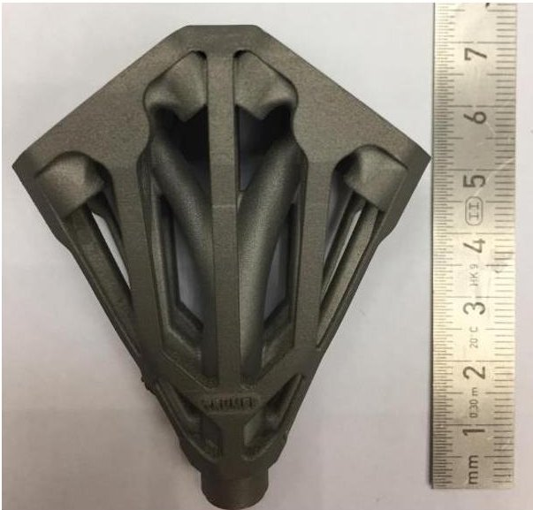

Figure 11: Example of an Inconel 718 SLM hydrogen oxygen injector.

4. 3 Additional examples of additive manufacturing In Figure 11 the finished product of a laser melted Inconel 718 hydrogen oxygen injector is displayed. This component is fully function integrated. Visible pipes that carry hydrogen or oxygen respectively do intersect and allow the gases to flow to their ideal positions. Manufacturing of such components is not possible with convention methods.

Further, the structure has been optimized for minimal mass, creating the complicated shapes displayed. Minimal post-processing is required for fitting, creating leads on fixing holes and for being able to screw on a nozzle.

## 5. Innovative technologies

As outlined above, one major purpose of IRAS is to research how novel technologies can be integrated into space systems, and to evaluate their benefits, especially with regards to cost and mass. IRAS partners therefore focussed on two fields: Use of automotive electronics components instead of hardware developed for space, and use of additive manufacturing for integrating functional parts into the spacecraft's structure, as well as for optimizing structural parts with respect to mass.

the innovative technologies as possible will then be compared to it.

The satellite design outlined in section one is currently being used to investigate to which extent the technologies described below can be applied to a space system. A first cost estimate for the conventional satellite design has been established, and the revised design using as many of

## 5.1 Automotive electronics

Because of the high demands with respect to reliability and robustness, space electronics are very expensive and require a very long qualification process. Research on self-driving cars and mobility-as-a-service concepts has led to increased requirements for automotive electronics, as a much longer lifespan, comparable to that of space hardware, is demanded. This means that today's automotive parts include features like redundant electrical connections, which makes them interesting for spaceflight as well. They offer increased performance at a reduced cost. IRAS partner Fraunhofer IPA (Institute for Manufacturing Engineering and Automation) is working on making automotive hardware available for spaceflight.

One result is that a lot of tests and requirements are comparable between automotive and space-qualified parts, especially thermal cycle and mechanical loads. The relevant automotive standard AEC-Q100 for integrated circuits is sometimes even more demanding than the comparable ECSS standard, e.g. for accelerated environment stress tests. Radiation hardness is a requirement unique to spaceflight, and an evaluation of the radiation hardness of automotive parts is intended as part of IRAS. Currently two types of components are investigated further for use on satellites: MEMS sensors (accelerometers and gyroscopes), and DC/DC converters.

Automotive MEMS sensors offer more functionalities than their space-qualified counterparts while being only a fraction in size. For example, they integrate 3-axis accelerometer and a 3-axis gyroscope in one package, and offer standard digital interfaces and integrated filters instead of an analogue output. They are small enough to be integrated into the structure (see below), and are also significantly cheaper.

DC/DC converters are used in large quantities onboard spacecrafts to convert the bus voltage to the lower voltage required by electronics, or to the high voltage required by electric propulsion systems. As automotive parts are again much cheaper and smaller, they offer significant savings in terms of mass and volume. [15]

Fraunhofer IPA has also performed research on analysing the cost structure for satellite and automotive electronics using the software TruePlanning. As development is typically the main cost driver for space electronics, use of components not specifically developed for space offers great cost saving potential. As production numbers of automotive parts are also vastly higher than those of space-qualified parts, their production cost per part is lower as well. This together with the lower mass and size of automotive electronics makes them very attractive for use in low-cost satellites. [16]

<!-- PDF_PAGE: 12 -->

In the next phase, IRS will focus on evaluating the potential of the components mentioned, and on assessing the cost savings associated with a large-scale application of automotive electronics based on the results of Fraunhofer IPA.

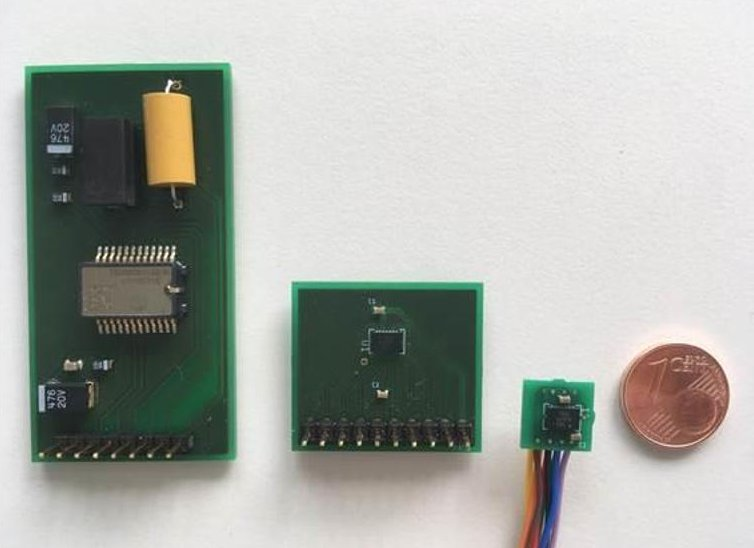

Figure 13: Size comparison of a space-qualified gyroscope (left, Murata SCC2130-D08) and automotive gyroscopes (Bosch SMI130) with miniaturized board. Courtesy of R. Adamietz, Fraunhofer IPA

## 5.2 Multifunctional & 3D-printed structures

By replacing the aluminium honeycomb of standard sandwich panels with a 3D-printed polymer core, the "empty space" inside the structure can be used for integrating cabling and connectors, small sensors, heaters for thermal control, and elements to connect the sandwich panel to other parts. The density of the honeycomb can be varied as needed to compensate for the gaps created by these parts. There are several benefits to this:

The harness of a spacecraft is often a complicated component that takes a lot of space and is difficult to integrate. Large connectors need to be considered when designing the internal layout of a satellite. When cables and connectors are integrated into the structure, integration becomes much easier, and the space required is reduced. As mounting nuts to connect other parts can be inserted during the printing process, it is possible to drastically reduce integration effort, as a component with its box and connectors can just be plugged & screwed onto the panel without any further steps necessary. This promises major cost & time saving during satellite integration, and also enables automating this step in case many satellites are to be produced.

This can be done even for the primary structure, so that whole parts of a satellite can be pre-assembled, and final integration just consists of connecting the assemblies using screws and bolts. No further effort is necessary, as the different components with their respective cabling are already integrated.

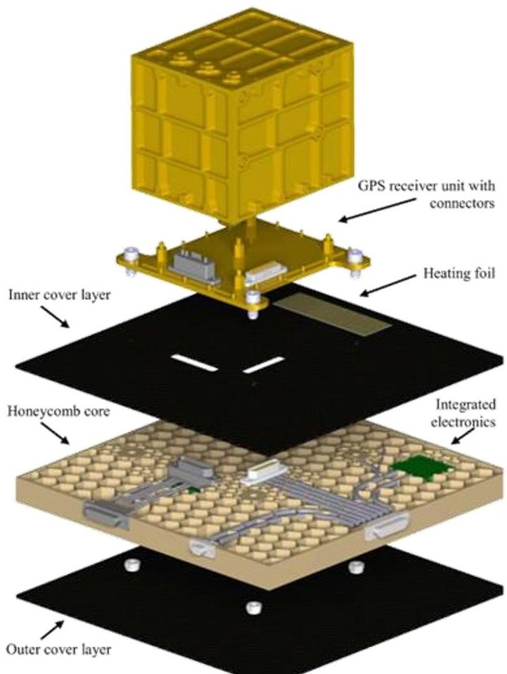

Figure 14: Exploded view of the technology demonstrator with the GPS receiver unit. Courtesy of S. Humbert, DLR-BT [REF_DLR]

Smaller components that would usually require their own housing and connectors can be embedded during manufacturing of the panel. This makes for a much cleaner design and decreases the number of integration steps necessary. Additionally, more temperature & acceleration sensors can be used on a satellite without additional effort. This can be used for better thermal control, health monitoring, and in general increase the accuracy of simulation models during development and operations.

Based on input from the IRS, IRAS project partner DLR (Institute of Structures and Design) has developed and produced demonstrators for these functionalities. A carbon-fibre reinforced polyamide (PA12) has been selected as material for the honeycomb core. It offers high potential for low-cost applications, while its operating temperature range allows use in internal parts of a satellite. For external parts with high heat loads, more expensive thermoplastics such as PEEK can be used.

A fused filament fabrication (FFF) process was used to manufacture test samples for outgassing and thermal vacuum (TV) tests as well as demonstrator parts. Both tests suggest that the material is suitable for space applications, as a slight improvement of the mechanical properties was observed after TV cycling.

<!-- PDF_PAGE: 13 -->

To enable comparison and assess the benefits, a demonstrator implementing most of the examples mentioned has been designed and produced. It is based on the GPS receiver box and its support structure of the "Flying Laptop" satellite, which was developed and built at the IRS and launched in 2017. The demonstrator contains power lines, data lines with shielding, coaxial cables, and their respective connectors (e.g. micro-D). Mounting nuts for the box, a temperature sensor, a heating foil, and a combined automotive MEMS gyroscope & acceleration sensor were integrated as well. Surface sheets of the demonstrator are made of carbon fibre laminate.

For smaller parts with complex geometry, such as brackets and assemblies, topology optimization together with additive manufacturing is being investigated by the DLR Institute of Structures and Design. First investigations using the star tracker bracket of the Flying Laptop satellite as an example have shown significant cost and mass savings. The technology is considered for secondary and tertiary structural parts (star tracker & antenna mount brackets, reaction wheel assembly, deployable) of the IRAS reference satellite.

Another demonstrator for mechanical tests was manufactured as well. It contains most of the functionalities described, and was subjected to a Random Vibration Load (RVL) as well as a High Level Sine Sweep (HLSS) test. The specimen passed the tests successfully, as no damage was observable, no change in natural frequency was detected, and the electronics were still functional [13] [14].

## 6. Conclusions

In this paper the IRAS project has been outlined with regards to the envisioned baseline constellation, as well as the satellite configuration to be deployed.

The digital concurrent engineering platform as an IRAS subproject has been described with regards to the envisioned aim and future application for unifying engineering tools from multiply stakeholders. It allows to create an efficient design toolchain to reduce development time and costs.

The evolutionary system design converger is a contribution on the level of electric propulsion systems to the platform. It is given as a subsystem example of the capabilities of the digital concurrent engineering platform. Additional examples of analysis and outputs are given for the IRAS use case. Gridded ion thrusters with xenon are likely to be able to provide an electric propulsion system with the lowest total system mass, while an ammonia based arcjet system will allow for the fastest regeneration of the constellation at a reasonable mass fraction. Additive manufacturing with its significant potential for space hardware cost reduction, while maintaining or increasing system performances

due to function integration, is explained. An arcjet nozzle with integrated regenerative cooling channels has been identified as promising component. It is being manufactured from tungsten powder through selective laser melting. The advantages of using the know how of the automotive industry and translating it into space are evident.

## References

[1] SAT4M2M: http://www.sat4m2m.com/#service, last accessed 29.08.2018

[2] T. Stäbler, I. Sakraker: Integrated Research Platform for Affordable Satellites, DLR https://www.dlr.de/bt/en/desktopdefault.aspx/tabid- 12817/22396_read-51559/, last accessed 29.08.2018

[3] H.-P. Roeser, F. Huber, G. Grillmayer, M. Lengowski, S. Walz, A. Falke, T. Wegmann, "A small satellite of the University Stuttgart - a demonstrator for new techniques," Proceedings of the 31st International Symposium on Remote Sensing of Environment (ISRSE) at NIERSC (Nansen International Environmental and Remote Sensing Center), Saint Petersburg, Russia, June 20-24, 2005

[4] World Wide Web Consortium: Extensible Markup Language (XML) 1.0 (Fifth Edition), 2008, https://www.w3.org/TR/REC-xml/, last accessed 29.08.2018

[5] M. Ehresmann, J. Skalden, G. Herdrich, S. Fasoulas: Automated System Analysis and Design for Electric Propulsion Systems, Space Propulsion 2018, Sevilla Spain, 2018 https://www.researchgate.net/publication/325196437 Automated System Analysis and Design for Electric Propulsion Systems, last accessed 29.08.2018

[6] European Parliament, Council of the European Union: Regulation on the protection of natural persons with regard to the processing of personal data and on the free movement of such data, and repealing Directive 95/46/EC (Data Protection Directive), L119, 4 May 2016, p.1-88

[7] Network Working Group of the IETF: The Secure Shell (SSH) Protocol Architecture, RFC 4251 January 2006, https://tools.ietf.org/html/rfc4251, last accessed 29.08.2018

[8] G. Kopp, J. L. Lean: A new, lower value of total solar irradiance: Evidence and climate significance, Geophysical Research Letters, Vol. 38, 2011

<!-- PDF_PAGE: 14 -->

[9] Institute of Space Systems University of Stuttgart: Systems Electronic Arcjet Database for Low, Medium and High Power Arcjets, 2018

[10] ArianeGroup: Electric Ion Space Propulsion Systems and Thrusters, data sheet, RIT 10 EVO http://www.space-propulsion.com/spacecraft propulsion/propulsion-systems/electric propulsion/index.html , last accessed 29.08.2018

[11] C. Montag, G. Herdrich, T. Schonherr, J. G. del Amo: Updates towards an Automated Vertical Impulse Pendulum and Performance Characterization of PETRUS 2.0. Space Propulsion Conference 2018, Sevilla, Spain, 2018 https://www.researchgate.net/publication/325195820 Updates towards an Automated Vertical Impulse Pendulum and Performance Characterization of PETRUS 20 , last accessed 12.08.2018

[12] Baisch, T.: Investigation of Rapid Prototyping Methods for Arcjet Manufacturing, Bachelor Thesis Institute of Space Systems, University of Stuttgart, Stuttgart, Germany, 2017.

[13] S. Humbert, L. Gleixner, E. Arce, P. Springer, M. Lengowski, I. Sakraker Özmen: Material Characterization of Additively Manufactured PA12 and Design of Multifunctional Satellite Structures, European Conference on Spacecraft Structures, Materials and Environmental Testing, Noordwijk, Netherlands, 2018

[14] L. Gleixner: Development of an Integrative Satellite Structure by using Additive Manufacturing Technologies, Master Thesis, Institute of Space Systems, University of Stuttgart, and DLR Institute of Structures and Design, Stuttgart, 2018

[15] S. Maisch: Researches to qualify automotive electronic components for application in low-cost satellites, Bachelor Thesis, Institute of Space Systems, University of Stuttgart, and Fraunhofer Institute for Manufacturing Engineering and Automation, Stuttgart, 2018

[16] L. Regh: Life-Cycle Kostenanalyse von Satellitenelektronik für die Low-Cost Satellitenproduktion, Bachelor Thesis, Hochschule Aalen, and Fraunhofer Institute for Manufacturing Engineering and Automation, Stuttgart, 2018