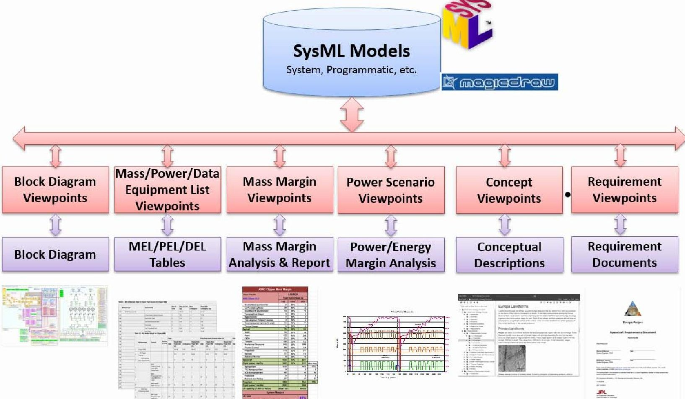

<!-- PDF_PAGE: 1 -->

# Is MBSE Helping? Measuring Value on Europa Clipper

Todd Bayer

Jet Propulsion Laboratory,

California Institute of Technology

4800 Oak Grove Dr.

Pasadena, CA 91109

818-354-5810

Todd.J.Bayer@jpl.nasa.gov

Abstract JPL's Integrated Model Centric Engineering Initiative (IMCE) has led the infusion of MBSE at JPL. In 2009 I authored for IMCE a set of challenges that confronted systems engineering at JPL, based on examination of issues and lessons from several recent projects (the "Five System Engineering Challenges"). In 2012 I augmented this work to describe specific areas where it appeared MBSE could help address these challenges. Around the same time, the Europa Clipper Mission became the first project at JPL to attempt, in close collaboration with IMCE, a widespread adoption of MBSE. This adoption has been highly successful so far. Europa Clipper completed Phase A (Formulation) with a successful System Requirements Review Mission Definition Review, and is nearing the end of Phase B, with a successful Flight System Preliminary Design Review in October 2017. This is an opportune time to take stock of the progress and the work yet to go. This paper proposes a practical method for measuring value added through use of MBSE, applies this method to the Europa Clipper Project, and suggests how it might be applied to other projects and organizations.

## TABLE OF CONTENTS

1. INTRODUCTION...1

2. DEFINING THE PROBLEM...2

3. MBSE ON EUROPA CLIPPER ...2

THEME 1: UNMANAGED MISSION COMPLEXITY...3

THEME 2: BOTTOMS-UP DRIVEN SYSTEM DESIGN..4

THEME 3: DISCONTINUITIES ALONG PROJECT

LIFECYCLE...8

THEME 4: INADEQUATE SYSTEM DESIGN REUSE...9

THEME 5: INADEQUATE TECHNICAL AND

PROGRAMMATIC COUPLING ...10

4. RECAP: THE FIVE SYSTEMS ENGINEERING

CHALLENGES...10

5. EUROPA CLIPPER SCORECARD ...10

6. SUMMARY AND FUTURE WORK ...12

ACKNOWLEDGEMENTS ...12

REFERENCES...13

BIOGRAPHY...13

## 1. INTRODUCTION

Since 2009, JPL's Integrated Model Centric Engineering Initiative (IMCE) has led the infusion of MBSE at JPL. In May 2009 IMCE held its first workshop at JPL, to develop an approach. A key insight achieved at this workshop was that the team was not yet clear about what problems MBSE was

intended to address. Therefore, one action from this workshop was to define the problem. I initiated a study of lessons learned and other retrospectives of recent missions at JPL. In October of that year, I published the results internally as a white paper entitled "Articulating the Need". The issues encountered from recent flight projects grouped naturally into five themes, which I dubbed the Five System Engineering Challenges. This distillation was later adapted for inclusion in the INCOSE Vision 2025 [1]. In April 2012, I updated the white paper, to add a description of where MBSE could help address the SE Challenges. This provided a "to-be" state description to complement the original "as-is" description.

The workshop also resulted in another task, to develop a Concept of Operations, i.e., what model-centric engineering would look like in day-to-day activities. I led this team and we published the work in 2010 [2,3].

Also in 2010, the planned Europa Mission became the first project at JPL to attempt, in close collaboration with IMCE, a widespread adoption of MBSE. This was enabled by the strong support of the engineering leadership team, including the Project System Engineer, Mission Architect, and myself as Flight System Engineer. My twin roles -- support to IMCE and Flight System Engineer for the Europa mission studies -- enabled me to lead the initial infusion of MBSE on Europa. In June 2011 we delivered our first modeling results on Europa Mission: the system block diagram and master equipment list with the mass rollup [4, 5, 6, 7]. In September 2014 the team completed a highly successful Europa Clipper Mission Concept Review, and received approval from NASA to begin Phase A. After several more years of development, in January 2017, the team completed a similarly successful System Requirements Review/Mission Definition Review, and started Phase B. Presently, the team has just completed a successful Flight System Preliminary Design Review, and is conducting PDRs for all subsystems and science instruments, leading up to a planned Project PDR in August 2018.

This is a good time to ask the question of how much MBSE has helped to address the systems engineering challenges articulated in the original white paper. To do so, a method is proposed for measuring the added value from the use of MBSE. This method is then applied to assess MBSE on the Europa Clipper Project through the current time (Phase B), and an approach is suggested for how this technique could be applied to other projects and other organizations.

<!-- PDF_PAGE: 2 -->

This paper is organized in the following way: the next section describes the process of arriving at the 5 SE Challenges. Next is a brief summary of the MBSE application to Europa Clipper. Following that is a detailed discussion of each of the five challenges, including the envisioned 'to-be' state with MBSE, and an assessment of the current state on Europa Clipper. Finally, the scorecard is introduced, distilling the detailed analysis into a more easily reviewed tabular form.

## 2. DEFINING THE PROBLEM

"IMCE is meant to address which problems?" was a question asked at the Integrated Model-Centric Engineering (IMCE) Workshop #1 in May 2009. I took multiple parallel approaches to answering the question. Specifically, I looked from several different vantage points at the current way JPL develops flight projects, and identified processes that are broken or functioning sub-optimally. I then identified patterns and common themes, and attempted to express them here. This overall approach is guided by a key assumption that the "JPL Way" of developing flight missions - as expressed by the Flight Project Lifecycle, the Gate Product matrix, Design Principles and Flight Project Practices (JPL-internal command media) - is a mature and successful roadmap. That is, the problems IMCE aims to address are in the ability of flight projects to execute this roadmap, not in the roadmap itself.

Below is a short description of the different viewpoints used.

Process View. Studying the JPL Flight Project Lifecycle Gate Product matrix (which is derived from NASA NPR 7120.5D), I looked for areas where projects' design artifacts currently lack good continuity on the time axis (across phase boundaries) and on the gate product axis (between artifacts at a point in time). This also provided a good start to help identify common themes and patterns in the information gleaned from the other viewpoints.

Task-Based View. In the course of developing a project, there are a myriad of tasks that engineers must perform on a day-to-day basis. This view focused on those daily tasks that are currently difficult or inefficient and that could be improved. I collected an initial list of these items from practicing flight project engineers.

In addition, in recognition that this is not the first examination of challenges in the current development processes, I also studied recent work by others at JPL to help inform and validate the results.

These inputs were then organized and synthesized into broad themes. Under each theme are listed several current issues, with references noted and examples provided where available (the "as-is" state). Following each specific issue in a theme is a brief description of how the issue could be mitigated in more model-centric environment (the "to-be" state). Then, an assessment of the current state of Europa Clipper is provided. The scorecard later in this paper summarizes this assessment in a tabular form.

This work (Defining the Problem) is part of the "Business Case: Needs, Goals and Objectives" section of the IMCE Architecture Description, (which describes the architecture of the overall process, methods, and tools for performing MBSE at JPL.) It is intended that the architecture and eventually the implementations that are developed demonstrate how these issues are addressed. It is further intended that the IMCE Operations Concept (another part of the overall IMCE Architecture) include use cases that explicitly address the main themes here, and that the IMCE Architecture and Design describes a system that mitigates these issues.

## 3. MBSE ON EUROPA CLIPPER

## The Europa Clipper mission is described in [8,9].

The application of MBSE to Europa Clipper has proceeded along two main thrusts (see Fig 1): first, the capture of a flight system conceptual design for the purpose of sizing key technical resources such as mass, power, energy, and data return; and later the development of a complete and well-supported set of project, mission, flight system and ground system requirements. The main principle is to use a single trusted source for key data. We use SysML as implemented by the current institutionally deployed tool, MagicDraw, as the main medium for developing and capturing the information. We use this central repository to produce a large and growing set of products. We started on the left of the below diagram and built more capability as we moved to the right.

A viewpoint is essentially a template for a kind of product (view). This makes views reusable, in the sense that one script produces the same table of date from the model for each mission variant and version. Power, energy and data follow the same pattern as mass.

The concept and requirements viewpoints were added to support development and capture of the overall architecture of the Clipper mission and spacecraft, within a framework of architecture description that was adapted from current architecture framework standards. The full implementation of the architecture framework is not yet finished, but the parts that are complete have been implemented as the "Concept and Requirements" viewpoints.

More details on the application of MBSE to Europa Clipper are provided in [4, 5, 6, 7].

The next five sections describe the system engineering challenges that MBSE is intended to help address, the envisioned improvements, and the Europa Clipper current state.

<!-- PDF_PAGE: 3 -->

## Europa System Model Framework

Figure 1: Europa System Model Framework

## THEME 1: UNMANAGED MISSION COMPLEXITY

Complexity of our missions is growing faster than our ability to manage it, resulting in inadequately-specified and incompletely-verified system level interactions, which are a major and growing risk factor for our missions.

At a high level, the core challenge is to better manage growing system complexity. As the character of JPL's missions progresses from fly-by to orbital study to in situ exploration, the systems that must accomplish these missions grow in complexity. This progression is enabled by better mission design capability, bolder science vision, more sophisticated instruments, and the long term trend of increasing processing power of spaceborne computers (even though this trend lags that of commercial capability), which allows more and more of the functionality of these systems to be implemented in software. Single viewpoint, natural language specifications are inadequate to capture and expose these system level interactions and characteristics (emergent system behaviors). At the same time, the potential range of behaviors has become so large that it is impractical to fully verify the system through test. The result of this situation is that inadequately-specified and incompletely-tested system level interactions are a major and growing risk factor for our missions.

In-flight problems often result from these issues. These problems range in severity from lowered science return all the way to catastrophic mission failures. In the most benign cases, unresolved development issues are left to mission operations

to work around, increasing cost and often degrading the science return [12]. In more serious cases, significant anomalies occur, some of which are mission-threatening. Escapes in management of complexity have played a clear role in several significant anomalies during the Mars Reconnaissance Orbiter (MRO) mission, as described in [10] and [11].

Following are specific issues that fall into this theme; their improved state with MBSE as envisioned in the 2012 study; and the actual state on Europa Clipper at this time:

a) Issue: System behavior is often an emergent property discovered during system test.

2012 "To be" state: Enhanced understanding of system behavior and reasoning about engineering completeness allows system behavior to be more intentionally designed from the beginning, and to be better validated during the design phase.

2017 Europa Clipper actual state: Early Functional Design Descriptions (FDD's) with rigorous behavior diagrams have facilitated discovery of missing functions and requirements as well as objective reasoning about specification completeness. Scenario modeling integrated with modes, geometry, power usage and data production enable more detailed and analyzable mission descriptions.

<!-- PDF_PAGE: 4 -->

b) Issue: Design errors are introduced through miscommunication and go undetected until system test or even operations

2012 "To be" state: Improved communication and reduced confusion using 'Single Source Of Truth' (SSOT) information reduces design errors.

2017 Europa Clipper actual state: System Model has improved communications among members of the flight project resulting in saved time, reduction in errors, and reduction in drudge work.

c) Issue: System-level properties are generated infrequently in the design phase and at significant cost.

2012 "To be": Automatically generated human interpretable documentation provides frequent and authoritative snapshots of system properties.

2017 Europa Clipper actual state: Machine generated documentation provides monthly snapshots from the System Model releases (MEL, PEL, block diagrams, system margins, etc.), which are applied consistently across Concept Descriptions, Requirements Documents, and Functional Description Documents

d) Issue: Design description comes together only infrequently, when preparing for major reviews.

2012 "To be" state: Design reviews consist largely of model inspection and validation.

2017 Europa Clipper actual state: Design description is integrated and analyzed on a monthly basis. Informal working level reviews often use the model directly (MEL, PEL, block diagrams, modes, scenarios requirements, concepts, FDDs). Also, although all three major gate reviews so far (MCR, SRR/MDR, FS PDR) were still hand-crafted powerpoint slide decks that tell a story, there were fundamental differences in the preparation: much more content came directly from the system model, and there were no major surprises in any of the review preparation phases.

e) Issue: Full verification is seldom practical, since it entails testing of the full set of possible behaviors.

2012 "To be" state: System test activities focus on model validation and correlation.

2017 Europa Clipper actual state: EC has not yet entered the system test phase, so there is not yet any data to support a conclusion. This will be measured in Phase D. However, there has been significant early design verification and validation through analysis, informed by the System Model.

f) Issue: Mission Operations teams must work around unresolved development issues, and significant in-flight anomalies can occur; some of which can be mission-threatening.

2012 "To be" state: Fewer surprises and workarounds occur in operations.

2017 Europa Clipper actual state: EC has not yet entered the flight operations phase, so there is not yet any data to support a conclusion. This will be measured in Phase D/E

## THEME 2: BOTTOMS-UP DRIVEN SYSTEM DESIGN

a) Issue: Architectural principles are seldom articulated or used to drive the design. The need for, and the role of, the architect has not yet become a strong part of our engineering processes. Lack of robust architecting allows poorly understood or flawed requirements and assumptions to persist, resulting in weakened designs. Without strong architectural principles, the quality of the architecture is disproportionately driven by the traditional design process of functional decomposition. But this process alone does not naturally produce a wellarchitected system, nor does the whole spontaneously reemerge from the parts. (A more complete process of functional decomposition, recognizing multiple simultaneous decompositions, can provide the foundation for good architecture). Some of the problem areas arising from weak architecture are: unmanageable interactions, stove-piped analyses, and brittle fault protection, as described below.

Without strong architectural support for system level considerations, the management of ad hoc point-to-point relationships (interactions, interfaces) can become overwhelming. Simplification for the purpose of analysis does reduce complexity but may overlook interactions. Extensive decomposing of problems into more "tractable" models can result in conflicting conclusions from sub-models. A common example is the separation of fault handling from nominal functionality.

Robust design must include fault protection that is woven into the fabric of a design. Such a design preserves system functionality over a broad range of conditions including faults, but not just faults. Some projects make the mistake of too-firmly separating fault protection from nominal functionality, to the detriment of both. Such systems tend to be brittle, difficult to operate, and less reliable.

Part of the issue is a training and experience issue - we need to grow a cadre of experienced and disciplineknowledgeable system architects. But another part of this issue is the lack of good ways to model our systems at an architectural level.

2012 "To be" state: A model-centric environment would give us a way to talk about our systems architecturally. Modeling languages such as SysML are well-suited to expressing architectural concepts and principles. The process of creating the models itself encourage thinking at this level and enhance communication internal and external to the project. Once the system model is captured

<!-- PDF_PAGE: 5 -->

in this way, other benefits also accrue: the design is unified, persistent, safely modifiable, and re-usable. It is also easy at this point to produce presentation materials directly from the model. As reviewers become more comfortable with modeling notation, design reviews consist more and more of model inspection and validation.

The model-based approach provides a better way to talk about our systems at an architectural level and facilitates a better architecting job: better separation of concerns; less unnecessary coupling; more coherence of function.

2017 Europa Clipper actual state: The architecture/requirements model are implemented in a mix of SysML and other tools. Benefits seen include: explicit articulation and separation of concerns; thorough, linked, living rationale for requirements; the ability explicitly to reconcile multiple constraints into a single requirement; the ability explicitly to include analyses in the requirements flow-down; the ability explicitly to associate requirements with system elements, and consequently with responsible teams.

b) Issue: System designs are spread across many disconnected artifacts (documents, presentations, spreadsheets). It's not always clear what the approved baseline is. A design change can take months to propagate fully into the baseline design, and the process requires many meetings, word-of-mouth interactions, and emails, in which the design rationale often becomes lost or untraceable.

2012 "To be" state: Design discussions between subsystems and with systems use common, authoritative representations. A proposed design change is expressed in terms of the system model, and during consideration it sits in an "approval pending" branch of the model CM tree, similar to software. Once approved, it is incorporated into the "baseline" branch of the CM tree, and everyone using the model has immediate access to it. (This is not to minimize the considerable CM issues that must be worked out, but we can look to the success of software CM tools and techniques as an indicator that these issues are surmountable.)

In its mature stages, projects have access to integrated behavioral, physical, cost and risk models, allowing for an integrated fully-informed approach to system optimization.

2017 Europa Clipper actual state: The design capture model provides a true single source of truth (SSOT) for a growing set of characteristics, including mass, power composition, suppliers, interfaces, and requirements. Not all data is integrated into the system model, but nevertheless, the model has enabled engineers to work and think at a higher level. For example, the engineer who would traditionally hold the job of keeper of the Master Equipment List in Excel was instead able to do the more creative and challenging job of integrating

power/energy analysis into a first ever, high fidelity end-to-end mission simulation in Phase A.

c) Issue: Physics-based models are not connected to each other or to a system model.

Physics-based models in the various engineering specialties are generally not connected to each other, and definitely not connected to a central system model (since none typically exists at present). There are some multi-physics models (e.g., integrations of thermal, mechanical, optical models) coming on the scene, but they are still the exception. Each of these separate models is configuration managed independently of the others. Trade studies and system analyses require manual integration of results among all these domains. The inefficiencies make trades and other analyses take longer than necessary, and make examination of more than a few discrete conceptual designs impractical. This 'stovepiping' of analyses can also hide significant system level interactions that may only be 'discovered' during system test or, worse, after launch. Example: trajectory, telecom, power, attitude, thermal, observation scenarios must be integrated manually, usually via Excel or paper.

2012 "To be" state: Integration of physics-based models with each other and with the system model provide enormous leverage for trade studies, science merit, and early verification and validation. Projects can fully explore the design space, rather than be limited to a few design points, allowing them to understand the 'landscape' around the chosen design, including key inflection points. Science merit is determinable very early and the architecture more strongly reflects the science goals, because projects understand which architectural elements have the most influence on science merit. Integrated models and configuration-controlled models and model executions provide a strong tool for early design validation: requirements completeness, responsiveness of design to requirements, operability of the system, etc., are much easier to determine than current capabilities. Furthermore, once model integration matures and execution is supported, much of the actual system verification is done using the model itself.

2017 Europa Clipper actual state: Integration of the high fidelity power model (normally not used until flight operations), sequence planner, and system model enabled high fidelity, end-to-end mission energy modeling in Phase A. The System Model provides stable, repeatable inputs for driving these analyses, reducing errors, increasing confidence, and dramatically decreasing cycle time (days versus weeks). Another benefit, somewhat unexpected, was better validation of the System Model due to wide availability and use: by exposing the details of the model and the analysis for all to see, the multiple sets of eyes repeatedly looking at the model ended up catching and fixing many disconnects.

d) Issue: V&V considerations are not adequately considered during requirements development.

<!-- PDF_PAGE: 6 -->

Unexpected cost and schedule growth during final system integration and test are often a result of underestimated V&V complexity combined with late resource availability and staffing.

The verification and validation approach is not always thought about and/or understood at the time requirements are created. This can result in some aspects of the design being untestable, and this increases mission risk. At the time requirements are defined, the V&V approach should be included with the requirement.

Example: Spacecraft FPGA test software. One project has experienced costly design and development delays with its integrated (hardware + software) avionics. Software for testing the avionics developmental FPGAs was a late scope addition. One example derives from the nature of the hardware, which makes extensive use of embedded FPGAs, requiring the generation of non-flight test software for verification. The latter was not recognized during the early design phase and later became a new task that the flight software team was brought in to develop. In addition, proper testing of the electronics hardware requires the development of use cases (i.e. the manner in which the software will use the hardware) and their application in the hardware test program. This task was not identified in the early project plans.

2012 "To be" state: V&V is begun earlier by use of the system model and the early simulations and analyses it enables. Continuous integration within a model-based approach surfaces operational issues earlier. Moreover, as above in 1e), once model integration matures and execution is supported, much of the actual verification as well is done using the model. Then system testing is more and more focused on demonstrating the correspondence of the as-built system to the system model (much as thermal vacuum testing is today). In other words, system test activities are able to focus on model validation and correlation, rather than on exhaustive testing of the actual flight system.

2017 Europa Clipper actual state: Some initial progress is evidenced, but only a start: Requirements, components, functions are explicitly associated. In Phase B, V&V approaches are being developed and integrated into system model, and linking of test plans and procedures is planned. It will become clearer in Phase C/D how much improvement the use of the system model is providing.

e) Issue: Science requirements are not well coupled to flight and ground system requirements; precise and objective science merit of a given point solution is not known until late in development.

Science requirements are not well coupled to flight and ground system requirements, causing the actual 'goodness' of a given engineering solution, in terms of the science return it provides, to be unknown until it's too late to change the design. The inadequate quantitative

understanding of how changes in engineering parameters affect the science objectives (the so-called Science Merit Function) can result in lost opportunities to make risk/cost/schedule saving trades, and can even result in a system that does not satisfy the science objectives.

Example: One project was launched with known operability issues to be worked around in flight. This was due in part to a lack of capability during development to quantitatively relate science objectives (a Science Merit Function) to the engineering implementation. Because of this, the needed operability requirements were not precisely known, and there were insufficient resources to design for all possible operations approaches.

Example (Positive): Another recent project did develop a Science Merit Function, and this provided powerful leverage when the project was forced to evaluate hundreds of descope options in order to save the project from cancellation.

2012 "To be" state: Architecture trades in formulation are informed by quantitative, risk-based, comparisons of science return, resulting in a demonstrably optimal design within a well-understood design space.

2017 Europa Clipper actual state: Science coverage of proposed Jovian tours is quantitatively assessed, with trajectory and observation plans linked explicitly to science requirements. [15]

f) Issue: Desired system behaviors are poorly articulated by the current textual representations. Using these textual representations, system engineers are not able to communicate as effectively as they could with software engineers about the desired system behaviors. This results in systems whose behavior must be 'discovered' often in flight.

Example: One project experienced unexpected computer swaps due to unanticipated power system dynamics at high spacecraft rotation rates.

Example: Another project experienced an unexpected safing event due to a broken aerobraking ephemeris "daisy chain." Complex interactions between flight software logic, ground commanded sequences, and onboard autonomous sequences that adjust parameters like timing, were difficult to understand and manage. This is a classic example of stumbling when trying to interlace increased autonomy with complex ground commanding. An executable, state transition, model of the integrated behavior would have allowed discovery of the fault case. [10]

Example: The same project experienced a fault whereby the autonomous solar array sun tracking function allowed the solar array to be driven into the spacecraft body. This is another example of complex parameterized software behavior that was not fully understood. Requirements at the flight system level were inadequate to describe the

<!-- PDF_PAGE: 7 -->

intended behavior, and partly as a result of this, the system engineers did not understand the system that was ultimately built. A simple graphical depiction of the full functionality of the appendage control algorithm would have prevented the misunderstandings that led to the anomaly. [11]

2012 "To be" state: System Behavior is specified rather than discovered, and faulted and nominal behavior are seamlessly considered and designed together. Behavioral models are created by the systems and software teams working together. The required behavior, much more richly expressed by SysML activity and state machine diagrams, is directly assignable to functions and components, and the software design fully and directly implements the behavior. State machine models are formally analyzed and executed to allow logic flaws to be discovered well before any code is written. Dialog between software developers implementing the behaviors and systems engineers prescribing the behaviors is enhanced via formal representations. Proposed design changes are expressed, analyzed, and considered by change boards in the system model directly. Kludges are less necessary and their impact more fully understood, allowing missions to arrive at the launch pad with more of their architecture intact, reducing operations cost and risk. Software is more amenable to formal verification methods.

2017 Europa Clipper actual state: A start has been made. Functional Design Description documents contain explicit behavior diagrams using SysML notation. Power and data simulations use spacecraft behavior (and conceptual design) information definitions from the System Model. In Phase B some of these behaviors are being made executable/auto-codable using SysML (autocoding is the automated generation of actual software code from structured high-level behavior specifications). System model impacts are reported at the Change Board, but more manual effort is required than would be if the model branch/merge capability were fully operational. The System Model has provided more stable and reliable estimates of key technical margins, resulting in fewer tiger team efforts to reduce mass, power, etc. This is expected to result in less future regret from hasty decisions based on poor information. Additional benefits should be evaluated in Phase C/D.

g) Issue: Architectural principles, where they exist at all, are sometimes abandoned to solve pressing technical problems. This is a problem because these "kludges" often make the system more brittle and difficult to operate, increasing costs as well as mission risk. Without stated architectural principles, it is easier to abandon them when the going gets tough. Even when they are stated, as some are in the JPL Design Principles, they may still be abandoned. Only when they are thoroughly and clearly embodied in a design, via the architecture, are they persistent enough to be of value.

Example: A project experienced a potentially dangerous anomaly during a cruise calibration of a science instrument, leaving the instrument in an indeterminate state and exposed it to the risk of damage through solar exposure. This anomaly was partly caused by abandoning the principle that system states should be explicitly commandable and visible. This principle was abandoned during integration and test in order to resolve electromagnetic compatibility problems, with the creation of an invisible toggled state of the instrumentspacecraft interface (called "loopback"). This 'kludge' came back to bite the operations team later and could potentially have resulted in the loss of the instrument. [10]

2012 "To be" state: Architectural principles are explicit and enforceable in the design as expressed in the System Model. The also makes it easier to determine the impact of not following the principle. That is to say, in those situations where a kludge may appear necessary in order to get the system launched, a system model enables a more informed decision, and helps prevent the change from causing problems downstream.

2017 Europa Clipper actual state: A start. One characteristic of a strong architecture is that requirements are explicitly linked with system components. This is the first step to enabling performance assessment against requirements. In Phase B more behaviors will be captured in the model and made executable/ auto-codable.

h) Issue: Analogous to the scattering of design artifacts, aspects of the design itself (e.g., functions) are often scattered. Weakly architected systems often result in a situation where many disparate pieces of the design contribute to carrying out a given function with little high-level coordination. The control parameters for these functions are similarly scattered throughout the system, and are therefore more difficult to understand, let alone manage. This problem is exacerbated by the sheer numbers of control parameters (on recent projects these have numbered well over 20,000).

Example: On one project, the parameters controlling the communication between the spacecraft and an instrument were fragmented between the spacecraft and the instrument, contributing to an in-flight anomaly that could have damaged the instrument. A model of the behavior across this interface could have facilitated understanding and avoided the anomaly. [10]

Example: On the same project the parameters controlling the function of a UHF Relay Session (with a lander on the surface) were fragmented among the spacecraft software, the radio internal software, and command sequences, increasing operations complexity of managing the UHF links and possibly contributing to UHF Relay anomalies during support of the lander. [11]

<!-- PDF_PAGE: 8 -->

2012 "To be" state: A more strongly architected system, enabled by the tools and techniques of model-centric engineering, mitigates this by allowing identification of these issues, minimize them from the beginning, and allow the rest to be controlled operationally (because they're now visible in the design, it is possible to safely manage them as a group).

2017 Europa Clipper actual state: Benefits accruing in this area will not be apparent until Phase C/D.

## THEME 3: DISCONTINUITIES ALONG PROJECT LIFECYCLE

a) Issue: Formulation models are abandoned when Implementation starts. Models used during the formulation phase of a project are abandoned and new ones created when implementation phase begins.

Examples: Concept Formulation Models: models used by JPL's TeamX are not used beyond their life in TeamX, even though they are the primary artifacts embodying assumptions, rationale, and system knowledge. Cost Models: inputs to parametric cost models (i.e., spacecraft design concept) are recreated between formulation and implementation, with little understanding of what changed or why. Lack of continuity directly impedes learning how to do better early cost estimates. Excel versions of models used in formulation, such as power and telecom, are replaced by high fidelity subsystem analysis tools between development and operations. Transfer of system knowledge between models is highly manual and error prone.

2012 "To be" state: Models and modeling tools are integrated across mission life-cycle phases, so that system models evolve and mature as they pass from formulation through implementation and then operations. TeamX draws from the same models as the implementation team: libraries of models developed and maintained by the doing organizations. Note that this also requires models to be integrated vertically, across different levels of abstraction. For example, the model of a reaction wheel included in a proposal is nearly identical to the model used in implementation - and from the same authoritative source, with more detail added as the implementation matures

2017 Europa Clipper actual state: Significant benefits have been realized. The System Model has been used and evolved from Pre-Phase A through Phase A and into Phase B. Identical automated analyses have been applied to all configurations and versions, providing a continuous and living history of the maturation of the Clipper design.

b) Issue: Configuration Management (CM) of the system design, as expressed in the current modeling capability, is lacking, impeding continued use in the next phase (or re-use on the next project).

2012 "To be" state: Configuration management of the

integrated system-level design is rigorous, for the first time. Inherent to the nature of an integrated system model is the notion of configuration management. Much like software CM today, system models are as tightly configuration managed as the project's policy requires. Branches from the baseline model are possible, to support trade studies, analysis of proposed changes, failure scenarios, etc. When the doing organizations stand up libraries of models within their domain, a configuration-managed repository of reusable model elements becomes available.

2017 Europa Clipper actual state: For the first time, a formulation team successfully configuration managed the mission concept from Pre-Phase A through Phase A and into Phase B. Enabled by the combination of this and an iterative approach during formulation (explicit 3-6 month design iterations within the 1-2 year formulation phases), the team has matured the mission concept with an unprecedented level of control. The preparation for major gate reviews is no longer the only time the baseline comes together. There have been no major surprises discovered during preparation for any of the three major gate reviews so far.

c) Issue: Essential attributes of design are not captured consistently in readily accessible manner. Architectural principles, trade study assumptions and rationale, and system design, rationale, and narrative are only partially captured at best and are seldom readily accessible, and therefore difficult or impossible to carry across lifecycle phase boundaries.

Example: Fault trees are currently done predominately in Excel, limiting the possibility of integrating with other design information or other analyses.

2012 "To be" state: Rich capture of design information is enabled: structure, behavior, requirements, and parametrics are connected in a unified model. Implementing fault trees in a more expressive language such as SysML allows greater insight and even machine reasoning when the mitigations are directly associated with potential faults. The fault tree are also integrated with the Fault Modes, Effects and Criticality Analysis (FMECA), and directly drive development of test cases.

2017 Europa Clipper actual state: A start. Structure behavior, requirements, delivery responsibility are linked. More linkage is possible. Planned capabilities include automated fault tree generation and fault containment region specification.

d) Issue: Training of engineers joining a project takes longer than necessary. Moving from pre-phase A to Phase A, and then to Phases B, C and D, significant team expansion and turnover occur. Training people who were not around for previous phases is currently heavily dependent on getting key documents from, and having lengthy conversations with, key people. Because the system design is poorly captured, this essentially ensures

<!-- PDF_PAGE: 9 -->

that new team members will be discovering attributes of the design for years to come.

Example: The misunderstanding regarding appendage keep out zone algorithm performance persisted partly because of inadequate knowledge transfer during turnover of key personnel. [10]

2012 "To be" state: The system model captures much more of the design in one place than is conventionally possible. Structure, behavior, requirements and parametrics are connected in a unified model. This doesn't guarantee that more helpful training materials automatically emerge, but it provides the container that, with proper discipline, captures and preserves a much richer set of knowledge than is presently possible. Model repositories enable quicker, more effective and less expensive training. They also enable ongoing independent study and exploration.

## THEME 4: INADEQUATE SYSTEM DESIGN REUSE

2017 Europa Clipper actual state: The System Model with views served through web pages has vastly improved access to information for new team members. The rich system model allows independent self-study and exploration. Key personnel can focus on more specific and critical knowledge transfer and mentoring. Many sets of eyes on the system model have helped discover errors early.

a) Issue: Because system architectures and designs are not well-captured, re-using them on subsequent projects is difficult and seldom happens (except where the project team itself is 'inherited' by the next project). There is currently no formal way to document and integrate the broad experience and knowledge of engineers across a project, to train new systems engineers who will need to absorb this broad knowledge quickly and deeply, and to make this available as a legacy to future projects in a manner that is easily dissected and reapplied to new circumstances. The current institutional guidance, while providing important and useful heuristics and lessons learned, is not sufficient to enable architecture re-use.

Too much of system development "way of doing business" is based on custom [tools (some), models (more) and processes (much more)]. Projects take some pride in this. Necessary custom thinking about "problem critical axes" is unnecessarily coupled with the development and use of custom tools, model types and processes. There is much independent usage/discovery of the same critical trade parameters.

2012 "To be" state: Architecture and detailed designs are captured in a formalized and repeatable system model. Once the architecture is captured, it is reused.

2017 Europa Clipper actual state: Within Clipper, use of the conceptual design system model enabled 5 major

architectural variants to be analyzed in parallel in Pre Phase A; and enabled 3 full mission studies in the time it usually takes for 1 or 2. Between projects: some capabilities have been adapted for use in other projects with little additional effort (Clipper NRE is paying off) such as Mars 2020. But mission architectures have not yet been shared between projects: this is TBD in subsequent projects.

b) Issue: Too much of the system development "way of doing business" is custom-built on each project: tools, models and processes.

2012 "To be" state: Increased reuse: systems engineering line organizations join subsystem line organizations in curating libraries of configuration managed and reusable models, tools and processes.

2017 Europa Clipper actual state: The systems engineering line organization has adopted and standardized mass and power models and tooling. The Line and the Clipper project are collaborating on additional standardized models such as behavior, electrical interfaces, fault containment region definition, etc. There has also been an informal sharing of practices between Europa Clipper and other projects, including Mars 2020 and Asteroid Redirect Robotic Mission (ARRM) [13] [14]. More to come in Phase B and C.

c) Issue: Heritage reviews narrowly focus on full re-use of components.

2012 "To be" state: Well-architected systems have less tightly coupled parts, enabling more reuse. Heritage of components and their risk are objectively assessed for applicability in the system and operational contexts.

2017 Europa Clipper actual state: TBD in subsequent projects.

d) Issue: The current institutional guidance such as Design Principles, while providing important and useful heuristics and lessons learned, is not sufficient to enable architecture re-use. Rule of thumb design margins can overly constrain design options and drive cost.

2012 "To be" state: Good architecture capture enables sharing and reuse of architecture and design principles between projects. Greater rigor in probabilistic-based analysis of design sensitivities leads to improved strategies for managing system robustness within programmatic constraints.

2017 Europa Clipper actual state: A rigorous Probabilistic Reliability Assessment capability is coming on line in late Phase B. Building on the work reported in [16], this explicitly links mission and science requirements with actual mission plans, system designs and behaviors, fault modes and effects, and reliability data.

<!-- PDF_PAGE: 10 -->

## THEME 5: INADEQUATE TECHNICAL AND PROGRAMMATIC COUPLING

a) Issue: The project implications (cost, schedule, scope, investment, risk) of a given set of requirements, science objectives, components or functions is very difficult to determine. Schedule and cost models rarely include mitigations/backup options for technical implementation risks. It is difficult to transfer information between tools and different discipline types. Costing models have been generally parametric and de-coupled from details of the formulation maturation process, but this is being improved.

The nature of the job and the products are not easily scoped to the nature, risk posture and/or funding of the mission.

Example: On one project, the required development (both in terms of complexity and new technology required) was not adequately understood during the formulation phases of the project, resulting in a major under-estimation of the development cost. The process by which the initial cost target was set and subsequent updates to those cost targets communicated to NASA HQ were therefore also flawed and not generally based on the required scope of the effort.

Example: On the same project, the process for establishing negotiated baseline cost estimates produced unrealistic and unachievable estimates.

2012 "To be" state: Behavioral, physical, cost and risk models are integrated allowing for a fully-informed approach to system optimization. Teams run many design options through our best cost models, achieving trade studies that include quantitative cost comparisons. Once the system is properly modeled, it is connected to the best available external cost, risk, and other models. The production of credible cost estimates reflecting the actual design is feasible. Trades, especially for example Flight-Ground trades, explicitly compare pre- and post-launch costs and risks, allowing us at the very least to understand the true impacts of de-scoping operability or deferring development until post-launch.

2017 Europa Clipper actual state: A start: The System Model was used as input to Phase A cost models for multiple architecture variants, allowing more reliable and comparable cost model results. Much more can be done here; some will be done in Phase B, and others will be TBD until future projects have built on the initial progress of Clipper.

b) Issue: Trade studies seldom fully incorporate programmatic considerations. There is an unfilled need to be sure that systems engineers are knowledgeable about the programmatic realities of a project and the impact of engineering decisions on programmatics. The existing tools do not support such an integrated view.

2012 "To be" state: Risk and cost/schedule resource implications of trade study options are quantified and better understood with quantitative analysis of the sensitivity of design factors informing the project's ability to achieve the mission objectives.

2017 Europa Clipper actual state: A start. Simulation of science data return with radiation-induced upsets allows exploration of the impact on actual science return from different spacecraft robustness options. [16] The System Model enables better trade choices: identical automated analyses are applied to all configurations and versions, providing more consistent, controllable generation of system metrics and normalization of risk assessment. Much more can be done here and on subsequent projects.

## 4. RECAP: THE FIVE SYSTEMS ENGINEERING CHALLENGES

1. Mission complexity is growing faster than our ability to manage it, increasing mission risk from inadequate specification and incomplete verification.

2. System design emerges from the pieces, not from an architecture, resulting in systems that are brittle, difficult to test, and complex and expensive to operate.

3. Knowledge and investment are lost at project lifecycle phase boundaries, increasing development cost and risk of late discovery of design problems.

4. Knowledge and investment are lost between projects, increasing cost and risk, and damping the potential for true product lines.

5. Technical and programmatic sides of projects are poorly coupled, hampering effective project decision-making and increasing development risk.

## 5. EUROPA CLIPPER SCORECARD

The "scorecard" provides a tabular summary assessment of progress against the specific issues identified, and a comparison with the envisioned end state. It is organized into five tables: one for each of the SE Challenges.

Each table is similarly structured. Column 1 describes specific issues that are associated with the challenge. Column 2 describes the detailed expected mitigations in a "to be" state after MBSE infusion is complete. Column 3 describes the characteristics of the Europa Clipper project that address the challenge. This column is color coded in stoplight fashion. Green means there has been significant and noticeable progress; yellow means there is some initial progress but still much to do; Blank (white) means there has been no progress yet, usually because the "to be" state refers to mission phases or projects that have not yet happened.

This first application of the scorecard uses the progress on Europa Clipper. It is also intended to be useful for assessing other projects, and eventually the institution and engineering state of practice at JPL.

<!-- PDF_PAGE: 11 -->

## Challenge 1: Growing Risk from Unmanaged Complexity

<table border="1"><tr><td>Specific Issues</td><td>Envisioned Mitigations 2012</td><td>Europa Clipper Actual 2016</td></tr><tr><td>System behavior is often an emergent property discovered during system test</td><td>Enhanced understanding of system behavior and reasoning about engineering completeness</td><td>Early FDDs with rigorous behavior diagrams allowed discovery of missing functions and requirements</td></tr><tr><td>Design errors are introduced through miscommunication and go undetected until system test or even operations</td><td>Improved communication and reduced confusion using‘Single Source Of Truth’(SSOT) information</td><td>System Model has saved time, prevented errors, minimized drudge work</td></tr><tr><td>System properties are generated infrequently and at significant cost</td><td>Automatically generated human-interpretable documentation provides frequent and authoritative snapshots of system properties</td><td>Machine generated documentation provides monthly snapshots:
- System Model releases(MEL, PEL, block diagrams, system margins, etc)
- Concept Descriptions
- Requirements Documents
- Functional Description Documents</td></tr><tr><td>Design description comes together only infrequently, when preparing for major reviews</td><td>Design reviews consist largely of model inspection and validation</td><td>- Informal working level reviews often use model directly(MEL, PEL, '-Block Diagrams, Modes, Scenarios, Requirements, Concepts, FDDs)
- MCR,and SRR/MDR were still hand-crafted powerpoint slide decks that tell a story BUT
- more content came directly from system model,and
- there were no major surprises in the review prep</td></tr><tr><td>System test must cover full set of possible behaviors</td><td>System test activities focus on model validation and correlation</td><td>TBD in Phase D</td></tr><tr><td>-Ops teams must work around unresolved development issues
-In-flight anomalies occur;some mission-ending</td><td>Fewer surprises and workarounds in operations.</td><td>TBD in Phase D/E</td></tr></table>

## Challenge 2: System Design Emerges from the Pieces

<table border="1"><tr><td>Specific Issues</td><td>Envisioned Mitigations 2012</td><td>Europa Clipper Actual 2016</td></tr><tr><td>Architectural principles are seldom articulated or used in design</td><td>Having a better way to talk about our systems at an architectural level enables us to do a better architecting job: better separation of concerns; less unnecessary coupling; more coherence of function</td><td>-Explicit articulation and separation of concerns
-Thorough, linked, living rationale for requirements
-Multiple constraints explicitly reconciled
-Analyses explicitly included in requirements flow
-Requirements explicitly associated with components</td></tr><tr><td>System designs are spread across multiple disconnected artifacts</td><td>Design discussions between subsystems and with systems use common, authoritative representations</td><td>-SSOT for mass, power, composition, suppliers, interfaces, requirements.
-System Model enables engineers to work and think at a higher level.
-System Modeling is a viable part of SE career path</td></tr><tr><td>Domain physics-based models are not connected to each other or to a system model</td><td>-Integrated models enable early validation of requirements completeness, operability, performance
-Integration with physics-based models enables more complete design space exploration</td><td>-Integration of high fidelity power model, sequencing planner, system model enabled full mission energy modeling (more examples to come!)
-System Model provides stable, repeatable inputs
-Better validation of System Model due to wide availability and use.</td></tr><tr><td>Insufficient consideration of V&amp;V during requirements development</td><td>System model captures and encourages early V&amp;V planning</td><td>A start: Requirements, components, functions explicitly associated.
Phase B: integrate V&amp;V events into system model</td></tr><tr><td>Actual science merit of a given point solution is not known until late</td><td>Architecture trades in formulation are informed by quantitative comparisons of science return</td><td>-Science coverage of proposed Jovian tours (SIMPLEX)
-Science data return with radiation upsets
-Gravity science modeling</td></tr><tr><td>Desired system behaviors are poorly articulated, resulting in software whose behavior must be ‘discovered’</td><td>System Behavior is specified rather than discovered:
-SE and SW collaborate on behavior models which are executable/analyzable to discover logic flaws very early
-FSW directly implements behavior models</td><td>A start.
-FDDs with explicit behavior diagrams
-Power, Data Sims use scenarios in System Model
-Phase B: make behavior diagrams executable/autocodeable w/SysML</td></tr><tr><td></td><td>Proposed design changes are expressed, analyzed, and considered by change boards in the system model directly</td><td>A start. System model impacts reported at Change Board, but model branch/merge is still being perfected</td></tr><tr><td></td><td>Kludges are less necessary and their impact more fully understood</td><td>A start. More reliable margins -> fewer resource "hunts" -> less future regret from hasty decisions. TBD in Phase B/C/D</td></tr><tr><td>Where they exist, principles are abandoned to solve pressing technical problems</td><td>Architectural principles are explicit and enforceable in the design</td><td>A start. Explicit association of requirements with system components is a step toward explicit architectural principles, enabling performance assessment against requirements.</td></tr><tr><td>Desired system behaviors are poorly articulated, resulting in software whose behavior must be ‘discovered’</td><td>Missions arrive at the launch pad with fewer cludges, and therefore more of their architecture intact, reducing operations cost and risk</td><td>TBD in Phase B/C/D</td></tr><tr><td>Control parameters for a function are scattered across the system</td><td>Integrated model at parameter level enables synoptic view and minimizes chance of missed interactions</td><td>TBD in Phase C/D</td></tr></table>

## Challenge 3: Investments Lost at Phase Boundaries

<table border="1"><tr><td>Specific Issues</td><td>Envisioned Mitigations 2012</td><td>Europa Clipper Actual 2016</td></tr><tr><td>Formulation models are abandoned and new ones created when Implementation phase begins</td><td>System models evolve from formulation through operations Rapid Mission Architecting and TeamX will eventually draw from the same line-developed model libraries as the implementation team</td><td>-System Model has been used and evolved from Pre-Phase A through Phase A and into Phase B.
-Identical automated analyses have been applied to all configurations and versions, providing continuous history of concept evolution.</td></tr><tr><td>CM of existing models is lacking, impeding continued use</td><td>Configuration management of the system design is rigorous, for the first time</td><td>-Successfully CM'd the mission concept Pre-Phase A and Phase A.
-This coupled with the iterative approach have allowed a concept to evolve in a controlled way.
-Build up to major gate reviews is no longer the only time the baseline comes together. No major suprises at either gate review prep.</td></tr><tr><td>Essential attributes of design are not captured consistently in readily accessible manner:
-Architectural principles
-Trade study assumptions and rationale
-System Design</td><td>Rich capture of design information is enabled: structure, behavior, requirements, and parametrics connected in a unified model</td><td>A start. Structure, behavior, requirements, delivery responsibility are linked. More linkage is possible</td></tr><tr><td>Training takes longer than necessary
-Affects staffing arc during phases A-D
-Affects team turnover as projects moves into ops</td><td>-Model repositories enable quicker, more effective, and less expensive training
-They also enable ongoing independent study/exploration</td><td>-Vastly improved access to information for new team members. Rich system model allows self-study and exploration.</td></tr></table>

<!-- PDF_PAGE: 12 -->

<table class="table table-bordered"><thead><tr><th>Specific Issues</th><th>Envisioned Mitigations 2012</th><th>Europa Clipper Actual 2016</th></tr></thead><tbody><tr><td>System architectures and designs are not well-captured. Re-using them on subsequent projects is difficult and seldom happens -- except where the project team itself is ‘inherited’ by the next project</td><td>- Architecture and detailed designs are captured in a formalized and repeatable system model - Once the architecture is captured, it is possible to consider reusing all or part of it</td><td>Within Clipper, - Enabled 5 major architectural variants to be analyzed in parallel in Pre Phase A. - Enabled 3 full mission studies in the time it usually takes for 1 or 2</td></tr><tr><td></td><td></td><td>Between projects: - Capabilities have been adapted for use in other projects with little additional effort (Clipper NRE is paying off): M2020, ARRM, others - Mission architectures have not yet been shared between projects. TBD in subsequent projects.</td></tr><tr><td>Too much of the system development “way of doing business” is custom: tools (some), models (more), processes(much more)</td><td>System Engineering Line Organizations join Subsystem Line Organizations in curating libraries of CM’d and reusable models, tools and processes.</td><td>- Line organizations have adopted and standardized mass and power models and tooling - Line and Clipper are collaborating on additional standardized models - behavior, electrical interfaces, etc.</td></tr><tr><td>Heritage reviews narrowly focus on full re-use of components</td><td>Well-architected systems have less tightly coupled parts, enabling more reuse</td><td>TBD in subsequent projects</td></tr><tr><td>The current institutional guidance (e.g., JPL Design Principles) is inadequate to enable architecture re-use. Rule of thumb design margins can overly constrain design options and drive cost.</td><td>Good architecture capture enables sharing of architecture and design principles between projects</td><td>A start. Rigorous Probabilistic Reliability Assessment capability is coming on line in late Phase B.</td></tr></tbody></table>

## 6. SUMMARY AND FUTURE WORK

This paper has proposed a practical method for measuring the value added by the use of MBSE, and has applied this method to the Europa Clipper Project. Clipper has shown compelling benefits so far, with the promise of more benefits in later phases of the project.

I plan to evaluate the scorecard at the end of subsequent phases of Europa Clipper. I may revisit the five challenges as further discussions warrant.

This method should also be applicable to the infusion of MBSE into other projects at JPL and to other organizations outside of JPL. The five systems engineering challenges appear to be generally applicable, judging from responses and feedback I have received, and from the inclusion of them in the INCOSE Vision 2025 publication [1]. To use this method for another team or organization, I suggest starting with the five overarching themes listed in this paper, adapting the specific issues under each of those themes for the unique aspects of that organization's work; adapting the specific "tobe" state in similar fashion; and then proceeding with the assessment of actual progress.

As a side observation, it has proven extremely valuable to have considered what problems could be solved and to envision what the end state might look like, before embarking on the MBSE application to Clipper. This guided the initial modeling and contributed significantly to its success.

Another observation worth noting here is the career path of a System Modeler. It was not known early on if those who built and maintained the System Model would have a viable career

path in engineering, or whether they would become pigeonholed as modelers. The EC work has answered that question: many of those on the original modeling team have over time, moved into the spacecraft systems engineering team and assumed traditional engineering roles. In fact, the modeling activity provides an opportunity for an early career engineer to see the entire system and the relationship of its components to the overall system behavior, making for an excellent training ground for more systems engineers with broad scope. Thus, system modeling can indeed be a viable part of a System Engineer's career path.

For the initial application of MBSE to Europa (the conceptual design model), the joint Europa/JPL Integrated Model Centric Engineering Teams was awarded the NASA SE Excellence Award in 2013.

## ACKNOWLEDGEMENTS

The research was carried out at the Jet Propulsion Laboratory, California Institute of Technology, under a contract with the National Aeronautics and Space Administration.

The author gratefully acknowledges Mark Brown, John Casani, Steve Cornford, Dr. Frank Dekens, Dr. Dan Dvorak, Dr. Lorraine Fesque, Dr. Steve Jenkins, Jennifer Mindock, Brian Muirhead, Alex Murray, Dr. Robert Rasmussen, Dr. Mark Rayman, and Dr. Nicolas Rouquette, whose internal briefings, memos and conversations provided source material for my analysis of the systems engineering challenges.

I am profoundly grateful to: Dave Nichols and Chi Lin, for providing the opportunity and encouragement to study and help improve the field of systems engineering at JPL; Dr

<!-- PDF_PAGE: 13 -->

Robert Rasmussen and Sandy Friedenthal for their patient mentoring and critical guidance; and Prof. Dr. Heinz Stoewer, for sharing his deep experience and excellent advice for where to start on the actual Europa Clipper infusion.

Thanks also to Sandy, Robert, and Dave for their review and suggestions for improving this paper.

Finally, I would like to acknowledge the critical early support for the MBSE aspirations of the original Europa team from: Tom Gavin and Barry Goldstein, the previous and current Europa Clipper Project Managers, respectively; Brian Cooke, the Project System Engineer who funded and helped guide the modeling work; and the outstanding work of the entire Europa Clipper team, who are making the mission into a reality.

## REFERENCES

[1] Systems Engineering Vision 2025, International Council on Systems Engineering, 2014, http://www.incose.org/AboutSE/sevision

[2] An Operations Concept for Integrated Model-Centric Engineering at JPL, IEEE Aerospace Conference Proceedings, 2010, T. Bayer, L. Cooney, C. Delp, C. Dutenhoffer, R. Gostelow, M. Ingham, J. S. Jenkins, B. Smith. these from the scorecard pptx

[3] Update - Concept of Operations for Integrated Model-Centric Engineering at JPL, IEEE Aerospace Conference Proceedings, 2011, T. Bayer, M. Bennett, C. Delp, D. Dvorak, J. S. Jenkins, S. Mandutianu.

[4] Model Based Systems Engineering On The Europa Mission Concept Study, IEEE Aerospace Conference Proceedings, 2012, T. J. Bayer, S. Chung, B. Cole, B. Cooke, F. Dekens, C. Delp, I. Gontijo, K. Lewis, M. Moshir, R. Rasmussen, D. Wagner,

[5] Update on the Model Based Systems Engineering on the Europa Mission Concept Study, IEEE Aerospace Conference Proceedings, 2013, Todd Bayer, Seung Chung, Bjorn Cole, Brian Cooke, Frank Dekens, Chris Delp, Ivair Gontijo, Dave Wagner.

[6] Model-Based Systems Engineering Approach to Managing Mass Margin, in Proceedings of the 5th International Workshop on Systems & Concurrent Engineering for Space Applications (SECESA), Lisbon, Portugal, 2012, Seung H. Chung, Todd J. Bayer, Bjorn Cole, Brian Cooke, Frank Dekens, Christopher Delp, Doris Lam.

[7] Early Formulation Model-centric Engineering On Nasa's Europa Mission Concept Study, Proceedings of 22nd Annual International Symposium (IS2012), Rome, Italy, 2012, T. J. Bayer, S. Chung, B. Cole, B. Cook, F. Dekens, C. Delp, I. Gontijo, K. Lewis, M. Moshir, R. Rasmussen, and D. Wagner.

[8] Europa Clipper Mission: the Habitability of an Icy Moon, IEEE Aerospace Conference Proceedings, 2015, T. Bayer, B. Cooke, I. Gontijo, K. Kirby

[9] Europa Mission Update: Beyond Payload Selection, IEEE Aerospace Conference Proceedings, 2017, T. Bayer, B. Buffington, J.F. Castet, M. Jackson, G. Lee, K. Lewis, J. Kastner, K. Schimmels, K. Kirby

[10] In-Flight Anomalies and Lessons Learned from the Mars Reconnaissance Orbiter Mission, Todd Bayer, 2007, IEEEAC Paper #1451

[11] In-Flight Anomalies and Lessons Learned from the Mars Reconnaissance Orbiter Mission an Update, Todd Bayer, 2008, IEEEAC paper #1086[12] Managing the On-Board Data Storage, Acknowledgement and Retransmission System for Spitzer, Marc Sarrel, Carlos Carrion, Joseph Hunt, Jr., 2006, AIAA Paper 2006-5564

[13] Extension of MBSE for Project Programmatics Management on the Asteroid Redirect Robotics Mission, Sindiy, O., Weatherspoon, B., Tikidjian, R., Mosafari, T., 2017, IEEE Aerospace Conference Proceedings

[14] Application of Model-Based Systems Engineering for the Development of the Asteroid Redirect Robotic Mission, Sindiy, O., Mosafari, T., Budney, C., 2016, AIAA Space 2016 Conference Proceedings

[15] Project-domain Science Traceability and Alignment Framework (P-STAF): Analysis of a Payload Architecture, Jones-Wilson, L., Susca, S, Reinholtz, K., 2018, IEEE Aerospace Conference Proceedings

[16] Assessing the Science Robustness of the Europa Clipper Mission: Science Sensitivity Model, McCoy, K., et al., 2018, IEEE Aerospace Conference Proceedings

## BIOGRAPHY

Todd J. Bayer is a Principal Engineer in the Systems Division at the Jet Propulsion Laboratory. He is currently the Flight System Engineer for the Europa Clipper Project. He received his B.S. in Physics in 1984 from the Massachusetts Institute of Technology. He started his career as a project officer in the US Air Force

at Space Division in El Segundo, California. Following his military service, he joined the staff of JPL in 1989. He has participated in the development and operations of several missions including Mars Observer, Cassini, Deep Space 1, and Mars Reconnaissance Orbiter, for which he was the Phase A-D Flight System Engineer and Chief Engineer during flight operations. During a leave of absence from JPL, he worked as a systems engineer on the European next generation weather satellite at EUMETSAT in Darmstadt, Germany. Most recently he was the Assistant Manager for Flight Projects of JPL's Systems and Software Division.