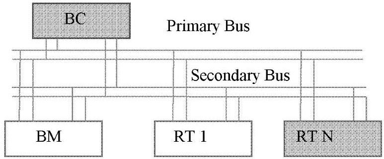
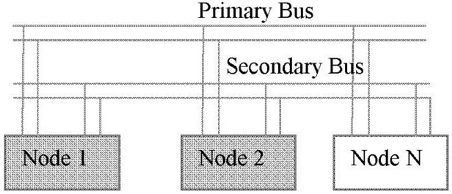
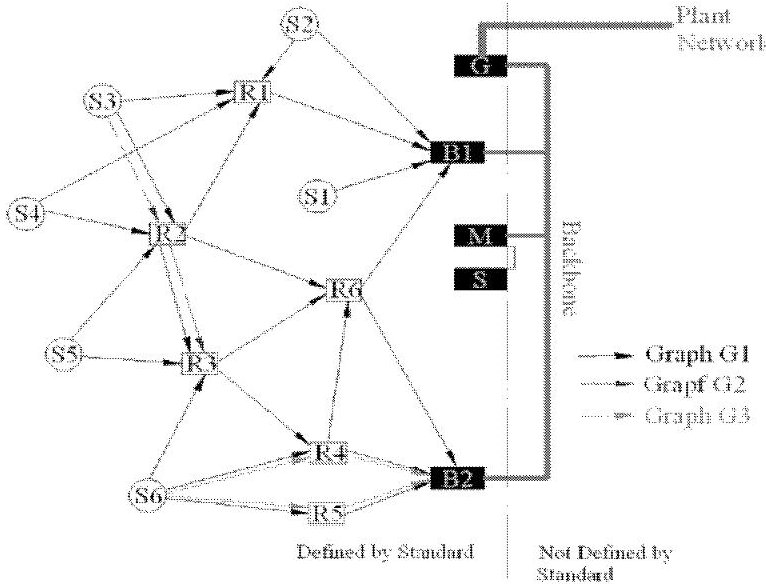
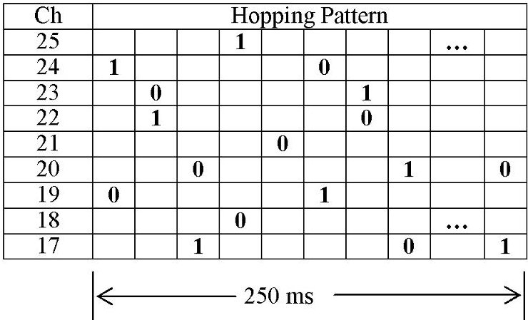
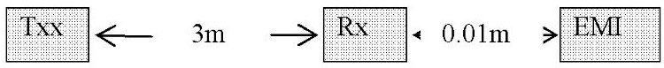

<!-- PDF_PAGE: 1 -->

# ISA100.11a CAPABILITIES FOR INTRA-SPACECRAFT COMMUNICATION

Ioan DOMUTA, Tudor PALADE, Emanuel PUSCHITA, Ovidiu RATIU, Radu ARSINTE Technical University of Cluj-Napoca, Faculty of Electronics, Telecommunications and Information Technology Communications Department 26.28 C. Paritiu Street 400027 Cluj Napoca, Romania Phone +40.264.505600

26-28 G. Baritiu Street, 400027 Cluj-Napoca, Romania, Phone +40-264-595699

Abstract: The main characteristic of the communication between spacecraft subsystems is the communication reliability. The performance growth of the low power wireless network may lead to their use for avionics communication. The ISA100.11a standard by the time, frequency and space diversity allows the implementation of a robust network and can reach the communication requirements for the spacecraft equipment. This paper analyses the resource allocation in an ISA100 network, for achieving the same throughput and latency as existing wired MIL1553B or CAN buses. Based on the this study the ISA100 network, on the current specifications, does not achieve the spacecraft communication requirements, but by adopting the UWB as the physical layer it can become a strong competitor for intra-spacecraft communication.

Keywords: ISA100.11a, wireless, spacecraft communication, MIL1553B, CAN bus

## I. INTRODUCTION

Two types of wired buses coexist on the satellite platform: the high speed bus, which handles the data from the scientific instruments, and low speed bus (named platform bus), which connects the platform equipment to the Satellite Management Unit. The high speed bus communication involves high amount of data transfer, high bit rate and is not in scope of this paper. This document is focused on replacing the current wired platform bus by a low power wireless network, in order to reduce overall weight, increase the scalability and simplify the commissioning.

There are several researchers, papers and experiments - [1] [2] [3] - regarding the implementation of wireless networks for intra-spacecraft communication, many of them being oriented towards the well-known ZigBee standard. Based on analysis of the current standardized low power network protocols - ZigBee, ISA100.11a, BLE, 6LoWPAN, WirelessHART, - we have focused on the ISA100.11a standard.

This standard holds some specific characteristics which fits it into the spacecraft communication requirements: high reliability in harsh environments, deterministic resource allocation, strong network management and high flexibility.

The most used protocols for platform intra-spacecraft communication are MIL-SDT-1553B and CAN (Control Area Network). In the wired buses the secondary redundant bus is used for network robustness increasing and low BER getting. In the current paper it is assumed that the wireless stations are enough reliable for communication requirements and the low BER and network robustness are reached by redundant slots allocation in the ISA100 network.

## II. SPACECRAFT WIRED BUS

This section contains a short description of the most used wired bus for communication between the platform subsystems and Spacecraft Management Unit (SMU).

MIL-SDT-1553 [4] is a wired military communication standard, defining a Digital Time Division Multiplexed Data Bus. The MIL1553B covers the Physical Layer and a part of Data Link Layer specifications.

Figure 1. - MIL1553B bus topology

The 1553 is a master-slave, half duplex communication protocol: all the data transfer are managed by the Bus Controller (BC). The Remote Terminal (RT) acts as interface between equipment and 1553 bus. The physical communication medium is twisted pair, screened cable (RS485). The data is coded using Manchester II biphase code with transmission rate 1Mb/s. The data is organized in a 20 bits word, every word having 16 bits of useful data, synchronization and parity bits. The words are grouped in the message, every message having a maximum 32 words.

The communication error rate is 1 word fault per 10

<!-- PDF_PAGE: 2 -->

million words. [5]

The ECSS-E-ST-50-13C [6] standard details the usage of MIL-1553B, covers the communication protocols, services and functions needed for exchange of information over the MIL-STD-1553B data bus and ensures compatibility for communication through MIL- STD-1553B data bus for communication devices onboard a spacecraft and across projects [6]. The 1553 messages are grouped in the synchronous frame, every frame having maximum 125 ms. The ECSS standard specifies bandwidth allocation, by bus proofing and scheduling, and defines the service latency too. Based on standard specifications we draw the conclusion that the minimum service latency is on frame period, 125 ms.

The Controller Area Network (CAN) is a serial communications protocol which efficiently supports distributed realtime control with a very high level of security [7]. The CAN is a multimaster, half duplex, multicast communication protocol. The medium access is Carrier Sense Multiple Access with Collision Detection (CSMA/CD) type, with message priority arbitration [8].

The CAN standard specifies the Physical Layer and the Data Link Layer.

The early CAN versions have specified, and ISO 11898-2 specifies now, the transceiver characteristics and as the communication medium twisted pair cooper cable. The current protocol does not specify the transceiver parameters and signal level, and allows the user to choose transmission medium and signal levels. The PHY defines Bit Encoding/Decoding, Bit Timing and Synchronization. The CAN uses Non Return to Zero (NRZ) coding and bit stuffing: for every five identical bits a complementary bit is inserted.

The MAC sublayer defines Data Encapsulation/Decapsulation, Frame Coding, Medium Access Management, Error Management and Acknowledgment.

Figure 2. CAN bus topology

A special and powerful feature of the CAN protocol is the Bus Arbitration. If two or more units start transmitting messages at the same time, the bus access conflict is resolved by bitwise arbitration using the IDENTIFIER. The IDENTIFIER defines the message priority on the bus, so the CAN protocol defines the message priority not the node priority.

The protocol defines a strong error handling: bit, stuff, CRC, form and acknowledgment errors. The CAN specifies that the total residual error probability for undetected corrupted messages is less than: message error rate - 4.7 * 10 $ ^{1 1} $ [7]. Some researches [9], [10] show that the interaction between the bit stuffing and the CRC the probability of undetected message corruption can reach $ 1.3 * 10^{-7} $ value [19].

The medium access of CSMA type does not allow

defining fixed bus latency. The message latency depends by its priority (IDENTIFIER) and the bus load and it may be assessed based on stochastic or real-time analyses method.

The ECSS-E-ST-50-15C [11] standard extends the CAN bus specification to cover the aspects required to satisfy the particular needs of spacecraft data handling systems. This standard recommends using the CANopen high layer over CAN standard.

## III. WIRELESS NETWORK - ISA100.11a

The ISA100.11a standard specifies the communication protocol for implementing of "Wireless systems for industrial automation: Process control and related applications" [12].

Some features of the ISA100 it closer to MIL1553 standard: deterministic resource allocation, time division multiplexing, synchronized superframe.

The main characteristics of ISA100.11a standard (Fig.3):

- Star, Mesh and Star-Mesh topologies

- Radio compliant with IEEE 802.15.4/2.4 GHz ISM band

- Time Division Multiple Access

- Hoping pattern - frequency hopping on 802.15.4/2.4 GHz channels

- Channel offset - multiple hoping patterns on the same network

- Graph routing

- IPv6 Network Layer

- The overall network is managed by System Manager

Figure 3. ISA100.11a network topology

The ISA100.11a protocol specifications follow OSI Model:

- Physical Layer: 802.15.4/2.4 GHz

- MAC sub-layer: standard 802.15.4 MAC frame

- MAC extension: ISA100.11a

- Data Link Layer: ISA100.11a

- Network Layer: 6LowPan

- Transport layer UDP/IPv6

This chapter points out the protocol features which are closely related the resource allocation: Physical Layer, Data Link Layer and System Manager.

The Physical Layer is radio compliant with 802.15.4 standard, 2.4 GHz ISM band, O-QPSK modulation. This

<!-- PDF_PAGE: 3 -->

standard section stipulates the Direct Sequence Spread Spectrum (DSSS) technique for spectrum spreading, 250 kb/s data rate and 127 bytes maximum PHY payload.

The ISA100 keeps only the MAC frame format and the FCS computing as they are specified by the 802.15.4 the medium access being specified by the DLL.

The Data Link Layer is the key point of the ISA100 standard in network organization and resource allocation. This layer details: Media Access Control, Routing, Message Control Integrity and Link Security. The medium access is carried out by Time Division Multiple Access (TDMA) procedure and the spectrum spreading is performed by channel hopping (frequency hopping on 802.15.4/2.4 GHz channels). Three hopping alternatives are supported by DLL: slotted channel hoping, slow channel hoping and a hybrid combination between the two. ISA100 stipulates five default patterns, but the user can define the proper patterns for noises channels avoiding. Many hopping pattern (Fig.4), separated by the channel offset, may coexist in the same network that giving an efficient spectrum use.

Figure 4. Slotted Hoping

The transactions within the time slot are detailed in Timeslot Template (Fig.5).

<table border="1"><tr><td>Prepare DPDU</td><td>DPDU</td><td>Wait</td><td>Ack</td><td></td></tr></table>

Figure 5. Transmit Timeslot Template

The timeslot durations have a fixed value such of 10 ms or 12 ms and the timeslots are re-aligned at each 250 ms. For the maximum PHY payload (127 bytes) the DPDU length is 4.064 ms, so by using the default template the communication efficiency falls to 41%.

The superframe is a collection of timeslots repeating on a cyclic schedule. Every superframe has an associated channel hopping pattern. For frequency diversity, the number of the timeslots in the superframe and in the hopping pattern should be relatively primes.

The System Manager (SM) acts as the "General Staff' of the ISA100 network. At the network formation, the field station send to the SM a list containing its neighbors and link quality by them, and ask for a contract establishment. Based on the neighbors list and links quality the SM decides network topology and graph routes. The contract is an agreement between the system manager and a device in the network involving the allocation by the SM of network resources, with a certain

QoS level: communication rate - by scheduled slots, latency - by allocated route and message priority. For every contract the SM establishes communication route/routes from the source to the destination, by assigning the links to those stations located along the route. The link means the timeslot position, the number of consecutive timeslots and the channel allocated for communication.

The standard specifies that maximum DSDU size is 96 bytes. The upper layers consume for packing around 20 bytes, so the Application Layer has available only 76 bytes per DL frame.

## IV. ISA100.11a FOR SPACECRAFT NETWORK ANALYSES

Some specific features have to be taken into account for the spacecraft wireless communication: the short distance between the stations, the metallic structure of the spacecraft behaves as resonant cavity, the stations could be located inside separate cavities, and for some cavities the maximum radiated power is -15 dBm and electromagnetic compatibility compliance.

Concerning to the Electromagnetic Interferences (EMI), the radiated power are scattered on the radio band by DSSS technique, giving low spectral power density. The DSSS coding also gives a high immunity at electromagnetic interferences. The experiments presented in the reference [13] shows that there are not the serious interference troubles between avionics and wireless networks.

The metallic structure of the spacecraft may cause reflections, diffractions and wave scattering. The experimental studies [14] in the mode stirred reverberation chamber show that in a particular situation the PER could become significant.

An experimental study in an aerospace environment [15] shows that ISA100 network performs better than a ZigBee network, under 802.11g interferences.

Since is not defined a concrete situation, the analysis will be made on the virtual scenario:

- there is only one ISA100 wireless network in the spacecraft

- network radio signals interfere with platform equipment; the equipment radiation are in compliance with the ECSS standard [16]

- maximum radiated power by the wireless stations, according to CCDS recommendation: -15 to +10 dBm [17]

- maximum distance between ISA100 stations is 3 m

- the minimum distance between a station and platform equipment is 10 cm

Figure 6. BER estimation setup

Where:

T - transmitter

R - receiver

EM - platform equipment

The maximum electric field strength at $ \mathrm{f}=2. 4 5 \mathrm{G H z} $ and at $ \mathrm{d}_{1}=1 $ meter is $ \mathrm{E}_{1}=7 8 \mathrm{d B \mu V / m}. $ [16, Figure A-3]

<!-- PDF_PAGE: 4 -->

The electrical field strength (dB $ \mu $ V/m) to the antenna input power (dBm) [14]:

$$
P (d B m) = E \left(\mathrm {d B} \mu \mathrm {V} / \mathrm {m}\right) - 2 0 * \log_ {1 0} f (G H z) - 1 3 7. 2 \tag {1}
$$

From Friis equation:

$$
P (d) = P (0) - 2 2 d B m + 2 0 ^ {*} \log (3 0 0 / d ^ {*} f)
$$

$$
P \left(d _ {2}\right) = P \left(d _ {1}\right) + 2 0 ^ {*} \log_ {1 0} \left(d _ {1} / d _ {2}\right)
$$

Where:

d - distance in millimeters

f-carrier frequency in GHz

The noise power at 1 m (1):

$$
\mathrm {N} (1 \mathrm {m}) = - 6 7 \mathrm {d B m}
$$

The noise power at 0.01 m (3):

$$
\mathrm {N} (0. 0 1 \mathrm {m}) = - 4 7 \mathrm {d B m}
$$

The most common 802.15.4/2.45 GHz transceivers have +3dBm the output power. The BER estimation is made on this power and 0 dBm antenna gain.

The received power at 3 m (2):

$$
\mathrm {S} (3 \mathrm {m}) = - 4 6. 8 \mathrm {d B m}
$$

Signal to noise ratio:

$$
\mathrm {S N R} = \mathrm {S} (3 \mathrm {m}) - \mathrm {N} (0. 0 1 \mathrm {m}) = + 0. 2 \mathrm {d B m}
$$

For SNR = +0.2 dBm the estimated BER is [19, Figure E.2]:

$$
\mathrm {B E R} _ {\mathrm {I S A}} = 1 0 ^ {- 4}
$$

The target is to get the same BER as wired network using redundant slots allocation. The chosen reference is MIL 1553B standard, having packet error rate "one word per 10 million words", and one word includes 20 bits.

Bit Error Rate to Packet Error Rate:

$$
P E R = 1 - \left(1 - B E R\right) ^ {N}
$$

$$
\mathrm {P E R} _ {\mathrm {M I L}} = 1 0 ^ {- 7}; \mathrm {B E R} _ {\mathrm {M I L}} = 5 * 1 0 ^ {- 9}
$$

The 802.15.4 specifies that the FCS is calculated over the MHR and MAC payload parts of the frame, that meaning 125 bytes at the maximum PHY payload.

The requested $ \mathrm{P E R}_{\mathrm{R}} $ for $ \mathrm{N}=1 0 0 0 $ bits (5):

$$
\mathrm {P E R} _ {\mathrm {R}} = 5 * 1 0 ^ {- 6}
$$

The packet error rate in the ISA100 network, without redundant slots, $ \mathrm{P E R}_{\mathrm{D P D U}} $:

$$
\mathrm {P E R} _ {\mathrm {D P D U}} = 9. 5 * 1 0 ^ {- 2}
$$

The acknowledgment frame has an MHR of only 3 bytes.

Packet error rate for acknowledgment (5):

$$
\mathrm {P E R} _ {\mathrm {A C K}} = 2. 4 ^ {*} 1 0 ^ {- 3}
$$

A successfully communication on the timeslot implies the DPDU transmission and ACK reception without errors, so the packet loss probability $ \mathrm{P E R}_{\mathrm{I S A}} $ is:

$$
P E R _ {I S A} = 1 - \left(1 - P E R _ {D P D U}\right) ^ {*} \left(1 - P E R _ {A C K}\right)
$$

$$
\mathrm {P E R} _ {\mathrm {I S A}} = 9. 7 * 1 0 ^ {- 2}
$$

Retransmission of the redundant slots in the ISA100 protocol is similar with Selective Repeat ARQ: the sliding window corresponds with ISA queue and the packets are indexed in the MAC header (Sequence Number). Assuming that the time to process the packet is small and the device keeps the unacknowledged packet in the queue the ARQ efficiency is (1-PER) and the redundant slots percentage RED is:

$$
R E D = 1 0 0 * P E R _ {I S A} / (1 - P E R _ {I S A})
$$

RED = 10.7%

Considering an ISA superframe of one second long 100 slots, 10 ms/slot - we get the follow timeslot assignment:

$$
- \quad 10 \% - \text{network management}
$$

$$
11 \%
$$

- 79% - payload

Assuming that the spacecraft network is star type there are only one hope between source and destination the total message bits BITS are:

$$
B I T S = S l o t s ^ {*} A p p P a y l o a d ^ {*} 8
$$

$$
\mathrm {B I T S} = 7 9 * 7 6 * 8 = 4 8 0 3 2
$$

$$
\text {The one bit period} = 1 / \left(2 5 0 * 1 0 ^ {3}\right)
$$

The total used time, from one second, for application data transfer $ \mathrm{T}_{\mathrm{A p p}} $ gets:

$$
\mathrm {T} _ {\mathrm {A p p}} = 0. 1 9 2 \mathrm {s e c o n d}
$$

So the ISA100 efficiency is:

$$
\eta_ {\mathrm {ISA}} = 19.2 \%
$$

and final throughput THR:

$$
\mathrm {T H R} = 0. 1 9 2 * 2 5 0 \mathrm {K b / s} \approx 4 8 \mathrm {K b / s}
$$

The poor efficiency of the standard is due to the fact that a high percent of the frame is used for packing purpose by the layers and in the meantime only a small part of the timeslot template is used for the data transfer. By lowering the timeslot length, e.g. to 7.8125 ms the throughput rises to 61.5 Kb/s.

A very important parameter defined by the ECSS-EST-50-13C is the service repetition frequency. The requested service frequency is solved by "bandwidth preallocated" in the bus scheduling stage. Similar, the ISA100 assures the desired frequency by assigning the

<!-- PDF_PAGE: 5 -->

dedicated slot with the dlmo.Link.Schedule parameter set to the requested frequency.

Other significant parameter is the service latency. The ECSS standard specifies that the latency is the service repetition period. The ISA inserts additional latency, that is the allocated slots duration. For a long packet, which is fragmented in the multiple frames and has allocated multiple slots the additional latency may become significant.

The current specifications of the ISA100 standard with QPSK modulation do not allow reaching enough throughputs for complex platform equipment communication.

The increasing of the ISA100 data rate involves the adoption of a new physical layer. The 802.15.4 UWB PHY (Ultra Wide Band PHY) specifications meet the spacecraft wireless communication requirements concerning low power consumption and high data rate transfer.

The 802.15.4-2011 specifies 15 UWB communication channels between 3.1 GHz and 10.6 GHz, so it can be done the frequency hopping on defined channels. The modulation is a combination of Burst Position Modulation (BPM) and Binary Phase-Shift Keying (BPSK). The error control is achieved using FEC by convolutional and Reed-Solomon encoding.

Although the standard specifies the maximum data rate of 27 MHz, the study is made based on a COTS transceivers and the following assumptions concerning to Data Rate, Pulse Repetition Frequency (PRF), PHY Header (PHR) and Synchronization Header (SHR):

The UWB frame is depicted in figure [7].

<table border="1"><tr><td>Field</td><td>SYNC</td><td>SFD</td><td>PHR</td><td>PSDU</td></tr><tr><td></td><td colspan="2">SHR</td><td>850KHz</td><td>6.81MHz</td></tr><tr><td>Symbols</td><td>64</td><td>8</td><td>21</td><td>N*8</td></tr><tr><td>Duration</td><td>65.1</td><td>8.1</td><td>24.7</td><td></td></tr></table>

Figure 7. UWB PPDU structure

The data bit duration:

$ \mathrm{T}_{\mathrm{b}}=1 / \mathrm{D a t a R a t e}=0.147 \mu \mathrm{s} $

The maximum PHY payload is 127 bytes length, so frame duration $ \mathrm{T}_{\mathrm{D P D U}} $ is:

$$
\mathrm {T} _ {\mathrm {D P D U}} = 2 4 7 \mu \mathrm {s}
$$

The typical acknowledgment frame specified by ISA standard, without PHY preamble, is 12 bytes long, and acknowledgment frame length $ \mathrm{T}_{\mathrm{A C K}} $ is:

$$
\mathrm {T} _ {\mathrm {A C K}} = 9 7. 9 + 1 2 ^ {*} 8 ^ {*} \mathrm {T} _ {\mathrm {b}}
$$

$$
\mathrm {T} _ {\mathrm {A C K}} = 1 1 2 \mu \mathrm {s}
$$

The ISA standard allows low clock stability up to 100 ppm for the I/O devices and 10 ppm for the routers. For the 6.5 s wakeup period, the timeslots misalignment:

$$
\mathrm {T} _ {\mathrm {M S A}} = 6. 5 * (1 0 0 + 1 0) = 7 1 5 \mu \mathrm {s}
$$

The above misalignment value is too large for a

network focused on high speed communication. The specifications should be amended:

- the clock drift for the I/O devices shall be no more than 30 ppm

- the timeslots shall be synchronized at every 250 ms cycle

The new misalignment $ \mathrm{T}_{\mathrm{MSA}} $ :

$$
\mathrm {T} _ {\mathrm {M S A}} = 0. 2 5 0 * (3 0 + 1 0) = 1 0 \mu \mathrm {s}
$$

The use the 2^15 Hz (32 KHz) oscillator as a wakeup clock sources inserts a 30.5 us jitter.

The total misalignment $ \mathrm{T}_{\mathrm{TMSA}} $:

$$
\mathrm {T} _ {\mathrm {T M S A}} = 4 0. 5 \mu \mathrm {s}
$$

Assuming that the transceiver wakeup time is 10 $ \mu s $ and acknowledgment computation needs 10 $ \mu s $ the minimum timeslot length $ \mathrm{T}_{\mathrm{TS-MIN}} $ is:

$$
\mathrm {T} _ {\mathrm {T S - M I N}} = 4 1 9 \mu \mathrm {s}
$$

It defines a new timeslot template having $ \mathrm{T_{s}}=500 \ \mu\mathrm{s} $

The useful time for application payload transfer: $ \mathrm{T}_{\mathrm{u}}=A \mathrm{p p P a y l o a l d} * 8 * \mathrm{T}_{\mathrm{b}}=8 9. 3 \mu \mathrm{s} $

The efficiency of IS100 over UWB:

$$
\eta = 1 0 0 * T _ {\mathrm {u}} / T _ {\mathrm {s}} = 1 7. 8 5 \%
$$

As showed in the previous chapter, 21 % of slots are used for redundant transfer and network management.

The final efficiency

$$
\eta_ {\mathrm {f i n a l}} = 14.1 \%
$$

and the throughput

$$
\mathrm {T H R} _ {\mathrm {U W B}} = 9 6 0 \mathrm {K b / s}.
$$

The small length of the UWB timeslots (0.5 ms) reduces the additional latency 20 times from original specifications.

## V. CONCLUSIONS

The ISA standard, in the current version, allows a maximum throughput of 48 Kb/s and it introduces a large additional latency in data delivery for the high length packets. The achieved throughput is much smaller than those provided by the wired buses and it does not meet the communication requirements for complex platform equipment.

By adoption of the UWB PHY as the physical layer for the ISA100.11a standard results in strong growth of the network throughput to 960 Kb/s, reducing the latency 20 times and as a result the ISA100 over UWB may become a strong competitor in the spacecraft communication.

In addition to throughput increase, the UWB leads to high accuracy location in the mobile network with high impact in the robots tracking. The tracking accuracy in the ISA100 mobile network is the subject of the future research.

## ACKNOWLEDGEMENT

This paper is supported by the Sectorial Operational Programme Human Resources Development POSDRU/159/1.5/S/137516 financed from the European Social Fund and by the Romanian Government.

<!-- PDF_PAGE: 6 -->

## REFERENCES

[1] Stone, T. et al., "Available COTS based wireless architecture for spacecraft avionics", IEEE Aerospace Conference, 2012

[2] Greg Swanson et al., Wireless Sensors in Thermal Protection Systems, [Online],

Available: https://solarsystem.nasa.gov/docs/P4.7

%20Swanson%20Wireless%20Sensors%20in%20TPS.pdf

[Accessed: April 15, 2015]

[3] Zhou Li et al., Research of Wireless Sensor Networks for Intra-Spacecraft Environmental Monitoring, Chinese Journal of Space Science, [Online], Available: http://www.cjss.ac.cn/EN/abstract/abstract1893.shtml [Accessed: November 10, 2014]

[4] Department of Defense, USA, "MIL-SDT-1553B, 21 September 1978", January 1979

[5] AIM Gmbh, "MIL-SDT-1553 Tutorial", November 2010

[6] European Cooperation on Space Standardization (ECSS), "Interface and communication protocol for MIL-STD- 1553B data bus onboard spacecraft ECSS-E-ST-50-13C", November 2008

[7] Robert Bosch GmbH, "CAN Specification, Version 2.0" September 1991

[8] Steve Corrigan, "Introduction to the Controller Area Network (CAN) ", Texas Instruments, July 2008

[9] Eushiuan Tran, "Multi-Bit Error Vulnerabilities in the Controller Area Network Protocol", Carnegie Mellon University, Pittsburgh, May 1999

[10] Joachim Charzinski, "Performance of the Error Detection Mechanisms in CAN", [Online], Available: http://www.jcho.de/jc/Pubs/cia-94.pdf [Accessed: November 12, 2014]

[11] European Cooperation on Space Standardization (ECSS), "CANBus extension protocol, ECSS-E-ST-50-15C DIR1", December 2013

[12] International Society of Automation (ISA), "Wireless systems for industrial automation: Process control and related applications, ISA-100.11a-2011" 4 May 2011

[13] Tanya Vladimirova et al., "Characterising Wireless Sensor Motes for Space Applications", Second NASA/ESA Conference on Adaptive Hardware and Systems, AHS 2007

[14] A. Centeno* and N. Alford, "Measurement of Zigbee Wireless Communication in Mode-Stirred AND Mode-Tuned Reverberation Cchamber", Progress In Electromagnetics Research, Vol. 18, pp.171-178

[15] Raymond Wagner and Richard Barton, "Performance Comparison of Wireless Sensor Network Standard Protocols in an Aerospace Environment: ISA100.11a and ZigBee Pro", IEEE Aerospace Conference, March 2012

[16] European Cooperation on Space Standardization (ECSS), "Electromagnetic compatibility, ECSS-E-ST-20-07C February 2012

[17] The Consultative Comitee for Space Data System (CCDS), "Low Data-Rate Wireless Communications for Spacecraft Monitoring and Control; CCSDS 882.0-M-1; MAGENTA BOOK" May 2013

[18] ITU-R, "Methodologies to relate radiation from power line telecommunication installations to power line telecommunication modem output; ITU-R SM.2269", July 2013

[19] IEEE Standard Association, "IEEE Std 802.15.4 $ ^{\mathrm{TM}} $ -2006"

[20] IEEE Standard Association, "IEEE Std 802.15.4 $ ^{\mathrm{TM}} $ -2011"