<!-- PDF_PAGE: 1 -->

# Pre-Launch Testing of the Lunar Flashlight (LF) CubeSat GNC System

David C. Sternberg, Peter C. Lai, Aadil Rizvi, Kevin F. Ortega, Kevin D. Lo, Philippe C. Adell, and John D. Baker

Jet Propulsion Laboratory

California Institute of Technology

Pasadena, CA, US

## Abstract

Lunar Flashlight (LF) is a 6U, 14 kg spacecraft that will measure potential surface water ice deposits in the permanently shadowed region (PSR) of the moon. The mission described in this paper will use IR laser technology to search for volatiles in preparation for future human lunar exploration. A CubeSat's guidance, navigation and control (GNC) system is crucial for the spacecraft to successfully reach the moon, enter a lunar orbit, and acquire scientific data. The Jet Propulsion Laboratory (JPL) has adopted a commercial-off-the-shelf (COTS) integrated GNC spacecraft system after experience from over twenty CubeSat missions. When hardware is delivered to JPL by the vendor, thorough validation testing is performed to guarantee fundamental functionality before the hardware is integrated into the spacecraft. Moreover, while the validation processes for the first few CubeSats relying on similar COTS-integrated GNC systems at JPL were very fluid, LF represents the first attempt JPL has made to apply large-mission, rigorous testing processes to a CubeSat, with the intent of standardizing the testing process for a rapidly growing number of CubeSats at JPL. This paper presents the rigorous testing concept applied to the GNC system, the various tests that have been performed and standardized, and the data acquired during the testing campaign to ensure that the LF GNC system will function as part of the integrated spacecraft once launched. The ground command and interface system is also summarized, and a path forward towards hardware integration at the spacecraft level is described.

## 1. Introduction

Small satellites (SmallSats) have been launched in higher numbers following advancements of miniaturized electronics, instruments, and commercial-off-the-shelf (COTS) components (Sweeting, 2018). There has been growth of three main mission architectures

involving SmallSats: 1) networks of fractionated payloads or constellations; 2) complements to larger missions with their own dedicated objectives (e.g. impactors, penetrators and flybys); and 3) missions consisting of individual SmallSats. In addition to performing these types of missions, SmallSats can strengthen the partnerships between universities, technology pioneers, and crowd-sourced initiatives.

<!-- PDF_PAGE: 2 -->

Most small spacecraft flown thus far have operated in Low Earth Orbit (LEO), largely because deep space operation is more costly than LEO missions due to a demand for more sophisticated and often more autonomous designs that can accommodate limited telecommunication opportunities. The Jet Propulsion Laboratory (JPL) has been at the forefront of developing deep space SmallSats with four deep space missions following NASA's CubeSat Launch Initiative (NASA CubeSat Launch Initiative, 2016). These JPL small satellites have been called CubeSats, a name given because of the fundamental spacecraft layout consisting of an arrangement of $ 1 0 \times1 0 \times1 0 \mathrm{c m}^{3} $ units. A major challenge to deep space exploration is that the space environment is different for each mission, requiring testing campaigns that consist of both standard and mission-specific tests. The process governing the test campaigns described in this paper applies to future JPL CubeSats, regardless of operational environment. The testing is a key factor in determining the net mission cost, since the number and depth of these tests add both time and monetary costs to flight projects. Validation and verification tests are critical, since once launched, there are limited opportunities for in-flight adjustments, and even small anomalies may lead to mission failure. Rigorous testing requires extensive planning and costs, which can place a significant burden on small CubeSat budgets.

The JPL Lunar Flashlight (LF) CubeSat is a 6U, 14 kg spacecraft planned to be launched as a secondary payload among twelve other CubeSats on the Space Launch System's (SLS) Exploration Mission-1 (EM-1) flight and will map the lunar south pole for volatiles, i.e., surface water ice (Cohen, 2015). Recent robotic mission data (LRO Diviner, LOLA, LAMP, Mini RF, and LCROSS) strongly suggest the presence of ice deposits in permanently shadowed craters of the moon. Therefore, the goal of LF is to find potential water ice hidden in these permanently shadowed regions (PSR). This mission also demonstrates several technological firsts, including being the first planetary CubeSat mission to use green propulsion and the first CubeSat mission to use lasers to search for water ice (NASA Jet Propulsion Laboratory Lunar Flashlight, 2018; Imken, 2016). After deployment from the launch vehicle, LF will follow a 190-day low-energy orbit transfer to the

Moon, including three gravity-assist lunar flybys. After six months, LF is inserted into a lunar near-rectilinear halo orbit (NRHO), achieving a perilune distance of approximately 15 km above the lunar south pole. At perilune, four near-infrared lasers will be pointed toward the permanently shadowed craters for water ice detection (Imken, 2016). Overall, the spacecraft is required to point within one degree of a commanded attitude, and perform momentum management thruster firings on an as-needed basis throughout the mission. The Science Phase of the mission is two months long (right side, Figure 1). In this figure, yellow indicates the desired elliptical trajectory, while green overlay indicates periods of communications with the Deep Space Network (DSN), red overlay indicates periods for thruster-based orbit maintenance, dark grey indicates eclipse periods, and light grey indicates the primary science pass sector. The detailed scientific mission, payload design, and flight avionics for LF have been discussed in Cohen (2015) and Imken (2016 and 2017).

One of the most critical systems of the LF mission is the GNC system. Its main functions are to transport the spacecraft from Earth to the Moon, and once in lunar orbit, to point the payload instrument toward the center of the Moon (nadir-pointing) for scientific measurements. The Lunar Flashlight GNC architecture was developed following the approach of the Interplanetary Nano-Spacecraft Pathfinder In Relevant Environment (INSPIRE) mission (NASA Jet Propulsion Laboratory INSPIRE, 2018) and Mars Cube One (MarCO) (NASA Jet Propulsion Laboratory MarCO, 2018; Klesh, 2018) using a COTS integrated GNC system, XACT by Blue Canyon Technology. A new reaction wheel assembly (RWA) was developed with 50 mNms momentum capacity by Blue Canyon Technologies (BCT) to meet the LF requirement of post-separation detumbling at up to 10 deg/s after deployment from the launch vehicle (Blue Canyon Technologies Attitude Control Systems, 2018). This new reaction wheel was incorporated into the BCT XACT integrated attitude control system to create the XACT-50 unit.

<!-- PDF_PAGE: 3 -->

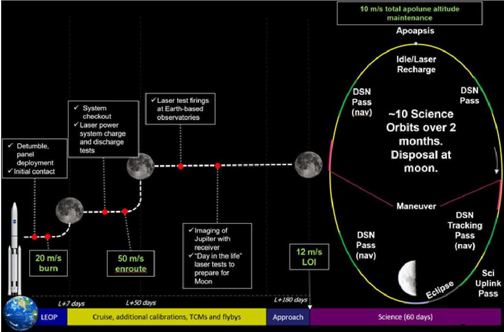

Figure 1. Lunar Flashlight mission overview.

LF was the first CubeSat at JPL to undergo a large spacecraft-style formal testing process, which demanded the creation of test plans, procedures, and regularly held test data reviews. Due to cost and time constraints, prior JPL CubeSats underwent GNC verification and validation processes that were more scaled down from those for larger missions, as described in Pong (2019). The GNC system in particular for LF underwent a comprehensive set of functional and performance tests on both engineering and flight units prior to integration with the rest of the spacecraft. This testing effort involved the XACT-50 engineering design unit (EDU) and flight model (FM) conducted at JPL's Small Satellite Dynamics Testbed (SSDT) facility (Sternberg, 2018), as well as in an Avionics Test Bed (ATB). The EDU went through hardware and software validation tests such as phasing testing on the reaction wheel assembly (RWA), inertial measurement unit (IMU), stellar reference unit (SRU), and coarse sun sensors (CSS), RWA jitter testing, and nadir-pointing/sun-pointing tests at SSDT. Afterwards, the EDU was delivered to the ATB to verify the communication between GNC, propulsion, and command and data

handling (C&DH) systems. The XACT-50 FM later repeated a similar validation process.

In this paper, a follow-on to Lai (2018 and 2020), the following topics are presented: a summary of the GNC design, the hardware qualification tests, functional performance assessment tests, reaction wheel jitter characterization testing (Shields, 2017), mission scenario tests, ATB validation, and lessons learned. Each of these topics is addressed in detail in the following sections, with particular attention given to the testing process and results of the flight unit testing. Additionally, the current paper provides a brief introduction to the interface between the XACT-50 and the spacecraft C&DH system and the ground commanding system. The paper will focus primarily on the XACT- 50 unit rather than the interfaces with the other subsystems, because it serves as the core of the GNC system, responsible for controlling both its own actuators and sensors, as well as commanding the propulsion system.

<!-- PDF_PAGE: 4 -->

## 2. LF Guidance, Navigation, and Control System

The LF GNC system is summarized in this section. For details, readers are referred to Lai (2018 and 2020). The LF spacecraft layout is shown in Figure 2. The XACT-50 unit is the core of LF GNC system. It consists of an SRU, IMU, and three RWAs, along with the GNC flight software (FSW) within one box (shown in Figure 3). Unlike ASTERIA or MarCO (Sternberg, 2019), LF has four BCT-designed CSS to provide close to $ 4 \pi $ steradian coverage: one sensor is mounted to the body +/-Y and +/-Z axes. These CSS are mounted separately, but connect electronically to the XACT-50.

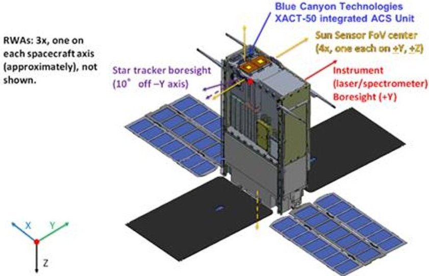

Figure 2. Final spacecraft layout and coordination system.

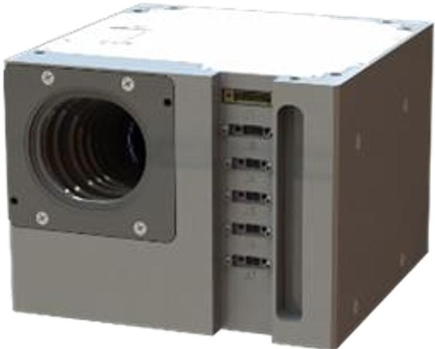

Figure 3. XACT-50 integrated GNC system.

The LF GNC FSW has two control modes, Safe Mode (SFM), pointing the solar panels to the Sun; and Fine-Pointing Mode (FPM), which points the spacecraft in a commanded attitude. The system powers on

in SFM, performing sun search autonomously until the spacecraft reaches the sun-pointing attitude that points the spacecraft +Z axis toward the Sun for maximum power available from the solar arrays. In this mode, the CSS and IMU are used to establish spacecraft attitude, while the RWAs orient the spacecraft to point towards the Sun. A 0.2 deg/sec rotisserie spin is commanded along the sun vector to increase spacecraft stability, improve thermal balancing, and help balance momentum build-up.

While in SFM, the spacecraft can be commanded to enter FPM for cruise and scientific activities. In this mode, the SRU and IMU determine spacecraft attitude with measured data processed by a Kalman filter. Upon entering this mode, GNC FSW autonomously performs a lost-in-space star identification algorithm within a few seconds. Once the correct attitude is determined, the FSW then changes to the tracking mode. When the SRU's field of view (FOV) is obstructed or intruded by a bright object, the IMU is used to propagate attitude until the SRU can regain attitude knowledge. In nominal operation, the RWAs are also used for attitude control in FPM.

The LF spacecraft does not have direct command or telemetry lines to its propulsion system, though it provides 5 V and 12 V power directly to the propulsion system. All the propulsion system commands and telemetry go through the XACT-50 unit. Therefore, it is critical to verify the proper interface connectivity between the spacecraft computer, the XACT-50, and the propulsion unit early in the spacecraft development stage. To verify this interface, an EDU was used for testing at BCT during the XACT-50 development and delivered to JPL for use in the ATB. This ATB testing is described in a later section of this paper. There was no flight-like testing of the propulsion system once it was integrated with the rest of the spacecraft. Instead, a set of simulations was performed to assess the performance of the propulsion system.

The CAD model of the propulsion system is shown in Figure 4, including four thrusters and a propellant tank. The four thrusters are canted at $ 1 2^{\circ} $ for three-dimensional control, and are used for dumping accumulated RWA momentum and performing $ \Delta\mathrm{V} $ maneuvers. Each thruster is capable of operating in continuous burn and pulsed modes.

<!-- PDF_PAGE: 5 -->

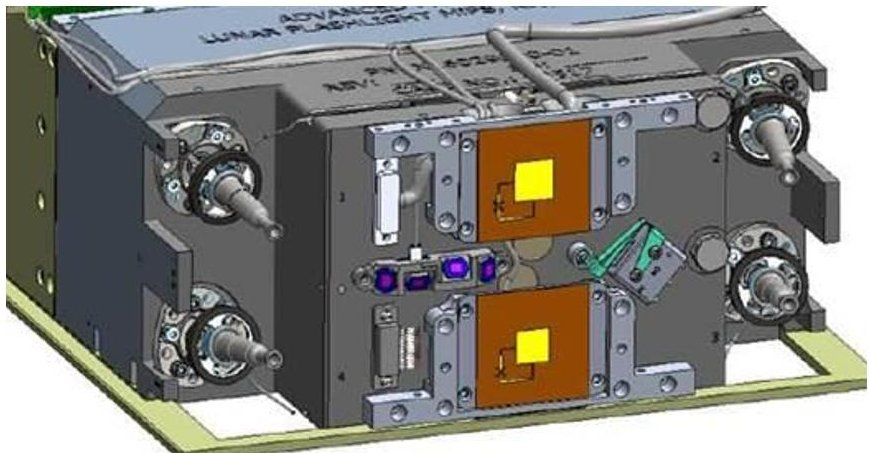

Figure 4. Bottom view of spacecraft showing propulsion module and sun sensor.

## 3. GNC Hardware Validation Test at Small Satellite Dynamics Testbed

## 3.1. Creating a Test Sequence for the LF GNC System

LF GNC testing used many of the testing philosophies used by larger spacecraft that are described in Pong (2019). Unlike on the MarCO and ASTERIA missions, for example, the LF GNC testing process was designed to include dynamic tests instead of just static tests. Lessons learned from both large and small missions were applied in the development of the LF GNC testing process.

When the XACT-50 was delivered to JPL, it was necessary to test the unit before ATB integration. This testing ensured that it met the functional requirements for its successful operation within the spacecraft and that its key functions were exercised in a relevant environment. Three sets of tests were performed on the EDU and FM XACT-50 units as listed in Table 1, to provide an assessment of the functionality of each major element of the XACT-50. The three sets of tests, grouped by the color-coding, were scoped to provide

Table 1. XACT-50 Hardware Test Matrix

<table border="1"><tr><td>Test</td><td>EDU*</td><td>FM</td><td>Comment</td></tr><tr><td>RW-Phasing Test</td><td>X</td><td>X</td><td>HW Critical</td></tr><tr><td>IMU-Phasing Test</td><td>X</td><td>X</td><td>HW Critical</td></tr><tr><td>Sun Sensor-Phasing Test</td><td>X</td><td>X</td><td>HW Critical</td></tr><tr><td>SRU*-Phasing Test</td><td></td><td>X</td><td>HW Critical</td></tr><tr><td>Air Bearing Test-Fine Pointing</td><td>X</td><td>X</td><td>FSW Functional</td></tr><tr><td>Air Bearing Test-Sun Pointing</td><td>X</td><td>X</td><td>FSW Functional</td></tr><tr><td>RW-Jitter/Imbalance Test</td><td>X</td><td></td><td>Nice to have for new RW</td></tr></table>

*No SRU in EDU; only 1 Sun Sensor available; FSW is preliminary version

assurance that both units would function as expected, with the specific tests on each unit tailored to the hardware contained within each XACT-50 unit. Phasing tests provide assurance that the hardware and software both are able to operate and are able to match the conventions for coordinate frames defined by the LF project. Software mode tests were included to build upon the phasing tests, as these closed-loop tests assess the functionality of the controllers themselves. Lastly, the jitter and imbalance testing was performed to assess the one of the dominant noise sources that will exist onboard the spacecraft. Unlike larger missions, the LF testing was able to be performed with the entire attitude control system mounted to an environmental simulator in a dynamically relevant physical environment, entirely separate from the rest of the spacecraft. Additionally, because the XACT-50 is a complete vendor-supplied unit, all attitude determination and control software had already been loaded onto the hardware and tested by the vendor. Consequently, the testing performed at JPL was of a system that had already undergone basic testing by the vendor.

The EDU XACT-50 and FM XACT-50 units have different GNC hardware components. While they have the same internal software structure, the FSW delivered with the EDU XACT-50 was not the final software version, which had not yet been completed. While the FM XACT-50 is a complete unit with all of the flight sensors and actuators, including four CSS for mounting to the exterior of the spacecraft (each CSS consists of four diodes each), the EDU XACT-50 does not have the SRU and has only one CSS. The software difference between the two units is centered on a set of physical property information that is stored in memory tables within the XACT-50 units; because these tests are not performance tests, this software difference does not play a role in assessing the functionality of the hardware and two main software modes.

The green-highlighted tests in Table 1 were performed together as the first set to assess the EDU's functionality through: a RWA phasing test (determining that commands to the reaction wheels yield the expected rotation directions), an IMU phasing test (determining that the estimated rotations are in the expected directions and at the commanded rates), and a CSS phasing test (to ensure the diode counts from a

<!-- PDF_PAGE: 6 -->

sun simulator match expectations). Additionally, this set included a fine-pointing operation test (to ensure that the XACT-50 can attempt to maintain a specific spacecraft attitude), and a sun-pointing operation test (to ensure that the XACT-50 can attempt to find and point spacecraft to the sun simulator).

The same set of tests was then performed on the FM XACT-50 (the yellow-highlighted set in Table 1), though a test of the SRU phasing (to determine if the SRU could identify the rate and direction of star field motions) was added to test this sensor. Importantly, that the FPM performance will be different between the EDU and FM sets of testing campaigns: the lack of SRU in the EDU limits the fine-pointing test because without the external reference sensor, it cannot compensate for gyroscopic drift.

Lastly, a RWA jitter test was performed on the EDU only to characterize this newly developed 50 mNm RWA (brown test in Table 1). It therefore provided a first order assessment of the jitter that will be seen on flight, since the FM and EDU XACT-50 units are not structurally identical. Unlike many larger missions, a detailed jitter model is typically not available for CubeSats with limited budget for use in determining a quantifiable effect on the science return from the spacecraft's instrumentation.

The aforementioned set of tests is described in the rest of this section. Section 3.2 describes the common set of documentation that accompanies each test as part of the overall rigorous testing scheme used by the LF project, while Section 3.3 describes the testing venues used for each of the tests. Section 3.4 describes why the LF FM XACT-50 requires different test configurations than the EDU. Section 3.5 provides more details about the tests conducted on the EDU, while Section 3.6 provides the details for the EDU jitter tests and Section 3.7 provides data from the FM tests.

## 3.2. Documentation and Reviews for Each Test

The LF GNC system testing process was the first effort at JPL to apply a large-scale spacecraft GNC approach to how the test planning, documentation, and reviews were conducted for the development of a CubeSat project's GNC system. One of the most critical documents that was developed for each type of test

was a test procedure document. Developed after extensive table-top planning and a test plan review with a particular focus on ensuring a complete functional assessment of each hardware element and software mode, a test procedure was prepared to span a set of related tests (such as all EDU tests being aggregated into one test procedure, since they were all performed serially and in one testing phase). While other JPL CubeSat projects had test procedure documents as well, the LF procedures were the most thoroughly vetted to date. Dedicated, independent reviews were performed by project and line management as well as project quality assurance prior to a formal procedure review. A final test readiness review was also performed prior to each test. No such process existed at JPL for subsystem testing on CubeSat missions prior to LF.

For LF, the result of the preliminary work for each test procedure was a document that contained all of the information necessary for an engineer not on the project to understand the scope and technical justification for each test, as well as to be able to complete each step in the procedure without any additional training. To reach this level of procedural detail, the test procedures include: detailed photos and drawings of the hardware in the to-be-tested configuration with instructions on how to assemble that configuration; sets of test objectives with pass/fail criteria in relation to project requirements and telemetry to be analyzed; handling and storage requirements; necessary training for all operators; step-by-step procedures for running each test; and a set of unplanned test termination and troubleshooting steps for the operator to use in the event that a test needs to be aborted. All of this information provides the test conductor sufficient background and operational guidance to perform each test safely while ensuring that the test data products are acquired as expected.

After each set of tests were completed, two key documents were created. The first was a review presentation describing the analyzed test results and any anomalies that were encountered during the testing. This test result review served as the main venue for presenting the results of each test and evaluating the success of the testing, the current state of the project, and any issues that arose with the test equipment. All issues were also reported, as is standard for all JPL

<!-- PDF_PAGE: 7 -->

projects, in a dedicated problem reporting system tool so that root causes can be tracked and all affiliated documents surrounding the issue are saved for access by any future user of the hardware or software in question. Further, a test report document was provided to both project and line management with a set of lessons learned was prepared to capture operational considerations for testing and integrating the unit under test and ground support equipment later in the project development cycle. The data from these tests was not used for performance validation, but the assurance that each element functions as expected is invaluable throughout the subsequent requirement verification and validation process. The data and as-run procedures are saved in the project's data repository for access by anyone on the project, and like all JPL projects, any unexpected results are saved in a dedicated JPL system for access by other projects that use similar hardware, software, or processes. The project's systems engineers are able to complete concept of operations designs, mission timeline analyses, and maneuver sequences, amongst others, using the outputs from these tests as well.

## 3.3. Testing Venues

All of the acceptance and functionality tests except for the RWA jitter test were performed in the SSDT. The SSDT was founded at JPL in 2014 to reduce risks associated with attitude control and to centralize the testing infrastructure needs for small satellites. The facility maintains the spacecraft hardware and testing environments necessary to support dynamics testing with a variety of SmallSat sensors, actuators, and software. In particular, the SSDT has two separate air bearing environments: a spherical air bearing with three rotational degrees of freedom (DOFs), and a planar air bearing with one rotational and two translational degrees of freedom (Sternberg, 2018). The planar air bearing can operate either on a 0.6 m x 0.6 m granite table in the SSDT or the much larger (7.3 m x 8.5 m) flat floor of JPL's Formation Control Testbed (FCT) (Scharf et al., Parts I and II, 2010). The facility space in the SSDT allows other equipment to be included as sensors and stimulators as well. The LF project made use of a 1kW lamp as a sun simulator, for example.

The SSDT testing of LF's EDU and FM XACT-50 units was performed on the spherical air bearing to assess the XACTs' performance on all three rotational degrees of freedom. The SSDT's spherical air bearing can accommodate a wide range of test payloads, and was configured to provide a neutrally stable platform capable of powering the XACT-50 unit under test, send commands, log telemetry, and provide sensor inputs as necessary without any cables or tethers constraining the motion of the hardware. Coarse and fine balance weights were used to achieve a minimal separation between the center of mass and center of rotation of the air bearing, since any offset leads to gravityinduced disturbance torques that would not be present in the space environment.

Jitter testing was performed at night in a basement laboratory at JPL to minimize the impact from sources of disturbance vibration from the environment, such as elevator or car motion. This testing was performed on a large isolator upon which the XACT-50 EDU was mounted. After sending a range of known RWA speed, commands, the resulting vibrations were then recorded.

Connected to the XACT-50 units for all ground testing was a separate unit from BCT called the Realtime Dynamics Processor (RDP). The RDP acts both as an environmental simulator that can inject simulated sensor measurements based on a real-time simulation of the spacecraft's position and attitude over time, while also capturing telemetry and allowing the user to send commands to the unit. The RDP therefore was instrumental in the testing process, since it allowed the sensors and actuators to respond as if they were in the flight environment.

## 3.4. Test Setup for Engineering Design Unit Testing

This section describes the test setup used for the LF EDU hardware in the SSDT, with the EDU testing process providing an example of how the test setup supported the overall LF testing campaign. The EDU testing was designed for generating and proofing the procedures required for testing the FM, and the overall set of EDU tests proceeded as planned, with test plan

<!-- PDF_PAGE: 8 -->

and procedure improvements folded into the FM testing process. Importantly, no tests in this section directly verified the mission's GNC requirements.

The test configuration on the SSDT spherical air bearing is shown in Figure 5, with the bulk of the setup being reused for FM testing. The solar simulator shining onto the air bearing is shown in Figure 6; at this distance, the CSS are able to identify the lamp as the dominant illumination source without risking thermal damage from the 1 kW halogen lamp. Further, a Star Field Simulator (SFS) developed at the SSDT was incorporated into the testing (Filipe, 2017). The SFS displays an image of a star field on a small high-definition screen, with the image being sent via HDMI cable from a dedicated SFS computer.

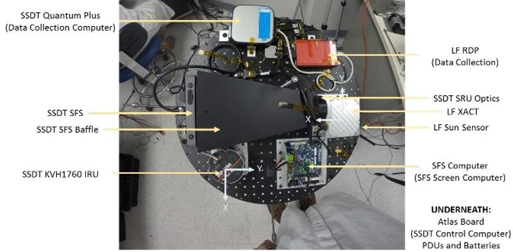

Figure 5. Top-down view of SSDT spherical air bearing system.

The star field is computed using the current orientation of the XACT-50 unit as determined by a separate ground truth gyroscope; the SFS computer determines the correct star field to be displayed for a given spacecraft attitude. Filipe (2017) provides a much more in-depth assessment of the performance capabilities of the SFS and how the system functions as ground test equipment; importantly, the high-definition screen is able to produce brightness and centroid data graphically to a level of accuracy such that the XACT-50's algorithms are the limiting factor in achieving finepointing. A baffle is used to prevent stray light from entering the XACT-50's optics, and a collimator lens is used to ensure that the incident light from the SRU behaves as if the XACT-50 were viewing far away stars. This complete setup is shown in Figure 7. Although the SFS was not used as part of the control loop for EDU testing because of there not being a SRU inside the EDU XACT-50, the hardware was included in the test configuration to maintain close mass property commonality with the FM test configuration. Instead of the SFS for the EDU tests, the RDP was used to generate attitude knowledge for XACT-50 FSW during the FPM test, since the RDP provided simulated SRU data.

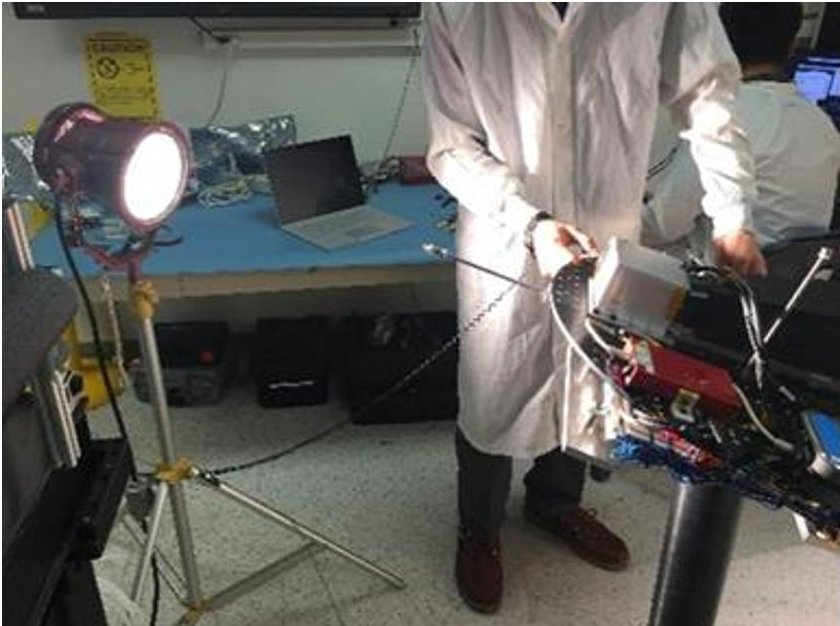

Figure 6. SSDT solar simulator setup.

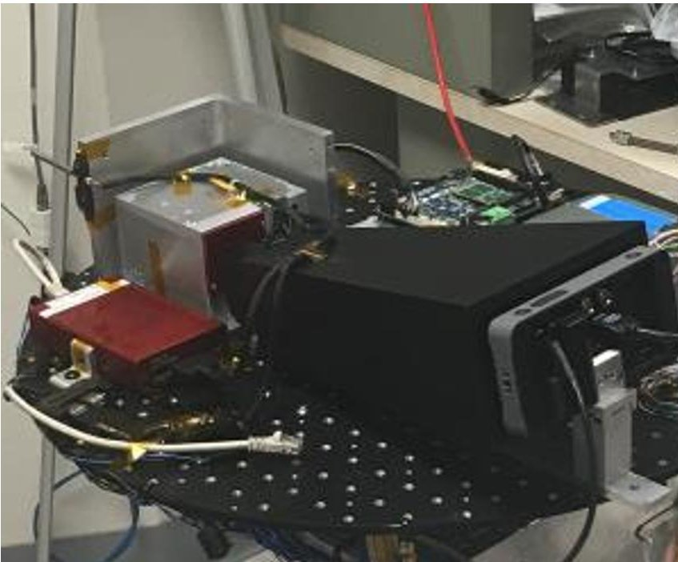

Figure 7. SSDT star field simulator, with screen, baffle, and collimator lens as black structures to the right of the silver XACT-50 and red RDP.

<!-- PDF_PAGE: 9 -->

The overall electrical integration that was used for the EDU and FM testing is shown in Figure 8, though there are some differences between the connections, as described in Section 3.5. The XACT-50 unit, with its connected CSS, interfaces with a single connection to another device. For this test configuration, the other device is the RDP, which receives power from the SSDT spherical air bearing's power distribution unit (PDU), which itself draws from an on-board Li-Ion battery pack. The EDU does not have connections for the second through the fourth CSS. Data from the RDP is sent over an Ethernet connection to a Quantum Plus computer, which serves as an on-board telemetry and commanding computer. The Quantum Plus is a Windows 10 computer that runs the data-logging software and allows for commands to be sent to the XACT-50 from the SSDT's ground station computer. The PDU on the spherical air bearing also powers the SFS system, which relies on the spherical air bearing's KVH

1760 gyroscope, Atlas single board computer, and the SFS screen, hood, and lens assembly. A separate laptop is used for designing the SFS initialization files; this laptop is not mounted to the spherical air bearing for testing. All of the cabling was tightly secured to prevent center-of-mass changes during dynamic motions, which would create unwanted disturbance torques on the system. At the start of the testing process, coarse balancing with large masses were attached to the spherical air bearing, and trim masses of washers on threaded rods were used to fine balance the complete system before each test in the event that cables shifted.

## 3.5. Unique Flight Model Test Configurations

The FM testing was designed to demonstrate the functionality of the hardware and software in the delivered flight hardware without making performance

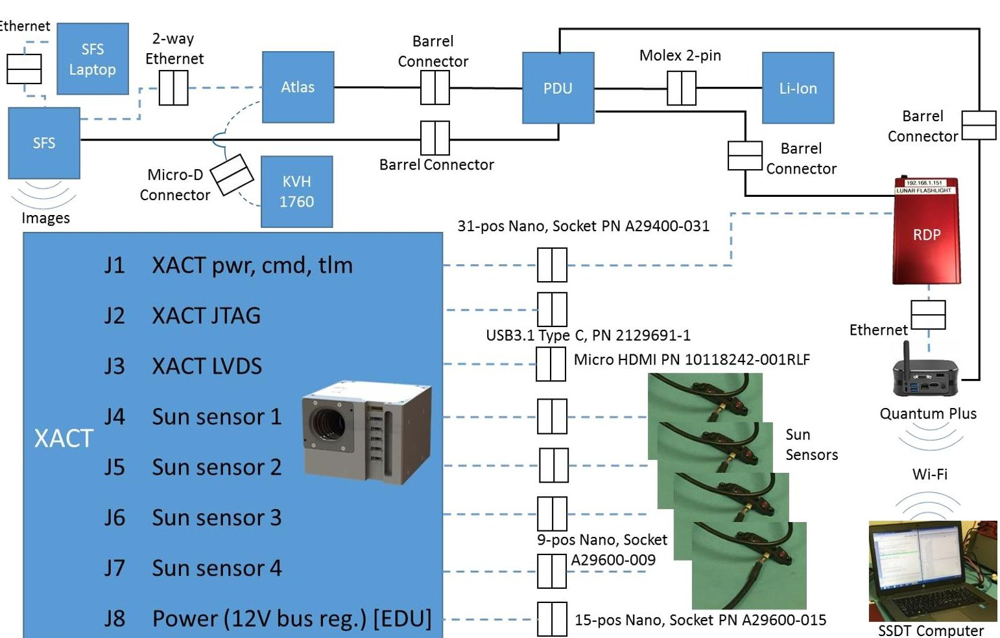

Figure 8. Electrical connection diagram in the JPL Small Satellite Dynamics Testbed.

<!-- PDF_PAGE: 10 -->

specification assessments, and was based on process and procedures developed in the EDU tests. This testing differed from the EDU testing in that the SRU was used in concert with the SFS. Again, no tests directly verified the GNC requirements of the LF mission, since the controllers were not modified to account for the difference in mass properties of the spherical air bearing as compared to the LF spacecraft. Consequently, the performance of the controllers will not perform in the exact manner as if they were controlling the spacecraft.

Figure 2 showed earlier in this text that the four CSS are placed on different faces of the spacecraft to provide wide coverage and minimize overlapping fields of view. The relative configuration between the XACT and the CSS is captured in software, but challenges the physical limitations of the ground testbed. To accommodate the additional CSS in the test environment, the four total FM CSS were rotated 90 deg as shown in Figure 9, such that no sensors were located on the bottom of the XACT-50 unit. This change enabled the CSS to be entirely above the top surface of the spherical air bearing, thereby allowing the sun simulator lamp to shine directly onto each sensor. Changing the software representation in accordance with the physical rotation required a change to the on-board table within the XACT-50's memory that was not permanently stored (only stored in volatile memory), so as to avoid permanently writing the testing configuration to memory.

## 3.6. Reaction Wheel Jitter Testing

The RW jitter testing was designed to characterize this newly developed 50 mNm RWA following the proven JPL in-house methodology (Shields, 2017) and conduct performance assessments of the vibration created by the spinning wheels (one wheel per axis) at the integrated GNC system level. No tests directly verified the GNC requirements of the LF mission, though the results helped inform the method of operating the spacecraft. The testing was performed on the Kistler table as shown in Figure 10, and it obtained the data to create a model of the jitter induced by the RWAs spinning in the range of -6,000 rpm to +6,000 rpm. This process produced waterfall jitter plots for each axis' force and moment jitter components. These models, however, are based on the EDU wheels within the EDU chassis. The EDU XACT-50 was used for this jitter testing to reduce the number of wheel actuations on the flight units. This difference between the test article and the flight unit prevents a direct use of the acquired data for predicting flight performance, but it provides a qualitative assessment of possible modes and effects that may be seen in space.

## 3.7. Test Results from FM Testing

This section includes example test results from the FM set of tests. These results show the FM behavior

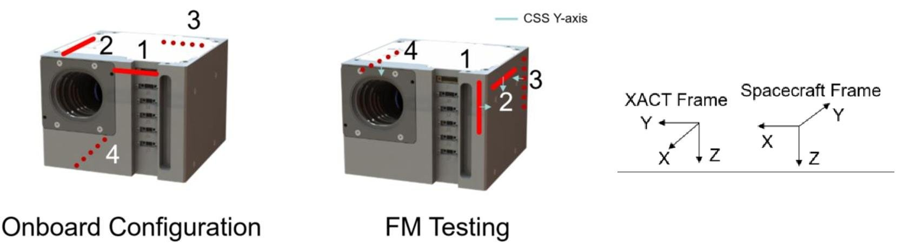

Figure 9. Rotated sun sensor positions to enable FM ground testing.

<!-- PDF_PAGE: 11 -->

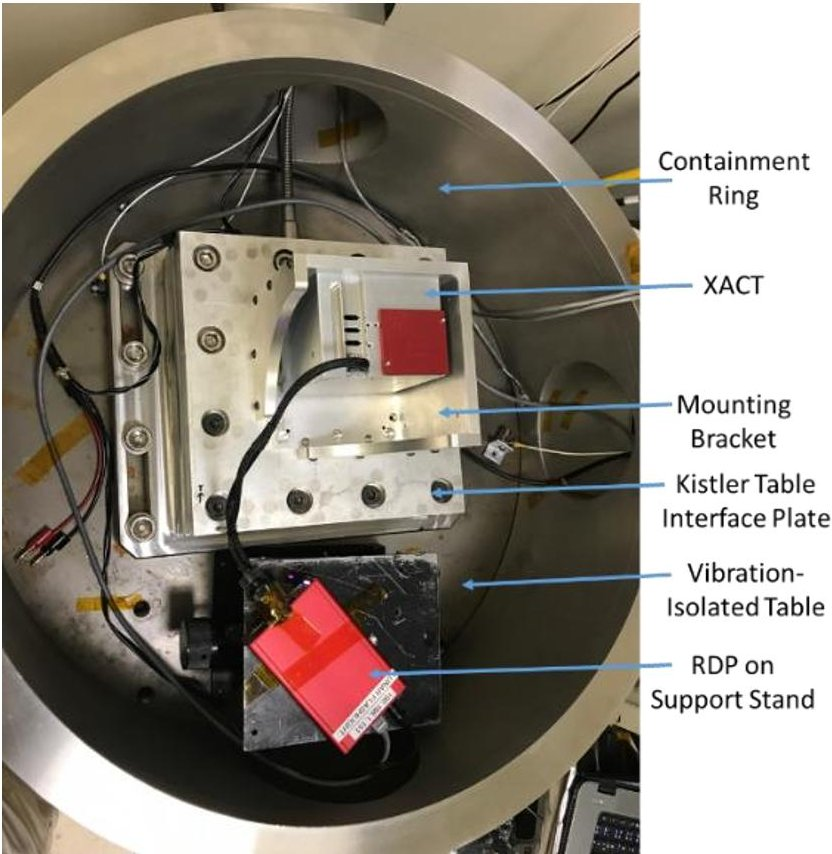

Figure10. Top-down view of jitter testing setup.

operating on the SSDT's spherical air bearing with different mass properties, without changes to the XACT 50's core control or estimation software, and therefore are not directly representative of the expected flight performance.

## 3.7.1. CSS Phasing Test

Figure 11 shows the diode counts during a CSS phasing test that focused on the fourth CSS, corresponding to diode numbers 13 through 16, as indicated in the figure legend. Over the course of the test, the spherical air bearing was rotated manually to orient the fourth CSS to the sun simulator, which explains the uneven nature of the response curves during the first 35 seconds. Additionally, the manual motion is evident in the variability of the CSS counts during the 35 sec to 42 sec period when the CSS was pointed toward the sun simulator. The ambient light in the room results in a low level of counts (as shown between approximately 45 and 55 seconds), though the diodes within the CSS unit are able to pick up some stray light from the sun simulator lamp even when not angled directly toward the sun simulator. This effect is visible by the count levels before 30 seconds into the test and

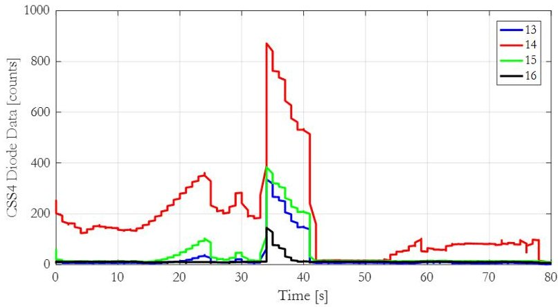

Figure 11. CSS 4 diode count history during sun sensor phasing test.

after 60 seconds into the test being higher than the ambient light condition. The high count levels between approximately 35 and 42 seconds occur because of the CSS being pointed nearly directly to the sun simulator. The peak diode count is roughly half of the value expected for 1AU distances, highlighting the need to adjust the diode threshold during ground testing for what is deemed a valid CSS measurement. This test therefore shows the ability of the CSS to output counts at the expected levels for ambient room conditions and when exposed to a sun simulator lamp. Further, it justifies the need for strong light sources to be used in such tests, as even the lamp used here resulted in counts half of what the CSS is capable of measuring.

## 3.7.2. SRU Phasing Test

Figure 12 shows the results of the SRU phasing test when the spherical air bearing was not floating so

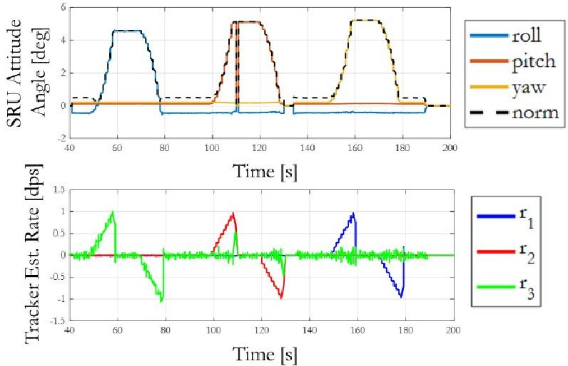

Figure 12. SRU phasing attitude and rate history.

<!-- PDF_PAGE: 12 -->

that it was fixed in place. The SFS was commanded to slew about all three axes in a one-at-a-time order: roll, pitch, and yaw. Consequently, only the simulated star field was free to move. Each axis was commanded to rotate first with an acceleration of 0.1 deg/s $ ^{2} $ until reaching 1 deg/s, at which point the star field was held still with no rate. After ten seconds of this static condition, the acceleration was reversed to arrive at the same angle as the initial condition. As a result, the rates all return to static after each axis' test, while the attitude angle returns to the initial value prior to the commanded star field slewing. The SRU attitude angle top graph shows the five degree change in attitude that was attained, while the lower rate estimate from the SRU shows the triangular slew periods, where the ramp rate is determined by the commanded star field rate of change. Throughout the duration of this test, the star tracker was able to track the star field for nearly the full duration. A small drop near the 110 sec mark shows a short period where the star tracker was unable to determine its orientation, resulting in no angle being reported. Such a short drop, likely a random glitch or stray light effect in the measurement, is not significant, and such a drop once in flight will not affect the spacecraft's ability to perform its mission. Additionally, the test reveals information about the noise that can be expected in the tracker's attitude estimate, since the third axis exhibits increased noise compared to the other two. This test therefore demonstrates that the SRU was able to identify correctly the axes and direction of travel, completing the objective for the phasing test. The SRU coordinate frame is as expected by the FSW and telemetry system, so it may be used in further, more complex tests.

## 3.7.3. Safe Mode Test

The sun-pointing operation does not use the SRU attitude estimates in determining the location of the sun, though the SRU remains powered on. The CSS provide measures of incident sunlight as a number of counts per diode, and the IMU rate is used to track the spacecraft attitude. Therefore, a phasing test of the sun-pointing operation tests the ability for the CSS and the IMU to command the three reaction wheels to find and track the sun.

The test of the sun-pointing operation was performed by manually moving the spherical air bearing to an off-sun simulator attitude and allowing the internal XACT-50 algorithms to slew the spacecraft until the sun simulator was found by one of the CSS. Thereafter, the XACT-50 pointed the spacecraft +X axis to the sun simulator despite disturbance torques, most notably the gravity torque, because of a nonzero offset of the center of mass to the center of rotation. Figure 13 shows the manual motion at the start of the test, as well as the result of the XACT-50 slewing to maintain the desired pointing vector with the red curve (y-axis) pointed to the sun, with the x and z axes pointed orthogonally to the sunline. The circles on the right graph edge show the desired locations for each curve, with each circle's color matching that of the corresponding data curve. Because the inertia properties saved within the XACT-50 are different from those of the spherical air bearing, the system exhibits a control behavior with oscillations that are larger than expected once in flight. The comparatively large gravity disturbance torques combined with the difference in inertial properties lead to the residual error shown in the plot at the end of the test. Despite these oscillations and the gravity disturbance torque, the XACT-50 was able to identify the sun, slew to the correct attitude, and generally maintain pointing for over 100 seconds. Therefore, the phasing of the sensors was demonstrated in concert, while demonstrating a basic functionality of the sun-pointing operation.

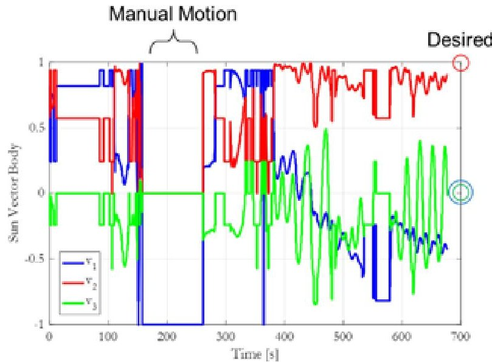

Figure 13. Sun-pointing operation, sun vector in body frame.

<!-- PDF_PAGE: 13 -->

## 3.7.4. Fine-Pointing Mode Test

Figures 14 and 15 show data from a fine-pointing operation test. In this test, the SRU was tested with the SFS providing closed-loop star fields based on the rotation of the spherical air bearing. The goal of the fine-pointing test was to determine the qualitative ability of the XACT-50 to maintain its attitude despite external disturbances, such as the gravity-based torque. The XACT-50 SRU initializes to the unit quaternion [0001], with scalar last; if the SRU estimate of the attitude remains at this value, then the SRU does not have a valid estimate of the spacecraft attitude.

Figure 14 shows two circled regions showing representative regions where the SRU was able to track the star field from the SFS (indicated by the quaternion elements each becoming approximately 0.5), and where the SRU was not able to lock onto the star field (where the SRU estimate is the initialization quaternion). The air bearing was free to rotate throughout this test, with the reaction wheels controlling the platform motion based on what the gyroscopes and SRU measured. This figure shows that the SRU was able to maintain lock for approximately 50% of the test, likely owing to a combination of factors including spherical air bearing oscillations and unintended motions or not fully collimated light entering the SRU optics stemming from SFS positioning errors. Subsequent testing of the SRU in the same test conditions as what was performed for MarCO's pre-delivery checkout in a static configuration with a programmed star field history resulted in similar performance to MarCO, with almost no loss of lock. Because of this result, the LF project did not work to extract the star fields from the loss of lock windows and test for lock when the platform was static. Because no other XACT unit has exhibited this kind of tracking lock behavior (because this test was not performed on any other XACT unit for any other mission), the project deemed the test informative for operations considerations, and the project is tracking the star tracker performance as an acceptable project risk.

Figure 15 shows the RWA speeds and the corresponding quaternion history, with 'Q Body wrt ECI' being the attitude estimate telemetry output by the XACT-50 using measurements from the star tracker

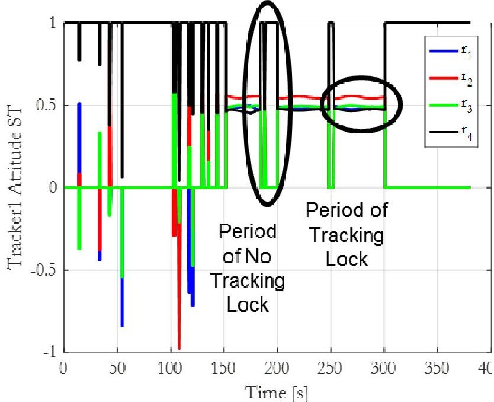

Figure 14. Fine-pointing operation tracker attitude quaternion (scalar last).

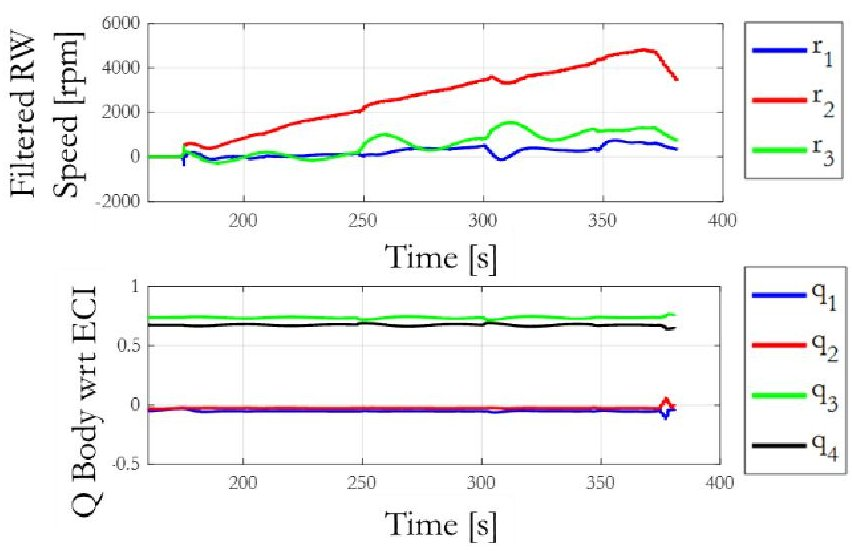

Figure 15. Fine-pointing operation test reaction wheel speed and body quaternion (inertial frame).

and gyroscope. This set of RWA speeds shows that the second wheel speed increased significantly more than the other wheel speeds, owing to the offset center of mass of the spherical air bearing being aligned mostly with that axis. Despite this torque, the achieved quaternion is nearly unchanged, demonstrating that the RWAs were able to compensate for the torque by increasing their stored momentum. The smooth quaternion history also demonstrates that the SRU moving in and out of lock does not significantly affect the ability of the XACT-50 to estimate its attitude; over these

<!-- PDF_PAGE: 14 -->

shorter periods, the onboard IMU is sufficient for providing rotational rate estimates. The small reaction wheel disturbances around the 250 sec and 300 sec points are likely caused by the attitude estimate being improved from a SRU measurement update or from the controller compensating for the larger platform inertia. Similarly, the roll off in wheel speed at the end of the test is likely due to a test engineer holding the spherical air bearing to stop the test shortly before the telemetry finished logging.

## 3.7.5. Reaction Wheel Jitter Test

The RWAs induce vibrations to the XACT-50 and spacecraft during their operation owing to imperfections in the mass distributions of the wheels and in the wheel mountings. These vibrations are a source of jitter within the spacecraft, and if incorrectly modelled they can have significant deleterious impacts on spacecraft science outputs. Figure 16 shows an example of the force amplitude spectrum data collected from the jitter testing in the X-axis. This spectrum shows the frequency range corresponding to the primary modes

of operation for the wheel, while the amplitude shows the force that is created from the spinning wheel. To acquire the jitter data, wheels were spun over the full range of speeds from -6,000 to 6,000 rpm in steps of 200 rpm, with a hold of 60 sec at each speed. There is a steady increase in the primary vibration mode through 100 Hz peaking at approximately 0.5N at 100 Hz, as this frequency corresponds to the 6,000 rpm maximum speed of the reaction wheels. There are larger amplitude peaks throughout the frequency range, however, which correspond to additional jitter modes and harmonics approximately every 10 Hz. These peaks are likely due to structural modes resulting from the mounting of the reaction wheel within the XACT-50 EDU chassis. This test, therefore, shows that the EDU exhibited a higher noise level in the 3,000-4,000 rpm range, with static and dynamic imbalances consistent with other, similar units that were tested previously for separate projects.

Testing the wheel vibration only on the EDU unit provides an overall assessment of the XACT-50 reaction wheel characteristics without risking the potential of incurring damage or wear to the FM wheels.

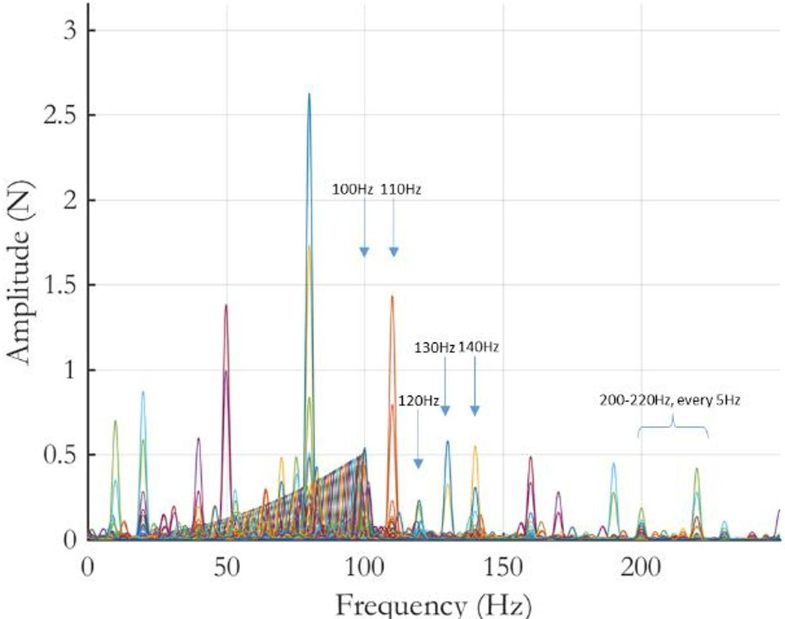

Figure 16. X-axis force amplitude spectrum during jitter testing.

<!-- PDF_PAGE: 15 -->

Though the FM wheels have better balance, the vibration characteristics are not expected to be significantly different, since the wheel assemblies and most of the XACT-50 chassis is shared, though the missing components in the EDU XACT-50 contribute to differing overall structural properties. It is for this reason that the data obtained from the EDU testing cannot be directly applied to the FM wheels, though the data is useful in conducting overall systems engineering analyses of the spacecraft. The waterfall plot data can be imported into a simulation of the attitude control system for improved in-flight performance modelling.

## 3.8. XACT-50 EDU and FM Testing Summary

The testing of both the EDU and FM XACT-50 units provided several benefits to the LF mission centered on the desire to validate the functionality of the GNC system's hardware and software. The series of initial EDU tests allowed the LF team to confirm the basic operation of the provided XACT-50 software and the coordinate frames that are used by the rest of the C&DH system. Furthermore, it validated the functionality of the EDU so that it would be able to provide attitude determination and control functionality as part of the ATB. Consequently, the EDU tests formed a baseline for the subsequent FM tests.

The FM tests ran with nearly identical test procedures, and they were similarly able to demonstrate the functionality of all sensors and actuators, as well as the software on-board. The FM tests, being the only such tests on the unit prior to flight, allowed the LF team to have a demonstrated set of capabilities on the ground prior to full integration and in a relevant dynamics environment. Ongoing EDU tests as part of the ATB take the risks of software development for the C&DH system away from the FM, while the jitter tests on the EDU provide valuable disturbance data without subjecting the FM to long duration dwells at high RWA speeds. The set of tests conducted on both the EDU and FM using the SSDT facilities therefore span the range of primary software modes and involved all sensors and actuators while following a more formal, incremental testing process than prior JPL CubeSats and serve as standard process for future CubeSats at JPL. Although out of the scope for this paper, anomalies

and unit idiosyncrasies encountered during the testing have been incorporated into future actionable steps for the project, including the beginning of a set of operational rules once LF launches.

## 4. GNC Integration with Avionics Testbed

## 4.1. Hardware and Electrical Connections in ATB

The ATB provides a ground testing platform for software development, integration, and functional testing of the hardware and software elements, and assessing the communication between each spacecraft functional element. These benefits are possible because the ATB allows engineers to make flight-like connections, as well as diagnostic connections. The current LF ATB is set up to develop, test, and validate FSW that is planned to be used to operate the whole spacecraft via the C&DH (Sphinx) sub-system (Imken, 2017). It is also used to demonstrate the functionality of each system when connected in a flight-like manner to the Sphinx. Furthermore, it is critical for early detection of potential issues during integration of GNC and Propulsion systems from different vendors. Importantly, the ATB is able to serve as the first step toward full FM integration into the spacecraft, as many of the connections made to the EDU in the ATB have corollaries when integrating the FM XACT-50 with the rest of LF's flight hardware.

The XACT-50 EDU was integrated with the rest of LF avionics and other system hardware including the propulsion engineering unit in a flat-sat configuration to create the ATB as shown in Figure 17. The current ATB has the following items connected with each other: the Sphinx EDU, the Electrical Power System (EPS) EDU, the XACT-50 EDU, propulsion engineering unit, and payload EDU.

The XACT-50 EDU connected to the LF C&DH system with a cable is nearly identical to the one that will be used in flight, i.e., using a 31-pin nano-D connector that contains low voltage data signal lines (LVDS) that are initially configured by pseudo-random binary sequences (PRBS). Additionally, the propulsion system EDU was connected both to the power supply and to the XACT-50 EDU in a manner similar to flight: the primary interface connector of the

<!-- PDF_PAGE: 16 -->

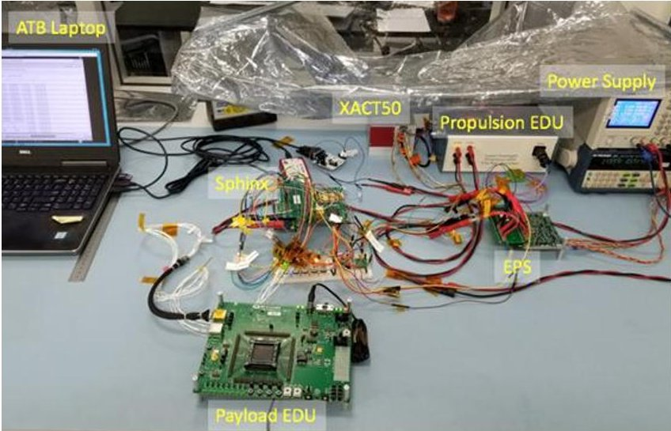

Figure 17. XACT-50 and propulsion EDUs integrated with ATB.

XACT-50 breaks out to connect both to the propulsion and C&DH subsystems. The communication between the XACT-50 and propulsion system units was tested to confirm their ability to send and receive data as part of the ATB testing. Data flow from C&DH to the propulsion unit goes through the XACT-50 data interface, which acts as a pass-through for commands and telemetry to and from the propulsion unit.

The LVDS interface allows the C&DH system to command the XACT-50 through a standard set of interfaces that are identified in the interface control document (ICD) provided by BCT. A sub-set of telemetry map and commands contained within the XACT-50 ICD were used to define the spacecraft commands and telemetry to interface with the XACT-50 unit. Also, additional functionality was added to send any set-to-generic data bytes to the XACT-50 unit and read the entire telemetry map into a file on-board. Functional testing was performed in the ATB to verify commanding and telemetry interface with the XACT-50 unit. Once connected, the completed ATB setup enables testers to develop the FSW used for commanding the XACT-50 and processing its telemetry.

The first XACT-50 commands executed upon integration were to change the wheel operating mode to IDLE. This process therefore confirmed that the telemetry from the XACT-50 was able to be passed and interpreted by the C&DH system, as well as confirming that the commands to the XACT-50 were being generated, sent, and accepted appropriately. Commands for firing the thrusters originate either from within the XACT-50 (such as autonomous reaction

wheel momentum dumping) or from C&DH commands (such as a ground-based command for a trajectory change maneuver). Commands to the propulsion unit are routed through the XACT-50, and all telemetry from the propulsion unit is also routed through the XACT-50 unit; this configuration allows the thrusters to be controlled at a high level with some functions handled entirely automatically by the XACT-50.

## 4.2. Ground Data System setup in ATB

The ground data system, namely Advanced Multimission Operations System (AMMOS) Mission data Processing and Control System (AMPCS) version 7.5, is used in the ATB to provide data interface with the Sphinx platform running FSW. AMPCS allows the operator to send commands and uplink files to FSW using the uplink control window as displayed in Figure 18. AMPCS has been used extensively for large missions at JPL, and has been successfully implemented for the MarCO CubeSat mission.

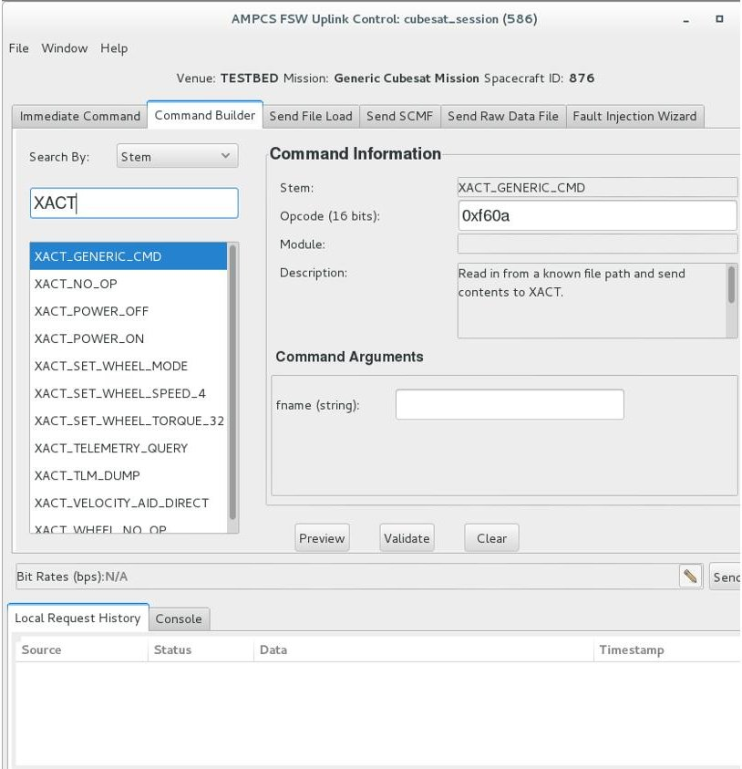

Figure 18. AMPCS command builder tab in uplink control window.

The command can be selected from the list displayed under Command Builder tab and sent to the Sphinx platform over a RS-232 GSE port connection between the ATB laptop and Sphinx by clicking the

<!-- PDF_PAGE: 17 -->

"Send" button in uplink control GUI. A file can be sent to the Sphinx platform by browsing by the input file on the ATB laptop and setting target file location as "/util/<filename>” under Send File Load tab and clicking the "Send" button in uplink control GUI, as displayed in Figure 19.

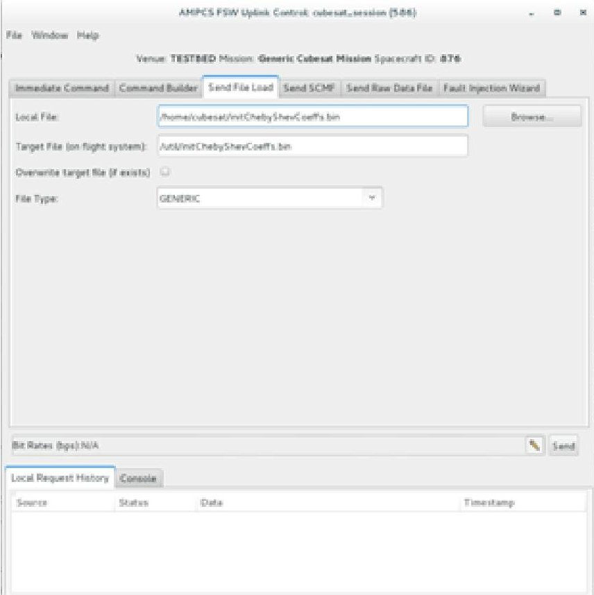

Figure 19. AMPCS send file load tab in uplink control window.

Telemetry values are read from XACT-50 at 1Hz by FSW and packetized into channels which are downlinked once every 10 seconds. They are displayed in AMPCS's Monitor window under the Channel List tab.

On-board events output by FSW are received in AMPCS as event verification records (EVRs) and displayed in the EVR tab of monitor window, shown in Figure 20. Color coding is used to assist test operators in interpreting the EVRs.

Using the AMPCS GUI installed on ATB laptop, an operator can send commands to XACT-50 unit and verify successful execution of the command by inspecting EVRs received in the EVR tab of monitor window indicating command completion success and verifying expected telemetry value updates displayed in the channel list tab. This technique is used to perform functional and integrated testing of XACT-50 unit in the ATB, as described in detail in section 6.2.

## 5. Functional and Integrated Testing in ATB

Thorough functional and integrated testing was performed in the ATB with XACT-50 unit using python-based test scripts that interface with the AMPCS command line interface to verify the data interface with XACT-50. The python test scripts send commands to the C&DH system over a UART serial connection, and receive telemetry from the spacecraft over the same connection. The test scripts verify expected telemetry items in response to sending certain commands and initiating events on-board the spacecraft. After a command is sent from the test script, command completion is verified upon receiving the OpCodeCompletion event in telemetry, indicating a successful completion status for the specific command ID. The test script queries the ground data system's database for the OpCodeCompletion event with the specific command ID, for which successful completion is expected with a maximum timeout value of 30 seconds from when the command was sent for execution from the test script. Once the OpCodeCompletion event is verified by the test script, the command execution is marked as successful. Also, the XACT-50 unit outputs a command accept count as part of its telemetry table, which is incremented by 1 for each successful command execution on the XACT-50. The command accept count value output from XACT-50 telemetry is telemetered to the ground in a FSW-telemetry channel (XACT-0275). Upon receiving an OpCodeCompletion event, the test script queries the ground data system's database for the current command accept count value and verifies it has incremented by 1. This process is illustrated in the test script's log file in Figure 21 for verifying successful completion of XACT_NO_OP command:

A complete list of XACT-50 LF FSW commands verified for successful completion is given in Table 2. Functional integrated testing of XACT-50 using Flight Software is performed by executing all applicable XACT commands in Flight Software implemented as ground commands, and verifying successful completion of the commands along with increment of the XACT command accept count in telemetry. The XACT commands are completed successfully in

<!-- PDF_PAGE: 18 -->

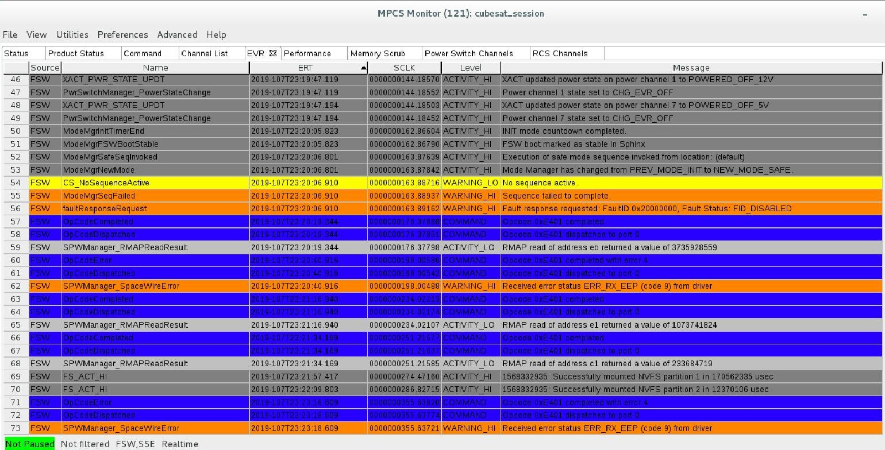

Figure 20. AMPCS EVR tab in monitor window.

<table border="1"><tr><td>2019-039T01:15:29.008</td><td>FSWSR</td><td>0000002983.27052</td><td>MPCS</td><td>FIT INFO</td><td></td><td>===== Beginning Testxactlf05Cmd05=====</td><td></td></tr><tr><td>2019-039T01:15:29.008</td><td>FSWSR</td><td>0000002983.27052</td><td>MPCS</td><td>FIT INFO</td><td></td><td>Test Case Description:</td><td></td></tr><tr><td>2019-039T01:15:29.008</td><td>FSWSR</td><td>0000002983.27052</td><td>MPCS</td><td>FIT INFO</td><td></td><td>Send command 5</td><td></td></tr><tr><td>2019-039T01:15:29.008</td><td>FSWSR</td><td>0000002983.27052</td><td>MPCS</td><td>FIT INFO</td><td></td><td></td><td></td></tr><tr><td>2019-039T01:15:29.008</td><td>FSWSR</td><td>0000002983.27052</td><td>MPCS</td><td>FIT INFO</td><td>MTAK_PASS</td><td>EHA found/verified XACT_CMD_ACCEPT_COUNT(XACT-0275)is DN32</td><td></td></tr><tr><td>2019-039T01:15:29.008</td><td>FSWSR</td><td>0000002983.27052</td><td>MPCS</td><td>FIT INFO</td><td></td><td>Sending FSW Command(number=218):XACT_NO_OP</td><td></td></tr><tr><td>2019-039T01:15:29.540</td><td>FSWSR</td><td>0000002983.27052</td><td>MPCS</td><td>FSW_CMD</td><td>XACT_NO_OP</td><td></td><td>91</td></tr><tr><td>2019-039T01:15:29.543</td><td>FSWSR</td><td>0000002983.27052</td><td>MPCS</td><td>LOG INFO</td><td>General</td><td>FSW::Forwarded transmitted command(s) to SOCKET.</td><td>91</td></tr><tr><td>2019-039T01:15:32.103</td><td>1970-001T</td><td>0000002992.83012</td><td>FSW RT</td><td>EVR COMMAN</td><td>OpCodeDispatched</td><td>Opcode 0xF605 dispatched to port 7</td><td>815</td></tr><tr><td>2019-039T01:15:32.339</td><td>1970-001T</td><td>0000002993.09743</td><td>FSW RT</td><td>EVR COMMAN</td><td>OpCodeCompleted</td><td>Opcode 0xF605 completed</td><td>816</td></tr><tr><td>2019-039T01:15:35.008</td><td>FSWSR</td><td>0000002993.09743</td><td>MPCS</td><td>FIT INFO</td><td></td><td>Opcode 0xF605 completed</td><td></td></tr><tr><td>2019-039T01:15:35.008</td><td>FSWSR</td><td>0000002993.09743</td><td>MPCS</td><td>FIT INFO</td><td></td><td>Expected command stages:&#x27;success&#x27;=True (expect=True)</td><td></td></tr><tr><td>2019-039T01:15:35.008</td><td>FSWSR</td><td>0000002993.09743</td><td>MPCS</td><td>FIT INFO</td><td></td><td></td><td></td></tr><tr><td>2019-039T01:15:35.008</td><td>FSWSR</td><td>0000002993.09743</td><td>MPCS</td><td>FIT INFO</td><td>MTAK_PASS</td><td></td><td></td></tr><tr><td>2019-039T01:15:35.210</td><td>FSWSR</td><td>0000002993.09743</td><td>MPCS</td><td>LOG INFO</td><td>Performance</td><td>FSW::Heap:Health=GREEN,Used=1177Mb,Max=1484Mb,High Water=1224Mb,Percentage=79%</td><td>91</td></tr><tr><td>2019-039T01:15:35.210</td><td>FSWSR</td><td>0000002993.09743</td><td>MPCS</td><td>LOG INFO</td><td>Performance</td><td>FSW::Overall health of the application is GREEN</td><td>91</td></tr><tr><td>2019-039T01:15:36.008</td><td>FSWSR</td><td>0000002993.09743</td><td>MPCS</td><td>FIT INFO</td><td>MTAK_PASS</td><td>EHA found/verified XACT_CMD_ACCEPT_COUNT(XACT-0275)is DN33</td><td></td></tr><tr><td>2019-039T01:15:36.008</td><td>FSWSR</td><td>0000002993.09743</td><td>MPCS</td><td>FIT INFO</td><td></td><td>wait 5 seconds</td><td></td></tr></table>

Figure 21. XACT-50 test script log.

Flight Software upon successful transmission of command data bytes from the C&DH UART port connected to the XACT-50 hardware.

## 5.3. XACT-50 Generic Commanding

The generic commanding capability was tested by sending a file containing data bytes comprising of a valid XACT-50 command, such as no-op. Once the file is received on-board the C&DH system, it is forwarded into the XACT-50 unit using the XACT_GENERIC_CMD command as illustrated in Figure 22. After executing the command, telemetry is read from XACT-50 unit and inspected to verify proper command counter increments indicating successful execution of the command.

## 5.4. XACT-50 Off-Nominal Testing

Limited off-nominal testing is also performed with the XACT-50 unit by triggering fault responses using test commands to verify proper sequence of events. For example, if the XACT-50 unit indicates ATTITUDE_VALID as 0 for 3,750 consecutive seconds (telemetry queried at 1Hz), then the fault response is to power cycle the XACT-50 unit up to three times. This fault response is verified using a test script that sends a test command to trigger the attitude invalid fault and verifies appropriate telemetry events that indicate the XACT-50 was power cycled up to three times. An excerpt of this behavior indicating test command used to trigger the fault manually and response to power cycle XACT-50 is shown in Figure 23. While the specific choice of log data is Lunar Flashlight project-specific,

<!-- PDF_PAGE: 19 -->

Table 2. XACT-50 LF FSW Command List

<table border="1"><tr><td>XACT Command Name</td><td>Command Description</td></tr><tr><td>XACT_INIT_CHEBYSHEV_SC</td><td>Initialize Chebyshev polynomial coefficients for spacecraft trajectory with respect to sun-centered inertial (J2000) coordinates.</td></tr><tr><td>XACT_SET_ATT_DET_FILTER</td><td>Set attitude determination filter.</td></tr><tr><td>XACT_GOTO_SUN_POINT</td><td>Go to SFM</td></tr><tr><td>XACT_GOTO_FINE_HOLD</td><td>Go to FPM (holds current attitude wrt ECI)</td></tr><tr><td>XACT_GOTO_TARGET</td><td>Go to target (transitions to FPM if not already in it)</td></tr><tr><td>XACT_NO_OP</td><td>No operation (for testing command interface)</td></tr><tr><td>XACT_SET_WHEEL_MODE</td><td>Go to FPM (holds current attitude wrt ECI)</td></tr><tr><td>XACT_SET_WHEEL_SPEED_4</td><td>Desired wheel speed</td></tr><tr><td>XACT_SET_WHEEL_TORQUE_32</td><td>Sets desired wheel torque</td></tr><tr><td>XACT_RATE_LIMIT</td><td>Limit body rates during Fine Reference Point. Resets to default on either a GainSelect command or a transition to SFM</td></tr><tr><td>XACT_ACCEL_LIMIT</td><td>Limit body acceleration during Fine Reference Point. Resets to default on either a GainSelect command or a transition to SFM</td></tr><tr><td>XACT_SET_CMD_MOMENTUM</td><td>Sets desired inertial momentum (J2000) to achieve during fine reference-pointing mode. Spacecraft continues to maintain inertial momentum until momentum too high, revert to SFM, or commanded otherwise</td></tr><tr><td>XACT_TRACK_MAG_LIMITS</td><td>Set track mode magnitude limits for star selection</td></tr><tr><td>XACT_STAR_ID</td><td>Begin star ID process. Transition to Track mode if enabled</td></tr><tr><td>XACT_TAKE_PHOTO</td><td>Take images with commanded settings, and store for later downlink. Suspends StarId and Track operations until done</td></tr><tr><td>XACT_REINIT</td><td>Re-initialize key software variables</td></tr><tr><td>XACT_GO_TO_TRACK</td><td>Go to track mode. Uses previously calculated tracker attitude</td></tr><tr><td>XACT_GO_TO_IDLE</td><td>Go to idle mode. Only commands and telemetry processed.</td></tr><tr><td>XACT_TRACKER_USAGE</td><td>Enable or disable tracker usage in attitude determination</td></tr><tr><td>XACT_THRUSTER_DIRECT_CMD</td><td>Send 10-byte command directly to thruster unit</td></tr><tr><td>XACT_MOMENTUM_DUMP</td><td>Use thrusters to reduce total momentum to reach a desired deadband</td></tr><tr><td>XACT_CLEAR_THRUSTER_FAULT_FLAG</td><td>Sets ThrusterFaultFlag to No Fault or to Fault</td></tr><tr><td>XACT_MANUAL_BURN</td><td>Use thrusters for attitude control</td></tr><tr><td>XACT_THRUSTER_USAGE</td><td>Stop all thruster usage and return to reaction wheel control.</td></tr><tr><td>XACT_WHEEL_NO_OP</td><td>Wheel No operation (for testing command interface)</td></tr><tr><td>XACT_SET_DELTA_V_FEED_FOR-WARD_TORQ</td><td>Sets a feedforward body-frame torque that is always applied in DeltaV mode.</td></tr><tr><td>XACT_SET_DELTA_V_PARAMETERS</td><td>Define period over which all future DeltaV burns will "ramp up"</td></tr><tr><td>XACT_SET_CURR_TIME_UTC</td><td>Set current spacecraft time using UTC in Gregorian format.</td></tr><tr><td>XACT_INIT_POS_VEL_UTC_GREG</td><td>Initialize spacecraft orbit ephemeris, using position, velocity and UTC Gregorian.</td></tr><tr><td>XACT_TEST_SET_ATT</td><td>Set FSW attitude to uploaded values (TEST ONLY). Also sets attitude valid and resets gyro-only ride timer.</td></tr><tr><td>XACT_ORBIT_METHOD</td><td>Method for orbit propagation.</td></tr><tr><td>XACT_VALIDATE_CHEBYSHEV</td><td>Validate Chebyshev.</td></tr><tr><td>XACT_INIT_CHEBYSHEV_TIME_SET-TINGS</td><td>Initialize Chebyshev polynomial time and settings for spacecraft trajectory with respect to central body-centered inertial (J2000) coordinates</td></tr><tr><td>XACT_INIT_CHEBYSHEV_X</td><td>Initialize Chebyshev polynomial X coefficients for spacecraft trajectory with respect to central body-centered inertial (J2000) coordinates</td></tr><tr><td>XACT_INIT_CHEBYSHEV_Y</td><td>Initialize Chebyshev polynomial Y coefficients for spacecraft trajectory with respect to central body-centered inertial (J2000) coordinates</td></tr><tr><td>XACT_INIT_CHEBYSHEV_Z</td><td>Initialize Chebyshev polynomial Z coefficients for spacecraft trajectory with respect to central body-centered inertial (J2000) coordinates</td></tr></table>

<!-- PDF_PAGE: 20 -->

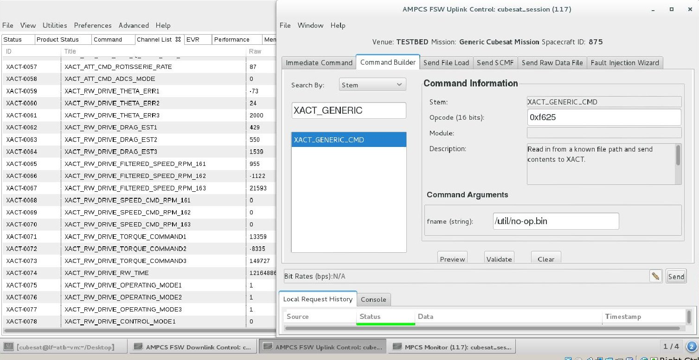

Figure 22. XACT-50 command and telemetry interface in ATB's ground data system.

<table><thead><tr><th>2019-037T00:49:52.962</th><th>FSWSR</th><th>0000072982.31287</th><th>MPCS</th><th>FSW_CMD</th><th>FPM_TRIGGER_FAULT</th><th></th><th>76</th></tr></thead><tbody><tr><td>2019-037T00:49:52.987</td><td>FSWSR</td><td>0000072982.31287</td><td>MPCS</td><td>LOG_INFO</td><td>General</td><td>FSW::Forwarded transmitted command(s) to SOCKET.</td><td>76</td></tr><tr><td>2019-037T00:49:53.006</td><td>FSWSR</td><td>0000072982.31287</td><td>MPCS</td><td>FIT_INFO</td><td></td><td>Opcode 0x0805 completed</td><td></td></tr><tr><td>2019-037T00:49:53.006</td><td>FSWSR</td><td>0000072982.31287</td><td>MPCS</td><td>FIT_INFO</td><td></td><td>Expected command stages: 'success'=True (expect=True)</td><td></td></tr><tr><td>2019-037T00:49:53.006</td><td>FSWSR</td><td>0000072982.31287</td><td>MPCS</td><td>FIT_INFO</td><td></td><td></td><td></td></tr><tr><td>2019-037T00:49:52.429</td><td>1970-001T00:00:00.000</td><td>0000072962.31367</td><td>FSW RT</td><td>EVR_COMMAND</td><td>OpCodeDispatched</td><td>Opcode 0x0805 dispatched to port 48</td><td>54</td></tr><tr><td>2019-037T00:49:52.429</td><td>1970-001T00:00:00.000</td><td>0000072962.31406</td><td>FSW RT</td><td>EVR_COMMAND</td><td>OpCodeCompleted</td><td>Opcode 0x0805 completed</td><td>53</td></tr><tr><td>2019-037T00:49:56.537</td><td>1970-001T00:00:00.000</td><td>0000072966.41010</td><td>FSW RT</td><td>EVR_COMMAND</td><td>OpCodeDispatched</td><td>Opcode 0x0800 dispatched to port 48</td><td>57</td></tr><tr><td>2019-037T00:49:56.537</td><td>1970-001T00:00:00.000</td><td>0000072966.41052</td><td>FSW RT</td><td>EVR_COMMAND</td><td>OpCodeCompleted</td><td>Opcode 0x0800 completed</td><td>56</td></tr><tr><td>2019-037T00:49:58.255</td><td>1970-001T00:00:00.000</td><td>0000072968.14183</td><td>FSW RT</td><td>EVR_WARNING_HI</td><td>GenMonitor_TimIdIsNotKnown</td><td>Received Telemetry ID 61793, which is not being monitored.</td><td>58</td></tr><tr><td>2019-037T00:49:59.818</td><td>FSWSR</td><td>0000072968.14183</td><td>MPCS</td><td>LOG_INFO</td><td>Performance</td><td>FSW::Heap: Health=GREEN, Used=1118Mb, Max=1484Mb, High Water=1156Mb, Percentage=75%</td><td>76</td></tr><tr><td>2019-037T00:49:59.818</td><td>FSWSR</td><td>0000072968.14183</td><td>MPCS</td><td>LOG_INFO</td><td>Performance</td><td>FSW::Overall health of the application is GREEN</td><td>76</td></tr><tr><td>2019-037T00:50:00.943</td><td>1970-001T00:00:00.000</td><td>0000072970.79225</td><td>FSW RT</td><td>EVR_COMMAND</td><td>OpCodeDispatched</td><td>Opcode 0xE0DA dispatched to port 3</td><td>59</td></tr><tr><td>2019-037T00:50:00.943</td><td>1970-001T00:00:00.000</td><td>0000072970.79474</td><td>FSW RT</td><td>EVR_ACTIVITY_HI</td><td>GenMonitor_EnDis_Filt</td><td>Setting monitor filter to GEN_MON_FILT_DIS_RESP.</td><td>60</td></tr><tr><td>2019-037T00:50:00.943</td><td>1970-001T00:00:00.000</td><td>0000072970.79666</td><td>FSW RT</td><td>EVR_COMMAND</td><td>OpCodeCompleted</td><td>Opcode 0xE0DAA completed</td><td>61</td></tr><tr><td>2019-037T00:50:03.221</td><td>1970-001T00:00:00.000</td><td>0000072973.14307</td><td>FSW RT</td><td>EVR_WARNING_HI</td><td>GenMonitor_TimIdIsNotKnown</td><td>Received Telemetry ID 61797, which is not being monitored.</td><td>62</td></tr><tr><td>2019-037T00:50:05.240</td><td>1970-001T00:00:00.000</td><td>0000072974.88985</td><td>FSW RT</td><td>EVR_WARNING_HI</td><td>faultResponseRequest</td><td>Fault response requested: FaultID 0x2, Fault Status: FID_ENABLED</td><td>74</td></tr><tr><td>2019-037T00:50:08.006</td><td>FSWSR</td><td>0000072974.88985</td><td>MPCS</td><td>FIT_INFO</td><td>MTAK_PASS</td><td>Successfully received EVR: faultResponseCompletionStatus with message RUNNING</td><td></td></tr><tr><td>2019-037T00:50:08.006</td><td>FSWSR</td><td>0000072974.88985</td><td>MPCS</td><td>FIT_INFO</td><td>MTAK_PASS</td><td>Successfully received EVR: PwrSwitchManager_PowerStateChange with message channel 1 state</td><td></td></tr><tr><td>2019-037T00:50:08.006</td><td>FSWSR</td><td>0000072974.88985</td><td>MPCS</td><td>FIT_INFO</td><td>MTAK_PASS</td><td>Successfully received EVR: XACT_PWR_STATE_UPDT with message XACT updated power state o</td><td></td></tr><tr><td>2019-037T00:50:08.006</td><td>FSWSR</td><td>0000072974.88985</td><td>MPCS</td><td>FIT_INFO</td><td>MTAK_PASS</td><td>Successfully received EVR: XACT_PWR_STATE_UPDT with message XACT updated power state o</td><td></td></tr><tr><td>2019-037T00:50:08.006</td><td>FSWSR</td><td>0000072974.88985</td><td>MPCS</td><td>FIT_INFO</td><td>MTAK_PASS</td><td>Successfully received EVR: PwrSwitchManager_PowerStateChange with message channel 7 state</td><td></td></tr><tr><td>2019-037T00:50:0240</td><td>1970-001T00:00:00.000</td><td>0000072974.89082</td><td>FSW RT</td><td>EVR_WARNING_LO</td><td>faultResponseCompletionStatus</td><td>Completion state of fault protection response (COMPLETE, RUNNING, ERRORRED): RUNNING</td><td>73</td></tr><tr><td>2019-037T00:50:0240</td><td>1970-001T00:00:00.000</td><td>0000072974.89128</td><td>FSW RT</td><td>EVR_COMMAND</td><td>OpCodeDispatched</td><td>Opcode 0x0805 dispatched to port 48</td><td>72</td></tr><tr><td>2019-037T00:50:0240</td><td>1970-001T00:00:00.000</td><td>0000072974.89166</td><td>FSW RT</td><td>EVR_COMMAND</td><td>OpCodeDispatched</td><td>Opcode 0x0805 dispatched</td><td>71</td></tr><tr><td>2019-037T00:50:175</td><td>1970-001T00:00:00.000</td><td>0000072974.89252</td><td>FSW RT</td><td>EVR_ACTIVITY_HI</td><td>PwrSwitchManager_PowerStateChange</td><td>Power channel 7 state set to CHG_EVR_OFF</td><td>70</td></tr><tr><td>2019-037T00:50:175</td><td>1970-001T00:00:00.000</td><td>0000072974.89279</td><td>FSW RT</td><td>EVR_ACTIVITY_HI</td><td>XACT_PWR_STATE_UPDT</td><td>XACT updated power state on power channel 7 to POWERED_OFF_5V</td><td>69</td></tr><tr><td>2019-037T00:50:175</td><td>1970-001T00:00:00.000</td><td>0000072974.89313</td><td>FSW RT</td><td>EVR_ACTIVITY_HI</td><td>PwrSwitchManager_PowerStateChange</td><td>Power channel 1 state set to CHG_EVR_OFF</td><td>68</td></tr><tr><td>2019-037T00:50:175</td><td>1970-001T00:00:00.000</td><td>000007294.89330</td><td>FSW RT</td><td>EVR_ACTIVITY_HI</td><td>XACT_PWR_STATE_UPDT</td><td>XACT updated power state on power channel 1 to POWERED_OFF_12V</td><td>67</td></tr><tr><td>2019-037T00:50:045</td><td>1970-001T00:00:00.000</td><td>000007294.89369</td><td>FSW RT</td><td>EVR_COMMAND</td><td>OpCodeDispatched</td><td>Opcode 0xF61A dispatched to port 7</td><td>66</td></tr><tr><td>2019-037T00:50:045</td><td>1970-001T00:00:00.000</td><td>000007294.89403</td><td>FSW RT</td><td>EVR_COMMAND</td><td>OpCodeDispatched</td><td>Opcode 0xF61A completed</td><td>65</td></tr><tr><td>2019-037T00:50:045</td><td>1970-001T00:00:00.000</td><td>000007294.89520</td><td>FSW RT</td><td>EVR_ACTIVITY_HI</td><td>XACT_PowerOnTime</td><td>Issued XACT power ON command stored for execution with current time: 72974.938673 secs, la64</td><td>64</td></tr><tr><td>2019-037T00:50:045</td><td>1970-001T00:00:00.000</td><td>000007294.89557</td><td>FSW RT</td><td>EVR_COMMAND</td><td>OpcodeDispatched</td><td>Opcode 0xF619 dispatched to port 7</td><td>63</td></tr><tr><td>2019-037T00:50:0926</td><td>1970-001T00:00:00.000</td><td>000007294.14713</td><td>FSW RT</td><td>EVR_WARNING_HI</td><td>GenMonitor_TimIdIsNotKnown</td><td>Received Telemetry ID 61711, which is not being monitored.</td><td>75</td></tr><tr><td>2019-037T00:50:0920</td><td>FSWSR</td><td>0000072979.14713</td><td>MPCS</td><td>LOG_INFO</td><td>Performance</td><td>FSW::Heap: Health=GREEN, Used=1151Mb, Max=1484Mb, High Water=1156Mb, Percentage=78%</td><td>76</td></tr><tr><td>2019-037T00:50:0922</td><td>FSWSR</td><td>0000072979.14713</td><td>MPCS</td><td>LOG_INFO</td><td>Performance</td><td>FSW::Overall health of the application is GREEN</td><td>76</td></tr><tr><td>2019-037T00:50:1528</td><td>1970-001T00:00:00.000</td><td>0000072985.14610</td><td>FSW RT</td><td>EVR_WARNING_HI</td><td>GenMonitor_TimIdIsNotKnown</td><td>Received Telemetry ID 61699, which is not being monitored</td><td>76</td></tr><tr><td>2019-037T00:50:1981</td><td>1970-001T00:00:00.000</td><td>0000072985.14610</td><td>MPCS</td><td>LOG_INFO</td><td>Performance</td><td>FSW::Heap: Health=GREEN, Used=1049Mb, Max=1484Mb, High Water=1156Mb, Percentage=71%</td><td>76</td></tr><tr><td>2019-037T00:50:1981</td><td>FSWSR</td><td>0000072985.14610</td><td>MPCS</td><td>LOG_INFO</td><td>Performance</td><td>FSW::Overall health of the application is GREEN</td><td>76</td></tr><tr><td>2019-037T00:50:2025</td><td>1970-001T00:00:00.000</td><td>0000072990.17061</td><td>FSW RT</td><td>EVR_WARNING_HI</td><td>GenMonitor_TimIdIsNotKnown</td><td>Received Telemetry ID 58127, which is not being monitored</td><td>77</td></tr><tr><td>2019-037T00:50:26233</td><td>1970-001T00:00:00.000</td><td>0000072996.15114</td><td>FSW RT</td><td>EVR_WARNING_HI</td><td>GenMonitor_TimIdIsNotKnown</td><td>Received Telemetry ID 61707, which is not being monitored</td><td>78</td></tr><tr><td>2019-037T00:50:2981</td><td>FSWSR</td><td>0000072966.15114</td><td>MPCS</td><td>LOG_INFO</td><td>Performance</td><td>FSW::Heap: Health=GREEN, Used=1074Mb, Max=1484Mb, High Water=1156Mb, Percentage=72%</td><td>76</td></tr><tr><td>2019-037T00:50:31250</td><td>1970-001T00:00:00.000</td><td>0000073001.15417</td><td>FSW RT</td><td>EVR_WARNING_HI</td><td>GenMonitor_TimIdIsNotKnown</td><td>Received Telemetry ID 61711, which is not being monitored</td><td>78</td></tr><tr><td>2019-037T00:50:35350</td><td>FSWSR</td><td>0000073005.13823</td><td>FSW RT</td><td>EVR_ACTIVITY_HI</td><td>PwrSwitchManager_PowerStateChange</td><td>Power channel 7 state set to CHG_EVR_ON</td><td>85</td></tr><tr><td>2019-037T00:50:35350</td><td>FSWSR</td><td>0000073005.13858</td><td>FSW RT</td><td>EVR_ACTIVITY_HI</td><td>XACT_PWR_STATE_UPDT</td><td>XACT updated power state on power channel 7 to POWERED_ON_5V</td><td>84</td></tr><tr><td>2019-037T00:50:3228</td><td>1970-001T00:00:00.000</td><td>0000073005.13902</td><td>FSW RT</td><td>EVR_ACTIVITY_HI</td><td>PwrSwitchManager_PowerStateChange</td><td>Power channel 1 state set to CHG_EVR_ON</td><td>83</td></tr><tr><td>2019-037T00:50:35228</td><td>1970-001T00:00:00.000</td><td>0000073005.13919</td><td>FSW RT</td><td>EVR_ACTIVITY_HI</td><td>XACT_PWR_STATE_UPDT</td><td>XACT updated power state on power channel 1 to POWERED_ON_12V</td><td>82</td></tr><tr><td>2019-037T00:50:3228</td><td>1970-001T00:00:00.000</td><td>0000073005.14240</td><td>FSW RT</td><td>EVR_COMMAND</td><td>OpCodeCompleted</td><td>Opcode 0xF619 completed</td><td>81</td></tr><tr><td>2019-037T00:50:3228</td><td>1970-001T00:00:00.000</td><td>0000073005.14240</td><td>FSW RT</td><td>EVR_COMMAND</td><td>OpCodeCompleted</td><td>Opcode 0xF619 completed</td><td>80</td></tr></tbody></table>

Figure 23.XACT-50 test log file showing power cycle of XACT-50 upon triggering fault ID 2 (attitude invalid).

<!-- PDF_PAGE: 21 -->

the color coding of the text and highlight, along with text capitalization, serve as useful methods of rapidly informing operators of spacecraft events and health. Such rapid identifications will be particularly useful in forthcoming off nominal, fault condition, and operational readiness tests. Flight telemetry logs will also have this color coding for consistency and ease of use.

## 5.5. XACT-50 Additional Testing and Lessons Learned

The RDP that was used for the earlier EDU test campaign is also connected in the ATB, to provide the simulated environment for the XACT-50. The integration process continued with the setting of the time, reference ephemeris, and attitude of the spacecraft. With these pieces of information, the XACT-50 could then be simulated in a flight-like environment while being connected to the propulsion system and rest of the LF flat-sat and operated as an integral system.

Additional behavioral, scenario-based, and offnominal testing is expected to be performed during system integration with the integrated avionics stack to simulate flight-like test scenarios. Also, fault protection for the XACT-50 unit is expected to be tested in a more flight-like manner without forcing faults to be triggered via test commands.

The test process described in this paper resulted in several lessons learned, many of which are specific to how the LF XACT-50 should be operated, but also several that are more generally applicable to other missions using a similar test process. For example, when using a spherical air bearing across multiple flight units with similar overall mass properties (like the EDU and FM units), a standardized test configuration should be employed to save several hours of setup time in the transition from one unit to the next. Having the ground support equipment be equally able to handle all units greatly simplifies the pre-test setup and reduces the time required to fine balance the spherical air bearing. Additionally, the test conductors determined that conducting the CSS phasing test benefits from a static illumination source and a dynamic test article, instead of vice versa: rotating on the spherical air bearing the XACT-50 saved time over moving the lamp to each required relative orientation. Furthermore, because of

the potential for heating components with the illumination source, the test conductors found temporarily reducing the threshold on the CSS in defining the "onsun" condition to be a much safer approach to the CSS tests.

## 6. Conclusions

Unlike university CubeSat projects, for which the risk tolerance is much higher and where many missions never launch (Sweeting, 2018), most CubeSats developed at JPL are for missions that require rigorous process in development and manufacturing for mission assurance; LF is no exception, as it will become JPL's first CubeSat to reach and orbit the Moon to perform scientific endeavors.

The LF GNC system went through rigorous validation and characteristic tests following a full test plan and procedure developed during the course of the mission development. The testing in the ATB was also a new development for LF. Therefore, LF became the first CubeSat to undergo such a formal process at JPL. The early integration of XACT-50 and Propulsion EDUs along with other C&DH avionics in ATB further guarantees the successful communication between different systems.

Testing performed with the XACT-50 unit in ATB verifies its functionality in the integrated system for command-ability and telemetry-data flow. FSW commands are exercised through the ground data system to command the XACT-50, and telemetry values are received on the ground for flight-like operation. The XACT's command counter telemetry point is verified for an increment of each successful XACT command. Furthermore, faults are exercised by manually triggering fault conditions and verifying appropriate action responses for XACT-50. These tests are part of a regression suite that is executed against FSW releases. The test results are used for ongoing requirement verification and validation, performance characterization, and demonstration of thorough functional testing of the XACT-50 unit.

Finally, the development presented in this paper helps construct the standard process for testing the GNC system for CubeSats prior to spacecraft integra-

<!-- PDF_PAGE: 22 -->

tion and testing, and lead the path toward a more efficient validation practice for an increasingly larger portfolio of future CubeSats at JPL.

## Acknowledgements

This work was carried out at the Jet Propulsion Laboratory, California Institute of Technology, under contract #NNN13D235T with the National Aeronautics and Space Administration. The authors wish to thank JPL management for allowing the publication of this work. The authors would also like to thank the other Lunar Flashlight team members, past, and present.

## References

Blue Canyon Technologies (2017): "Blue Canyon Technology Attitude Control System Product Catalogue." Available at: http://bluecanyontech. com/attitude-control-systems/ (accessed Feb. 5, 2015).

Blue Canyon Technologies (2017): "Blue Canyon Technology Reaction Wheel Product Catalogue." Available at: http://bluecanyontech.com/reaction wheels/ (accessed Feb. 5, 2019).

Cohen, C. et al. (2015): Lunar Flashlight: Mapping Lunar Surface Volatiles Using a CubeSat, presented at the 46th Lunar and Planetary Science Conf., The Woodlands, TX, Mar. 16-20. Paper 2020.

Filipe N., Jones-Wilson L., Mohan S. et al. (2017): Miniaturized Star Tracker Stimulator for Closed-Loop Testing of CubeSats. J. of Guidance, Control, and Dynamics, Vol. 40 (12), Aug., pp. 3239- 3246. doi: 10.2514/1.G002794.

Imken, T. et al. (2017): CubeSat Flight System Development for Enabling Deep Space Science, presented at the IEEE Aerospace Conf., Big Sky, MT, Mar. 4-11. doi: 10.1109/AERO.2017.7943885.

Imken, T. (2016): Payload Developments on the Lunar Flashlight Mission, presented at the 13th Ann. CubeSat Developers Workshop, Cal Poly State University, San Luis Obispo, CA, Apr. 20-22, pp. 1-12.

Klesh, A. et al. (2018): MarCO: Early Operations of the First CubeSat to Mars, presented at the 32nd Ann. Small Satellite Conf., Paper SSC18-WKIX- 04.

Krejci, D. and Lozano, P., (2018): Space Propulsion Technology for Small Spacecraft, in Proc. of the IEEE, Vol. 106 (3), pp. 362-378. doi: 10.1109/JPROC.2017.2778747.

Lai, P. et al (2020): Lunar Flashlight CubeSat GNC System Development. Acta Astronautica, Vol. 173, Aug., pp. 425-441. Available at: https:// doi.org/10.1016/j.actaastro.2020.01.022.

Lai, P. et al. (2018): Lunar Flashlight CubeSat GNC System Development for Lunar Exploration, presented at the IAC Conf., Bremen, Germany, Oct. 1-5, Paper IAC-18.B4.8.4.

NASA CubeSat Launch Initiative, "About CubeSat Launch Initiative" (2016): Available at: http:// www.nasa.gov/content/about-cubesat-launch-initiative (accessed Feb. 8, 2018).

NASA Jet Propulsion Laboratory. "Interplanetary NanoSpacecraft Pathfinder In Relevant Environment (INSPIRE) Mission Information" (2018): Available at: https://www.jpl.nasa.gov/cubesat missions/inspire.php (accessed Feb. 5, 2019).

NASA Jet Propulsion Laboratory, "Lunar Flashlight Mission Information" (2018): Available at: https://www.jpl.nasa.gov/cubesat/missions/lu nar flashlight.php (accessed Feb. 8, 2018).

NASA Jet Propulsion Laboratory, "Mars Cube One (MarCO) Mission Information" (2018): Available at: https://www.jpl.nasa.gov/cubesat/missions/marco.php (accessed Feb. 5, 2019).

NASA Jet Propulsion Laboratory, "Near Earth Asteroid Scout (NEAScout) Mission Information" (2018): Available at: https://www.jpl.nasa.gov cubesat/missions/neascout.php (accessed Feb. 8, 2018).

Pong, C. et al. (2019): Adaptations of Guidance, Navigation, and Control Verification and Validation Philosophies for Small Spacecraft, presented at the AAS Conf., Breckenridge, CO. Paper AAS 19104. Available at: http://hdl.handle.net/2014/ 46649 (accessed Jan. 19, 2021).

<!-- PDF_PAGE: 23 -->

Scharf, D., Keim, J., and Hadaegh, F. (2010): FlightLike Ground Demonstrations of Precision Maneuvers for Spacecraft Formations - Part I. IEEE Systems J., Vol. 4 (1), IEEE, Mar., pp. 84-95. doi: 10.1109/JSYST.2010.2042532.

Scharf, D., Keim, J., and Hadaegh, F. (2010): FlightLike Ground Demonstrations of Precision Maneuvers for Spacecraft Formations - Part II. IEEE Systems J., Vol. 4 (1), IEEE, Mar., pp. 96-106. doi: 10.1109/JSYST.2010.2044281.

Shields, J. et al. (2017): Characterization of CubeSat Reaction Wheel Assemblies, J. Small Satellites, Vol. 6, pp. 565-580.

Sternberg, D. et al. (2019): Attitude Control System for the Mars Cube One Spacecraft, presented at the IEEE Aerospace Conf., Big Sky, MT. doi: 10.1109/AERO.2019.8741816.

Sternberg, D. et al. (2018): JPL Small Satellite Dynamics Testbed Simulation: Validated Models for Predicting On-Orbit Performance. J. Spacecraft and Rockets, Vol. 55, pp. 322--334. doi: 10.2514/1.A33806.

Sweeting M. (2018): Modern Small Satellites-Changing the Economics of Space, in Proc. of the IEEE Vol. 106 (3), pp. 343-361. doi: 10.1109/JPROC.2018.2806218.