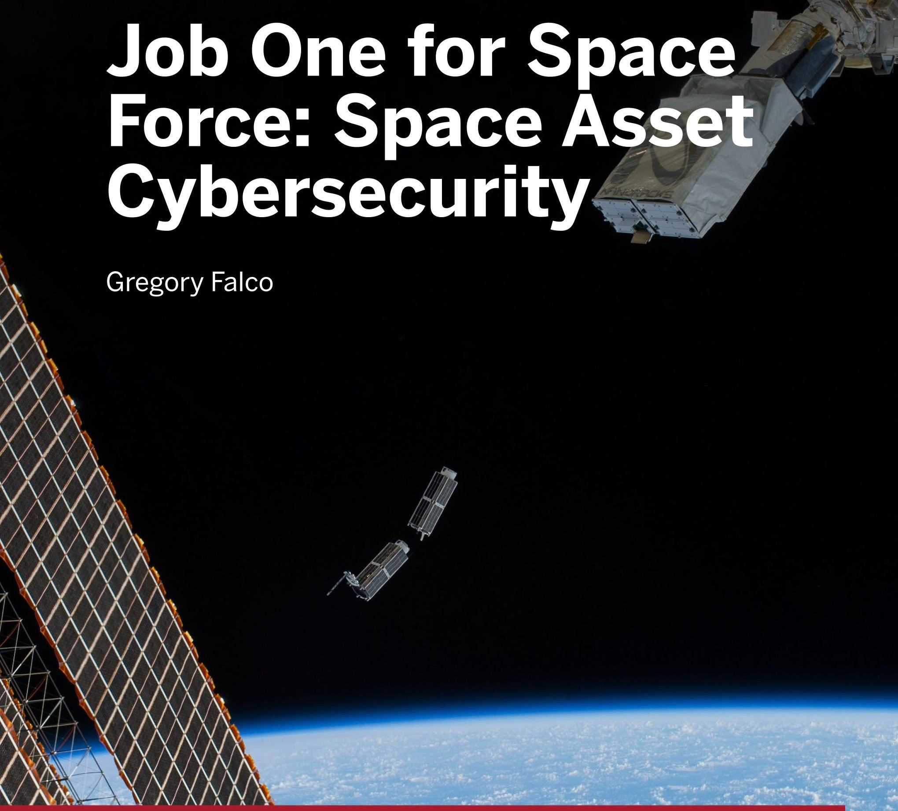
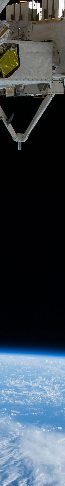
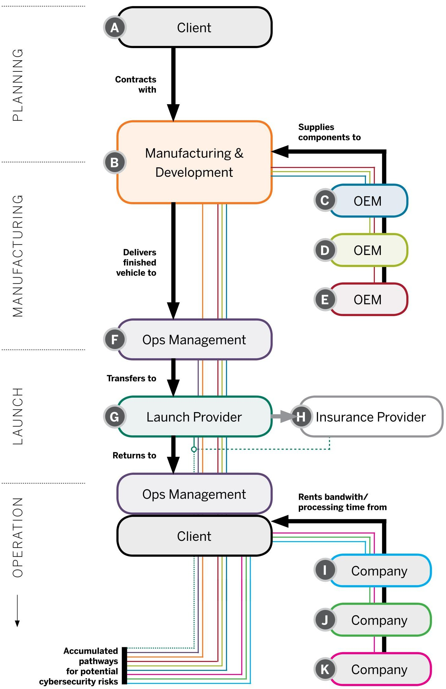

# Job One for Space Force: Space Asset Cybersecurity

Authors: Gregory Falco

<!-- PDF_PAGE: 1 -->

CY B E R S EC U R I T Y P R OJ ECT

Job One for Space
Force: Space Asset
Cybersecurity
Gregory Falco

                                         PA P E R
                                     J U LY 2 0 1 8

<!-- PDF_PAGE: 2 -->

Cyber Security Project
Belfer Center for Science and International Affairs
Harvard Kennedy School
79 JFK Street
Cambridge, MA 02138

www.belfercenter.org/Cyber

Statements and views expressed in this report are solely those of the authors and do not imply

endorsement by Harvard University, the Harvard Kennedy School, or the Belfer Center for Science

and International Affairs.

Layout and Design by Andrew Facini and Mari Dugas

Cover photo: A set of NanoRacks CubeSats is deployed from the International Space Station,

February 25, 2014. (NASA/iss038e056389)

Copyright 2018, President and Fellows of Harvard College

Printed in the United States of America

<!-- PDF_PAGE: 3 -->

CY B E R S EC U R I T Y P R OJ ECT

Job One for Space
Force: Space Asset
Cybersecurity
Gregory Falco

                                         PA P E R
                                     J U LY 2 0 1 8

<!-- PDF_PAGE: 4 -->

About the Author
     Gregory Falco is a Research Fellow with the Belfer Center’s Cyber Security
     Project at Harvard Kennedy School. He received his PhD in Cybersecu-
     rity from MIT’s Computer Science and Artificial Intelligence Laboratory
     (CSAIL) and earned his master’s degree from Columbia University and
     undergraduate degree from Cornell University. He is an expert in Indus-
     trial Internet of Things (IIoT) cyber-physical system security. His research
     focuses on analyzing cyber risk to critical infrastructure using AI plan-
     ning, data science and qualitative methods. Much of his work has focused
     on the security of smart cities’ industrial control systems used in critical
     infrastructure including electric grids, water networks and transportation
     systems. He has pioneered the field of Defensive Social Engineering—a
     toolbox of non-technical defenses that employs social engineering methods
     against hackers.

     Greg is an Adjunct Professor at Columbia University where he teaches
     classes on machine learning, big data and smart cities. He is also the
     Co-founder and CEO of NeuroMesh, an IoT managed security and end-
     point protection company that is piloting its technology with major utilities
     to secure the routing and smart metering infrastructure of the Smart Grid.
     Previously, Greg has worked as a security researcher for NASA’s Jet Pro-
     pulsion Laboratory on cutting edge AI-based risk assessment for mission
     critical IoT and was an executive at Accenture where he founded the Smart
     City Strategy Division. He will begin his postdoctoral studies at Stanford
     University in the Fall where he will teach courses on Cyber Risk.

ii   Job One for Space Force: Space Asset Cybersecurity

<!-- PDF_PAGE: 5 -->

Table of Contents

Executive Summary............................................................................1

Why are space systems an attractive target? ................................ 4

What attacks have occured on these systems?. ............................ 7

Why are space assets so vulnerable today?. ................................ 10

What is being done today to secure these systems?....................15

Recommendations........................................................................... 19

    What can space asset organizations do?. ..................................................... 19

    What can policymakers do?............................................................................ 22

    What can the Department of Homeland Security do? ................................. 23

Conclusion........................................................................................26

Acknowledgements .............................................................................................. 27

                                         Belfer Center for Science and International Affairs | Harvard Kennedy School   iii

<!-- PDF_PAGE: 6 -->

Cover Image
A set of NanoRacks CubeSats is deployed
from the International Space Station,
February 25, 2014. (NASA/iss038e056389)

<!-- PDF_PAGE: 7 -->

Executive Summary
When we think about critical infrastructure, the first assets that come
to mind include the electric grid, water networks and transportation
systems. Further unpacking the definition of critical infrastructure, we
consider industries such as agriculture, defense or the financial sector.
However, we rarely think about where the underlying systems that
enable technology functionality across these sectors physically reside,
who developed the technology, and who can access and manage that
technology.

Much of the United States’ critical infrastructure relies on space sys-
tems. I define space systems as assets that either exist in suborbital or
outer space or ground control systems—including launch facilities for
these assets. Space asset organizations are organizations that build,
operate, maintain or own space systems. Some examples of critical
infrastructure’s reliance on space systems are agribusiness’ reliance
on weather and climate satellites, the U.S. military’s reliance on intel-
ligence satellites, and various transportation industries’ reliance on
global positioning system (GPS) satellites. Several critical infrastruc-
ture sectors also rely on space systems for global communications.
We also rely on space systems for scientific discovery, which often
requires highly specialized and advanced equipment. Such equipment
originally designed for scientific discovery is later used in critical
infrastructure sectors upon further testing and commercialization of
the intellectual property.

Despite efforts to improve the cybersecurity of critical infrastructure
in the U.S., there has been little focus on cybersecurity for space sys-
tems. While security standards for critical infrastructure are often
technically sufficient to deter many attacks, they remain a challenge to
implement due to time and resource constraints.1 Space systems, how-
ever, are more complex than critical infrastructure from a technology
development, ownership and management perspective. Thus far, this

1   “Trends in Security Framework Adoption: A Survey of IT and Security Professionals.” Dimen-
    sional Research. 2016. https://static.tenable.com/marketing/tenable-csf-report.pdf.

                     Belfer Center for Science and International Affairs | Harvard Kennedy School   1

<!-- PDF_PAGE: 8 -->

has led to a lack of guidance in the form of standards that govern space
    system security and, ultimately, policies that enforce these standards.

    I will first review some of the major cybersecurity threats to space systems
    and the potential motivations for why cyber criminals or nation states
    would be interested in compromising space systems. Next, I will evaluate
    the challenges for managing space system cybersecurity. I will then eval-
    uate steps currently being taken by companies and government agencies
    to secure these systems. Finally, I will propose policy recommendations to
    streamline cybersecurity for space systems across the public and private
    sectors. A selection of these recommendations are below.

    Space Asset Organizations should:

         •    Apply existing cybersecurity standards and best practices to space
              assets and where necessary, develop new, tailored standards for
              unique components of space assets;

         •    Assign security experts with distinguished expertise based on the
              function of each space asset and enable this resourcing by establish-
              ing cybersecurity as a mission line-item in budgets. For example,
              do not assign a server security expert to work on the security of a
              satellite endpoint. Instead, designate security experts with satellite
              endpoint knowledge to secure these systems;

         •    Develop and incentivize a cybersecurity culture that prioritizes
              security across the teams working on space assets. For example,
              gamify good security behavior, such as running an internal phish-
              ing program where top performers are rewarded;

         •    Use appropriate cybersecurity tools such as encryption or threat
              intelligence. Encrypt communications even if the data transmitted
              from satellites will ultimately be public and open source to better
              protect the integrity of that information (such as weather data); and

         •    Develop relationships with security researchers that allow for
              researchers to access company data and provide solutions to reme-
              diate vulnerabilities in the company’s systems.

2   Job One for Space Force: Space Asset Cybersecurity

<!-- PDF_PAGE: 9 -->

Policymakers should:

   •   Hold space asset organizations accountable for cybersecurity
       deficiencies in the components of space systems that they
       develop, operate, and own. For example, require all space asset
       organizations that contract with the government to comply with
       key performance parameters for system survivability that covers
       cybersecurity;

   •   Expand the Code of Federal Regulations for the Department of
       Defense-Defense Industrial Base Cybersecurity Activities (32 CFR
       Part 236) to include required reporting of cyber incidents by space
       asset organizations that are responsible for space assets that enable
       other critical infrastructure; and

   •   The Department of Homeland Security should create a space
       system Information Sharing and Analysis Center (ISAC) that
       requires participation from government agencies that rely on space
       assets and encourage participation of the private sector’s space asset
       organizations.

The Space System ISAC should:

   •   Require disclosure of credible sector cyber threats to other space
       system organizations within a certain time period so that others
       have the chance to act on the intelligence;

   •   Document and maintain space system security best practices and
       encourage member organizations to implement these security
       protocols; and

   •   Cooperate with ISACs for oil/gas, electricity and emergency
       services to assess space system vulnerabilities that underpin
       terrestrial systems for these critical sectors, and work to remediate
       accordingly.

                     Belfer Center for Science and International Affairs | Harvard Kennedy School   3

<!-- PDF_PAGE: 10 -->

Why are space systems
    an attractive target?
    The Opportunity Landscape for Hackers

    Space systems are essential to and underpin the critical infrastructure
    that enables our global economy and military presence, and act as a cen-
    tral point of failure across various industries. A stealthy cyber attacker’s
    goal is generally to minimize exposure and maximize impact. One may
    think that a hacker attempting to cripple U.S. commerce would first try
    to interrupt e-commerce companies such as Amazon.com, disrupt online
    payments through PayPal, or impede a credit card provider. However, these
    companies invest heavily in cybersecurity and are constantly monitoring
    their networks for fraudulent and mischievous activity. Further, there are
    several systems that would need to be compromised simultaneously to
    cause the infrastructure that enables each of these pillars of commerce to
    malfunction. From the cyber attacker’s perspective, perhaps a simpler route
    to compromising U.S. commerce would be to target communications sat-
    ellites that provide connectivity enabling point of sale credit card systems,
    inventory management, and even video conferencing services. Even more
    valuable might be targeting the operator of a series of satellites that enable
    such services.

    Satellites and their associated ground control systems that enable underly-
    ing infrastructural support are a central point of failure for commerce and
    other industries. Without space systems, many industries cannot efficiently
    function. For example, natural gas distribution companies rely on satellites
    for communications from remote pipelines to understand the health of
    their systems. Hackers who compromise a communications satellite can
    cause pipe explosions if they inhibit maintenance calls from these remote
    pipes to the natural gas distributor command center. There are various
    attack pathways to inhibit the central point of failure of a space system- two
    of which are the manufacturer of the space asset equipment and the oper-
    ator or management company of the space systems. The ability to impact
    multiple systems by compromising a central point of failure makes space
    systems attractive targets.

4   Job One for Space Force: Space Asset Cybersecurity

<!-- PDF_PAGE: 11 -->

Space systems such as satellites and their controls are typically sophisticated
pieces of equipment considering their communication, radiation hardening,
and computing requirements. Despite this, cybersecurity standards for space
assets are not regulated by any governing body and a lack of regulation means
that satellites both lack common cybersecurity standards and may be used for
cyberattacks with impunity/anonymity. This is unlike other industries such as
electric systems that are regulated by the Federal Energy Regulatory Commis-
sion (FERC). In fact, regulation of satellites is generally weak. The International
Telecommunication Union (ITU), a United Nations agency, regulates frequen-
cies of satellite communications to prevent communication interference and
registers the orbits of satellites, but beyond these areas, there are few standards.
At this point, there are no agencies restricting the use of satellites and there is
no governing body that monitors satellite useages. Because of this vacuum, it is
possible that some satellites are being used as a base to launch cyber operations
or for other nefarious cyber purposes.

While the lack of standards for such critical systems is a concern, the com-
plexity of the supply chain required to create these systems also makes
them attractive to hackers. Some systems will require multiple manufactur-
ers with various specialties to develop multiple technologies and a system
integrator to compile all the components to function as one. The multiple
vendors required provide various access points for a hacker to gain access
to a satellite. Each incremental vendor provides an additional opportunity
to compromise a satellite. For these highly complicated systems, we would
assume that stringent security protocols are in place. However, not all sat-
ellites are so sophisticated. A recent trend includes low-cost satellites being
launched into orbit that use commercial-off-the-shelf (COTS) technology.
These “cubesats” have a fairly low barrier to entry for development from
a technical standpoint and are well-within budget of any major company
(or wealthy hobbyist) to launch (generally under $100K). Considering the
COTS nature of the satellite, it is likely that components such as open-
source operating systems riddled with security vulnerabilities are central
to these satellites’ function. There are considerable security concerns for
these systems because: 1) the wide distribution of COTS products means
that many people have access to the devices, so a hacker can extensively
analyze the device for vulnerabilities, 2) COTS products need to be actively
maintained and upgraded for security patches that are often not applied

                       Belfer Center for Science and International Affairs | Harvard Kennedy School   5

<!-- PDF_PAGE: 12 -->

by users, and 3) anyone could have contributed to the code behind open-
    source technology, which means that vulnerabilities or backdoors to the
    software could be intentionally planted by adversaries. As of 2017, it was
    estimated that there were approximately 700 cubesats in orbit.2 It is con-
    ceivable for a company to launch a cubesat to streamline operations on
    Earth and by doing so introduce vulnerabilities to their IT ecosystem. Gov-
    ernment agencies are known to lease bandwidth on commercial satellites,
    and doing so could introduce vulnerabilities into military or other gov-
    ernment agency IT ecosystems as well if the cubesat is not appropriately
    secured.3 While it is unlikely this would be the first choice of an attacker
    to disable a satellite, it could even be possible for a malicious organization
    to hack a cubesat or small satellite with propulsion and direct it to collide
    with other satellites. Cubesat collisions are known phenomena. In one
    instance, the European Space Agency noticed a cubesat cut a hole in the
    solar panel for its Sentinel 1-A satellite.4 This was an unintentional mishap,
    but one can imagine that a malicious actor could do much worse.

    Space systems are attractive targets due to their ability to serve as a central
    point of failure to massive systems, their lack of security regulation, and
    their vast surface area of attack. Considering that so much U.S. critical
    infrastructure relies on space systems, it would be logical for hackers to
    attempt to compromise critical infrastructure via this means. Space sys-
    tems do not need substantially different security systems than other critical
    infrastructure; however, they do need special attention for security because
    they often go overlooked. Because they act as underlying infrastructure
    for critical systems, they are not necessarily considered to be part of crit-
    ical systems themselves and therefore are not subject to the same security
    standards. Further, as discussed more in depth below, cybersecurity
    responsibility for space systems is extremely convoluted compared to other
    industries, which leaves room for ambiguity regarding who should secure
    these vital systems and how they should be secured.

    2    Leonard David. “Sweating the Small Stuff: CubeSats Swarm Earth Orbit.” Scientific American. 2017.
         https://www.scientificamerican.com/article/sweating-the-small-stuff-cubesats-swarm-earth-or-
         bit/.
    3    Ryan Schradin. “Government Space Leaders Look To Commercial Satellites for More Resilient
         Communications.” The Government Satellite Report. 2016. https://ses-gs.com/govsat/defense-in-
         telligence/government-space-leaders-look-to-commercial-satellites-for-more-resilient-communi-
         cations/.
    4    Tereza Pultarova. “Could Cubesats Trigger a Space Junk Apocalypse?” Space.com. 2017. https://
         www.space.com/36506-cubesats-space-junk-apocalypse.html.

6   Job One for Space Force: Space Asset Cybersecurity

<!-- PDF_PAGE: 13 -->

What attacks have occured
on these systems?
Space assets have already been compromised by nation states and criminal
organizations. The most referenced attacks were mounted against gov-
ernment and corporate-backed space assets. These attacks demonstrate
that even well funded space projects lack the appropriate cybersecurity to
defend against hackers.

Among the most interesting attacks waged thus far against satellites had
little to do with hackers’ interest in compromising the space system, but
rather the technology that was enabled by the space system. Kaspersky
Labs discovered that the Russia-based cyber-espionage group, Turla,
hacked their way into a satellite internet provider to hide cyber-espionage
operations against countries ranging from the US to the former Eastern
Bloc.5 By using a ground antenna, Turla could detect IP addresses from sat-
ellite internet users and then initiate a TCP/IP connection from the stolen
IP address. Turla can obfuscate their nefarious operations by leveraging
the stolen IP satellite address. The attack is not easily detectable because
the espionage operation does not need to perceivably impact the innocent
user’s performance; it depends on whether the hacker and the legitimate
user are using the IP address simultaneously. Because both the victim and
attacker’s machines would have the same IP address, the attack will be
stealthy and unlikely to be flagged by intrusion detection systems.

Independent of how stealthy space-based cyberattacks can be, they can
cause serious damage to an end-user’s operations. Imagine that hackers
employ Turla’s technique to target a remote electric substation. An attacker
can intercept uplink or downlink packets from the victim’s IP address or
inject data to the user system connected to the IP address. Such a false data
injection to an autonomous drone could result in an override of the system
or even crash the aircraft.

Another space-based cyberattack compromised GPS systems, which rely
on satellites to triangulate specific positions on Earth. Introducing noise
5   Kaspersky’s Global Research and Analysis Team (GReAT). “The Epic Turla Operation.” SecureList.
    2014. https://securelist.com/the-epic-turla-operation/65545/.

                           Belfer Center for Science and International Affairs | Harvard Kennedy School   7

<!-- PDF_PAGE: 14 -->

into the receiver spectrum of the GPS satellite can cause the failure of a
    GPS receiver on earth to provide a reading. This is a technique known
    as jamming. Russia has installed GPS jammers on over 250,000 cellular
    towers to disrupt the navigation of incoming missiles from the US.6 While
    GPS jamming attacks have been used in the past and are not necessarily
    considered a cyberattack, GPS spoofing is a cyberattack because of the
    manipulation of the GPS signal. GPS spoofing is far more dangerous than
    jamming because it appears that the GPS is working as intended. The trust
    in the device is not broken for a spoof, which becomes dangerous when
    dealing with critical systems.

    There are multiple ways to spoof a GPS satellite. One mechanism to do
    so is by compromising the satellite receiver and altering the output signal
    from the satellite. Another opportunity is via a false data injection attack
    where an adversary uses a GPS signal simulator (whose success will be
    limited because it cannot always trick the receiver) or uses a software-de-
    fined spoofer. Software-defined spoofers are more reliable. They work by
    inserting a barely detectable fake signal behind the true signal. Gradually,
    the power of the fake signal is increased to the point where the receiver
    thinks the fake signal is actually the real signal.7 A system that can execute
    a software-defined spoof attack only costs about $1,000-2,000 to build, as
    demonstrated by Professor Todd Humphreys at the University of Texas,
    Austin.8

    Attacks using software-defined spoofing are not just theoretical or con-
    ducted in a lab. In 2017, the US Maritime Administration reported the
    first GPS spoofing attack against over 20 ships in the Black Sea.9 Corre-
    spondence between one of the impacted vessels and their command center
    reflects that over the course of the attack, the GPS position displayed on

    6    Andrew Dalton. “Russia Hopes to Block Cruise Missile Attacks with Cell Towers.” Engadget. 2016.
         https://www.engadget.com/2016/10/17/russia-jamming-cruise-missile-attacks-with-cell-towers/.
    7    Alan Gatherer. “Lost in Space: How Secure is the Future of Mobile Positioning.” IEEE ComSoc
         Technology News. 2016. https://www.comsoc.org/ctn/lost-space-how-secure-future-mobile-posi-
         tioning.
    8    Colin Lecher. “Texas Students Hijack a U.S. Government Drone in Midair.” Popular Science. 2012.
         http://www.digitaljournal.com/article/327529.
    9    Maritime Administration. “2017-005A-GPS Interference-Black Sea.” US Department of Transporta-
         tion. 2017. https://www.marad.dot.gov/msci/alert/2017/2017-005a-gps-interference-black-sea/.

8   Job One for Space Force: Space Asset Cybersecurity

<!-- PDF_PAGE: 15 -->

their navigation tool sometimes showed “lost GPS fixing positon.”10 At one
point during the attack, the spoofed location showed the ship was located
near the Gelendzhik airport, but was in fact 25 nautical miles from the
reported location. According to a non-profit organization called Resilient
Navigation and Timing, which monitors GPS incidents, anecdotal spoofing
reports are not uncommon in Russian waters.11 It is widely speculated that
another attack of this type was used by the Iranians to capture a US drone
in December 2011.12 In September 2011, Iranians claimed they mastered a
new technique to compromise aircrafts via GPS spoofing. This technique
was demonstrated when they successfully captured an American RQ-170
Sentinel drone by reconfiguring the coordinates of the GPS signal to make
the drone land in Iran instead of its base in Afghanistan.13 The US military
blamed the capture on a malfunction, but were unable to explain how the
Iranians received the drone intact.14

These incidents represent a small sampling among many other reported
cyberattacks on space assets.15 Beyond actual cyberattacks, “thought exper-
iments” and demonstration attacks on space assets have been referenced
in various reports.16 Given that there have been so many cybersecurity
incidents involving space assets, why has so little work been done to secure
these assets?

10   Dana Goward. “Mass GPS Spoofing Attack in Black Sea?” The Maritime Executive. 2017. https://
     www.maritime-executive.com/editorials/mass-gps-spoofing-attack-in-black-sea; http://www.
     insidegnss.com/node/5555.
11   Lisa Vaas. “Suspected Mass-Spoofing Of Ships’ GPS In The Black Sea.” Naked Security, 2017,
     https://nakedsecurity.sophos.com/2017/09/26/suspected-mass-spoofing-of-ships-gps-in-the-
     black-sea/.
12   Lisa Vaas. “Drone Hijacked By Hackers From Texas College With $1,000 Spoofer.” Naked Security.
     2012. https://nakedsecurity.sophos.com/2012/07/02/drone-hackedwith-1000-spoofer/.
13   Scott Peterson. “Exclusive: Iran Hijacked US Drone, Says Iranian Engineer.” The Christian Science
     Monitor. 2011. https://www.csmonitor.com/World/Middle-East/2011/1215/Exclusive-Iran-hi-
     jacked-US-drone-says-Iranian-engineer.
14   Ibid.
15   D.J. Byrne, David Morgan, Kymie Tan, Bryan Johnson, Chris Dorros. “Cyber Defense of Space-based
     Assets: Verifying and Validating Defensive Designs and Implementations.” Procedia Computer
     Science. Volume 28. 2014 http://www.sciencedirect.com/science/article/pii/S1877050914001276.
16   Ruben Santamarta. “A Wake-up Call for SATCOM Security.” IOActive. 2014. http://www.cs.tufts.edu/
     comp/116/archive/fall2016/rhutchins.pdf; https://ioactive.com/pdfs/IOActive_SATCOM_Securi-
     ty_WhitePaper.pdf.

                             Belfer Center for Science and International Affairs | Harvard Kennedy School   9

<!-- PDF_PAGE: 16 -->

Why are space assets so
     vulnerable today?
     Originally, space assets, like all other technology, were analog devices.
     These systems did not present the same opportunities for hacking because
     they lacked software with code vulnerabilities and the ability to access the
     system remotely. As technology moved into the digital age, space assets
     became digitized as well. Like most systems of the time, cybersecurity
     was generally not considered and certainly not prioritized. For example,
     when TCP/IP was created, the protocol’s security was not seen as an issue.
     Even when security was required and considered, manufacturers still did
     not take cybersecurity seriously. A case that illustrates this is problem is
     the Iridium satellite constellation, which provided GPS capabilities to the
     Pentagon. When the constellation was created, no special cybersecurity
     parameters were deployed because engineers thought the technology was
     too advanced for a hacker to compromise.17 This naiveté was not unique
     to the Iridium constellation developers, as security was not considered a
     concern for decades into the early 2000s for many industries. For example,
     industrial control system operators and manufacturers cite the proprietary
     protocols in their system and insist that the protocol would be too compli-
     cated and obscure to crack.18 In terms of cybersecurity, space assets were
     not any different from digital assets on earth.

     As data server manufacturers and operators started to care about secu-
     rity in the early 2000s after cyberattacks against these systems were made
     public and impacted their business, space assets began to lag behind.
     Despite most industries adopting standard encryption schemes for data
     storage and transfer in the 90s19, space technology designers and manufac-

     17   J.M. Porup. “It’s Surprisingly Simple to Hack a Satellite.” Motherboard. 2015. https://motherboard.
          vice.com/en_us/article/bmjq5a/its-surprisingly-simple-to-hack-a-satellite.
     18   “Recommended Practice: Improving Industrial Control System Cybersecurity with Defense-in-
          Depth Strategies.” Industrial Control System Cyber Emergency Response Team. 2016. http://
          www.verizonenterprise.com/verizon-insights-lab/VES/obscurity-no-more-4-steps-to-secur-
          ing-the-ot-environment-for-manufacturing.
     19   Jinwoo Hwang. “The Secure Sockets Layer and Transport Layer Security.” IBM Developer Works.
          2012. https://www.sslshopper.com/what-is-ssl.html.

10   Job One for Space Force: Space Asset Cybersecurity

<!-- PDF_PAGE: 17 -->

turers seemed to resist the movement toward security.20 We can speculate
that the resistance could be a function of lower profit margins for space
systems compared with commercial products or defense systems. Also,
some security techniques, such as encryption, require more processing
power to function. On many space systems, processing power and band-
width is a precious resource and other functions are given priority. Some
space systems are developed as a “labor of love” and/or “in the name of
science” and the developers of the technology do not even think about why
someone would want to hack their project. Because of the open-source
nature of data published by NASA and other space agencies, it may have
been unclear what proprietary information there even was to secure.

Some of the lag relating to space asset security can be explained by the
complexity of the supply chain and vendor ecosystem for the big corporate,
government, and military-funded systems. The specialized parts needed for
space assets are not all created by one manufacturer. In fact, to keep costs
down, NASA and other space technology developers purchase components
from catalogs of approved vendors around the world.21 The approval process
for these vendors does not necessarily specifically include cybersecurity vet-
ting standards and instead concerns physical quality control. When NASA
purchases a part from a vendor, they have little control over which technician
developed the printed circuit board (PCB) or what software engineer wrote
the code for a given component. This lack of insight introduces considerable
cybersecurity risk. In addition to vendors being vulnerable across the system
supply chain, space asset organizations generally work with several research
centers who may possess vulnerabilities. Collaborations across multiple part-
ners exacerbate potential security issues.

20   Paul Martin. “NASA Cybersecurity: An Examination of the Agency’s Information Security.” Testi-
     mony before the Subcommittee on Investigations and Oversight, House Committee on Science,
     Space, and Technology. 2012. https://oig.nasa.gov/congressional/FINAL_written_statement_
     for_%20IT_%20hearing_February_26_edit_v2.pdf.
21   Michael Sampson. “NASA Parts Selection List.” NASA Electronic Parts and Packaging 		
     Program. 2016. https://nepp.nasa.gov/npsl/npsl_UsePolicy.htm.

                            Belfer Center for Science and International Affairs | Harvard Kennedy School   11

<!-- PDF_PAGE: 18 -->

Figure 1: Cybersecurity risks and responsibility
          pathways for an example satellite project

                                       A             Client

     P LANNI NG
                                        Contracts
                                             with

                                                                 Supplies
                                                                 components to

                                               Manufacturing &
                                       B
                                                Development

                                                                     C       OEM

     MANUFACTU RING
                                         Delivers                    D       OEM
                                          finished
                                        vehicle to

                                                                      E      OEM

                                       F      Ops Management

                                      Transfers to

     LAUNC H
                                      G        Launch Provider   H Insurance Provider

                                       Returns to

                                              Ops Management     Rents bandwith/

     OP ERAT ION
                                                                 processing time from

                                                     Client

                                                                      I     Company

                                                                      J     Company

                           Accumulated
                               pathways
                            for potential                            K      Company
                      cybersecurity risks

12         Job One for Space Force: Space Asset Cybersecurity

<!-- PDF_PAGE: 19 -->

Complex supply chains related to space assets make it challenging to
discern who should be operationally and financially responsible for the
cybersecurity of a system at various point of the space asset’s lifecycle.
The challenge of the space asset supply chain is caused by the complex-
ity of development, management, use and ownership environment of
space assets. Unlike most critical infrastructure sectors, space assets are
not owned by the same organizations that manage the infrastructure
which results in questions related to liability if they are attacked. Figure
1 depicts a graphic representing the complex landscape for cybersecurity
responsibility.

As shown, company A may commission the development of a satellite
with company B that then assumes the cybersecurity responsibility of the
satellite. Company B then outsources components of that satellite devel-
opment to companies C, D, and E, who own their own component of the
cybersecurity responsibility of the satellite. When company B completes
the development of the satellite and delivers it to the owner (company A),
company F is then contracted to manage the operations of the satellite
(Company F then assumes operational cybersecurity responsibility of the
satellite). Company F then commissions company G to launch the satellite
into space. Company G assumes cybersecurity responsibility during the
launch process. The liability for this cybersecurity responsibility is often
shifted to an insurance provider company, H. Once the satellite is in orbit
and operational, the management company (F) then resumes cybersecurity
responsibility for the operations of the satellite. Often, the owner of the
satellite (company A) will want to maximize the utility of the satellite to
improve profitability and so will lease the use of bandwidth or processing
on the satellite to other companies I, J, K, etc. Because of this complex eco-
system of owner, developer, operator and user cybersecurity responsibility,
there are many opportunities for an adversary to gain access to the satellite.

Not only are there many stakeholders involved in the space asset devel-
opment lifecycle, but the lifespan of the asset itself is extensive and
complicated. Space missions can last decades and because of this, secu-
rity concerns can be exacerbated from legacy systems that are unpatched.
Not dissimilar to industrial control systems, space assets are built to last
and because they are functional in the field for such long periods and

                      Belfer Center for Science and International Affairs | Harvard Kennedy School   13

<!-- PDF_PAGE: 20 -->

are mission critical, system downtime is not an option. This makes space
     assets difficult if not impossible to patch for security flaws once they are
     discovered.

     Finally, the institutional design of space system organizations causes secu-
     rity challenges. To properly secure a system, it is important to understand
     how the system works and the various opportunities for a hacker to disrupt
     the asset. Because this is so, the security experts that are knowledgable in
     data management, servers, and internal networks for traditional IT infra-
     structure likely are not the same experts who fully understand a specialized
     satellite or ground control system for a deep space asset. Despite this, most
     space system organizations’ security groups are not set up to distinguish
     between internal IT infrastructure and specialized space systems. This
     could leave space assets vulnerable because specialists that understand
     their function are not attending to their security. Also, because of the broad
     responsibilities of the security team—spanning both IT and space assets-
     the security experts are spread thin.

     Part of the resourcing concern across space asset organizations is that
     cybersecurity is typically not a line-item in mission budgets. This makes
     it more difficult to justify why extra resources should be spent on security
     personnel who are experts in specific mission systems. Without allocated
     budget for cybersecurity tasks, system engineers are left to figure out secu-
     rity needs for their space assets. Unfortunately, they are not necessarily
     adequately trained to be seeking out security flaws in their designs and
     are also time-constrained, which could result in poor attention to system
     security.

     Another challenge at the organizational level is employee access control to
     sensitive information. Exacerbating this issue for space assets are the many
     niche skills required to develop these systems and the resulting number of
     resources needed to complete a project. Widespread access to develop the
     space asset increases the need for control procedures such as access man-
     agement. NASA employees have continuously been subjected to phishing
     attacks, which, when successful, reveal sensitive information that can be

14   Job One for Space Force: Space Asset Cybersecurity

<!-- PDF_PAGE: 21 -->

used to compromise space assets to attackers.22 The sheer volume of people
that need access to such sensitive data is an ongoing risk for such organiza-
tions and begs the need for stricter operating and access standards.

Despite the historical reasons why the cybersecurity of space assets has
lagged behind other kinds of critical infrastructure, such as energy systems,
which are regulated by NERC and have robust industry standards, and
financial institutions, which are regulated by the Security and Exchange
Commission (SEC), there are relatively few technical obstacles to better
cybersecurity. This poses the question: how are space assets being secured
today to combat the growing cyber threat?

What is being done today to
secure these systems?
Among the space industry community, the lack of attention to cybersecu-
rity is acknowledged; however, the responses to the cybersecurity threats
have been variable. An audit of NASA in FY 2015 revealed the need for a
revamping of their cybersecurity standards and protocols. The audit cited
several attacks on NASA space assets, which were not publically disclosed,
as the driver for the call for reform.23 NASA’s efforts are not necessarily
representative of the broader space industry’s cybersecurity awareness and
efforts—however, smaller organizations working on satellites look to NASA
for standards and best practices. More established private space companies
such as SpaceX or Blue Origin have no public comments on their cyberse-
curity posture. There have been calls for more discussion from the public
on how SpaceX and others plan to address cybersecurity in the future.24

NASA has taken several steps to improve security around space assets.
With this said, there are considerable opportunities for improvement. First,
22   John Sprague. “Collaboration that Pays NASA Back.” NASA IT Talk. 2012. https://www.hq.nasa.gov/
     office/itcd/notices/010410-1.htm.
23   Paul Martin. “NASA’s Management of the Deep Space Network.” NASA Office of Audits. 2015.
     https://oig.nasa.gov/audits/reports/FY15/IG-15-013.pdf.
24   Zulfikar Abbany. “SpaceX’s Starlink satellite internet: It’s time for tough talk on cyber security in
     space.” Deutsche Welle. 2018. http://www.dw.com/en/spacexs-starlink-satellite-internet-its-time-
     for-tough-talk-on-cyber-security-in-space/a-42678704.

                              Belfer Center for Science and International Affairs | Harvard Kennedy School   15

<!-- PDF_PAGE: 22 -->

NASA has begun implementing stricter access control policies across their
     providers and engineers. This will help guard against some of the phishing
     attacks used against NASA employees in the past that steal credentials and
     access valuable intellectual property.

     Second, NASA has created teams across their space asset development
     centers that specifically work with the security of their missions’ systems.
     Previously, the Office of the Chief Information Officer (OCIO) was respon-
     sible for all cybersecurity across NASA. However, OCIO teams could not
     fully focus their attention on both the server infrastructure security of
     NASA’s labs and mission systems, respectively. To address this challenge,
     NASA’s Jet Propulsion Laboratory (JPL) created the Cyber Defense Engi-
     neering and Research Group (CDER). CDER’s goal is specifically to address
     mission systems (such as the Mars Science Lab or the Europa Lander),
     which often have unique cybersecurity requirements from traditional
     firewalled data servers. Developing specialized teams that have unique
     expertise in mission systems enables customized analysis and protection
     for these space assets in ways that traditional security teams protecting
     servers and data would not. Some of CDER’s work aims to develop tools
     and methodologies that apply across multiple mission systems to reduce
     costs and security operations.

     Finally, NASA has begun encrypting data while it is stored and during
     transfer. Recently, at the end of 2016, AT&T encrypted NASA’s Deep Space
     Network (DSN), which is the foundation of communication infrastructure
     for technology such as the Mars Rover.25 Consistent with the previous
     section’s explanations of why space assets lag behind other assets in cyber-
     security, AT&T encrypted the DSN only after a report on how to hack into
     the Mars Rover appeared on the Internet.26 Encryption provides private
     communications that are only visible to others with the cryptographic key.
     Such encryption will become a first line of defense against hackers aiming
     to hijack the DSN or listen in on communications sent over this multi-bil-
     lion-dollar, long-range communication network.

     25   “AT&T Powers NASA’s Deep Space Network.” AT&T. 2016. http://about.att.com/story/att_powers_
          nasa_deep_space_network.html.
     26   Sebastian Anthony. “Could you hack into Mars rover Curiosity?” ExtremeTech.com. 2012. https://
          www.extremetech.com/extreme/134334-could-you-hack-into-mars-rover-curiosity.

16   Job One for Space Force: Space Asset Cybersecurity

<!-- PDF_PAGE: 23 -->

NASA JPL’s CDER Group is also working with university researchers at
MIT to conduct penetration tests on mission system software. Increasing
engagement with the broader security research community will consid-
erably improve mission system security for space assets. CDER is also
proactively working to establish a security culture at JPL. A security culture
is one of healthy digital skepticism, where employees “think before they
click” and do not trust all digital content at face value. CDER kick started
building a security culture by starting a lighthearted game called Donuts.
When a CDER Group member leaves their computer unlocked, another
CDER teammate sends an email from the unlocked computer writing
“Donuts” in the subject line. If this note is sent, the compromised computer
user needs to buy the team donuts. The teams keep track of the number
of donuts owed by each team member thereby incentivizing teammates
to lock their machines when they step away. At first, the team was getting
their fair share of donuts daily, but as security awareness grew the donuts
stopped coming. This game has expanded to other teams at JPL, thereby
helping to establish a security culture of constant security awareness.

Like NASA, the private space asset industry is currently improving its secu-
rity, but as previously mentioned, it is impossible to evaluate many private
sector companies who are not transparent regarding their cybersecurity
efforts. Penetration testers, ethical hackers and security researchers are
constantly finding holes in various satellite network systems and asking the
responsible party to fix the vulnerabilities. Unfortunately, these vulnerabil-
ity notifications often go ignored due to manufacturers’ lack of bandwidth
to address the issues or mistrust of the hackers. The lifecycle complexities
and associated liability questions discussed earlier further complicate fixing
vulnerabilities. If ignored, the ethical hackers generally follow responsible
reporting procedures and expose the vulnerability to the public follow-
ing a period of time after notifying the vendor. By publicly announcing
the threat, the ethical hackers intend to garner large-scale attention to the
problem and force the vendor to fix the issue. This was the case with the
Iridium satellite owners who asserted their systems were extremely difficult
to hack .27 Only after ethical hackers announced their vulnerabilities and

27   J.M. Porup. “It’s Surprisingly Simple To Hack A Satellite.” Motherboard. 2015. https://motherboard.
     vice.com/en_us/article/bmjq5a/its-surprisingly-simple-to-hack-a-satellite

                             Belfer Center for Science and International Affairs | Harvard Kennedy School   17

<!-- PDF_PAGE: 24 -->

embarrassed the company did Iridium take steps to improve the security of
     their communication network.

     Unlike GPS satellites that can be detected and penetration tested without
     direct access to the space asset, other private industry space asset security
     is inaccessible and therefore not testable by the security community. For
     example, SpaceX, Virgin Galactic or other space asset developers, owners
     and operators do not make their technology readily available for security
     researchers to test. This is probably because they are concerned that their
     sensitive code or information will fall into competitors’ hands. Another
     reason is that private space asset developers are concerned about what the
     security researchers will find and fear that if it is publicly disclosed, that
     can ruin their companies. Further, there is not any required disclosure or
     reporting on cybersecurity testing procedures from these companies and
     as a result it is difficult for the security community to evaluate the cyber-
     security of these space assets. Again, the theme of vulnerability disclosure
     liability and the risk of releasing technology for testing is substantial, which
     is a major barrier to transparency regarding space asset security.

     Neither public nor private space asset organizations are at a complete
     standstill concerning their cybersecurity efforts, as we previously described
     with the NASA JPL work on building a security culture. However, there are
     considerable gaps to the space asset security posture compared with other
     critical infrastructure sectors, and these must be addressed. The steps for
     improvement are not uniform for private industry and government organi-
     zations, as described below.

18   Job One for Space Force: Space Asset Cybersecurity

<!-- PDF_PAGE: 25 -->

Recommendations

What can space asset organizations do?

Organizations developing space assets are largely unregulated for cyberse-
curity purposes. The lack of specific space asset cybersecurity requirements
necessitates a considerable degree of self-policing. Without mandatory
standards, space asset organizations can improve their security either indi-
vidually or collectively. What follows are some options to consider:

     •    Employ existing cybersecurity standards and develop new standards
          for space systems where needed. There is no lack of cybersecurity
          standards and best practices available for developers to follow when
          attempting to design and develop secure systems. Many of these
          standards, like the National Institute of Standards and Technology
          (NIST) Cybersecurity Framework, are well-documented and widely
          adopted in some form.28 Most space systems’ security can benefit
          from using these standards. In some cases, these standards may
          not apply for the specific technologies used in space systems. For
          these systems, space asset organizations should create new space
          asset-specific standards and best practices so that security can be
          applied consistently across the organization. Vendors of space asset
          organizations should also be held to these standards. This should
          involve the explicit testing and demonstration that vendors to these
          organizations conform to the security standard in place for the
          space asset organization.

     •    Establish cybersecurity capabilities for mission systems and internal
          network/server systems. Similarly to what was done at NASA JPL,
          it is important to establish separate cybersecurity specialists for
          mission systems and internal networks/server systems. The distinc-
          tion between the two systems are operational technology versus
          information technology—each one has very different operating
          and security requirements and need to be addressed accordingly.

28   Nicole Cieslak. “NIST Cybersecurity Framework Adoption on the Rise.” Tenable. 2016. https://www.
     tenable.com/blog/nist-cybersecurity-framework-adoption-on-the-rise.

                            Belfer Center for Science and International Affairs | Harvard Kennedy School   19

<!-- PDF_PAGE: 26 -->

A security expert who knows how to manage firewall settings for
               servers is not necessarily the best security expert to deal with small
               microprocessors or operational technology systems. Security exper-
               tise should be specialized so that the right cybersecurity strategies
               are being employed for the particular function and threats to the
               system. To be able to allocate resources to mission system cyberse-
               curity, that should be listed as a line-item in mission budgets.

          •    Build a security culture. Establishing a security culture where all
               those who work on space assets focus on cybersecurity matters
               rather than relying entirely on a designated cybersecurity team is
               also important. This could begin as simply as starting the “Donuts”
               game. Rewarding good cybersecurity behavior or using the tradi-
               tional “name and shame” approach to punishing bad cybersecurity
               practices could help to encourage the security culture.

          •    Utilize appropriate security tools that are available. Space asset
               organizations should encrypt all satellite communications and
               space asset data where possible. Modern encryption schemes
               provide a cost-effective and rather simple security measure to
               accomplish without much computational overhead. Some space
               asset organizations do not feel the urgency to encrypt satellite
               communications due to the public, open-source nature of the data
               flowing across these systems. However, encrypting the data is still
               important to maintain the integrity of the communications so that
               the information can ultimately be useful for the public. Space asset
               organizations should also invest in “threat intelligence” tools so that
               they can consistently maintain situational awareness regarding the
               latest cyber technical and organizational threats.

          •    Cooperate with security researchers. Space asset organizations can
               collectively work with ethical hackers and university researchers
               to conduct penetration tests of systems. This would provide a
               low-cost resource to space asset organizations seeking to improve
               their cybersecurity posture. A relationship with ethical hackers
               and university researchers can facilitate not only the discovery of
               vulnerabilities for critical space systems but also the remediation of
               these security holes. Many organizations establish bug bounty pro-
               grams for security researchers to identify vulnerabilities in systems,

20   Job One for Space Force: Space Asset Cybersecurity

<!-- PDF_PAGE: 27 -->

but these often have limited success. One reason for this limitation
       is that bug bounty programs do not allow any privileged system
       access. This limits the researchers’ abilities to find deeper bugs
       and security vulnerabilities that are not at the surface layer of the
       exposed system. Another challenge with the traditional approach
       to bug bounty is that after the bugs are identified, there are too
       many for the organization’s security team to patch or remediate in a
       timely fashion, thereby exposing the organization to additional risk
       during this period. Partnering with security researchers to not only
       discover vulnerabilities but also fix security issues can considerably
       improve security outcomes. As we have already described, there are
       barriers to establishing a transparent and substantial relationship
       with security researchers. For example, providing privileged access
       to security researches could expose the space asset organization to
       liabilities. The third party could unintentionally disclose private
       data or vulnerabilities to the public. This could cause a public
       relations disaster and provide an invitation to hackers to exploit
       vulnerabilities.

These are some actions that space asset organizations can take without
national policy or legal guidance. However, some of these cybersecurity
improvements can be enabled through policy shifts concerning space assets.

                     Belfer Center for Science and International Affairs | Harvard Kennedy School   21

<!-- PDF_PAGE: 28 -->

What can policymakers do?

     To date, congress has provided little guidance in terms of enabling cyberse-
     curity across sectors. One of the few examples includes the Cybersecurity
     Information Sharing Act (CISA) which was signed into law in late 2015
     by President Obama. CISA is meant to help facilitate information sharing
     between the government and the private sector by limiting the liability of
     the private sector for certain attack disclosure.29 Congress should develop
     more laws that could be specifically relevant to space assets. Recommen-
     dations concerning these laws follows.

          •    This is Urgent. Act quickly. Be proactive, not reactive. Do not wait to
               pass a law on space cybersecurity until there is a WannaCry (major
               ransomware attack that compromised healthcare systems around
               the world) or Mirai (IoT attack that took down a major DNS
               provider on the East Coast resulting in downtime for websites such
               as Facebook, Twitter and Reddit) equivalent for Space. It seems that
               action only occurs when a disaster strikes. A space cyberattack can
               have serious consequences as detailed previously and we cannot
               wait until something happens to pass legislation protecting these
               critical systems.

          •    Clarify critical infrastructure security requirements to include under-
               lying systems. Currently, policy concerning critical infrastructure
               security does not require third-party, enabling infrastructure to
               also comply with the same requirements. Space systems should be
               held to the same standards of the critical infrastructure on which
               they rely.

          •    Assign responsibility and liability for cyber. Cybersecurity respon-
               sibility and associated liability for a breach should be clarified and
               assigned for space asset organizations. An important component
               of cybersecurity legislation currently under review concerns the
               liability of technology developers, owners and operators. In January
               2017, the FTC sued D-Link for the vulnerability in their routers

     29   Brad Karp. “Federal Guidance on the Cybersecurity Information Sharing Act of 2015.” Harvard Law
          School Forum on Corporate Governance and Financial Regulation. 2016. https://corpgov.law.har-
          vard.edu/2016/03/03/federal-guidance-on-the-cybersecurity-information-sharing-act-of-2015/.

22   Job One for Space Force: Space Asset Cybersecurity

<!-- PDF_PAGE: 29 -->

leading to the widespread Mirai botnet attack in October 2016.30
          This was the first time a manufacturer was sued for the cyberse-
          curity failures of their devices. Legal guidance concerning where
          liability falls will encourage the responsible party to take the neces-
          sary measures to secure their systems. Today’s lack of clarity around
          liability for the space asset ecosystem results in poor accountability
          and inaction to secure these important systems.

     •    Make space asset organizations accountable for cybersecurity. All
          government contracts with space asset organizations should
          require the contractor to comply with key performance parameters
          (KPPs) pertaining to cybersecurity. Today, cybersecurity KPPs are
          a subcomponent of system survivability KPPs. Cybersecurity KPPs
          should be firmly enforced for all government contracts.

     •    Expand 32 CFR 236 to include space asset organizations. Currently,
          the defense industrial base is required to report all cyber incidents
          that have affected or could affect national security under the
          Department of Defense-Defense Industrial Base Cybersecurity
          Activities Regulation31. Considering the critical posture of space
          systems and the U.S. reliance on these assets for both national
          security and critical infrastructure, space asset organizations
          should be included under this ruling. This would improve cyber-
          security transparency between the government and space asset
          organizations.

     •    Establish a Space System Information Sharing and Analysis Center
          (ISAC). Government agencies such as the Department of Home-
          land Security (DHS) could play a crucial role as a convener for
          public and private sector entities that work with space systems. The
          DHS could become an important facilitator for this sector’s efforts
          to improve cybersecurity by creating a Space System Information
          Sharing and Analysis Center. The DHS should require participation
          of government agencies that work with space systems ranging

30   Ari Lazarus. “FTC sues D-Link over router and camera security flaws.” Federal Trade Commission.
     2017. https://www.consumer.ftc.gov/blog/2017/01/ftc-sues-d-link-over-router-and-camera-securi-
     ty-flaws.
31   Defense Department. “Department of Defense (DoD)-Defense Industrial Base (DIB) Cy-
     bersecurity (CS) Activities.” Federal Register. 2015. https://www.federalregister.gov/docu-
     ments/2015/10/02/2015-24296/department-of-defense-dod-defense-industrial-base-dib-cyber-
     security-cs-activities.

                            Belfer Center for Science and International Affairs | Harvard Kennedy School   23

<!-- PDF_PAGE: 30 -->

from the Department of Defense (DoD) to NASA to participate
               in the Space System ISAC. This would provide an incentive for
               private sector space asset organizations to also join. If 32 CFR 236
               were expanded to include space asset organizations, the Space
               System ISAC could be made compulsory through this requirement.
               Sharing threat information across space system agencies and space
               asset organizations would be a logical step to improve the security
               posture of the sector. Some agencies or private organizations may
               be much further ahead in securing systems than others and sharing
               insights will help all ISAC members involved.

     What can a Space System ISAC do?

     Sharing threat information across space system agencies and space asset
     organizations would be a logical step to improve the security posture of the
     sector. Some agencies or private organizations may be much further ahead
     in securing systems than others and sharing insights will help all ISAC
     members involved. The recommendations for what a Space System ISAC
     should are as follows.

          •    Encourage collaboration among space-relevant organizations.
               The DHS should require participation of government agencies
               that work with space systems ranging from the Department of
               Defense (DoD) to NASA to participate in the Space System ISAC.
               This would provide an incentive for private sector space asset
               organizations to also join. If 32 CFR 236 were expanded to include
               space asset organizations, the Space System ISAC could be made
               compulsory through this requirement. Sharing threat information
               across space system agencies and space asset organizations would
               be a logical step to improve the security posture of the sector. Some
               agencies or private organizations may be much farther ahead in
               securing systems than others and sharing insights will help all ISAC
               members.

          •    Establish information sharing requirements. The Space System ISAC
               should require member entities to disclose vulnerability and attack
               information to one another within a predefined period. This would

24   Job One for Space Force: Space Asset Cybersecurity

<!-- PDF_PAGE: 31 -->

be in the spirit of the UK’s General Data Protection Regulation
          (GDPR) that requires an organization to disclose when personally
          identifiable information is breached within 72 hours of discovery.32

     •    Document and maintain space system cybersecurity best practices
          and standards. Member organizations should share internal or
          contractor standards for cybersecurity in a manner that does not
          release sensitive information. A master list of best practices should
          be shared across the Space System ISAC and curated. Member
          organizations can comment on the merits of the best practices and
          cater existing cybersecurity standards to be highly relevant to the
          idiosyncrasies of space systems.

     •    Cooperate with ISACs for other critical infrastructure sectors that rely
          on space systems. Because space systems underpin other sectors,
          certain threat information for space systems should be shared
          with the relevant sectors that might be affected if an attack occurs.
          The Space System ISAC should work with the oil/gas, electricity
          and emergency services ISAC to communicate threats that are
          relevant to these critical infrastructure and services. The potentially
          affected critical infrastructure organizations could then work with
          the space asset organizations to remediate the vulnerability where
          appropriate.

32   “General Data Protection Regulation.” https://gdpr-info.eu/art-33-gdpr/.

                             Belfer Center for Science and International Affairs | Harvard Kennedy School   25

<!-- PDF_PAGE: 32 -->

Conclusion
     Space assets are underlying systems on which most critical infrastructure
     in the U.S. relies. Researchers, policymakers and engineers are increas-
     ingly concerned with the cybersecurity of critical infrastructure, but fail to
     include the space assets that enable these systems. Cybersecurity challenges
     will only become more substantial as technology continues to evolve and
     attackers will always find the weakest link to penetrate a target system.
     Today, space assets are that weakest link. Space asset organizations must
     not wait for policymakers to take action on this issue as there are several
     steps that could be taken to secure their systems without policy guidance.
     With this being said, it is the responsibility of policymakers to include
     space assets when addressing which technologies require cyberdefense to
     enable our country’s continued digital “manifest destiny.” It is time to fill
     the vacuum of space asset cybersecurity policy.

26   Job One for Space Force: Space Asset Cybersecurity

<!-- PDF_PAGE: 33 -->

Acknowledgements
The author would like to thank the Belfer Family for supporting this
research. He would also like to thank Michael Sulmeyer for his detailed
review of the paper and the Cyber Defense Engineering and Research
Group at NASA’s Jet Propulsion Laboratory for their insights on mission
system security. In addition, the author would like to thank Ben Buchanan,
Fiona Cunningham, Nadiya Kostuk and Mari Dugas for providing feed-
back and formatting assistance.

                     Belfer Center for Science and International Affairs | Harvard Kennedy School   27

<!-- PDF_PAGE: 36 -->

Cyber Security Project
Belfer Center for Science and International Affairs
Harvard Kennedy School
79 John F. Kennedy Street
Cambridge, MA 02138

www.belfercenter.org/Cyber

Copyright 2018, President and Fellows of Harvard College

Printed in the United States of America

## Figures

