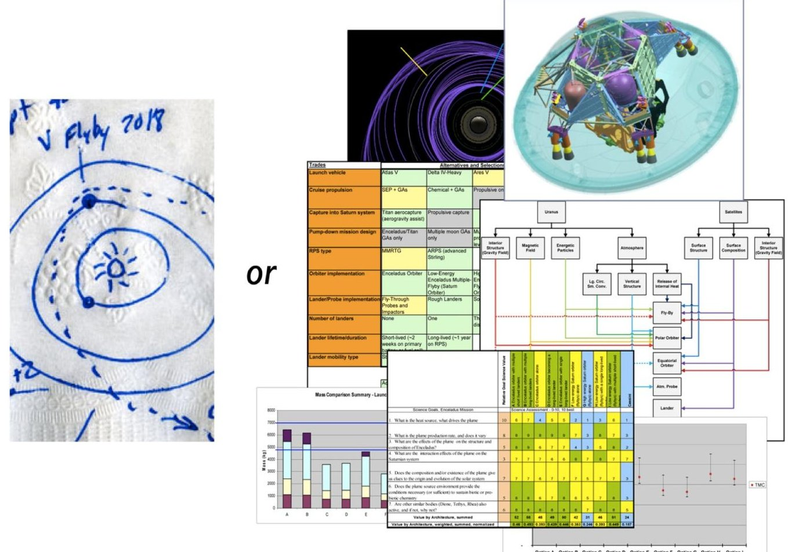
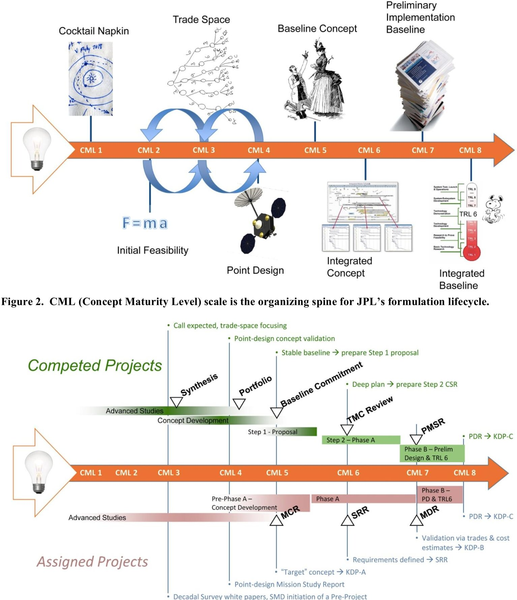
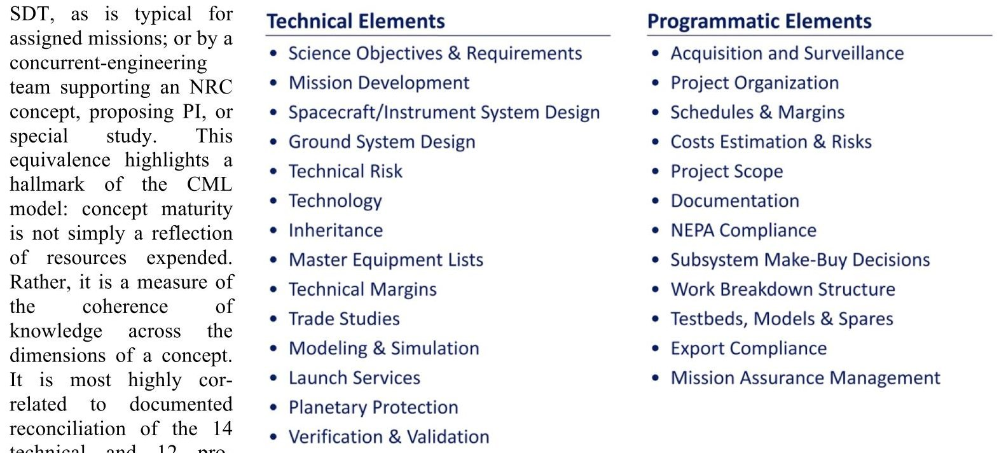
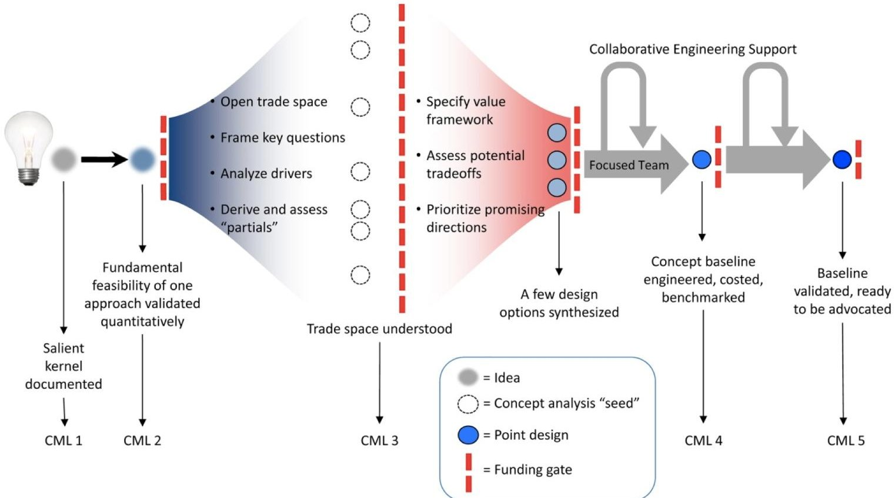
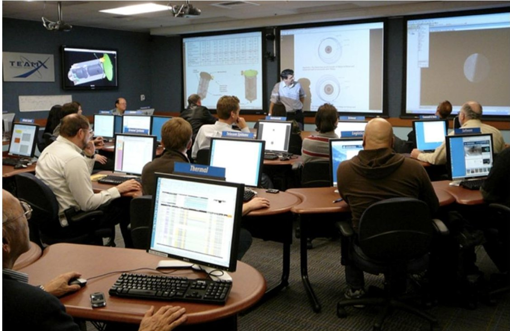
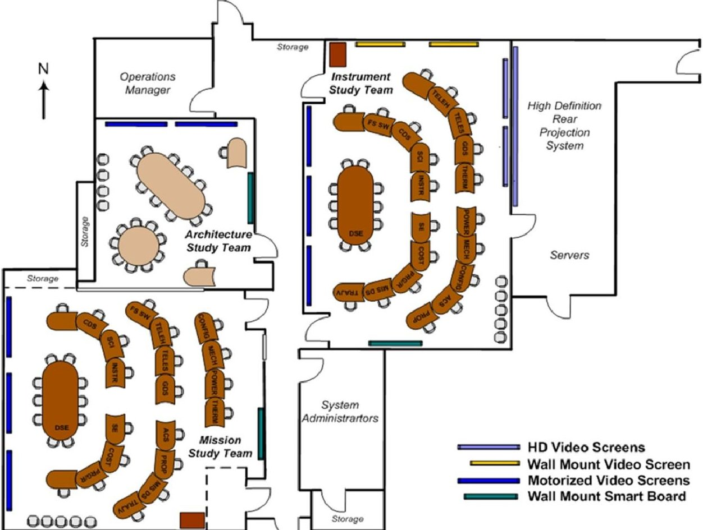
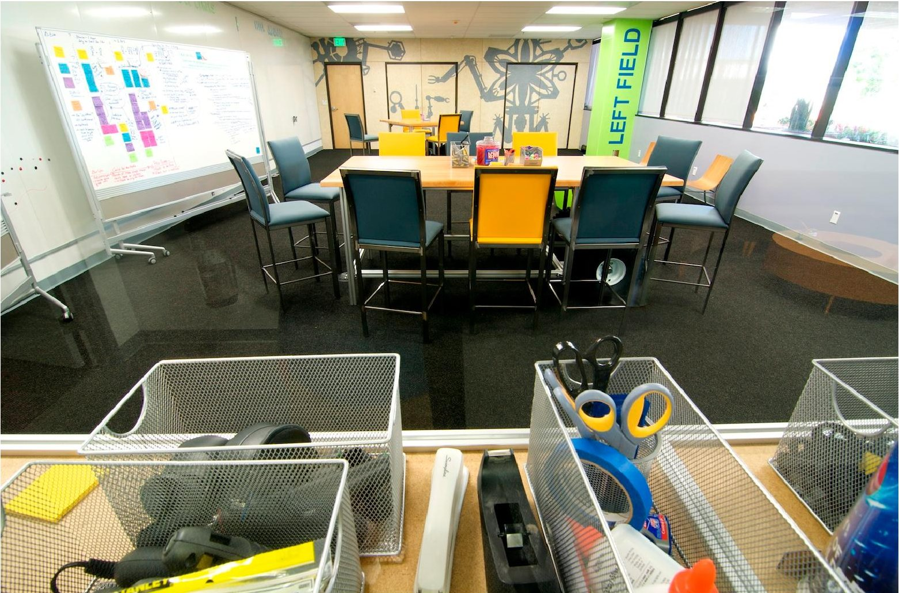
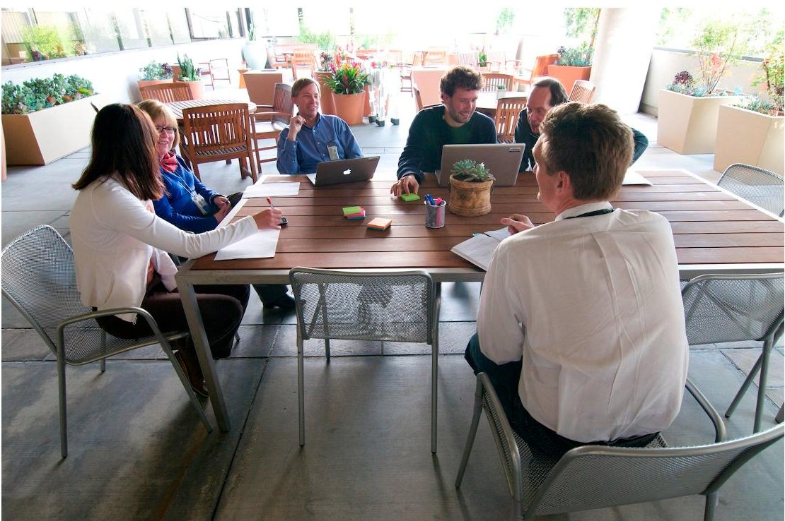
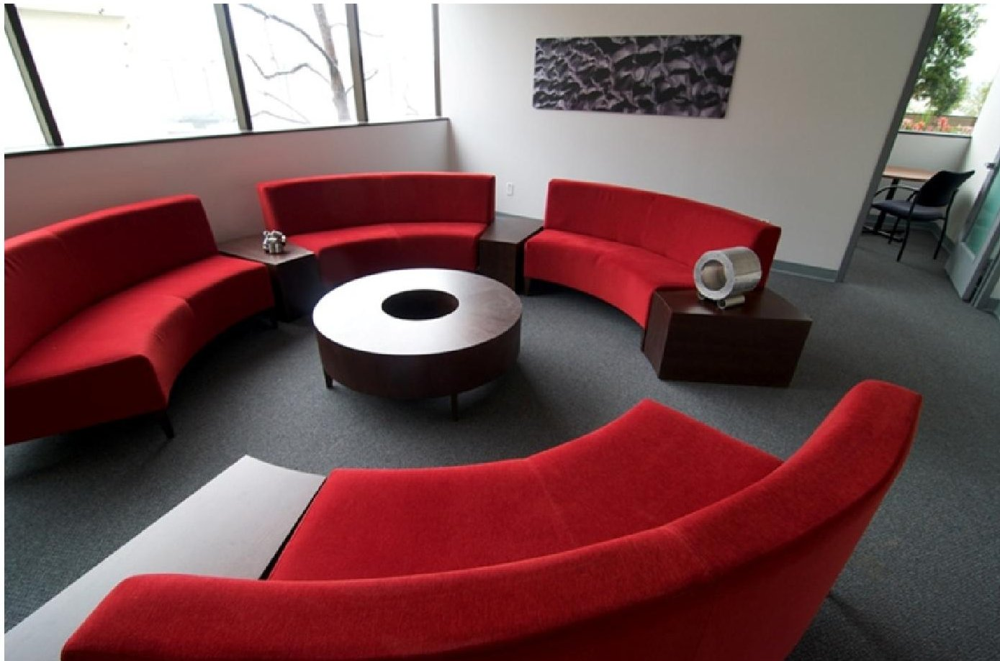

<!-- PDF_PAGE: 1 -->

# JPL Innovation Foundry

Brent Sherwood $ ^{1} $ and Daniel McCleese $ ^{2} $ Jet Propulsion Laboratory, California Institute of Technology, Pasadena, CA, 91109

Space science missions are increasingly challenged today: in ambition, by increasingly sophisticated hypotheses tested; in development, by the increasing complexity of advanced technologies; in budgeting, by the decline of flagship-class mission opportunities; in management, by expectations for breakthrough science despite a risk-averse programmatic climate; and in planning, by increasing competition for scarce resources. How are the space-science missions of tomorrow being formulated? The paper describes the JPL Innovation Foundry, created in 2011, to respond to this evolving context. The Foundry integrates methods, tools, and experts that span the mission concept lifecycle. Grounded in JPL's heritage of missions, flight instruments, mission proposals, and concept innovation, the Foundry seeks to provide continuity of support and cost-effective, on-call access to the right domain experts at the right time, as science definition teams and Principal Investigators mature mission ideas from "cocktail napkin" to PDR. The Foundry blends JPL capabilities in proposal development and concurrent engineering, including Team X, with new approaches for open-ended concept exploration in earlier, cost-constrained phases, and with ongoing research and technology projects. It applies complexity and cost models, projectformulation lessons learned, and strategy analyses appropriate to each level of concept maturity. The Foundry is organizationally integrated with JPL formulation program offices; staffed by JPL's line organizations for engineering, science, and costing; and overseen by senior Laboratory leaders to assure experienced coordination and review. Incubation of each concept is tailored depending on its maturity and proposal history, and its highest-leverage modeling and analysis needs.

Acronyms

<table border="1"><tr><td>CML</td><td>=</td><td>Concept Maturity Level</td><td>Pwin</td><td>=</td><td>probability of winning</td></tr><tr><td>FFRDC</td><td>=</td><td>Federally Funded R&amp;D Center</td><td>SDT</td><td>=</td><td>science definition team</td></tr><tr><td>P4</td><td>=</td><td>Pre-Project Principles and Practices</td><td>SMD</td><td>=</td><td>Science Mission Directorate</td></tr><tr><td>PI</td><td>=</td><td>Principal Investigator</td><td>TMCO</td><td>=</td><td>Technical, Management, Cost, and Other</td></tr><tr><td>PS</td><td>=</td><td>Project Scientist</td><td>TRL</td><td>=</td><td>Technology Readiness Level</td></tr></table>

## I. NASA Science Mission Planning

THE NASA Science Mission Directorate (SMD) performs two types of missions for the science community: programmatic, and PI-led. Programmatic missions comprise the strategic skeleton of each science division's prosecution of the science communities' investigation priorities. They are sequenced, sized, and specified by SMD science program offices to utilize NASA's limited resources in the most efficient way to answer fundamental questions prioritized by the National Research Council Decadal Survey process. In this way the "center of gravity" investigation priorities of the science communities (Planetary, Astronomy and Astrophysics, Earth Science, and Heliophysics) are met incrementally. The science content of the mission, including instrument complement and science operations, is determined by a science definition team (SDT) as coordinated by Project Scientist (PS). Each instrument is led by a Principal Investigator (PI), who steers that instrument's allocation of mission and system resources in pursuit of a progressive investigation. Programmatic missions typically range from medium-class (~$0.5B) up to flagship-class ($2B or more). The more modest missions tend to have fewer instruments and more focused objectives; flagship missions (e.g., Cassini) are typically able to perform highly interdisciplinary discoveries and investigations that bring to bear multiple instruments.

<!-- PDF_PAGE: 2 -->

PI-led missions are focused investigations proposed, organized, and led by a single Principal Investigator. NASA created this mission mode in the mid-1990s as a way to increase the diversity of missions and the mission "onramp" rate for new generations of scientists. Each mission is governed by a single scientist, who personally chooses all the Co-Investigators, prioritizes the measurement operations, and allocates project resources to the conduct of specific investigations. They range from small-class (~$0.1B) to large-class (~$1B); only the largest category (New Frontiers, at ~$1B not including launch costs) is guided by specified science objectives. Mission selection is done through a highly competitive process, typically in two formal steps over a period of three years, that winnows a field of dozens of ideas down to a single mission selected to proceed into Phase B. Selection criteria center around traceability of mission objectives to Decadal Survey priorities (especially investigations not likely to be addressed by programmatic missions in the pipeline or that may respond to emergent results), and "low implementation risk" which is defined by NASA to mean an implementation plan predictably commensurate with the available project resources. Although the probability of winning (Pwin) is numerically low for any given mission proposal, PI-led missions have been extremely popular with the science community. To date, 40 have been developed over two decades, amply implementing the program's goals.

Mission formulation for the two types of missions is done quite differently. In the case of programmatic missions, the implementing NASA center (e.g., JPL, GSFC, ARC, or LaRC) stands up a pre-project team that supports the SDT with iterative cycles of mission engineering, design, analysis, and cost estimation-perhaps over many years-until alignment is achieved among science promise, mission concept, technology need, and projected budget. The mission becomes a NASA budget line item, proceeds on NASA-direct formulation funding through Phase B, and is confirmed to enter Phase C (or not) depending on successful retirement of risk, stability of mission requirements and cost estimate, and continued solidity of projected budget at that point. Contemporary experience with the most ambitious programmatic missions, e.g., MSL and JWST, shows that even the best minds doing detailed analyses over multiple years may inadequately predict development challenges, and consequent schedule and cost increases, that occur after formulation. The uncertainty of cost and budget is a major reason why formulation of programmatic missions often follows a tortuous road from initial concept to implemented mission. NASA efforts since Galileo to fly a Europa mission illustrate the transformations a programmatic mission concept may undergo-JIMT, JIMO, JGO, and now EHM-to get into, and through, Phase B successfully.

The formulation lifecycle for PI-led missions tends to be rougher but shorter, and the formulation costs are predominantly borne by implementing centers and contractors rather than by NASA HQ. Sometimes PI-led missions are proposed multiple times before being selected for flight, but more than a few rounds of non-selection typically cause a proposing PI either to dramatically change the mission concept or to abandon the chase and move on to other research priorities. Rather than a small number of long-iterated mission concepts, the PI-led formulation landscape contains many dozens of ideas percolating in various stages of maturity, some of which proceed on to full-fledged Step 1 proposals. An implementing center chosen by the PI, and a spacecraft contractor chosen by that team, typically spend significant sums of human and financial capital on every proposal. Two dozen proposals, submitted by diverse teams, are not uncommon in a single opportunity, even though in the end only one will be selected for flight.

## II. Changing Environment

NASA supports the community of mission PIs by helping them ideate, mature, and propose concepts for new missions. JPL is NASA's FFRDC (Federally Funded R&D Center). In addition to implementing many simultaneous space science missions, JPL implements a large fraction of NASA's formulation support role. Over the years JPL has become a primary resource for this support service to the science community; at any given time many dozen mission concepts are undergoing exploration and maturation for future competitive and programmatic opportunities.

Four secular trends in the mission selection environment affect how JPL provides this service today:

- More competitors—NASA expects "winning" PIs to have flight credentials as experienced leaders of major science investigations, e.g., as instrument PI, mission Co-I, Project Scientist, or deputy PI on prior missions. So over time the number of qualified PI candidates increases. In addition, the ratio of PI-led to flagship-class missions is likely to increase, so more PI candidates are likely to seek missions through the competitive route. Thus, the served population grows.

- More-complex mission ideas—While opportunities for sheer "discovery" science remain (e.g., straightforward missions to make first measurements of fundamental quantities such as Mars' interior structure), PIs increasingly aim for complex datasets that bridge disciplines. Earth-system science, exoplanet observation, interior-surface-atmosphere interactions, small-body tomography, and investigation of outer-

<!-- PDF_PAGE: 3 -->

planet satellite habitability are examples of tomorrow's ambitious mission objectives. Thus, the technical challenge grows.

- Scarcer formulation resources—SMD budget topline constraints—particularly for the planetary and astrophysics divisions—limit the frequency of mission new-start opportunities. Two direct effects are reduction of the "addressable market" for candidate PIs, and reduction of NASA funding for Phase A (PI-led) and pre-project (programmatic) concept engineering. An indirect effect is constrained financial capability by JPL and other laboratories to support candidate PIs in developing their concepts. Together the three effects concentrate the field earlier, which exacerbates the long-known dilemma that NASA project funding profiles in Phases A and B is inadequate to bound subsequent implementation risks. Multiple independent studies have concluded that spending a significant (up to 20% or more) fraction of project resources before confirmation (KDP-C) is essential to prevent cost surprises later. Thus, the ability to control uncertainty in concepts diminishes.

- Toughening standard of technical evaluationNASA uses a two-channel process to evaluate merit and risk of PI-led mission proposals: review of the proposed science by a peer panel; and review of the science and mission implementation by a large review panel. This TMCO (Technical, Management, Cost, and Other) evaluation is increasingly being applied to assessment of programmatic mission concepts as well. Over two decades the TMCO mechanism has been honed by insight into many hundreds of mission proposals and the aggregate experience base of the 40 PI-led missions that have been developed. Evaluators are keenly aware of the history of project cost growth and other implementation challenges unforeseen by the respective formulation cycles. As a consequence the NASA evaluation of PI-led mission proposals is strongly biased toward flight heritage, low development risk, and in many cases PDR-fidelity technical analyses, despite thin formulation resources. Thus, it gets increasingly harder to pass muster.

The integrated result of these four environmental trends is that SMD's candidate PIs and SDTs face a ratcheting challenge: simultaneous, competitive formulation of a large number of deeply engineered concepts, for ambitious science objectives, achieved using well-understood system, formulated on a strict "diet."

## III. Scientists' Expectations

Recognizing both the stakes, and the evolving challenge outlined above, generally causes mission-leading scientists to bring five expectations to concept development campaigns:

- To win—There is little benefit from any other outcome.

- Respect for the integrity of the scientific vision—PIs expect their partners and team members to align their efforts toward achieving the science objectives they set; mission content, instrument integration issues, infusion of advanced technical capabilities, cost, workshare allocation, and personnel assignment should be dependent issues. For some PIs this respect includes proprietary secrecy during concept development and competition, extending in rare cases even to the mission's name.

- Dedicated campaign team—PIs want their team members undistracted and undiluted by other duties, including work on flight projects already in implementation; and undiluted. Budget realities typically force concept-team work to be part-time for many specialists; however, PIs seek commitments that appear full time or are as full-time as instantaneously needed. They never want to feel the presence of other projects impacting their team members' attention share, nor feel the presence of parallel, competing teams that may share institutional resources.

- The best help NASA can muster—As options are compared and issues are solved, PIs expect "no stone unturned." They have come to NASA for the world's best talent for formulating space science missions; they expect the deepest experts applied as needed, no matter which department, center, or contractor hosts them. PIs also want assurance that all relevant lessons learned from prior NASA concepts, proposals, evaluation feedback, and executed projects are known, accessible, and tangibly applied to their current circumstance.

- Full immersion in decision-making ecology—Formulation is the project lifecycle phase when a large number of high-leverage decisions are made at a fast rate. And NASA specifies that a mission PI is "accountable to NASA for the success of the investigation, with full responsibility for its scientific integrity and for its execution within committed cost and schedule." PI candidates keenly feel this responsibility; while they recognize the need to trust experts in engineering, management, operations, and so forth, they typically seek selective control over the development of both the concept and the proposal that proffers it. Time constraints due to their own extra-campaign commitments may confound this intention. Above all, as common for all leaders, PIs want no surprises.

<!-- PDF_PAGE: 4 -->

## IV. Derived Requirements

To respond to scientists' expectations in the evolving mission-planning environment, JPL has retooled its provision of integrated formulation lifecycle support to PIs, SDTs, concept teams, and program offices. The retooled formulation enterprise is the JPL Innovation Foundry. The Foundry comprises an alliance among three matrixed institutional elements: program offices charged with creating and securing new mission opportunities, line organizations that contain the Laboratory's skilled personnel, and institutional offices responsible for formulation infrastructure. The Foundry operates and undergoes continuous improvement to meet requirements derived directly from the core challenges.

Mission concept leaders and their teams need two fundamental activities:

- Darwinian evolution of a seed idea Mission concepts start with a spark of an idea: a novel measurement; unprecedented access or persistence; unique synergy of multiple observables; etc. All such sparks undergo significant exercising and elaboration before they can be actualized in flight. It is helpful to view this dynamic process as Darwinian evolution: iterative cycles of variation and natural selection that continuously test the idea against models of the vicissitudes, agendas, and other influences that are likely to obstruct, bend, or twist it during its lifecycle. Against such forces the concept baseline must be resilient enough that it can win, fly, and deliver on its promise as the years unfold. Proper formulation practice must mature the concept, toughening it by challenging it in the right ways at the right times.

- Accurate forecasting despite incomplete data-A hallmark of formulation is the need to make decisions without "enough" information. The ability to do this well "separates the sheep from the goats" in the tough sport of formulation-many engineers simply cannot tolerate the ambiguity, shifting ground, and consequent reliance on intuitive thinking that formulation requires. Perfect knowledge is achieved only after Phase F, however, and this eventual state of truth regarding performance, risk, and especially cost must be forecasted throughout formulation. All participants in the formulation lifecycle, from PI to selection official, operate with incomplete, fuzzy, and incorrect information, yet decisions must be made. In the competitive planning environment, even more vital is the ability to forecast not just the eventual state of truth, but how others will model it-particularly evaluators.

The Foundry is organized and run to promote excellence in meeting five requirements that flow from these two needs:

1) MethodThe foundational principle of the Foundry is that excellence in formulation performance is achieved and provided through method. The way we ideate, explore, engineer, estimate, and mature mission conceptsand the way we communicate them in advocacy, outreach, and proposals—must be amenable to a coherent method that is stable (documented, operational, and supported), reliable (predictable and repeatable), clearly understood (by all participants), and exercised (for discipline during campaigns and continuous, longitudinal improvement across them). Such a method must be appropriately tailored for various types of opportunity and for the progressive stages of the formulation lifecycle, throughout the course of which the expectations levied, knowledge gained, and cost incurred all increase.

2) SME access—Almost every technical or programmatic challenge a mission concept encounters can be mapped to one or a few standout subject-matter experts whose experience is vital to solving with elegance and efficiency. As a general rule such experts are already fully occupied at the time a concept "needs" them. So a supportive formulation process must provide on-demand, "surgical" access to them as needed—but only as needed. Formulation budgets cannot carry a large retinue of deep SMEs continuously; nor could any given formulation effort sequester their time.

3) Facilities—Key facility types used for aerospace mission engineering (meeting rooms and web- or server-hosted information resources) need special configuration and outfitting to support formulation. This is because, for any mission's fundamentals, the rate of change per unit resource available or expended (time, people, dollars, etc.) is far higher in formulation than in later, implementation phases. And the earlier in the concept lifecycle, the larger these partial derivatives are; design leverage is greatest when little is yet decided. Optimized facilities like design centers and war rooms must enable and promote "extreme collaboration" characterized by: instant visibility and socialization of issues; simultaneous, integrated analysis of solution options; directed progress in the absence of hard requirements; rapid redirection; liberal use of experienced judgment in lieu of detailed analysis; and above all, velocity.

4) Smart access to prior art—New mission concepts do not arise in a knowledge vacuum. Today's concepts for tomorrow's missions are cultivated and harvested in a pivotal milieu of experience, and engineering and programmatic judgment regarding implementation risk. JPL has won 43% of the competed missions awarded to date, has historically submitted large proposal portfolios compared to peer enterprises, and has

<!-- PDF_PAGE: 5 -->

run Team X since inventing collaborative engineering in the mid-1990s. A supportive formulation process must bring to bear the accumulated, reconciled knowledge implicit in tens of flown missions, hundreds of fully vetted proposals, and thousands of engineered concepts.

5) Hands-on coaching of the formulation craftProcess, talent, infrastructure, and knowledge base must all be tailored to the opportunity and concept at hand. Every PI is unique, as are their mission ideas, teams, and needs. In addition, formulation excellence requires skills beyond acumen in science, engineering, and management. Concept ideation, feasibility quantification, broad trade-space exploration, mission architecting to generate requirements, facilitation of intense technical conversations, strategic communication whether graphical, written, or oral, and reviewing and editing are all essential. Experienced coaching is needed to help scientists and their technical teams maneuver through all the wickets of the formulation phase, including especially the development of a concise, evaluable proposal that communicates their concept successfully.

## V. Meeting the Challenge

Among the many method-improvement initiatives undertaken by the JPL Innovation Foundry, four are described here: the Concept Maturity Level scale, Pre-Project Principles and Practices, Team X, and A-Team.

## A. CML Scale

Significant public resources are planned based on expectations set by mission concepts. Such concepts are incorporated into competitive proposals, pre-project study reports, white papers submitted to NRC decadal surveys, and continuous "what if' challenges posed by program planners. But "one person's concept is another's doodle" (Figure 1), so a common set of metrics and a common language can help communicate effectively about which is which.

The TRL scale (Technology Readiness Level) serves that function routinely in the technology world, having become, despite variations in application, "baked into" contemporary aerospace program planning.

In 2009 JPL created the CML scale (Concept Maturity Level) to serve the analogous function for measuring the maturity of integrated mission concepts $ ^{1} $ . CMLs now provide the organizing spine for the formulation lifecycle in the Foundry (Figure 2), and are being coordinated throughout SMD and its partners. The scale is designed as an

Figure 1. One person's "concept" is another's doodle. How can concepts be compared? 5 American Institute of Aeronautics and Astronautics

<!-- PDF_PAGE: 6 -->

Figure 3. CML scale provides onramp to NASA project lifecycle.

onramp to NASA NPR-7120.5 program milestones (Figure 3): CMLs 8, 7, 6, and 5 designate readiness for PDR, MDR, SRR, and MCR respectively for non-competed missions. Those same CMLs provide maturity benchmarks to help align the offset decision points NASA uses for competed projects.

The CML scale is particularly useful earlier in the concept lifecycle: before MCR (assigned) or the Step 1 baseline (competed). CML 4 designates a point design that has been engineered, integrated, and costed (e.g., as done by a traditional Team X study). Sufficient integration may be achieved either by a dedicated team supporting an

<!-- PDF_PAGE: 7 -->

Figure 4. Integrated concept embodies both technical and programmatic decisions.

Foundry provides JPL teams an assessment service that benchmarks these 26 concept attributes as the teams progress through CMLs 4, 5, and 6; and domain-area coaching to bring weak areas up to par.

The path from "cocktail napkin" to CML 4 has emerged as pivotal. In these early formulation stages key decisions are made about: ideas to pursue; innovations to explore; options to winnow; partnerships to form; proposals to invest in; and in some cases, mission concepts to incorporate into decadal planning. Every one of these decisions is made in an environment characterized by insufficient, incomplete, uncertain, and in some cases nonvalidatable, information. In this situation a disciplined method can stimulate creativity and rigorously apply strategic knowledge to wring the most value out of available resources (Figure 5).

At CML 1 the salient kernel of a mission concept—the core idea that differentiates it from other concepts—is articulated and documented. Typically this represents some marriage of exploration goal, science observable, instrument technology, mission engineering, system performance, and implementation scheme. It arises as the spark of an "a-ha," captured so it can be communicated. A CML 1 meme is easily transmitted. Study activities aiming for

Figure 5. Systematic evolution of an idea yields a robust concept that can be advocated successfully.

<!-- PDF_PAGE: 8 -->

CML 1 focus on techniques like lateral thinking, inversion, and other creative provocations and progressive brainsteering. Capture and expression techniques may be as simple as diagramming a conceptual parti, and writing crisp, elevator-speech descriptions of the kernel. The traditional "cocktail napkin" image is apt.

CML 2 requires documenting a way to accomplish the mission idea, thought through by testing it for fundamental feasibility. The "soft spots"aspects that could un-do what at first seemed like a bright idea—are identified, probed, quantified, and forced to reconcile with known approaches. Analogy, look-up tables, and firstprinciples theoretical calculations done with very large engineering-reality margins are useful adjunct tools at this stage, but the core talent required for efficient study is expert differentiation between what must be scrutinized and what need not yet be quantified; as well as rapid application of estimation techniques to bound, frame, and dissect the idea. What results is the gist of a coherent, reasonable way to approach implementing a version of the idea that embodies a sufficient value proposition.

CML 3 purposely puts a flow diverter in front of a CML 2 concept. Rather than allow the idea to be detailed into a full-fledged concept—a typical urge for study teams—it forces proliferation and consideration of options designed to preclude premature "settling." A rigorous study articulates, then systematically disassembles the assumptions that drive key aspects of the CML 2 concept—both its objectives and its approach (at this point there are not yet any actual requirements or design). The study asks and answers three key questions: (1) what other ways might there be to accomplish comparable objectives; (2) what is learned by stretching the concept in various ways; and (3) what derivative applications might the concept be useful for?

The main goal of this "tradespace exploration" is conceptual understanding of the gradients that characterize a multivariate option space: the "partial derivatives of science return with respect to the key, driving parameters." First-by analogy with solid mechanics-principal axes of the tradespace are identified: orthogonal parameters that matter strongly to the client, or intrinsically to the concept. Second, the relevant tradespace range is circumscribed by denoting appropriate limits on the principal axes: e.g., upper bounds on launch epoch or cost class, or lower bounds on TRL or payload capacity. Third, a manageable set of concept analysis "seeds" is defined, that collectively span the multivariate tradespace and (when considered as a set) characterize what the tradespace can offer the concept. Analyzing the behavior of these analysis seeds-their sensitivity along the principal axes-yields a documented understanding sufficient for subsequent decision making: CML 3.

Some studies stop there; however, depending on what has been learned, and the programmatic or strategic context, a study client may choose to invest in development of one or more potentially implementable concepts. This gate highlights an important aspect of concept analysis seeds: they may be defined for CML 3 analysis purposes only, never intended to be elaborated themselves into implementable concepts. In the interest of efficiently exposing tradespace behavior, the study architect may purposefully design analysis seeds that are "too extreme" in one or more dimensions to be acceptably balanced for implementation. But the knowledge gained through the analysis puts the PI and study team on solid ground for knowing how to maneuver flexibly later in the concept lifecycle.

Past CML 3 a small set of implementable concepts is synthesized; from among these the client expects to develop the implementable concept to be advocated. The engineers' innate urge to drill into detail, elaborate subsystem design and performance analysis, and build out the concept is unleashed, leading to one or more CML 4 point designs and the rest of the lifecycle. Synthesis is pivotal because it makes the transition from expansion exploration, and trial to prioritization, reduction, and selection. Depending on circumstances, the design agent who performs the synthesis may be a study team chartered to make downselect recommendations; a singular mission architect empowered by the PI or client; a client with concept-development expertise; or some combination. The key action in synthesis, and the reason it cannot simply be assumed to be an automatic study-team product, is making value judgments about how to reconcile conflicting priorities. Once informed by CML 3, the design agent is in a position to re-assess which combination of parameters is really the most critical, and thus where the concept should be driven. Often multiple, distinct combinations of parameter values will be attractive to the client as planning alternatives, which is why the standard synthesis product is two or three point-design candidates. The client may carry parallel alternatives through CML 4 or even CML 5, depending on the advocacy environment.

A particular challenge of the CML 1-4 stages of the concept lifecycle is knowing how, how much, and when to "open" and "close" at each stage throughout the sequence. Proliferating and sustaining options is key to avoiding entrapment by un-iterated assumptions; on the other hand, branches can multiply exponentially far beyond the ability of any study resources to handle them. The divergent-convergent behavior diagrammed in Figure 5 is a constant process, occurring at large and small scales as an idea gets evolved, and its management requires skill and experience. A mission architect performs this role. Architecting is fundamentally different from other kinds of engineering—even design engineering—because it is synthetic rather than analytical. That is, it puts together rather than taking apart. The architect is comfortable operating before there can be requirements, by balancing the shifting landscape of implicit valuation among conflicting priorities and by establishing a vision of the end state that the

<!-- PDF_PAGE: 9 -->

team's analyses serve. The consummate engineer can answer any question; the proficient architect intuits which questions to ask, in what sequence. Architecting skill arises from a combination of aptitude—including tolerance for ambiguity and readiness to both invent and abandon provisional requirements—and domain experience. Expert formulation architects are a limited resource that the Foundry carefully cultivates.

## B. Pre-Project Principles and Practices

At the turn of the 21st century, in a then-new environment of multiple, simultaneous, "faster-better-cheaper" flight projects, a cluster of JPL missions failed. Among several remedial actions undertaken by the Laboratory was a focused knowledge-capture activity. Advice accumulated by senior project implementers over the years was extracted, organized, documented, and codified. Now continually updated, the JPL Flight Project Practices and JPL Design Principles guide the Lab's project implementation and system design today.

An experience-based framework for preliminary (Phase B) and detailed (Phase C) design of project systems, however, provides insufficient guidance for conceptual design earlier in the project lifecycle. In and before Phase A, the knowledge environment within which design options are contrived, analyzed, and decided among can never be as secure or detailed as during Phase B and thereafter. So even the wide technical margins expected in Phase B may provide too brittle a framework for earlier concept development.

To address this gap the Foundry operates to an integrated set of proprietary guidelines called the P4 (Pre-Project Principles and Practices) $ ^{2} $ . The P4 recommends standards for coverage and content for each of the 26 concept elements, matrixed by CML. Hosted on the JPL intranet, this extensively hyperlinked resource is easily entered by CML (so practitioners can see the cross-section of product fidelity expected at each stage of concept development) or concept element (so practitioners can see the maturation trajectory expected for that dimension).

By analogy to JPL's Project Support Office, the Foundry Office provides Project Formulation Support to assist teams in applying the P4 while working toward CMLs 5 and 6: the rationale, cross-linkages, case-specific tailoring, practice, adaptation, assessment, and remediation of the guidance. The small number of implemented flight projects, and the long project lifecycle, limits the amount and utility of feedback into the P4 from "actuals." However, vast amounts of feedback are generated by JPL internal campaign reviews and customer proposal evaluations; this body of learning is continually analyzed, correlated, and folded into P4 updates. Thus through the P4, PIs and concept teams benefit from the broad base of concept development undertaken by JPL, today and over the years.

## C. Team X

In the mid-1990s NASA SMD created the PI-led mission approach, which established the need for fair and open competition by PI-led teams for mission opportunities. This mission selection mechanism opened the possibility that any qualified scientist could be awarded a focused mission of the scientist's own design. This opening led directly to the need for JPL, other NASA centers, and other national laboratories, to support individual members of the science community with mission concept and proposal development.

Widespread interest by hopeful PIs rapidly overwhelmed the ability of the Laboratory to respond in the traditional way: by standing up dedicated concept teams for each. Instead, JPL invented the technique of concurrent engineering and created Team $ X^{3} $ . Team X systematically engineers a mission point design, to a benchmarked level of fidelity and validation, for a predictable cost on a predictable schedule.

Concurrent engineering designates a method in which the minimum necessary set of relevant experts convenes in a shared space, operating on shared data and facilitated by an expert study lead, to conduct a quantitative concept study. The inputs are typically a set of performance requirements for the mission (e.g., synthesized after CML 3). The output is a reviewed study report that captures mission design; derived requirements; instrument selections; operations concept; component descriptions and performance for all subsystems; budgets for mass, power and other resources; and programmatic (schedule, cost, and risk) estimates for the mission. A typical study includes two dozen specialists, includes one or more client representatives, and takes a few weeks from initial meeting to final report, with less than ten hours of in-session, concurrent work. Because of its intensity, the Team X environment imposes practical limits on session duration and personnel duty cycle (Figure 6).

The mechanism combines people, processes, and tools in a manner refined over two decades. The line- organization element of the Foundry provides subsystem experts and the technical vetting of design models they build and maintain, so that Team X operates on a footing of technical consistency with how the Laboratory implements projects. The line also provides skills unique to concurrent engineering, including study facilitation and formulation systems engineering. The institutional element of the Foundry manages an IT backbone that integrates the parameters exchanged among the over a hundred design and analysis models; the data server, storage, archiving, and configuration management functions; method training; and strategic investments in continuous capability improvement. Special-purpose theaters equipped with networked engineering workstations and display screens are

<!-- PDF_PAGE: 10 -->

configured to support all-in conversations, multi-specialist sidebars, and individual yet simultaneous work. In 2009 the Foundry invested in a major renovation and upgrade of the Team X facilities, which now includes two fully capable study theaters (Figure 7) $ ^{4} $

The concurrent engineering technique, and particularly its electronically enabled setting, has been copied throughout the aerospace industry and beyond, and been applied to preliminary design as well as conceptual design stages. However, Team X remains unique in that its practitioners are JPL technical experts, and that since 1994 it has

Figure 6. Team X, the original concurrent engineering enterprise, allows costeffective development of integrated point designs.

engineered well over a thousand concepts for Earth science, planetary, and astrophysics missions. Together the experts and database comprise a key resource of captured and tacit corporate knowledge upon which new concepts can be engineered expeditiously and confidently.

Recently the Foundry has been able to offer other innovative uses of the Team X models and concurrent approach. For mission concepts these include services useful at CML 5 in particular, such as: (1) Red Teaming point

Figure 7. JPL continues to invest in modernizing Team X, including optimization of its infrastructure based on over 1000 studies.

<!-- PDF_PAGE: 11 -->

designs engineered by other methods; (2) generating institutional-standard cost estimates of already-engineered concept baselines; (3) capturing heritage assumptions underlying a design baseline; and (4) directly preparing proposal drafts to obviate large campaign teams. The Foundry also offers a Team X Instruments study that applies concurrent engineering techniques and instrument-specific "subsystem" models (including optics and data systems) to the challenge of rapid conceptual design of observational and in situ instruments.

## D. A-Team

One of the most popular contemporary capabilities provided by the Foundry is its A-Team. Conceived to tackle mission architecture-level trades, JPL's A-Team applies concurrent engineering throughout the concept ideation and exploration stages, CMLs 1-3, according to the principles promoted by the P4.

The Foundry's A-Team method shares the core, defining attributes of concurrent engineering as performed by Team X: the minimum necessary set of relevant experts convenes in a shared space, operating on shared data and facilitated by an expert study lead, to conduct concept ideation. The facilities, tools, and facilitation are optimized for the purpose; and the studies are systematically planned and executed.

However, A-Team's instantiation of concurrent engineering is quite different in key respects. A-Team is built around contemporary principles of idea development as practiced by Silicon Valley innovation companies.

Study teams are essentially never the same; instead they comprise a few core-team technical experts (who are also practiced in A-Team approach) augmented by SMEs chosen for the study challenge at hand. This delivers to PIs and other clients the focused attention of deep experts drawn from across and beyond the Laboratory, at the time when diverse options are first being considered and feasibility is first being tested, yet in a managed setting that regulates the depth of detail and controls the urge to dismiss novelty. Immediate access to the right SME can often obviate unnecessary analyses.

Team size is kept small—always less than twelve and more optimally, around eight. While such concentration maximizes the vibrancy, integration, and productivity of the process and product, it also mandates special skill both in the domain coverage that can be provided by study participants, and in selecting them for each study. Whereas Team X "chairs" are operated by individual subsystem experts, A-Team technical roles are filled by expert generalists (e.g., a comprehensive flight system engineer rather than multiple engineers for propulsion, mechanical, thermal, telecom, etc.). The Foundry sustains a core of A-Team experts who establish performance standards for the roles, adapt them for unusual studies, participate in studies as needed, and oversee the development of analytical tools optimized for the A-Team environment.

Because of their strategic nature, A-Team studies tend to include beyond-technical experts as well, such as executives, thought leaders, and strategic communicators. The study leadership framework is comparable to that required for Team X, because of the irreducible amount of simultaneous attention required for key roles and to produce a professional study product. Typically this framework comprises a nucleus of two or three people covering each of two dimensions: innovation method (technical facilitation and study leadership), and technical coordination (architecting, systems engineering, and integration engineering). Smaller "team" configurations simply collapse to a solitary architect supported by SMEs. Technical facilitation of CML 1-3 idea development is, like mission architecting, a limited resource that the Foundry cultivates.

The parameters of A-Team studies vary as widely as the study participants. For example, duration may be as short as two days (end-to-end including planning, session, and knowledge capture) or as long as several months spanning multiple sessions. The Foundry A-Team has proven useful for early-stage and vaguely constrained problems in domains as diverse as strategy, mission concept development, and technology assessment. Presently seven types of A-Team study are conducted:

1) Idea generation

2) Feasibility assessment

3) Architecture tradespace exploration

4) Concept synthesis

5) Science traceability

6) Technology impact

7) Strategic investments and opportunities

The core facility used for hosting A-Team studies is Left Field, located in JPL's Formulation Laboratory near the Mission Systems Concepts Section and the Team X theaters. Left Field is an oversize room equipped with conference-room IT accoutrements plus easily movable furniture, full-wall, electronic-capture whiteboard, HD videoconferencing, ample but discreet storage, and toys (Figure 8). The ratio of room area to study-team size is far higher than conventional meeting rooms; yet the interaction energy and the movement of participants throughout study sessions "fill" the space nonetheless. The A-Team complex also includes an open-air overflow space

<!-- PDF_PAGE: 12 -->

Figure 8. JPL Innovation Foundry's Left Field supports concept ideation and exploration by the A-Team.

(Figure 9, Out There, which takes advantage of Pasadena's Mediterranean climate for small studies and breakout conversations) and adjacent private offices and collaboration space for visiting PIs (Figure 10, PI Lounge).

The A-Team's inception was in early 2011. In addition to a steady flow of client studies commissioned by JPL's formulation program offices, the Foundry itself continues to invest in pilot studies that stretch the boundaries, scope, and modalities of what A-Team can be. PI response has been strong and affirming. In the right hands, in the right kind of environment, and informed by the right expertise, the

Figure 9. A-Team complex includes Out There, informal overflow space adjacent to Left Field.

systematic disassembly and rebuilding of assumptions proves to be a powerful tool to help PIs and program managers learn quickly what matters, what options can be made, and where to turn next.

<!-- PDF_PAGE: 13 -->

Figure 10. PI Lounge provides private and collaboration space for visiting scientists conducting formulation studies.

## VI. Conclusion

The JPL Innovation Foundry is forging the space and Earth science missions of tomorrow. It is designed, equipped, staffed, and operated to provide NASA with an energizing, cost-effective way to spark and proliferate ideas, test assumptions, understand parameter leverage and decision options, select best approaches, mature mission concepts, and propose them. Through an alliance among program offices, line organizations, and institutional process it coordinates the Laboratory's investment and operations attention on all aspects of formulation skill: people, processes, and tools. In state-of-the-art facilities, formulation leaders run best-practice methods that tap into a unique knowledge base of concepts engineered, proposals reviewed, and missions flown. The most relevant subject matter experts in the business are surgically applied to formulation questions posed by experienced architects and facilitators. As formulation resources continue to contract, and as stakes rise, competitions toughen, and more scientists envision ever more ambitious investigations, the Foundry is prepared to support.

## Acknowledgment

This research was carried out at the Jet Propulsion Laboratory, California Institute of Technology, under a contract with the National Aeronautics and Space Administration.

## References

$ ^{1} $Wessen, R. R., Adler, M., Leising, C. J., Sherwood, B., "Measuring the Maturity of Robotic Planetary Mission Concepts," AIAA Space 2009 Conference and Exposition, AIAA 2009-6824, Pasadena, California, September, 2009.

$ ^{2} $Leising, C. J., Sherwood, B., Adler, M., Wessen, R. R., Naderi, F. M., "Recent Improvements in JPL's Mission Formulation Process," Proceedings of the 2010 IEEE Aerospace Conference, Big Sky, Montana, March 6-13, 2010.

$ ^{3} $Wall, S., "Reinventing the Design Process: Teams and Models," IAF, Specialist Symposium: Novel Concepts for Smaller, Faster & Better Space Missions, Redondo Beach, CA, 1999.

$ ^{4} $Sherwood, B., Adler, M., Wheeler, R., "The New Team X: Concurrent Engineering Advancement at JPL," 58th International Astronautical Congress, Hyderabad, India, September 24-28, 2007.