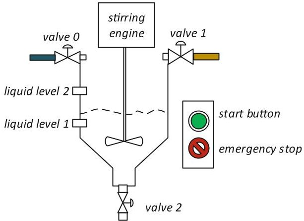
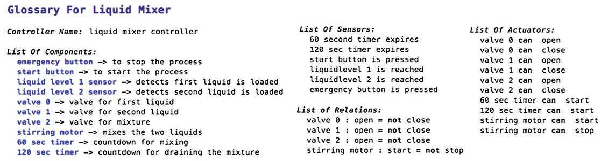
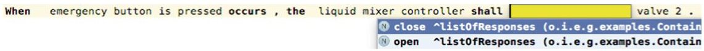
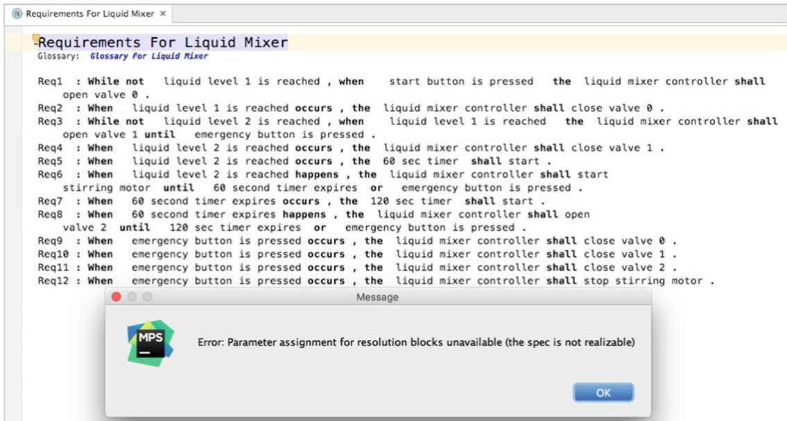

<!-- PDF_PAGE: 1 -->

# Just Formal Enough? Automated Analysis of EARS Requirements

Levi Lucio $ ^{1(\boxtimes)} $ , Salman Rahman $ ^{1} $ , Chih-Hong Cheng $ ^{1} $ , and Alistair Mavin $ ^{2} $

$ ^{1} $ fortiss GmbH, Guerickestraße 25, 80805 München, Germany {lucio,cheng}@fortiss.org, salman.rahman@tum.de $ ^{2} $ Rolls-Royce, PO Box 31, Derby, UK alistair.mavin@rolls-royce.com

Abstract. EARS is a technique used by Rolls-Royce and many other organizations around the world to capture requirements in natural language in a precise manner. In this paper we describe the EARS-CTRL tool for writing and analyzing EARS requirements for controllers. We provide two levels of analysis of requirements written in EARS-CTRL: firstly our editor uses projectional editing as well as typing (based on a glossary of controller terms) to ensure as far as possible well-formedness by construction of the requirements; secondly we have used a controller synthesis tool to check whether a set of EARS-CTRL requirements is realizable as an actual controller. In the positive case, the tool synthesizes and displays the controller as a synchronous dataflow diagram. This information can be used to examine the specified behavior and to iteratively correct, improve or complete a set of EARS-CTRL requirements.

## 1 Introduction

When writing requirements for software systems in natural language problems such as ambiguity, vagueness, omission and duplication are common [17]. This is due to the large gap between natural language and the languages in which code is expressed. Natural language requirements describe a wide range of concepts of the real, abstract and imaginary worlds. By contrast, programming languages are used to describe precise sequences of operations inside a machine. Natural language can be partial, ambiguous and subjective, whilst code can typically be none of those things.

EARS (Easy Approach to Requirements Syntax) is an approach created at Rolls-Royce to capture requirements in natural language [17]. EARS is based on practical experience, but has been shown to scale effectively to large sets of requirements in diverse domains [15,16]. Application of the approach generates requirements in a small number of patterns. EARS has been shown to reduce or even eliminate many problems inherent in natural language requirements [17]. In spite of its industrial success, we are not aware of any published material describing tool support for EARS. The method is primarily aimed at the early stages of system construction, as a means of providing clear guidance to requirements engineers when using natural language to describe system behavior. Automating the writing and analysis of EARS requirements has not been attempted thus

<!-- PDF_PAGE: 2 -->

far. It is however reasonable to expect that, due to the semi-formal nature of the EARS patterns, automated analysis of EARS specifications can be implemented to improve software development methodologies already in place at Rolls-Royce and elsewhere.

In this paper we will describe our initial work in the direction of automating the analysis of EARS requirements. As domain of application, we have chosen to focus on the construction of controller software. In particular, the EARS requirements for the controller running example we present in this study have been validated by a requirements engineer at Rolls-Royce. Aside from being industrially relevant, the controller domain lends itself well to analyses and syntheses, given its constrained nature. The contributions described in this paper are as follows:

- An editor for EARS specifications, called EARS-CTRL, based on the projectional editor MPS (Meta Programming System) [2]. Sentences written in our MPS EARS-CTRL editor have the "look and feel" of pure natural language, but are in fact templates with placeholders for which meaningful terms are proposed to the requirements engineer.

- Automated check of realizability of the requirements as a real controller is provided at the push of a button. Additionally, when the controller is realizable, a synchronous dataflow diagram [14] modelling the specified behavior is generated. This information can be used iteratively to check whether the set of EARS-CTRL requirements correctly express the desired behavior of the natural language requirements written in EARS.

## 2 Running Example

Our running example for this study is a liquid mixing system. The controller for this system, depicted in Fig.1, is supposed to behave as follows: when the start button is pressed, valve 0 opens until the container is filled with the first

Fig.1. Liquid mixing system

<!-- PDF_PAGE: 3 -->

liquid up to the level detected by the liquid level 1 sensor. Valve 0 then closes and valve 1 opens until the container is filled up with the second liquid up to the level detected by the liquid level 2 sensor. Once both liquids are poured into the container, they are mixed by the stirring motor for a duration of 60 s. When the mixing process is over, valve 2 opens for 120 s, allowing the mixture to be drained from the container. It is possible to interrupt the process at any point using an emergency stop button. Pressing this button closes all valves and stops the stirring engine.

## 3 Expressing and Analyzing Requirements

The first step when writing a set of requirements using EARS-CTRL is to identify the vocabulary to be used. Figure 2 depicts the glossary for the liquid mixing system we have presented in Sect. 2. The glossary defines the name of the controller being built, the names of the components of the system that interface with the controller (together with informal descriptions of their purpose), and the sensors and actuators those components make available. Rules expressing relations between signals are also expressed here.

Fig. 2. EARS-CTRL glossary for the container fusing controller

Once the glossary is defined, the EARS-CTRL requirements can be written. Our editor is built using MPS, a projectional meta-editor for DSL development. The projectional capabilities of the editor make it such that requirements can be edited directly as abstract syntax trees projected onto a textual view. In practice this means that each requirement can be added as an instance of a template with placeholders. These placeholders are then filled by the requirements engineer using the terms defined in the glossary.

Fig. 3. Example of adding an EARS-CTRL requirement

<!-- PDF_PAGE: 4 -->

## 3.1 Well-Formedness by Construction

In Fig.4 we depict the action of adding an EARS requirement using our editor. Note that two aspects of well-formedness by construction are enforced at this point: firstly, by using EARS templates instances, we guarantee that the form of the requirement is correct; secondly, the editor provides suggestions for the terms that are added to each of the placeholders as a range of possibilities extracted from the glossary. Figure 3 illustrates some examples for the action associated with the valve 2 component of the system. Note that in the suggestions associated to this placeholder two constraints are enforced: (a) only actions associated with actuators are proposed, and (b) the actions for component valve 2 are limited to the ones that are described in the glossary in Fig.2.

Fig. 4. EARS-CTRL requirements to describe the controller for the liquid mixer system

## 3.2 Realizability Analysis

Well-formedness by construction, as described in Sect. 3.1, guarantees a certain level of correctness of individual requirements. EARS-CTRL provides additional mechanisms for analyzing the interplay of individual requirements in a specification. In particular, at the press of a button the tool can decide whether the set of requirements is realizable as a concrete controller. Note that non-realizability is typically due to conflicting requirements. This analysis is executed by (a) transforming EARS-CTRL requirements in LTL (Linear Temporal Logic) formulas, and (b) running the GXW synthesis [6] tool autoCode4 [7] via an API to attempt to synthesize a controller for those formulas.

<!-- PDF_PAGE: 5 -->

In Fig. 4 we depict a set of requirements $ ^{1} $ for the running example from Sect. 2 that is actually not realizable - as can be understood from the pop-up message in the fig. obtained after running the analysis. When revising the specification, we realized that requirements Req1 and Req9 were in conflict. The reason for this conflict was that, according to Req9, the emergency button can be pressed at any moment thus closing valve 0. However, Req1 states that valve 0 opens when the start button is pressed. Thus, logically valve 0 could be simultaneously open and closed - a contradiction.

Req1 : While not liquid level 1 is reached , when start button is pressed the liquid mixer controller shall open valve 0 until emergency button is pressed .

Fig. 5. Updated requirement to allow realizing the liquid mixer controller

To eliminate the contradiction we have replaced Req1 in the set of requirements in Fig. 4 by the requirement in Fig. 5. $ ^{2} $ Adding the condition until emergency button is pressed to the original version of Req1 disallows valve 0 being simultaneously open and closed.

When a set of EARS requirements is realizable, EARS-CTRL imports a synchronous dataflow diagram from the autoCode4 tool that describes the behavior of the specified controller. The controller can be visualized inside the EARS-CTRL tool as a block diagram using MPS's graphical rendering capabilities. Due to space limitations, we direct the reader to the project's website [3] for an image of the controller generated for the running example. Note that the synthesized controller is imported into EARS-CTRL as an MPS model, making it possible to further implement automated analyses on this artifact.

## 3.3 The EARS-CTRL Tool

The EARS-CTRL tool is available as a github project [1]. Note that the tool is distributed as an MPS project and requires MPS [2] to be installed as prerequisite. Together with the functional running example, we distribute with the project the realizable EARS-CTRL requirements for a simple engine controller, a sliding door controller and quiz controller.

## 4 Related Work

The quest for automatically generating controller implementation from specifications dates back to the ideas of Church [8]. However, it was not until recently

<!-- PDF_PAGE: 6 -->

that researchers investigated practical approaches to the problem. Methodologies such as bounded synthesis [19] or GR-1 [18], and the combination of compositional approaches [10] have proven to be applicable on moderately-sized examples. Based on these results that stand on solid logical foundations, several projects produced research on the generation of logic formulas from natural language, with the goal of achieving reactive control synthesis from natural language. The ARSENAL project starts from specifications written in arbitrary natural language [11] and also uses GR-1 as the underlying synthesis engine. The work of Kress-Gazit et al. focuses on the synthesis of robot controllers [13]. Their methodology is based on using template-based natural language that matches the GR-1 framework. The work of Yan et al. [20] applies to full LTL specifications and includes features such as guessing the I/O partitioning and using dictionaries to automatically derive relations between predicates (such as open(door) = closed(door)), in order to detect inconsistencies in specifications.

The workflow presented in this paper, although also targeting the use of natural language, starts with a methodologically different approach. Conceptually, the tool proposes a formal language with a fixed interpretation, while hiding the formality from end-users; in fact an end-user specifies the required system behavior using only natural language. Therefore, for scenarios such as the relation between open(door) and closed(door), the negation relation is not decided during controller synthesis phase but is given during the requirements design phase. Although our tool supports producing generic LTL formulas, our decision for using the autoCode4 tool and the GXW language subset lies on the rationale that, for iterative validation of requirements, it is necessary that designers understand the structure of controllers. For tools [5,9,12] supporting GR-1 or bounded synthesis, the synthesized controller is commonly a generated via BDD dumping or via creating explicit state-machines which can have thousands of states, making user interaction and inspection difficult. The work presented here largely draws inspiration from and builds on the knowledge obtained when building the AF3 [4] tool for the model-driven development of software.

## 5 Conclusions and Future Work

Due to the early nature of this work, two main technical issues remain to be addressed: (a) the fact that expressing and analysing complex states such as "the valve is 3/4 closed" or "the quantity of liquid in the container is under quantity X" cannot be reasonably done within EARS-CTRL (due to the boolean representation in autoCode4 of sensors and actuators); and (b) lifting the information provided by the analysis engine autoCode4 for debugging EARS-CTRL requirements is currently manually done.

The work described in this paper is an early analysis of the gap between constrained natural language expressed using EARS and logical specifications that can be automatically transformed into controllers. Note that while the former enables humans to write requirements that are as unambiguous as possible, the latter are developed for computers to process. While these worlds may overlap, they were not necessarily designed to do so.

<!-- PDF_PAGE: 7 -->

Ideally, our tool would have as starting point "pure" EARS requirements. However, given the gap mentioned above, we had to slightly adapt "classic" EARS to make it amenable to formal treatment, as briefly mentioned in Sect. 3. The implicit question posed by the title of this paper - whether EARS is just formal enough for automated analyses (and syntheses) - is thus partly answered by this work, although additional research is needed. Future efforts will thus concentrate on automatically bridging this gap such that engineers using EARS- CTRL are as unaware as possible of the underlying automatic mechanisms of our tool.

Acknowledgements. This work was developed for the "IETS3" research project, funded by the German Federal Ministry of Education and Research under code 01IS15037A/B.

## References

1. EARS-CTRL GitHub project. https://github.com/levilucio/EARS-CTRL.git

2. Meta Programming System. https://www.jetbrains.com/mps/

3. Wiki for the EARS-CTRL project. https://github.com/levilucio/EARS-CTRL/wiki

4. Aravantinos, V., Voss, S., Teufl, S., Hölzl, F., Schatz, B.: AutoFOCUS 3: tooling concepts for seamless, model-based development of embedded systems. In: ACES-MB (Co-located with MoDELS), pp. 19-26 (2015)

5. Bohy, A., Bruyère, V., Filiot, E., Jin, N., Raskin, J.-F.: Acacia+, a tool for LTL synthesis. In: Madhusudan, P., Seshia, S.A. (eds.) CAV 2012. LNCS, vol. 7358, pp. 652-657. Springer, Heidelberg (2012). doi:10.1007/978-3-642-31424-7_45

6. Cheng, C.-H., Hamza, Y., Ruess, H.: Structural synthesis for GXW specifications. In: Chaudhuri, S., Farzan, A. (eds.) CAV 2016. LNCS, vol. 9779, pp. 95-117. Springer, Cham (2016). doi:10.1007/978-3-319-41528-4_6

7. Cheng, C.-H., Lee, E., Ruess, H.: autoCode4: structural reactive synthesis. In: TACAS 2017, accepted for publication, Tool available at: http://autocode4. sourceforge.net

8. Church, A.: Applications of Recursive Arithmetic to the Problem of Circuit Synthesis - Summaries of talks, Institute for Symbolic Logic, Cornell University (1957). Institute for Defense Analysis, Princeton, New Jersey (1960)

9. Ehlers, R.: Unbeast: symbolic bounded synthesis. In: Abdulla, P.A., Leino, K.R.M. (eds.) TACAS 2011. LNCS, vol. 6605, pp. 272-275. Springer, Heidelberg (2011). doi:10.1007/978-3-642-19835-9_25

10. Filiot, E., Jin, N., Raskin, J.-F.: Compositional algorithms for LTL synthesis. In: Bouajjani, A., Chin, W.-N. (eds.) ATVA 2010. LNCS, vol. 6252, pp. 112-127. Springer, Heidelberg (2010). doi:10.1007/978-3-642-15643-4_10

11. Ghosh, S., Elenius, D., Li, W., Lincoln, P., Shankar, N., Steiner, W.: ARSENAL: automatic requirements specification extraction from natural language. In: Rayadurgam, S., Tkachuk, O. (eds.) NFM 2016. LNCS, vol. 9690, pp. 41-46. Springer, Cham (2016). doi:10.1007/978-3-319-40648-0_4

12. Jobstmann, B., Galler, S., Weiglhofer, M., Bloem, R.: Anzu: a tool for property synthesis. In: Damm, W., Hermanns, H. (eds.) CAV 2007. LNCS, vol. 4590, pp. 258-262. Springer, Heidelberg (2007). doi:10.1007/978-3-540-73368-3_29

<!-- PDF_PAGE: 8 -->

13. Kress-Gazit, H., Fainekos, G.E., Pappas, G.J.: Translating structured English to robot controllers. Adv. Robot. 22(12), 1343-1359 (2008)

14. Lee, E.A., Messerschmitt, D.G.: Synchronous data flow. Proc. IEEE 75(9), 1235- 1245 (1987)

15. Mavin, A., Wilkinson, P.: Big ears (the return of "easy approach to requirements engineering"). In: RE, pp. 277-282. IEEE (2010)

16. Mavin, A., Wilkinson, P., Gregory, S., Uusitalo, E.: Listens learned (8 lessons learned applying EARS). In: RE, pp. 276-282. IEEE (2016)

17. Mavin, A., Wilkinson, P., Novak, M.: Easy approach to requirements syntax (EARS). In: RE, pp. 317-322. IEEE (2009)

18. Piterman, N., Pnueli, A., Sa'ar, Y.: Synthesis of reactive(1) designs. In: Emerson, E.A., Namjoshi, K.S. (eds.) VMCAI 2006. LNCS, vol. 3855, pp. 364-380. Springer, Heidelberg (2005). doi:10.1007/11609773_24

19. Schewe, S., Finkbeiner, B.: Bounded synthesis. In: Namjoshi, K.S., Yoneda, T., Higashino, T., Okamura, Y. (eds.) ATVA 2007. LNCS, vol. 4762, pp. 474-488. Springer, Heidelberg (2007). doi:10.1007/978-3-540-75596-8_33

20. Yan, R., Cheng, C., Chai, Y.: Formal consistency checking over specifications in natural languages. In: DATE, pp. 1677-1682 (2015)