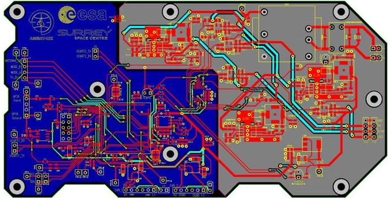
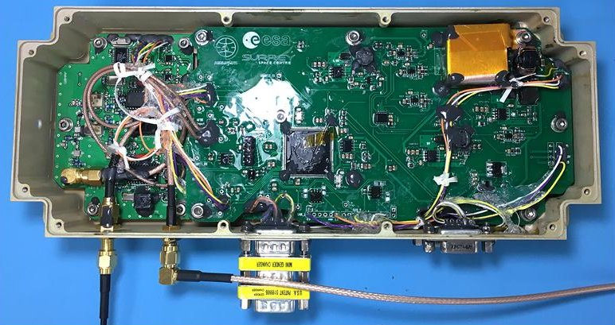
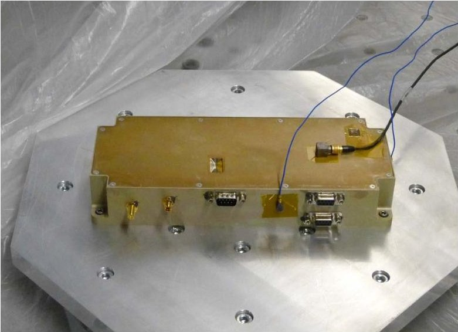
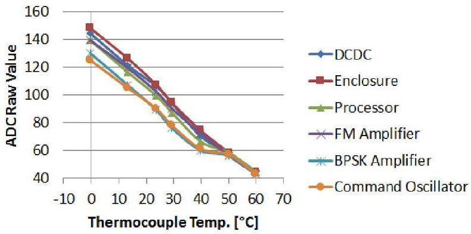
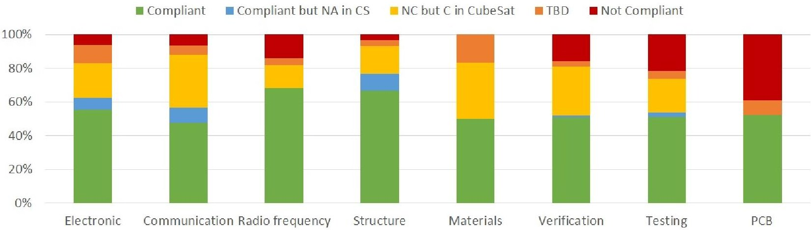
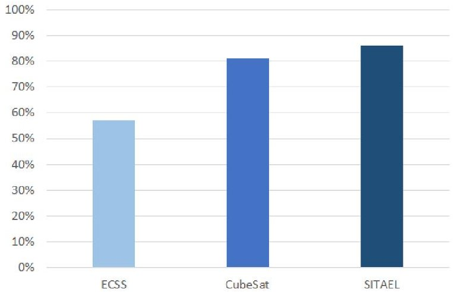

<!-- PDF_PAGE: 1 -->

# Lean Satellite Design for Amateur Communications Payload in the ESA ESEO Mission

J. Holtstiege, C. P. Bridges Surrey Space Centre University of Surrey Guildford, Surrey, United Kingdom +44 (0)1483 689137 c.p.bridges@surrey.ac.uk

Abstract—AMSAT-UK and the Surrey Space Centre are cooperating in delivering an educational communication payload for the ESA European Student Earth Orbiter (ESEO) mission, comprising a payload computer, an L-band receiver and a VHF transmitter. The primary purpose of the payload is to provide downlink telemetry that can be easily received by schools and colleges for educational outreach purposes [1].

Common space industry standards such as European Cooperation for Space Standardization (ECSS) consist of a large number of documents that were primarily written for large-scale space missions. Academic space projects cannot follow these design guidelines due to a lack of sufficient expertise, human resources, facilities or equipment. However, many projects were successfully developed, launched and operated with major deviations from ECSS standards. A recently published CubeSat standard consists of tailored ECSS requirements with the aim to improve the applicability of these specifications to small satellite projects. These, however, are still incompatible with the limited working environment of most university projects. In recent years, a 'lean satellite' design approach that utilises non-traditional, risktaking development and management was proposed by Cho et al. [2] to address these issues.

This design approach was successfully applied by the AMSAT project team to develop a proto-flight model of the payload which entailed an improvement of customer specification compliance from 81% to 86% with respect to the engineering model. This method allowed a low cost and fast development process as well as passing all functional and environmental tests without major issues. A key finding was that despite having superior facilities, equipment and expertise compared to most academic CubeSat teams, only an overall compliance of 82% to the CubeSat standard and 57% to the analysed set of ECSS specifications could be achieved. This shows the challenge small space projects face when following conventional industry specifications such as ECSS which are written for traditional space missions. Following this, it is recommended to further promote the development of a new ISO standard for lean satellite design which could ease the development process and reliability of small space projects that struggle to fully comply to ECSS or CubeSat specifications.

## TABLE OF CONTENTS

1. BACKGROUND ...1

2. PAYLOAD DEVELOPMENT ...3

3. COMPLIANCE OF VERIFICATION PROCESS ...4

4. PFM COMPLIANCE AGAINST EM ...5

5. PROJECT EXPERIENCE AND CHALLENGES ...6

6. SUMMARY ...7

ACKNOWLEDGMENTS ...7

BIOGRAPHY ...8

## 1. BACKGROUND

978-1-5386-2014-4/18/$31.00 ©2018 IEEE

An increasing number of universities is getting involved in space missions in recent years [3] which raises questions about design philosophies and standards which cannot be adapted from traditional space industry approaches given their limited resources. The European Space Agency (ESA) is trying to work with universities on small space projects that follow professional standards by providing them with the necessary technical facilities and know-how. One of these projects is the European Student Earth Orbiter (ESEO).

## AMSAT ESEO Payload

ESEO is a micro-satellite mission to Low Earth Orbit [4]. It is being developed, integrated, and tested by European university students as an ESA Education Office project. ESEO will orbit the Earth taking pictures, measuring radiation levels and testing technologies for future education satellite missions.

Nine European universities are working with the prime contractor Sitael (former ALMASpace), Italy, on the mission. AMSAT-UK and the Surrey Space Centre are providing a 1260/145 MHz FM transponder and a 145 MHz BPSK telemetry beacon for the satellite [1]. The primary purpose of the AMSAT-UK payload is to provide a downlink telemetry that can be easily received by schools and colleges for educational outreach purposes. The data will be displayed in an attractive format and provide stimulation and encouragement for students to become interested in all STEM subjects in a unique way.

This paper focuses on the development and test of the protoflight model which will provide the above-named payload functions. The computer and the RF system will be placed on separate PCBs and integrated in a custom-made aluminiummilled housing. The RF boards were developed by AMSATUK while the flight computer was developed at the Surrey Space Centre. The flight computer PCB consists of two parts, an electronic power system (EPS) and a command, control and telemetry system (CCT). It is distinct from the two RF boards (transmitter and receiver) that together will be integrated in the enclosure and complement the payload excluding the antennas.

Designing electronics for such hostile environments as space is challenging because the satellite and its electronics have to cope with high radiation doses, extreme temperatures, a vacuum environment and any design flaw could potentially end the entire mission at an early stage. Furthermore, the resources available for electronic systems are limited, mainly by the parameters mass, power and volume [5]. For this reason it is desirable to develop a payload and PCB that is light, power efficient and as small as possible. In addition, it has to be robust to withstand the high mechanical loads and

<!-- PDF_PAGE: 2 -->

vibration during launch [5].

## Academic Space Projects

In recent years the number small satellites and especially CubeSat launches rose significantly and represents a great opportunity for universities to involve their students in hands-on space projects. However, according to Duke et al. [3] CubeSat missions have a statistical low success rate and there is no obvious success recipe. This is confirmed by a study of Swartwout et al. [6] that evaluated numerous university CubeSat missions with regard to their success and found that only 40% of all missions were able to meet their primary mission objective. According to Swartwout, reasons for this are often higher-risk, novel missions and technologies. Nevertheless, the study also showed that universities that developed multiple spacecraft could significantly improve their success rate due to the lessons learned in previous projects. These kind of missions have a low-cost and fast-delivery characteristic in common and are predominantly used for educational or experimental purposes [7]. However, concerns are raised about the hazard to other existing missions in orbit [3] and reliability [7] since it cannot meet the same reliability level of traditional satellites.

Bartram also says that the output of a student cannot be compared to a professional engineer working 40 hours a week which leads to compromises to be taken on documentation requirements. As Duke et al. [3] point out, most educational CubeSat projects tread the fine line between financial viability and technological acceptability while often ignoring relevant ECSS and CCSDS specifications. This leads to the question how compatible these small space projects are with current specifications like ECSS. A low cost satellite project does not have the technical and human resources required as a traditional ECSS projects and can therefore not follow all requirements and recommendations of this standard.

Another issue in academic projects is the compatibility of project schedule and university calendar. Often students work on the project only for a limited time before they leave to start a job and then new students continue their roles on the project which makes long project durations and meeting deadlines difficult as Betram et al. point out [8]. This poses the risk that know-how is not passed on to the next students as well as continuing with the project without knowing the basis or background of numerous requirements [9]. This risk can be mitigated by maintaining a comprehensive and up to date documentation.

## Space Engineering Standards

The new CubeSat engineering standard [10], [11] is improving this issue but is not very practical since it contains only the delta/tailoring information which is why one has to always look at both documents to assess the compliance to a requirement. This is not very practical in a fast-delivery project that could ideally rely on a short and precise set of necessary and useful requirements.

Currently the development of several ISO standards to address this issue are in progress which include CubeSat (ISO/CD/17770), testing (ISO/CD/19683) and capability-based safety, dependability, and quality assurance (ISO/CD/18667) [2]. There is also an ongoing activity started at ISO/TC20/SC14 to develop an ISO standard that describes definition and requirements of small satellites [2]. In addition a new study group was initiated at the International Academy of Astronautics (IAA) [12] which recently released a status

report [7] on the 'Definition and Requirements of Small Satellites Seeking Low-Cost and Fast-Delivery'. It says that the study group is examining the definitions of small satellites and tries to differentiate requirements that are applicable for every satellite regardless of size and requirements that only need to be followed by traditional medium and large satellites in order to keep cost low for small projects. A white paper on U.K. CubeSat regulation & UKSA CubeSat consultation by Bridges et al. [13] also recommends to introduce an applicable international standard for CubeSat platforms to provide safety assurances regarding the hazards that CubeSats pose to other satellite missions.

## Lean Satellite

As a result of an international workshop on small-scale satellite standardisation, Cho et al. [2] introduced the concept of a 'lean satellite' which describes a 'satellite that utilizes untraditional risk-taking development approaches to achieve low-cost and fast-delivery with a small number of team' [sic] (members). According to the authors, a lean satellites seeks to deliver value to the customer at the lowest cost and in the shortest possible time by minimising waste. Moreover they contrast this approach with the one used by traditional satellites where reliability often supersedes cost and schedules. However, the authors also remark that there is no clear definition for a lean satellite but it is essential that customer and supplier have a common understanding of the concept when agreeing on a contract.

The IAA study group [9] listed the following characteristics of a lean satellite:

- Positive use of COTS parts and technology

- Single points of failure are allowed

- Development and operation by a small team

- Care is taken so that a failure of single satellite does not jeopardize the satellite program

- Mission downtime is allowed

- Short mission duration

- Waste minimization in the satellite program

- Explosive and/or toxic materials are avoided

- Simple satellite system

- Minimum parts control

The AMSAT design philosophy largely follows these principles with minor differences. Parts are mainly COTS components but many of them were already flown in space successfully and in general most components are specified for use in harsh environments and in a broad operating temperature range for better reliability. Single points of failure could not be avoided completely but are mitigated by using redundant and overrated components for critical paths as well as implementing a fault protection and failure propagation strategy. In terms of team size, five people are forming the core team which allows efficient communication and synchronisation without the need of high documentation effort.

Since the AMSAT payload is not critical to the ESEO satellite and measures are taken to avoid failure propagation on the satellite bus, downtime of the payload is acceptable and failure does not jeopardise the satellite bus nor the objectives of the other payload teams involved in the mission. Moreover, the payload needs to be designed for a slightly longer mission

<!-- PDF_PAGE: 3 -->

duration than traditional CubeSats are intended for, namely 18 months. This is achieved by the design philosophy of selecting high quality components and redundancy where possible. Since the ESEO satellite will have an de-orbiting payload on-board, minimisation of waste is also considered. The payload design is kept as simple as possible in order to enable fast-delivery and save cost. Finally, parts control is carefully maintained during the project and does not require much resources due to the small number of parts.

## 2. PAYLOAD DEVELOPMENT

The AMSAT payload project runs now for a couple of years and went through several development stages involving a project team comprising students from the University of Surrey, members of AMSAT-UK and staff from Surrey Space Centre. For the payload, a multi-model philosophy was chosen, consisting of an electronic breadboard (EBB), an engineering model (EM) and a proto-flight model (PFM). A previous AMSAT-UK CubeSat project, FUNCube [14], serves as heritage for this project in hardware and software aspects. The EM was already developed and test and is used as a baseline for the PFM development.

The PFM was developed based on the lessons learned and best practice approaches from countless CubeSat projects. Cho et al. [9] identified in their paper that a common aspect in failed projects is immature workmanship and insufficient verification. Moreover, they state that success is more likely if heritage from a previous mission can be used. The AMSAT project uses technology that was used on several FUNcube amateur radio satellites [14] that were developed successfully by members of the AMSAT community and allowed them to gain valuable engineering and management skills as well as a 'tradition' or 'culture' [9] of developing satellites that could be exploited in this project. In addition, the use of the Surrey Space Centre (SSC) facilities - including a cleanroom - and assistance from professionally trained staff for difficult tasks such as the payload assembly, ensured an excellent workmanship. With regard to verification, extensive documentation was written to cover every verification process in detail and coordinate it with the customer. Where possible, ECSS verification standards were used as well as utilising trained SSC facility staff to perform environmental tests.

Cho et al. also conducted a survey [9] that found that vibration, thermal vacuum and end-to-end tests were the most effective to detect any defects in CubeSats. It was also identified that issues regarding attitude control or power system dominated over radiation induced problems like Single Event Effects (SEE). Another important factor was the use of mechanisms which are always critical items in a mission. The AMSAT payload verification consisted of extensive testing, including vibration, thermal vacuum, thermal ambient and various end-to-end tests to detect any possible defects. Moreover, development tests were conducted constantly during the assembly stages from testing PCB's separately to its integrated state in the enclosure to detect any anomalies as early as possible and minimise the potential impact on cost and schedule for any necessary modification. To mitigate the risk of SEE, the flight computer uses standard industry techniques such as triple modular redundancy and memory scrubbing as well as a new approach to combine them with the kernel behaviour of the real time operating system that is utilised [8]. In order to have a reliable design, no mechanisms are used for the payload electronics or its receive and transmit antennas.

The test campaign on the EM revealed a compliance of 81% with respect to customer specifications. Among the 134 requirements defined by the system prime Sitael, 20 non-compliant requirements were identified plus 8 remedial actions from test reports that needed to be addressed for the PFM development. Furthermore, the compliance to ECSS and CubeSat specifications was assessed qualitatively. Therefore, 8 applicable and relevant ECSS specifications were identified and the compliance of the engineering model with respect to these standards analysed. These are standards for Electronics [15], Communication [16], Radio frequency [17], Structure [18], Material [19], Verification [20], Testing [21] and PCB design [22]. Additionally, the compliance to the tailored CubeSat versions of these documents were assessed in parallel. Major deviations to all ECSS and CubeSat standards were found whereas CubeSat compliance was higher since many requirements are relaxed in comparison with ECSS. A detailed assessment will be given for the PFM in section 3.

Given the fact that the AMSAT payload differs significantly from a traditional medium or large scale space project, a lean satellite design approach was discussed and implemented for the PFM. This method uses an untraditional risk-taking development process to achieve low-cost and fast-delivery with a small team [2]. It also involves the use of COTS parts, allowing single points of failure and mission downtime. Furthermore, the small team size allowed to establish agile project management methods and efficient communication among team members and between team and customer or agency. As mentioned in section 1, an ISO standard for lean satellite design is currently in development and could ease the development and reliability of small space projects that struggle to fully comply to ECSS or CubeSat specifications.

According to the survey by Cho et al. [9], most projects used a multi-model philosophy (qualification and flight model) while a proto-flight model approach was rarely adopted due to low design maturity at this stage. Despite this, the AMSAT team is using a proto-flight model approach contrary to initial plans instead of a flight model due to significant design changes compared to the engineering model and the lack of time to produce a second engineering model and keep the delivery time line. However, NASA found in an internal study [23] that a proto-flight approach does not increase the risk of mission failure. According to the authors, risk management is key to implementing a proto-flight approach given an acceptable risk (risk mitigation vs cost/schedule).

Figure 1. Final PFM PCB design.

The PFM design comprises major modifications and improvements that resolve the various issues that occurred during functional testing of the EM. Modifications includes the replacement and adjustment of resistors, capacitors and other components as well as an improvement of the overall routing

<!-- PDF_PAGE: 4 -->

and grounding concept. Although the majority of the design conventions comply with ECSS [22], the minimum track spacing could not be achieved on some areas of the board due to the high component density. An internal assessment concluded that the high ECSS margins are not adequate for the very low voltage tracks on the board and can be neglected. Figure 1 shows the final PCB design.

The assembly process was closely linked to the functional testing which had the advantage of detecting errors very early in the assembly process, saving time and keeping cost as low as possible for potential design alterations. After the manufactured and unpopulated PCB was received, trained staff at the Surrey Space Centre soldered the components on the board in the SSC cleanroom facilities. Manual cutouts and the repair of a few board traces needed to be done due to a mismatch in the board and enclosure outline. This was done by SSC staff according to the ESA PCB repair standard [24]. After consulting with the project team, the issue of an unstable power line could be solved by bypassing the current protection function. This reduced the protection circuit solely to an overvoltage protection capability which is still in line with customer requirements. During this initial testing, several resistors were already changed on the board to improve RF carrier and filter characteristics until results were satisfying.

Because of time pressure and staff holidays at SSC it was decided to proceed with the integration of all PCBs into the aluminium enclosure. To do this, the flight harness was installed by an AIT expert from SSC and the boards were covered with conformal coating which gives them an extra layer of protection. After the coating was dried, the spacequalified epoxy adhesive DP190 was used to fix cables and larger components on the boards to mitigate any movement. These procedures were recommended and agreed by ESA and Sitael. The flight-prepared payload is shown in Figure 2. The coating can be recognised from the reflection of light in the center of the board. The entire assembly and flight preparation process largely followed ESA standards where possible to mitigate any risk of failure.

Figure 2. Assembled payload with conformal coating and DP190 applied.

## 3. COMPLIANCE OF VERIFICATION PROCESS

As part of the verification process, the customer requires to perform functional, thermal vacuum, vibration and EMC tests on the payload.

carrier and modulation characteristics as well as commanding in the different operational modes. At no point a complete functional test was performed but rather sets of procedures were conducted over time in parallel to assembly, calibration and environmental testing. This risk-taking strategy allowed the team to parallel the verification process and save time to meet the delivery deadline. However, this test philosophy leads to a non-compliance with certain ECSS requirements for testing [21]. For instance, ECSS requires to perform full functional tests before and after each environmental test. Compromises needed to be taking in this regard to stay on schedule.

To confirm the overall functional performance of the payload electronics, functional test were conducted that cover aspects such as grounding, power consumption, CAN bus operation,

## Vibration Test

To ensure that the spacecraft is able to withstand the mechanical launch environment, a vibration test comprising sinusoidal and random vibration sequences was performed. Before and after those tests a low level sine vibration was applied. This allows to compare the shock response spectrum of each low level sine test in order to find any mechanical change on the test subject which would be indicated by a deviation in the spectrum. The response of the payload was monitored by three accelerometers, attached to the payload, one for each axis. Because of the PFM approach the test was conducted at qualification level as by request of the customer. This lead to a higher risk of damage on the flight hardware but is in accordance with ECSS recommendations [21].

In order to perform the above mentioned tests on the PFM the shaker table of the environmental test facility at SSC was used. To mount the payload on the table, a special adapter plate had to be manufactured. Due to errors in the technical drawing it was manufactured with the wrong type of holes. The issue could be rectified in a mechanical workshop at the university in a short time frame. This highlights the key role of professional facilities that are essential for such a project.

Figure 3. PFM mounted on shaker table for vibration test.

Figure 3 shows the payload with attached accelerometers mounted to the shaker table by utilising the adapter plate. Since the facility does not provide cleanroom conditions and violates ECSS requirements for ambient test conditions [21], precautions had to be taken to protect the payload from contamination as much as possible. Before mounting, the entire machine was covered in a plastic sheet to protect the payload from the dust ejections from the hydraulic system. Furthermore, all holes in the payload enclosure were covered with Kapton tape in the cleanroom to minimise particle con-

<!-- PDF_PAGE: 5 -->

tamination inside the enclosure and on the PCBs as requested by ESA.

In most aspects the test was done according to the procedures but there were a few deviations. For instance, the previbration test on the adapter plate without payload was only performed as a low level sine test and an acceptance test was skipped because the team and the trained facility staff came to the conclusion that is was not necessary and it would save time. A major deviation to the test procedures was that the payload was not functionally tested after vibrations for one axis was finished but only after all vibration tests were completed. The reason for this was time pressure as well as the fact that a damage on the payload would have been fatal for the project and jeopardise the ability to meet the delivery deadline regardless during which test it occurred. For this reason a risk-taking time saving approach was preferred for this test. An inspection and extensive functional testing after the vibration test revealed no defects on the payload and enabled the team to proceed with the test plan.

## Thermal Test

The thermal testing of the payload was intentionally conducted after the vibration which increases chances to detect any damage induced by the mechanical stress on payload. Because the thermal vacuum test would transition only between hot $ (70^{\circ}\mathrm{C}) $ and cold $ (-25^{\circ}\mathrm{C}) $ cycles, it was necessary to test the payload in smaller temperature intervals to calibrate the internal temperature sensors. For this purpose a thermal air chamber at SSC was used to simulate temperatures from $ 0^{\circ}\mathrm{C} $ to $ 60^{\circ}\mathrm{C} $ in $ 10^{\circ}\mathrm{C} $ intervals. The temperature of the payload was measured with a thermocouple sensor attached to the enclosure. The test results shown in Figure 4 suggest that the sensors on the board are quite linear in this temperature range and only differ from each other marginally.

Figure 4. Thermal ambient test: Internal sensor values over thermocouple measurements, $ 0^{\circ} \mathrm{C} $ to $ 60^{\circ} \mathrm{C} $ in $ 10^{\circ} \mathrm{C} $ steps.

Due to the large size of the thermal chamber and time pressure, cycling was performed at 1 K/minute with a dwelling time of 10 minutes at each temperature interval. This violates ECSS requirements for thermal testing [21] but was agreed by the customer and can be justified by the non-critically of the calibration process for the mission and the fact that there are no customer requirements on calibration.

To comply to customer thermal requriements, a thermal vacuum chamber at a professional test facility in Harwell was used to cycle the payload through its specified operating temperature range. The required cycle pattern took about 48 hours to complete and comprised 4 cycles between $ + 7 0^{\circ} \mathrm{C} $ and $ - 2 5^{\circ} \mathrm{C} $ to expose the payload to extreme temperature

changes and verify its full operability at all times. At $ + 7 0^{\circ} \mathrm{C} $ and $ - 2 5^{\circ} \mathrm{C} $ temperatures are kept for a dwelling time of 2 hours to allow the payload to reach equilibrium and take accurate measurements in cycles 1 and 4. Measurements from these cycles were compared later to identify any vacuum induced damage.

Functional testing during cycling revealed that the flight software still contained code for the temperature limits that were set for the engineering model to switch into safe mode. Due to slightly different hardware on the PFM this resulted in an anomaly that the payload could not be commanded by the GSE over $ 50^{\circ} \mathrm{C} $ . The TVAC test was compliant to the test procedures in all aspects and further functional testing at SSC confirmed that the payload was not damaged and was still fully operational after completion. The test was in line with both customer and ESA specifications.

## EMC Test

Due to the fact that Surrey Space Centre and the University of Surrey do not have suitable equipment to perform the required EMC tests, assistance was requested from Sitael and ESA. At this point no EMC test could be conducted.

## 4. PFM COMPLIANCE AGAINST EM

With respect to the EM, the compliance achieved with the PFM increased significantly. For the customer specification it increased from 81% to 86% while ECSS compliance was determined as about 57% and compliance to the CubeSat specification as 82%. A high non-compliance to ECSS is acceptable given the scale of the project but a higher compliance with the CubeSat specification could have been achieved with reasonable effort. Regarding the Sitael interface requirements, a full compliance is desirable as well but not realistic due to fuzzy and ambiguous requirement definitions that cannot be met with the current payload. If the 6 affected requirements would be updated with tailored requirements that are suitable for the payload, a compliance of 94% could be achieved. In case Sitael or ESA provides the necessary facilities for a full EMC test, additional three requirements could be verified which could results in a 96% compliance.

The conformance of the relevant ECSS standards and its tailored CubeSat versions identified in section 2, is illustrated in Figure 5. In total, 519 ECSS requirements and their CubeSat equivalents were analysed and classified in five categories. Green indicates that the requirement is compliant in both the original and the tailored ECSS specification. Blue means that it is compliant with the original ECSS and not applicable in the CubeSat version. Yellow represents requirements that could not be met in the original ECSS but are compliant or not applicable in the tailored document. Orange indicates requirements for which the compliance status could not be determined clearly or a verification task is yet to be performed. Finally, the red colour signifies that requirements are not compliant in either of the two versions of the specification.

The bar chart shows that the flight model achieved a compliance of around 50 to 70% for this selection of relevant ECSS specifications. The fact that the compliance is better in the radio frequency and structure specification can be explained by the low number of applicable requirements to the project of 22 and 30, respectively. By adding the blue and yellow category, the compliance status for the CubeSat tailored version can be interpreted. Therefore, around 80 to 90% compliance could be achieved which is significantly

<!-- PDF_PAGE: 6 -->

Figure 5. ECSS and CubeSat compliance assessment.

higher. This is not unexpected since the tailoring by the CubeSat standard relaxes many requirements that are more suitable for large space projects and makes them applicable for small scale amateur projects. In addition, the chart shows that up to 10% of the requirements in the original ECSS are met despite a relaxation or making them not applicable in the tailored document. A possible explanation for this is that the ESEO satellite is bigger than conventional CubeSats and therefore could be located between professional satellites and CubeSats on a scale of design complexity and quality which enables it to comply to some more sophisticated ECSS requirements without tailoring.

Between 0 and 20% of requirements are not met in either of the specification versions in part because they require a much higher standard as feasible in such a small project but also in part because compromises needed to be taken during development and verification which lead to a non-compliance to ECSS while still being compliant to the customer specification. Another reason is the much higher degree of documentation and review processes that is common for traditional space projects but not practical for a small team amateur academic project like ESEO. Finally, several requirements could not be allocated to one the discussed categories because it is unclear if those requirement are met due to missing data (e.g. tests not performed) or ambiguous interpretation.

Figure 6. PFM compliance to ECSS, CubeSat and Sitael specifications compared

Figure 6 shows the total compliance in percent to the three analysed specifications ECSS, CubeSat and Sitael in comparison. As expected the Sitael compliance is the highest with 86% followed by the CubeSat standard (82%) and ECSS

(57%) at last. As mentioned before, only a small selection of relevant ECSS documents was analysed here due to the limited applicability and focus on the PFM development, but gives nevertheless an idea on the general ECSS compliance since results are similar for the specifications that were analysed.

## 5. PROJECT EXPERIENCE AND CHALLENGES

Developing a payload flight model for an ESA space mission in an academic environment is a challenging task that requires an effective project management, analytical thinking, excellent problem solving skills, efficient team communication and a high level of personal commitment.

During this project, many lessons were learned and valuable experience was gained by all team members. The lean satellite design approach utilised for the PFM development entailed significant deviation from ECSS conformal design and verification but allowed to save time, cost and other resources. It was possible to parallel many tasks and conduct testing concurrently with assembly and flight preparation to discover errors and correct them as early as possible to avoid delays and cost increase. Hardware issues that occurred during this process were fixed quickly and efficiently by relying on the internal experience of the team and local experts towards developing reliable and cost-effective solutions.

A suitable risk management approach enabled the team to conduct environmental tests in a very short time frame with the payload passing all requirements successfully and gathering calibration data for the flight software and telemetry simultaneously. Nevertheless, care was taken to perform tests in a very professional manner and in conformance to the test procedures since insufficient verification and immature workmanship are the most common reasons for failure in CubeSat projects [9]. The risk posed by every attempt to accelerate the assembly or testing process was discussed with the project team and its implementation only decided after careful consideration. The strategy to do continuous functional testing during the entire assembly and testing process turned out to be very valuable. Anomalies like the current protection malfunction could be detected and fixed very early before the PCBs were mounted into the enclosure. Moreover, extensive testing with ground station equipment enabled the team to simulate near mission conditions, check the RF performance and to change resistors on the RF boards to adjust the filter characteristics immediately. In order to calibrate the internal temperature sensors, the thermal vacuum and ambient test

<!-- PDF_PAGE: 7 -->

was combined to collect data over a large temperature range of $ - 2 5^{\circ} \mathrm{C} $ to $ + 7 0^{\circ} \mathrm{C} $ in a very time-efficient manner.

In terms of time planning, the project manager monitored and updated the project schedule frequently in close coordinated with Sitael and ESA. Efficient time management allowed the team to perform most environmental tests in a single week. Delivery dates for documentation were kept and the delivery date for the PFM could have been met as well but Sitael postponed the date on short notice due to internal delays. Furthermore, the dense university calendar and time consuming preparation for several exams limited the available time students could be spent working on the project more than initially expected.

In terms of team communication, the small size of the team had great advantages over traditional projects that involve many people. It was possible to synchronise the core team of five people through a common Skype group, regular face to face meetings and emails while keeping the documentation effort low. However, this poses the risk that important knowledge gets lost if one team members leaves the project. The outstanding dedication of all team members that worked on weekends and several times during the night ensured that deadlines were kept and had significant influence on team building which in turn mitigated the risk of team members leaving the project.

Furthermore, most team members worked on the project uncompensated in parallel to their daytime jobs which implies a strong dedication and commitment to the project and promotes excellent work ethics. Bartram [8] who was working on the same project identified that communication between different working groups is critical and project updates from the top level are able to provide continuing motivation for payload teams at lower level. He also points out that every student that was working on the project found real value and motivation in working with the experienced AMSAT team on a hands-on space project that will actually launch into orbit.

The team stayed in constant contact to the customer for synchronisation and to discuss and agree on any design changes and problem resolving or mitigation strategies in a fast way. In addition, comprehensive documentation was maintained to ensure common understanding among team members, Sitael and ESA. Delays that are related to the contractor or the agency could not be controlled by the AMSAT team but internal delays due to technical issues could be recovered by working overtime, on weekends or in night shifts [9].

## 6. SUMMARY

By using a pragmatic lean satellite design and verification approach, it was possible to successfully build a payload proto-flight model that is highly compliant to customer specifications and to identify its compliance to ESA standards. It is a thorough recommendation that this process is followed by any similar projects in the future.

The literature review on academic space projects revealed vital lessons learned that could be exploited for this project. By adopting a different design, manufacturing, mission and management philosophy than traditional missions, the project achieved some significant advantages [9]. Such a small project team has the ability to easily implement agile project management methods and to establish an efficient team communication. Because the AMSAT core team consisted of

only 5 people that live in close proximity, it was possible to schedule regular face-to-face meetings for important discussion or test campaigns. Using freely available software such as Skype allowed to establish a 24h group communication channel for discussions and to virtually participate in any testing activities over video conferencing.

The PFM could not achieve full compliance to customer specifications mainly due to improperly defined requirements by the system prime, the lack of an EMC test facility as well as a few generic analyses and calculations that could not be provided by the AMSAT team. However, the compliance could be improved from 81% to 86% with respect to the EM. In addition, the extensive PFM test campaign comprised only minor deviations from test procedures and confirmed the excellent quality of the payload design as well as ensuring its high reliability for the upcoming mission.

Despite having superior facilities, equipment and expertise compared to most academic CubeSat teams, only an overall compliance of 82% to the CubeSat standard and 57% to the analysed ECSS requirements could be achieved with the PFM. Considering this, it is recommended to further promote the development of a new ISO standard for lean satellite design as initiated by Cho et al. [2] that could ease the development process and reliability of small space projects that struggle to fully comply to ECSS or CubeSat specifications. This approach seems to be a promising concepts but further investigations to identify best practices of small satellite projects are required to assist in the development of such a standard.

## ACKNOWLEDGMENTS

The authors would like to acknowledge the AMSAT team: Graham Shirville, David Bowman, Duncan Hills, Dave Johnson, Howard Long and Wouter Weggelaar. There are also many students which have made real contributions to the project: Pete Bartram, Eduardo Theves Lourenco, Viktor Lopes de Castro Martinelli, Ben Clewer, Ben Chapman and Andre Vitor Celkevicius. Finally, thanks to ESA and Sitael staff for their continued efforts in the ESEO mission.

## REFERENCES

[1] AMSAT-UK. (2017). ESEO, [Online]. Available: https://amsat-uk.org/satellites communications/eseo/ (visited on 06/19/2017).

[2] M. Cho, M. Hirokazu, and F. Graziani, "Introduction to lean satellite and iso standard for lean satellite," in 2015 7th International Conference on Recent Advances in Space Technologies (RAST), Jun. 2015, pp. 789-792. DOI: 10.1109/RAST.2015.7208447.

[3] R. Duke, C. P. Bridges, B. Stewart, C. Taylor, C. Massimiani, J. Forshaw, and G. Aglietti, "Integrated Flight & Ground Software Framework For Fast Mission Timelines," International Astronautical Congress, pp. 1-9, 2016. [Online]. Available: http://epubs. surrey.ac.uk/812797/1/IAC-16%20Duke% 20V5.pdf.

[4] European Space Agency. (2017). ESEO Mission. [Online]. Available: http : / / www . esa . int / Education / ESEO _ mission (visited on 06/19/2017).

<!-- PDF_PAGE: 8 -->

[5] P. W. Fortescue and J. P. W. Stark, Spacecraft systems engineering, 3. ed. Chichester: Wiley, 2003.

[6] M. Swartwout and C. Jayn, "University-class spacecraft by the numbers: Success, failure, debris. (but mostly success.)," in 30th Annual AIAA/USU Conference on Small Satellite, 2016. [Online]. Available: http: // digitalcommons . usu . edu / smallsat/2016/TS13Education/1/ (visited on 08/19/2017).

[7] M. Cho and F. Graziani, "IAA Study Group Status Report - SG 4.18: Definition and Requirements of Small Satellites Seeking Low-Cost and Fast-Delivery," IAA, research rep., 2016. [Online]. Available: http://iafastro.directory/iac/archive/browse/IAC-16/B4/7/33147/.

[8] P. Bartram, C. P. Bridges, D. Bowman, and G. Shirville, "Software defined radio baseband processing for esa eseo mission," in 2017 IEEE Aerospace Conference, Mar. 2017, pp. 1-9. DOI: 10.1109/AERO. 2017.7943952.

[9] M. Cho and M. Hirokazu, "Best practices for successful lean satellite projects," in 7th Nano-Satellite Symposium and 4th UNISEC-Global Meeting, Jun. 2016. [Online]. Available: https: //unisec2016 . castra . org / index . php / unisec2016 / unisec2016/paper/download/49/10 (visited on 08/19/2017).

[10] ESA/ESTEC, "Tailored ECSS Engineering Standards for In-Orbit Demonstration CubeSat Projects," vol. 3, no. 1, 2016.

[11] ESA/ESTEC, "Product and Quality Assurance Requirements for In-Orbit Demonstration CubeSat Projects," vol. 2, no. 1, 2016.

[12] M. Cho and F. Graziani. (2016). IAA Study on Lean Satellites, IAA, [Online]. Available: http : //iafastro.directory/iac/archive/browse/IAC-16/B4/7/33147/ (visited on 08/20/2017).

[13] C. Bridges, D. Cullen, R. Burgon, C. Guillo, G. Shirville, S. Greenland, M. Waldram, and B. Dalgleish, "White Paper on U.K. CubeSat Regulation & UKSA CubeSat Consultation," 2014 UK CubeSat Workshop, research rep., 2014. [Online]. Available: http://www.cubesatforum.org.uk (visited on 08/20/2017).

[14] AMSAT-UK. (2017). FUNcube Web Site, [Online]. Available: https://funcube.org.uk (visited on 07/29/2017).

[15] ECSS, "ECSS-E-ST-20C - Space Engineering: Electrical and electronic," ECSS Standard, C Jul. 31, 2008. [Online]. Available: http://ecss.nl/ standard/ecss-e-st-20c-electrical and-electronic/.

[16] ECSS, "ECSS-E-ST-50C - Space Engineering: Communications," ECSS Standard, C Jul. 31, 2008. [Online]. Available: http://ecss.nl/standard/ ecss-e-st-50c-communications/.

[17] ECSS, "ECSS-E-ST-50-05C - Space Engineering: Radio frequency and modulation," ECSS Standard, C Oct. 4, 2011. [Online]. Available: http://ecss nl/standard/ecss-e-st-50-05c-rev-1 radio-frequency-and-modulation/.

[18] ECSS, "ECSS-E-ST-32C Rev.1 - Space Engineering: Structural general requirements," ECSS Standard, no.1, C Nov.15, 2008. [Online]. Available: http:// ecss.nl/standard/ecss-e-st-32c-rev 1-structural-general-requirements/.

[19] ECSS, "ECSS-E-ST-32-08C - Space Engineering: Materials," ECSS Standard, C Oct. 15, 2014. [Online]. Available: http://ecss.nl/standard/ecss-e-st-32c-rev-1-structural-general requirements/.

[20] ECSS, "ECSS-E-ST-10-02C - Space Engineering: Verification," ECSS Standard, C Mar. 6, 2009. [Online]. Available: http://ecss.nl/standard/ecss-e-st-10-02c-verification/.

[21] ECSS, "ECSS-E-ST-10-03C - Space Engineering: Testing," ECSS Standard, C Jun. 1, 2012. [Online]. Available: http://ecss.nl/standard/ecss-e-st-10-03c-testing/.

[22] ECSS, "ECSS-Q-ST-70-12C - Space product assurance: Design rules for printed circuit boards," ECSS Standard, C Jul. 14, 2014. [Online]. Available: http: //ecss.nl/standard/ecss-q-st 70-12c-design-rules-for-printed circuit-boards-14-july-2014/ (visited on 08/21/2017).

[23] M. Coan, S. Hurshorn, and R. Moreland, "Internal NASA Study: NASA's Protoflight Research Initiative," NASA, research rep., 2014. [Online]. Available: https://ntrs.nasa.gov/archive/nasa/casi.ntrs.nasa.gov/20150014585.pdf (visited on 08/20/2017).

[24] ECSS, "ECSS-Q-ST-70-28C - Repair and modification of printed circuit board assemblies for space use," ECSS Standard, C Jul. 31, 2008. [Online]. Available: http://ecss.nl/standard/ecss-q-st- 70-28c-repair-and-modification-of printed-circuit-board-assemblies for-space-use/.

## BIOGRAPHY

Jonas Holtstiege received his B.S. degree in Systems Engineering from the University of Bremen (Germany) in 2016 and a M.S. in Space Engineering from Surrey University (UK) in 2017. He is currently a payload systems engineer at Airbus Defence and Space. He worked on the service module for the NASA Orion MPCV mission and is now involved in the development of the MWS

Microwave Sounder payload which will be the primary instrument for the new MetOp-SG meteorological satellites. In addition, he works on the Sentinel 1 and OneWeb missions as well as several radar concept studies.

Dr. Christopher Bridges (BEng, 2005; PhD 2009) leads the On-Board Data Handling (OBDH) research group within Surrey Space Centre (SSC). He researches software defined radios, realtime embedded systems, agent computing, Java processing, multi-core processing in FPGAs, and astrodynamics computing methods in many spaceflight payloads. In 2013, he designed, built

and still operates the UKs first CubeSat (STRaND-1) with SSTL and now contributes towards computing hardware and software with SSTL, on ESAs ESEO mission and also the NASA-JPL/CalTech AARST mission.