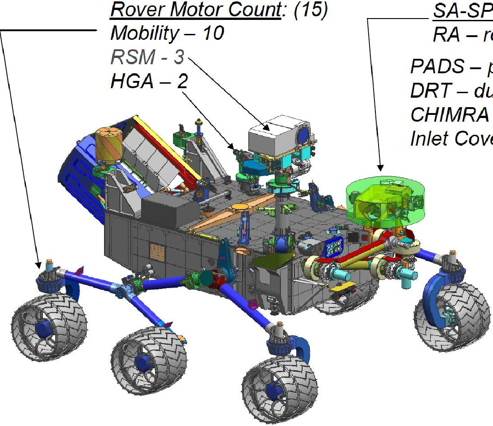
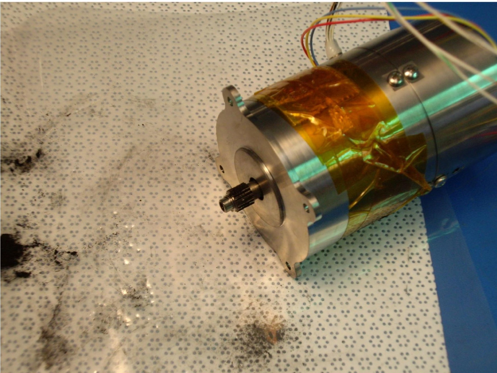
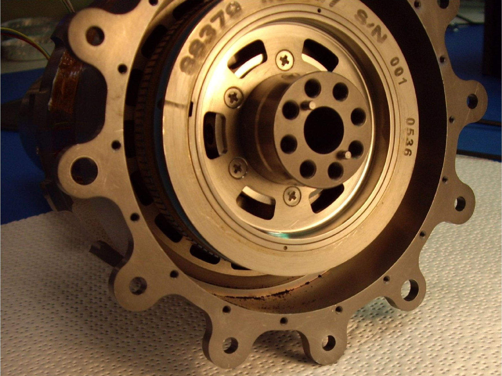

<!-- PDF_PAGE: 1 -->

# Subject

MSL Actuator Design Process Escape

## Abstract

The mechanical design process for the Mars Science Laboratory (MSL) actuators exhibited significant flaws, including poorly defined performance requirements, lack of established technical milestones, design incompatibilities, and inadequate verification. Recommendations are provided for seven engineering processes that went awry on the project, including mass reduction, incorporation of new technology, and design review.

## Driving Event

The ambitious MSL mission presented some major design challenges for the NASA/Caltech Jet Propulsion Laboratory (JPL) in its development of the "Curiosity" rover. Arriving at a successful design for the rover actuators, however, posed the one of the thorniest problems over the course of MSL development. An actuator is a complex component comprised of a motor and a gearbox. Rotary actuators are used on planetary rovers for such disparate purposes (Figure 1) as driving the rover wheels, moving the robotic arm (RA), and actuating science instrument components.

SA-SPaH Motor Count: (16)

RA-robotic arm-5

PADS-percussive drill-3

DRT-dust removal tool-1

CHIMRA-scoop & sample handling-4

Inlet Covers - SAM & CheMin - 3

Total Motor Count = 31

Figure 1. Locations of MSL actuators

The Mars Exploration Rover (MER) project that landed the previous, smaller, rover design on Mars in 2004 procured commercial off-the-shelf motors with minimal design modifications for use on the Mars surface. However, the MSL mission profile called for a rover that could operate for seven times longer than any previous planetary mission, and at the colder latitudes farther from the equator. JPL needed to acquire a total of 61 actuators and 29 stand-alone motors (90 units) for use in the MSL engineering models, test units, spare units, and in the flight model that was intended to be launched in 2009.

<!-- PDF_PAGE: 2 -->

Because the wet lubricant that had been used for the MER actuators was not suitable for usage at colder temperatures, the baseline design (Reference (1)) for most MSL rover applications called for an actuator with a titanium gearbox and dry lubricant capable of operating at -135 degrees C without a dedicated heater. By June 2007, three life tests of this design had each failed (Figures 2 and 3), and in September 2007 the MSL project switched to a heated actuator design using a conventional steel gearbox and wet lubricant actuator design that left part of the gearbox unheated (Reference (2)).

This redesign was passed to the actuator supplier, but by this late date in the project development cycle, even triple shifts at this point were insufficient to produce quality actuators on schedule. By November 2008, NASA recognized that MSL was too far behind schedule to meet its October 2009 launch date (due to the problems with actuator development and production-- and other risk factors), and the mission was delayed for two years.

Figure 2 Unit #3 of the dry lubricant actuator design reached only 20% of its design life before failing the life test (Reference (3))

<!-- PDF_PAGE: 3 -->

Figure 3 Unit #3 titanium gearbox

The MSL Curiosity rover's two-year primary mission ended in August 2014, and the actuators performed to expectations in the severe Martian environment.

## References:

1. Mars Science Laboratory Rover Actuator Thermal Design Peer Review, January 23, 2008, p. 8.

2. Keith Novak & Steven Hendricks, "Mars Science Laboratory Rover Actuator Thermal Design," Spacecraft Thermal Control Workshop, March 11 -13, 2008, p. 8-9.

3. Richard Cook, et al, "Quarterly/GPMC Mars Science Laboratory" May 9, 2007, p. 4.

4. Rius Billing and Richard Fleischner, "Mars Science Laboratory Robotic Arm," 14th European Space Mechanisms and Tribology Symposium, September 28 - 30, 2011.

5. Technical Assessment of MSL Actuators, Letter to Howard Eisen (JPL) from Dr. Christopher DellaCorte (GRC), April 2, 2009.

6. "Dawn Ion Propulsion System (IPS) Lessons Learned, NEN #3396, NASA Lesson Learned Information System (LLIS), April 26, 2010.

## Lesson(s) Learned

See "Recommendations."

## Recommendation(s)

<!-- PDF_PAGE: 4 -->

Reference (4) provides a list of flaws in the MSL actuator mechanical design process, including poorly defined performance requirements, lack of established technical milestones, design incompatibilities, and inadequate verification.

1. Lesson Learned - Mass reduction without consideration of technical and programmatic impacts can lead to significant subsystem development dependencies, schedule delays, and in some cases, design weaknesses (References (4) and (5)):

## 1a) Optimization/Reduction Across Interfaces

Planetary rovers and Entry, Descent, and Landing (EDL) systems are as volume-constrained as they are mass-constrained. In pursuit of minimizing mass and volume, the MSL RA joint bearings were incorporated into the drive actuators. Thus, a functional robotic arm could not exist without the actuators, and the RA development schedule was held hostage by a delayed actuator development schedule.

Recomendation 1a) A configuration that results in the drive actuators being integral to the subsystem structure causes significant development schedule dependences. Specification of the external loading requirements (particularly cross-moment loading cases) must be defined very early in the design phase to enable a timely actuator procurement. (See Item #7 below regarding long lead-time procurement of bearings.)

## 1b) Mass Reduction vs. Manufacturability

The original plan was to develop "a catalog" of a few motor types and gearbox sizes, which subsystem users could mix and match at Preliminary Design Review (PDR). Actuator procurement was significantly delayed because subsystem users specified a custom actuator for each application in pursuit of minimizing mass and volume. (The original purpose for developing titanium gearing was for mass reduction, but the increased volume required compared to a conventional steel gearbox was not taken into consideration.) The number of variations on a similar design exploded, with many gear stages that differed only in the width of the gear.

Recomendation 1b) There are significant schedule ramifications in mass optimization of numerous actuator types. Minimization of mass is an important pursuit, but project management must balance the amount of mass reduction against manufacturability-- number of drawings produced, parts count, management of parts inventory, and manufacturing cost/schedule.

## 1c) Mass Optimization Resulting in Poor Design Configuration

The MSL Low-Power High Torque Actuator (LPHTA) with its A500 motor, and to some extent the A300 motors, exhibited speed and torque instability that was never fully understood or fixed-- only mitigated. The symptoms occurred somewhat randomly, but were ultimately blamed on a combination of rotational non-concentricities, bearing clearance fits, "springy" bearing preload, unbalanced rotors, and a three-bearing design to accommodate the encoder. Prioritizing mass and volume reduction resulted in a non-optimum MSL motor mechanical configuration, producing a number of functional imperfections that most likely were the root source of operating dynamics problems. (Reference 6.)

Recomendation 1c) The motor design process should place a priority on controlling concentricity of the rotating mass, tight-fitting bearings that still allow easy disassembly, consistent bearing preload, and avoiding a three-bearing configuration. (This issue is also related to LL #5 regarding a breakdown in the design review process.)

2. Lesson Learned- The motor encoder implementation was susceptible to magnetic disruption from the motor/brake. The motor cold encoder was not tested in the proximity of the power-off brake early in the

<!-- PDF_PAGE: 5 -->

development program. The cold encoder also presented functional idiosyncrasies (in concert with the drive electronics) that were difficult to characterize and mitigate.

Recomendation 2) Verify motor encoder design compatibility with magnetics in Phase B, or very early in Phase C. Should any of the three elements in a controlled-drive design (i.e., motor, feedback device, and drive electronics) not be fully developed, avoid design configurations that are magnetically sensitive.

3. Lesson Learned - Qualification of a new actuator material/lubricant application in the flight program:

## 3a) Validation of New Application.

The supplier failed to retain the data from MER-- the heritage program that utilized the dry lube process proposed for MSL. Evidence of process efficacy was not pursued by JPL until failures were experienced in the MSL developmental life test program. The one MER hardware example still available was the Lander Petal Actuator (LPA), which had passed its much shorter cycle life qualification test for the MER project. (The MSL developmental life test unit design was derived from the MER LPA.) The MER LPA qualification life test unit was again disassembled and re-inspected under magnification. It was determined that the dry lube and gearing failure observed in the MSL development unit was just beginning in that MER unit, but at a fraction of the MSL design life. Hence, the MSL project reverted to a wet lubrication scheme for the gearing.

Implementation of titanium gearing was fraught with development problems not related to lubrication. As is common with the use of titanium, many problems were ultimately traced to the low thermal conductivity of the material. Accommodation of the thermal gradients within the gearbox and use of hard surface coatings might have eventually produced a successful titanium gearing design. Instead, JPL went with "conventional" steel materials, but using the (larger) titanium gearing design configuration.

Recomendation 3a) Demand a higher standard of proof-of-readiness prior to incorporation of risky new technology. This proof did not exist at the time the MSL project chose to implement titanium gearing (for mass reduction) and dry lubricant gear coating (for cryogenic operation without active heating).

## 3b) Fall-back plan for New Technology.

A steel gearbox approach concurrent with a titanium gearbox design program would have increased the initial costs (plus the need for more staff), but it would have been ready for implementation if the titanium gearing design approach failed. Furthermore, this would have provided an accurate design trade of mass and volume between the two approaches. MSL switched to the conventional steel gearing and conventional wet lubrication once the development problems couldn't be solved quickly, but retained the larger gearing design intended for the titanium material to preserve cost and schedule.

Recomendation 3b) Whenever new technology is incorporated in the baseline design of the flight system, a heritage technology "fall-back" implementation should be concurrently developed until the new technology is validated.

## 4. Lesson Learned - Out-of-Phase Development

The Critical Design Review (CDR) schedules for the actuators slipped until mid-2007, yet extremely important requirements such as output torque, external loading, and cycle life were fuzzy. Disconnects such as "what side of the interface does torque margin reside" resulted in the need to submit waivers to institutional requirements.

Recomendation 4) Avoid out-of-phase project development, which in this case resulted from "rearchitecture" of the MSL Surface Sampling System in spring 2007. The detailed performance

<!-- PDF_PAGE: 6 -->

requirements for the Sampling System actuators were determined well after detailed design had begun in the winter of 2006.

## 5. Lesson Learned - Breakdown of the design review process:

## 5a) Gate Reviews Not Actually Passed.

Although over 200 requests for action (RFAs) were submitted as a result of the design reviews, few were closed by the supplier. In some cases delta-reviews were convened, and in some of those reviews, some of the action items were answered. Due to limited staffing at JPL and at the supplier, there was a lack of attention to closing major open items identified in the reviews. Also, there were a number of glaring design deficiencies that were only identified after testing had begun. JPL and the supplier were operating nearly continuously in "recovery mode" from ongoing test anomalies. In some cases poor design features were identified, but they were left unchanged in an attempt to preserve schedule.

Few Actuator design reviews were truly "passed," but extreme schedule pressure demanded that production proceed. Although it was hoped that design weaknesses would be retired concurrently, there was not enough JPL and supplier staff to accomplish this. In hindsight, a few of the significant hardware failures were traced to design review RFAs that did not receive timely or adequate attention.

Recomendation 5a) It is imperative RFAs be dispositioned and retired in a timely manner, particularly for a deliverable such as the MSL actuators that are integral to multiple subsystems. Workforce resources need to be applied to manage design review actions so manufacturing doesn't build-in design weaknesses that cannot be rectified at a later date.

## 5b) Review of vendor competency.

The actuator supplier had demonstrated good technical performance in the past, and JPL anticipated similar performance for MSL. However, the supplier had subsequently reorganized staff roles and lost some core competencies. This was not clearly recognized by the MSL project until the actuator designs were already in production. (See Item #5a.) As another example, the JPL Dawn mission launched in 2007 had planned to use the same ion propulsion system design that was successfully demonstrated by the JPL Deep Space 1 spacecraft, only to find that the supplier's technical and management capabilities had significantly degraded during the 6-year lag between the two projects (Reference (7)).

Recomendation 5b) The design reviews did not adequately assess the competency of the supplier staff to produce the product. This largely occurred due to the incomplete nature of the review materials, which tended to hide or defer to later the detailed technical weaknesses and corrective actions. Preliminary design reviews must strive to evaluate the competency of the supplier and its staff as well as the technical design. Both Dawn and MSL point out the need to "re-qualify" subcontractors who bid to produce mission-critical components. (See Item 6.)

## 6. Lesson Learned - Excessive Scope to Design, Test & Deliver Large Production Quantities

The actuator development task consisted of too much work, too many deliverables, in too short a schedule-a key finding. The development schedule slipped as the procurement concept changed from "a catalog of component assemblies to select from" to custom actuators for specific applications (per Item #1b above). The decision to procure all of the actuators from one supplier was extremely risky, and JPL paid dearly in cost and schedule. Eventually, splitting a quantity of small actuators from the primary supplier to another (who performed very well) greatly enabled the eventual success of the actuator subsystem.

<!-- PDF_PAGE: 7 -->

The final actuator ship-set for MSL was 31 actuators in 13 configurations, and the total quantity procured was 90 units! Seven large dynamometers were fabricated to permit concurrent acceptance testing.

The development schedule was compressed to an insufficient duration due to delayed requirements definition. The complexity of the designs was complicated by mass reduction efforts and changing requirements as the various subsystem customers for the actuators refined their needs. An unfortunate result of the schedule slip for the design phase was that the scope of work to design and implement testing resources compromised the flight hardware development efforts. The large quantity of deliverable hardware over a relatively short duration overstretched supplier and JPL staff resources.

Recomendation 6) Track the cost-to-complete and schedule-to-complete throughout project development, and allocate project reserves as necessary to retire major project development risks. Consider obtaining a second source for complex critical components acquired in quantity.

## 7. Lesson Learned - Rolling Element Bearings Procurement is Extremely Long-Lead

Today, there are fewer ball bearing suppliers, and they are less willing to respond rapidly to customers who have unusual requirements and purchase in small quantities. Therefore, design changes demanding a change in bearing size or type often cannot be accomplished without a serious impact to schedule.

Recomendation 7) Since the load cases define the size of the bearings, the difficulties of long-lead procurement were exacerbated by delays in determining external load cases per Item #4 and by the complexity of the usage cases of the subsystems per Item #1. Recognize that acquisition of rolling element bearings is a fundamental pacing item for production of actuators.

## Evidence of Recurrence Control Effectiveness

JPL has referenced this lesson learned as additional rationale and guidance supporting Paragraph 5.17.1 ("Management Practices: Risk Management") in the Jet Propulsion Laboratory standard "Flight Project Practices, Rev. 10," JPL DocID 58032, October 23, 2013.

## Program Relation

N/A

## Program/Project Phase

Implementation » Phase C

## Mission Directorate(s)

- Human Exploration and Operations

- Science

## Topic(s)

- Engineering Design

- Manufacturing and Assembly

- Program Management

<!-- PDF_PAGE: 8 -->

- Systems Engineering and Analysis

- Flight Equipment

- Hardware

- Industrial Operations

- Payloads

- Spacecraft

- Test and Verification

- Spacecraft and Spacecraft Instruments

- Acquisition / procurement strategy and planning

- Contractor relationships

- Early requirements and standards definition

- Review systems and boards

- Engineering design and project processes and standards

- Level II/III requirements definition