<!-- PDF_PAGE: 1 -->

# Lessons Learned from the GT-1 1U CubeSat Mission

Maximilian Kolhof, William Rawson, Radina Yanakieva, Andrew Loomis, E. Glenn Lightsey, Sterling Peet Georgia Institute of Technology 620 Cherry St NW, Atlanta, GA, 30332; 703-579-7422 mkolhof3@gatech.edu

## ABSTRACT

With more universities conducting low-cost small satellite development programs, resources for students starting off in satellite design are essential to avoid common pitfalls. Hardware integration and testing of the GT-1 CubeSat revealed both design flaws and strengths that led to a comprehensive list of lessons learned applicable to future CubeSat missions at the Georgia Institute of Technology Space Systems Design Laboratory (SSDL) and within the broader academic community. GT-1 was originally slated to be designed, built, and delivered in nine months with an orbital lifespan of around seven months. However, various schedule delays resulted in the mission spanning over two years. This paper provides a resource to those beginning a small satellite development program at the university level by presenting a case study of lessons learned from the GT-1 mission. Detail will be provided for topics including best practices for enabling modular design, creating effective documentation, structural design for proper fit-up and manufacturability, testing, and planning a realistic mission scope.

## INTRODUCTION

The GT-1 mission demonstrates a rapid cradle-to-grave lifecycle of a university level CubeSat and is the first in a series of at least four 1U CubeSats to be developed and launched approximately annually by the Space Systems Design Laboratory at Georgia Tech. These missions are intended to train undergraduate students in all aspects of a space mission while producing a working satellite bus as a foundation for demonstrating experimental technologies. As such, the GT-1 mission is run almost entirely by undergraduate students performing hardware design, structural analysis, software development, integration and testing, and on-orbit operation.

GT-1 contains a software payload that will allow amateur radio operators around the world to communicate with the spacecraft as it orbits the Earth. An experimental UHF antenna deployment mechanism is utilized to constrain the stowed antenna within the chassis of the spacecraft. Prototype deployable solar panels enable the spacecraft to support approximately 600 $ cm^{2} $ of solar cells, more than double the surface area a typical 1U can support, providing capacity for power-intensive payloads on future missions.

GT-1 is manifested by Spaceflight Inc. (a Launch Service Provider) to be launched to the International Space Station on CRS-24 in a December 2021 resupply mission where it will be deployed from the Japanese Experimental Module into a low Earth orbit (LEO) with

an approximate lifetime of 7 months. This will be one of the first missions supported by the GT Mission Operations Center and is in partnership with W4AQL (the Georgia Tech Amateur Radio Club).

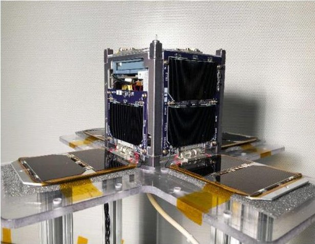

Figure 1: GT-1 CubeSat

The following discussion details some of the major lessons learned during the development of this spacecraft. This report is intended to serve as a reference for university or other teams designing and constructing their first CubeSat mission, but it may also introduce more experienced groups to alternative design, integration, and test philosophies. First, the mission requirements and spacecraft design overview are described. Then, several major lessons learned are explored in depth with first-hand accounts describing what was experienced during the GT-1 mission and

<!-- PDF_PAGE: 2 -->

explanations of what actions are recommended by the team on future missions.

## MISSION REQUIREMENTS

As is common across CubeSat missions, the use of a standardized deployment method introduces additional interface considerations. Thus, the driving requirements for the GT-1 mission can be separated into two distinct varieties: design requirements needed to achieve the mission minimum success criteria and those pertaining to the interface with the deployer provided by the Japanese Aerospace Exploration Agency (JAXA).

## JEM Payload Requirements

The Japanese Experimental Module (JEM) Payload Requirements serve as the Interface Control Document (ICD) for the Japanese Small Satellite Orbital Deployer Reusable (JSSOD-R), which is the deployment mechanism JAXA will use for the GT-1 mission. The JSSOD-R install cases are designed to accept rail-based spacecraft up to 3U in size adhering to the Cal Poly CubeSat Design Specification $ ^{1} $ , so many of the mechanical interface requirements flow down from this standard. While a majority of the JEM Payload Accommodation Handbook $ ^{2} $ is out of scope for this discussion, certain requirements are discussed which are of particular relevance to the design process and resulting lessons learned over the development life of GT-1.

The dimensional requirements for a 1U CubeSat flow directly from the Cal Poly Standard - an exterior rail profile of 100 mm x 100 mm x 111.5 mm with a 0.1 mm tolerance to allow for a clearance slide-fit with the JSSOD-R install case. The JEM Accommodation Handbook includes additional specifications for rail parallelism and perpendicularity within 0.2 mm. These specifications can be difficult to verify due to the need for a reference datum and complex measuring techniques. However, it is important to monitor this specification throughout the entire fabrication and assembly process as an out-of-specification structure will bind the satellite in the install case.

The battery protection requirements for GT-1 in the Accommodation Handbook are supplemented by those in JDX-2017078-0A $ ^{4} $ . JAXA classifies all CubeSat batteries as a "catastrophic hazard" per JSC-20793 $ ^{5} $ (NASA's Crewed Space Vehicle Battery Safety Requirements) which requires three inhibits for battery over-charge, over-discharge, and external short events. Software inhibits are possible, but verification is challenging, so hardware inhibits are strongly preferred. Inhibits can reside in the battery cells, EPS unit, or the

spacecraft avionics so long as this requirement is met between the battery and the load as well as between the battery and the solar panels of the spacecraft. Note that one of these inhibits must explicitly be placed in-line with the battery ground return.

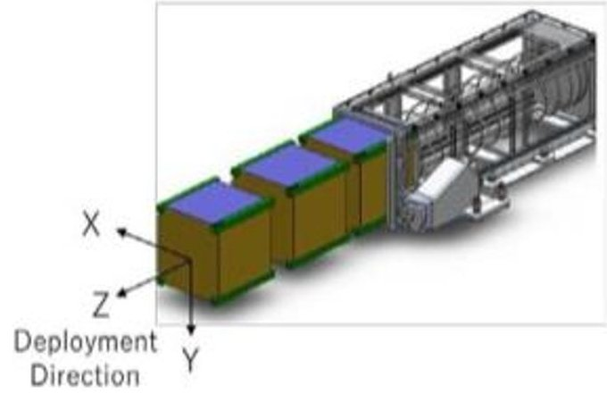

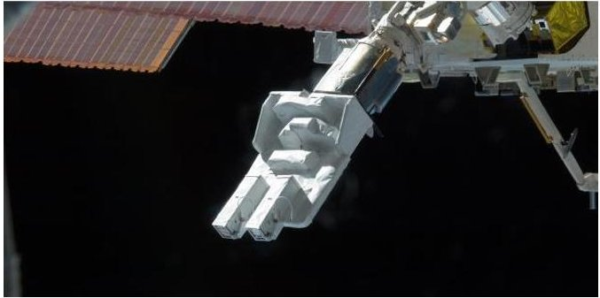

Figure 2: JSSOD with coordinate system (top) $ ^{2} $ and deployer on $ \mathrm{I S S}^{3} $ (bottom)

JAXA also requires satisfactory completion of vibration and thermal cycling environmental tests. Vibration testing has two aspects: frequency analysis and random vibration. These tests must be performed along each of the three body axes. Frequency analysis using a sine sweep is performed before and after random vibration testing to identify the fundamental frequency mode and higher order modes. Large frequency or amplitude shifts of these modes, indicative of a failed component, are undesirable and may require further analysis, retest, or disassembly of the spacecraft to investigate. The random vibration profile is launch vehicle specific in the case of GT-1, a SpaceX Dragon profile was baselined. To pass the thermal cycling tests the spacecraft shall satisfy all performance and safety requirements stated in the JEM Handbook at dwell temperatures of -15 and 60 degrees Celsius.

## GT-1 Minimum Success Criteria Requirements

While the JEM Payload Requirements limited what payload the GT-1 team could deploy from the ISS, additional Mission Success Criteria were imposed to ensure the mission had scientific and educational merit.

<!-- PDF_PAGE: 3 -->

Establishing these criteria is especially important as they provide a foundation for future missions to expand from and provide flight heritage to increase the Technology Readiness Level (TRL) of the prototype systems onboard. Table 1 details the minimum and full

mission success criteria. These minimum success criteria were used to drive go/no-go flight decisions and determine whether descoping of certain criteria or components was plausible.

Table 1: GT-1 Mission Success Criteria

<table border="1"><tr><td>Criteria</td><td>Minimum</td><td>Full</td></tr><tr><td>Prototype Solar Panel Deployables</td><td>X</td><td></td></tr><tr><td>Custom Footprint OpenLST Radio with Deployable Antenna</td><td>X</td><td></td></tr><tr><td>Telecommand and Telemetry Communications System with Beacon</td><td>X</td><td></td></tr><tr><td>Functional EPS subsystem with Latchup Protection</td><td>X</td><td></td></tr><tr><td>Current and Voltage Monitoring of Subsystems</td><td></td><td>X</td></tr><tr><td>FSW State Machine and Rate Groups</td><td>X</td><td></td></tr><tr><td>Over-The-Air FSW Update Capability</td><td></td><td>X</td></tr><tr><td>B-Dot Controller and Torque Rods Allowing for Detumble</td><td>X</td><td></td></tr><tr><td>Full-State Attitude Estimation Using Magnetometer, Sun Sensors, GPS, and IMU</td><td></td><td>X</td></tr><tr><td>Well Documented Design and Integration &amp; Test Documentation Providing Baseline for Future Missions</td><td>X</td><td></td></tr></table>

## GT-1 DESIGN OVERVIEW

The spacecraft electrical power system (EPS), command and data handling (CDH) and attitude determination and control (ADC) systems are explained briefly in the following sections. A basic understanding of the spacecraft design will be necessary in extracting useful information from the subsequent lessons learned sections.

## Electrical Power System

The core of the GT-1 EPS is the GomSpace P31u (Figure 3), a highly integrated PCB with two lithium ion 18650 battery cells, maximum power point tracking (MPPT) solar panel chargers, and latch-up protected power supplies. Additionally, the spacecraft contains four "static" solar panels mounted on opposite X and Y faces of the structure and four double-sided "deployable" solar panels. Each panel contains two Spectrolab XTJ Prime solar cells in series, with the exception of one static solar panel containing a single cell to allow clearance for antenna deployment. When not in eclipse, the spacecraft will always have some solar cell area in direct sunlight, alleviating any pointing requirements driven by the EPS.

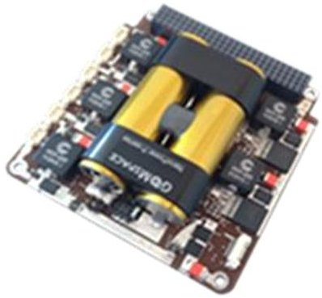

Figure 3: GomSpace P31u $ ^{6} $

## Command and Data Handling

Command and data handling is conducted by a custom flight computer (Figure 4) using a radiation tolerant ATmega128 microcontroller running flight software based on NASA's F' (F Prime) framework. The ATmega128's vast community support and tools through the Arduino community helped to get the flight software team running programs on the flight computer very quickly with little development environment overhead, which is a large advantage in a student-developed CubeSat mission.

<!-- PDF_PAGE: 4 -->

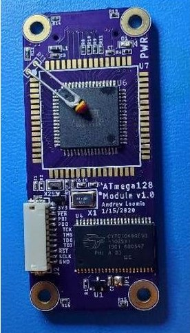

Figure 4: GT-1 Flight Computer

The flight software team had difficulties fitting all the desired software components into the 128 kB program memory of the ATmega128. Estimating the required program memory using NASA's new F' framework was difficult for GT-1, as the framework had never been used on an ATmega128 microcontroller. Future small satellite projects using experimental software should consider applying large margins to the allocated program memory on the flight computer.

Additionally, an Onion Omega2 microprocessor is onboard the spacecraft for performing more complex and faster computations than what the ATmega128 can provide, at the cost of greater power consumption. The Onion Omega2 is not utilized for flight-critical functions due to its lack of heritage in the space environment but is used for managing the amateur radio communications payload and for commanding the ADC system.

## Battery Hazard Inhibit

The battery hazard inhibit circuit is responsible for preventing damage to the battery as a result of overcharge, over-discharge, and external short fault conditions. Typically, this circuit "inhibits" the battery from powering the spacecraft until after deployment so that a battery fault while in storage or transit does not result in an explosion or battery leakage.

GT-1's inhibit circuit is shown in Figure 5. Only a few of the hazard protections are supplied by the GomSpace P31u, namely the PTC/CID protection and "Protection IC" blocks. The remainder of the hazard protections were implemented in GT-1's custom electronics which include the solar panel blocking diodes and the "GND Break MOSFETs". These MOSFETs disconnect the battery from the spacecraft ground while the satellite is not deployed.

Understanding this circuit is critical to the success of a small satellite mission both in meeting launch provider requirements and in maximizing the reliability of the successful deployment of the spacecraft. The GT-1 team misunderstood the inhibit circuit requirements until late in the spacecraft integration process, requiring an undesirable modification of hardware to bring the circuit into compliance.

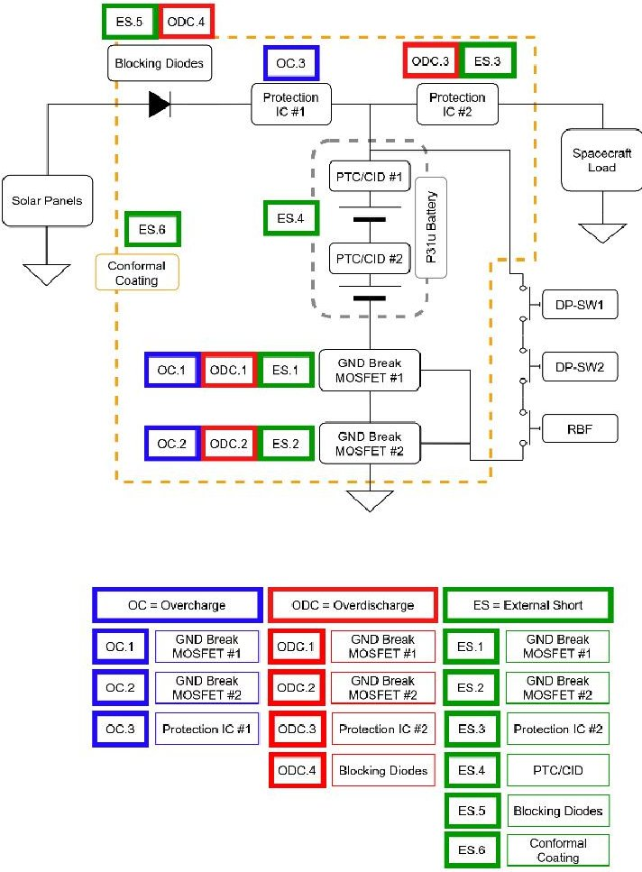

Figure 5: GT-1 Battery Hazard Inhibit Circuit

## Communications

The spacecraft communicates with the ground using a custom 1W UHF radio operating in the 70cm amateur band at 9600 bps. The radio is based on the open-source OpenLST design (Figure 6) released by Planet Labs for small satellite projects, which uses the Texas Instruments CC1110 radio transceiver IC. Since the OpenLST firmware and CC1110 do not support amateur radio AX.25 packet protocol and G3RUH scrambling, the firmware was modified to support these amateur standards. This allows for GT-1 to communicate not only with the Georgia Tech ground stations, but with the many licensed amateur radio operators around the world.

However, implementing the AX.25 packet framing, G3RUH scrambling, and other data manipulation in

<!-- PDF_PAGE: 5 -->

software caused long delays in the project timeline and reduced the data rate due to saturation of the processor's performance. Selecting a radio transceiver IC that supports the mission's required radio data manipulation in hardware will speed up the radio development process considerably.

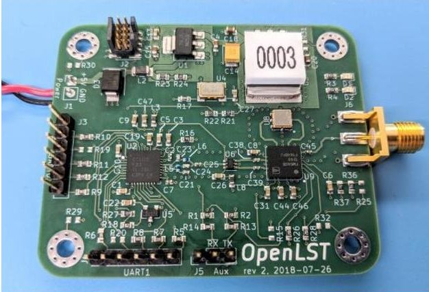

Figure 6: Planet Labs OpenLST Radio $ ^{7} $

## Attitude Determination and Control

The spacecraft attitude determination system includes a magnetometer, sun sensors, and an inertial measurement system (IMU) with integrated Microelectromechanical System (MEMS) gyroscopes and accelerometers. For attitude control, the spacecraft contains two orthogonal torque rods for active magnetic control in order to detumble after deployment. The magnetometer, torque rods, and sun sensors were designed, built, and tested in-house.

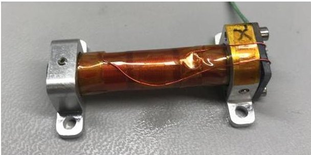

Figure 7: GT-1 Torque Rod

A commercially available GPS receiver was included in the original spacecraft design. However, this component was de-scoped due to complications explained in the following lessons learned section. Likewise, the IMU was included in the design, but the module was de-scoped following damage and not included in the final integration.

## Other Elements

Similar to the subsystems described in the previous sections, the spacecraft structure was designed and fabricated in-house. The aluminum 1U structure included a top and bottom plate, and two-piece side walls (Figure 8).

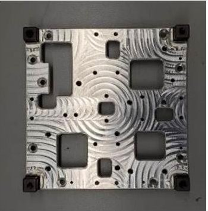

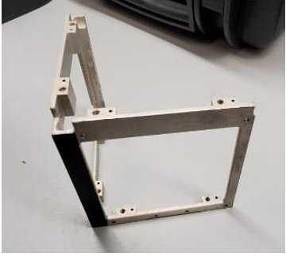

Figure 8: GT-1-Z Plate (left) and one piece of side wall (right)

Temperature and power monitoring sensors were included for spacecraft health monitoring. Thermistors were placed on the solar panels and flight critical components such as the flight computers, batteries, and radio. Power monitoring was included on all major power consuming components and on each of the 12 solar cell series strings.

## LESSONS LEARNED TO BE APPLIED TO THE GT-X BUS

The integration and testing of the GT-1 spacecraft revealed both design flaws and strengths. These flaws necessitated late-term design changes, hardware modifications, and occasional descoping or other changes to the mission. From these challenges an extensive list of lessons learned is derived to assist in the planning and execution of future CubeSat missions. While the details of problems encountered may be specific to the GT-1 mission, the resolutions and extensions are phrased in a general sense to be broadly applicable to similar projects. These lessons are described in the following sections.

## Commercial (COTS) Component Repair and Managing Schedule Risk

Throughout the mission lifetime, various components required repair or replacement. While most issues with components designed in-house could be resolved over a short timeline, issues with COTS components required more consideration as they greatly affected the mission schedule. In several cases, such as that of the GPS receiver, sending the component back for repair was a

<!-- PDF_PAGE: 6 -->

multiweek process. A problem was discovered with the GPS a few days before the start of final integration and the GPS receiver was ultimately descoped since it the first PCB to be integrated into the avionics stack. At the time, waiting for the repair and subsequent subscale testing would have set integration back by more than a month. Ultimately, a schedule slip introduced additional time which could have been utilized to integrate a functional unit if swift action had been taken to send it back to the vendor.

In situations where repair was not an option, obtaining a replacement typically required a lead time of multiple months. This was encountered with the IMU and the P31u, but different approaches were taken to resolve their issues. It was determined the IMU required a replacement well before integration began. However, the new part was set to arrive well past the original integration date, and therefore would have caused the satellite to miss the first launch opportunity. As such, the IMU was descoped early into the mission timeline since it was determined to not be critical to the satellite's functionality. As for the P31u, the vendor was immediately contacted once a problem was observed a month before final integration, and after three weeks of correspondence the mission was recommended to obtain a new unit. As this too would have caused the mission to miss a launch opportunity and incur a significant financial cost, it was ultimately decided to modify the component and bypass the functionality causing issue.

However, when critically analyzing the schedule, both components could have been reordered to ensure full functionality of the flight system. As the mission ultimately missed the first launch opportunity due to the COVID-19 pandemic, it would have been best to replace the units when the issues were discovered. Furthermore, the next mission in the GT-X series will utilize the same IMU, so a delayed component could simply transition to the next mission. The loss in functionality of the P31u affected the mission for the rest of its duration, as an accidental short on the satellite's main board can be traced back to the bypass implemented.

Ultimately, there was enough time to repair and replace all COTS components that caused issues on GT-1 since the first two delivery dates could not be met. The decisions to not repair these components were made under intense schedule pressure resulting in the

dismissal of the option to accommodate a schedule slip in order to restore system functionality. Further discussion on the topic of creating a realistic schedule can be found in Set a Realistic Scope.

Moving forward in the GT-X series, damaged or malfunctioning COTS components will be immediately sent back to vendors for repair. In cases where repair is not possible, replacements will be ordered regardless of lead time since the component may be used for a future mission if it is descoped from the originally planned mission. This second case is made possible by the nature of the GT-X series as an iterative design spanning multiple missions. For missions where this is not the case, realistically evaluating the schedule is vital. Ensuring the system works properly may be worth accepting a schedule slip, especially in missions where the schedule is already uncertain.

## Prioritizing Critical Bus Components

Although there are many components and features (both in hardware and software) onboard a CubeSat and the team desires them all to be complete before launch, only specific components are mission critical (See Table 1). Keeping de-scope options available is an important aspect of space mission planning since launch opportunities are generally inflexible and the timeline of solving engineering challenges can be difficult to predict. However, only non-mission-critical components can be de-scoped from the mission, so prioritizing the mission-critical components early in the design, assembly, and test process is imperative to meet the mission schedule.

Prioritization of simple but flight-critical components can seem counter-intuitive but is nevertheless worth considering. The GT-1 spacecraft's battery hazard inhibit circuit is an example of an oversight in prioritizing a critical component. While the inhibit circuit (block diagram shown in Figure 5) is one of the most straightforward circuits to design on the spacecraft, it is arguably the most important. If this particular circuit does not meet payload requirements, the spacecraft cannot launch. The GT-1 team did not allocate additional time to develop a thorough understanding and ensure the inhibit circuit met requirements as it appeared simple to design relative to other circuits designed for the mission. Rather than supplying three independent battery hazard inhibits, the circuit was originally designed with only a single independent inhibit controlled by three trigger switches. The three trigger switches were mistakenly identified as three "independent" inhibits, but only controlled the

<!-- PDF_PAGE: 7 -->

single inhibit mechanism. This circuit had to be redesigned and installed on the exterior of the spacecraft (Figure 9) after final integration which proved to be challenging and incurred additional risk to the mission.

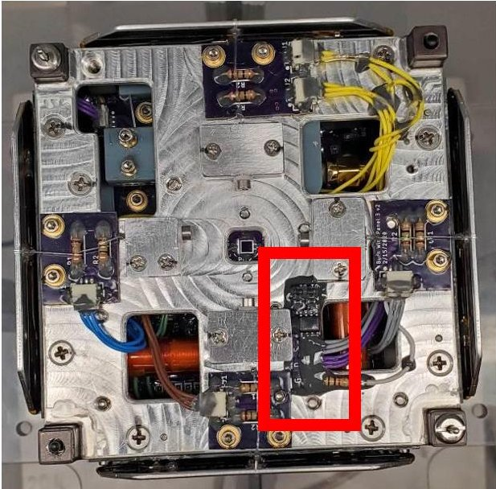

Figure 9: Inhibit Circuit Modification PCB (outlined in red) mounted on spacecraft -Z plate

Similarly, the GT-1 spacecraft UHF radio is a flightcritical component, yet it was one of the last components developed and tested due to its complexity. One team member held the tribal knowledge related to radio development and it was difficult to transfer this knowledge upon their graduation. As there was also no dedicated communications team on the GT-1 mission, this resulted in further delays while other team members scrambled late in the mission to become knowledgeable about this component in order to complete the radio development.

For future GT-X missions, the critical satellite bus components will be identified and allocated more time and personnel for their development and testing. In particular, future missions will include a dedicated communications team for developing and testing the spacecraft radio and ground station links.

## Modularity

Having easy access to electrical components inside the spacecraft at any time during the integration process is critical in an experimental or university CubeSat mission. While components should be individually acceptance tested before being integrated into the system, there will likely be failures that are unique to a fully integrated system. The GT-1 mission experienced a multitude of these failures including an incorrectly manufactured cable and a damaged component from an

overcurrent condition elsewhere in the system Especially when designing custom electronics without flight heritage, the ability to swap out damaged components during integration and testing is highly beneficial.

The use of approximately 20 cable assemblies, all staked using epoxy for secondary retention, resulted in the GT-1 spacecraft being very difficult, if not impossible, to disassemble to replace damaged components.

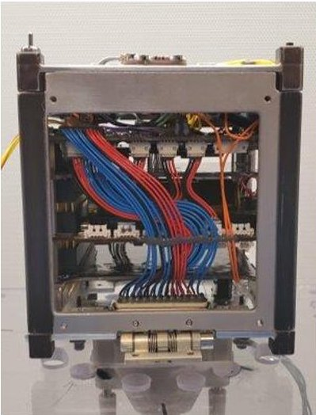

Figure 10: Many cable harnesses routed throughout GT-1 spacecraft

When faced with a damaged component, the team generally opted to not disassemble the spacecraft and modified the internal hardware as little as possible by adding external circuits to bypass the internal faulty circuits. While the GT-1 team rarely disassembled the spacecraft after staking, the following provides insight on why spacecraft disassembly with a large number of staked cables is so difficult. Once cables have been staked with epoxy, the cable assemblies must be cut in order to disassemble the spacecraft. After replacing the damaged component, the GT-1 team developed several options for re-assembly:

1) The cables could be soldered back together with increased risk of an electrical short to the structure and of a broken cable on orbit due to a poor solder joint. Similarly, cable plugs and sockets could be crimped to the cut wire ends and could be re-attached with a connector in the middle of the cable (rather than soldering) if available volume and wire length permit.

2) The staking securing the cable plugs could be removed and the cable assemblies replaced. The cured staking was too strong to easily cut

<!-- PDF_PAGE: 8 -->

through without risking the surrounding components making this option practically impossible.

3) The PCB attached to the cut cable could be replaced entirely with a new connector receptacle and new cable assembly. Replacing more components than necessary can increase the cost of the mission substantially and result in lengthy schedule delays.

4) A combination of the previous options on either end of the cut cable.

Because the above-mentioned options are undesirable, it is recommended to prioritize ease of disassembly and reassembly as a primary goal during the spacecraft design process. While GT-1 was largely unsuccessful in achieving this modularity goal, our team recommends several improvements that will be implemented on the future GT-X satellites:

1) Utilize board-to-board connectors rather than board-to-wire connections where possible. Cable assemblies are prone to error in their construction, occupy more volume, and have greater mass than a board-to-board solution. An incorrectly constructed cable installed in the GT-1 spacecraft caused an overcurrent condition in an electrical component resulting in spacecraft hardware modifications adding mass and risk to mission success.

2) For connectors that must be board-to-wire prefer non-permanent retention methods such as screw-locks. If cable plugs are secured using locking screws, the cable assembly can be easily detached during disassembly Likewise, board-to-board connectors can be secured using screws and standoffs and can be easily disassembled when compared to a more permanent retention method such as staking.

3) Plan to complete full integrated system testing prior to final integration to reduce instances of spacecraft disassembly. When staking integrated components is necessary, prefer withholding the staking until integrated system testing is complete. Once testing is complete, disassemble the spacecraft and re-assemble with staking for final integration.

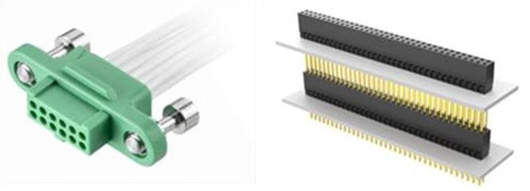

Figure 11: Harwin Gecko screw-lock connector $ ^{8} $ (left) and Samtec PC104 board-to-board connector $ ^{9} $ (right)

## Documentation

Documentation was one area in which the mission showed considerable strength. Detailed mission documents were created for every integration and testing procedure facilitating smooth interactions with the flight hardware by preventing mistakes and oversights. These documents created standardized methods and templates for recording events and set best practices for future missions to follow. Blank templates allowed for iterative improvements to be made as the mission progressed. While performing the procedures, notes and observations were included in the margins in cases where the written steps did not suffice. Important documents, such as the completed integration procedure, were promptly scanned and uploaded to a server to remove reliance on a hardcopy. In addition to written documentation, photographs were taken at every milestone to create a visual record of the state of the system and components over time. A time-lapse of the satellite's integration was recorded to supplement the extensive photographic documentation.

These practices became increasingly important in the cases of anomalies. Separate non-conformance reports (NCR's) and anomaly descriptions were written to aid in the troubleshooting and planning of a solution. The previously completed procedures were referenced to determine possible cause. In general, the photographs were typically the most helpful form of documentation. Being able to reference actual images of the satellite state at various points in time, both before and after an anomaly, was an invaluable resource.

During tests of the deployable solar panels, anomalous behavior was observed on one of the burn wire mechanism PCBs. The root cause was speculated to be an overcurrent condition produced by a flipped cable which, with a reversed pinout, shorted power to ground. However, it was difficult to confirm this without taking apart the spacecraft. Photographs from the integration process taken just after several cable assemblies had

<!-- PDF_PAGE: 9 -->

been installed confirmed that an incorrectly manufactured harness had indeed been installed into the spacecraft (Figure 12).

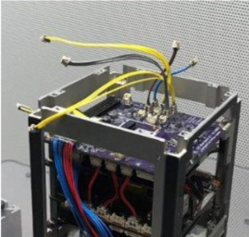

Figure 12: Image taken during integration helped to resolve a cable problem later in testing

For future GT-X missions, existing mission documents and test procedures will be updated with lessons learned from their previous uses. New documents will be created to track flight hardware interactions, including a log system to ensure proper quality assurance practices are being followed when working with mission critical hardware. As photographs were essential to anomaly troubleshooting, explicit steps will be added to all procedures to ensure any changes to the satellite will be photographed. Standalone procedures to photograph each component before it is integrated into the system will be written to provide a baseline for any anomalies. Furthermore, video records of hardware interactions will be obtained via an integrated camera in the GSE equipment. This camera will enable continuous monitoring and recording of interactions with flight hardware.

## Subscale Testing

Subscale testing is of the utmost importance when integrating any complex system, especially high-risk systems such as CubeSats. While there is no "golden rule" for how granular subscale tests should be, and this depends heavily on specific subsystem or integration stage, it is important to baseline what subscale tests are applicable to the specific mission. If a software or hardware fault is detected far upstream of the last "known state" of the spacecraft, it is often difficult to determine the root cause of the problem. Attempting to debug the issue can result in additional risk being incurred to the system. Environmental and system level testing is also necessary but not discussed here.

It is essential to know the state of the system to a high degree of certainty at all times and to recognize unknowns. Adopting a "test-as-you-go" method is especially risky as it is often unclear of when the next subscale test should occur. The GT-1 team was successful in planning milestone tests well in advance to ensure major changes to the spacecraft were successful but did employ the "test-as-you-go" methodology during substantial sections of the avionics integration due to schedule pressure. This resulted in power rail shorting, incorrectly connected signals, and incorrectly constructed cable assemblies. Some of these occurrences resulted in damage to the system and created schedule slips. More granular testing would have been invaluable - trading short-term labor and time for long-term schedule benefits. However, this can be limited by the bandwidth of experienced students needed to plan and carry out testing, which proved to be a challenge for the GT-1 mission. It is suggested to design all these subscale tests, no matter how simple, far in advance of integration to ensure issues similar to those above do not slip through the cracks.

As mentioned before, the subscale testing frequency and detail are highly system dependent, but there are some standards for when such a test should occur. Subscale tests are classified into specific categories which can serve as a guide for whether and when such testing is needed.

Sub-Assembly Testing is critical for components developed in-house. Often, a component will have several sub-assemblies which need to be discretely tested. A good example of this is the GT-1 main avionics board which houses the inhibit, burnwire, and solar panel interface circuitry. The team effectively tested each of these sub-assemblies which allowed for some non-conformities such as soldering irregularities to be identified early and easily resolved. Had the team conducted this testing at a higher level, these issues could have been discovered after the component was staked and conformal coated making any repair far more complex.

Component Acceptance Testing should be conducted on all components, whether COTS or developed in-house, prior to integration into the system. Such testing should occur at least twice regardless of how the component is sourced. For COTS components, testing should occur immediately after receipt from the vendor to ensure no damage has occurred in shipping and the vendor has not overlooked any issues during checkout testing. Then, the components must be tested just prior to installation into the system to ensure they have not been damaged (possibly from long storage times or other intermediate

<!-- PDF_PAGE: 10 -->

testing). A similar approach should be taken with inhouse developed components testing after manufacture and prior to installation. Some additional testing may be warranted for these components following finishing processes such as potting, staking, or conformal coating as they may have unanticipated effects on the final component (damage during application, expansion/contraction during cure, etc.).

The handling of the GPS receiver for GT-1 is an example of the need for proactive acceptance testing practices. The GT-1 team shipped the GPS receiver back to the vendor after it had been damaged from prolonged storage. The component was received by the GT-1 team but not immediately acceptance tested. By the time a new issue was identified which had not been detected by the vendor, the schedule was too mature to make the repair and the unit was ultimately descoped.

Avionics Stack-Up Testing is an essential consideration specifically when integrating a CubeSat. While each component should have been fully tested prior to assembly, irregularities can arise when these units are integrated together. It is suggested that testing occur after every component or part is mated with the stack. This might include an entire PC104 board, if it is to be mounted with board-to-board connectors directly to the stack, or even a single cable assembly connecting two circuits. Reasonable effort should be taken to "cold" test circuits (testing for continuity or open circuits on power, ground, and signal rails) prior to supplying power for a "hot" test. It may only be possible to conduct "cold" tests before the battery is integrated. This will avoid nonconformities which risk causing damage to systems from high current events. The GT-1 team accidentally constructed a cable assembly with two signals swapped, which was not identified until the entire spacecraft was integrated and staked. The cable had to be cut and spliced resulting in reduced system functionality. More frequent and detailed Avionics Stack-Up Testing (particularly "cold" testing) could have prevented this permanent damage.

Flight Software (FSW) Testing involves any functional test with previously untested flight software. If the system is well designed, it is possible to limit the risk of software testing by implementing circuit design to prevent errant or bugged code from damaging hardware, though this is not always possible. FSW testing must be conducted on an Engineering Development Unit (EDU) before upload to the spacecraft. This EDU can come in many forms: an entire Hardware-in-the-Loop Testbed (HITL), a duplicate component, or as simple as a breakout board with the flight processor onboard. The GT-1 team

successfully employed a "FlatSat" (an EDU spacecraft with components disassembled and easily accessible shown in Figure 13) to identify software issues before uploading code to the spacecraft. This was largely successful except for an instance where the wrong version of the software was uploaded onto the spacecraft resulting in an anomalous solar panel deployment. The GT-1 "FlatSat" did not include circuitry to indicate when a deployment would occur, so this issue was not identified prior to upload to the spacecraft. As such, it is important that any testbed be as functionally identical to the flight unit as possible.

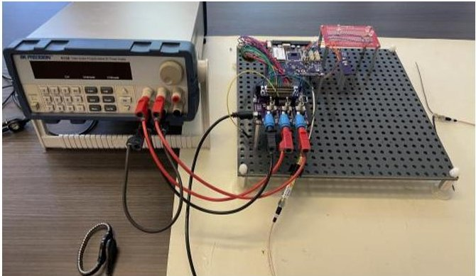

Figure 13: GT-1 "FlatSat" Hardware-in-the-Loop Testbed

Structural Fit Checks should occur at multiple stages in the CubeSat development process as the tight deployer tolerances impose equally strict structural dimension requirements. A JSSOD-R test pod was supplied for vibration testing and used for fit checks which proved invaluable in solving fit up issues as described in later sections. Structural fit checks should occur at least three times: after the structure is first machined, when the preliminary build of the spacecraft is complete, and when integration is complete. Each time, fasteners should be torqued to specification with a repeatable assembly process. It is often difficult to verify the parallelism and perpendicularity of the spacecraft rails, so these fit checks are an effective method for confirming alignment. The earlier in the integration process a structural alignment issue is identified, the simpler it is to resolve since re-machining or modification of the structure is still possible without fully disassembling the spacecraft.

Note that there is no subsystem level testing mentioned above. While subsystem level testing can occur, the highly coupled nature of subsystems in CubeSats can make testing individual subsystems a challenge. Tests containing an entire subsystem and possibly aspects of other subsystems can be categorized into Avionics Stack-up Testing and should adhere to the same guidelines.

<!-- PDF_PAGE: 11 -->

## Ease of Fabrication and Assembly

The design of spacecraft components should include consideration of their planned manufacturing process and whether the chosen method of fabrication can meet the required tolerances. Furthermore, assemblies of the fabricated components should work the same way each time and with a maximal amount of flexibility ("foolproofing").

One of the most significant issues encountered during integration was poor fit of the spacecraft inside the test pod simulating the orbital deployer. This test pod was provided by JAXA to be used during testing to ensure that the assembled satellite will fit inside the launch case during integration and to be used for vibration testing. Upon initial assembly, GT-1 could be inserted into the test pod but could not slide freely, as required by the JEM Payload Accommodation Handbook ICD, and would bind at several points along the rails. The quality of the fit varied significantly depending on the order in which the various primary structural elements were torqued and based on the torque patterns used on a given face. These fit issues illustrate the importance of repeatable assembly procedures and designing parts for manufacturability.

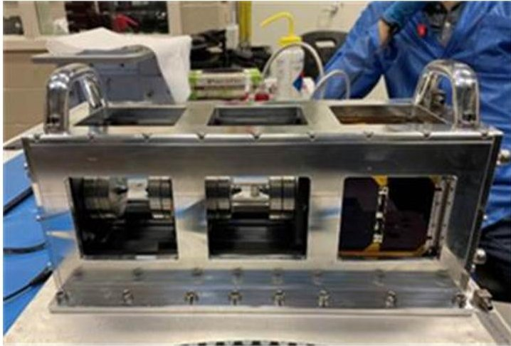

Figure 14: J-SSOD Test Pod with GT-1 spacecraft and two 1U mass simulators

The troubleshooting process identified several likely causes for the improper fit in the test pod: machining errors which created nonconforming part dimensions, lack of proper tolerancing in the design, and poor structural design in which the CubeSat rails are divided among three different parts.

Investigation uncovered that as the GT-1 primary structure was being fabricated, a mistake in the operation of one of the machines reduced the as-built width of the walls of the structure. The fact that the structure still assembled and fit inside the test pod was

taken as proof that the error was acceptable. However, this nonconformity had not been quantified and compared back to design tolerances to identify whether it was acceptable and what, if any, corrective action was necessary. The structure ultimately remained within specifications after required procedural changes allowed for repeatable, in-specification assembly. This machining error also highlights the need for quality control in design processes and the importance of designing parts that are easy to fabricate.

Designing for manufacturability is generally not easy and may require some iteration, particularly if fabrication is being performed by less-experienced student machinists. When considering how a part will be fabricated, it is necessary to determine not just whether a particular machining operation is possible, but how difficult it will be. These concerns could include very tight hole placement tolerances or complex geometries that make it difficult to clamp or otherwise restrain a workpiece during machining. If a particular machine shop or facility has already been identified prior to design (such as an on-campus facility), the staff machinists should be consulted during design to provide input on capabilities (tools/operations available and their precisions) as well as to consult on how parts should or could be fabricated (order and type of operations).

In order to properly control the quality of machining processes, tolerances must be included in the design flowing down from the constraints and tolerances of the ICD. Individual part dimensions and tolerances should be constructed such that parts conforming to those designs will fit together properly and correctly interface with the deployment mechanism. Taking as-built measurements of the final fabricated parts allows verification of conformance. In the event that one or more dimensions is non-conforming, such measurements allow analysis to be performed to determine whether the as-built parts will fit together and what corrective action is needed to repair them. Considering tolerances during design and measuring parts after fabrication is essential to confirm that the final assembly of parts will fit within overall constraint tolerances and to understand the consequences of any mistakes or nonconformities during fabrication.

In addition to poor quality control processes, several design decisions also contributed to the structural fit issues. The rails on the edges of the satellite form the interface with the orbital deployer (and the test pod) and thus their dimensions, placement, and orientation must be tightly controlled. On GT-1, each rail is formed by segments of three separate parts: one end on the top

<!-- PDF_PAGE: 12 -->

plate, a segment of the wall, and another end on the bottom plate. All three of these parts were machined entirely independent of one another and so slight variation in any single part degrades the quality of the entire rail, thus impairing the alignment of the satellite rails. It is believed that this three-part rail design was the largest contributor to the poor structural fit, especially in light of the machining error with the walls.

Since the rails are so vital to the interface of the CubeSat with the deployer and any other external features, a structural design in which the entire length of the rail is contained within a single part is highly desirable and has been adopted for the GT-2 structure. If it is impossible to make the rails in a single part, perhaps due to a need for more access, the rails should be machined in a single operation early in the fabrication process.

Another design choice that impaired the structural fit was the use of countersunk fasteners for the assembly of all the primary structure components. The use of a countersunk fastener (instead of a counterbore with a socket head fastener) adds a constraint to the interface by enforcing concentricity between the threads in the substrate and the countersink in the bolt-side part. Since the placement of the threads and countersinks cannot be controlled with exact precision, any more than two countersunk fasteners will over-constrain the interface and introduce internal strains in the parts being fastened together.

A better design uses socket head fasteners with a clearance hole in the bolt-side part. In the case where the clearance hole is slightly larger than the fastener, the interface is only constrained normal to the interface when the fastener(s) are torqued into place. This allows a more precise feature, such as dowel pin holes machined into both parts in a single operation early in fabrication, to be used to reliably align the assembly. A counterbore could also be included if clearance of the bolt head is an issue provided that the counterbored hole is slightly larger than the head of the fastener.

Separate from the design process, the measurement and testing of the structural components prior to integration failed to detect the fit-up issues that would later manifest. Several structural fit-ups were performed where the primary structure was assembled and fit-checked inside of the test pod. To eliminate the need for clean bench and electrostatic discharge (ESD) procedures, each component in the avionics stack was replaced by a 3D printed replica of the same size but not the same mass. The accuracy of the subsequent tests was thus limited because the resulting "dummy"

satellite was not a mass-accurate replica of the flight system. When the structural fit-up issues manifested during integration, it became apparent that the mass of the avionics stack must be causing deformation of the structure to a degree that impacts the fit-up of the satellite in the test pod. For future missions, structural fit-ups will be performed with more accurate stand-in components that approximate both the size and mass of their actual flight counterparts. Improving the accuracy of this test setup will increase the likelihood that any future structural fit-up issues are identified as early on in the mission as possible.

Repeatability is essential to achieving proper quality control, and a robust assembly procedure that leaves no room for interpretation is not just good practice but can also help to account for poor design or fabrication. The very detailed structural assembly procedure developed for GT-1 allowed the team to create a baseline state of the system from which experimentation with different assembly methods and torque patterns was possible. By keeping a detailed log of each of these changes and deviations along with the resulting outcome, it was possible to develop via trial-and-error a procedure to successfully assemble the satellite with proper fit-up in the test pod.

## Resolving Nonconformities

Throughout the integration and testing of the GT-1 CubeSat there were several anomalies that created nonconformities, some of which have been discussed in previous sections, and required lengthy troubleshooting to resolve. Even with meticulous planning and iterative improvements from these lessons learned, there will always be "unknown unknowns", and so it is vital to have a reliable, established procedure for troubleshooting hardware issues.

Before outlining and describing an example of such a procedure as implemented during the GT-1 mission, it is important to consider several factors. The first is that hardware modifications during and after integration always carry additional mission risk, and so any solution that resolves the problem at hand without such a modification (a software fix or a change in the mission Concept of Operations) should always be preferred. The second is that it is critical to not further damage the satellite or any components when investigating or resolving nonconformities. This means that as soon as an anomaly occurs or is identified, the satellite should be returned to the most recent safe, stable configuration and any test or operation to be performed should be thoroughly considered to make certain the situation will not worsen.

<!-- PDF_PAGE: 13 -->

The troubleshooting process used to resolve nonconformities during the GT-1 mission can be outlined as shown below:

1) Stabilize the system.

2) Identify the problem.

3) Determine root causes.

4) Consider alternative solutions.

5) Develop a detailed procedure.

6) Practice the procedure on non-flight hardware.

7) Perform the modification on the satellite.

8) Thoroughly test the system.

This process is iterative with both major and minor loops to allow new information to be continually incorporated and incremental improvements to be included after testing. For example, anything learned during the practice run in step 6 should be used to improve the procedure from step 5 which should be tested again in step 6 and so on.

Stabilizing the system is the most vital step as discussed earlier and allows time to properly consider every possible cause and solution. It is very important not to rush any step in this process as schedule pressure often leads to mistakes and poor decisions. The next step is to identify the problem. This process should work from the highest level of the outward system behavior (i.e. satellite does not activate when deployed) and progress downward with ever-refining detail of the state of every relevant component in the system. This should naturally lead into a determination of the root cause(s) since a definition of the complete system state will include any components that appear or behave in unusual ways indicating damage or failure. Steps 2 and 3 should involve tests performed on the satellite to quantify any relevant system parameters to both identify and confirm plausible root causes.

Once a root cause has been identified, possible solutions should be brainstormed and as many alternatives as possible should be considered. The characteristics of competing solutions should be compared including cost, difficulty, feasibility, required time/schedule delay, impaired system performance, and consequence of failure. Most importantly, the additional mission risk imposed by a given solution should be determined at least in a relative sense. The ideal solution may not always be the one that carries the lowest mission risk, but that is likely to be the case. To move from step 4 to step 5, a preferred solution should be identified, but it is also a good idea to maintain one or more additional solutions as backup or secondary options.

The importance of the next two steps, to develop a detailed procedure and practice this procedure on nonflight hardware, cannot be overemphasized. As discussed earlier, there should be some iteration between these steps to incrementally improve the procedure, and it is also possible that either writing or practicing the procedure will reveal that a particular solution is either impossible or riskier than initially believed which could prompt a return to step 4 and selection of a different alternative. In order to achieve consistent, reliable results, it is necessary to allocate significant effort into writing a detailed procedure to properly control the process, and into creating as accurate a test setup as possible to properly simulate the actual system. The less accurate a procedure or test setup is, the more uncertainty there is in whether the solution will actually be successful, and the greater likelihood that an unexpected error will be encountered when performing the final modification on the flight hardware. Figure 15 shows the test setup used to practice the GT-1 inhibit circuit modification using a 3D printed spacecraft structure (Figure 9 shows the installed inhibit circuit on the spacecraft).

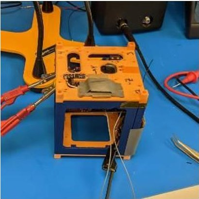

Figure 15: Inhibit Circuit Modification Test Setup

Once the procedure has been tested and refined, the time has come to actually perform the modification on the satellite hardware. Meticulous care should be taken to follow the procedure developed earlier as precisely as possible. This task should include testing whenever possible throughout the process to confirm that each step has succeeded and that no further damage has been done to the satellite. It is important to understand which, if any, steps or sequences need to be performed in quick succession and which are partially or completely irreversible. Any such irreversible actions should be left as late in the procedure as possible. It is important when performing hardware modifications to not blindly plow ahead. If something differs from the practice setup or a new problem or piece of information is discovered, immediately halt the procedure and take time to consider the new implications and take

<!-- PDF_PAGE: 14 -->

appropriate action. This may even include circling back in the troubleshooting procedure by stabilizing the system and testing out a new method before proceeding.

Once the modification is complete, functional tests should be performed to confirm that the system is behaving as expected, that the original nonconformity has been resolved, any modifications are working as expected, and that no other system functions have been unexpectedly impaired or removed. Any nonconformities discovered through such testing should be resolved in a similar manner as discussed above with specific care and attention paid to any such issues which may have been caused by the solution procedure itself. Consideration should also be made of any system-level environmental tests which could be affected by the modification and now need to be repeated or retested (for example, any modification to the structure should necessitate performing vibration testing again).

## Set a Realistic Scope

The original scope of the GT-1 mission was beyond what was possible in the preliminary time allotted. Hence, much of the planned functionality was descoped to ensure deadlines could be met. The ADC system sacrificed the most functionality with the descoping of the GPS receiver and IMU. The loss of the IMU necessitated the descoping of the attitude estimator leaving just the magnetometer to implement a detumble system using B-dot control with two torque rods. More wide-ranging functionality losses were seen in flight software, with hardware available onboard the spacecraft for tasks such as data logging and voltage and current monitoring but no time to develop the software. Software components were descoped well after the final build of the satellite was complete, most recently with development of the over the air update component halted to allow focus on more mission critical components.

The first thing to consider when determining the scope and timeline of such a mission is to recognize the scope of personnel. As GT-1 was fully staffed by undergraduate students, it was vital to recognize that many could not contribute more than the weekly hours they had committed to. This was especially apparent during school breaks when many students were unavailable. Additionally, for many students, GT-1 was their first experience working on a spacecraft. Therefore, they required time to be onboarded and learn

all the skills required to make progress on such a mission. Hence, many aspects of the mission extended past the allotted period as it simply took longer to make progress. Furthermore, it is impossible to speak about the timeline of GT-1 without mentioning to effect of the COVID-19 pandemic. The mission was affected most notably with fewer students on campus available to assist with integration and testing causing those on campus to work long hours to compensate. However, the time necessary to develop the minimum viable software build would have delayed the project regardless. The months lost to the pandemic would not have been enough to ensure the mission launched when originally slated to.

Ultimately, the GT-1 mission suffered from a lack of student experience and flight heritage as it is the pathfinder spacecraft in a series. It was impossible to gauge the time and effort certain tasks would require as they had never been performed by any of the members before. One such example is the simulated communications (SimCom) test wherein the link budget would be verified. The test had been planned for February 2021 but will be unable to be completed until June 2021. The level of technical difficulty and test logistics were severely underestimated, and thus work began on test preparations late in the mission timeline. Since the required time and effort far exceeded that allotted to the test, SimCom has significantly delayed the mission timeline.

Future GT-X missions benefit from the iterative nature of the system, with students ideally remaining on the project for multiple spacecraft and therefore passing knowledge down to the next group of students. This includes both technical skills and general experience with design, integration, and testing. Thorough documentation from experienced students will assist in this effort. Additionally, as each satellite will improve upon the next, the same mistakes should not be repeated. Therefore, future missions will be able to set more reasonable, yet aggressive, timelines and scopes.

A new addition to the mission process will be independent design reviews. Experienced reviewers will have the ability push back on design decisions to ensure feasibility with respect to both mission scope and timeline. These reviewers will be students from previous GT-X missions and graduate students with experience in building small satellites. By consulting individuals not directly involved with the mission,

<!-- PDF_PAGE: 15 -->

students will be able to obtain impartial feedback on the mission design and scope rather than falling into the dangers of groupthink. Mission decisions and designs will need to be supported by convincing arguments and a thorough engineering process, preventing members of future GT-X missions from repeating similar mistakes.

While every mission differs, the following questions should be answered early into a mission's timeline to ensure a greater chance of success when organizing a schedule.

1) Are those working on the mission able to dedicate the time necessary to meet mission milestones?

2) Is the time allotted to mission critical components comparable to allotments from similar missions?

3) How much margin has been included in the mission schedule? Is it sufficient?

If the answers to any of these questions raise concern, it is vital to reevaluate the mission scope and schedule. It is sometimes best to reduce scope or extend the schedule to ensure mission success, rather than rushing and launching a system that may or may not perform as designed. A comparison of the GT-1 and GT-2 schedules is shown in Table 2 to highlight how these considerations have been re-evaluated between missions.

Table 2: Comparison of GT-1 and GT-2 mission schedules

<table border="1"><tr><td>Task</td><td>GT-1 Planned</td><td>GT-1 Actual</td><td>GT-2 Planned</td></tr><tr><td>Hardware Development</td><td>5 months</td><td>8 months</td><td>6 months</td></tr><tr><td>Software Development</td><td>9 months</td><td>23 months</td><td>12 months</td></tr><tr><td>Integration</td><td>2 weeks</td><td>2 months</td><td>2 months</td></tr><tr><td>Test</td><td>1 month</td><td>9 months</td><td>5 months</td></tr></table>

As the GT-X series is iterative, GT-2 benefits from the developments of GT-1. While the software is the easiest component to port over from the previous satellite, GT-2 is allotting 12 months to the task ensuring new members are provided ample time to familiarize themselves with the software framework and architecture.

## CONCLUSIONS

Ultimately, new CubeSat teams must develop their own tribal knowledge over the course of several projects to determine what approaches are appropriate given the schedule, budget, and risk of their respective missions. Unlike private or governmental missions, commonly accepted NASA and military standards cannot be applied in a strict sense due to the intrinsic rapid timeline accompanying CubeSat missions. However, while each mission is unique, development does not need to be an isolated endeavor. Much knowledge can, and should, be passed between different CubeSat teams.

The aim of this paper was to provide some experience-driven guidance and help bring inexperienced CubeSat teams into the mindset required for a successful mission. An inexperienced team has every opportunity to be successful if risks and weaknesses are identified early and mitigated. The lessons learned presented in this paper should help teams avoid similar mistakes and establish a mindset to cope with further "unknown unknowns" which may arise in their unique missions.

## ACKNOWLEDGEMENTS

This work would not have been possible without Dr. Glenn Lightsey for his guidance and continued support over the lifetime of this project. Special thanks to Sterling Peet for offering his technical expertise and assistance in overcoming the numerous obstacles the team has faced. Support from Jeff Roberts and Sean Stoker from Spaceflight Inc. was instrumental in liaising with Mitsui Bussan Aerospace and JAXA. Thanks to the Georgia Tech Amateur Radio Club (W4AQL) for assisting with RF testing and allowing use of their ground station. Thanks to the Georgia Tech Space Systems Design Laboratory and Daniel Guggenheim School of Aerospace Engineering for providing facilities and tools to help the team succeed. At GTRI, thanks to Ryan Lewis and Ian Harrison for assisting in vibration testing.

Figure 16: The GT-1 Team

<!-- PDF_PAGE: 16 -->

The incredible efforts of Abhraneel Dutta who led the team for its first year and Ebenezer Arunkumar who served as our FSW lead are also recognized. Finally, gratitude must be given to all current and past students in the GT-1 and Mission Operations teams not mentioned above who spent countless late nights and long hours on weekends and holidays to make this project a reality: Megan Kim, Sarah Scott, Myles Sun, Aaron McDaniel, Benjamin Zabback, Kian Shirazi, Chris Carter, Rohan Thatavarthi, Kaushik Manchikanti, Athreya Gundamraj, Anthony Limiero, Alan Xing, Srinath Dhamodharan, Hyatt Bao, David Hermanns, John Courtney, Ricardo Saborio, George P. Burdell, Ava Thrasher, Rickey Macke, Giovanny Guechá- Ahumada, Katie Hartwell, Graham Jordan, Antoine Paletta, Abigail Kimber, James Anderson, Paul Drosu, Franco Santolamazza, Jishnu Medisetti, Andrew Morell, Paul Carter, Mason Placanica, Sarah McDougal, Suhail Singh, Benjamin Jensrud, and John Amin.

## References

1. Johnstone, A., "CubeSat Design Specification (1U-12U)," The CubeSat Program, Cal Poly SLO, revision 14, July 2020.

2. Japanese Aerospace Exploration Agency, JEM Payload Accommodation Handbook - Small Satellite Deployment Interface Control Document, vol 8, revision B, January 2015.

3. NASA, "Small Satellite Orbital Deployer." https://www.nasa.gov/mission_pages/station/multimedia/gallery/iss033e009269.html (Accessed 05-29-21).

4. Akagi, H, "Guidelines for Safety Design and Verification Planning for Use of Satellite Kits, Parts, Battery Cells, and EPS in Small Satellites Deployed from the Small Satellite Orbital Deployer Installed in the JEM," JEM Utilization Center, Human Spaceflight Directorate, September 2018.

5. Bragg, B. "Crewed Space Vehicle Battery Safety Requirements," Engineering Directorate Propulsion and Power Division, NASA, revision D, Houston, Texas, March 2017.

6. GomSpace, "NanoPower P31u." https:// gomspace.com/shop/subsystems/power/ nanopower-p31u.aspx (Accessed 05-29-21).

7. Bryan Klofas. "Planet Releases OpenLST, An Open Radio Solution." https:// www.planet.com/pulse/planet-openlst-radio solution-for-cubesats/ (Accessed 05-29-21).

8. Harwin, "1.25mm Pitch Connectors." https://www.harwin.com/connectors-hardware/ high-reliability-connectors/1-25mm-pitch connectors/ (Accessed 05-29-21).

9. Samtec, "PC/104 STANDARD PRODUCTS AND SUPPORT." https://www.samtec.com/ standards/pc104/pc104 (Accessed 05-29-21).