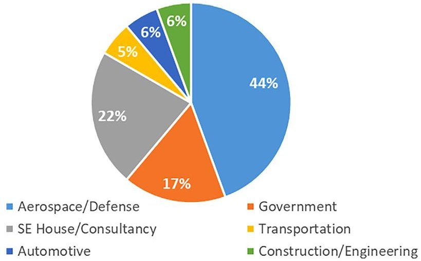
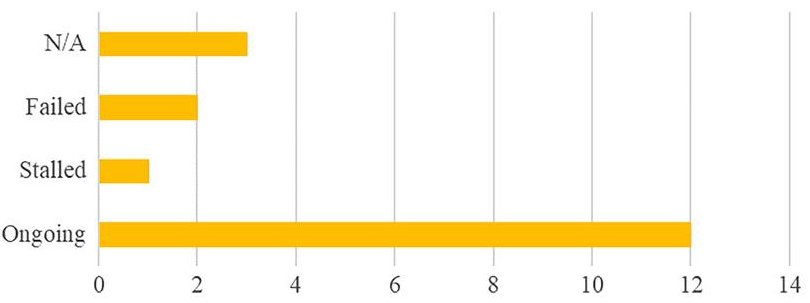
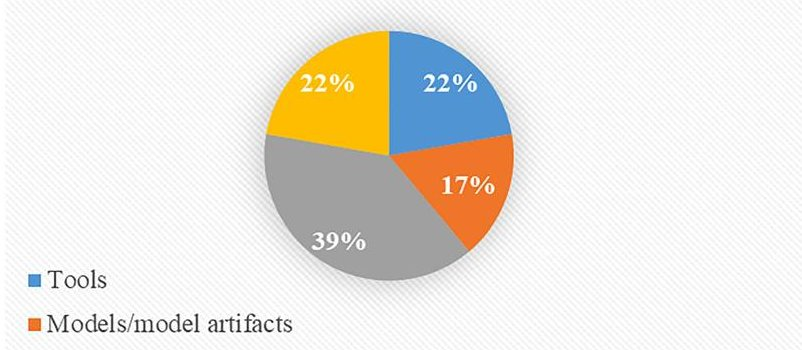
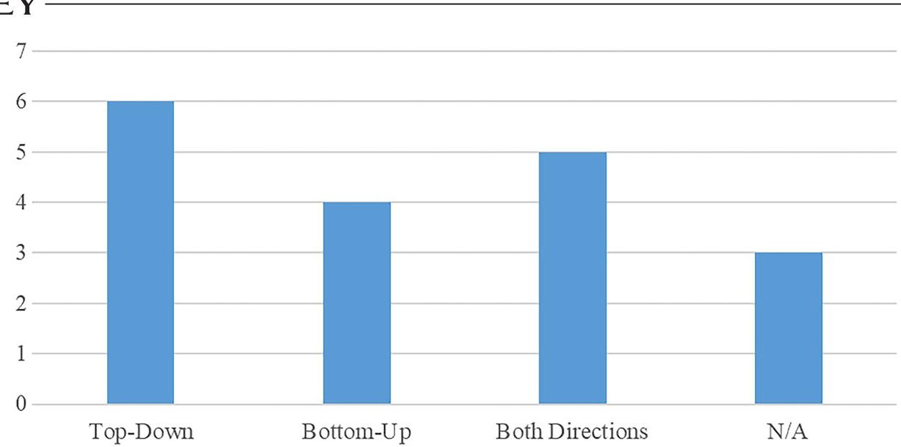
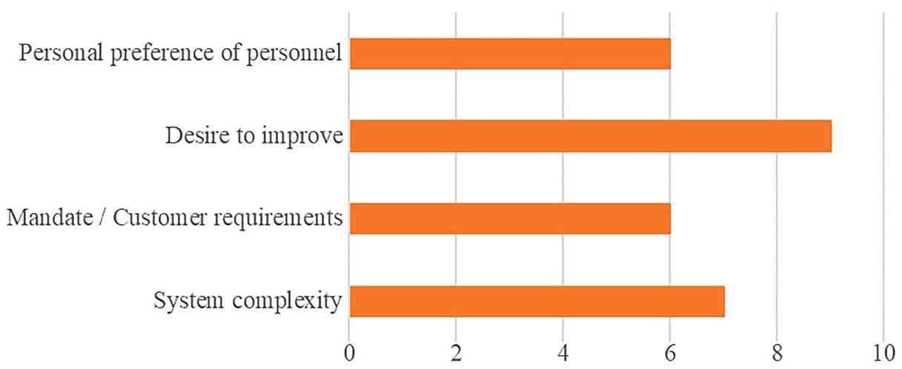

<!-- PDF_PAGE: 1 -->

# MBSE adoption experiences in organizations: Lessons learned

<table border="1"><tr><td>Item Type</td><td>Article; text</td></tr><tr><td>Authors</td><td>Henderson,K.;McDermott,T.;Salado,A.</td></tr><tr><td>Citation</td><td>HendersonK,McDermottT,SaladoA.MBSE adoption experiences in organizations:Lessons learned.Systems Engineering.2024;27:214-239.https://doi.org/10.1002/sys.21717</td></tr><tr><td>DOI</td><td>10.1002/sys.21717</td></tr><tr><td>Publisher</td><td>John Wiley and Sons Inc</td></tr><tr><td>Journal</td><td>Systems Engineering</td></tr><tr><td>Rights</td><td>©2023 The Authors.Systems Engineering published by Wiley Periodicals LLC.This is an open access article under the terms of the Creative Commons Attribution License.</td></tr><tr><td>Download date</td><td>08/09/2026 08:42:56</td></tr><tr><td>Item License</td><td>https://creativecommons.org/licenses/by/4.0/</td></tr><tr><td>Version</td><td>Final Published Version</td></tr><tr><td>Link to Item</td><td>http://hdl.handle.net/10150/674645</td></tr></table>

<!-- PDF_PAGE: 2 -->

## REGULAR ARTICLE

WILEY

# MBSE adoption experiences in organizations: Lessons learned

Kaitlin Henderson $ ^{1} $ Thomas McDermott $ ^{2} $ Alejandro Salado $ ^{3} $

$ ^{1} $Grado Department of Industrial and Systems Engineering, Virginia Tech, Blacksburg Virginia, USA

$ ^{2} $Systems Engineering Research Center, Stevens Institute of Technology, Hoboken, New Jersey, USA

$ ^{3} $Department of Systems and Industrial Engineering, The University of Arizona, Tucson, Arizona, USA

## Abstract

## Correspondence

Kaitlin Henderson, Grado Department of Industrial and Systems Engineering, Virginia Tech, Blacksburg, VA, USA. Email: karj1@vt.edu

Lessons learned through MBSE adoption efforts is one of the key ways of communicating best practices and recommendations for MBSE. This study compiles lessons learned from published case studies and practitioner interviews. Lessons are summarized into categories such as adoption strategy, modeling practices, and communication. This paper provides a source for future adopters of MBSE to review best practices and recommendations from a multitude of different experiences. This should improve the adoption and implementation of MBSE.

KEYWORDS MBSE, Digital Engineering, best practices, lessons learned, adoption

## 1 INTRODUCTION

Model-Based Systems Engineering (MBSE) is the result of the Systems Engineering (SE) practice shifting from a document-based to model-based paradigm as part of the larger Digital Engineering (DE) transformation happening in the industry. $ ^{1} $ MBSE is becoming more commonly practiced and is expected to eventually become the standard for SE. $ ^{2,3} $ However, MBSE adoption and implementation remain a widely reported problem in the industry. $ ^{4-7} $ There have been several examples in the literature of discussions of the lessons learned from an MBSE adoption experience, barriers to adoption, and recommendations for future adoption. Furthermore, because there is insufficient empirical evidence showing the value of MBSE, $ ^{8} $ lessons learned from those who have gone through the MBSE adoption process are often the main source showing the value of MBSE.

The purpose of this study is to consolidate the experiences expressed in the literature, combined with interviews of practitioners specifically addressing MBSE adoption, to provide a unified source of information on MBSE adoption. These experiences provide a more holistic view of the current state of MBSE adoption in organizations. The rest of the paper is organized as follows. Section 2 briefly discusses relevant prior research to this study. Section 3 presents the lessons learned derived from a literature review on MBSE adoption.

Section 4 discusses a set of interviews given by MBSE practitioners on MBSE adoption. Section 5 discusses the lessons learned from the literature review and interviews. Finally, Section 6 presents the conclusions garnered from this study.

## 2 BACKGROUND

This study builds on a line of research that has been conducted related to MBSE/DE adoption and value. The first relevant study is the MBSE Maturity Benchmark Survey. It was a joint effort between the International Council on Systems Engineering (INCOSE), the National Defense Industrial Association (NDIA), and the Systems Engineering Research Center (SERC). The purpose driving this study was to better understand MBSE use and expectations in industry. As such, this survey collected responses related to obstacles and enablers of MBSE adoption. Some of the top responses in this category are shown in Table 1.

Another related study conducted a literature review to determine how the value of MBSE was being presented in the existing body of literature at the time. $ ^{8} $ The study concluded that the majority of benefits claimed of MBSE in 360 literature sources were not supported by empirical evidence. A majority of the benefits were claimed based on the authors' expectations of what the benefit should be.

<!-- PDF_PAGE: 3 -->

TABLE 1 Top obstacles and enablers of MBSE adoption.

<table border="1"><tr><td>Leadership support/commitment</td><td>Training</td><td>Resources for MBSE implementation</td></tr><tr><td>Workforce knowledge/skills</td><td>Tools</td><td>Integration to support MBSE implementation</td></tr><tr><td>MBSE methods/processes</td><td>Demonstrated benefits/results</td><td>Awareness of MBSE benefits/value</td></tr><tr><td>Organizational culture</td><td>Change management process design</td><td>People willing to use MBSE tools</td></tr></table>

TABLE 2 Literature review paper classifications.

<table border="1"><tr><td>Paper classification</td><td>Number of papers</td></tr><tr><td>Case study experience(single)</td><td>29</td></tr><tr><td>Collective experiences from case studies</td><td>4</td></tr><tr><td>Survey</td><td>5</td></tr><tr><td>Interviews</td><td>4</td></tr><tr><td>Discussion</td><td>4</td></tr></table>

## 3 LITERATURE REVIEW

In order to establish a foundation that the interview results could be compared to, a literature review on MBSE adoption was conducted. This literature review specifically targeted "lessons learned" or "best practices" $ ^{*} $ from adopting MBSE. Wiley Online Library was used as the main source for the search. The search terms that were used were [MBSE OR "digital engineering"] AND ["lessons learned" OR "best practices"] . This resulted in 230 results from journals, books, and conference proceedings.

The 230 search results were read to determine if actual lessons learned were presented. $ ^{\dagger} $ A total of 46 papers were identified that discussed MBSE adoption lessons learned. The different classifications of those papers are shown in Table 2. The majority of the lessons learned come from single case study experiences, so the synthesis of those experiences should provide a more reliable narrative on MBSE adoption.

Each paper was evaluated for lessons learned, which were recorded in an Excel spreadsheet. Over 600 lessons learned were extracted from the literature sources. Once all of the papers had been evaluated, an inductive coding process revealed the various categories seen in Table 3. Table A1 in Appendix A includes examples of the literature lessons learned for each of the categories.

There are several limitations of relying on lessons learned for prescriptive recommendations for MBSE adoption. Some of the lessons are provided as prescriptive (cannot) instead of recommendation (should not), even though there may not be evidence provided for why it cannot be done. All lessons learned are presented in this paper as suggestive (e.g., should), although many originate as prescriptive statements (e.g., must) from the authors. This change has been implemented to take into account that many sources may not have adequate evidence to support definitive statements. Furthermore, many of the literature sources were categorized as experience from a case study, which are often self-reported. In these cases, especially since there is a

lack of metrics that can quantify what is a "good" or "bad" implementation of MBSE, it is possible that what is overall a poor implementation of MBSE could be documented as a "best practice." As the popular saying goes, correlation does not equal causation. These various factors are some of the reasons why we believe it is critical to establish metrics to evaluate MBSE. $ ^{63} $

It should be noted that many of the resulting "lessons learned" from this literature review are in line with existing knowledge found in change management literature. Factors such as organizational culture, organizational readiness for change, leadership support, organizational structure, and technical expertise have all been shown to have a statistically significant impact on the adoption of various technologies/processes. 66-77

## 4 INTERVIEWS

## 4.1 Method

Interviews were conducted by the first author as part of her dissertation work. The purpose behind the interviews was to capture a detailed look at the MBSE adoption process. Participants were recruited through a survey that was distributed over email and social media to different SE organizations/groups. Anyone who had been part of an organization that attempted to adopt MBSE was eligible to be included as a participant. The interviews were conducted and recorded over Zoom. Permission to record the interview was obtained verbally before the interviews began. Participants had the option to turn off their video if they did not want their face recorded. These recordings were then transcribed after the interviews are completed.

Participants were asked to generally recount their adoption experience and also asked to explain how their organization and project are structured and how MBSE performed in those settings. The semistructured interview format provided the opportunity for the interviewer to ask follow-up or clarifying questions based on the responses given. A pilot interview was conducted before participant interviews in order to refine the protocol. Table 4 shows the interview prompt questions that were used to guide the interview when needed. The first and last questions listed in the table were posed to every subject.

Since the only qualification for an interviewee to be included was experience trying to adopt MBSE, there is a similar limitation as to the self-reported case study examples discussed in Section 3. These interviews are also self-reported, so there was no "quality metric" for how well or poorly the organizational unit that the interviewee

<!-- PDF_PAGE: 4 -->

TABLE 3 Literature lessons learned categories.

<table border="1"><tr><td>Lessons learned categories</td><td>Number of lessons</td><td>Lessons learned categories (cont.)</td><td>Number of lessons (cont.)</td></tr><tr><td>Adoption strategy</td><td>33</td><td>Legacy systems</td><td>8</td></tr><tr><td>Authoritative data and models, Authoritative Sources of Truth(ASoT)</td><td>23</td><td>Maturity of MBSE</td><td>8</td></tr><tr><td>Automation</td><td>8</td><td>MBSE over the whole life cycle</td><td>3</td></tr><tr><td>Communication</td><td>44</td><td>Measurement/value</td><td>23</td></tr><tr><td>Complexity</td><td>11</td><td>Model analysis</td><td>7</td></tr><tr><td>Configuration management</td><td>6</td><td>Model definition/guidelines</td><td>43</td></tr><tr><td>Consistency of MBSE practices</td><td>26</td><td>Model reviews</td><td>8</td></tr><tr><td>Culture</td><td>16</td><td>Modeling practices</td><td>38</td></tr><tr><td>Data</td><td>15</td><td>Necessity of MBSE method</td><td>26</td></tr><tr><td>Dedicated modelers</td><td>6</td><td>Organizational design</td><td>16</td></tr><tr><td>Deliverables</td><td>4</td><td>Process changes</td><td>18</td></tr><tr><td>Diagram layouts</td><td>10</td><td>Provide examples</td><td>13</td></tr><tr><td>Domain/tool knowledge</td><td>14</td><td>Reusability</td><td>6</td></tr><tr><td>Importance of mentorship</td><td>13</td><td>Security</td><td>4</td></tr><tr><td>Importance of tool support</td><td>7</td><td>Skills/abilities</td><td>10</td></tr><tr><td>Importance of training</td><td>21</td><td>Stakeholder involvement</td><td>25</td></tr><tr><td>Infrastructure</td><td>8</td><td>Tools</td><td>41</td></tr><tr><td>Integration</td><td>25</td><td>Traceability</td><td>17</td></tr><tr><td>Knowledge capture/representation</td><td>7</td><td>Traditional SE artifacts</td><td>10</td></tr><tr><td>Leadership</td><td>17</td><td>Upfront investment</td><td>18</td></tr></table>

TABLE 4 Interview prompt questions.

<table border="1"><tr><td>How is MBSE defined or understood in your organization?</td></tr><tr><td>What Systems Engineering tasks do you use MBSE for?</td></tr><tr><td>What does your day-to-day use of MBSE look like?</td></tr><tr><td>Is MBSE used on all projects?</td></tr><tr><td>Does everyone in an MBSE project use MBSE?</td></tr><tr><td>Has there been any effort to standardize the use of MBSE across the organization?</td></tr><tr><td>How was the process of first adopting/learning MBSE?</td></tr><tr><td>Was there a defined plan/process to adopt/learn/teach MBSE?</td></tr><tr><td>How often does your organization adopt new technologies/methods?</td></tr><tr><td>How does your organization determine the success of an adoption effort?</td></tr><tr><td>Is there a future plan on how to adapt to new/improved MBSE tools/capabilities?</td></tr><tr><td>**If not adopted** At what point did you stop using MBSE?</td></tr><tr><td>**If not adopted** Is there a plan to implement or adopt anything in place of MBSE?</td></tr><tr><td>Is there anything else you want to tell me about your experience with adopting and using MBSE?</td></tr></table>

represents adopted MBSE. Once again, these are limitations we have to accept until more mature metrics are developed and employed in organizations.

Interviews were conducted April 2022 to June 2022 utilizing the video conferencing platform Zoom. The target length for each interview was 30 min, but several interviews were shorter or longer depending on the participant's availability. A total of 18 interviews were conducted, representing 18 different organizational units. The term "organizational unit" refers to the participant's department, division, or other suborganization they work most immediately with.

Interviews were recorded through the Zoom platform and were transcribed after they were completed. This resulted in a transcript of the conversation that took place over the interview. Responses were transferred to Microsoft Excel for processing. First, responses were separated into separate rows by each question. Then, within the response to a single question, the data were further separated so each row contained a unique idea/topic, as viewed by the researchers.

Separated responses were coded in four categories: content orientation, organizational structure variables, adoption components, and key themes. If one row had multiple codes it could represent for a single category, that response was divided so that each row was represented by one code per category. Content orientation refers to the nature

<!-- PDF_PAGE: 5 -->

TABLE 5 Key themes inductive codes.

<table border="1"><tr><td>Adoption difficulty</td><td>Management/leadership</td></tr><tr><td>Lack of understanding</td><td>Legacy programs/cost</td></tr><tr><td>Adoption activity</td><td>Tools</td></tr><tr><td>Knowledge retention/decision making</td><td>Culture/organizational change</td></tr><tr><td>Interconnectedness</td><td>Integration</td></tr><tr><td>Consistency/standardization</td><td>SE fundamentals</td></tr><tr><td>Customer requirements</td><td>Training</td></tr></table>

FIGURE 1 Industries of organizations from interviews.

of the response. The three possibilities for this category were: problems/challenges, reports of experience, and recommendations. So, if the response was discussing a challenge with adoption, that row would be coded as "Problems/challenges." The options for organizational structure variables were seven identified characteristics of organizational structure discussed in Section 3, or "None." The options for the adoption components category included: training/resources, reception, process changes, maturity of MBSE, use of MBSE, and influence on organizational outcomes. The final category was the key theme of the quote. This was coded using two schemas. One was created inductively as responses were being processed. The codes that emerged from this method are shown in Table 5.

## 4.2 Results

Certain demographical information was extracted from the interview transcripts. Figure 1 shows the different industries that the organizations represented by the interviews are a part of. Nearly half of the organizational units were in the Aerospace/Defense industry, which is a typical distribution in SE practice.

The second highest category was SE House/Consultancy, which included companies that do SE consulting as well as provide MBSE tools and services. These organizations often help other organizations adopt MBSE, which provided another perspective on MBSE adoption. Because these are SE organizations, they typically have already

FIGURE 2 Adoption status of organizations from interviews.

Method to enact the systems engineering process

Did not clearly indicate how MBSE was defined in their organization

FIGURE 3 Interview organizations understanding of MBSE MBSE, model-based Systems Engineering.

adopted and are using MBSE. In Figure 2, which shows the adoption statuses of the different organizations, these SE organizations are represented by the "N/A" category. Two of the organizations had attempted to adopt MBSE and were unsuccessful. Another organization had started the adoption process but is currently at a stand-still. The rest of the organizations were in various stages of the adoption process.

Every interview began with the same question: "How is MBSE defined or understood in your organization?" Figure 3 shows the differing views of MBSE among the organizations. In some organizations, MBSE is defined in terms of the tools. According to one participant, "Most people think of MBSE as being synonymous with a specific tool... Most don't understand how MBSE fits into DE or what it really does other than it is modeling instead of documents." $ ^{16} $ Others define MBSE in terms of the models or model artifacts. These participants tended to focus on modeling or diagrams in the description of their adoption efforts. About 22% of the participants were not able to convey a clear definition for MBSE, whether this was because the organization did not have a common understanding, or the participant did not actually define MBSE in response to this question. The remaining organizations had an understanding of MBSE similar to how it is defined in this paper: as a method and a process. As one participant said, "The way I describe MBSE to the folks that I teach and work with is MBSE is the effective use of models to support systems engineering... It's the effective use of models to support your SE process. Get your process right first, then we'll talk about models, then we'll talk about tools." $ ^{9} $

One of the defining characteristics of an MBSE adoption effort is where the effort originated from. Figure 4 shows the distribution

<!-- PDF_PAGE: 6 -->

FIGURE 4 Direction of MBSE adoption from interviews. MBSE, model-based Systems Engineering.

FIGURE 5 Key reasons behind the initiative to adopt MBSE from interviews. MBSE, model-based Systems Engineering.

of adoption directions in the organizations. "Top-Down" refers to an adoption effort that originated from upper levels of leadership or management. These efforts were often due to someone at the executive level supporting the adoption of MBSE. Another source of the Top-Down effort was some type of mandate or policy at a high level especially for organizations who work with the government. "Bottom-Up" refers to an adoption effort that originated from the engineers and other technical personnel. In these cases, people often started using MBSE because they wanted to or saw the potential value, and then had to push the effort up the hierarchy. This typically involved having to convince management of the value of MBSE, which is a difficult task. In some organizations, the adoption effort came from "Both Directions." In these organizations, not only were engineers and others organically using MBSE because they wanted to, but there was some direction from management also pushing for adoption.

Figure 5 shows a summary of key factors that were catalysts behind the decision to adopt MBSE. There are some similarities between the "Adoption Direction" categories from Figure 4 and several influencing factors. "Personal preference of personnel" is in line with the Bottom-Up organizations, while Mandate/Customer requirements overlaps

with the Top-Down direction. The other two key factors are related to the potential capabilities MBSE could provide. Project or system complexity was a frequently cited reason for looking to MBSE. This differs from the final category "desire to improve" in the mindset of the organizations. Having a desire to improve the organization through MBSE has a more positive point of view. Whereas system complexity is a problem, and the organization is hoping that MBSE can be the solution. In other words, one is motivated by the presence of negative factors, and the other is motivated by the potential of positive factors.

## 5 DISCUSSION

Table 6 shows the different categorizations used throughout this study (from Tables 1,3, and 5) synthesized to factors that fall into three different classifications: organizational design, organizational enablers/barriers, and organizational change management. These classifications/factors will structure the discussion of lessons learned gleaned from this study.

<!-- PDF_PAGE: 7 -->

TABLE 6 MBSE adoption "lessons learned" categories.

<table border="1"><tr><td>Classification</td><td>Factor</td><td>Lit review categories</td><td>Interview key themes</td></tr><tr><td rowspan="6">Organizational design</td><td>Workforce knowledge/skills</td><td>-Skills/abilities
-Domain/tool knowledge</td><td>-Lack of understanding
-SE fundamentals</td></tr><tr><td>Integration</td><td>-Integration</td><td>-Integration</td></tr><tr><td>Demonstrated benefits/results</td><td>-Measurement/value
-Authoritative Sources of Truth(ASoT)
-Automation
-Communication
-Complexity
-Knowledge capture/representation
-Reusability
-Traceability</td><td>-Knowledge retention/decision making
-Interconnectedness</td></tr><tr><td>Organizational structure</td><td>-Organizational design
-Dedicated modelers</td><td></td></tr><tr><td>Leadership/management support/commitment</td><td>-Leadership</td><td>-Management/leadership</td></tr><tr><td>Training</td><td>-Importance of training
-Importance of mentorship</td><td>-Training</td></tr><tr><td rowspan="4">Organizational enablers/barriers</td><td>Resources for implementation</td><td>-Legacy systems
-Upfront investment</td><td>-Legacy programs/cost</td></tr><tr><td>Tool infrastructure</td><td>-Tools
-Importance of tool support
-Configuration management
-Security
-Data</td><td>-Tools</td></tr><tr><td>Application of MBSE methods/processes and modeling practices</td><td>-Maturity of MBSE
-MBSE over the whole lifecycle
-Necessity of MBSE method
-Model analysis
-Model definition/guidelines
-Model reviews
-Modeling practices
-Diagram layouts</td><td></td></tr><tr><td>Adoption/implementation strategy and design</td><td>-Adoption strategy
-Provide examples
-Traditional SE artifacts
-Process changes
-Consistency of MBSE practices</td><td>-Adoption activity
-Adoption difficulty
-Consistency/standardization</td></tr><tr><td rowspan="2"></td><td>Culture change management</td><td>-Culture</td><td>-Culture/organizational change</td></tr><tr><td>Willingness to use tools (employee and stakeholder buy-in)</td><td>-Stakeholder involvement
-Deliverables</td><td>-Customer requirements</td></tr></table>

## 5.1 Organizational design

## 5.1.1 Workforce knowledge/skills

Interview participants expressed there being a lack of knowledge/confusion related to MBSE/SE. 6,9,10,29,37,40-43,58 Stakeholders also need to have a level of familiarity with the tools. 36,40,41 As one participant noted: "if they aren't familiar with MBSE, they're not going to use it". 29 However, there is still an associated learning curve/ difficulty in learning MBSE. 9,37,41,43,58 Stakeholders need training at different levels based on their role. 3,5,37,43

## 5.1.2 Integration

One of the critical MBSE adoption issues revealed in the interviews was the concept of integration. Integration ideally occurs at both the organizational level and the technical level. The technical level refers to the fact that tools, models, and/or data repositories need to be linked together in some way. This is how an authoritative source of truth is established. Some tools have to integrate with others by virtue of their functionality. One participant discussed an architecture tool which "has to be able to integrate with other tools" $ ^{55} $ because it cannot do everything, such as requirements management. Some organizations also want to

<!-- PDF_PAGE: 8 -->

accommodate engineers from "classically trained disciplines" $ ^{40} $ that have their own tools they prefer to use, so there needs to be a way to transfer the data between those tools. Another occasion for integration is if many systems are spread out over different companies/locations. In this case, the different companies/locations each create a part of a system that has to integrate together for the final product. One participant described the different scenarios where this type of integration can currently be achieved:

"We haven't found a solution for exchanging architecture models digitally, which is an important part of MBSE. My assumption is all my suppliers are going to use their own tool- they all have their favorite brand. But at the end I need to have an integrated model or the product will be a failure... There are two scenarios we can try to implement. One is direct communication of our models. So you take my model, I'll take yours and we're going to use it out of the box. So... in order to do direct communication, I am going to stamp my feet and say 'we're all going to use one brand' everyone has to switch to that brand. Or we're going to use a 3rd party translator. I'm going to pay a 3rd party to translate their model into my tool and vice versa. The other scenario [indirect communication] is we're going to put our models in a third-party tool and they're going to be magically combined into one model. So instead of us having our own model, we will use a tool to build a single model."10

Integration also should occur at the organizational level, because "a lot of different functional areas need to come together for MBSE." Especially in the context of DE, because it "affects every aspect of the busines." $ ^{40} $ The way many organizations are structured, this often means that different departments or teams are going to have to work together. One participant's organization specifically had difficulty adopting MBSE because they could not get the IT department "to do five minutes of work for three to four months." $ ^{31\§} $ Another participant discussed the difficulty of getting collaboration across the organization:

"The other area that still frustrates me... is getting that collaboration across the organization. You can't think of MBSE as just what the systems engineers do, because it's Systems Engineering, as a good systems engineer you need to appreciate things like electrical, mechanical, environmental, economics. So, using models allows you to bring all of that together into a source of truth."41

Even when an organization has been instructed by upper management to integrate across different disciplines, it can still be a challenge. According to a participant, "we are getting commands from the top-down to try to get the other teams integrated, but they're having the problem of it's

not as important to do as other things, investing time into the model is not as important as other issues."43

## 5.1.3 Demonstrated benefits/results

Interview participants indicated that there is still a big question of what the value of MBSE is. $ ^{3,10,16,30,31,37,43} $ As with the literature examples, $ ^{26} $ the "crispness and precision" of MBSE in uncovering errors makes it difficult to prove ROI. $ ^{14} $ Metrics is an area that many are trying to address to try and empirically show value, but is difficult in practice. $ ^{3,9,36,37,40,55} $ The impact on decision-making is a key way to show the value of MBSE. $ ^{16,40} $ As one participant reported: "The only way to really evaluate and measure effectiveness is how well the program succeeded, how much better can you make decisions, and are those decisions supportable and justifiable". $ ^{9} $

## 5.1.4 Organizational structure

SE as a discipline is involved throughout the lifecycle of a project and thus should involve communicating with multiple subunits. A high level of communication is necessary within the SE group, and between related functions for a given project. $ ^{21,22} $ So in order to gain all the advantages MBSE has to offer, the organizational form has to be adjusted. $ ^{23} $ According to Kellner et al., $ ^{23} $ "walls and borders" between different subunits need to be broken up to create a cohesive team where all disciplines are involved from the start of a project. This reduces misunderstandings and the rework that comes from those mistakes.

A case study discussing the implementation of MBSE in an organization discussed the creation of a liaison role as a coordinating mechanism. This position, referred to as business system manager, formed the bridge between the engineering division and IT division. $ ^{24} $ This new role assisted in the successful adoption and implementation of MBSE through addressing the lacking communication structures between subunits on the project. One of the interview participants discussed the difficulty coordinating between the systems engineers and the IT department. The lack of coordination with IT was one of the contributing factors to the adoption effort failing.

A frequent recommendation in the literature was to establish a Core MBSE team, $ ^{4,23} $ dedicated modeling teams, $ ^{18,25} $ communities of practice, $ ^{4} $ or more formal teams that provide guidance, training, and technical support. $ ^{1} $ A common adoption activity amongst the interview participants was establishing a Core MBSE team. These Core MBSE teams took the form of all of the examples from literature listed above. However, it is still important to make sure the modeling team is well-integrated, and knowledgeable of the system they are modeling. Additionally, a modeling team would need to be communicating insights gained during modeling activities, which can provide significant value in the system development.

<!-- PDF_PAGE: 9 -->

## 5.2 Organizational enablers/barriers

## 5.2.1 Leadership/management support/commitment

Interview participants indicated that management and leadership buy-in and support is a critical factor to MBSE adoption. 6,10,14,16 29-31,36,37,40,41,43,58 For both organizations that were not able to successfully adopt MBSE, the driving barrier was a lack of management support. But when there is management support, the adoption effort is vastly improved. One participant discussed the efforts their organization's corporate management took to support MBSE adoption. Because of the contributions of corporate management, "there is a complete system put together on how to execute the [adoption] strategy at a high level, [and] there have been a lot of activities going on." 37 Oftentimes, the positive accounts of leadership support from the interviews involved leadership that had an understanding of what MBSE/DE is and the value it can provide. 6,10,37,40,41,43,58

Several participants noted specifically having problems with middle management. One participant recounted their organization's experience: "we're trying to convince our managers and follow through on it, since the executives have said they want it. But middle managers can ignore that because it doesn't impact their day-to-day." $ ^{41} $ Efforts to convince this level of middle management were often unsuccessful. It was "through the natural progression of people retiring, moving on, or moving sideways $ ^{41} $ that the void of middle management began to disappear.

## 5.2.2 Training

Regardless of the adoption strategy, the participants agree that training is a crucial part of the adoption process. Authors of previous works also argued that all stakeholders involved should have some level of training in the MBSE tools and methods as well as the selected modeling language. $ ^{1,18-20} $ Over half of the interview participants specifically mentioned the importance of training. According to the participants, there are four categories of people who need to be trained to various levels (see Table 7). The first group of people are the Model Reviewers. These are leaders, stakeholders, or customers who need to know how to use the models to make decisions. The second group is the Developers, or the Modelers. These are the people who are building and maintaining the models in the tools, so they will likely need detailed knowledge of how the tool works. The third group is the Architects. These are the people who will be working on the model to some extent. These people are often senior engineers or people from other disciplines who are helping with the content of the model. This group does not necessarily need as deep of training as the modelers, but they should be able to operate in the models. The last group is the Administrators. These are people who work in IT or software who will be managing the relevant accounts, licenses, tools, and so forth. According to a participant, "They don't need to know how to use the tool in a hands-on way, but they need to know the limitations and all of the details of the tool." $ ^{37} $ Forgetting to train this group is a common problem, and according to one participant, it could be "part of the reason [organizations] aren't seeing value" from the MBSE implementation.

TABLE7 Categories of people that need MBSE training.

<table border="1"><tr><td>Model reviewers</td><td>“The leaders and decision makers are the ones who should day‘I need a model that tells me this information,’ so[should] teach them how to do that.Digital Engineering fundamentals, reviewing digital artifacts,and some tool courses[9].”</td></tr><tr><td>Developers</td><td>“These are the people who are going to be modeling in the tool.So,these people[should]know the tool mechanics,and also the why/how of MBSE[41].”</td></tr><tr><td>Architects</td><td>“Engineers who have knowledge of the system who are the people who you would actually want to lay out the architecture in the model[47].”</td></tr><tr><td>Administrators</td><td>“If you hand out the specifications in a new way or a new language,are we absolutely prepared as a downstream engineering within the software community...they[should]understand how to deal with a large amount of inputs coming in related to MBSE[41].”</td></tr></table>

Several participants point out that training that is too generic may not be actually useful. As one participant noted, a basic training class that says "let's build a flashlight" will not be helpful when the product is as complicated as a helicopter or a missile. $ ^{5} $ One participant discussed how their training approach takes this into account. According to the participant, "If there is a project in need they come to me, or my team, and ask for training for onboarding. Then we define the scope: what do they want to model, which outcome? Then we align on the first steps and provide relevant training for the process and the tool. So, the outcome can be used in a real development." $ ^{36} $

## 5.2.3 Resources for implementation

One fact commonly noted by the interview participants $ ^{3,9,14,16} $ 30,36,37,40,43 as well as the literature sources $ ^{4,6,17,29,40} $ is the large cost that comes with adopting MBSE, especially with respect to the tools. Not only are the tools expensive, but they require time to get approval, install, establish infrastructure, and ensure that the tools are secure. $ ^{3,10,31} $ One interview participant noted that their organization's machines do not have the capability to support using an MBSE tool, which is an additional resource consideration. Another interview participant remarked that these software administrative "background" costs are often not budgeted. $ ^{9} $

One further resource that needs to be implemented is training, both in terms of time users need to spend taking the training as well as the cost of the training itself. $ ^{37} $ It also requires a substantial effort upfront to set up a model-based environment. $ ^{36,43} $ If there is not sufficient cost/resources allocated to allow the necessary MBSE efforts, many people will prioritize their "actual" project work, neglecting modeling

<!-- PDF_PAGE: 10 -->

and other MBSE activities. $ ^{37,43} $ As one participant put it, "when you get the project rush the model is not really the priority, so the model ends up being not useful because it is not really reflecting the system". $ ^{55} $

## 5.2.4 Tool infrastructure

As one interview participant noted, "tools and methodologies are always changing". $ ^{41} $ Often multiple languages and/or multiple tools are used in an organization, $ ^{3} $ because none of the tools "do it all". $ ^{10} $ The interview participants report various capabilities that the tools do not provide or are not mature. $ ^{10,14,29,37,55} $ SysML itself is also hard to understand and cumbersome to use. $ ^{6,40,41} $ The right equipment is necessary to be able to open/run a model. $ ^{5,31} $ As in the literature examples, $ ^{27,28} $ open standards are reported to be important for integration purposes. $ ^{10,40,55} $ Tools are often the sole focus of an MBSE adoption effort, $ ^{9,31,42,58} $ which speaks to the lack of understanding of MBSE conceptually.

## 5.3 Organizational change management

## 5.3.1 Application of MBSE methods/processes and modeling practices

Many literature sources discussed the importance of having an established, and documented methodology for MBSE. $ ^{4,17,27,36,51,52,57,61} $ This is a fact that interview participants agreed with. $ ^{10,14,16,55} $ One participant particularly noted that "the lack of off the shelf methodologies" is a substantial barrier to MBSE adoption. $ ^{14} $ A benefit of having a method/process that is followed is it can make integration between different modelers, organizations, and/or tools easier. $ ^{5,10} $

Specific modeling recommendations were frequently mentioned as lessons learned in the literature sources (see Appendix B).

## 5.3.2 Adoption/implementation strategy and design

There were differing opinions among the interview participants on the adoption strategy that should be taken for MBSE. Some participants believed that "MBSE only works if you go all or nothing." $ ^{43} $ According to one participant: "You have to make a clean cut for MBSE. You have to build it up, consolidate the data, ensure that the models are built right with the right information. We cannot just dump everything in there and recreate a mess." $ ^{36} $ On the other hand, some advised starting small with MBSE adoption. These participants suggested to "find out where that organization's needs are and tailor your MBSE delivery to that particular aspect." $ ^{31} $ Certain programs should be selected to adopt MBSE "based upon the monetary value, the probability of success, and the mustwin aspect. $ ^{37} $ As one participant recommended, "Start with one project, identify what SE concerns you want to improve with MBSE, [and] focus modeling activities on only this concern. Then you learn and grow from that." $ ^{55} $

This division is echoed in the literature, with various authors arguing for an either incremental adoption approach or a wholesale adoption approach. $ ^{4,11,12,14} $

Different perspectives on adoption strategy were also reflected in the literature. For the adoption of SE, Bretz et al. $ ^{13} $ stated that SE should be introduced simultaneously across an organization. If SE is introduced from one department, there is a risk of not considering all stakeholder's needs and missing support from other departments. $ ^{13} $ MBSE adoption literature also considers different approaches: off-cycle or on-cycle. $ ^{4} $ The off-cycle approach occurs "in a sandbox environment," and is considered ideal but expensive. The on-cycle approach is when MBSE is implemented on productive projects and is much more challenging, since the adoption needs to occur while normal project activities are also occurring.

Another common adoption activity amongst the participants was establishing a Core MBSE team. Some of these Core MBSE teams were created to embed a common way of working across the organization. One participant described their MBSE team that has personnel based out of the different sites in the organization. According to them, "it is kind of putting the tendrils out in those different areas and [promote] a common way of working instead of an ad hoc type of modeling approach." $ ^{14} $ Other organizations established Core MBSE teams as a place to go for help and to share ideas. These teams were often categorized as communities of practice or working groups. According to one participant, the purpose of their organization's MBSE team is "to form a center of excellence where you can help people in need and coordinate ideas." $ ^{16} $ Another participant described the informal network across the organization that was established through a core MBSE team. According to that participant, "if I have a question or am struggling, I tend to be able to know who has done this in the past with the help of the communities, various forums, [and] meetings." $ ^{41} $

Two-thirds of the interview participants report having a standardization group/framework. $ ^{3,5,10,14,30,36,37,40-43,58} $ However, standardization can be slow/difficult. $ ^{9,14,16,29} $ Consistency/standards are necessary for organizations that are spread out into different units, $ ^{9,10,14,29,36,41} $ which is especially relevant for interfaces where integration is required. $ ^{40} $ An organization where subunits all "d[o] things their own way" can result in missed opportunities/capabilities. $ ^{9} $

## 5.3.3 Culture change management

Cultural and organizational challenges were frequently cited by the participants. Authors from literature sources also acknowledge the major culture shift that MBSE requires. $ ^{4,15-17} $ Several participants found a cultural resistance to adopting MBSE. $ ^{5,9,14,16,29,40,42,58} $ As one participant noted, "MBSE requires a mindset change," $ ^{5} $ and that was often difficult to achieve. In one organization, leadership was particularly concerned about the cultural changes necessary. According to the participant, "new people [often] expect everything to already be in a digital realm, and the generation that is phasing out" typically believes they can still use slide rules to do their engineering. $ ^{16} $ One participant disclosed that "there's very little resistance from our direct customers, now

<!-- PDF_PAGE: 11 -->

they have resistance from their customers sometimes that we have to deal with." $ ^{6} $ However, there were also reports of people being "onboard" for MBSE, $ ^{6,43} $ particularly the "new generation" of engineers. $ ^{14,16} $

Organizational factors were another common issue for adoption. According to one participant, "it's not about the technical problem of introducing MBSE, it's about company change." $ ^{36} $ "Organizational change management $ ^{40} $ is a critical component of the adoption process. Several participants noted that it was difficult to get something standardized or consistently applied across their organizations due to their fragmented structures. Without consistent oversight, learning MBSE was not always prioritized in organizations by teams who wanted to focus on their typical work. One participant noted that people create issues "due to a lack of holistic systems thinking." $ ^{37} $ Teams prioritize their other tasks over learning MBSE, and especially when project costs are considered, "the model building work is going to be the first thing that is going to go." $ ^{43} $

## 5.3.4 Willingness to use tools

Several of the previously discussed factors contribute to a person's willingness to use MBSE and its tools. Resistance to change (cultural change management) has to be overcome to start. A common complaint that is reported comes from people who do not want to learn a new way of doing something because it is not the way they have always operated. 5,9,16,40,58 Another factor is having adequate training to promote the necessary knowledge/skills needed to actually use the tools. 5,9,29,37,42,58

Another perspective of MBSE users involves stakeholders aside from those doing the actual modeling. For a model to be truly representative of a system, all relevant stakeholders need to be involved in the model creation process. Several literature sources found that the more that stakeholders were exposed to the model, the more benefits they saw, leading to them buying-in to MBSE as a concept. $ ^{6,32,34} $

## 6 CONCLUSIONS

The observations from literature and the interview experiences can be summarized into four classifications: organizational design, organization enablers/barriers, organizational change management, and organizational experience. Table 8 shows some of the most prominent factors compiled from this research organized into those three categories. Appendix B shows specific lessons learned from literature applied to each of these categories.

Based on reports from the literature and the practitioner interviews given in this study, there is likely still a lack of understanding or confusion about what MBSE is. This is reflected in the difficulties reported by those that have tried to adopt MBSE. The lessons learned presented in this study are a consolidation of many different organizations' experiences with MBSE. Since the measurement of empirical metrics is still an area that needs development, the information gleaned from these experiences is the main source of data we have about MBSE adopt-

TABLE 8 Categories of lessons learned identified in this research.

<table border="1"><tr><td>Organizational design</td><td>Organizational enablers/barriers</td><td>Organizational change management</td></tr><tr><td>Workforce knowledge/skills</td><td>Leadership/management support/commitment</td><td>Application of MBSE methods/processes and modeling practices</td></tr><tr><td>Integration</td><td>Training</td><td>Adoption/implementation strategy and design</td></tr><tr><td>Demonstrated benefits/results</td><td>Resources for implementation</td><td>Culture change management</td></tr><tr><td>Organizational structure</td><td>Tool infrastructure</td><td>Willingness to use tools(employee and stakeholder buy-in)</td></tr></table>

tion and implementation. Future work needs to continue to develop measurement frameworks and empirical metrics in order to provide more substantiated evidence to convince those in industry to adopt MBSE/DE.

The data obtained through these MBSE adoption interviews are consistent with not only the literature lessons, but other previous studies such as the MBSE maturity survey as well. The consistency of these important adoption categories across different studies and samples provides validation that these topics are important to MBSE adoption. However, future work should explore more organizations that are currently employing MBSE and DE in an exemplary way in order to support the generality of the findings in this paper.

Many of the factors found from this research are also consistent with findings well established from change management. For example, leadership commitment to change, communicating the value of the change, and dedicating resources to support the change effort are all factors that have been shown to assist organizational change management, $ ^{64} $ all of which were also "lessons learned" for MBSE adoption from the sources discussed in this paper. This further illustrates the importance of gathering empirical evidence regarding MBSE adoption. Through the development of metrics specifically targeted at MBSE, we can further isolate aspects of MBSE adoption that are worth cementing as best practices.

## DATA AVAILABILITY STATEMENT

Data are available on request due to privacy/ethical restrictions.

## ORCID

Kaitlin Henderson https://orcid.org/0000-0002-7860-2103 Alejandro Salado https://orcid.org/0000-0001-9378-0795

## ENDNOTES

* For the rest of this paper, "lessons learned" will refer to both lessons learned and best practices.

$ ^{\dagger} $ Even though all of the results had the term "lessons learned" or "best practices," they did not all convey actual lessons learned. For example, often

<!-- PDF_PAGE: 12 -->

authors referenced the fact that "MBSE best practices" were used without stating what those practices were.

$ ^{ \ddagger} $Direct quotations from interviews are italicized with the ID number related to the participant in brackets [example] at the end of the quote.

$ ^{\S} $Resources for MBSE implementation.

## REFERENCES

1. Papke BL, Wang G, Kratzke R, Schreiber C. Implementing MBSE--an enterprise approach to an enterprise problem. Paper presented at: INCOSE International Symposium. 2020.

2. Friedenthal S, Moore A, Steiner R. A Practical Guide to SysML: the Systems Modeling Language. Morgan Kaufmann; 2014.

3. Ramos AL, Ferreira JV, Barcelo J. Model-based systems engineering: an emerging approach for modern systems. IEEE Trans Syst Man Cybern. 2011;42(1):101-111.

4. Chami M, Aleksandraviciene A, Morkevicius A, Bruel JM. Towards solving MBSE adoption challenges: the D3 MBSE adoption toolbox. Paper presented at: INCOSE International Symposium. 2018.

5. Broodney H, Dotan D, Greenberg L, Masin M. 1.6.2 Generic approach for systems design optimization in MBSE1. Paper presented at: INCOSE International Symposium. 2012.

6. Wang L, Izygon M, Okon S, Wagner H, Garner L. Effort to accelerate MBSE adoption and usage at JSC. In: AIAA SPACE 2016. 2016:5542.

7. Weilkiens T, Scheithauer A, Di Maio M, Klusmann N. Evaluating and comparing MBSE methodologies for practitioners. Paper presented at: 2016 IEEE International Symposium on Systems Engineering (ISSE) 2016.

8. Henderson K, Salado A. Value and benefits of model-based systems engineering (MBSE): evidence from the literature. Syst Eng. 2021;24(1):51-66.

9. McDermott T, Hutchison N, Clifford M, Van Aken E, Salado A, Henderson K. Benchmarking the Benefits and Current Maturity of ModelBased Systems Engineering across the Enterprise. SERC-2020-SR-001. Systems Engineering Research Center; 2020.

10. Groth L. Future ORGANIZATIONAL Design: the Scope for the IT-based Enterprise. John Wiley & Sons Ltd.; 1999.

11. Julian B, Noble J, Anslow C. Agile practices in practice: towards a theory of agile adoption and process evolution. Paper presented at: International Conference on Agile Software Development. 2019.

12. Mahanti A. Challenges in enterprise adoption of agile methods--a survey. J. Comput. Inf. Technol. 2006;14(3):197-206.

13. Bretz L, Kaiser L, Dumitrescu R. An analysis of barriers for the introduction of systems engineering. Procedia CIRP. 2019;84:783-789.

14. Qumer A, Henderson-Sellers B. A framework to support the evaluation, adoption and improvement of agile methods in practice. J Syst Softw. 2008;81(11):1899-1919.

15. Friedenthal S. SysML: lessons from early applications and future directions. Insight. 2009;12(4):10-12.

16. Madni AM, Sievers M. Model-based systems engineering: Motivation, current status, and research opportunities. Syst Eng. 2018;21(3):172- 190.

17. Cloutier R. Current modeling trends in systems engineering. Insight. 2015;18(2):10-13.

18. Bayer T, Chung S, Cole B, et al. 11.5.1 Early formulation model-centric engineering on NASA's Europa mission concept study. Paper presented at: INCOSE International Symposium. 2012.

19. Gräßler I, Wiechel D, Pottebaum J. Role model of model-based systems engineering application. Paper presented at: IOP Conference Series: Materials Science and Engineering. 2021.

20. Piggott S, Melanson P, Hartman L, Adourian C. 7.2.2 Advancing modelbased systems engineering at a small space agency. Paper presented at: Eighteenth Annual International Symposium of the International Council on Systems Engineering (INCOSE), 15-18 June 2008. 2008.

21. Blanchard BS, Blyer JE. Organization for system engineering. In: System Engineering Management. Wiley; 2016:372-425.

22. Conroy M, Mazzone R, Lin W. NASA Integrated Model-Centric Architecture (NIMA) model use and re-use. Paper presented at: 2013 IEEE Aerospace Conference. 2013.

23. Kellner A, Ringhofer S, Hehenberger P, Weingartner L, Friedl M. The impact on organizational structures of model-based mechatronic system design. Proc Technol. 2016;26:333-340.

24. Friedland B, Malone R, Herrold J. Systems engineering a model based systems engineering tool suite: the Boeing approach. Paper presented at: INCOSE International Symposium. 2016.

25. Simpson KA, Sindiy OV, McVittie TI. Orion flight test 1 architecture observed benefits of a model based engineering approach. Paper presented at: 2012 IEEE Aerospace Conference. 2012.

26. Noguchi RA. Recommended best practices based on MBSE pilot projects. INCOSE Int Symp. 2019;29(1):753-770.

27. Amorim T, Vogelsang A, Pudlitz F, Gersing P, Philipps J. Strategies and best practices for model-based systems engineering adoption in embedded systems industry. Paper presented at: 2019 IEEE/ACM 41st International Conference on Software Engineering: Software Engineering in Practice (ICSE-SEIP). 2019.

28. Smith T, Payne C, Shackleton J. Constructing an authoritative source of truth in a changing information landscape. INSIGHT. 2022;25(1):29-33.

29. Chami M, Bruel J-M. A survey on MBSE adoption challenges. In: The Systems Engineering Conference of the Europe, Middle-East and Africa (EMEA) Sector of INCOSE (EMEASEC 2018). 2018.

30. Parrott E. The value of successful MBSE adoption. No Magic World Symposium 2016. No. GRC-E-DAA-TN32000. 2016.

31. Hause M. 2.1.2 The UPDM RFC Development Project An Exercise in Model-Based Virtual Team Development or "Practicing What We Preach". Paper presented at: INCOSE International Symposium. 2010.

32. Blackburn MR, McDermott T, Kruse B, Dzielski J, Hagedorn T. Digital engineering measures correlated to digital engineering lessons learned from systems engineering transformation pilot. INSIGHT. 2022;25(1):61-64.

33. Andersson H, Herzog E, Johansson G, Johansson O. Experience from introducing unified modeling language/systems modeling language at Saab Aerosystems. Syst Eng. 2010;13(4):369-380.

34. Bonnet S, Voirin JL, Normand V, Exertier D. Implementing the mbse cultural change: organization, coaching and lessons learned. Paper presented at: INCOSE International Symposium. 2015.

35. ANDERSSON J, HULDT T. Model-based technical planning: an evaluation of description techniques. Paper presented at: Systems Research Forum. 2009.

36. Booth ST. 4.2.3 network centric architectures: are we up to the task? Paper presented at: INCOSE International Symposium. 2005.

37. Pihera LD, Ender T, Taylor B, et al. 4.2.2 Application of systems engineering to improve extracorporeal membrane oxygenation (ECMO) therapy. Paper presented at: INCOSE International Symposium. 2012.

38. Roodt D, Nadeem M, Vu LT. Model-based systems engineering for complex rail transport systems--a case study. Paper presented at: INCOSE International Symposium. 2020.

39. Do Q, Hartigan D. An MBSE methodology for capability systems definition. Paper presented at: INCOSE International Symposium. 2017.

40. Suryadevara J, Tiwari S. Adopting MBSE in construction equipment industry: an experience report. Paper presented at: 2018 25th Asia-Pacific Software Engineering Conference (APSEC). 2018.

41. Gregory J, Berthoud L, Tryfonas T, Rossignol A, Faure L. The long and winding road: MBSE adoption for functional avionics of spacecraft. J Syst Softw. 2020;160:110453.

42. Foster M. Developing a heavy lift launch vehicle systems architecture using a model based systems engineering approach. Paper presented at: AIAA SPACE 2011 Conference & Exposition. 2011.

<!-- PDF_PAGE: 13 -->

43. Herzog E, Hallonquist J, Naeser J. 4.5.1 Systems modeling with SysML--an experience report. Paper presented at: INCOSE International Symposium. 2012.

44. Weiland KJ, Knizhnik JR. Design thinking, lean startup, and hightechnology marketing for human-centered systems engineering. Syst Eng. 2022;25(3):207-223.

45. Maurandy J, Helm A, Gill E, Stalford R. 11.5.3 Cost-benefit analysis of SysML modelling for the atomic clock ensemble in space (ACES) simulator. Paper presented at: INCOSE International Symposium. 2012.

46. Barnes P. 11.5.2 A NASA space communications and navigation SysML profile adaptation. Paper presented at: INCOSE International Symposium. 2012.

47. Marco A, Angelo C, Elena LM, Scarl D, Elena V. 4.4.2 MBSE feasibility study to improve PLM business solution system specification and design. Paper presented at: INCOSE International Symposium. 2012.

48. Mitchell SW. Transitioning the SWFTS program combat system product family from traditional document-centric to model-based systems engineering. Syst Eng. 2014;17(3):313-329.

49. Forslin J, Thulestedt B-M, Andersson S. Computer-aided design: a case of strategy in implementing a new technology. IEEE Trans Eng Manag. 1989;36(3):191-201.

50. Do Q, Cook S. 10.5.1 An MBSE case study and research challenges. Paper presented at: INCOSE International Symposium. 2012.

51. Peak R, McGinnis L, Paredis C. Academia as an educator in the world of MBSE. INSIGHT. 2015;18(2):30-34.

52. Vogelsang A, Amorim T, Pudlitz F, Gersing P, Philipps J. Should I stay or should I go? On forces that drive and prevent MBSE adoption in the embedded systems industry. Paper presented at: International Conference on Product-Focused Software Process Improvement. 2017.

53. Do Q, Lovric B, Cook S. 4.6.3 An MBSE feasibility study using the systems integration sandpit. Paper presented at: INCOSE International Symposium. 2011.

54. Bone M, Cloutier R. The current state of model based systems engineering: results from the omg $ ^{\mathrm{TM}} $ sysml request for information 2009. Paper presented at: Proceedings of the 8th Conference on Systems Engineering Research. 2010.

55. Lu J, Wen Y, Liu Q, Gürdür D, Törngren M. MBSE applicability analysis in Chinese industry. Paper presented at: INCOSE International Symposium. 2018.

56. Bayer T, Chung S, Cole B, et al. Update on the model based systems engineering on the europa mission concept study. Paper presented at: 2013 IEEE Aerospace Conference. 2013.

57. Trauth SL, Carroll ER, Matta AP, Salguero LM, Griego RM. MBSE Culture Configuration and Integration At Sandia National Laboratories. Sandia National Lab. (SNL-NM); 2017.

58. Carson RS. MBSE implementation across diverse domains. INSIGHT. 2015;18(2):22-23.

59. Huldt T, Stenius I. State-of-practice survey of model-based systems engineering. Syst Eng. 2019;22(2):134-145.

60. Younse PJ, Cameron JE, Bradley TH. Comparative analysis of a modelbased systems engineering approach to a traditional systems engineering approach for architecting a robotic space system through knowledge categorization. Syst Eng. 2021;24(3):177-199.

61. Karban R, Zamparelli M, Bauvir B, Chiozzi G. 10.5.2 Three years of MBSE for a large scientific programme: report from the trenches of telescope modeling. Paper presented at: INCOSE International Symposium. 2012.

62. Llano MI, Quappen G. MBSE methodology applied for a technology demonstrator in the space transportation sector. Paper presented at: INCOSE International Symposium. 2020.

63. Henderson K, McDermott T, Van Aken E, & Salado A. Towards developing metrics to evaluate digital engineering. Syst Eng. 2023;26(1):3-31.

64. Bourne M, Neely A, Mills J, & Platts K. Why some performance measurement initiatives fail: lessons from the change management literature. Int J Bus Perform Manag. 2003;5(2-3):245-269.

65. Tsui R, Davis D, Sahlin J. Digital engineering models of complex systems using model-based systems engineering (MBSE) from enterprise architecture (EA) to systems of systems (SoS) architectures & systems development life cycle (SDLC). INCOSE Int Symp. 2018;28:760-776. https://doi.org/10.1002/j.2334-5837.2018.00514.x

66. Akano AK, Campbell W. A cross-cultural survey of the impact of organizational culture on adoption of green IT. In: 2014 Eighth International Conference on Complex, Intelligent and Software Intensive Systems. IEEE. 2014.

67. Duncan R. What is the right organization struture? IEEE Eng Manag Rev. 1985;3(13):53-72.

68. Hage J, Aiken M. Program change and organizational properties a comparative analysis. Am J Sociol. 1967;72(5):503-519.

69. Hameed MA, Counsell S, Stephen S. A meta-analysis of relationships between organizational characteristics and IT innovation adoption in organizations. Inf Manag. 2012;49(5):218-232.

70. Harper GR, Utley DR. Organizational culture and successful information technology implementation. Eng Manag J. 2001;13(2):11-15.

71. Kimberly JR, Evanisko MJ. Organizational innovation: the influence of individual, organizational, and contextual factors on hospital adoption of technological and administrative innovations. Acad Manag J. 1981;24(4):689-713.

72. Kwon TH, Zmud RW. Unifying the fragmented models of information systems implementation. In: Critical Issues in Information Systems Research. John Wiley & Sons; 1987:227-251.

73. McDermott CM, Stock GN. Organizational culture and advanced manufacturing technology implementation. J Oper Manag. 1999;17(5):521- 533.

74. Park H, Vincent R, Schulte WD. Critical attributes of organizational culture that promote knowledge management technology implementation success. J Knowl Manag. 2004;8:106-117.

75. Premkumar G, Roberts M. Adoption of new information technologies in rural small businesses. Omega. 1999;27(4):467-484.

76. Raymond L. Organizational characteristics and MIS success in the context of small business. MIS Q. 1985;9:37-52.

77. Thong JY, Yap C-S. CEO characteristics, organizational characteristics and information technology adoption in small businesses. Omega. 1995;23(4):429-442.

How to cite this article: Henderson K, McDermott T, Salado A. MBSE adoption experiences in organizations: Lessons learned. Systems Engineering. 2024;27:214-239. https://doi.org/10.1002/sys.21717

<!-- PDF_PAGE: 14 -->

APPENDIX A

TABLE A1 Lessons learned from literature examples.

<table border="1"><tr><td>Lessons learned categories</td><td>Literature examples</td></tr><tr><td>Adoption strategy</td><td>When adopting MBSE,a“clear purpose and scope”should be defined from the start.4,29The transition should not be conducted in“an ad hoc manner,”15there should be a plan on how the transition will occur and how change management will be employed at all organizational levels.The projects where MBSE is first adopted should be intentionally selected to have the best chance of success and impact.26,27,30Many reports recommend to“start small”with the MBSE implementation,27,30,31and build up capabilities and employee skills overtime.Pilot projects are recommended in order to“validate the MBSE approach,”15,32“acquire some experience,”27and“demonstrate the value of system modeling.”26Others argue that“the best way to figure out how to apply MBSE is to do it for real”18; modeling skills develop as a result of“practical work”33</td></tr><tr><td>Authoritative data and models, Authoritative Sources of Truth(ASoT)</td><td>In order to establish the model as an authoritative source of truth,all stakeholders should be involved with contributing to models early on.32,34“The model[should not]be considered as the reference if all stakeholders are not involved.”34Multiple copies of data should not be propagated, model instances should refer to a centralized source of data.4,31The digital artifacts within the ASoT should be standardized as much as possible to facilitate interoperability,28,35and the standards/policies/guidelines governing the ASoT should be communicated to all stakeholders.</td></tr><tr><td>Automation</td><td>Artifacts should be generated automatically from the data/models,31diagrams should not be manually maintained.26,34Automation that is made possible using MBSE may be used to convince stakeholders of the direct benefits of MBSE.6</td></tr><tr><td>Communication</td><td>Digital artifacts have been shown to be effective methods of communication and information sharing.36-42Objectives, risks, standards,and protocols regarding MBSE should be communicated to all stakeholders.28,33,43-45“Keep communications open and regular,”31,44information should be accessible to everyone.18,31,46</td></tr><tr><td>Complexity</td><td>The complexity of MBSE tools and methodologies make adopting MBSE difficult and time-consuming.4,17,33,43Despite this,MBSE aims to assist in managing complexity in systems.47</td></tr><tr><td>Configuration management</td><td>Configuration management is different for descriptive models,which“share some features with analytical models(software)and some features with program documentation(static documents).”16,26,33</td></tr><tr><td>Consistency of MBSE practices</td><td>Consistency/standardization is necessary to assist with communication between units and integration of models/artifacts.1,18,33,40,41,46However,some find that there is a“resistance to enforced consistency.”43,48Different organizational units choosing their own methods,tools,languages,and so forth can lead to“integration and model interchange issues”down the road.29A formalized framework or selection of practices is necessary to avoid these issues.28,43,49-51</td></tr><tr><td>Culture</td><td>MBSE represents a major shift in culture for project personnel,customers,and management.4,15-17It is important to involve everyone in the adoption process,27since it“affects the entire set of engineering disciplines and overall business enterprise.”1Resistance to change is a common problem in the innovation process,4,29,48,52stakeholders and project members often need to be convinced that using MBSE benefits them in some way.6,17</td></tr><tr><td>Data</td><td>It is important to focus on the data,not just diagrams/models.26Models should be built to support the input and exchange of data from different sources.6,36,41,53Data should be designed and managed1,31;“data does no good if you cannot find it or do not have the rights to use it.”28“The more a model is used,the more data it contains and integrates,the more valuable it is.”26</td></tr><tr><td>Dedicated modelers</td><td>“The time to train a MBSE modeler and to become proficient at the tool is beyond the ability of any single project.”6Many recommend having a core modeling team of dedicated modelers that can be matrixed into different projects.6,18Technically capable people with methodological knowledge of MBSE should be provided to support the engineers.27,39</td></tr></table>

(Continues)

<!-- PDF_PAGE: 15 -->

TABLE A1 (Continued)

<table border="1"><tr><td>Lessons learned categories</td><td>Literature examples</td></tr><tr><td>Deliverables</td><td>“Keeping focused on real engineering deliverables is important to avoid the pitfall of delivering a modeling solution everyone thinks is finished but which does not provide the required engineering answers.”18,31</td></tr><tr><td>Diagram layouts</td><td>A consistent set of approved representations for diagrams should be adopted and adhered to Smith et al.28Having a consistent layout across diagrams should assist in their readability,34especially since stakeholders often have a hard time understanding diagrams.45,54</td></tr><tr><td>Domain/tool knowledge</td><td>Lack of knowledge related to MBSE is a cited inhibiting factor to MBSE adoption and use.4,17,38,54,55There is a significant learning curve for MBSE tools, languages, diagrams.43,50,56All stakeholders may need training at different levels based on how involved they will be with the modeling.18,33</td></tr><tr><td>Importance of mentorship</td><td>Mentor support is advocated due to the complexity and steep learning curve of MBSE.6,15,27,33,34,56Specifically, one experienced mentor is recommended for every 5-7 developers.33</td></tr><tr><td>Importance of tool support</td><td>MBSE tools are often complicated and time-consuming to figure out, so having dedicated tool support that can assist engineers and other operational users is critical.6,27,34,57,58</td></tr><tr><td>Importance of training</td><td>Not all stakeholders need to be proficient in MBSE, but they likely have to have enough of an understanding to be able to interact with the models in whatever role they have.1,4,15,18,27,33,59There could be an issue due to the relatively simple examples used in training compared to the complexities of an actual project.33This may be offset through continued mentorship.15,33</td></tr><tr><td>Infrastructure</td><td>Infrastructures for tools and the ASoT should be planned and established early.1,32How data will be stored, accessed, and exchanged should be thought out as well.28,53Leadership/management support“creates a strong MBSE infrastructure.”6,57</td></tr><tr><td>Integration</td><td>Integration is necessary in order to provide end-to-end traceability throughout a system that is housed over multiple tools/models/networks.1,16,34,40-42,47The interfaces where integration needs to occur should be well-defined.28,33,41Consistent modeling standards/methodologies across teams/groups are reported to assist with integration.36,46</td></tr><tr><td>Knowledge capture/representation</td><td>Knowledge capture in models in an area that needs further development.16,50,60</td></tr><tr><td>Leadership</td><td>Commitment/support from leadership/management is frequently cited as a key enabling factor (or inhibiting factor) for the successful adoption and use of MBSE.4,15,17,18,27,34,57,58Leadership/management should also have an appropriate level of understanding of MBSE.17,59</td></tr><tr><td>Legacy systems</td><td>The issue of how to deal with legacy systems is difficult.There is not a simple process to translate old artifacts into a model-based environment.17,27,48Additionally, the document-based way of working often still needs to be maintained.26,40,52and therefore models need to be able to produce the expected document-based artifacts.26,40</td></tr><tr><td>Maturity of MBSE</td><td>MBSE tools, methods, terminology, and standards are often seen as immature.17,52</td></tr><tr><td>MBSE over the whole life cycle</td><td>MBSE should be implemented across the full system lifecycle.1,45,55</td></tr><tr><td>Measurement/value</td><td>Sharing lessons learned/experiences with MBSE are an effective way to build support for MBSE.6,27,56The improved communication and understanding that comes from MBSE are extremely beneficial.6,18,38“Measure success in the problem space, not the solution space. Measurement should focus on the quality of the questions and decisions that can be supported by the models.”26</td></tr><tr><td>Model analysis</td><td>Change impact analyses are assisted as a result of MBSE and the traceability it enables.31,38</td></tr><tr><td>Model definition/guidelines</td><td>It is important to“set clear modeling objectives” right from the beginning of a project clearly defining the purpose behind the model.15,26,34,36,41,50,53Stopping criteria should be defined so the model is not over-detailed.4,18,33,45,53Modeling guidelines should be formalized to ensure consistent practices.4,18,33,34,50,61</td></tr><tr><td>Model reviews</td><td>Regular model reviews should involve model contributors and domain experts.34Model reviews should be conducted by going through model files instead of static images.26However, there is still many questions on how model reviews should be conducted.16</td></tr></table>

(Continues)

<!-- PDF_PAGE: 16 -->

TABLE A1 (Continued)

<table border="1"><tr><td>Lessons learned categories</td><td>Literature examples</td></tr><tr><td>Modeling practices</td><td>Pitfalls:
- not separating need and solution modeling34,39
- not associating model elements with proper descriptions34
- do not keep several engineering levels in the same model(systems and subsystems have different lifecycles, contributors, design drivers, etc.)26,34,47
Best practices:
- provide a guide for others to be able to navigate the models34
- build in flexibility to adapt to future needs18,26
- generate artifacts directly from the model38,61
- use dynamic references when possible31</td></tr><tr><td>Necessity of MBSE method</td><td>An MBSE method should be defined and used as widely and consistently as possible4,6,15,17,28,29,32,34,43,50,51,57</td></tr><tr><td>Organizational design</td><td>It is important to consider all domains/departments when adopting MBSE1,27Interfaces between organizational subunits should be identified and standards applied across those subunits as much as possible41,46Additionally, it may be difficult to bring staff up to the skill level necessary for MBSE immediately17,18,46Some organizations approach this issue by hiring as many outside skilled MBSE practitioners as possible18Another strategy is to focus staff development efforts on a select group that will become “expert modelers that can be provided by the organization to any project”6,18</td></tr><tr><td>Process changes</td><td>Business processes should be re-evaluated and potentially changed to best integrate MBSE1,42,48,57,59New processes should be well-documented and visible/accessible to everyone27,31,41</td></tr><tr><td>Provide examples</td><td>One recommendation to assist the learning curve of MBSE is to provide “real project examples”(e.g., model an existing artifact)18,27,33,39,54,61Showing examples of how MBSE has created value is also an effective way to convince others to engage with MBSE6,18,38,41,56</td></tr><tr><td>Reusability</td><td>If data is “copied and pasted” for reuse purposes, if that data is then altered the model’s status as a “source of truth” is lost4Establishing a library of reusable model elements helps get projects initially started and help with modelers in adopting MBSE6The more the analysis is separated from the model, the more reusable it may be18</td></tr><tr><td>Security</td><td>Security policies need to be created to enforce authorized access to certain classified portions of the model1,26,28</td></tr><tr><td>Skills/abilities</td><td>There is a reported significant learning curve for MBSE tools, languages, and diagrams43,50,56All stakeholders may need training at different levels based on how involved they will be with the modeling18,33</td></tr><tr><td>Stakeholder involvement</td><td>All stakeholders should be involved throughout the duration of the project15,28,31,34,39but do not need to be exposed to the model in greater detail than necessary39,53It can also be a challenge to “align all stakeholders with the selected modeling objectives and methodology”43</td></tr><tr><td>Tools</td><td>MBSE tools are reported to have a significant learning curve52,56SysML is complicated and requires a large number of elements to be created in order to complete a model17,33,50which is said to be “not very resource-effective” by modeling teams43Tools for requirements management may allow for more data consistency and traceability47Open standards are important for integration when multiple tools are used in a project27,28</td></tr><tr><td>Traceability</td><td>Integration is reported to be necessary in order to provide end-to-end traceability throughout a system that is housed over multiple tools/models/networks1,16,34,40-42,47The use of a table, matrix, or other representations of requirement traceability assists in managing requirements and system changes53,62MBSE tools may provide this capability31,38,47</td></tr><tr><td>Traditional SE artifacts</td><td>There needs to be a way to extract “traditional SE artifacts” from models because not all stakeholders will be able to/want to engage with the model as a decision-making tool6,16,26,33,40</td></tr><tr><td>Upfront investment</td><td>There is a significant upfront investment of not only cost to implement4,17,18,27,29,40but time/effort to learn MBSE6,17,18,33,40There is also a substantial initial effort that should be put into creating and populating the model40,61and building up an “MBSE-friendly” infrastructure6,61</td></tr></table>

<!-- PDF_PAGE: 17 -->

## APPENDIX B

## ORGANIZATIONAL DESIGN

## Workforce knowledge/skills

"Another major inhibiting factor is the availability of skilled practitioners; not just to actually execute MBSE-based projects, but the advocacy and energy of our most talented modelers is now spent in projects (a good thing) without much time left over to educate management or practitioners in other parts of the adoption curve than early adopters (not such a good thing)."17

"The final lesson learned is the addition of new team members to the trade study. As the trade study matures and goes through cycles, team members come and go. One of the biggest challenges for the team is bringing new team members up to speed on the Trade Study itself. Background knowledge ... is critical. Since the Trade Study continues moving forward, bringing any new person into the team would require them to come up to speed on all existing [knowledge], the trade study work done so far, as well as keeping up with current trade study work being done... The Trade Study team has found an incredible value of MBSE and this modeling methodology when bringing new team members up to speed rapidly. Tradition SE practices would have a new team member reading thousands of pages of documentation on each of the network processes and systems. Using MBSE and our specific model, new members are able to go to one source for all information they would need to come up to speed on the study as the existing network diagrams have all been created already. At the same time as the new team member is parsing through previous cycle diagrams to learn the working of each network and what the integrated solution might be, the team member can also browse models which are currently being created so the transition from keeping up to speed on the study, to producing for the study, can be as smooth and painless as possible. This has enabled our team to bring in new members and quickly get them up to production capability for the team, which in turn allows the team to shift off veteran members to further work in any one of the specific cycle programs."46

"In the early formulation phase in which we find ourselves there is a curious duality. On the one hand, the key work in early formulation centers around conceptual thinking. The spacecraft we propose are mere sketches, and a critical function of models is to describe the design space generously, in which the concept can evolve and take shape. On the other hand, we must always show that our concepts are feasible, and one of the ways we do this is build and analyze a 'point design' which we analyze for technical resources, performance, and cost. The models that we build to address these two disparate viewpoints must of necessity be partly conceptual and partly realizational. This should not mislead one into thinking that the space between them must be entirely filled in: it has proven very workable to have some parts of our model be treated as strictly conceptual, and other parts be treated as realizational (e.g., for the mass margin analysis)."18

"Models Evolve. The model needed in concept formulation is very different than the model needed in detailed design, or in operations. Models need to evolve and grow, and sometimes shrink. This should be the focus of model reuse along the project lifecycle. It also helps to answer the people who will suggest that building a detailed model

of the last flown mission will help you formulate the next. It all goes back the principle of modeling for a purpose, and not more. While the models may change, these changes can be evolutionary and cumulative as long as they are connected by a common set of ontologies and methodologies."18

"Models need to be architected and peer-reviewed. The conceptual model and the organization of models into modules can significantly impact their usability, consistency, and maintainability. It is important to have experienced architects familiar with both the problem space and the capabilities of the tools to lead that effort."26

"The first infusions will not have the benefit of an engineering pool with ubiquitous modeling skills...we found that the best way to get started on the right path was simply to hire as many of the existing cadre of skilled MBSE practitioners as we could afford."18

"Get Outside Expertise. From the very beginning, visionary managers ... brought in world-class outside expertise to teach, advise, and guide our adoption of MBSE. These experts imbued our efforts with a maturity and credibility which would otherwise have been achieved through expensive trial and error. In addition, because some of these experts have also been in positions of executive leadership, they were also extremely helpful in helping executive leadership ... understand the value proposition for MBSE. So outside expertise has proven invaluable both for the quality of the infusion itself, as well as the institutional support for the infusion."56

"Prefer methodological knowledge over domain knowledge - While it would be optimal to have practitioners with a sound understanding of both MBSE methodology and the domain being analysed, this will not be achievable in all instances. If this is the case, it is recommended that an experienced MBSE practitioner be preferred to a domain expert. To extend Logan's (2011) observation on MBSE enforcing good SE: expert application of MBSE on a group of domain experts will elicit a better product than a less than expert application of Systems Engineering on the same domain savvy personnel."39

“Skill in modeling comes mainly from practical work and the learning curve to become highly productive seems to be 3-6 months, depending on modeling focus, engineering back-ground, and ambition. A wide range of learning curves was observed; one engineer with a good background in object-oriented methods became highly productive in 1 month. Hence, pilot projects for MBSE introduction should be allowed to have longer calendar time allotted, until the first increment of system analysis and design has been completed. For following increments the calendar time can be "paid back" through increased efficiency gained by the MBSE approach. With this initial investment in the "core development" phase, ...we believe that there is a great potential for cost and time savings in the following phases."33

"Tools and modeling languages evolve very quickly. These modeling tools and modeling languages are evolving quickly, so any tool assessment, no matter how disciplined the decision process, will also become out of date quickly. The model architects will need to keep up to date with the latest developments in the modeling tools, explore the new features and capabilities being added with each new release, and understand what old bugs or deprecated modeling constructs have

<!-- PDF_PAGE: 18 -->

been eliminated. Establishing a reusable tool and language selection criteria provides a repeatable method for assessment." $ ^{32} $

## Integration

"The MBSE implementation itself is a system of interest (SOI) and requires the same systems engineering technical processes and any other SIO for successful design and development. As one SOI within the larger digital engineering system-of-systems, the MBSE SOI will most likely be integrated into an existing network of engineering tools, networks and data repositories." $ ^{1} $

"Operational engineers have spent too much time installing and configuring the engineering workbench, which has impacts on their operational milestones."34

"Communicate the approved tools that the DoD will require stakeholders to use. Communicate these selections in the solicitation and/or Statement of Work. The ASoT requirements call out the need for a registry of approved modeling and analysis tools and the need to store the model analysis results in a systematic way that supports examination by subject matter experts."28

"The model building tools allow the import of data from different sources; this accelerates the building of the model. One of the objectives is to leverage existing artifacts that stakeholders have built to accelerate the development of models. Creating a tool, ... to generate elements and diagrams from an Excel spreadsheet was the beginning of the toolset development. Modelers utilized this tool to build models directly from existing spreadsheet artifacts they have collected." $ ^{6} $

"There should be methods to capture, store, access, and share both artifacts and the central model."57

"Tool selection should be driven by needs. Stakeholder concerns and needs for the models should be solicited first, then the desired outcomes for the project, as these should be the ultimate drivers for the project. The questions that the models are intended to answer to achieve these outcomes should be identified, followed by the products that the model set needs to contain or produce to answer these questions. Then, the methodology to be followed to develop those products through the sequential application of system modeling concepts should be fleshed out to the point where the needs of the modeling language and the tools are made explicit. This process provides a traceable framework for identifying tool needs based on the stakeholders' needs for the integrated set of models."32

"Communicate the interfaces approved for access to other stakeholder ASoTs, such as OSLC. Our tool survey revealed that of the two common approaches for tool integration (either build a custom interface or build to a common standard), building to a common standard is more scalable and better supports future capabilities."28

"Tools that support standardized, interoperable data representations and interfaces provide flexibility and enable the credible threat of recompete."28

"Challenge: Tool Dependency and Integration. Companies need to pick a set of tools and train employees accordingly. Such a decision is not an easy task and there is no tool that satisfies all needs. Moreover, integration between systems modeling tools and others, such as simulation or requirements, is still solved with specific solutions."4

"A third lesson learned is the division of modeling between two geographical diverse teams. Each team has a lead modeler which has some background in MBSE, and thus, their own ideas of how models should be constructed and how information should be represented. This is a problem since one of the main goals of this modeling work is to link information from the software diagrams to the operational process flows, and vice versa. If two teams are not on the same page, as far as modeling methodology, this could present a problem when it comes time for integration/linking... the modeling team has gone through several iterations of methodology discussion before finally settling into a final methodology. Even with everyone seemingly on the same page, the team still finds it important to meet on a regular basis to reevaluate the modeling standards for the trade study and discuss any issues occurring or that we might see on the horizon."46

"Invest in open standards. To meet engineering objectives an organization may need to use multiple tool environments. For example, an organization might use MagicDraw for a modeling environment, IBM DOORS for requirements management, and IBM Rational Change Management for change management. Any significant engineering effort generates a vast amount of data, with data overlapping in representation and storage. An ASoT should integrate accumulated data so that query operations can traverse data relationships."28

"Automated Web-Based Model Reports are Critical. One of the issues faced by adopters of MBSE is that the default vendor offerings require a consumer or reviewer of model information to use the vendor tool. Because the tools have a significant learning curve, this can present an insurmountable hurdle to acceptance among non-modelers (i.e., management, sponsors, and review board members)."56

## Demonstrated benefits/results

"In contrast, the discipline specific Subject Matter Experts (SME) generally are not very interested in the MBSE approach since system integration is not their primary responsibility. The benefits to the individual discipline are often overshadowed by their direct responsibility. To win over the SMEs, there needs to be some concrete added value provided to them. By demonstrating some of the tools described below, the SMEs can be convinced to give MBSE a try. For instance, producing documents, and requirements compliance matrices from the information captured in the models, and showing the ability to produce the reports that project management and design engineers utilize during the design process can demonstrate how MBSE based approach can assist the SMEs in their daily activities. Demonstrating the capability to support the communication between all the project stakeholders is also important to obtain acceptance of the MBSE approach. Showing evidence of successful projects that have benefited over time can help the project justify the additional costs."

"The project team members need to be convinced that the extra effort required to develop the models provides some direct benefits. Generating products such as a parts list, connectivity information, telemetry and command data, requirements and traceability from the model is a considerable help for the project team. SMEs and other stakeholders can also benefit from these products."

<!-- PDF_PAGE: 19 -->

"Resolving disconnects is a key benefit of MBSE. These disconnects linger unnoticed because the document-centric approach for knowledge management results in many information stovepipes that may only intersect due to serendipitous circumstances. However, building models based on the available data sources was found to be very useful in exposing the disconnects, driving stakeholders to recognize the disconnects and beginning the process of resolving them. The state of consistency of the program's technical baseline will determine how much time is spent resolving these issues. If the MBSE effort is being tracked against schedule milestones, it is important to realize that this time spent is more a benefit of MBSE than a cost of MBSE. MBSE found the latent problems--it did not create them."26

"First Description, Then Analysis. Another common misconception is that models are not really useful until they can be subjected to quantitative analysis. This is simply not the case. Capture and description are powerful and far-reaching first steps. Just describing something in a formal modeling language like SysML immediately improves communications and understanding. The benefits of this would be difficult to overstate."18

"Change impact assessments. Changes to the conceptual design continually occurred during early supplier engagements. The Operations Concept Definition (OCD) and Maintenance Concept Definition (MCD), System, Subsystem requirements and interface requirements were analysed by various SMEs and refined. The inherent traceability of the MBSE approach significantly assisted these impact assessments with a near end-to-end visibility from project business requirements to functions and interfaces to system and subsystem requirements. This has enabled trade-offs to be made against the user's operational requirements and commercial off-the-shelf (COTS) products offered by suppliers, with the intent to minimise customisation in products."38

"Using Enhanced Functional Flow Block Diagrams (EFFBD) for scenario modelling were found to be novel to the ... system acquirer, supplier and user, and considerable time was spent on advocating the benefits of using this method. The best EFFBD scenario review results came from preparing the reviewers with a simple flow block diagram example, explaining the purpose of the information captured in them, and keeping the review session numbers low (1-3 people). Following a few sessions, majority of the reviewers were able to utilise the diagrams to create a shared understanding of sociotechnical interactions between multiple operational and technical stakeholders."38

Demonstrated "ability to link system elements and components to the requirements and provide end-to-end traceability from the final system architecture, back to the original customer goals."49

"A model-based architecture [is a] valuable communication device, especially for stakeholders who desire system information to be conveyed quickly and efficiently."49

"...some short time benefits can be easily obtained. For instance, communication between cross-functional teams, single source of information, traceability between requirements and system artifacts etc. Project planning need take this into account and commit sufficient resources in advance avoiding budget over-runs later."40

## Organizational structure

"There is a need for a team of expert modelers that can be provided by the organization to any project. In the past it was identified as a critical core function to develop and maintain a cadre of users for applications such as CAD and Finite Element Analysis since an individual project could not afford the time to train project members on the proper use of these detailed modeling tools. MBSE should be treated in the same manner. The time to train a MBSE modeler and to become proficient at the tool is beyond the ability of any single project. Another problem is that the MBSE modeler on one project may not continue with MBSE after that particular project. The time invested to train that modeler is lost when the project is completed. By having a team of MBSE modelers matrixed into all projects, the skills can continue to improve on each new project."

"No matter how much UML/SysML and tool training is performed, there is a critical period in any project where engineers are getting frustrated in their attempts to apply the MBSE techniques. This is partly due to the gap in complexity between the comparably simple examples used in training and the size and complexity of the product under development... experienced mentors were engaged to assist developers to overcome such frustration and to ensure that modeling guidelines were applied by the individual developers. The mentors also had the responsibility to verify and approve implementation of tool/method "add-ons," such as report generator implementation, document templates, and modeling guidelines. By experience, at least two members in the project team need to have experience in development with the use of object-oriented methods, the modeling tool, and large-scale models. Having two experienced persons reasoning about how to plan the modeling approach and how to partition the model, brings stability and safety to the proposed and adapted method. Initially, in a project, it seems desirable to have one experienced mentor for every 5-7 developers... Naturally, mentor support can be decreased as developers gain proficiency. With less mentor support, the risk increases for a diverging model and/or insufficient stringency or quality in the model/system."33

"Team Organization Matters... The pattern we have found that works well is a three-tiered one involving a small set of core modelers within a larger set of modeling-savvy systems engineers, within a larger set of all project personnel. While we have found that descriptive modeling can be done by almost anyone with the basic training, the additional rigor and consistency needed for quantitative analysis requires us to designate a smaller team of people who are modeling experts and who can apply best practice to the official configuration managed project models. Presently we have a core modeling team of a half dozen or so, within a larger team of 20 or so engineers. The experienced systems engineers provided guidance to keep the modeling focused on providing useful information, as well as mentoring of the core modelers who tended to be more junior. Frequent (daily) interactions were crucial to getting useful products: we were pathfinding so we had to stay very closely in touch. As important as it is to have a core modeling team, it is just as important to avoid fencing them off from the rest of the project. If the models are to be useful to the project, the project must understand and interact with the modeling team regularly, and likewise the modelers must be engaged in the

<!-- PDF_PAGE: 20 -->

larger engineering effort. Modelers who are also capable systems engineers will naturally employ their modeling skills to deliver engineering products in a model-based way."18

"To counter the pitfall of capturing several engineering levels in the same model, use models as a means to perform co-engineering. In the case of a transition from a system to a subsystem for example, subsystem stakeholders have to be involved in any decision related to their subsystem and must validate that the high-level view the system stakeholders have is accurate, relevant and feasible."34

"Always take extreme care when showing diagrams to persons not introduced to SysML! Systems Engineers are nowadays used to MS Visio diagrams in which an exact and precise meaning is not associated with each type of arrows and blocks, and in which the purpose of the diagram is supporting a paragraph, or a document. This leads to misunderstandings, confusion and misinterpretations of the SysML diagrams. When a modeler presents a diagram to other engineers, he or she needs to make sure, before even explaining the diagram itself, that the others understood: the purpose of the diagram (e.g., showing architecture and not functions), what each type of element represents (e.g., physical block), and the meaning of each link (e.g., composition)."45

## ORGANIZATIONAL ENABLERS/BARRIERS

## Leadership/management support/commitment

"Leadership sets direction, supports staff development, organizes for project and infrastructure development, support and sustainment (ask for artifacts, implement MBSE-based reviews, establish and reward milestones, measure progress)."57

"Unity of Leadership is Essential. In the first infusions, management support for the effort [should] be clear and consistent. Management must be willing to pay the startup costs and to give time for the effort to pay dividends. In addition, the engineering leadership must be reasonably unified in their willingness to work together to figure out how to do this."18

"Executive Level Sponsorship. Although increased MBSE popularity has strengthened executive support, there are still conflicting MBSE adoption goals between short-term driven employees who care about low adoption cost, with others aiming at more adoption quality and long-term solutions."4

"As a consequence of not adapting how projects were planned and executed, the MBSE initiative often became an isolated effort, not part of the generic planning process, leading to unclear goals and objectives. Successful implementation is a management issue, and requires managers have the relevant understanding/competence. However, this necessary education/training is often not taking place on all levels."59

"Failure to consider the broader engineering organizational needs, as well as those of the enterprise itself, results in lack of enterprise leadership support, including MBSE adoption decisions and choices that fail to operate within the overall engineering environment and fail to achieve their goals even within the systems engineering organization." $ ^{1} $

Organizations should be "aware of potential target programs and [have] just-in-time availability of mature tools, training, support, expertise, tailoring approaches, and troubleshooting prior to actually

beginning the engineering. It also requires the encouragement of program leadership to recognize that the competitive environment likely requires changes to the development process for the sake of improved cost, schedule, and capability."58

## Training

"All engineers should get, at least, basic training in MBSE."27

"New practitioners need training in the language methods and tools of MBSE. The training should also be adapted to different members of the project team. In particular, a small core modeling team may require more significant MBSE training, while the larger project team may only require sufficient training to understand the modeling artifacts. After the initial training, ongoing mentorship is essential to provide the support needed to help the team climb the learning curve."15

"Everyone Needs Training, but to Different Levels... three groups need to receive training commensurate with their level of interaction with the models. Different levels of modeling familiarity are required, thus resulting in different levels of training... we have constructed a set of classes that addresses all three user-type groups. The classes are sequential, each one building on the one before it. We start with the basics: Architecting, AFT, MBSE and SysML familiarization for everyone. The second class is the advanced SysML and Tool-Specific training, for the engineers who will be working with the models (MagicDraw and AFT). Then finally the third class, really a continuing series of special topic sessions, is for those engineers who actually construct, maintain, and analyze the official project models."18

"To master a modeling tool for UML and/or SysML, training and practice must provide some understanding of the definition of these model elements, how they relate, how to apply them efficiently in modeling tasks, but also what not to use of all available features. Even if only a subset of UML/SysML is used in the project, the users—and in particular the mentors—need to have understanding of the underlying meta-model and its implementation in the tool. The fact that SysML is based on UML, and that UML is in turn based on a "merge" of several other modeling notations/standards, makes the meta-model cumbersome and non-transparent."33

## Resources for implementation

"MBSE does imply heavy investment as well as a steep learning curve especially in the initial phases, and is beyond the scope of a single project."40

"MBSE adoption requires a substantial upfront investment, especially if it has not been considered before. This also includes determination of an effective investment strategy, accurate cost estimation and quantifying its return on investment."4

“... it is clear that the resource needed to align large teams to a coherent modelling methodology has been underestimated. Modelling opens up many new possibilities in terms of capturing design information and some stakeholders see the opportunity to revolutionise their engineering process. Here, the challenge is to communicate the cost associated with meeting ambitious objectives and the risk imposed by setting ambitious objectives that cannot be readily met by the current generation of SysML tools."43

<!-- PDF_PAGE: 21 -->

"For instance, companies with high available upfront investment might suffer from having the freedom that each department starts to define its own MBSE adoption solution. This brings later integration and model interchange issues."29

"Good tools are costly; time to implement MBSE before starting the project is costly; until it becomes mainstream or someone demonstrates value at no cost to them, many will resist."17

"The second challenge mentioned, the additional costs and efforts, requires an organizational proactive approach to put in place an overall infrastructure including training, toolset and MBSE support team. The costs mentioned in the challenge section have to be fully or partly supported by the overall organization rather than by the project itself. Training is already funded by the JSC Human Resource training department. Similarly, tool costs should be subsidized by the overall engineering organization in order to facilitate the insertion into a project and ensure standardization across projects." $ ^{6} $

"Having enough skilled resources to support the MBSE efforts is critical to its successful adoption. Mentors should be made available to partner with the Systems Engineers in order to support the adoption of modeling practices and tools. Effort and budget is required to provide project mentors who can participate as part of the project team and be involved in the system design and integration." $ ^{6} $

## Tool infrastructure

"Security classification issues complicate model management. While one of the strengths of the MBSE approach is that the model can be queried and transformed to construct a near-infinite variety of customized views, some of these views may result in classified associations of information. This may pose a significant challenge for security review of models." $ ^{32} $

"To build these MBSE tool suites in house, it was necessary that [we] develop a set of processes to guide the specification, development and deployment of the tool suites, and a unique set of SE skills within the cadre of engineers who execute these processes."24

"The project team recommends creating an appropriate structure and defining where each type of textual component should be stored, since there are various locations available."50

"Challenge: Large Models Visualization. Different team members are involved in querying the model contents. Unfortunately, existing tools require additional training effort, and customizing the layout of model elements and diagrams is time consuming. Additional challenges appear in large models, where model navigation and understanding become highly complicated." $ ^{4} $

"Acquire required metadata for each digital artifact needed in order to support access control, search, approval, and recompete. Develop and adhere to a standard for the metadata collected". "The ASoT requirements call out collecting artifact expiration dates, country of-origin, country-of-delivery, information criticality, non-functional requirements such as manufacturing constraints, and cost and scheduling metrics. The ASoT requirements also call out evidence to demonstrate the provenance of digital artifacts, such as the tools used to build or generate the artifact, the contract guidance used to produce the artifact, marking and licensing information (even from previous

contracts), template models used to produce the artifact, and analysis results and certification results associated with specific versions of the artifact."28

"Models Evolve. The model needed in concept formulation is very different than the model needed in detailed design, or in operations. Models need to evolve and grow, and sometimes shrink. This should be the focus of model reuse along the project lifecycle. It also helps to answer the people who will suggest that building a detailed model of the last flown mission will help you formulate the next. It all goes back the principle of modeling for a purpose, and not more. While the models may change, these changes can be evolutionary and cumulative as long as they are connected by a common set of ontologies and methodologies."18

"What constitutes a complete set of models is a fundamental gap that is beyond the purview of MBSE. Also, the specification of model uses and how to use models is an overarching concern for model-based approaches."16

"Focus on the underlying data, not just diagrams. While diagrams are the most visible products of a model, a well-architected model can provide many more insights through queries and automated report generation than the hand-assembled diagrams can by themselves, and additional views can be generated from that model through automated model transformations."26

"At the commencement of every project, it is essential to establish a package structure to enable model elements storage, data accessibility and control, model management, and data exchange."53

But if the first mission element took longer than expected to analyze ... the second and third ones showed the power of developing reusable methods: they each took a fraction of the time of the first. For the first mission element... both model capture and analysis were performed in the SysML model and the mass report took approximately two work-months to complete. The subsequent two concepts we modeled ... each took about one half work-month each. And, a subsequent change of ... design was accomplished in a fraction of that time. So, our advice is to first focus on description, and then implement analyses. A large part of the benefit accrues as soon as people start using the descriptive models, and this gives time and support to allow the more difficult work of analysis to be done."18

"Separate the Model from the Analysis. Two troublesome characteristics worth mentioning in this context are: as it is commonly used, the model and the analysis are inextricably intertwined; and by the nature of the tool, the model is forced into a form which facilitates the analysis. It is clear that the more a model can be a self-contained, internally self-consistent, and an intuitive description of the concept, the more informative it will be. Moreover, the more the analysis can be separated from the model, the more reusable it will be... The corollary to this is "keep the model aligned with the concept rather than with the analysis". We initially found ourselves adopting modeling patterns which made the analysis scripts easier (drifting back into the Excel mindset). But we soon discovered that in order to further expand and refine these analyses, we would be forced to model in more and more non-intuitive ways. Therefore, we discovered, and adopted, the principle that the model should be kept intuitive and aligned with the

<!-- PDF_PAGE: 22 -->

concept. We are convinced that the extra work required to make the analysis tools work is well worth it in the long run."18

"Challenge: Modularity and Reusability. Many organizations still follow an opportunistic and isolated reuse approach, where a set of data is copied and pasted from one context to another. Unfortunately, this still happens even with system models and results in losing the "source of truth" as soon as the copied source or pasted target is changed."4

"Provide Versioning, Variants, and Backups. If possible, this should be done on a whole model basis. Again, this ensures that impact and traceability can be assessed against the whole model. If done on a section-by-section basis, it becomes more likely that version skew will take place."31

"Model configuration management is different. Configuration management of these descriptive models is a little different than for typical analytical models. The reason for this is that these descriptive models share some features with analytical models (software) and some features with program documentation (static documents). Like software, these models are contained in electronic files. Like program documentation, these models are intended to describe the system primarily for human understanding across multiple perspectives, and therefore need to reflect the system more precisely than typical analytical models, which only need to capture the essential abstracted characteristics of the system as it pertains to that analysis perspective. However, some of the unique properties of these models may add complexity to the configuration management process. For example, software configuration management typically relies on textual comparisons of software source code and checksum calculations performed on binary files. In contrast, system models are neither textual nor linear in nature, so model comparison will be much more complex. For example, moving a graphical model element within a diagram constitutes a change to the model file, but may or may not represent either a syntactic or semantic change. Because of these unique characteristics, configuration management processes for models will need to incorporate and improve upon the appropriate features from both software configuration management and document configuration management practices."32

"Another part of the MBSE infusion approach that has been successfully implemented ... is the creation of a library of reusable models. By providing exemplary reference models, a project can jump start the model development. During SysML model development, for various projects, models that has the potential for re-use were collected for future projects. [we] designed a preliminary library structure for re-usability. As a result, some common representation and re-usable elements have been established that are shared with new projects to leverage at project initiation. A library of reusable SysML elements is essential to assisting beginners and expert modelers in adopting MBSE." $ ^{6} $

"Acquire the data rights for each digital artifact ... Consider technical data, computer software, and computer software documentation data rights and communicate the DoD's desired rights in the solicitation for each procurement based on the TD and CS strategy according to Defense Federal Acquisition Regulations Supplement (DFARS) 207.106 in the Acquisition Planning Phase of the procurement. The

Statement of Work and CDRL should identify negotiated data rights for each digital artifact to be delivered... Communicate data rights and distribution marking policy for all types of digital artifacts that the ASoT will manage. Communicate the granularity with which markings are to be applied within diverse types of artifacts. For example, policy might call for data rights markings applied at the level of blocks in a SysML model."28

"Communicate the approved representations for each type of digital artifact. Adopt and adhere to a set of approved representations (languages, formats) to facilitate interoperability between different ASoTs and to simplify the recompete of any digital artifact. During our demonstrations we found that contemporary tools can manage and relate different data representations, but to configure and maintain these tools requires engineering effort."28

"Communicate the security policies that will enforce authorized access to digital artifacts stored in the ASoT. Stakeholders contributing digital artifacts to the ASoT should understand how the ASoT will protect those artifacts. The ASoT requirements call for security policies addressing, for example, information sensitivity, contractual rights, and organizational role."28

"MBSE needs to incorporate artifacts/objects that are maintained outside the MBSE database. For example, detailed design drawings, which are created using specialized tools, are generally maintained in a configuration-controlled external database. Accessing these drawings from within the model, while maintaining consistency of the model with these drawings inevitably leads to parallel systems that need to be individually maintained while remaining mutually consistent."16

"Tools are perceived as not really mature at least for SysML and language is found too complex so people prefer using MS Visio." $ ^{17} $

## ORGANIZATIONAL CHANGE MANAGEMENT

## Application of MBSE methods/processes and modeling practices

"More time should be spent on properly defining how to best use existing methodologies, which therefore appear to cost much more time and resources than necessary. Time must be set aside to build up an MBSE-friendly infrastructure; otherwise MBSE practices will also be considered a burden, because they are not well defined."61

"Ensure that the model is centralized and distributed. This does sound like a contradiction, but it is possible. Mostly it involves making MBSE a reality. A centralized repository for the information as opposed to a file-based system ensures that people are able to access the model as a whole rather than snippets. In addition, because of the pervasive nature of the model elements and the need for cross-references, much of the model is required for most operations. Keeping as much information in the model simplifies traceability considerably and helps ensure completeness, correctness, and consistency. It also provides a means for impact analysis."31

"In some cases, the technical debt that has accumulated in the models makes reuse of the model untenable, and significant refactoring of the models-if not complete reconstruction from first principles-may be the most effective approach to take in the long run."26

"It is easy to fall into the trap of putting semantics into diagrams: the semantics must be instead fully defined by the model behind in order to

<!-- PDF_PAGE: 23 -->

create more artifacts from the same source in an automated way: this requires an expensive initial effort which pays back many more times later on."61

"Best practice: Using diagram automatic generation when possible instead of manually maintaining diagrams." $ ^{3 4} $

Given the modeling and analysis tools now available, an MBSE methodology is essential - otherwise every student invents their own, and this lesson carries over into the practice of MBSE as well."51

"Challenge: Method Definition and Extension. It is often necessary to customize an appropriate method according to a defined purpose and scope. It is a challenge to set up the required method, document it and facilitate it with modeling rules, guidelines, tool customizations and training materials. Further challenges arise when new method extensions are needed."4

"Apply engineering methodologies that support effective modeling of the architecture both horizontally and vertically. The modeling method must support the definition of end-to-end system threads, preserve decomposition, be executable, and provide the capability to associate requirements to the elements within the behavior model."36

"Tools and methodologies issues. Projects also seem to create their own 'style' in how 'they' decide to utilize MBSE on a project." $ ^{17} $

"No common terminology for MBSE... There are no process models that integrate MBSE properly."52

"Do not use SysML for requirements handling only! Since it was not meant to be used as such, it becomes a bit awkward and unhandy as compared to other tools, which are better suited to this kind of use."45

"Keep the Focus on Engineering Products. Keeping focused on real engineering deliverables is important to avoid the pitfall of delivering a modeling solution everyone thinks is finished but which doesn't provide the required engineering answers. After all, the engineering deliverables are the whole point of the exercise. Our early attempts at "rolling up the mass" for the mass margin report showed this in stark relief: getting the numbers to add up, make sense, and be reliable turned out to require significantly more modeling and scripting than expected."18

"A well-defined MBSE method is essential. An MBSE method must be clearly defined to support the model development. The method should also provide guidance on how to organize the system model to ensure it can be navigated, managed, and controlled."57

"By having the project team clearly identify their goals in adopting MBSE, one can better advise them on the method to follow. The method defines the concepts and rules to model the system. Using the method, the engineers can ensure that the models used to describe the structural and behavioral aspects of their systems are created accurately. The JSMT developed a meta-model, as a foundation to the modeling method, to capture the system architecture, hardware interfaces, and command and telemetry interfaces. The tools that extract data from the system models are used to generate multiple target products. This is aimed at providing added value to the project team." $ ^{6} $

"Have the new MBSE processes well documented so you better understand what tool you will need."27

"The project team found that SysML-based MBSE practice provides a great level of flexibility, providing systems engineers with numerous

options for facilitating and capturing systems engineering knowledge throughout the system lifecycle. However, this high-level of flexibility imposes the need to design the model structure carefully and select the most appropriate metamodel, SysML diagrams, and model elements to suit the project. This selection needs to be formalised and supported with model design rationale, in order to ensure consistent practices between team members, and across projects internal or external to an organization."50

"Models are Meant to be Abstractions. A common misconception of MBSE is that in order for the model to be useful it must describe everything and describe it to a fine level of detail. This misconception needs to be corrected for an infusion to succeed, because otherwise resources will run out long before the job is complete. A key principle we have followed is to model only as far as we need to answer the question at hand. Assuming this is done on an infrastructure of common languages and tools, then the model can grow over time, as necessary, and each new model element will add synergistically to the body of work."18

"One must be mindful when conducting the modelling task of the level of model fidelity needed, the purpose of the model, the questions that need to be answered, and not to model for the sake of modeling. Thus, the purposes of creating the model must be clearly defined upfront."53

"It is important to realize the necessity of different levels of abstraction, their relation and how to effectively use them." $ ^{61} $

"Establish a consistent approach towards the definition of equivalency relationships within the Model Based Engineering Environment. Specifically, a rigorous process must be in place to establish equivalency relationships, and to modify or remove equivalency relationships when associated artifacts change, undergo versioning, or are removed. Without a consistent process, equivalency relationships can become confused, corrupted, or lost, leading to unreliable traceability throughout the ASoT implementation."28

"For example, is it possible to have a single, unified model? If not, how should different heterogeneous models communicate? How should different disciplines and attendant models interact with each other? What measures need to be taken to assure common assumptions and consistent semantics across different models from the different disciplines? How should quality attributes be incorporated in system models and how can the models be analyzed in terms of the degree to which they satisfy the quality attributes? What is the best way to capture knowledge, decisions, decision rationale, and expertise of system engineers? Last, since a model is a shared, living representation of multiple domains of interest, how can a consistent 'baseline' be established, and how should it be reviewed?"16

"Defining different use cases for a use case diagram has allowed a cyclical requirements analysis. Thanks to this analysis it is possible to correctly translate the business requirements in system requirement."47

"Closely related is the lack of stopping criteria. Modeling easily becomes addictive. It is easy for an engineer to over-detail the parts he knows well and overlook what he less understands. It should be the opposite: hot spots of a system must be modeled with greater care."34

<!-- PDF_PAGE: 24 -->

"An organization should create its own, domain specific cookbook when introducing MBSE. Domain independent recipes and practices can be collected in a commonly shared cookbook...which provides modeling patterns, recipes, guidelines, and best practices for the application of SysML."61

"It is also worth underlining the importance of adequate modeling guidelines clearly describing what information should be captured in UML/SysML and what should be captured using traditional methods. In the absence of such guidelines, users have a tendency to add information to the model just because the possibility exists, leading to information inconsistency and redundancy."33

"Not separating need and solution modeling is a major but common mistake. This actually is not a MBSE-specific problem, as customers and engineers are often too early diving into the solution, overlooking the problem space. Adopting a new approach is an opportunity to change this wrong practice. Not separating need and solution blurs the reading grid of the model and increases the risk of delivering a system that actually does not fully satisfy the original operational needs."34

"Another major pitfall is keeping several engineering levels in the same model 'for the sake of simplicity'. The architectural design of a system is not the same thing as the architectural design of each of its subsystems: lifecycle are different, contributors are different, design drivers might be different, etc. Performing the design of a system and a subsystem in the same model is a major error that has led to significant refactoring work 2 or 3 times on... projects these last years."34

"Build in flexibility to adapt to future needs. Architects of the integrated set of system models should provide some flexibility in the structure of the models to allow them to grow to encompass new applications."26

"Success here can be traced to the following factors: A clear objective with modeling from the start of the project creating a clear sieve for identifying information within scope of the model. Strict adherence to a tested pre-defined methodology. One single experienced user who took command of methodology definition (considering the constraints imposed by the tools used) and further refinement of the document generator."43

"More time should be spent on properly defining how to best use existing methodologies, which therefore appear to cost much more time and resources than necessary. Time must be set aside to build up an MBSE-friendly infrastructure; otherwise MBSE practices will also be considered a burden, because they are not well defined."61

"By providing a graphical, navigable model template with standard notation for architectures and behaviour, development time can be reduced and the benefits of more complex modelling features can be extracted over the course of multiple projects. Best practices can be built into the model template structure."41

"Best practice: Documenting the model. Not only should each model element be correctly and textually described, the global model should be given a reading grid providing external readers a logical path to browse the model."34

"Build models hierarchically and eschew 'eye chart' diagrams. Each diagram should be built for a specific purpose, and only the information needed to communicate that purpose should be included in the diagram. Additional purposes can be served with additional diagrams or reports. Most of these large diagrams canand shouldbe built hierarchically, in many smaller diagrams that each attempt to capture a small number of key concepts. Capturing too many layers of hierarchy in a single diagram makes it difficult to read and understand. A good rule of thumb was found to be to limit the scope of a diagram to what can be viewed on the computer screen without scrolling."26

## Adoption/implementation strategy and design

"Successful implementation and adoption of MBSE is not a single, discrete event. Successful implementation requires a time-phased transformation in a complex System-of-Systems enterprise environment. As such, a coordinated vision across the entire enterprise is essential." $ ^{1} $

"Two approaches dominate MBSE adoption: off-cycle (in a sandbox environment) or on-cycle (directly on productive projects). The first approach is considered ideal, as not all companies have the required budget and time. The second approach is much more challenging and introduces additional costs for running projects. Choosing the wrong strategy can negatively impact the benefits of MBSE."4

"A successful MBSE adoption effort must address enterprise level challenges, such as: Identification of organizational changes and new skills training required for all constituent organizations within the enterprise needed in a digital environment over the full lifecycle of systems." $ ^{1} $

"Pilot programs can use available tools for early exploratory work. The principal value of the pilot effort is to provide valuable insight into the MBSE problem space, demonstrate the value of system modeling, architect the conceptual model, and serve as the launching point for the next iteration of the organization's evolution to an MBSE end state. The models themselves should not be seen as the principal objective of that effort. And the program should be willing to entertain changing tools if it is clear that the pilot toolset is not the most suitable solution for the longer-term effort."32

"An organization or project team should not make the transition to MBSE in an ad-hoc manner, but should employ concepts of organizational change in support of continuous improvement. These concepts include clearly identifying the issues to be addressed by MBSE, engaging stakeholders, developing and executing a plan for improvement or transition, and monitoring the results."15

"Efficiency requires reengineering the business process, rather than just building the legacy process into the model."59

"The adoption of MBSE is not isolated to the System Engineering department. It affects the entire set of engineering disciplines and overall business enterprise." $ ^{1} $

"Grow capabilities slowly (through a roadmap) to more advanced capabilities."30

"Bring everyone to adoption (i.e., avoid creating castes)." $ ^{27} $

"Operational users get lost in their objectives, face difficulties with the tooling. Damages are there already when help is sought, typically leading to blaming the method and workbench."34

"The adoption of MBSE and the development and implementation of the digital engineering environment requires systems engineering

<!-- PDF_PAGE: 25 -->

methods and rigor. If not applied to the definition of requirements, development of the CONOPS, analysis of organizational impacts, and security concerns and the planning of development and integration, the resulting implementation of tools and the information technology infrastructure will likely fall well short of the strategic needs of the business and the functional and performance requirements." $ ^{1} $

"Standardization of language across domains is necessary to aid in communication between teams." $ ^{41} $

"To alleviate the perception of increased risks, targeted presentations are created and directed to new and potential users that explain the benefits of using MBSE, highlights the available models and tools, and presents successful project experiences. These presentations need to clearly emphasize the value proposition of MBSE and provide evidence on how the project can benefit by adopting MBSE." $ ^{6} $

"Pilot projects can be used to validate the MBSE approach. A pilot project should be well planned with clear objectives, deliverables, milestones, and sufficient resources to achieve the objectives. In addition, team continuity with effective leadership and stakeholder participation are essential."15

"A crucial basis for MBSE adoption is to define a clear purpose and scope (the why and what). Ideally, it must be precisely described before beginning the deployment. However, this is a challenge in real world applications, where modeling can be used in so many ways."4

"For new programs the challenge is to gain adoption early during the program definition phase. Short time-to-market leaves little time for learning MBSE once the program begins, yet there may be little demand to learn an MBSE approach prior to having a targeted program for application."58

"Well-defined modeling objectives and scope are critical to MBSE success. The application of MBSE to a particular project should have a well-defined purpose, objectives, and scope, and the scope should be consistent with the planned resources and schedule."15

"Indisputably the most important of all best practices is to set clear modeling objectives right from the beginning of the project: identification of inputs and outputs of the model. Ideally, these objectives would be captured in a model management plan, also containing the modeling guidelines."34

"Replace the 'vicious cycle' with the 'virtuous cycle'... (If a model isn't being used, it won't get the resources or attention needed to keep it current and relevant. However, if a model isn't current and relevant, it won't be used)... (virtuous cycle, in which the models are so highly valued and frequently used that the enterprise is compelled to commit the resources to maintain them, which allows them to retain and expand upon that value, and continue to increase in value)."26

"Just Do It. We've found that the best way to figure out how to apply MBSE is to do it for real: make the commitment to adopt MBSE as the way to produce (at least some subset of) the project products, and then figure out how to accomplish this. This is in contrast to the suggestion sometimes made by skeptics, that a "safer" or "more gradual" approach would be to conduct a "shadow" or "parallel" pilot that allows side-by-side comparison of benefits and drawbacks, including cost."18

effective way of communicating progress and areas of improvement to senior management. Model data in the DSM enabled these representations."38

"Dashboarding. Dashboards were created for the digital systems model (DSM) to measure the level of coverage and were an

"Maintain the project schedule and ensure it is "trackable".A project schedule that is trackable is one where the project schedule tasks and deliverables correspond to what people are actually doing on the project. This may sound obvious, but I have been unpleasantly surprised by too many project schedules to assume that this is always the case. Regular and short-term deliverables are essential to letting you know when you are falling behind. Finally, contingency planning needs to be done to investigate what to do when things go wrong."31

"Acquire the digital artifacts the DoD needs to approve and recompete the fielded system. 'Knowing what you know' was a recurring theme in our discussions with stakeholders; data does no good if you cannot find it or do not have the rights to use it. Digital artifacts that the DoD requires to recompete the system should exist within an ASoT that is under the DoD's control. Mark the digital artifacts approved for integration, and associate with each digital artifact the evidence that justifies that approval. Track the system throughout its lifecycle to identify the as-approved, as-built, as-maintained, and as-destroyed versions of the system. Acquire models to represent legacy components."28

"CM Can Start Modestly. In thinking about the needs of a Configuration Management (CM) system for our models, we found that the Initial exploration in the IMCE Concept of Operations was helpful. Initially setting up the model to support collaboration, we focused on: structuring modules and packages with collaboration in mind; and we emphasized single owner packages in topically defined modules. Model access permissions were set loosely for the time being. Lightweight versioning was found to be sufficient: Teamwork was used to track changes to model elements; DocWeb reports captured snapshot of full model and resource reports; reviewed and baselined versions are tagged as such in DocWeb. Quality Control is developing as needed: scripts are now doing some rudimentary model validation; a hand calculation is used before report release as final correctness check."18

"Exploit "network effects" to accelerate adoption (the more a model is used, the more data it contains and integrates, the more valuable it is)."26

"Model the 'T' to explore both breadth and depth. Modeling needs and issues driven by the breadth of model scope were found to differ significantly from those driven by depth of modeling detail. Exploring both of these dimensions of modeling early in the model life cycle was found to mitigate the risk that poor decisions made early in the model's life are allowed to propagate far and wide as the model grows."26

"Alongside with model progress monitoring, it is crucial to organize regular model reviews involving not only model contributors but also domain experts. The model cannot be considered as the reference if all stakeholders are not involved."34

"Iterative Design Approach -Through regular stakeholder meetings to confirm the results of the operational and functional analysis, divergent (and at times conflicting) stakeholder expectations were able to be managed. Presenting previous decisions and the resultant analytical consequences enabled convergence to be achieved when describing

<!-- PDF_PAGE: 26 -->

the physical domain. A strength of using a model based, vice a paper based, approach enabled a relatively fast turnaround on the effect of decisions made by the key stakeholder group."39

## Cultural change management

"There is a learning curve associated with reprogramming engineers. It can be more difficult to learn a new way of doing a familiar task than to learn it fresh."59

"The most challenges related to MBSE adoption are noticed to be based on the human and technological factors. It starts with the awareness and change resistance on both executive and engineering levels within an organization. It goes over having the right MBSE resources to define the purpose, scope and method. Additionally, these challenges need to be addressed from the early phases and directly depends on the executive sponsorship and available upfront investment."29

"The human factor plays a central role, particularly if key players have different levels of MBSE knowledge and adequate time for training is not granted. Consequently, change is not always accepted, compared to existing approaches, it creates strong resistance due to the lack of expertise to deliver the required artifacts."4

"There is resistance to enforced consistency. Smart people like to do things their own way, which makes collaboration and knowledge transfer more difficult."59

"Tooling inertia describes phenomena of the current in-house tooling environment that made our participants refrain from adopting MBSE. Tooling inertia includes resistance against learning new tools as well as potential incompatibilities of MBSE tools with current tools, and resistance to integrating new tools."52

Inertia cannot be easily offset without a change agent or a technology champion. Understanding where to champion the efforts and at what level of the project, is important to successful adoption of MBSE."6

"We let the discovery of the need drive the solution. There was 'top down' innovation but not in the traditional sense of pre-ordained specifications: it consisted mainly of constant guidance during the modeling process to keep the effort focused on satisfying the end objectives."18

"Real Examples are Powerful. Trying to describe to stakeholders and potential collaborators what MBSE looks and feels like has proven to be rather difficult and not very effective. We have found that many people 'get it' for the first time only when they see an actual example."18

"Peer Pressure Pays. The outside experts mentioned above could convey to our executive leadership their informed assessment of the state of the industry in a way that we practitioners could not. Their assessments are far more authoritative than ours could be, so that when they warn of JPL falling behind and becoming less competitive if it does not proactively engage with MBSE, the message is compelling and believable. In this way we have found that peer pressure pays in terms of building institutional support for MBSE. Likewise, we have found peer pressure within JPL to be an effective driver of infusion. IMCE has organized several lab-wide opportunities for emerging MBSE-based efforts to showcase their work and share lessons learned. The obvious benefit of course has been to cross-fertilize and share learning across

many efforts. The additional benefit is the spirit of healthy competition which has been fostered."56

## Willingness to use tools (employee and stakeholder buy-in)

"Seek the "killer apps" (specifically identified high impact applications of the methodology that can motivate each stakeholder to make the leap from skeptic to advocate)."32

"Sharing the model with all stakeholders and making it the reference. Once a model is recognized as the reference, it is used as a source for other engineering activities and its existence becomes therefore less likely to be challenged. Evangelization, coaching and MBSE commitment from the management are necessary to reach this goal."34

"As more stakeholders were exposed to the modeling method and tools, they requested additional capabilities to extract an increasing number of system design artifacts. Expanding the tool suite and generated products makes MBSE useful to a broader audience and increases the stakeholder involvement." $ ^{6} $

"Provide expected SE products to accelerate adoption. Once the MBSE effort has proven that it can support existing processes with familiar products, these stakeholders may become more amenable to exploring more transformational approaches to improving processes and products, enabled by MBSE capabilities."32

"Engage early and often - If... MBSE has resulted in the discovery of non-obvious issues and problems, the earlier empowered stakeholders are engaged, the earlier these issues can be addressed. Through the use of the model, the implications of a given decision or option can be quickly (relative to not using a model) analysed and then returned to the decision makers for resolution and further guidance if required. The early and regular engagement also militates against producing a perfect solution for the wrong question."28

"The models afforded by MBSE, specifically SysML, were shown to bridge the gap in communication between engineers and medical professionals. This suggests that the same benefit may be seen when working with professionals in other non-engineering domains. The ability to formally model aspects of the system and display them simply enough for all stakeholders to understand, proved invaluable."37

"Expose the stakeholders to the model, but not in more detail than absolutely necessary - The model is a tool to enable design decisions to be made not an end in itself. Depending on the stakeholder group and the level of experience of the MBSE practitioners, the early and frequent engagement referred to above, may devolve into a discussion on the minutia of the model or the modelling process rather than being used as a forum to make decisions or discuss options and trades. Some stakeholder groups may, if allowed, become enamored of the model or the modelling process rather than focused on making the decisions the model was created for."50

"The process itself needs to be visible, with a clearly defined purpose and observable benefits of using supporting models - using models or diagrams to communicate complex use cases and system functionality is likely to be beneficial and improve communication of design information, but the process by which this is done must also be clear."41

<!-- PDF_PAGE: 27 -->

"The tool must be used as a communication aid, as well as for storing and executing design information. It would require the development of a system model with the appropriate structure to communicate data between multiple domain-specific tools in order to execute and analyse the validity of the proposed system."41

"Benefit for project: The ability to embed recognizable graphical icons within the models to represent system elements allowed for the models to be intuitively understood without a great deal of additional explanation. This enhanced communication was perhaps the most outstanding benefit of employing a model-based approach to engineering a system."49

"Problems arose to a higher extent between system engineering and other specialty engineering disciplines. In spite of special training provided for, e.g., safety engineers, the feedback was that the models were very difficult to interpret. A conclusion is that model based projects should be prepared to provide 'traditional style' information in the form of documents in order to, at some level, serve specific engineering disciplines when requested."33

"It is not possible to make all stakeholders (of the model content) proficient in interpreting and navigating the model. Consequently, a way of extracting information from the model to traditional documents must be established so that stakeholders/colleagues can view and review model content as effective as with a traditional document approach, without extensive mentor support."33

## AUTHOR BIOGRAPHIES

Kaitlin Henderson has a PhD in Industrial and Systems Engineering with a concentration in Management Systems from Virginia Tech in Blacksburg, Virginia. She also earned her Bachelor's and Master's degrees in Industrial and Systems Engineering at Virginia Tech. Kaitlin has contributed to the fields of Model-Based Systems Engineering (MBSE) and Digital Engineering (DE) with her works on MBSE adoption, MBSE domain maturity, and MBSE/DE performance measurement. Kaitlin won the Best Presentation Award at the SERC Doctoral Student Forum in 2020, and has been recognized for her 2021 publication in Systems Engineering. Her research interests include organizational design, technology adoption, and performance measurement.

Thomas McDermott serves as the Deputy Director and Chief Technology Officer of the Systems Engineering Research Center (SERC) at Stevens Institute of Technology in Hoboken, NJ. The SERC is a University Affiliated Research Center sponsored by the Office of the Secretary of Defense for Research and Engineering. With the SERC,

he develops new research strategies and is leading research on

Digital Engineering transformation, education, security, and artificial intelligence applications. Mr McDermott also teaches system architecture concepts, systems thinking and decision making, and engineering leadership. He consults with several organizations on enterprise modeling for transformational change, and often serves as a systems engineering expert on government major program reviews. He currently serves on the INCOSE Board of Directors as Director of Strategic Integration and AIAA.

Alejandro Salado has over 15 years of experience as a Systems Engineer, Consultant, Researcher, and Instructor. He is currently an Associate Professor of Systems Engineering with the Department of Systems and Industrial Engineering at the

University of Arizona. In addition, he provides part-time consulting in areas related to enterprise transformation, cultural change of technical teams, systems engineering, and engineering strategy. Alejandro conducts research in problem formulation, design of verification and validation strategies, model-based systems engineering, and engineering education. Before joining academia, he held positions as Systems Engineer, Chief Architect, and Chief Systems Engineer in manned and unmanned space systems of up to $1B in development cost. He has published over 100 technical papers, and his research has received federal funding from the National Science Foundation (NSF), the Naval Surface Warfare Command (NSWC), the Naval Air System Command (NAVAIR), and the Office of Naval Research (ONR), among others. He is a recipient of the NSF CAREER Award, the International Fulbright Science and Technology Award, the Omega Alpha Association's Exemplary Dissertation Award, and several best paper awards. Dr Salado holds a BS/MS in Electrical and Computer Engineering from the Polytechnic University of Valencia, an MS in Project Management and an MS in Electronics Engineering from the Polytechnic University of Catalonia, the SpaceTech MEng in Space Systems Engineering from the Technical University of Delft, and a PhD in Systems Engineering from the Stevens Institute of Technology. Alejandro is a member of INCOSE and a Senior Member of IEEE and AIAA.