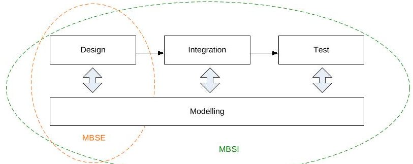
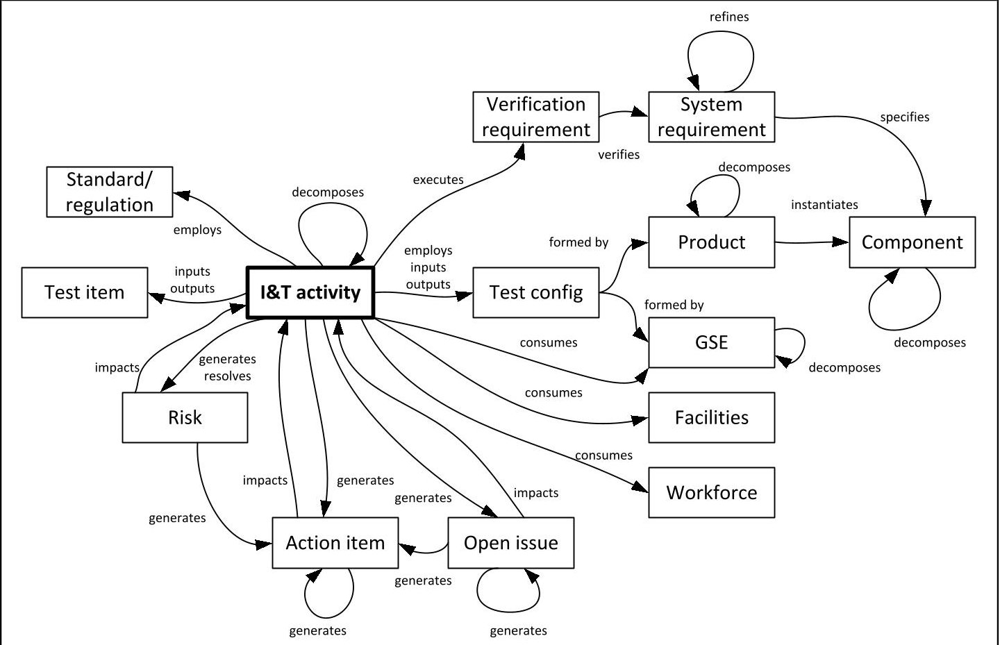
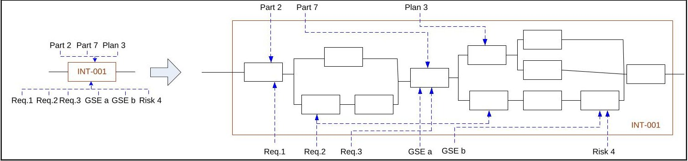
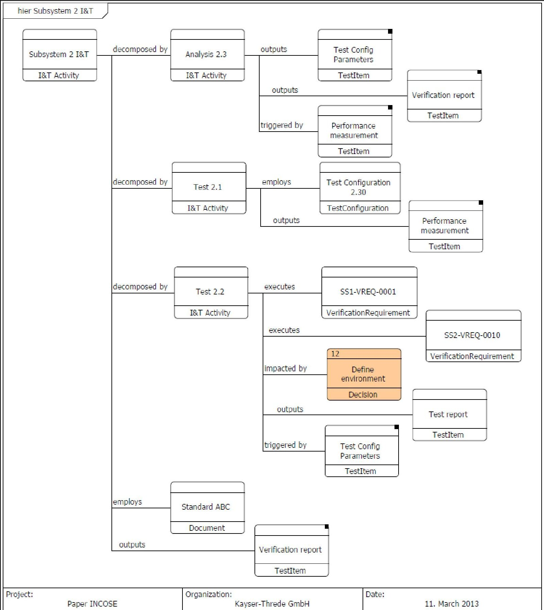

<!-- PDF_PAGE: 1 -->

# Effective and Efficient System Integration and Verification Planning Using Integrated Model Centric Engineering: Lessons Learnt from a Space Instrument

- SECESA 2014 -

08-10 October 2014

Vaihingen Campus, University of Stuttgart Germany

Alejandro Salado $ ^{(1)} $

$ ^{(1)} $OHB System AG

Perchtinger Str. 5, 81379 Munich (Germany)

Email: alejandro.salado@ohb.de

## ABSTRACT

There is an increasing interest in Model-Based Systems Engineering (MBSE) practices in academia and industry. The majority of research and adoption in industry is relevant to the early phases of the system life-cycle, where model-based design is expected to provide improved results during the system development. However, little attention has been paid to the application of such methodology to later phases of the development, and in particular to system integration and verification of the actual manufactured system, which continues to be done in the traditional document-centric environment. This paper proposes a model-centric environment for system integration and verification activities at the end of the development cycle and presents lessons learnt from its application to an actual space project.

## INTRODUCTION

The systems engineering community seems to increase its preference towards Model-Based Systems Engineering (MBSE) as opposed to traditional document-based approaches [1-3]. Most research in this area focuses on using MBSE for improving conceptual design and system architecting [4], where research has proven benefits in productivity or, in other words, efficiency and effectiveness [5-6]. However, there is a lack of research that addresses how MBSE can support other systems engineering activities, such as for example system integration and verification, where the traditional document-based approach dominates the playground. The question this paper addresses is the following: could system integration and verification planning benefit from the capabilities of MBSE? The approach for using MBSE for system integration and verification planning was presented in a previous work [7]. This paper presents lessons learnt from its application on the development of an actual space system.

The present paper is organized as follows. First, a literature review on model-based systems engineering is provided, followed by a comparison between traditional and model-based integration and verification planning. Then the paper summarizes the proposed methodology to plan integration and verification activities under a model-centric environment. Further, its application on an actual space project is presented, followed by a number of lessons learnt for future applications. Finally, a short summary of the conclusions is given.

## LITERATURE REVIEW

Because systems engineering is actually naturally model-based [8], the difference between MBSE and traditional systems engineering does not lay on the representation of a system, but on what drives its development. Whereas in traditional systems engineering the development is driven by information contained in stand-alone documents, although the model is probably on the systems engineers' minds [9], in MBSE models elevate "in the engineering process to a central and governing role in the specification, design, integration, validation, and operation of a system" [4].

Model-based and model-centric should not be used indistinctively, because they are conceptually different [9]. Whereas model-based refers to how the system is constructed, model-centricity refers to how the different system artifacts are handled. In other words, model-centricity consists in developing "models of and about the system" [9]. Under these definitions, this research uses a model-based systems engineering approach for integration and verification activities under a model-centric environment: "integration and verification activities can be modeled and executed (model-based) and that their related artifacts form part of the model (model-centricity)" [7]. In this context, both terms should not be confused with SysML (Systems Modeling Language), which is a language that supports the definition and representation of models, while MBSE is the methodology itself [10]. SysML provides several pre-defined diagrams that serve the purpose of representing models and foster mutual understanding in communications; they include among others activity diagrams, sequence diagrams, requirements diagrams, or use case diagrams.

<!-- PDF_PAGE: 2 -->

As introduced earlier, current practices in MBSE focus on early system definition due to its efficiency in early validation of solution concepts and of requirement elicitation. Attempting at getting the same benefits on later life cycle phases of a system development, the concept of Model-Based Systems Integration has been proposed [11]. It expands model-based beyond the early definition phases of a system and uses its capabilities to explore the implications of the architectural design on the future integration and test of a system, as depicted in the Fig. 2 [11]. For example, the author uses an N2 diagram to detect integration complexity due to high coupling [11]. However, this attempt to create a MBSI "maintains the vision of using model-based for evaluating architectures and designs and therefore [it] does not propose additional artifacts or uses for the actual integration and test of a system" [7]. The present research contributes to fill that gap by applying an information model that uses model-based systems engineering to actually plan integration and test activities of a system into a real space system development.

Fig. 1. Model-Based Systems Integration (MBSI) [7, 11]

Planning of system integration and verification often requires the production of several artifacts, like for example verification requirements or integration and verification flows [12-14]. Actual execution of such activities often require maintenance of configuration logs, production of integration and test reports, and maintenance of verification control documents among others [12]. Furthermore, such activities are usually immersed in a perpetual documentation activity of decision tracking, open issues, and action items. Schedule development and resource allocation takes also a significant amount of effort at this stage. Traditionally all those artifacts are generated or controlled by a combination of independent or stand-alone methods and tools, which are listed in Table 1.

Table 1. Traditional methods/tools to generate integration & verification artifacts [7]

<table border="1"><tr><td>Artifact</td><td>Tool/Method</td></tr><tr><td>Requirement tracking</td><td>Requirements database or dedicated spreadsheets.</td></tr><tr><td>Verification tracking</td><td>Requirements database or dedicated spreadsheets.</td></tr><tr><td>Allocation of requirements (system, verification, or test) to integration and test steps</td><td>Manually from requirements database or dedicated spreadsheets to verification flows and integration and test specifications.</td></tr><tr><td>Integrated verification fishbone diagrams</td><td>Diagram tools or mind-mapping tools.</td></tr><tr><td>Integration and test procedures</td><td>Text processors, spreadsheets, or dedicated integration tools.</td></tr><tr><td>Integration and test specifications</td><td>Text processors; in few cases directly in requirements databases.</td></tr><tr><td>Verification requirements</td><td>Text processors, requirements database, or dedicated spreadsheets.</td></tr><tr><td>Description of configuration</td><td>Drawings, word processor, spreadsheets.</td></tr><tr><td>Configuration maintenance</td><td>Drawings, word processor, spreadsheets.</td></tr><tr><td>Open issues</td><td>Spreadsheets.</td></tr><tr><td>Action items</td><td>Spreadsheets.</td></tr><tr><td>Integration and verification flows</td><td>Diagram tool.</td></tr><tr><td>Decision tracking</td><td>Text processor, spreadsheet.</td></tr><tr><td>Schedule</td><td>Scheduling tools, spreadsheet.</td></tr><tr><td>Workpackage(activities)inputs and outputs</td><td>Text processor, spreadsheet, databases.</td></tr></table>

Using several heterogeneous tools and methods to control and generate information results in several risks [7]:

- "Multiple sources of information, which could easily lead to inconsistent information and need for recurring updates and task repetition.

- Multiple sources of information, which could easily lead to outdated information and need for recurring updates and task repetition.

- Since the model is on documents, information has to be reproduced manually in several artifacts and formats, which increases the required effort to accomplish a particular task.

- Since the model is on documents a significant effort is needed to produce text, even though the model exists.

- Lacking information linkage between artifacts enforces manual propagation of changes.

- Lacking information linkage favors the loss of attention to open issues, decision history, and action items needed to start or finish a given activity.

<!-- PDF_PAGE: 3 -->

- Using several tools requires a significant effort by IT and configuration management to keep consistency, correctness, and relevance."

Because "model-centricity enforces the use of single source information and information sharing, [...] current information exists within the model and does not depend on particular release of documentation" [7]. Such characteristics results in the following benefits [7]:

- "Information usage is always current, thus the need for information update is reduced. $ \rightarrow $ Reduction of required time for given activity improves efficiency.

- Information lays within the model and therefore there is no need to rewrite pieces of information in several documents. $ \rightarrow $Reduction of required time for given activity improves efficiency.

- Information is only in one place and therefore mistyping or confusion is reduced. $ \rightarrow $Reduction of mistakes and corrections improves effectiveness.

- Many documents can be written by themselves; only the model has to be built, but this is nevertheless done in the engineers' brain. $ \rightarrow $Reduction of required time for given activity improves efficiency.

- Decisions are constantly tracked and associated to an element of the system, thus there is no need to go back to previous decisions or reinvent multiple times the wheel. $ \rightarrow $Reduction of required time for given improves efficiency.

- Open issues and action items are persistently present, thus it is difficult that they get forgotten or lost. $ \rightarrow $ Reduction in activity repetition improves efficiency and effectiveness.

- Systems engineering teams (verification) and assembly, integration and test teams work concurrently in a shared model, thus information exchanges and reviews occur in real-time. $ \rightarrow $Real-time collaboration maximizes benefits of reviews while minimizes review cycles, which improves effectiveness and efficiency.

- Project management and engineering work concurrently in a shared model, thus reporting of elements such as open issues, action items, or risks occurs in real-time. $ \rightarrow $Real-time reporting reduces the need to prepare stand-alone artifacts, which improves efficiency, and allows for quicker reaction by management and engineering teams, which improves effectiveness."

## MODEL-CENTRIC ENVIRONMENT FOR SYSTEMS INTEGRATION AND VERIFICATION

This section summarizes the key contributions of the work reported in [7]. An information model was developed to support planning of integration and test activities (ref. Fig. 2). It should be noted that the term component refers to "conceptual physical elements of a design or architecture" and the term product to "instantiations of those components, i.e. the actual built and existing element that instantiates the conceptual component" [7]. In the space jargon, models within a model philosophy would be products and the actual design element would be the component. The key tenet of differentiating between components and products is that it "allows for documenting and evaluating the levels of similarity between tested configurations and end-items, thus facilitating assessment of verification coverage and effectively dealing with resulting decision needs" [7].

Ground Support Equipment (GSE) includes "all external hardware and software elements and tools that are needed during integration and test of the system" [7]. Test items are inputs and outputs of the integration or test activity, which can include data, raw materials, processed materials, or similar. Relationships of types inputs, outputs, and consumes "enable simulation capabilities, which are of particular importance to define deployment of hardware, software, and human resources" [7]. As a result, they "facilitate the optimization of integration and test sequences" [7]. Finally, it should be noted that the model allows reflecting how a test configuration changes during integration activities by providing relationships of type employs, inputs, and outputs to Test configuration.

A key aspect of the information model proposed in [7] is its hierarchical construct, as shown in Fig. 3. By directly flowing down and up information between the different hierarchical layers, the information model facilitates consistency: all elements from a higher level are inherited into the lower level (top-down) and new needs identified at a lower level are demanded to the higher level (bottom-up). In addition, collaborative work in the model allows for seamlessly sharing information between different teams and artifacts in a seamless way. For example, integration specifications can be decomposed into integration procedures (ref. Fig. 3). Furthermore, such an information model provides a holistic description of all dependencies between the different integration and test activities, which is hard to represent otherwise in a realistic manner when using line by line procedures. Finally, "the modelled sequence enables automatic simulation of schedule constraints and resource allocation and usage, which enforces again using consistent information" [7].

<!-- PDF_PAGE: 4 -->

Fig. 2. Information model [7]

Fig. 3. Hierarchical construct [7]

By mapping integration and test activities with functions and states, and other artifacts with inputs, outputs, and resources, existing systems engineering diagrams, such as SysML ones, can be converted to model integration and test activities. A key aspect of such integrated model centric engineering for industry is that "graphical representation is an outcome and not a product that needs to be developed" [7]. This basically implies that once the information model is fed with data any diagram can be seamlessly generated and, more importantly, consistency is effortlessly maintained throughout all diagrams. Table 2 describes how different diagrams can be used for the purpose of integration and verification planning. Actual diagrams are provided in [7].

Table 2. Leveraging diagrams [7]

<table border="1"><tr><td>Architecture and Design Diagram</td><td>Use for I&amp;T planning</td></tr><tr><td>Activity diagram</td><td>Show sequence of activities and their dependencies.</td></tr><tr><td>Sequence diagram</td><td>Show sequence of activities and their dependencies.</td></tr><tr><td>Hierarchy diagram</td><td>Show hierarchy of activities. Enables identification of reusable artifacts and critical elements.</td></tr><tr><td>Behavioral diagram</td><td>Enable simulating the uncertainty to accomplish in a given time and with a given amount of resources the integration and test activities for a specific system, describe how resources are utilized, e.g. in relation to personnel or ground support equipment, and facilitate the identification of conflicts and constraints, promoting optimization of integration and test sequences.</td></tr><tr><td>N2 diagram</td><td>Quick identification of interrelation of product needs between different activities, which would ease the identification of activities that may need good control of resources.</td></tr></table>

In addition, "since all the information is in a centric, common, and controlled database and is structured according to a defined information model" [7], production of documentation is efficiently automated. Furthermore, because all information is single source a single change of an element or an artifact is automatically updated in all integration and

<!-- PDF_PAGE: 5 -->

verification planning documentation. On top of that, the integrated model centric approach facilitates that a team works on current data continuously, thus reducing effort spent on updating information and repairing or reworking mistakes that result from invalid data [7].

Fig. 4 shows an extraction of an actual project database that contains the elements that form a test specification. A scripted document generator retrieves "verification requirements that need to be executed as part of the test activity, entry and exist criteria for the activity, configuration to be achieved or used, special equipment or constraints to be used, [and] decomposition of lower level activities if required" [7]. Furthermore, model centricity enables collecting and relating other programmatic elements such as risks, open points or action items. When they impose constraints on the start, the end, or the execution of an integration or test activity, they automatically emerge during the scripting process, thus ensuring they are never forgotten. This is found extremely beneficial in terms of effort reduction in the areas of controlling, management, and product assurance, while at the same time it reduces the risk of rework.

Fig. 4. Model elements to generate a test specification [7]

<!-- PDF_PAGE: 6 -->

# APPLICATION TO A SPACE PROJECT: LESSONS LEARNT

## The project

This research applied the proposed model-centric approach to plan the verification activities of the Hyperspectral Instrument on board the Environmental Mapping and Analysis Program (EnMAP). EnMAP is a German space based hyperspectral Earth observing mission that will provide information about the status of different ecosystems and their response to natural or man-made changes of the environment [15]. The space segment consists of a single satellite orbiting at 653 km altitude on a sun-synchronous orbit with LTDN 11:00 and inclination of approximately $ 98^{\circ} $ [15]. The satellite is formed by a bus and a single instrument that "covers the wavelength range from 420 nm to 2450 nm using a dual spectrometer layout" [15]. Using a push broom imager, the instrument samples a swath of 30 m x 30m and 30 km nadir looking, at a frame rate of 230 frames per second [15]. The satellite is developed by OHB System AG under DLR contract [15]. It should be noted that the development of the instrument was subjected to applicability of ECSS.

## Infusion into the organization

Infusion of MBSI into the organization was considered a driving element for its success. Therefore, an infusion strategy was developed before its actual implementation. The strategy was driven by three types of obstacles that seem inherent to any adoption of a methodology, a technique, a framework, or similar in an organization [16]:

1. Enablers: These elements are part of the environment on which the methodology is applied. They are necessary conditions that have a binary behaviour. Examples include complexity, time, awareness, knowledge, experience, benefit versus investment, or structure of the organization.

2. Behaviour: These elements are inherent to the people that will have to adopt the methodology. They have an c continuous behaviour. Examples include culture, openness to change mindset, motivation, skills, practicalities training, or familiarity.

3. Usability: These elements are inherent to the actual methodology. Examples include confidence on its effectiveness, acceptance and beliefs, simplification and adaption of methods, or ability to handle.

Step 1. Overcoming enabling obstacles.

The project of infusing MBSI for planning verification activities was born within the Systems Engineering Office at OHB System AG in Munich (formerly known as Kayser-Threde GmbH during the time of the activity) and had full support of the head of the department. This was instrumental in achieving the infusion. A preliminary benefit versus investment analysis was performed and a decision was made to verify the results with an actual running project. Such step was crucial in clearing confidently the necessary investment budget.

First, it was decided to use MBSI in a precisely bounded pilot project ad not as an organizational-wide activity. This decision was twofold: (1) verify with a limited investment the actual benefits that could be achieved and (2) debug the implementation of the methodology before going to the full organization. A project that was at the end of Phase C and close to transition to Phase D was chosen. The system had sufficient complexity to provide a representative case study and its maturity was sufficient to isolate the effects of MBSI with respect to traditional approaches. Furthermore, the verification manager had previous experience and formal knowledge in the areas of verification of space systems and MBSE.

The scope of the activity was limited to verification planning. Although the activity is highly interactive in nature, the artifacts and their owners can be easily bounded. Therefore, verification requirements in a requirements database were employed as inputs (DOORS $ ^{\circledR} $ ) and test specifications and verification flows were provided as outputs (in MS Word $ ^{\circledR} $ format). It should be noted that both inputs and outputs were automatically imported and exported by the MBSI tool.

In addition, a test running in parallel to the normal flow of activities was set to measure how seamless the interaction between generating test specifications and producing integration and test procedures could be. This test was intended to gain a preliminary understanding of the acceptability of MBSI beyond the scope of verification planning.

A set of objectives was put in place before initiating the activity in order to measure its level of success: (1) reduce the necessary effort to define and plan verification activities, (2) reduce the necessary time to produce test specifications, and (3) reduce the number of issues of documents originating from inconsistent information. These metrics provided the necessary evidence to justify continuing support to the activity and potential investment for its expansion to the rest of the organization.

Finally, a key element of the strategy was to grant freedom to develop the information model as the verification planning was developed in the project. In particular, this had two key effects: (1) since the development of the information model was not limited by time, the methodology was not limited in features when being in use, and (2) the

<!-- PDF_PAGE: 7 -->

information model focused on features that were really needed. As a result, the information model reflected the real needs of a running project.

## Step 2. Overcoming behavioural obstacles.

There were two instrumental aspects that significantly contributed to the success of the pilot study. First, the culture of the organization was characterized by being very open-minded and in constant seek for improvement. Second, there was no company-wide process for verification activities. Therefore, projects were not strictly bounded by internal pressures. Rather the contrary, the activity was perceived as investigating the best process that could be put in place. The same applied to the project, where decisions were taken based on the expected reduction in effort.

In addition, it was decided not to force other projects to use MBSI, but rather to show and train without a condition to use. Therefore, several workshops and one-to-one training sessions were conducted within the organization. Freedom to choose and show benefits instead of imposing processes were found to be key for getting acceptance of other members of the organization.

Finally, technical support of the MBSI tool vendor provided significant help in tailoring the information model and the necessary scripts to the needs of the project. This proved very effective in avoiding being limited by the tool.

## Step 3. Overcoming usability obstacles.

Usability of MBSI can be measured in two axes: usability of the methodology itself and usability of the tool that supports implementing the methodology. Usability of the methodology was ensured by limiting its use to people with knowledge of MBSE. Usability of the tool was achieved by a careful selection process. Although SysML tools seem rather extended, the language was not rich enough to enable modelling of life cycle phases other than pure concept design and system architecture. The proprietary language STRATA $ ^{\circledR} $ (Vitech Corporation), which can be seen as a predecessor of the Lifecycle Modeling Language (LML), was chosen. It provided the necessary flexibility and in-built structures to enable seamless translation of elements and relationships to verification planning activities. The selected tool was CORE $ ^{\circledR} $ , by Vitech Corporation, with which some personnel in the company had previous experience.

## Results

The three objectives that were set as measures of effectiveness were achieved during the study. Actual figures are confidential and therefore cannot be disclosed.

The effort that was necessary to define and plan verification activities was significantly reduced when compared to the internal company benchmark. Once the model was set, production of test specifications was seamless. Finally, consistency of information and control of open issues proved very effective. First, there was no single document update that originated from using inconsistent information. Second, the single source of information facilitated finding inconsistent information in other external artifacts.

The selection of lifecycle modeling language instead of a system modeling language proved very beneficial for developing a MBSI methodology. The methodology, as described in [7], was entirely modelled without any limitation. Furthermore, it was possible to generate all necessary artifacts with the chosen tool.

Finally, the methodology was qualitatively positively received by other engineers within the department. The activity is currently still under development and a decision has not been taken yet with respect its expansion as a company-wide methodology.

## Open points

There were some elements that were not tested during the pilot project, being the most important ones: (1) simultaneous use of the database by an entire team, (2) integration with formal configuration control process, (3) release of baselines, and (4) integration with other activities, such as integration and test. Future internal studies are envisaged to test those capabilities.

## CONCLUSIONS

The present research has used the capabilities of model-based systems engineering and model-centricity to plan verification activities for a system. A previously developed information model, based on a lifecycle modelling language, has been used in an actual running space system development in order to verify the expected benefits of MBSI at later phases of the system life cycle. Several SysML diagrams have been leveraged to report verification and test sequences.

<!-- PDF_PAGE: 8 -->

A strategy for infusing MBSI into the organization was defined and metrics of success were defined. At the completion of the study all metrics were considered successful. In particular, the effort to define and plan verification activities was reduced, the effort to produce test specifications was reduced, and there was no document update needed that originated from using inconsistent information. Furthermore, the strategy proved successful in gaining buy-in from the company personnel.

Some elements remain untested, such as for example the use of the database simultaneously by an entire team. Future studies are envisaged in this direction.

## ACKNOWLEDGEMENTS

The work presented in this paper was performed in part on behalf of the German Space Agency DLR with funds of the German Federal Ministry of Economic Affairs and Technology under the grant No. 50 EP 0601.

## REFERENCES

[1] P. Korfiatis, R. Cloutier, and T. Zigh, "Graphical CONOPS Development to Enhance Model-Based Systems Engineering," Third International Engineering Systems Symposium CESUN2012, Delft University of Technology, 18-20, June 2012.

[2] T. Muth, D. Herzberg, and J. Larsen, "A fresh view on model-based systems engineering: The processing paradigm," INCOSE International Symposium, 2001.

[3] K. Robinson, D. Tramoundanis, D. Harvey, M. Jones, and S. Wilson, "Demonstrating Model-Based Systems Engineering for Specifying Complex Capability," Systems Engineering / Test & Evaluation Conference, Adelaide, 2010.

[4] J. Estefan, "Survey of Model-Based Systems Engineering MBSE Methodologies," INCOSE MBSE Initiative, 2008, (http://www.omgsysml.org/MBSE_Methodology_Survey_RevB.pdf) Retrieved 11.08.2012.

[5] B. Brown, "Model-based systems engineering: Revolution or evolution?," IBM Software. Thought Leadership White Paper. December 2011.

[6] J. Maurandy, E. Gill, A. Helm, and R. Stalford, "Cost-Benefit Analysis of SysML Modelling for the Atomic Clock Ensemble in Space (ACES) Simulator," INCOSE International Symposium, 2012.

[7] A. Salado, "Efficient and Effective System Integration and Verification Planning Using a Model-Centric Environment," INCOSE International Symposium, Philadelphia, Pennsylvania, (USA), 2013.

[8] H. Crisp, "Systems Engineering Vision 2020," Technical Operations INCOSE, Version 2.03, September, 2007.

[9] D. Harvey, M. Waite, P. Logan, and T. Liddy, "Document the Model, Don't Model the Document," SETE APCOSE, 2012.

[10] S. Friedenthal, A. Moore, and R. Steiner, A Practical Guide to SysML: The System Modeling Language. 2nd edition. Morgan Kaufmann, 31 October 2011.

[11] P. Montgomery, "Model-Based Systems Integration (MBSI). An Instructional Approach," Systems Engineering Conference, Washington DC, May 15, 2012.

[12] European Cooperation for Space Standardization (ECSS), Verification. ECSS-E-ST-10-02C, Second issue, 06 March 2009.

[13] European Cooperation for Space Standardization (ECSS), Testing.ECSS-E-ST-10-03C, Second issue, 01 June 2012.

[14] NASA, Systems Engineering Handbook. NASA/SP-2007-6105 Rev1, 2007.

[15] B. Sang, S. Hofer, K.-P. Foerster, T. Stuffler, J. Schubert, C. Neumann, V. Mogulsky, H. Kaufmann, A. Mueller, and C. Chlebek, "Instrument concept for the dual hyperspectral imaging spectrometer of the German EnMAP mission," Proc. SPIE Conf. on Optical Engineering and Applications, August 10-14, San Diego, 2009.

[16] A. Salado and R. Nilchiani, "Elegant Space Systems: How Do We Get There?," In Proceedings of IEEE Aerospace Conference, 2-9 March, 2013.