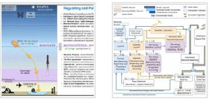
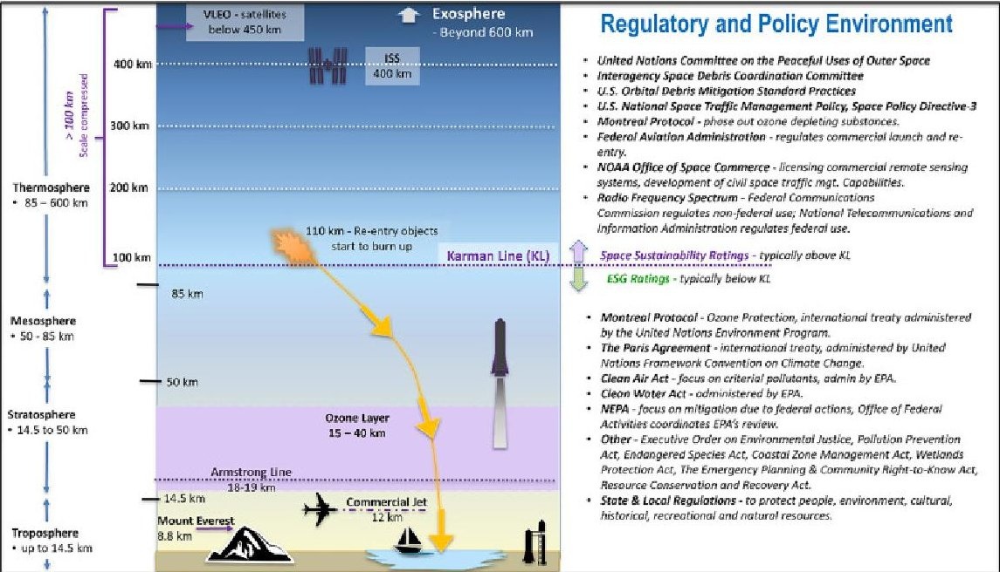
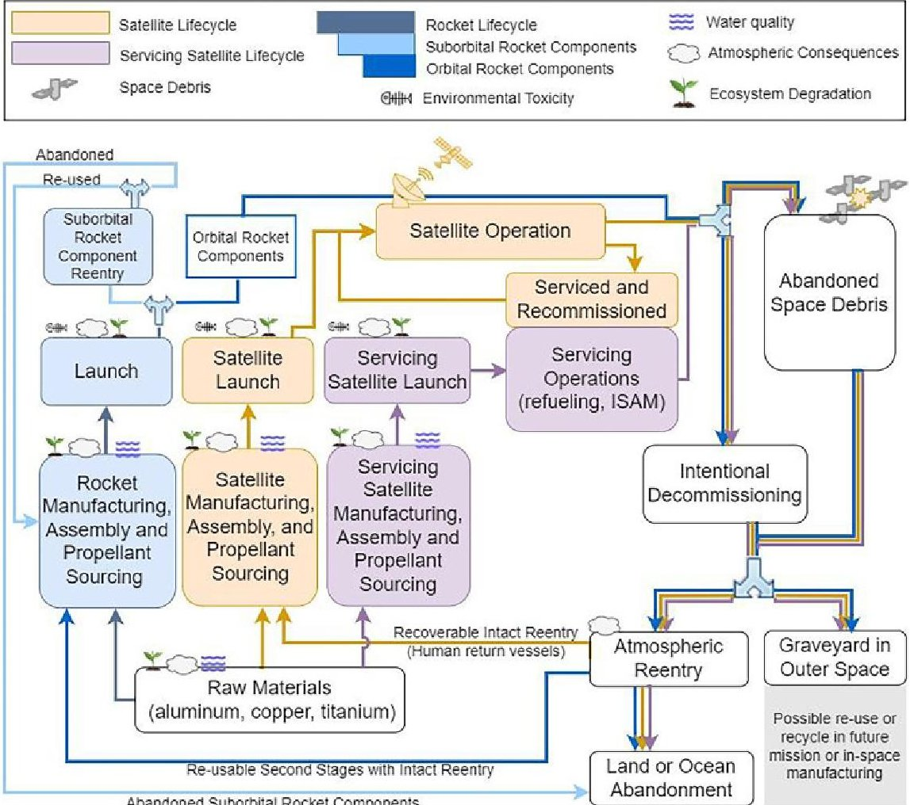

# Life cycle assessments for the space industry

Authors: Jones, K.L, Jain, A.K. The green circularity

<!-- PDF_PAGE: 1 -->

Journal of Space Safety Engineering
 Date: September 2023
 Show more

Research article     Full text access   Get rights and content

The green circularity: Life cycle assessments for the space industry
Karen L. Jones     , Asha K. Jain Show more

     View PDF            Download full issue        Cite         Add to Mendeley        Share        10.1016/j.jsse.2023.03.009

   Article         Recommended articles         Cited by (12)       Metrics

                                                                                            Outline
Abstract                                                                                        Abstract
The rapid growth of the global space industry opens the door to an increasing
                                                                                                1. Introduction: productive harmony …
volume and variety of space activities at the same time that companies are
increasingly recognizing the value of environmentally responsible business                      2. Multi-domain impacts: Space, atm…

practices. The environmental impacts of space activities are particularly                       3. Life cycle assessments as a path t…
challenging to understand and address given their complexity and distribution
                                                                                                4. The art and science of environmen…
across different domains and industries. Multiple key areas still suffer from a
lack of research, leaving critical knowledge gaps. Environmental life cycle                     5. Next steps for government stakeh…
assessments (E-LCAs) are one tool that can be applied to understand the space                   6. Conclusion
sector's cradle-to-grave impacts across space and terrestrial environments.
                                                                                                Declarations of Interest
Specifically, an E-LCA can identify circular economy opportunities to reduce
waste and pollution by quantifying the environmental impacts of space missions                  Acknowledgments
                                           1
or systems over their entire life cycle.
                                                                                                References
This paper provides an overview of environmental and sustainability trends and                  Show full outline
offers options for the U.S. government, and Department of Defense (DOD) in
particular, to consider and adopt E-LCAs in space acquisitions. As both DOD and
                                                                                            Figures (2)
civilian spacefaring agencies seek reduced environmental footprints, E-LCAs can
motivate the space industry to improve designs, practices, and realize
operational and economic efficiencies.

Additionally, the U.S. government is in a strong position, as a large and
influential buyer of space systems, to support the harmonization of E-LCA
methodologies and frameworks with international partners. Such efforts could
                                                                                            Tables (1)
catalyze a sustainable space industry while building transparency and trust for
all stakeholders.                                                                                Table 1. Satellite Environmental Life…

      Previous article in this issue                       Next article in this issue

<!-- PDF_PAGE: 2 -->

1. Introduction: productive harmony in space and on earth
In the United States and globally, there is growing pressure for every industry to
account for their environmental impact and adopt sustainable practices. But the
space industry has appeared at times to enjoy a “special status, a space
exceptionalism which in turn is supported by and supports a space
exemptionalism,” meaning that the space industry views itself as different
enough to be excused from typical environmental scrutiny and regulatory
compliance expectations [1]. The issue goes beyond recent studies showing that
implementation of space sustainability guidelines has been lagging [2]. The
space community's view of sustainability in general has been limited, often
focusing on impacts to the space environment without consideration of impacts
on Earth and its atmosphere. Such a view is understandable given the
historically low number of launches and orbiting satellites compared to the level
of activity in other domains. But now this dynamic is changing as the volume
and diversity of space activities grow. By the end of 2021, this figure had risen to
4877 [3]. Since the end of 2021 and through January of 2023, approximately
2500 additional satellites have been launched, which raises the estimated
number of active orbiting satellites to approximately 7400. This unprecedented
growth in space activity is now prompting greater scrutiny of the space
industry's environmental impacts and potential to improve sustainability [4]. On
balance, the space sector contributes enormously to environmental and
humanitarian concerns. Should the space sector continue to get a “free pass” to
ignore its environmental footprint and sustainability opportunities?

Ultimately, “space exemptionalism” as national policy appears unlikely to persist
indefinitely as the United States Space Priorities Framework (2021) now
emphasizes U.S. leadership for “global governance of space activities” and “the
development of new measures that contribute to the safety, stability, security,
and long-term sustainability of space activities.” The Framework also encourages
“open, transparent, and international standards” [5]. Furthermore, international
agreements like the United Nations’ Long-Term Sustainability (LTS) Guidelines,
agreed to by nearly 100 countries including the United States, push for more
comprehensive sustainability efforts throughout space activities.

One way to address sustainability goals is to examine mission or product
lifecycles, cradle-to-grave, to reveal opportunities for environmental benefits as
well as cost savings. The U.S. government could broadly meet the intent of the
Framework by encouraging the standardization and application of
environmental life cycle assessments (E-LCAs) for future government space
systems or service acquisition efforts. E-LCAs can bring a diverse range of
environmental impacts to light across all domains touched by space activities
with an end goal of enabling measurable progress to improve space industry
sustainability.

Industrial strategy in the United States and other nations is still forming in the
era of climate change. Inevitably, there is a tension between the economic self-
interests of a growing space sector and regulatory efforts to internalize negative
externalities.2 But there are options available to incorporate environmental
policy considerations through government space stakeholders motivated by

<!-- PDF_PAGE: 3 -->

national interests [6]. Through leadership by example, the U.S. government has
the opportunity to catalyze the space industry towards a more sustainable
future.

2. Multi-domain impacts: Space, atmospheric, and terrestrial
Sustainability has been an elusive and challenging goal for the space industry,
partially because the meaning of the term sustainability depends upon context.
The United Nations (UN) defines space sustainability as the “ability to maintain
the conduct of space activities indefinitely into the future” and the term is often
used to refer to the worsening orbital debris situation. However, all space
activities begin and many of them end on Earth; therefore, environmental
sustainability from space activities should be viewed with a more expansive
context. The Environmental Protection Agency (EPA) defines sustainability as the
ability to “create and maintain conditions under which humans and nature can
exist in productive harmony, that permit fulfilling the social, economic and other
requirements of present and future generations” [7]. This broader EPA definition
is central to this analysis and covers productive harmony in space and on Earth.

The space sector affects a wide range of operating environments and domains:
the ground, sea, air, and space. The satellite industry's operations can generate a
variety of environmental consequences, including stratospheric ozone depletion,
air acidification, smog, toxic waste spills, water pollution, noise pollution, water
consumption, and various types of material demands which can contribute to
resource depletion [8]. These effects have varying severity, and in certain cases,
are small but growing compared to other industries.3 Space players must
navigate a complex web of overlapping regulatory regimes across ground, water,
air, and space (see Fig. 1) and across a range of satellite life cycle phases,
including manufacturing, launch, operations, and reentry (see Fig. 2).

Download: Download high-res image (962KB)
Download: Download full-size image

Fig. 1. The Space Industry's Complex Multi-Domain Environment. Traversing
different geographies and physical boundaries, space requires an understanding
of national, regional, and international regulations and norms of behavior to

<!-- PDF_PAGE: 4 -->

address impacts above the Karman line, in the atmosphere, and in the terrestrial
ecosystems and communities [63].

Download: Download high-res image (1MB)
Download: Download full-size image

Fig. 2. Satellite Life Cycle Overview. For rockets, satellites, and satellite servicing
operations, the cradle-to-grave environmental impacts include consequences to
water, atmosphere, ecosystems, workplace health and safety, and space (e.g.,
debris) [64]. The circular nature of the space industry across launch, satellite
manufacturing and operations, and in-space servicing allows increased
sustainability opportunities, wherein the materials or waste from one phase can
“loop back” to provide re-use for future manufacturing or extended life missions.
Note: System boundaries do not include raw material extractive processes or
design processes.

The border between space and Earth's atmosphere is commonly, but not
universally, recognized at the Karman line, or 100 kms in altitude above mean
sea level.4 Above the Karman line, sustainability issues typically focus on space
debris in crowded orbits, planetary protection on interplanetary missions, and to
a growing extent electromagnetic spectrum interference issues. Below the
Karman line, sustainability typically encompasses issues relating to Earth's
natural resources, habitat, biodiversity, toxicity exposure, and pollution
concerns.

The Karman line does not, however, reliably signal regulatory applicability. For
instance, an Aerospace study noted that optical reflective emissions of orbiting

<!-- PDF_PAGE: 5 -->

satellites “may have a negative impact” on astronomical research from ground-
based telescopes, a potential terrestrial impact from light pollution, but satellites
appear to be exempt from the National Environmental Policy Act (NEPA) of 1969
[9]. NEPA requires that federal agencies prepare a detailed environmental impact
statement on federal actions and proposed mitigation measures to avoid adverse
environmental impacts. The Federal Aviation Administration (FAA) Office of
Commercial Space Transportation (AST) has been responsible for integrating
environmental guidelines into its decisionmaking process. For spaceports, the
decision to license is a major federal action under NEPA, and therefore private
sector spaceport siting, construction, and operation falls under NEPA.
Additionally, terrestrial industrial activities relating to rocket production, launch,
and satellite manufacturing are subject to a range of federal and state
environmental regulations (see Fig. 1).

2.1. Above Karman line: Space sustainability
In response to the growing debris problem in space, the United Nations, national
space agencies, space industry associations, and various regulatory agencies,
such as the Federal Communications Commission (FCC), have collaborated to
develop and demonstrate best practices for space sustainability [10]. The U.S.
Government Orbital Debris Mitigation Standard Practices (ODMSP), established
in 2000, applies to U.S. organizations involved in space operations and is
considered the foundation for national orbital debris mitigation requirements
and guidance. More recently, Space Policy Directive-3 and the 2020 National
Space Policy call for U.S. leadership and international industry standards to
address space traffic management, preserve a sustainable space environment,
and work towards a safer space operations environment. Additionally, a member
of Congress has introduced legislation to address concerns about the fiscal and
environmental sustainability of space activities [11]. Beyond domestic U.S.
policies, there are multilateral efforts underway led by the Inter-Agency Space
Debris Coordination Committee (IADC) and the United Nations Committee on
the Peaceful Uses of Outer Space (COPUOS) [12]. To further motivate the
industry towards sustainable practices, several organizations, catalyzed by the
World Economic Forum,5 have worked together to develop Space Sustainability
Ratings (SSR) [13]. Similar to other consumer information ratings, like
Leadership in Energy and Environmental Design (LEED), the SSR provides a
technical standard to give space operators a common sustainability assessment
framework to enhance environmental transparency [14]. Members of the SSR
design team, Danielle Wood and Minoo Rathnasabapathy, noted that “space
operators are feeling positive pressure to demonstrate their commitment to
space sustainability and do not want to be the ‘last one in’” [15]. Thus far, the
SSR addresses the space environment, above the Karman line.

2.2. Below Karman line: Environmental impacts
Like other industries, space is regulated by state, federal, and international laws
governing air, water, and land use. Space actors are required to comply with both
procedural and regulatory requirements across the space industry value chain,6
including manufacturing, operations, and launch facilities. Depending upon the

<!-- PDF_PAGE: 6 -->

industrial process and location, a wide range of sustainability, procedural, and
environmental regulations might apply.

Atmospheric Impacts. The satellite industry introduces a range of atmospheric
impacts. According to Dr. Martin Ross, an Aerospace scientist who studies
atmospheric impacts, “Spaceflight emissions are the only human-produced
compounds injected into the atmosphere above 18 km.” Ross emphasizes that,
compared to aviation emissions, “black carbon from a rocket could introduce
immediate and long-range consequences which are an order of magnitude
higher” [16]. Besides black carbon, other emissions are harmful to the
atmosphere and have been targeted by international agreements. The Montreal
Protocol, an international treaty drafted in 1987 and which entered into force in
1989, successfully banned or limited nearly 100 substances that deplete the
ozone layer, but the agreement does not address emission sources such as
rockets and aircraft that emit directly into the stratosphere [17].

Some launch providers are moving towards cleaner-burning rocket propellants,
such as hydrogen and methane,7 and away from kerosene, hydrazine,8 and
aluminum-based solid rocket fuels for both environmental and financial reasons.
Kerosene, a highly enriched petroleum product, and hydrazine, a carcinogenic
fuel, produce several by-products when burned, including carbon dioxide, black
carbon, and water. Aluminum-based solid rocket motors typically produce
chlorine gasses, alumina, and carbon dioxide. Several studies have shown that
black carbon, alumina, and chlorine emissions are among the most concerning
rocket combustion products while rocket-produced carbon dioxide and water
have negligible effects on the ozone layer and greenhouse gas effect. Cleaner
burning fuels, like hydrogen and methane, produce no chlorine, alumina, or
black carbon. Instead, hydrogen combustion creates only water, leading to less
harmful atmospheric consequences for rocket launches. Moreover, methane
combustion produces water and carbon dioxide, which is not associated with
atmospheric warming in the upper atmosphere and, in fact, may have a cooling
effect. This differs from the effect at lower altitudes where carbon dioxide
behaves as a greenhouse gas, absorbing infrared radiation and heating the lower
atmosphere [18].

Atmospheric impacts occur during reentry as well as launch. When a satellite
reaches end-of-life and deorbits, the high-temperature process of atmospheric
reentry melts away approximately 60–90 percent of a reentering object, leaving
behind metal particles in the upper atmosphere, known as particulates [19].
These particulates9 can remain suspended in the atmosphere for several years
and eventually scatter and settle on Earth's surface [20]. Especially as the scale
of re-entries grows, these particulates could alter atmospheric behavior. Once
lower in the atmosphere, some of these particulates, including alumina, can
interact with ozone-depleting chemistry and alter global temperatures [21]. The
annual number of objects launched into space has increased significantly since
1987 when the Montreal Protocol was drafted. In that year, 135 objects10 were
launched into space. More recently, during 2021, over 1807 objects were
launched into space. What goes up must eventually come down if it is not
disposed in a graveyard orbit, and therefore the growing mass of objects in space

<!-- PDF_PAGE: 7 -->

portends a future higher rate of reentries, which will result in a rise in
atmospheric particulates and therefore an increased likelihood of atmospheric
impacts [22].

Terrestrial Impacts. Terrestrial impacts from launch can be significant. Spaceports
and launch sites require a large amount of land and can contribute to the
destruction of critical habitats and biodiversity [23]. Over 367,000 acres in the
United States are licensed as an FAA, federal, or private spaceport. Moreover, out
of 17 licensed spaceports, nine are in coastal areas and their construction often
requires the destruction of wetlands. Swamps, marshlands, and coastal areas are
typically protected by a wide range of federal and state regulations because
wetlands offer water quality protection, fish and wildlife habitats, natural
floodwater storage and buffer, and reduction in the erosive potential of surface
water [24]. In addition, for any development or construction impacts related to a
spaceport, a range of environmental laws could apply to air quality, noise and
compatible land use, light emissions, historical and cultural resources,
protection of recreational lands and parks, water resources, and biological
resources and habitats.

3. Life cycle assessments as a path to the circular space economy
There is often no standard or harmonized method to measure whether an
industry has achieved sustainable consumption or production levels. For space
activities, this is particularly challenging when both harmful impacts and
mitigation measures span so many different contexts and domains. One way to
synthesize a study of these complex dynamics is to develop a process for
conducting environmental life cycle assessments (E-LCAs) for space activities,
exploring the relationship between the activity and the environment at every
stage of space system development, operation, and disposal. An E-LCA can be
used to measure or validate environmental impacts, making it a potentially
critical assessment tool as more industries strive for higher levels of long-term
sustainability [25].

E-LCAs can be useful beyond measuring the current impact of space activities.
They can also establish milestones towards a key feature of sustainable
industries, the “circular economy.” According to the U.S. Environmental
Protection Agency (EPA), a circular economy11 uses a systems-focused approach
that is restorative or regenerative by design to enable resources to maintain their
highest value for as long as possible [26]. In other words, circular economies
eliminate waste through better process design across their life cycle. As
industries transition from a traditional linear economy, or “take-make-use and
dispose” practices, to a circular economy, or “make-use-recycle and/or reuse,” they
need a standardized way to measure and navigate toward more sustainable
practices. Circular economy principles are gaining global momentum: 193
countries and the European Union are parties to the Paris Agreement, an
international treaty on climate change [27]. According to the UN, engaging in
circular economy principles is critical to meeting the terms of the Paris
Agreement by avoiding the waste, emissions, and biodiversity loss caused by
resource extraction and use [28]. With widespread adoption, E-LCAs offer a

<!-- PDF_PAGE: 8 -->

credible technical approach to fulfill these commitments and a path forward to a
circular economy for space activities.

Like many industrial life cycles, the satellite life cycle is complex, with both
tangible, observable effects and numerous unknown consequences. The system
boundary of satellite life cycles, graphicly summarized in Fig. 2 at a high level, is
extended to the entire value chain or satellite economy. Mapping life cycles
facilitates a broad consideration of the industry's extended supply chain,
environmental impacts, and how one process can “loop back” and become an
input for another process.

3.1. The circular economy - Life Cycles, environmental economics, and
natural capital
Life cycle frameworks are not new: they stretch back well before the first UN
Climate Change Conference in 1995. During the 1970s, life cycle assessments
(LCAs) evolved from methodologies such as energy analysis and environmental
burden analysis. Between 1970 and 1990, a variety of life cycle methodologies
existed but without a common framework. Later, between years 1990 and 2000,
various LCA guidebooks were published and eventually the International
Organization for Standardization (ISO) standardized methods and procedures.

E-LCAs are not entirely new to the space industry. The European Space Agency
(ESA) has been exploring the life cycle methodology for over a decade and, in
2009, ESA established a Clean Space office to address space industry
environmental challenges. During the past few years, ESA has included E-LCA
requirements in projects such as Copernicus and Ariane 6 expansion missions
[29].

ESA concluded that ISO standards 14,040 and 14,044 “are not sector specific and
leave many options open for the LCA practitioner to decide” [30]. ESA added that
the space industry is quite different, with low production rates, long
development cycles, specialized materials and processes, and unique operating
environments in the high atmosphere [31]. To address the space industry's
unique characteristics and operating environment, ESA published the Space
System Life Cycle Assessment (LCA) Guidelines in 2016 to extend ISO 14,040 and
14,044 to the space sector. This framework includes five impact categories which
ESA expects E-LCAs to specifically address :12

•   Ozone depletion

•   Climate change

•   Metal and mineral resource depletion

•   Human toxicity

•   Freshwater aquatic ecotoxicity

Following the establishment of life cycle assessments, the United Nations
developed the System of Environmental Economic Accounts (SEEA) during 1993

<!-- PDF_PAGE: 9 -->

as an international standard. SEEA is considered a crucial step to quantify the
environment into national accounts. More recently, during January 2023, the
White House issued the first ever U.S. National Strategy to Develop Statistics for
Environmental-Economic Decisions (“National Strategy”). The National Strategy
“creates a U.S. system to account for natural assets—from the minerals that
power our tech economy and are driving the electric-vehicle revolution, to the
ocean and rivers that support our fishing industry, to the forests that clean our
air—and quantify the immense value this natural capital provides” [32]. The
National Strategy also recommends that the U.S. incorporate the internationally
agreed-upon SEEA “to guide development of U.S. natural capital accounts and
environmental-economic statistics, where the SEEA standards are relevant and
robustly developed.”

Life cycle assessments, SEEA, and natural capital accounting are all mutually
supportive. Combined, they represent a fundamental shift in how our society
and economy values the previously ignored and unquantified resources,
recognizing that nature and natural resources are “capital assets that are critical
for economic growth and prosperity, and that their inclusion in economic
planning is imperative for addressing 21st century economic challenges such as
climate change, biodiversity loss, and declines in natural capital wealth” [33].

3.1.1. Global implications – competition and U.S. leadership
The complexities of international trade, cooperation, and competition will
impact the costs and benefits of requiring and applying space related E-LCAs. For
instance, ESA's lead with space life cycles presents an opportunity for the U.S.
government to leverage lessons learned and to coordinate and harmonize
methodologies. Conversely, if the U.S. government ignores or lags behind Europe
in adopting life cycle methodology for the space industry, such inaction could
imperil international trade relations. A significant portion of the U.S. space
industry benefits from exports to other countries, especially to Europe. If LCAs
become a mandatory reporting requirement for Europe, the U.S. could lose
market share and U.S. satellite suppliers could be “cut-off by European
consumers” [34].

There are also persistent concerns that burdensome regulations could cause U.S.
industries to lose competitive advantage and lag behind China, referred to as “a
very aggressive competitor” by NASA administrator Bill Nelson [35]. China
appears to be unencumbered by many established norms of behavior in space,
as evidenced by allowing their massive first stage rockets to fall uncontrollably
back to Earth. However, there is good reason to believe that China has the will
and resources to reach certain climate goals. China is working to redeem its
negative environmental image and has launched several climate adaptation and
resilience efforts, including a plan to decarbonize its highly industrialized
economy by 2060 and a national strategy to protect wetlands, ecodiversity, and
forested areas. In fact, the World Economic Forum notes that compared with
Western market-driven models, China's authoritarian top-down economic
planning approach may prove advantageous for long-term investing to respond
to climate [36]. Regardless of economic policies or political structures, all

<!-- PDF_PAGE: 10 -->

industrialized countries face a challenging journey to a carbon-free and
sustainable future. And now, the United States has an opportunity to lead and
navigate using E-LCAs to help the global space industry adapt.

E-LCA adoption would also be a way to demonstrate U.S. space sustainability
leadership and to implement the U.N. Guidelines for the Long-term
Sustainability of Outer Space Activities of the Committee on the Peaceful Uses of
Outer Space, emphasizing international responsibility for national activities in
outer space to:

“(b) Develop specific requirements and procedures to address the safety and
reliability of outer space activities under the entity's control, during all phases of
a mission life cycle;

(c) Assess all risks to the long-term sustainability of outer space activities
associated with the space activities conducted by the entity, in all phases of the
mission life cycle, and take steps to mitigate such risks to the extent feasible”
[37].

Approximately 100 COPUOS member states—which include the United States
and China—could interpret that long-term sustainability risks would encompass
environmental impacts to both the orbital and Earth environment, and that LTS
guidelines call for an E-LCA or something like an E-LCA.

3.2. Challenges and opportunities across the space activity value chain
In general, E-LCAs can help close loops in the satellite industry life cycle to fuel a
circular space economy. Table 1 offers an overview of satellite life cycle
challenges during the phases of manufacturing, launch, operations, and
decommission. Each of these challenges also presents opportunities to apply life
cycle thinking to identify new means and methods for achieving cleaner and
more sustainable practices.

Table 1. Satellite Environmental Life Cycle: Environmental Challenges and
Opportunities.

Challenges                                        Opportunities

Manufacturing – procuring raw materials, transporting materials and components, operating
the manufacturing site, satellite assembly, and testing.

Supply chain delays and shortages, rare           Explore supply chain risk mitigation
earth elements (REEs) and dependence              strategies, such as REE substitution and
upon uncertain foreign suppliers.Material         diversifying supply base.Selecting
sources that can cause various adverse            sustainable materials, including related
impacts to land, air, and water.                  extraction techniques.Select less toxic
                                                  supply chain materials for safer and less
                                                  costly handling and manufacturing.

Launch - rocket manufacturing, propellant sourcing, launch site operations and maintenance.

Terrestrial impacts of launch sites.Rocket        Shifting to clean burning fuels during the
propellants, such as methane and kerosene,        launch phase, such as methane and low

<!-- PDF_PAGE: 11 -->

Challenges                                       Opportunities

can have notable environmental footprints        carbon hydrogen and away from kerosene,
during extraction phase.Potential for            hydrazine, and aluminum-based solid rocket
propellant leaks resulting in greenhouse gas fuels.Reusable rocket systems offering
(GHG) emissions.Stratospheric ozone              sustainability advantages in terms of
depletion from rocket combustion and             resource efficiency as well as potential cost
resultant gasses (e.g., HCl, NOx) or particles   savings.
(e.g., black carbon, AL2O3).

Satellite On-orbit Operations – satellite operations including ground stations, network
operations centers, and data or cloud services supported by data centers.

Ground stations located in environmentally       Minimize ground station footprints and
sensitive areas.RF Spectrum - satellites         avoid environmentally sensitive areas.Use
could interfere with radio frequencies           spectrum-efficient transmitters and receiver
supporting space operations, cell phone          designs.Debris – follow debris mitigation
networks, radio towers, and other terrestrial guidelines to limit debris, potential for
services.Debris – collision possibilities and    break-ups, collisions, intentional
the potential for dangerous debris               destruction, stored energy at end-of-life,
clouds.Data centers – energy-intensive data      and the long-term presence of spacecraft in
centers could increase carbon footprint.         both LEO and GEO.Data centers - renewable
                                                 energy sourced.

End-of-Life/Decommission – collision avoidance, reentry plans, move to graveyard orbit.

Continued on-orbit collision                     Space situational awareness tools,
risks.Stratospheric particle pollution from      simulations, and programs.On-orbit
reentry, including aluminum oxide and            servicing for refueling in-space repair and
black carbon.Water and land consequences         debris recycling to extend lifetime of
of debris abandonment, and risk to human         satellite, including avoiding expensive
life and property during uncontrolled            replacement satellite.Benign materials to
reentry.                                         reduce potential impact to ozone and upper
                                                 stratosphere (more research needed).

Supply chain vulnerability is one area of concern, highlighted in the
manufacturing section of Table 1. This issue has been underscored by events such
as the COVID-19 pandemic and the Russian invasion of Ukraine. Most space
companies are now striving to strengthen their supply chain and make it more
valuable, agile, and resilient. Companies are now adding resource depletion
metrics to the E-LCA process to position themselves for future supply chain
constraints and unpredictable availability. These efforts could address important
materials with vulnerable supply chains, such as titanium, a key metal for rocket
bodies and space structures; lithium that is specially adapted for space satellite
batteries; and germanium, a substrate for photovoltaic cells. For example,
Russian titanium accounts for about a third of Boeing's titanium needs and
about half of Airbus's supply, yet Russia has low levels of titanium mineral
reserves [38]. Since the three largest suppliers of titanium are China, Japan, and
Russia, this supply line has a higher geopolitical risk exposure, creating
additional supply chain uncertainty. Beyond availability concerns, today's

<!-- PDF_PAGE: 12 -->

inflationary pressures have increased prices for many materials, which further
underscores the need to reduce waste and consider more efficient practices
throughout the satellite life cycle. Environmental life cycle analysis does not
itself solve supply chain vulnerabilities, but the visibility needed to conduct
them also supports supply chain risk mitigation efforts.

4. The art and science of environmental life cycles
Despite existing efforts and growing interest in life cycle assessments to achieve
a circular economy for space activities, there is a long road ahead before
widespread industry adoption of E-LCAs. Implementation of E-LCAs is both an
art and a science, requiring balance among highly technical measurements,
subjective judgment, and a need to clearly communicate the results to various
audiences, as well as other factors [39]. The maturation path for E-LCAs in the
space sector will involve a combination of improving access and data integrity,
establishing metrics and standardized reporting, and addressing research gaps.

4.1. E-LCAs – ensuring integrity, access, and strategic insight
According to Dr. Andrew Ross Wilson, University of Strathclyde, LCAs are still
relatively new in the space sector and concerns about sharing potentially
sensitive information play a role in hesitancy to implement. Wilson stated: “I'm
not aware of many LCAs being done. Certainly, confidentiality is a big concern
from industry.” He added that space companies currently view life cycle
inventory data as confidential, competition-sensitive information. This lack of
willingness to share makes it very hard to populate space LCA databases and
substantiate any environmental sustainability claims these companies may
make [40].

Fear of revealing proprietary or strategic information could be mitigated by an
E-LCA process orchestrated by a trusted body with a data management protocol
which provides both sufficient information to conduct E-LCAs and protection of
confidential and competitive information. There is, for example, supply chain
information that companies may never want to make public but would be
willing to release to a trusted and responsible party for overseeing E-LCAs, with
access strictly limited to E-LCA assessors.13 At the same time, open data enable
accountability, so companies would be encouraged to release as much
information as possible, with any confidential data anonymized before being
made public. Also, “open data” can be protected with role-based access where
only a subset of data would be made public (internationally or nationally), while
the full set of data would be open to trusted E-LCA assessors. E-LCA data
management, access, and security will need further consideration, based upon
input from all stakeholders involved.

Environmental sustainability and governance (ESG) scores complement and
reinforce the need for E-LCAs because the financial industry is expecting greater
application of ESG scores and E-LCAs can provide the analytical rigor to support
greater transparency to fund managers and institutional or individual investors.
The Gartner Group defines ESG as “a collection of corporate performance
evaluation criteria that assess the robustness of a company's governance

<!-- PDF_PAGE: 13 -->

mechanisms and its ability to effectively manage its environmental and social
impacts” [41]. However, recent research suggests ESG scores are correlated with
the quantity of voluntary disclosures rather than a company's compliance
records or actual levels of carbon emissions [42.] This research supports a
growing push for better ESG methodology and verification. Moreover, trusted
third party E-LCAs could increase the rigor of ESG disclosures.

4.2. Metrics and standardized reporting for objective analysis
A crucial part of any life cycle data management plan is to standardize how data
is reported to provide meaningful metrics and enable fair “apples-to-apples”
comparisons [43]. Making sense out of any LCA should start with identifying
functional units or reportable metrics.

Functional units are foundational to any life cycle assessment and enable
objective comparisons across disparate products and technologies. LCA
guidelines suggest that functional units should be: quantitative and precise;
expressed in terms of application-specific performance requirements; and
defined broadly enough to encompass competing technologies in the same
functional unit definition [44]. Developing the most appropriate functional units
is not an easy task and would involve deliberation across a range of
constituencies, including the government space stakeholders, the commercial
space sector, trade associations, and environmental regulators. One mistake
would be to oversimplify industry metrics down to only one functional unit. Best
practice is to consider use cases and market sectors, and to apply a range of
functional units to specific products or applications.

In the case of established transport industries, for instance, the following
metrics are used to analyze various aspects of transport impacts:

•   Passenger kilometer of travel (PKM), representing the transport of
    one passenger

•   Vehicle kilometer of travel (VKM), traffic flow, determined by
    multiplying the number of vehicles on a given road or traffic
    network by the average length of their trips

•   Lifetime vehicle travel (LKM), total lifetime kilometers of a vehicle
    [45].

What functional units should apply to LCA findings for the space sector? The
sector does not enjoy a unified mission, such as transporting people from one
location to the next. Instead, there are many missions, such as human
spaceflight and tourism, communications, remote sensing, and navigation
services. Since each mission delivers different types of products, the reportable
metrics should reflect those products. For remote sensing this might include a
measurement of environmental impact per pixel or, for satellite connectivity, a
measurement of environmental impact per Mb transmitted. For the space
tourism industry, this could include environmental impact per passenger trip or
per hour of tourist flight.

<!-- PDF_PAGE: 14 -->

4.3. Research gaps need to be addressed
Further research in several understudied research areas could better inform the
scientific community, space industry, and government on the environmental
consequences of launching and operating satellites, especially given the
differences among space missions. These areas include the atmospheric
consequences of launch and reentry emissions, manufacturing and material
sourcing processes, and local disturbances caused during launch and debris
abandonment. Environmental studies could include in-situ measurements, such
as rocket plumes in the stratosphere; long-term observations of the upper
stratosphere to the lower mesosphere; and information on combustion products
across rocket engine manufacturers. Better data and scientific understanding of
these environmental processes will inform satellite life cycle assessments and
contribute to creating a diversified database of industrial practices and their
environmental consequences. This information will help industry identify areas
of possible technological innovation and sustainability improvement while
informing policymakers on tolerable practices and emission standards.

4.4. Climbing the LCA learning curve
Adoption of an E-LCA requirement could impose a significant implementation
burden on space industry stakeholders. To help overcome early hurdles, the
research community could work with regulators and industry to advance the
knowledge base for E-LCAs, with the intent to close critical knowledge gaps.
Regulators will also need to be comfortable with partial information because life
cycle inventory data can be difficult to obtain, and best estimates will sometimes
need to suffice. Also, the government acquisition process is already slow and
burdensome; adding an additional E-LCA expectation could further delay an
acquisition cycle. Regulators and acquiring agencies should also consider a
phased approach with appropriate pilot activities to maximize learning and
minimize disruption. As the life cycle discipline matures, government and the
commercial space community can build a body of knowledge which, with time
and practice, can reduce the implementation burden.

E-LCAs are standardized and credible tools to assess environmental impacts
associated with all the stages of a product or service life cycle. But there are
other compelling methodologies that could apply to understand various
impacts, each offering different advantages and limitations. First, not all E-LCAs
are cradle-to-grave. Partial E-LCAs, such as “cradle-to-gate,” do not include the
operational use or disposal phases of a product or service. Also, depending upon
needs and interests, metrics that address energy consumption, water usage, or
waste and pollution could be useful. Other metrics and tools could include:

•   Life Cycle Sustainability Assessment (LCSA) – a broad framework of
    models, including an E-LCA, to fully capture all three sustainability
    dimensions: environment, society, and economy [46,47].

•   Climate Risk Index – including how companies report transition
    risks and existing physical risks due to climate change.

<!-- PDF_PAGE: 15 -->

•   Carbon Return on Investment (CROI) – a narrower product than an
    E-LCA. CROI can facilitate LCA-based assessment of candidate CO2
    capture, utilization, and storage technologies and offer a better
    measure of a technology's true potential to sequester CO2 [48].

•   Sustainability Indexes - some indexes are a synthesis of surveys
    filled out by committees or auditors. These indexes, such as the S&P
    Dow Jones Sustainability Index, also include broad benchmark
    industry group weights. And as discussed in Section 2, a new Space
    Sustainability Rating (SSR) addresses the growing debris problem
    above the Karman line.

These frameworks or metrics align with specific transparency or information
needs, and sometimes more than one solution is needed. However, the E-LCA
approach has been gaining traction amongst those pursuing comprehensive
understanding of environmental impacts.

4.5. Voluntary, mandatory, and government buyer-led approaches
Looking across mature industries, most experience a period of development that
led to environmental standardization and regulation. The aviation industry, for
instance, underwent a significant degree of evolution over the past several
decades. Today, regulatory frameworks exist at the airplane level for CO2 and
noise, and at the engine level for nitrogen oxides (NOx), non-volatile particulate
matter (nvPM) mass and particle number, carbon monoxide (CO), and unburned
hydrocarbons (UHC). These standards ensure “that new technologies are
incorporated into the aircraft fleet and that there is a level playing field
internationally” [49].

As the space industry matures, evolving environmental standards can provide a
meaningful framework to understand climate-related risks, future outlooks for
climate goals, and key insights which could impact business models and
financial health. To inform these climate-related risk forecasts, space sector
stakeholders could work cooperatively across the industry value chain to
establish environmental transparency and position the industry for longer-term
sustainable growth. Looking forward, how can the space sector implement E-
LCAs to strike the right balance between burden and benefit?

There are numerous challenges and opportunities when comparing voluntary to
regulatory approaches for E-LCA implementation; neither approach is a perfect
solution and both approaches have their drawbacks. The former invites
deceptive practices or green-washing and the latter could discourage growth in
the sector and may raise new issues when it comes to enforcement. Another
option to consider would be to leverage the government's buying power to
financially motivate sustainable behaviors.

4.6. Voluntary disclosure approach
Increasing public awareness of green products and services is already
encouraging sustainability-related disclosures in many industries. A common

<!-- PDF_PAGE: 16 -->

finding across many studies of consumer ESG awareness is that consumers and
business leaders increasingly support environmentally sustainable business
practices. For instance, in IBM's Institute for Business Value 2021 survey of
16,000 global consumers in 10 major economies, 51 percent of respondents
indicated that environmental sustainability had become more important to
them today than it was 12 months ago. And 49% indicated that they paid a
premium for products branded as either sustainable or socially responsible in
the last 12 months. IBM's study also found that 39 percent of executives view
environmental sustainability as a top priority, and more than half (53 percent)
said it will be a top priority in three years [50].

Voluntary ESG-related programs or climate-related financial disclosures can
motivate consumers and investors, and they often require minimal oversight and
review to implement. Unlike specific legislation overseen by regulatory
authorities, voluntary practices are not subject to regulatory capture or to
procedural obstruction by the targeted industry or polluter. However, voluntary
disclosures often do not work well in practice due to the lack of accountability
and opportunities for selective and misleading environmental disclosures,
known as greenwashing. Greenwashing involves unsubstantiated claims to
deceive investors or consumers into believing that a company's products or
industrial processes are environmentally or socially friendly. Ian Christensen,
director of private sector programs at Secure World Foundation, urges a more
“holistic approach” that goes beyond the voluntary and warns that sole reliance
on voluntary commitments will continue to “offer the potential for
greenwashing” [51].

Another voluntary environmental disclosure challenge is the issue of green-
hushing, the resistance of some commercial actors to publicly discuss their
sustainability efforts. According to South Pole, a multinational climate
consultancy, 23 percent of survey respondents from 12 globally representative
regions, including the U.S., indicated that they have set science-based emission
reduction targets but do not plan to publicize them. The survey found that
green-hushing makes it difficult to hold companies accountable for specific
goals and obstructs scrutiny of specific climate projects which might open up
the door to criticism or even litigation. For instance, a company's climate
mitigation strategy could be embarrassingly modest or controversial. Other
companies may have robust environmental efforts but may keep them quiet to
avoid drawing political scrutiny. Ultimately green-hushing is counterproductive
to progress on environmental sustainability because it prevents knowledge
sharing and best practices [52].

4.7. Mandatory requirements and regulations approach
On the other end of the spectrum from fully voluntary environmental
disclosures, a mandatory approach could use laws, regulations, licenses, or other
mechanisms to require space actors to share information on environmental
impacts. Mandatory requirements can produce a level of consistent and
comprehensive data that can encourage transparency and understanding and
discourage green-washing tendencies, as well as give confidence to

<!-- PDF_PAGE: 17 -->

environmentally motivated investors. However, requirements and regulations
addressing industrial development are often perceived as constraints on growth
and innovation. Introducing a commitment to a planning system, such as E-LCAs,
can support the space industry's expansion efforts and help avoid controversies
and public backlash, but there is some risk that a new regulatory condition will
be interpreted as a burden and affect return on investment. Mandating a specific
form of disclosure could even slow progress toward improved tracking
methodologies and more informative disclosures.

A recently proposed requirement from the Securities and Exchange Commission
(SEC) might be applicable to encouraging life cycle assessments from the space
industry. On March 21, 2022, the SEC proposed rule changes14 that would
require publicly traded companies to include climate-related disclosures in their
registration statements and periodic reports [53]. These climate-related risks
would include disclosure of a registrant's greenhouse gas (GHG) emissions from
direct sources owned or controlled as well as indirect sources,15 thus creating a
more transparent life cycle inventory. SEC Chair Gary Gensler noted that
investors “recognize that climate risks can pose significant financial risks to
companies, and investors need reliable information about climate risks to make
informed investment decisions” [54]. While these SEC requirements would only
affect companies listed on U.S. stock exchanges, the rules would nudge many
industries, including the space sector, towards greater familiarity with E-LCAs, as
they require an inventory of direct and indirect GHG emissions. As of the early
2023, the SEC's “Climate Disclosure Rule” is still pending, with significant
pushback on reporting indirect emissions from industry and some lawmakers in
the House of Representatives. With concerns regarding future lawsuits, the SEC
is now reconsidering the more demanding aspects of the proposed rule, the
reporting of indirect carbon or Scope 3 emissions [55].

Another challenge for implementing a mandatory life cycle assessment would
be where to designate government authority oversight and implementation.
There are no obvious subject matter experts retained in any one government
agency because the space industry crosses several environmental and
jurisdictional domains. And while the General Services Administration (GSA)
currently provides some guidance on E-LCA methodology, they are not chartered
or positioned to actively regulate and provide environmental oversight.

Even if regulatory agencies and Congress agreed on the need for new
regulations, that would not necessarily resolve all limitations faced by voluntary
approaches. Mandatory requirements and regulations require time to review
and implement and, depending upon resources, they could be imperfectly
enforced. In fact, the United Nations Environment Programme notes that despite
the dramatic growth of environmental laws over the past three decades, there is
a persistent lack of implementation and enforcement, falling short of what is
needed to address global environmental threats [56]. The United States EPA, for
instance, experienced a decline in enforcement resources from FYs 2006
through 2018, resulting in a reduction in compliance monitoring activities and
concluded enforcement cases [57].

<!-- PDF_PAGE: 18 -->

4.8. Leveraging U.S. government scale and procurement power to
achieve sustainability goals
For this option, the U.S. government, including national security and civil
satellite buyers, could incorporate acquisition standards that ask the space
industry to provide environmental transparency across all stages of a satellite
service or product life cycle.

The U.S. government is in a strong and influential position to effect long-term
changes to the space industry as a large volume buyer and primary investor in
many space systems. In the recent past, the U.S. government captured
approximately 80 percent of U.S. satellite manufacturing revenues [58].
Therefore, the role of the U.S. government as an anchor tenant could help drive
E-LCA implementation without relying on a blanket industry regulation.

The federal government is already applying its scale and procurement power to
achieve sustainability goals. White House Executive Order (EO) 14,057, issued in
December 2021 and known as “The Federal Sustainability Plan,” sets out a range
of ambitious goals to deliver an emissions reduction pathway to reduce U.S.
greenhouse gas emissions by 50 to 52 percent from 2005 levels by 2030. The
Plan calls for each agency to reduce waste and pollution and “promote a
transition to a circular economy” [59]. In addition, the Inflation Reduction Act of
2022 includes several commitments to catalyze markets for a new clean energy
economy, including funds for zero-emission U.S. Postal Service vehicles, support
to develop and standardize environmental product declarations, and programs
for low carbon labeling and procurement of clean, lower carbon construction
materials.

In November 2022, several months after the SEC proposed regulations targeting
greenhouse gas emissions, the DOD, General Services Administration (GSA), and
NASA also proposed a new rule requiring federal suppliers to report direct
(Scopes 1, 2) GHG emissions and “major contractors” who receive more than $50
million in federal contract obligations to report indirect (Scope 3) GHG
emissions. The proposed regulation is intended to provide a better
understanding of federal supply chain impacts [60].

Even before these new procurement rules were proposed, U.S. government
agencies had broad discretion to consider environmental and climate impacts in
their procurement decisions; many government and defense organizations had
already started to incorporate climate considerations across processes, plans,
and decisions [61].

5. Next steps for government stakeholders: institutionalize,
harmonize, and research
National climate priorities, coupled with increasing efforts to steer the
government buyer to more sustainable suppliers, provide a strong rationale for
E-LCAs as a tool to measure greenhouse gas emissions and environmental
footprints. This method for setting acquisition requirements could help establish
commercial transparency, standardize metrics for measuring progress, and serve

<!-- PDF_PAGE: 19 -->

the U.S. leadership role in space. It also avoids the potential burden of
negotiating and issuing requirements across the whole space industrial base and
the potential misrepresentation and green-washing that can result from
voluntary requirements.

5.1. Recommendations
U.S. government space missions and programs are motivated by public purpose
and interests. Therefore, the U.S. government—as a large and influential buyer—
may be able to catalyze a sustainable space industry—leading by example.
Regardless of the path forward, either through government buyer acquisition
requirements, mandatory regulation or voluntary incentives, the following
recommendations can move the needle forward to enhance our understanding
of space industry environmental impacts. These key steps can advance the space
industry to a higher level of environmental sustainability and accountability
through E-LCAs:

•   Fund research for future environmental impact studies. It is
    important to document and fund key areas for further studies. There
    are several “unknown unknowns” that need to be addressed. Future
    studies should consider environmental impacts from rocket and
    reentry emissions in the upper atmosphere, specifically in the
    fragile stratospheric ozone, as well as terrestrial-based
    manufacturing impacts, spaceport land use, and local environmental
    impacts.

•   Establish a center of excellence to ensure analytical rigor and
    objectivity. Ensuring E-LCA integrity and unbiased results will be
    key to overcoming vested interests among competing commercial
    companies vying for social and market benefits from lower
    environmental footprints. Objective parties, such as government or
    academic institutions, could provide the expertise and rigorous
    analysis needed across a range of satellite applications and products.

•   Harmonize E-LCAs for an International User Base. The space
    industry is a network of international agencies and commercial
    companies operating in a multinational market. Closely coordinate
    with international allies including ESA, the United Kingdom, and
    Japan and eventually broaden the methodology to include, inspire,
    and lead spacefaring allies to harmonize E-LCA standards.
    Ultimately, the standardization journey must be open and inclusive
    to engender trust and agreement across the international space
    community.

6. Conclusion
Space industry advocates have long been leery of environmental scrutiny, often
pointing to the degree to which space technology has contributed to human
understanding of environmental problems. Indeed, compared to mature and

<!-- PDF_PAGE: 20 -->

global industries such as aviation, the space industry's pollution volume,
environmental impacts, and atmospheric emissions are most likely low. And
while the space industry has taken numerous steps to mitigate environmental
damage, such as a shift to greener fuels, the space sector's terrestrial impacts
from expanding spaceport footprints and increased manufacturing and launch
tempo are clearly on the upswing. Particle pollution contributions to the upper
stratosphere could be harmful to the climate and ozone, causing pollution to
upper atmospheric layers that are untouched by other industries [62]. The net
collective impact of the space industry remains largely unknown at a time when
the space industry is experiencing unprecedented growth.

A growing and secure space industrial base relies upon a foundational
understanding of environmental effects across the entire life cycle, including
terrestrial and atmospheric impacts. Government and commercial space
stakeholders should not assume that life cycle study efforts are a burden and the
unfortunate cost of doing business. Rather, circular economy principles and
environmental life cycle assessments enable strategic insight across the value
chain of space activities. Commercial space industry players could benefit by
finding new opportunities for reusable or more efficient designs and by reducing
costs and supply chain risks. Such efforts could also attract both domestic and
international ESG-minded investors and customers to expand market access and
increase profit.

As the impacts of climate change are increasingly felt around the world, the
space sector will need to adapt. The U.S. space industry should not fall behind as
other international space actors adopt sustainability measures such as E-LCAs.
Instead, the U.S. government has an opportunity to act decisively and lead a
thriving and circular space economy.

Declarations of Interest
The authors declare that they have no known competing financial interests or
personal relationships that could have appeared to influence the work reported
in this paper

Acknowledgments
In memory of Dr. Sandra Brown, Winrock International, for her pioneering work
on the role of forests in the global carbon cycle, which has shaped how we
approach climate change.

The authors would like to thank Robin Dickey for her valuable editorial support
and insight. We also appreciate contributions from Martin N. Ross, who has
dedicated his research time to study space industry atmospheric impacts, and
Madison Hobbs, who inspired several Aerospace colleagues to explore how we
might find greener paths to growth. We are also grateful to the many experts,
officials, and colleagues who informed the research and foundation of this
paper.

<!-- PDF_PAGE: 21 -->

References
[1]    Daniel Deudney
       Dark Skies: Space Expansionism, Planetary Geopolitics, and the
       Ends of Humanity
       Oxford University Press (2020)
       Google Scholar

[2]    McKinsey & Company
       The Role of Space in Driving Sustainability
       Security, and Development on Earth (2022)
       Google Scholar

[3]    Statista, “Number of active satellites from 1957 to 2021,”
       https://www.statista.com/statistics/897719/number-of-active-satellites-
       by-year/
       Google Scholar

[4]    Martin N. Ross, Karen L. Jones
       Implications of a growing spaceflight industry: climate change
       J. Space Saf. Eng., 3 (9) (2022), pp. 469-477, 10.1016/j.jsse.2022.04.004
           View PDF      View article    View in Scopus         Google Scholar

[5]    The White House, “United States space priorities framework,” December
       2021.
       Google Scholar

[6]    Mariana Mazzucato, “Mission economy: a moonshot guide to changing
       capitalism”, 2021,
       Google Scholar

[7]    Environmental Protection Agency,
       https://www.epa.gov/sustainability/learn-about-sustainability .
       Google Scholar

[8]    Loïs Miraux, Andrew Ross Wilson, Guillermo J. Dominguez Calabuig
       Environmental sustainability of future proposed space activities
       Acta Astronaut, 200 (2022), pp. 329-346
       November 2022
           View PDF      View article    View in Scopus         Google Scholar

[9]    Josef S. Koller, Roger C. Thompson, and Luc H. Riesbeck, “Light pollution
       from satellites,” October 2020.
       Google Scholar

[10]   Satellite Industry Association, https://sia.org/policy/space-debris-
       mitigation-sustainability/
       Google Scholar

[11]   US Congressman Earl Blumenauer (OR-3), Interview, August 15, 2022.
       Google Scholar

<!-- PDF_PAGE: 22 -->

[12]   Michael P. Gleason
       A Short Guide for Understanding and Assessing U.S
       Space Sustainability Initiatives (2021)
       April
       Google Scholar

[13]   Tereza Pultarova
       New Spacecraft Sustainability Rating Targets Space Junk
       Space.com (2021)
       June 21
       Google Scholar

[14]   Minoo Rathnasabapathy, Danielle Wood, Francesca Letizia, Stijn Lemmens,
       Moriba Jah, Simon Potter, Nikolai Khlystov, et al.
       Implementing the Space Sustainability Rating: an Innovative Tool
       to Foster Long-Term Sustainability in Orbit
       72nd International Astronautical Congress (IAC) (2021)
       October 25
       Google Scholar

[15]   Interview with Danielle Wood
       Director Space Enabled Research Group, MIT Media Lab, and
       Minoo Rathnasabapathy
       Research Engineer Space Enabled Research Group, MIT Media Lab (2022)
       July 21
       Google Scholar

[16]   Interview with Martin N. Ross, The aerospace corporation, November 3,
       2022.
       Google Scholar

[17]   Martin Ross, James A. Vedda, “The policy and science of rocket emissions,”
       April 2018.
       Google Scholar

[18]   Stanley C. Solomon
       Effects of Carbon Dioxide on the Upper Atmosphere
       AccessScience, McGraw Hill (2008)
       Google Scholar

[19]   Slimane Bekki, et al.
       Impacts of Space Vehicles’ Launch & Re-Entry on the Ozone Layer
       and Climate
       Briefing for workshop, Clean Space Industrial Days & AeroThermoDynamics
       Design for Demise Workshop (2017)
       Google Scholar

[20]   Martin N. Ross, Patti M. Sheaffer
       Radiative Forcing caused by rocket engine emissions
       Earth's Future, 2 (4) (2014), pp. 177-196, 10.1002/2013EF000160
       Apr

<!-- PDF_PAGE: 23 -->

Google Scholar

[21]   Martin N. Ross, Patti M. Sheaffer
       Radiative forcing caused by rocket engine emissions
       Earth's Future, 2 (4) (2014), pp. 177-196, 10.1002/2013EF000160
       Apr
       Google Scholar

[22]   United Nations Office for Outer Space Affairs, Online index of objects
       launched into outer space (2022).
       https://ourworldindata.org/grapher/yearly-number-of-objects-launched-
       into-outer-space?
       country=OWID_WRL~USA~RUS~CHN~GBR~JPN~FRA~IND~DEU~European
       +Space+Agency
       Google Scholar

[23]   Jordan Rutter
       SpaceX destroys habitat of endangered species, defies federal
       approval process
       Am. Bird Conserv. (2021)
       https://abcbirds.org/article/spacex-destroys-habitat/
       October 21
       Google Scholar

[24]   J.M. Ralph
       Temmink et al. “Recovering wetland biogeomorphic feedbacks to
       restore the world's biotic carbon hotspots
       Science (2022)
       September 2001
       Google Scholar

[25]   C. Pena, B. Civit, A. Gallego Schmid, A. Druckman, A. Caldeira- Pires, B. Weidema,
       E. Mieras, F. Wang, J. Fava, L. Milà i Canals, M. Cordella, P. Arbuckle, S. Valdivia, S.
       Fallaha, W. Motta
       Using Life Cycle Assessment to Achieve a Circular Economy
       Life Cycle Initiative,” The University of Manchester Research (2020)
       Google Scholar

[26]   U.S. Environmental Protection Agency, “What is a circular economy and
       why is it important?” https://www.epa.gov/recyclingstrategy/what-
       circular-economy
       Google Scholar

[27]   United Nations, Climate action,
       https://www.un.org/en/climatechange/paris-agreement
       Google Scholar

[28]   United Nations, “Shifting to a circular economy essential to achieving
       paris agreement goals,” April 15, 2021. https://unfccc.int/news/shifting-
       to-a-circular-economy-essential-to-achieving-paris-agreement-goals
       Google Scholar

<!-- PDF_PAGE: 24 -->

[29]   “ESA L.C.A. Database and handbook: framework for life cycle assessment
       in space,” January 25, 2021, https://sdg.esa.int/activity/esa-lca-database-
       and-handbook-framework-life-cycle-assessment-space-4854
       Google Scholar

[30]   ESA
       ESA Opens an ITT to Update the ESA Environmental LCA
       The Clean Space Blog (2020)
       November 19
       https://blogs.esa.int/cleanspace/2020/11/19/environmental-lca-database/
       Google Scholar

[31]   Theo Geerken, An Vercalsteren, Katrien Boonen
       User Experience of the ESA LCA Handbook
       Clean Space Industry Days (2018)
       October 20
       https://indico.esa.int/event/234/contributions/4023/attachments/3020/3643/CSID
       _2018_User_experience_of_the_ESA_LCA_Handbook_and_database_Theo_Geer
       ken.pdf
       Google Scholar

[32]   Office of Science, Technology and Policy, “National strategy to develop
       statistics for environmental-economic decisions,” January 2023.
       https://www.whitehouse.gov/wp-content/uploads/2023/01/Natural-
       Capital-Accounting-Strategy-final.pdf
       Google Scholar

[33]   Office of Science, Technology and Policy
       Joint Statement of the Government of the United States of
       America and the Government of Australia on Cooperation on
       Natural Capital Accounting
       Environmental- Economic Accounting, and Related Statistics (2022)
       December 15
       Google Scholar

[34]   Andrew Ross Wilson, Shelia Scott Neumann
       Space Life Cycle Assessment: a Risk or Opportunity for the USA?
       Space Educ. Strateg. Appl. (2022), p. 36081
       Google Scholar

[35]   Christian Davenport
       Lunar relations: The U.S., China and a New Brand of Space Race
       Washington Post (2023)
       January 14
       Google Scholar

[36]   World Economic Forum
       China's Climate Challenge: Financing the Transition to Net Zero
       Insight Report (2022)
       July
       Google Scholar

<!-- PDF_PAGE: 25 -->

[37]   United Nations Office of Outer Space Affairs, “Guidelines for the long-term
       sustainability of outer space activities of the committee on the peaceful
       uses of outer space,” 2021.
       Google Scholar

[38]   Pratima Desai
       “Explainer: Importance of Russian Titanium to Global Industry
       Reuters (2022)
       March 1sec. Business
       https://www.reuters.com/business/importance-russian-titanium-global-
       industry-2022-03-01/
       Google Scholar

[39]   A.A. Jensen, et al.
       European Environment Agency
       Life Cycle Assessment (LCA): A Guide to Approaches, Experiences, and
       Information Sources (January 1998)
       Google Scholar

[40]   Interview with Dr. Andrew Ross Wilson
       Aerospace Centre of Excellence
       University of Strathclyde (2022)
       June 28
       Google Scholar

[41]   Gartner, “Gartner glossary”, https://www.gartner.com/
       Google Scholar

[42]   Aneesh Raghunandan, Shiva Rajgopal
       Do ESG funds make stakeholder-friendly investments?
       Rev. Account. Stud. (2022), 10.1007/s11142-022-09693-1
       June 2
       Google Scholar

[43]   Andrew Ross Wilson, Sara Morales Serrano, Keith J. Baker, Haroon B Oqab,
       George B. Dietrich, Massimiliano Vasile, Tiago Soares, Luisa Innocenti
       From life cycle assessment of space systems to environmental
       communication and reporting
       J. Br. Interplanet. Soc., 75 (9) (2022), pp. 321-336
       View in Scopus         Google Scholar

[44]   DOE Advanced Manufacturing Office, “Defining functional units for LCA
       and TEA,” May 2022.
       Google Scholar

[45]   Tyler Lewis
       A Life Cycle Assessment of the Passenger Air Transport System
       Using Three Flight Scenarios
       Norwegian University of Science and Technology (2013)
       July
       Google Scholar

<!-- PDF_PAGE: 26 -->

[46]   Jeroen B. Guinée, et al.
       Life cycle assessment: past, present, and future
       Environ. Sci. Technol., 45 (1) (2011), pp. 90-96
       September 2, 2010
       Crossref          View in Scopus     Google Scholar

[47]   Andrew Ross Wilson, Massimiliano Vasile, Christie Maddock, Keith baker
       “Implementing life cycle sustainability assessment for improved space
       mission design,” doi: 10.1002/ieam.4722, December 15, 2022.
       Google Scholar

[48]   Udayan Singh, Lisa M.Colosi
       The case for estimating carbon return on investment (CROI) for
       CCUS platforms
       Appl. Energy, 285 (2021)
       1 March
       Google Scholar

[49]   FAA, “United States 2021 Aviation climate action plan,”
       https://www.faa.gov/sites/faa.gov/files/2021-
       11/Aviation_Climate_Action_Plan.pdf
       Google Scholar

[50]   IBM Institute for Business Value, “Balancing sustainability and
       profitability,” April 2022.
       Google Scholar

[51]   Ian Christensen, “Op-ed | Guarding against greenwashing in space” April
       12, 2022
       Google Scholar

[52]   Nadia Kahkonen, Elliott Bourgeault, Isabel Hagbring, “Net Zero and
       Beyond,” South Pole 2022 Net Zero Report, 2022.
       Google Scholar

[53]   Securities and Exchange Commission, Proposed Rule, 17 CFR 210, 229,
       232, 239, and 249, “The enhancement and standardization of climate-
       related disclosures for investors”.
       Google Scholar

[54]   SEC, “SEC proposes rules to enhance and standardize climate-related
       disclosures for investors,” https://www.sec.gov/news/press-release/2022-
       46
       Google Scholar

[55]   Declan Harty
       SEC's Gensler weighs scaling back climate rule as lawsuits loom
       Politico (2023)
       February 4
       Google Scholar

<!-- PDF_PAGE: 27 -->

[56]   United Nations Environment Programme, “Environmental laws impeded
       by lack of enforcement, first-ever global assessment finds,” January 29,
       2019. https://sdg.iisd.org/news/environmental-laws-impeded-by-lack-of-
       enforcement-first-ever-global-assessment-finds/
       Google Scholar

[57]   EPA Office of Inspector General, “Fiscal year 2023: top management
       challenges,” October 28, 2022.
       https://www.epa.gov/system/files/documents/2022-
       11/_epaoig_20221128_EPA_FY_2023_Top_Management_Challenges_Final.
       pdf
       Google Scholar

[58]   Bryce Tech, Satellite Industry Association, “State of the satellite industry
       report,” 2022.
       Google Scholar

[59]   The White House, “Federal sustainability plan catalyzing America's clean
       energy industries and jobs,” December 2021.
       Google Scholar

[60]   Federal Register, “Federal acquisition regulation: disclosure of greenhouse
       gas emissions and climate-related financial risk, “November 14, 2022.
       Google Scholar

[61]   Richard L. Revesz, Max Sarinsky
       The social cost of greenhouse gases: legal, economic, and
       institutional perspective
       Yale J. Regulat., 39 (2) (2022)
       Google Scholar

[62]   Interview with Martin N. Ross, The aerospace corporation, November 3,
       2022.
       Google Scholar

[63]   The Aerospace Corporation, Center for space policy and strategy, figure
       created by authors.
       Google Scholar

[64]   The Aerospace Corporation, Center for Space Policy and Strategy, figure
       created by authors.
       Google Scholar

  1    “Life cycle” as a term is in a state of flux. ISO standardized this term as two words. However,
       in the United States, this term is still often a single word: “lifecycle.”

  2    Negative externalities occur when activities undertaken to generate private benefit (e.g.,
       profit) also produce costs on others that are not compensated.

  3    The space industry is several orders of magnitude smaller compared to other industries in
       terms of transportation volume. During 2021, there were only 150 orbital launches. By

<!-- PDF_PAGE: 28 -->

comparison, the International Air Transport Association (IATA) estimates that the number of
     domestic and global airline flights worldwide to be 22.2 million in 2021.

4    The Karman Line was established in the 1960s by the Fédération Aéronautique
     Internationale in honor of physicist Theodore von Kármán. There is some disagreement
     regarding the exact altitude where space exists.

5    World Economic Forum, European Space Agency, Massachusetts Institute of Technology,
     Univ. of Texas, and BryceTech have worked to develop the SSR, which is currently being
     administered by Space Center at École Polytechnique Fédérale de Lausanne.

6    The value chain implies the full chain of a business's activities in the creation of a space
     product or service.

7    Although methane is a potent greenhouse gas, it is a clean-burning fuel. If fugitive methane
     leaks could be avoided during extraction, propellant transport, and storage phases, then
     methane could be considered a clean rocket fuel from a life cycle perspective. In December
     2022, China's Zhuque-2 attempted the first orbital launch of a methane-fueled rocket. Other
     next generation methane rockets might include SpaceX's Starship, the ULA Vulcan, Blue
     Origin's New Glenn, Rocket Lab's Neutron and Terran 1 from Relativity Space.

8    The trend towards methane and hydrogen propellants mirrors a decline in hydrazine use in
     rockets and satellites. Hydrazine is highly toxic, carcinogenic, and corrosive, which makes it
     difficult and expensive to handle. Some space stakeholders are motivated to reduce its use
     to address workforce safe and environmental concerns. There are also financial gains from
     eliminating the infrastructure needed for handling toxic fuels, as well as the reduction in the
     cycle time of launching spacecraft.

9    Amount of particulates ablated during reentry depends upon mass, volume, and angle of
     reentry.

10   Satellites, probes, landers, crewed spacecraft, and space station flight elements.

11   Circular economy principles are recognized by the United Nations Environment Assembly as
     key for achieving sustainable consumption and production patterns.

12   Various LCA methodologies apply different impact categories, such as: air acidification,
     particulate matter, photochemical oxidation, ionizing radiation, land use, etc.

13   Third party independent experts are normally required to review LCAs, particularly if
     followed by a published Product Environmental Footprint (PEF) or an Environmental Product
     Declaration (EPD). Programs such as Leadership in Energy and Environmental Design (LEED)
     buildings may soon introduce standards for environmental declarations that demand
     increased transparency and detail. And while more information could compromise
     proprietary technology, there are neutral parties who can guard such details. Confidentiality
     concerns are surfacing across a range of sectors dealing with environmental transparency
     and sustainability ratings.

14   The Enhancement and Standardization of Climate-Related Disclosures for Investors,
     https://www.sec.gov/rules/proposed/2022/33-11042.pdf .

15   Scope 1 – direct emissions released by company as a result of its own activities or industrial
     activity. Scope 2 – indirect emissions from the generation of purchased energy or a utility
     provider. Scope 3 - indirect emissions not included in Scope 2, could include other emissions
     due to a range of upstream activities in the supply chain.

<!-- PDF_PAGE: 29 -->

View Abstract

Recommended articles

Based on reading popularity

Case report      Full text access
Is space being reinvented?
Frances Brown
Space Policy • Volume 43 • 2018 • Pages 33-34

    View PDF

Research article     Full text access
Evolving Elman neural networks based state-of-health estimation for satellite lithium-ion batteries
Dengfeng Zhang, …, Cuimei Bo
Journal of Energy Storage • Volume 59 • 2023 • Article 106571

    View PDF

Review article     Open access
Efficient prediction of ground noise from helicopters and parametric studies based on acoustic mapping
Fei WANG, …, Yongjie SHI
Chinese Journal of Aeronautics • Volume 31, Issue 2 • 2018 • Pages 273-284

    View PDF

Research article     Full text access
A method for constructing an interplanetary trajectory of a spacecraft to Venus using resonant orbits to ensure landing in
the desired region
Vladislav A. Zubko, …, Andrey A. Belyaev
Advances in Space Research • Volume 72, Issue 2 • 2023 • Pages 161-179

    View PDF

Research article     Full text access
Global risk & global challenges – Space as a game changer for socioeconomic sustainable development
Christopher Lehnert, …, Christina Giannopapa
Acta Astronautica • Volume 140 • 2017 • Pages 59-65

    View PDF

Research article     Open access
Toward the LEO economy: A value assessment of commercial space stations for space and non-space users
Alessandro Paravano, …, Paolo Trucco
Acta Astronautica • Volume 228 • 2025 • Pages 453-473

    View PDF

Cited by (12)

Research article     Open access

<!-- PDF_PAGE: 30 -->

Safe docking of a payload-carrying spacecraft using state constrained adaptive control
Sankaranarayanan V.N., …, Nikolakopoulos G.
Control Engineering Practice • Volume 162 • 2025 • Article 106363

Show abstract

Research article    Open access
Sustainable aviation finance: Integration of environmental impact mitigation and green investment strategies
Kumar B., …, Sassanelli C.
Research in Transportation Business and Management • Volume 61 • 2025 • Article 101410

Show abstract

Regulation of the new space economy: opportunities and challenges of the new Italian law 89/2025
Garavaglia C., Sartirana C.
Journal of Industrial and Business Economics • 2026

Sustainability within Aotearoa New Zealand’s aerospace sector: current state and implications for the future
Bickerton S., …, Dhopade P.
Journal of the Royal Society of New Zealand • Volume 55 • 2025

The expanding sphere of human responsibility for sustainability on earth and in space
Wood D.R.
Routledge Handbook of Space Policy • 2024

Considerations for Eco-LeanSat Satellite Manufacturing and Recycling
Buitrago-Leiva J.N., …, Moncada Niño A.
Sustainability (Switzerland) • Volume 16 • 2024 • Article 4933

        View all citing articles on Scopus

Metrics

Citations

Citation Indexes                                                                                                                       12

Captures

Mendeley Readers                                                                                                                   66

                                                                                                                        View details

© 2023 International Association for the Advancement of Space Safety. Published by Elsevier Ltd. All rights reserved.

<!-- PDF_PAGE: 31 -->

All content on this site: Copyright © 2026 Elsevier B.V., its licensors, and contributors. All rights are reserved, including those for text and data mining, AI training, and similar technologies. For all open
access content, the relevant licensing terms apply.

## Figures

