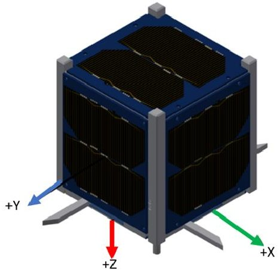
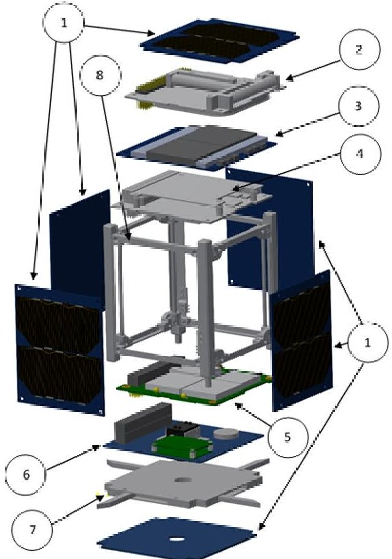
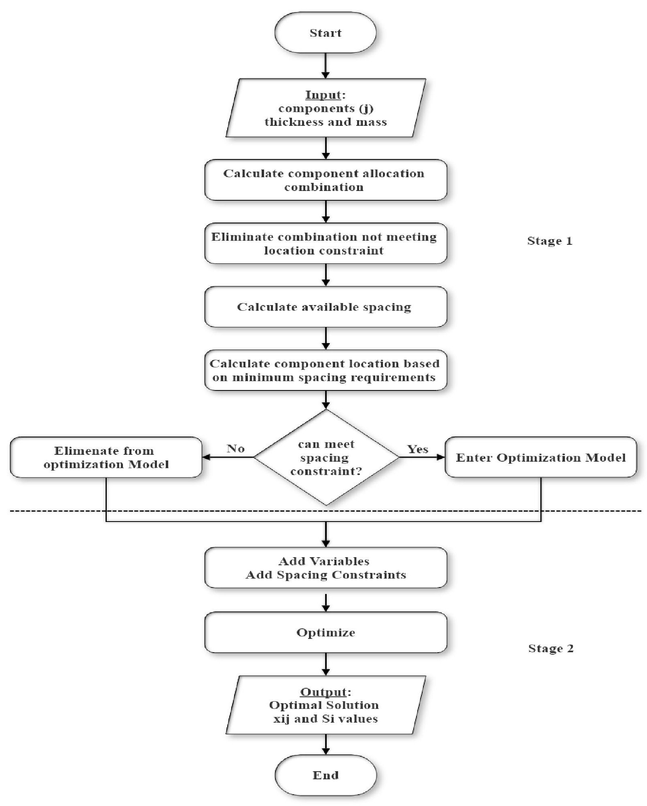

<!-- PDF_PAGE: 1 -->

# LINEAR CUBESAT CENTER OF GRAVITY OPTIMIZATION

Aysha Alharam $ ^{1)2} $ , Amina Albalooshi $ ^{2)3} $ & Dr.Andrei Sleptchenko $ ^{3} $

$ ^{1} $Department of Electrical and Computer Engineering, Khalifa University of Science and Technology Abu Dhabi, UAE $ ^{2} $National Space Science Agency, Bahrain

$ ^{3} $Department of Industrial and Systems Engineering, Khalifa University, Khalifa University of Science and Technology

## Abstract

Nowadays, CubeSats are being developed by many organizations and universities. It is due to it being relatively low in cost and having a short development cycle. CubeSats development process requires various system analyses before launch; to ensure meeting all design and mission requirements. The mechanical analysis includes calculating the mass budget, volume budget, components allocation with an optimal center of gravity, and vibration test. Finding the Optimal center of gravity is critical for CubeSats' stability; due to it being proportional to the environmental disturbances that profoundly impact CubeSats in low earth orbits. Currently, the optimal center of gravity is found by the trial and error method. The trial and error method is an inefficient method as its time consuming, and its results may not be optimal. This research proposes an optimization model that automates finding the optimal center of gravity in the CubeSat development. The proposed system is more timely-efficient than the trial and error method, as it takes all possible solutions to find the optimal solution in less than one second. This research proves the ability of the proposed model to find the optimal center of gravity for different mission scenarios that have different design requirements and constraints.

Keywords: Optimization, CubeSat, Center of Gravity

## 1. Introduction

CubeSats are nanosatellites that have a unit-based design. Each unit has a size of 10x10x10 cm called 1U, and these units can be together to build 2U,3U, and 6U CubeSats. CubeSats enabled universities and educational institutes to start building their satellites due to its simple design and low cost for building educational and scientific missions. The vital missions that CubeSats built for, compared to the time where satellites built for commercial and military applications. The rise in CubeSats popularity made it a trend to have Commercial On the Shelf components (COTS). The availability of off the shelf components had various advantages; it speeds up the building process of CubeSats and reduces the risk of mission failures by having components with flight heritage.

On the other hand, having fixed components is considered a constraint in some aspects of building CubeSats. Components' features restricted to vendor specifications and some design requirements. In the structural design of the CubeSat, some physical requirements must be met, but having off the shelf components makes it challenging. The challenge is to achieve the requirements while maintaining low cost and achieving the mission requirements.

CubeSats can be deployed directly from launch vehicles as an auxiliary payload, or they can from the international space station (ISS) after 1 to 3 months from their arrival. CubeSat's developer should follow standard design specifications called CubeSat Design Specification (CDS). It has a set of general, mechanical, and electrical requirements to define the CubeSat design. CubeSats to be deployed from the ISS should follow the Interface Control Document (ICD) set of requirements of the deployer such as NanoRack and JAXA. CubeSat mechanical requirements highlight different structural requirements. One of the most critical requirements for is the center of gravity of the CubeSat

<!-- PDF_PAGE: 2 -->

concerning the geometric center. [1]

The center of mass, which is the reference point for mechanical calculations and is the point where any uniform form force acts on the object. It is crucial for satellite motion definition, the motion of the satellite around itself, and the object; it is orbiting. As well as attitude determination and control since the center of mass is a big contributor in the CubeSat's stability.[2]

One of the most important physical concepts is the center of mass. The center of mass is a position defined relative to an object or system of objects. It is the average position of all the parts of the system, weighted according to their masses. The center of mass requirement differs for each axis direction based on the size of CubeSat. The center of gravity for X and Y directions fixed, and it shall locate within 2 cm from the geometric center for 1U, 2U, and 3U. In contrast, the center of mass in Z-direction needs to be within 2 cm, 4.5 cm, and 7 cm, respectively. As both X and Y center of gravity fixed, the Z-direction center of gravity differs based on the placement of the boards in the CubeSat based on their distance from the edge point. Placement of boards in the CubeSat to achieve the requirement of the Z-direction center of mass usually done manually as trial and error way.[3]

Thus, this paper aims to provide an optimization model to minimize the difference between the CubeSat CG and the geometric center while maintaining different constraints. It is achieved by measuring optimal resource allocation based on their distance and masses. The contribution of this paper is to propose a new system that will calculate the center of gravity for CubeSats in a time-effective manner, compared to the currently used trial and error method.

This paper organized as follows: Section 2.reviews different related work to this research. Section 3. describes the problem of statement mathematically. The section shows the problem of mathematical model formulation. Section 5.shows this problem-solving method. Finally, section 6.illustrates the result of this research.

## 2. Literature Review

From previous research, it is clear that the center of mass plays a significant role in the satellite's design and stability. Research by Samir and James in [4] shows how aerodynamics and the center of pressure are critical physical concepts. In optimal cases, the center of pressure shall lie behind the center of mass. This concept is critical for CubeSats since they orbit in low altitudes( less than 500 km). Thus, it makes the satellites experience a significant amount of aerodynamic drag. Another research by Lappas et al. in [5] discussed a CubeSat design with solar sails. The sail acts as a novel 3-axis attitude control system that depends on the change of center mass and center of pressure.

Fakoor and Taghinezhad in [6] proposed a hybrid method to optimize layout design in GEO satellites by using a combination of simulated annealing optimization and Quasi-Newton methods. The challenge of this research was to place the fuel tank closer to the center of mass; because the mass of fuel tanks varies in the GEO satellite due to fuel consumption. This research aimed to have such a layout that minimizes the difference between the tank's and satellite's center of mass. Also, decreasing the arisen torque that affects the satellite. This minimization considered an attitude control requirement. The final algorithm of the layout optimization helps in having an optimal design for communication satellites.

Tikhonov et al. in [7] introduced an automated solution to find an optimal three-dimensional layout of large satellites' equipment. They were taking into consideration the center of mass, moment of inertia, thermal distribution, natural frequencies, and structural strength. Their model had three objective functions: minimizing the center of gravity offset, minimizing the cross moments of inertia, and minimizing the space debris impact risk.

Another research conducted by Chesi et al. in [8] proposed an attitude control technique based on the center of mass shifting. It modified the satellite's center of pressure by shifting its center of mass. This shifting results in changing the aerodynamic torque that is one of the primary torques disturbances affecting the satellite's attitude. As this method is not a three-axis stabilization method, an actuator such as a reaction wheel added. This research resulted in improving the pointing accuracy of satellites in low earth orbit. Since the most significant disturbance torque in low earth orbit is the aerodynamic drag force. Their model was a numerical model for allocating three shifting masses and three magnetic torquers dynamically. Nevertheless, this research did not use an optimization algorithm.

<!-- PDF_PAGE: 3 -->

Two research conducted by Belokonov et al. in [9],[10] that; focused on the CubeSat stabilization based on its design parameters. Its motivation was to control the lifetime of the CubeSat with ensuring the safety of the international space station (ISS). They proposed a probabilistic model to choose the appropriate inertial characteristics. The research resulted in a formula for designing passive and active attitude stabilization.

Amiouny et al. in [11] presented a balancing algorithm of loading aircraft or trucks. The algorithm's objective was to minimize the difference between the actual center of gravity and the target point. The challenge of this optimization problem was the trade-off between the efficient utilization of space and the load distribution. Load distribution is an essential factor for flight safety, flight speed, and fuel consumption. The model developed was a one-dimensional load balancing problem.

Mathur in [12] introduced a one-dimensional load balancing problem. The research aimed to place blocks of given length and weight in a way that the center of gravity is closer to the theoretical center of gravity. The approximation in the research is a knapsack problem. The algorithm had a complexity of an existing algorithm for aircraft but with enhanced results. The research took into consideration the balance algorithm and the knapsack algorithm. Both algorithms were programmed and tested with randomly generated variables. As a result, the knapsack algorithm showed a better solution than the balance algorithm for 85 problems. Furthermore, the remaining 315 problems had the same values.

Bussolino et al. in [13] proposed an analytical model, a detailed analytical model for cargo accommodation according to a set of rules and dynamic constraints. The research motivation was to have a model that overcomes the challenges of producing the optimal solution manually. This project used mathematical programming methodology and advanced operation research. This optimization problem solved using a mixed-integer programming optimizer. Besides, for the mechanical analysis of mass properties and volume, the CAD system was used.

Colaneri et al. in [14] solved an optimization problem for space vehicle accommodation while considering all the loading constraints. In their research, they accounted for the non-linear parameter that is the center of mass. Thus, their problem was non-linear.

Most of the published researches was building models for big satellites, space vehicles, and cargos. Also, they considered the center of gravity optimization as a non-linear problem. Since the is no such a model to optimize CubeSat's center of gravity, this research proposes an optimization model for CubeSat's center of gravity. Furthermore, to simplify this problem and solve it in a time-efficient manner, by linearizing the problem. This solution is novel for CubeSats' missions with their different designs and constraints.

## 3. Problem Statement

The stability of CubeSat is affected by many factors; one is the center of gravity (CG), which described as the total force of gravity acting on an object. Moreover, in theory, the center of gravity is expected to be in the geometric center of the object. In CubeSats, each subsystem's component has a mass and a center of gravity around the 3D axis; thus, contributing to the CubeSat center of gravity. A problem arises with the trend of using COTS components due to their restricted mass and center of gravity. Thus, it makes it critical to measure the CG of the CubeSat in the ground testing and development phase. According to the 1U CubeSat design standard(CDS), the CG shall be within 2 cm from its geometric center in the X, Y, and Z direction. Both X and Y direction has fixed CG almost in the center of the CubeSat. The CG in Z-axis depends on the distance between the components and the reference point at the bottom edge. Therefore, the Z-axis CG calculation relies on the order of the placed component in the structure of the CubeSat. The traditional way to find the best order of components carried by mechanical engineers is the trial and error method. It is complicated and time-consuming; thus, developing an optimization model will automate the process and improve the designing phase for less time and better decisions.

This project aims to propose an optimization model to minimize the displacement of the CubeSat's center of gravity from the geometrical center. Thus, the objective is to find the optimal component's

<!-- PDF_PAGE: 4 -->

placement within the structural skeleton of the CubeSat.

## 3.1 Arrangement of CubeSat Subsystems

In this project, a case study of a 1U CubeSat project used to build the proposed model. Figure 1 shows a block diagram for 1U CubeSat with different subsystem fitted in the structure and its axis reference. CubeSat subsystems are namely OBC, EPS, COMM, ADCS, and PL. The Onboard Computer (OBC) is the primary controller of all subsystems that act as the brain of the CubeSat. The Electrical and Power Subsystem (EPS) that manages the power distribution among other subsystems. The communication subsystem (COMM) can function separately as a Receiver (RX) board and Transmitter board (TX), or it can be a full-duplex transceiver (TRX). The Attitude Determination and Control System (ADCS) maintains the stability of the CubeSat in orbit. Moreover, each CubeSat

Figure 1-1U CubeSat with reference axis

shall include at least one Payload (PL). This mission's Payload is a camera connected to a payload controller.According to CubeSat Design Specification (CDS), a 1U CubeSat mass shall not exceed 1.3 kg. The CubeSat mass budget shown in Table 1. Figure 2 shows an exploded view of the CubeSat's components. As it is shown, the total mass is 1.15 kg, which is less than the CSD requirement. For the center of mass calculation, the CubeSate structure Skeleton and the solar panels are not counted.

Figure 2-1U CubeSat with reference axis

<!-- PDF_PAGE: 5 -->

Table 1-1U case study CubeSat's Mass Budget

<table border="1"><tr><td>Part</td><td>Name</td><td>Quantity</td><td>Mass(g)</td></tr><tr><td>1</td><td>6</td><td>Solar panels</td><td>50</td></tr><tr><td>2</td><td>1</td><td>ADCS</td><td>196</td></tr><tr><td>3</td><td>1</td><td>EPS</td><td>50</td></tr><tr><td>4</td><td>1</td><td>OBC</td><td>94</td></tr><tr><td>5</td><td>1</td><td>COM</td><td>75</td></tr><tr><td>6</td><td>1</td><td>Payload Board(with camera)</td><td>135.5</td></tr><tr><td>7</td><td>1</td><td>Antenna</td><td>89</td></tr><tr><td>8</td><td>1</td><td>Skeleton</td><td>211.2</td></tr><tr><td></td><td></td><td>Total mass(g)</td><td>1150.7</td></tr></table>

The physical placement of these subsystems' boards in the CubeSat structure depends on the available space as well as different constraints. The main constraints of the subsystem's Printed Circuit Board (PCB) are Electromagnetic (EMI) susceptibility and emissivity. Thus, the communication transceiver board shall be as close as possible to the antenna (ANT) in order to reduce the RF path. Therefore, the ANT and COMM shall be apart by 40 mm at maximum. Also, the ANT needs to be placed either on the top or the bottom of the Z-axis. Besides, the camera shall be in nadir direction toward the earth. Therefore it needs to be fitted at the bottom of the structure. The ADCS board should be away from the ANT to avoid any magnetic interference by 25 mm, at least. Both COMM and EPS emitted heat, so they shall not be placed on top of each other. Furthermore, the recommended spacing between boards shall be at least 1 mm. The total space available is 10 cm in the Z-axis. Each board can be fitted in one location only, and each location contains only one board.

## 4. Mathematical Model

In this section, the parameter and decision variables that are used in the optimization model are illustrated. Also, the mathematical model is described in this section.

## 4.1 Notations

Indices:

i: component location $ i\in I=\{1,2,3,4,5,6\} $

j: Component number

j in J = {ADCS,EPS,OBC,COM,PL,ANT}

Zcg : Total Center of gravity in Z-axis

xi1:ADCS

xi2：EPS

xi3：OBC

xi4:COMM

xi5:PL

xi6:ANT

a: location of COM at location i

b: location of ANT at location i

c: location of ADCS at location i

Problem Parameters:

$ z_{i} $ : center of mass in Z-axis for board at location(i)

M: Total Mass

m i: mass of board at location i

$ t_{i} $ : thickness of the subsystem in this location $ i $

m': component j mass

t'：component j thickness

<!-- PDF_PAGE: 6 -->

Decision Variables:

$ x_{ij} $ : binary value is whether component j in position i

$ S_{i} $ : spacing between the components and the previous at the bottom of the it

As mentioned, each component has its mass $ m^{\prime} $ and thickness $ t^{\prime} $ . Table 2 shows each component mass and thickness.

Table 2- Components Masses and Thickness values

<table border="1"><tr><td>Subsystem</td><td>Mass(g)</td><td>Thickness(mm)</td></tr><tr><td>ADCS</td><td>196</td><td>18.7</td></tr><tr><td>EPS</td><td>50</td><td>8.1</td></tr><tr><td>OBC</td><td>94</td><td>15.45</td></tr><tr><td>COM</td><td>75</td><td>10.7</td></tr><tr><td>PL</td><td>135.5</td><td>37.9</td></tr><tr><td>ANT</td><td>89</td><td>1.1</td></tr></table>

Center of mass depends on the mass of each component based on its location, component center of mass $ z_{i} $ , and the total mass, Z-axis center of mass formula is shown in equation (1). Each location is defined by $ z_{i} $ , starting from bottom to top. Each board in location $ z_{i} $ has the following thickness of the subsystem $ t_{i} $ in this location including (top-height, bottom-height, and PCB thickness), and the spacing between the components and the previous at the bottom of it $ S_{i}.z_{i} $ depends on the location of the previous component at location $ z_{i-1} $ directly. $ z_{i} $ location formula is shown in equation (2). The spacing between components is strictly dependent on the location of the components; spacing is calculated by equation (3).

$$
Z _ {c} g = \sum_ {i = 1} ^ {6} \frac {\left(m _ {i} * z _ {i}\right)}{M}
$$

$$
z _ {i} = z _ {i - 1} + \frac {1}{2} \left(t _ {i} + t _ {i - 1}\right) + S _ {i - 1}
$$

$$
S _ {i} = z _ {i} - z _ {i - 1} - \frac {1}{2} \left(t _ {i} + t _ {i - 1}\right)
$$

The center of gravity depends on the location, thickness, and mass of component at that location, and the spacing between locations depends on the location selected at location i . Thus, the binary variable $ x_{ij} $ define as a decision variable. It is whether component j in position i . Since the location $ z_{i} $ depends on the component j selected at this location equation (5) and (6) represents the relation between the location and the component thickness and mass.

$$
x _ {i j} = \left\{ \begin{array}{l l} 1, & \mathrm {i f} j ^ {t h} \mathrm {c o m p o n e n t p l a c e d i n l o c a t i o n} i \\ 0, & \mathrm {o t h e r w i s e} \end{array} \right.
$$

$$
t _ {i} = \sum_ {j = 1} ^ {6} x _ {i j} * t _ {j} ^ {\prime}
$$

$$
m _ {i} = \sum_ {j = 1} ^ {6} x _ {i j} * m _ {j} ^ {\prime}
$$

## 4.2 Objective Function

The objective function is to minimize the difference between the center of gravity of the CubeSat and Geometric center. The geometric center in 1U CubeSat is located at 5 cm. Objective function is

<!-- PDF_PAGE: 7 -->

shown in equations (7), (8), and (9)

$$
\delta_ {p l u s} \geq \sum_ {i = 1} ^ {6} \frac {\left(m _ {i} * z _ {i}\right)}{M} - 5, \delta_ {p l u s} \geq 0
$$

$$
\delta_ {m i n u s} \geq 5 - \sum_ {i = 1} ^ {6} \frac {\left(m _ {i} * z _ {i}\right)}{M}, \delta_ {m i n u s} \geq 0
$$

Minimize

$$
\delta_ {p l u s} + \delta_ {m i n u s}
$$

## 4.3 Constraints

The CubeSat resource allocation has many constraints, as mentioned in the previous section. These constraints are formulated below. The Cubesat center of mass shall be between 30 mm to 70 mm; it is shown in equation (10). Also, each location (i) must be filled by one (j) component and each component (j) is fitted in one location (i). Thus it is a 1 to 1 relation the is represented by the equations (11) and (12). Moreover, the separation between boards shall be at least 1mm. The spacing from the bottom to the location i=1 is '0'. Moreover, the thickness of the structure border not counted; this illustrated in equation (13). The ANT shall be placed either at the bottom in i=1 or at the top in location i=6, this is described in equation (14). The PL shall be allocated at the bottom of the CubeSat either at location i=1 or location i=2 if the ANT were at location i=1, this is illustrated in equation (15). The COM and the EPS shall not be on top of each other, and they shall be separated by one component, at least as shown in equation (16). The ADCS component shall be away from COMM by at least 25 mm, as describes in equation (18). The distance between ADCS location and COMM location shall not be more than 40 mm, as shown in equation (17). The total length of Z-axis for CubeSat is 100 mm, as shown in equation (19)

$$
3 c m \leq Z _ {c g} \leq 7 c m
$$

$$
\sum_ {j = 1} ^ {6} x _ {i j} = 1 \quad \forall i \in I
$$

$$
\sum_ {i = 1} ^ {6} x _ {i j} = 1 \quad \forall j \in J
$$

$$
S _ {i} \geq 1 m m,
$$

$$
S _ {0} = 0,
$$

$$
t _ {0} = 0,
$$

$$
x _ {1 6} + x _ {6 6} = 1
$$

$$
x _ {1 5} + x _ {2 5} = 1
$$

$$
x _ {i 2} + x _ {(i - 1) 4} + x _ {(i + 1) 4} = 1
$$

<!-- PDF_PAGE: 8 -->

$$
a = z _ {i} + \left(x _ {i 4} \frac {1}{2} * t _ {4} ^ {\prime}\right)
$$

$$
b = z _ {i} + \left(x _ {i 6} \frac {1}{2} * t _ {6} ^ {\prime}\right)
$$

$$
a - b \leq | 4 0 | m m
$$

$$
c = z _ {i} + \left(x _ {i 1} \frac {1}{2} * t _ {1} ^ {\prime}\right)
$$

$$
a - c \geq | 2 5 | m m
$$

$$
\sum_ {i = 1} ^ {6} t _ {i} + S _ {i - 1} \leq 1 0 0 m m
$$

## 5. Solving Methods

As discussed in the previous section, this problem has two decision variables that depend on each other. Thus, it is a non-linear problem. In this project, the problem becomes linearized in two steps. First, The calculation of all possible components allocated with the minimum spacing. The second stage is for solving a linear optimization problem on the generated allocation combination using the spacing between components as a variable. Figure 3 illustrates the flowchart of the optimization process in the two stages.

## 5.1 Generation of possible component allocation

In this stage, a python code developed to generate all possible combinations of components allocation. Six components can fit into six different locations. Thus, the total number of the combination is 6!=720 different possible components allocation. After that, all the constraints that are related to a component location removed from the combination set. These constraints are shown in equations 14, 15, and 16. Removing all these combinations resulted in 20 different combinations only. After that, for each component in location i, the corresponding set of masses, and thicknesses were generated. The constraints in equations 17 and 18 are related to the location and the total spacing between components. A pre-processing stage introduced to the system to minimize optimization model time. This step calculates whether the combination can satisfy the constraint using the total available spacing and the total distance between components, with the minimum spacing. For example, if the constraint is to have at least 25 mm between two components and the total distance with the minimum spacing is less than 40 mm by 10 mm. If the 10 mm is less than the available space, this combination can be optimized. Else-wise, this combination will give an infeasible solution. As a result, excluding it before entering the optimization model will reduce the optimization time.

## 5.2 Solving for the Spacing variable

In this stage, all the combinations that satisfy the location constraints and can satisfy the spacing constraints will enter the optimization model. The first step in the model is initializing the variables, such that the spacing $ S_{i} $ and $ z_{i} $ location. After that, adding all the spacing constraints to the model and setting the objective function. Then, the optimization model applied to all possible combinations. Finally, all variables printed for further design analysis.

## 6. Result and Discussion

The result of the optimization model is verified manually, and it gave the optimal solution with archiving all the constraints. This system allows the engineer to make the right design decision at an early stage of satellite development. For example, if the optimal solution is out of the design requirement range, the engineer will decide to change the size of the CubeSat. Also, they can relax some of the constraints, if possible. Moreover, using the pre-processing stage, the optimization time is minimal

<!-- PDF_PAGE: 9 -->

Figure 3 - Problem Optimization flow chart

<!-- PDF_PAGE: 10 -->

because it eliminates infeasible solutions before entering the optimization model. Thus, this solution is unique in comparison to the other complicated systems in this field. This model is applied to different cases with different constraints to verify its functionality. In this section, the results of the original case study CubeSat project discussed and the what-if analysis of different cases.

## 6.1 Original Problem Result

The result illustrated in Table 3 shows the optimal solution selected by the optimizer. This result gives the minimum difference between the center of gravity and the geometrical center; it also satisfies all the constraints. The optimal solution is 0.14 cm between the center of gravity and the geometrical center. It shows that the CG located at 5.14 cm. The total available spacing was 3.05 mm only. As shown, the ANT is in location i=1, followed by the Payload at location i=2. Also, the EPS is separated from the COMM by the OBC. Moreover, the total distance between the ANT and the COMM is 39.9 mm, which is less than the constraint of 40 mm. Besides, the distance between ADCS and COMM is 26.55 mm, which is greater than the 25 mm constraint. Thus, increasing the size of the CubeSat will give more flexibility in locating the components with different spacing. The manually calculated center of gravity using the trial and error method was four times more than the optimal solution obtained by the model.

Table 3-1U center of gravity optimization $ z_{i} $ and $ S_{i} $ results

<table border="1"><tr><td>Location(i)</td><td>component(j)</td><td>zi(mm)</td><td>spacing(mm)</td></tr><tr><td>6</td><td>ADCS</td><td>87.6</td><td>3.05</td></tr><tr><td>5</td><td>EPS</td><td>73.2</td><td>1</td></tr><tr><td>4</td><td>OBC</td><td>60.42</td><td>1</td></tr><tr><td>3</td><td>COM</td><td>46.35</td><td>1</td></tr><tr><td>2</td><td>PL</td><td>21.05</td><td>1</td></tr><tr><td>1</td><td>ANT</td><td>0.55</td><td>0</td></tr><tr><td colspan="4">Optimal Solution(cm):0.14</td></tr></table>

Although it seems easy to allocate components in small CubeSats, the spacing is a very critical variable that affects the result significantly. The multistage process gives more flexibility in changing the constraints based on the design requirements. As mentioned previously, the trial and error method of calculating the center of gravity took approximately two days to complete, while the proposed model found an optimal solution within one second, in addition to showing all the different possible optimal solutions.

CubeSat's stability is dependent on two directly proportional factors: Gravity gradient torque and moment of inertia. The gravity gradient torque is one of the environmental disturbances. Also, the moment of inertia is a calculated quantity that depends on the center of gravity. Thus, the less displacement of the center of gravity from the geometric center will result in a more CubeSat's stability. That will help in optimizing power consumption and on-board processing.

## 6.2 What-If Analysis Result

CubeSat designs vary in many aspects, namely, mission, size, components' specifications, requirements. Any changes have a direct impact on the various analysis performed in the designing and implementation phase and can modify the pre-calculations, constant parameters, and the optimal solution. Therefore, to serve the objective of this optimization model and have a better understanding of how the model behaves under different cases. Different case studies considered to verify this model and are as follows: Change in size, COTS Vendor, and Payload.

## 6.2.1 CubeSat size

CubeSats have different sizes; the change of size influences the design in terms of structural space availability, but for a higher cost. Having more space on the Z-axis allows fitting more components,

<!-- PDF_PAGE: 11 -->

and lowers the restriction on component sizes. In this case, the optimization model tested on a 2U CubeSat results in changing the length of the z-axis from 10cm to 20cm, affecting the center of gravity constraints. Having more space in the z-axis provides more flexibility for the spacing between the components. The result shows that eight different components allocation can satisfy all the constraints, and the center of gravity is exactly at the geometric center. It also shows that the total available spacing is 103.5 mm.

## 6.2.2 COTS Vendor

With the new trend of having COTS, CubeSat designers can purchase components instead of building their own. COTS gives the great advantage of having flight heritage, which lowers the risk of failure on the mission. Besides, the selection criteria depend on its compatibility, price, mission requirements, and physical specification, which created a highly competitive market. In the original model form, the components were selected according to their mass and thickness to calculate the optimal solution. In order to study the effect of component's vendor changes on the optimization model, components were selected from other vendors and are used to modify and test the model. The result shows that the second selected vendor gives better results in terms of center of gravity by 0.01 cm due to the effects of changing the thickness and mass of components.

## 6.2.3 CubeSat Payload

CubeSat missions can either be scientific, commercial, or educational, and that specifies the Payload selected. One of the most commonly used Payloads are cameras, which was the case in the first model. The use of a camera as a payload restricted the model for its location requirement. Other payloads have fewer placement requirements, such as Automatic Identification System (AIS) receivers, that used to track vessels. Using an AIS receiver as a payload for the third case, changed the payload location constraint in the model. This change resulted in adding 11mm free space due to the difference in the payload thickness, which reflected on the possible component allocations (108 combinations). Thus, the objective value reaches the minimum of value zero.

It concludes that replacing components such as the Payload with another changes the constraints in the implemented model; thus, changing the available possible combinations. Also, the center of gravity is allocated precisely to the geometrical center. The result was similar in the case of changing the CubeSat size to 2U. However, in the case of selecting components from a different vendor, the optimal solution computed was worse than the original model.

## 7. Conclusion

The CubeSat center of gravity is a critical factor for CubeSat stabilization. Thus, the objective of this paper is to propose a mathematical model that finds the optimal center of gravity. The introduced model decreased the displacement of the center of gravity from 1.2 cm to 0.14 cm. Besides, the time required for calculating the optimal center of gravity reduced from approximately two days to one second. The proposed model was tested for different cases, and it proves its ability to be used for different case studies. It provided a better layout of components in a CubeSat resulting in improved stability. However, the model assumes components with an optimized center of mass, leaving space for future work. As such, the non-optimized center of gravity components is taken under consideration and solving the model for the three-axis x, y, and z. Lastly, considering the component rotation in one of the steps in the model.

## 8. Contact Author Email Address

Aysha Alharam: Aysha.alharam@nssa.gov.bh Amina Albalooshi: amina.albalooshi@nssa.gov.bh

## 9. Copyright Statement

The authors listed above holds the copyright on all of the original material included in this paper. The authors also confirm that they have obtained permission, from the copyright holder of any third party material included in this paper, to publish it as part of their paper. The authors confirm that they give permission, or have obtained

<!-- PDF_PAGE: 12 -->

permission from the copyright holder of this paper, for the publication and distribution of this paper as part of the AEC proceedings or as individual off-prints from the proceedings.

## References

[1] N. C. L. Initiative et al., "Cubesat 101: Basic concepts and processes for first-time cubesat developers," no. October, p. 96, 2017.

[2] V. Beletskii, "Satellite motion relative to the center of mass in a gravitational field," Moscow Izdatel Moskovskogo Universiteta Pt, 1975.

[3] C. D. Specification, "rev. 13," The CubeSat Program, Cal Poly SLO, 2014.

[4] S. A. Rawashdeh and J. E. Lumpp, "Aerodynamic stability for cubesats at iss orbit," Journal of Small Satellites, vol. 2, no. 1, pp. 85-104, 2013.

[5] V. Lappas, N. Adeli, L. Visagie, J. Fernandez, T. Theodorou, W. Steyn, and M. Perren, "Cubesail: A low cost cubesat based solar sail demonstration mission," Advances in Space Research, vol. 48, no. 11, pp. 1890-1901, 2011.

[6] M. Fakoor and M. Taghinezhad, "Layout and configuration design for a satellite with variable mass using hybrid optimization method," Proceedings of the Institution of Mechanical Engineers, Part G: Journal of Aerospace Engineering, vol. 230, no. 2, pp. 360-377, 2016.

[7] A. A. Tikhonov, D. Spasic, K. A. Antipov, and M. Sablina, "Optimizing the electrodynamical stabilization method for a man-made earth satellite," Automation and Remote Control, vol. 72, no. 9, p. 1898, 2011.

[8] S. Chesi, Q. Gong, and M. Romano, "Aerodynamic three-axis attitude stabilization of a spacecraft by center-of-mass shifting," Journal of guidance, control, and dynamics, vol. 40, no. 7, pp. 1613-1626, 2017.

[9] I. Belokonov, I. Timbai, and P. Nikolaev, "Analysis and synthesis of motion of aerodynamically stabilized nanosatellites of the cubesat design," Gyroscopy and Navigation, vol. 9, no. 4, pp. 287-300, 2018.

[10] I. Belokonov and I. Timbai, "The selection of the design parameters of the aerodynamically stabilized nanosatellite of the cubesat standard," Procedia Engineering, vol. 104, pp. 88-96, 2015.

[11] S. V. Amiouny, J. J. Bartholdi III, J. H. Vande Vate, and J. Zhang, "Balanced loading," Operations Research, vol. 40, no. 2, pp. 238-246, 1992.

[12] K. Mathur, "An integer-programming-based heuristic for the balanced loading problem," Operations Research Letters, vol. 22, no. 1, pp. 19-25, 1998.

[13] L. Bussolino, G. Fasano, and A. Novelli, "A cargo accommodation problem for a space vehicle: The cast project," in Operations Research in Space and Air. Springer, 2003, pp. 13-26.

[14] L. Colaneri, F. Della Croce, G. Perboli, and R. Tadei, "A heuristic procedure for rack configuration in the space vehicle accommodation problem," in Operations Research in Space and Air. Springer, 2003, pp. 27-42.