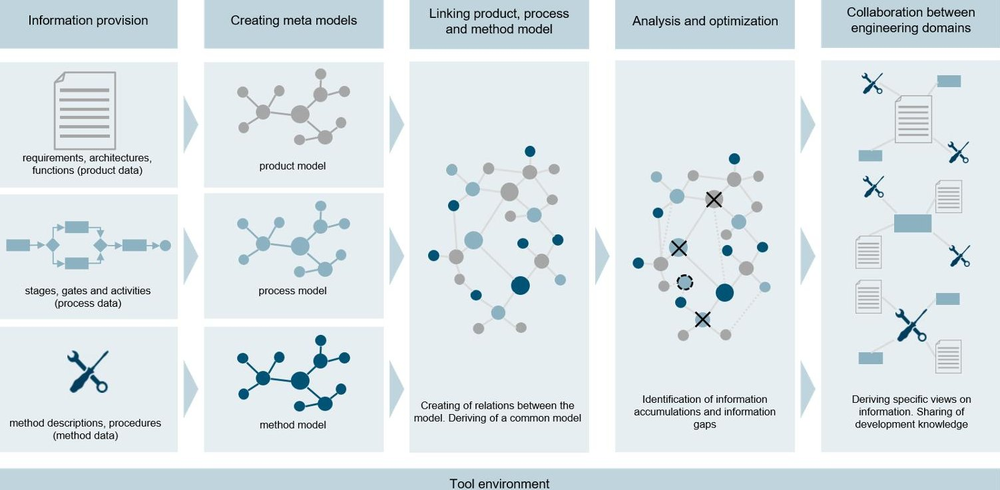
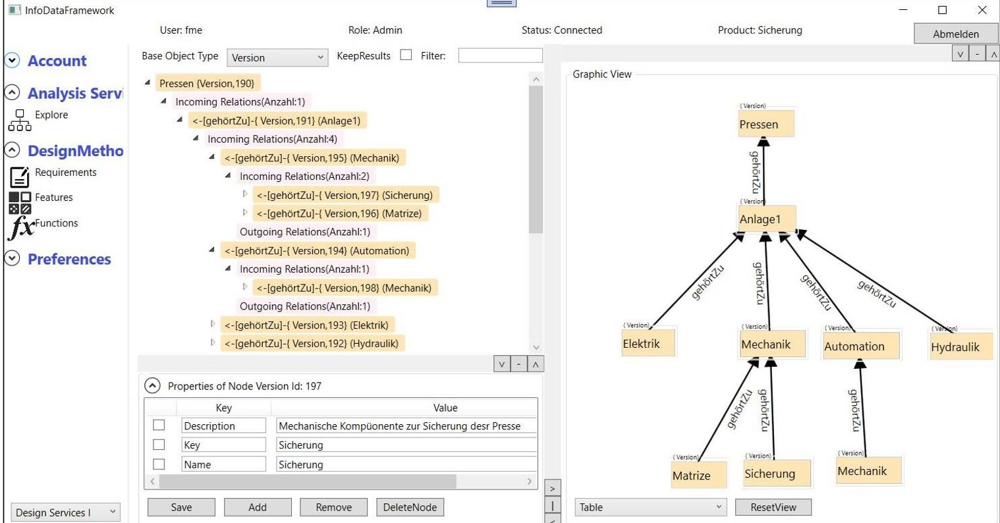
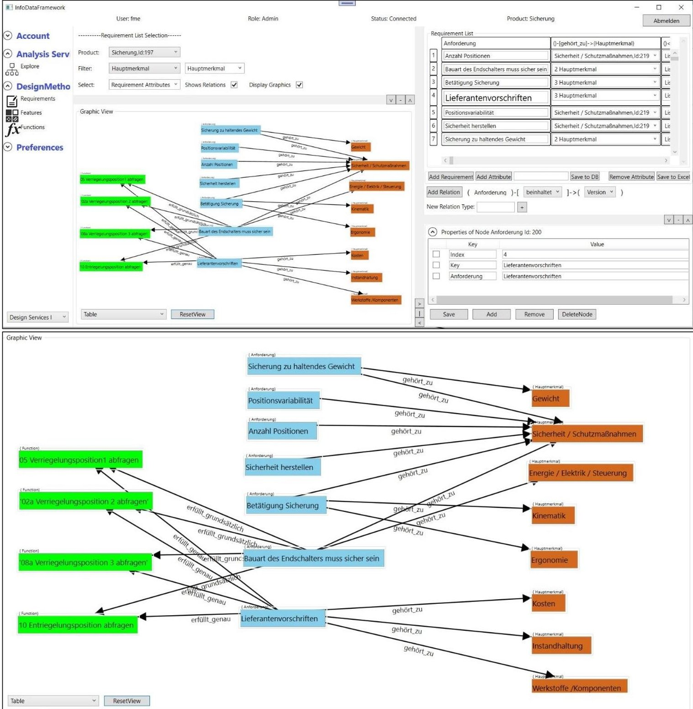

<!-- PDF_PAGE: 1 -->

# LINKING CROSS-DOMAIN INFORMATION TO SUPPORT THE DEVELOPMENT OF COMPLEX SYSTEMS

Baschin, Julian (1);

Schmidt, Ronald (2);

Schneider, David (1);

Vietor, Thomas (1);

Kizgin, Umut Volkan (1)

1: TU Braunschweig;

2: fme AG

## ABSTRACT

Due to an expanding number of mechatronic functionalities in modern technical products, the proportion of software and electronic components is also increasing. As a result, the products are developed by different engineering domains in complex development processes. To handle the growing complexity, Systems Engineering (SE) is increasingly important for development organizations of enterprises. System Engineering (SE) is understood as an approach to network the individual engineering domains and shall lead to a collaborative development of complex systems. Model-Based System Engineering (MBSE) expands SE by using common models and software tools to describe und visualize the systems. However, MBSE is not widely established in enterprises today. On the one hand, the introduction requires a distinct and consistent system understanding and collaborative way of working. On the other hand, the application of the existing tools requires extensive tool competencies due to many possible functions and features. Therefore, this paper presents a concept and a software based tool for a lean implementation of SE/MBSE to support the collaborative development of complex technical systems in small and medium-sized enterprises.

Keywords: Systems Engineering (SE), Product modelling / models, Process modelling, Functional modelling, Design methods

Contact:

Baschin, Julian

TU Braunschweig

Germany

j.baschin@tu-braunschweig.de

<!-- PDF_PAGE: 2 -->

## 1 INTRODUCTION

## 1.1 Motivation

Products in mechatronic engineering become more and more complex and varied today. Due to an expanding number of mechatronic functionalities, the proportion of software and electronic components is also increasing. As a result, many technical products have no longer a predominantly mechanical design. Rather, the products have to be understood as a comprehensive system, which is developed by different engineering domains such as mechanic, electronics and software (Eckert et al., 2004). For example, a cooking machine was previously a simple product consisting of mechanical and a few electronic components. The only function was the controlling of the dough hook with a few different speed settings. Modern smart cooking machines offer users significantly more functions today. For example, the cooking machines have special kneading and mixed programs with intervals of left and right rotation, different cooking programs, and integrated scales. This trend can be observed in a similar form at many products (Huth and Vietor, 2020). Furthermore, the separate development teams of the engineering domains are often distributed locally, which complicates the communication. Complex and dynamic product development processes arise, in which many design data have to be exchanged for the harmonization of the product (Baschin et al., 2020). To handle the growing complexity of modern products and development processes, new approaches are important in development organizations of enterprises to support collaborative design (Noel and Roucoules, 2008). For example, Systems Engineering (SE) addresses these challenges. SE is as an approach to network the individual engineering domains and shall lead to a collaborative development of complex systems (Walden et al., 2015). For an effective exchange of extensive design data and technical requirements, Model-Based System Engineering (MBSE) expands SE by using common models and software tools to describe und visualize the systems (Alt, 2012). However, MBSE is not widely established in enterprises today. On the one hand, the introduction of MBSE requires a distinct and consistent system understanding and collaborative way of working (Gausemeier et al., 2015). On the other hand, the application of the existing software tools requires extensive tool competencies due to many possible functions and features (Kauffeld and Paulsen, 2018).

## 1.2 Aim of the paper

Based on the motivation, the aim of the paper is to develop a lean and applicable concept to support collaborative design in product development projects to introduce SE. The concept shall enable the connection of project information (product, process and method data) to indicate, which product data has to be available at what time in the development process and how can this be supported methodically? The implementation of the concept shall be supported by using a software-based tool, which is developed parallel within a research project. To evaluate the work, the concept is applied in a real development project of a mechatronic engineering enterprise via using the software tool.

## 1.3 Content of the paper

The following paper is structured as follows: chapter 1 shows the motivation, the aim and the content of the paper. Chapter 2 presents the state of the art of systems thinking, SE and MBSE. In chapter 3, the contribution or the paper is described. Chapter 4 presents the concept and the software tool that are developed on the findings of chapter 2 and chapter 3. In chapter 5, the concept and the software tool are applied. For this purpose, a case study in the environment of a product development in mechatronic engineering is presented. Finally, chapter 6 summarizes the findings and gives a critical reflection and an outlook for further research.

## 2 STATE OF THE ART - SYSTEM ORIENTED PRODUCT DEVELOPMENT

## 2.1 Characteristics of systems thinking and systems engineering (SE)

According to Ropohl (2012), a system is a form of representation by which a part of reality is depicted. Humans subdivide reality itself into perspective constructions and interpretations (Ropohl, 2012). This means, that humans divide reality from their subjective perspective into systems, respectively networks of connections. These connections between some elements are thereby demonstrably present, but not

<!-- PDF_PAGE: 3 -->

between others. Elements, between which a connection is clearly identifiable, are called "wholeness". The wholeness is the object of investigation of the general system theory (Ropohl, 1975). By the system theory, systems are built from the wholeness, which comprise the relevant part of the wholeness (Ropohl, 2012). Systems are not natural constructs, but models of human thought (Ropohl, 2012). Hereby, general systems theory becomes an "operational theory about how to build models of any whole fields of experience" (Ropohl, 2012). As a result, in terms of general systems theory, a system is a model of a wholeness. "A system represents a wholeness, but considers only selected properties of the wholeness and is relevant only for a part of people for a certain time and certain forms of thinking and acting" (Ropohl, 2012). Such a model or system has to be able to withstand critical review, only then it can serve the requested purpose. General systems theory introduces three formal concepts for systems. Each of them represents different content and is thus suitable for different objectives:

- functional system concept: The actual system is as a black box. Only the inputs and outputs of the system are known or visible from the outside. The function of the system is defined as the (reproducible) relation that the system generates between the inputs and outputs. "Functional systems thinking explicitly refrains from the material concretization and the internal structure of the system and is limited to the behaviour of a wholeness in its environment" (Ropohl, 2012).

- structural system concept: In this concept, a system is understood as a set of different elements. A multiplicity of relations can exist between the elements. "On the one hand, the structural approach is based on the high variety of possible relation networks, which exist in a given set of elements and thus can lead to different system properties. On the other hand, it is about the properties of the elements, on which it depends how well they can be integrated into a system" (Ropohl, 2012). In the structural system concept, the individual elements are not considered on their own, but in their context and interaction with other elements.

- hierarchic system concept: This system concept serves to represent different levels of abstraction and concretization. Because a considered system (A) can consist of elements, which are also systems in themselves (from the point of view of (A) it is its subsystems). Otherwise, the system (A) itself can be part of a superordinate system (From the point of view of (A) it is its superordinate system). Depending on the view of the hierarchic system, the details or the essential connections are focussed. "Systems thinking is open to both strategies, for the ever more detailed analysis as well as for the superordinate synthesis of interrelationships" (Ropohl, 2012).

- The mentioned system concepts are not exclusive to each other, but can also be combined to describe systems with a specific objective of experience" (Ropohl, 2012). The three system concepts previously explained the terms of the system and the term of the model are important in the context of systems engineering. The International Council of Systems Engineering (INCOSE) defines Systems Engineering as follows: "Systems Engineering is a transdisciplinary and integrative approach to enable the successful realization, use, and retirement of engineered systems, using systems principles and concepts, and scientific, technological, and management methods. [...] Systems Engineering focuses on:

- establishing, balancing and integrating stakeholders' goals, purpose and success criteria, and defining actual or anticipated customer needs, operational concept and required functionality, starting early in the development cycle;

- establishing an appropriate lifecycle model, process approach and governance structures, considering the levels of complexity, uncertainty, change, and variety;

- generating and evaluating alternative solution concepts and architectures;

- baselining and modelling requirements and selected solution architecture for each phase of the endeavour;

- performing design synthesis and system verification and validation;

- while considering both the problem and solution domains, taking into account necessary enabling systems and services, identifying the role that the parts and the relationships between the parts play with respect to the overall behaviour and performance of the system, and determining how to balance all of these factors to achieve a satisfactory outcome.

Systems Engineering provides facilitation, guidance and leadership to integrate the relevant disciplines and specialty groups into a cohesive effort, forming an appropriately structured development process that proceeds from concept to production, operation, evolution and eventual disposal. Systems Engineering considers both the business and the technical needs of customers with the goal of providing a quality solution that meets the needs of users and other stakeholders, is fit for the intended purpose in real-world

<!-- PDF_PAGE: 4 -->

operation, and avoids or minimizes adverse unintended consequences. The goal of all Systems Engineering activities is to manage risk, including the risk of not delivering what the customer wants and needs, the risk of late delivery, the risk of excess cost, and the risk of negative unintended consequences. One measure of utility of Systems Engineering activities is the degree to which such risk is reduced. Conversely, a measure of acceptability of absence of a System Engineering activity is the level of excess risk incurred as a result (INCOSE, 2022)."

The definition summarizes many characteristics of systems engineering. A key characteristic of Systems Engineering is interdisciplinary. In the sense of systems engineering at least the disciplines of mechanics, electrics/electronics and information technology/software development work together as a team during the development of technical systems. The focus on the customer is another essential characteristic. In Systems Engineering, product development begins with the recording of the customer's requirements with regard to product and its functionalities. Based on this, the requirements of other stakeholders as well as boundary conditions, resulting from the possible use cases, are recorded systematically. In the further development process, these requirements are an important input for the individual development activities and serve as a basis for realization of the product. The requirements serve also as a basis for the tests to be performed during the validation of the product, in order to ensure matching of the initially requirements and customer's needs. Systems Engineering can also be understood as a meta-discipline that supports the flow of information between the individual disciplines (e.g., software, electronics, and mechanical development) by providing suitable interfaces and processes and aims to develop the best possible solution under the specified constraints (Weilkiens, 2014; Friedenthal et al., 2015). To achieve this goal, Systems Engineering considers not only pure technical development, but also aspects of project management are taken into account in interaction (Haberfellner et al., 2019). Other systems engineering approaches focus the development organization in the enterprise as a system and try to describe it with its elements (processes, roles, humans, product information, methods and tools). These approaches shall support the introduction of Systems Engineering in enterprises (Huth et al., 2018). Martin (1996) also describes systems engineering as the interaction between processes, methods, tools, the environment, existing technologies and the employees. Systems Engineering is thus not a specific (product development) method but is increasingly becoming an own discipline due to the diversity of different approaches (Gausemeier et al., 2015; Walden et al., 2015).

## 2.2 Model-based systems engineering (MBSE) as advancement of systems engineering (SE)

In order to compensate the weaknesses of earlier document-based systems engineering approaches (e.g., lack of traceability of dependencies between requirements and system elements as well as decisions during development), approaches to Model-based Systems Engineering (MBSE) have been developed (Alt, 2012). The goal of Model-based Systems Engineering is to integrate the results of different development activities in a central common system model. It helps to generate context-specific views for this information and its dependencies (e.g., to answer the following questions during product development: "Which customer requirements are important for the development?" or "Which elements are relevant for the functionality of the product?). Model-based Systems Engineering thus promotes the transition from heterogeneous, document-based product models to consistent and cross-linked product models. The disciplines involved use the models as a source of information in order to document their work results and to relate them to other model elements (Alt, 2012). The modelling of the system is of fundamental importance for Model-based Systems Engineering. For this modelling, the concepts of systems theory and SE are applied and are extended by additional frameworks (e.g. MBSE-Grid, RFLP) and their views (e.g. component behaviour) (Sahin et al., 2021). The modelling is based on the three elements language, tool and method. The methods specify a systematic procedure as well as a definition of the aspects of the technical system to be represented in the model (cf. approaches in the previous chapter). Existing standards for modelling languages such as UML (Object Management Group, 2017a) or SysML (Object Management Group, 2017b) define the semantics and syntax to be used, and form the basis for modelling within the framework of the method. Using software-based modelling tools (e.g. Enterprise Architect, iQUAVIS, Cameo Systems Modeler $ ^{\mathrm{TM}} $ ) the models are created in compliance with the semantics and syntax, and analyses (such as the relationship between customer requirements) are performed. The languages, used in model-based systems engineering, are of a generic character in order to support the representation of different types of systems (e.g., kitchen machines and vehicle systems) in

<!-- PDF_PAGE: 5 -->

the same way. Model-based Systems Engineering formalizes the Systems Engineering by using models to support the following goals (Borky and Bradley, 2019):

- "Ensuring accuracy, repeatability, and manufacturability in systems engineering processes (e.g., decision traceability during development ensures accuracy and repeatability).

- Fostering quality, completeness, and correctness in system design (e.g., traceability/assignment of requirements to addressed elements of the product supports the correctness in the system design).

- Risk minimization in requirements analysis, design, integration and testing as well as in other activities (e.g. deriving relevant test cases, based on customer requirements, reduces the risk of developing the product without matching the customer's needs).

- Expansion of communication and synchronization of activities across the organization and disciplines (e.g., technical changes for the elements of the other disciplines can be derived from the models and the common development of alternatives can be initiated)."

Therefore, Model-based Systems Engineering is the consistent combination of Systems Engineering with the principles of model-based object-oriented software development and thus offers additional possibilities for manageable development of complex systems. However, for effective collaborative working, human aspects also have to be taken into account and the different models have to be linked to the surrounding business models (Noel and Roucoules, 2008).

## 3 CONTRIBUTION OF THE PAPER - SYSTEMS ENGINEERING IN PRACTICE

Surveys on Systems Engineering have shown that the establishment of SE and MBSE in the development of mechatronic engineering varies significantly between different branches of industry. SE is firmly established in the aerospace industry. In the automotive industry, SE is seen as an enabler. It is becoming increasingly important and is promoted by the OEMs. However, Systems Engineering is rarely used in small and medium-sized mechatronic engineering industry, despite its high importance (Gausemeier et al., 2015). The reasons for the missing use of SE are very different. The most cited reasons are the difficult quantification of the benefits of Systems Engineering approaches and the lack of availability of methods for implementation of Systems Engineering approaches (Gausemeier et al., 2015). Furthermore, the lack of skills of the employees, according to systems thinking and new introduced software tools, has to be addressed through competence building (Gausemeier et al., 2015; Kauffeld and Paulsen, 2018). Existing software tools support the introduction of SE and MBSE by creating complex models. However, these tools are very extensive with a large number of functions. This leads to an immense tool competency, that is necessary to use the tools, and complicates the implementation of SE in the development process. In addition, the data basis in the enterprises is mostly insufficient to build the models. Therefore, the data has to be elaborately prepared and implemented in the tools. Furthermore, the targeted transfer of information between stakeholders has to be supported in case of inconsistencies and dependencies.

Therefore, there is a need for a concept that enables a lean implementation of SE/MBSE in small and medium-sized enterprises (SMEs). On the one hand, comprehensible procedures have to be created, which make it possible to aggregate the essential developmental information for a systemic view. On the other hand, the application of the concept has to be supported by an intuitive software tool. This shall quickly show the added value of Systems Engineering and shall enable a sustainable implementation of the new approach. This leads to the following research questions:

- Which views in development projects have to be combined to enable Systems Engineering in SMEs in a lean way?

- How can a software tool support the modelling of complex technical systems and collaborative design in a lean way and which functionalities are necessary for that?

To answer the research questions, the following chapters will present a concept and a tool for a lean implementation of Systems Engineering in the development of small and medium-sized enterprises of mechatronic engineering industry.

<!-- PDF_PAGE: 6 -->

## 4 LINKING CROSS-DOMAIN INFORMATION TO SUPPORT THE DEVELOPMENT OF COMPLEX SYSTEMS

## 4.1 Concept to support cross-domain collaboration

In the following, a concept for a lean implementation of SE is presented (s. fig. 1). As highlighted by Martin (1996) and Huth et al. (2018), the combination of product, process and methods/tools forms the basis for the introduction of Systems Engineering. Accordingly, the essential development information can be represented via a product model (what?), a process model (when and who?) and a method model (how?) that are generated by a software tool. The information about these three fields (subsystems) has to be related to each other. By considering the models in an integrated way, it is possible to determine which product data has to be available at what time and how it can be created. This shall support the implementation of SE into the development process by effective collaboration between different stakeholders and engineering domains. In addition, analysis can be performed to identify information gaps and data inconsistencies to improve the process. The product model, the process model and the method model are the scope of the elaborated concept, which can be generated by five implementation stages (s. below).

Figure 1. Concept for linking process, product and method data

- Information provision. First, the existing data in the enterprise is compiled. The exact data to be collected depends on the issue to be addressed. For example, if there are often problems with the transfer and documentation of requirements, the focus should be on requirements documentation. In addition, it can also be considered, for example, at which stages in the process a requirement has to be provided or implemented. In this case, existing process data should also be compiled in order to link the requirements and the process later. If possible, the information should already be structured hierarchically (top down, for requirements e.g. assigned to the system levels of the product, for processes e.g. different process levels such as reference processes and individual tasks). Because structured data is often not available or only partially available in this way, individual documents can also be provided according to the bottom-up principle and can be continuously expanded later. In addition, method descriptions can be provided to support the developer in the creation of product data and process data. This can be helpful, for example, to describe the procedure for defining or structuring requirements. The method descriptions thus provide guidance on how to proceed with certain development activities and create artefacts. The development data built the basis for the following creation of the meta models.

- Creating meta models. In this stage, the information of the fields (product, process, method) is related separately for each field. For the field of product, this means the connection and dependencies of certain components (system architectures, hierarchical product structures) or functions (function structures, function sequences, logical connections). For the field of process,

<!-- PDF_PAGE: 7 -->

this means the relationships of sequential and/or parallel activities, stages, gates and releases (time sequences, logical sequences). For the field of methods, this means possible links between interrelated methods and its tools (e.g. benchmarking can be a basis for requirements description, house of quality is needed for quality function deployment) or the individual procedure steps of a discursive method.

- Linking product, process and method model. In this stage, the created meta models are related to each other to generate a common model, that represents the development context. Connections between product data, process data and method data are established. The following example illustrates the procedure: with the help of a requirements analysis (Method. How?), the requirements for a product can be described systematically. As a result, a requirements description (Product. What?) is created in the form of a model or text-based document. The additional information, which requirement has to be completed for which release or who is responsible for the completion of the requirement, can also be used to make a link to the process (Process. When and who?). Therefore, the generated model contains the information, what is processed, how until when and by whom?

- Analysis and Optimization. Through the joint model, accumulations of information and information gaps can be identified. It is obvious whether necessary information is provided consistently to the stakeholders. For example, if there is no link between the requirements and the process, there may be confusion about responsibilities or deadlines. If, on the other hand, there are a large number of links between them, there is a risk that decisions will be made differently and not in a reproducible way, because there is no clear procedure defined. Accordingly, the data can be adapted to remove the known weaknesses (e.g. adding of roles and responsibilities, deleting of inconsistent data).

- Collaboration between engineering domains. Finally, the objective of the concept is to make the collaboration between the different engineering domains more effective. By deriving individual views, the required information is filtered and is visualized depending on the problem case. This way, only the information that is needed by the developer is provided. For example, only the product can be visualized in general. Additional information such as milestones are linked with the product model (e.g. milestone for a CAD-prototype or a software feature). This allows developers from different engineering domains to work on a harmonized model. For example, dependencies between requirements can be displayed in order to estimate how an adaptation of a requirement affects other domains (e.g. test cases) and timelines.

## 4.2 Software tool for linking process, product and method data

Based on the presented concept, a software-based tool has been developed that supports the user in providing development data, creating and linking meta-models, analysing the development data and sharing information with other development domains (collaboration). The tool is designed to support development activities in small and medium-sized enterprises. No special systems engineering language skills or modelling expertise are required for the use of the tool. By using the tool, the SE processes of project management, requirements management, architecture management, configuration management, release management and quality management shall be optimized. The principle of the tool is based on linking individual elements (development information such as requirements) to create complex graphs that show the relationships of the individual elements to each other. Analogous to the presented concept, the following describes how the five stages have been realized in the tool to enable the implementation of approaches of SE:

- Information provision. It is possible to set up product and process data (requirements, functions, functional structures, solution approaches, variants, product structures, process structures, activity sequences, etc.) at different levels (system, module, component) and phases (requirements analysis, design, testing, etc.). Here, the data generation is based on the single point of truth principle. To support the process methodically, different functions and features are implemented. For example, requirements can be captured systematically in a predefined requirements list. The implemented methods and tools will be extended step by step.

- Creating meta models/Linking product, process and method model. There are template functions for generating and linking product and process data. By entering the data in predefined input masks and tables, the generation and linking of the data can be done without extensive modelling knowledge. The links between the individual elements are specified separately one by one (e.g.

<!-- PDF_PAGE: 8 -->

related parts of a module, input/output). The model is generated automatically in the background by expanding it with the data. In this way, the creation and linking of the individual models (see phases two and three of the concept) is carried out in one step. The generated model and the entered data can be edited and can be visualized by using 2D/3D graphs (linked components or activities with described dependencies), structures or tables.

- Analysis and Optimization. By the linked graphs, dependencies between the individual elements (e.g. requirements, parts, etc.) can be monitored. For example, the completeness of requirements and interrelations to functions can be checked to minimize risks. In addition, there is the possibility of integrative change management, whereby the effects of technical changes to requirements or functional structures are visible immediately in the different views.

- Collaboration between engineering domains. Finally, the derivation of special views for the different domains (hardware, software, electronic) or phases can be made by the graphs. The individual views are used for discussion and solution finding between the domains for crossdomain requirements or problems during the development process. So, the tool supports the crossdomain integration and verification processes. The main structure of the tool is shown in Figure 2.

Figure 2. Structure of the tool for linking process, product and method data

## 5 CASE STUDY - STRUCTURING TECHNICAL REQUIREMENTS

The tool has been tested at an enterprise that develops, produces, and sells hydraulic presses. In development, problems arose frequently in the communication and transmission of important product requirements between the individual stakeholders (costumer, sales, engineering domains; requirements management is only one possibility to use the tool). On the one hand, the requirements were previously captured in several text-based documents, which made transparency difficult. On the other hand, there was no standard document for all stakeholders to follow. In addition, changes in the documents were not consistently captured and shared. Therefore, the product structure was mapped with the help of a template at the different product levels (system, modules, components/parts). Then, the requirements were captured systematically at the various levels of the product structure from the perspective of the customer, sales, development (mechanics, hydraulics, software, sensor technology) and production. The next step is the creation of functional flows on the different levels of the product structure to link the requirements with the function structures (over the same product structure). After that, new solution alternatives and product configurations could be derived with the help of the created models. Based on requirements criteria (e.g. costs, weight, cycle times etc.), these alternatives could then be evaluated by showing the impact of changes on the requirements and functions. Finally, the derivation of crossdomain views follows as a basis for discussion to resolve arising conflicts. The implementation of the described procedure in the tool is shown in figure 3.

<!-- PDF_PAGE: 9 -->

Figure 3. Systematic assignment of product requirements via the tool

## 6 CONCLUSION AND OUTLOOK

In this paper, a concept for linking product, process and method data has been presented based on approaches of Systems Engineering and Model-based Systems Engineering. Through the coherent consideration of the three views (product, process, method), holistic linked models can be derived that enable an integrated cross-domain view in product development. This approach was implemented in a software-based tool. The tool was tested in a real development project of the mechatronic engineering industry. It was possible to demonstrate that the tool made complex dependencies between technical contexts visible that could not be identified by the individual developer. In addition, information sharing between stakeholders and engineering domains could be facilitated. However, the entering of the development information into the tool requires an additional initial effort. But the effort is relativized when using the tool for a longer time due to the mentioned advantages. By further developing of the functions, features and the user interface, the effort can also be reduced. It should be noted that the results are not representative for the entire mechatronic engineering industry, because only one case study has been conducted at this time. Therefore, the tool has to be tested and further developed in additional development projects of different enterprises. If necessary, the concept has also to be reviewed again to ensure better applicability.

<!-- PDF_PAGE: 10 -->

## ACKNOWLEDGEMENTS

"This research and development project is funded by the German Federal Ministry of Education and Research (BMBF) within the "Innovations for Tomorrow's Production, Services, and Work" Program (funding number 02J19B140) and implemented by the Project Management Agency Karlsruhe (PTKA). The author is responsible for the content of this publication."

## REFERENCES

Alt, O. (2012), Modellbasierte Systementwicklung mit SysML, Carl Hanser, Munich.

Baschin, J., Huth, T., Vietor, T. (2020), "An Approach for Systematic Planning of Project Management Methods and Project Processes in Product Development", International Conference on Industrial Engineering and Engineering Management (IEEM 2020), online, 14-17 December 2020, IEEE, Singapore, pp. 1037-1041. 10.1109/IEEM45057.2020.9309809

Borky, J.M., & Bradley, T. H. (2019), Effective model-based systems engineering, Springer, Cham.

Eckert, C., Clarkson, P.J., Zanker, W. (2004), "Change and customisation in complex engineering domains", Research in Engineering Design, Vol. 15, No. 1, Available at: https://link.springer.com/article/10.1007/s00163-003-0031-7 (25th November 2022). https://doi.org/10.1007/s00163-003-0031-7

Friedenthal, S., Moore, A., & Steiner, R. (2015), A practical guide to SysML: The systems modeling language, Morgan Kaufmann, Burlington.

Gausemeier, J., Dumitrescu, R., Steffen, D., Czaja, A., Wiederkehr, O., & Tschirner, C. (2015), Systems Engineering in der industriellen Praxis, IEM Fraunhofer. Available at: https://www.iem.fraunhofer.de/content/dam/iem/de/ documents/Studie%20Systems%20Engineering_deutsch.pdf (25th February 2019).

Haberfellner, R., de Weck, O., Fricke, E., & Vossner, S. (2019), Systems engineering, Springer, Cham.

Huth, T., Inkermann, D., Wilms, R., & Vietor, T. (2018), "Model-based process engineering - an approach to integrated product system and process modelling", Tag des Systems Engineerings, 5-7 November 2018, tdse, Berlin.

Huth, T., Vietor, T. (2020), „Systems Engineering in der Produktentwicklung: Verständnis, Theorie und Praxis aus ingenieurswissenschaftlicher Sicht“, Gruppe. Interaktion. Organisation. Zeitschrift für Angewandte Organisationspsychologie (GIO), Vol. 51, No. 1, Available at: https://link.springer.com/article/10.1007/s11612-020-00505-1 (25th November 2022). https://doi.org/10.1007/s11612-020-00505-1

INCOSE (2022), Systems Engineering. International Council of Systems Engineering (INCOSE), Available at: https://www.incose.org/about-systems-engineering/system-and-se-definition/systems-engineering-definition (25th November 2022).

Kauffeld, S., Paulsen, H. (2018), Kompetenzmanagement in Unternehmen. Kompetenzen beschreiben, messen, entwickeln und nutzen, Kohlhammer, Stuttgart.

Martin, J. N. (1996), Systems Engineering Guidebook: A Process for Developing Systems and Products, CRC Press, Inc., Boca Raton, FL.

Noël, F., Roucoules, L. (2008), "The PPO design model with respect to digital enterprise technologies among product life cycle", International Journal of Computer Integrated Manufacturing, Vol. 21, No. 2, pp. 139- 145, https://dx.doi.org/10.1080/09511920701607782

Object Management Group (2017a), OMG systems modeling language (OMG SysML $ ^{\mathrm{TM}} $ ), OMG. Available at: https://www.omg.org/spec/SysML/1.5/ (25th November 2022).

Object Management Group (2017b), OMG Unified Modeling Language (OMG UML), OMG. Available at: https://www.omg.org/spec/UML/2.5.1/ (25th November 2022).

Ropohl, G. (1975), Systemtechnik - Grundlagen und Anwendung, Hanser, Munich.

Ropohl, G. (2012), Allgemeine Systemtheorie: Einführung in transdisziplinäres Denken, edition sigma, Berlin.

Sahin, T., Raulf, C., Kizgin, V., Huth, T., Vietor, T. (2021), "A Cross-domain System Architecture Model of Dynamically Configurable Autonomous Vehicles", Proceedings of 21st Internationales Stuttgarter Symposium, Stuttgart, Germany, 30-31 March 2021, Springer, Wiesbaden. https://doi.org/10.1007/978-3-658-33521-2_40

Walden, D.D., Roedler, G. J., Forsberg, K., Hamelin, R.D., Shortell, T.M. (2015), INCOSE Systems Engineering Handbook: A Guide for System Life Cycle Processes and Activities, INCOSE, San Diego, CA.