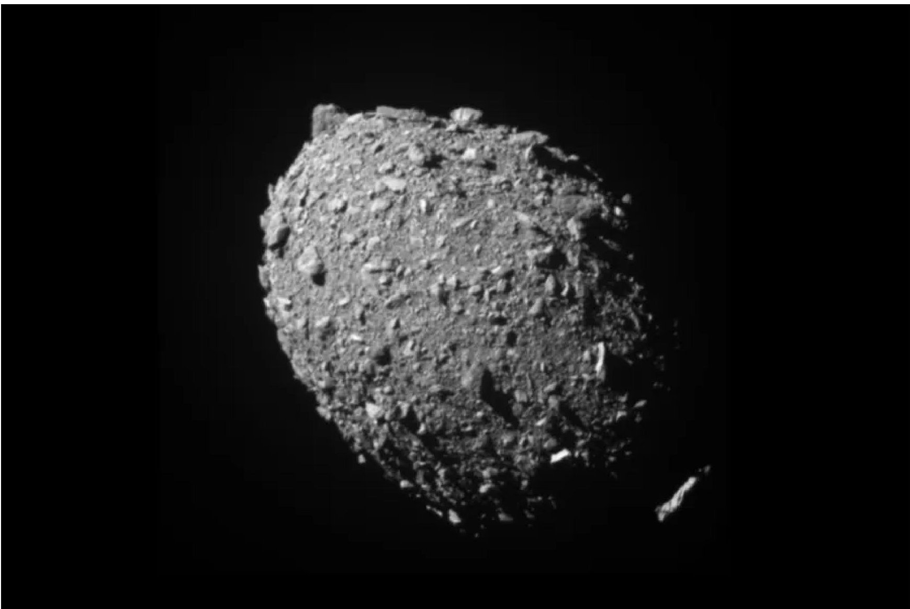
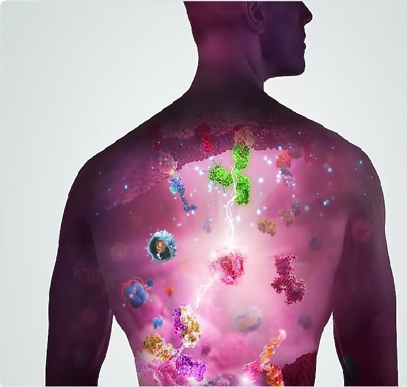

<!-- PDF_PAGE: 1 -->

Space

# What we learned from NASA's asteroid-smashing DART mission

The Double Asteroid Redirection Test smashed into the asteroid Dimorphos in 2022, and the huge plume of rubble from the collision more than tripled the momentum transferred from the spacecraft to the asteroid

By Leah Crane

1 March 2023

The asteroid Dimorphos as seen by the DART spacecraft II seconds before impact NASA/Johns Hopkins APL

<!-- PDF_PAGE: 2 -->

NASA smashed a spacecraft into an asteroid in 2022 in an attempt to move it, and the collision had more effect on the asteroid's orbit than predicted. An analysis of the smash-up and its aftermath has revealed why, and the results could teach us more about how to protect our planet from asteroids.

The Double Asteroid Redirection Test (DART) sent a probe careening into a small asteroid called Dimorphos, which orbits a larger one called Didymos. Five groups of researchers have now analysed different aspects of the collision, which pushed Dimorphos closer to Didymos, making every orbit about 33 minutes shorter than before the smash - more than 25 times the change in orbital period required for the mission to be considered a success.

That was helped by the fact that DART was right on target. "The spacecraft hit very close to the centre... of Dimorphos, which is where you want to hit in order to maximise the momentum transfer," says Carolyn Ernst at Johns Hopkins University in Maryland.

Advertisement

<!-- PDF_PAGE: 3 -->

But perhaps more importantly, parts of the asteroid flew off after the collision, giving it an extra push. "People may think of the DART mission as a fairly straightforward experiment that is similar to playing billiards in space - one solid spacecraft impacts into one solid asteroid," says Cristina Thomas at Northern Arizona University. "However, asteroids are far more complex than just a solid rock."

Most asteroids - including Dimorphos, as it turns out - are rubble piles tenuously held together by gravity. So when DART hit it, between 0.3 and 0.5 per cent of the asteroid's mass came flying off in a huge plume of ejecta. This plume amplified the momentum transferred from the spacecraft to the asteroid by a factor of 3.6.

<!-- PDF_PAGE: 4 -->

## Read more

If we ever need to use something like DART to deflect an asteroid that is heading towards Earth, understanding that extra push will be crucial. "Ejecta is going to give a larger push to the asteroid than the spacecraft itself, so that means in the future if we have to use this technology to divert an asteroid from hitting Earth, then we don't necessarily need a huge spacecraft," says Jian-Yang Li at the Planetary Science Institute in Arizona.

The plume of ejecta also puts Dimorphos in a strange category of asteroids called active asteroids, which have tails like comets. It has long been thought that these tails might form from collisions with smaller space rocks, and DART has shown that idea to be a good fit. "We can now really nail down what's going on with active asteroids, and that helps us figure out what they're made of, which ties back to the birth of the solar system when they formed," says Ariel Graykowski at the SETI Institute in California.

After DART, we know that we can change the trajectory of a small asteroid like Dimorphos, but all asteroids are different so we can't be sure that a similar mission would work on anything that might be headed our way. "I think the best way to apply what we've learned is to do it again on something bigger," says Graykowski. "We need to now take what we know about how squishy the asteroid ended up being, how much stuff came off of it, how much we were able to move it, scale it up and do it again."

Journal references: Nature, DOI:10.1038/s41586-023-05805-2, DOI:10.1038/s41586- 023-05810-5, DOI:10.1038/s41586-023-05811-4, DOI:10.1038/s41586-023-05878-z, DOI:10.1038/s41586-023-05852-9

Sign up to our free monthly Launchpad newsletter for a voyage across the galaxy and beyond

<!-- PDF_PAGE: 5 -->

Sponsored Content

# Beyond individual breakthroughs: building a smarter strategy against cancer

Cancer is a complex disease. Discover how AstraZeneca is bringing together early detection, combination therapies...

Sponsored by AstraZeneca

Topics:

Asteroids / NASA