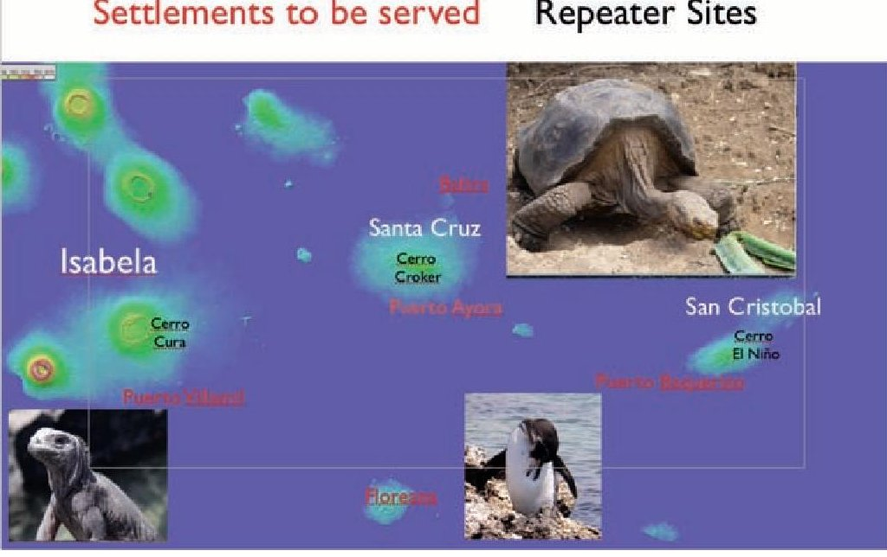
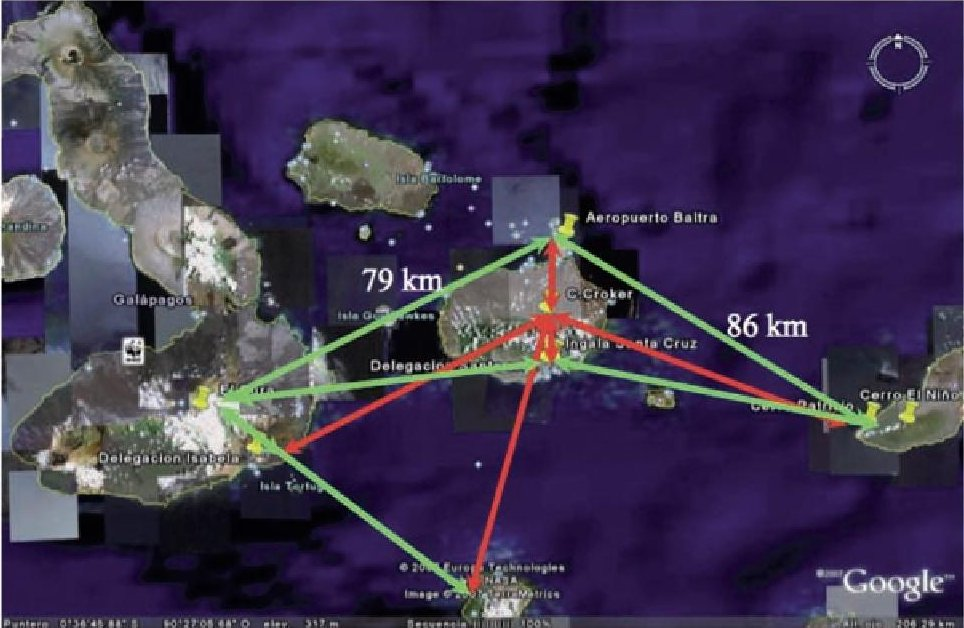
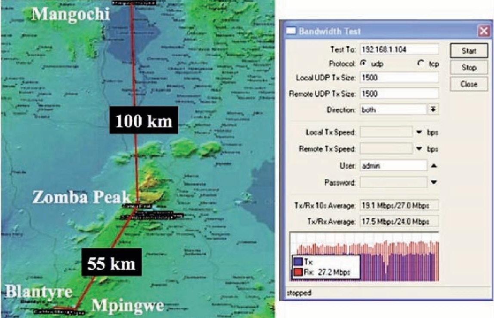
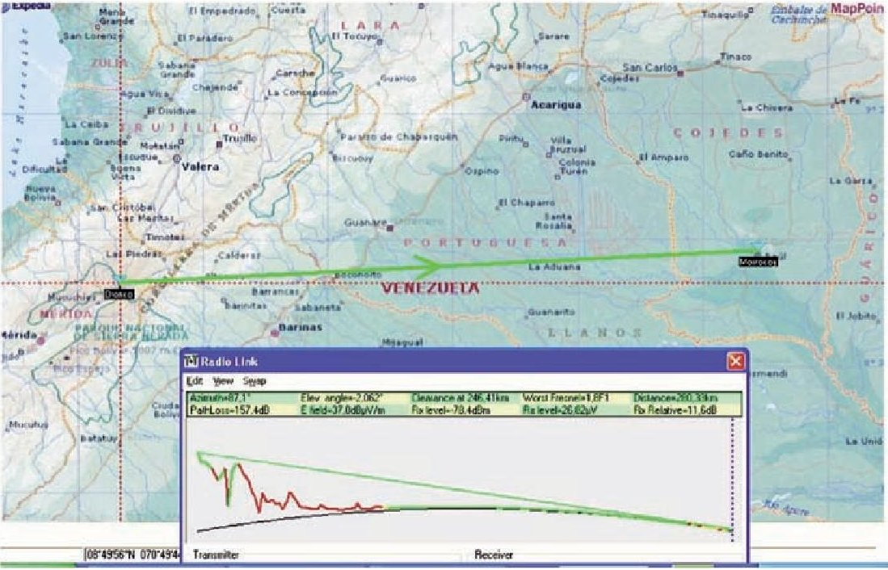
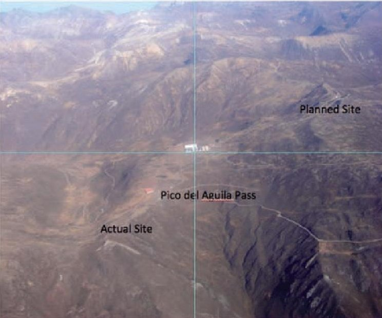
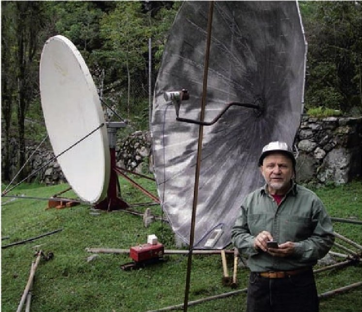
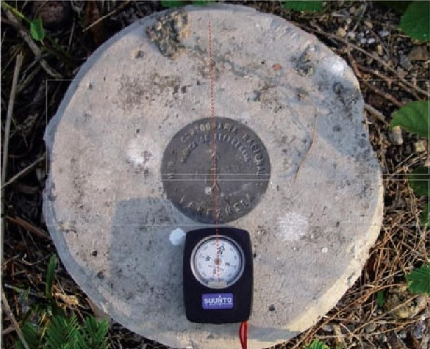
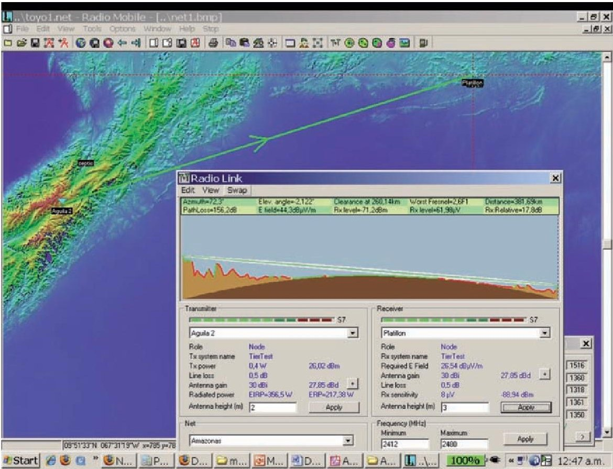
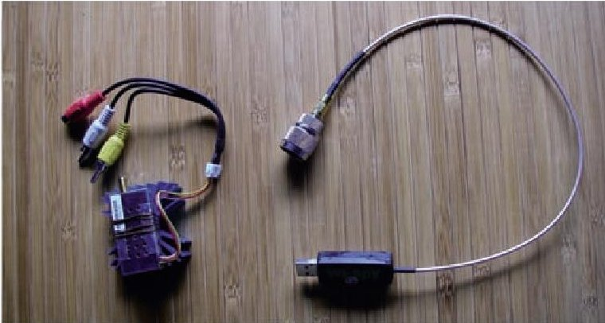
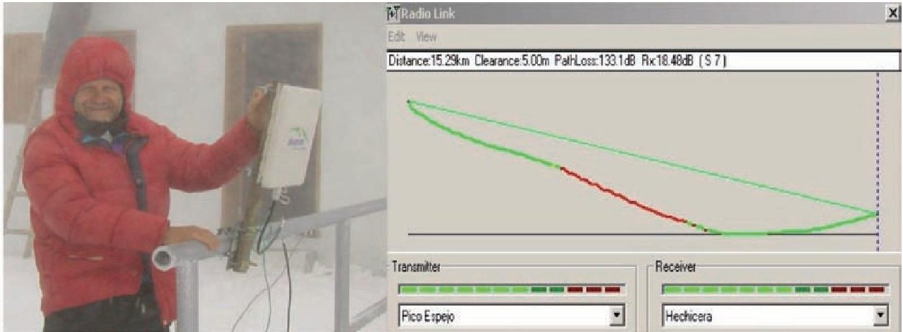

<!-- PDF_PAGE: 1 -->

# Long-Distance, Low-Cost Wireless Data Transmission

E. Pietrosemioli

## Abstract

802. 11 Wi-Fi technology is commonly used for creating wireless networks with a range of about one hundred meters. With careful planning, external antennas, and modifications to the medium access protocol, the same equipment can be used to make point-to-multipoint links of tens of kilometers, and point-to-point links in the range of hundred of kilometers. This paper presents some experiments at distances of up to 382 km that were performed in Venezuela from April 2006 to July 2007, as well as an affordable instrument setup for long-distance antenna alignment. These experiments paved the way for practical applications in a network to provide connectivity among five of the Galapagos Islands in Ecuador, and in another network built to connect several hospitals to the College of Medicine at the University of Malawi.

## 1. Introduction

For developing countries, wireless allows leapfrogging over the traditional telecommunications infrastructure. This has been proven in many countries of Africa and Latin America, where the number of mobile phones has greatly surpassed the number of land lines. Although fiber optics offers much greater bandwidth, and satellite systems are unsurpassed for unidirectional broadcast services, neither can compete with land-based radio from a cost perspective for two-way applications.

Furthermore, both fiber-optic and satellite systems require large up-front investments and considerable expertise to properly maintain them. This means that they can only be deployed by large organizations with deep pockets that can wait several years before recovering their investments. On the other hand, terrestrial microwave systems are less capital intensive. The investment is gradual as the network gracefully grows, and can be deployed by smaller organizations and even local communities.

Since the early 1990s [1-3], we have been experimenting with means for providing Internet access through wireless technology, first using packet radio,

and later with spread-spectrum techniques, in Mérida Venezuela. These efforts led to the deployment of a wireless network that spans most of the state of Mérida. This was honored by the organizers of SuperComm 1998 in Atlanta Georgia, with the SuperQuest Award in the Remote Access category.

With the development of the IEEE 802.11 standard, the cost of wireless data transmission for short distances plummeted. Many people around the world started using devices based on this technology for long-distance communications. By overlaying VoIP (voice over IP) on these networks, telephony services can also be offered in rural or underserved urban areas at a fraction of the cost of wired services. Furthermore, these technologies can be installed by a grassroots community with a moderate amount of technical skills.

For instance, Wi-Fi, the sobriquet for 802.11-standardbased devices, was used by a group of American radio amateurs to demonstrate transmission at a distance of 125 miles in 2004 [4]. Thanks to a favorable topography, Venezuela already had some long-range WLAN links. Since 2001, Fundacite Mérida has operated a 70 km link between Pico Espejo and Canaguà [5]. To test the extreme possibilities of long-distance WLAN, we have successfully used inexpensive Wi-Fi equipment to establish links of 279 km and 382 km. A successful example of the application of these technologies is the network built to provide connectivity to five Islands in the Galapagos archipelago.

## 2. Connecting Beautiful Islands

In 2007, an international tender offer to design a wireless network for the interconnection of several islands in the Galapagos was issued, and our proposal was selected. The project goals were:

1. Provide data and voice service to the Galapagos Islands organizations that are in charge of protecting the ecosystem in a cost-effective way.

2. Minimize the environmental impact of the structures to be built.

<!-- PDF_PAGE: 2 -->

Settlements to be served Repeater Sites

Figure 1. The Galapagos Islands wireless nodes.

3. Minimize the power requirements of the equipment to be deployed.

The sites to be served were:

- Puerto Ayora in Santa Cruz Island

- Airport in Baltra Island

- Puerto Baquerizo Moreno in San Cristobal Island

- Puerto Villamil in Isabela Island

- Port at Floreana Island

- Since all these locations were at about sea level numerous simulations were performed using digital elevation maps to assess the possibilities of several possible repeater locations at high altitudes (favoring existing infrastructure already in place to minimize cost and environmental impact). This led to the identification of some interesting spots, including:

- Cerro Croker in Santa Cruz Island, has visibility to each of the sites.

- El Cura in Isabela Island, has visibility to Baltra, Puerto Ayora and Floreana.

- Cerro El Niño in San Cristobal Island, has visibility towards Baltra, Puerto Ayora, and Puerto Baquerizo Moreno.

Figure 1 shows the layout of all the nodes.

During a trip to the islands, a site survey was performed at each of the locations to be served, and also at prospective repeater sites. This was done to ascertain the existence of line of sight, and to measure the spectrum occupancy in both unlicensed bands at 2.4 and 5 GHz. An environmental impact assessment was also performed by a team of scientists led by Prof. Miguel Acevedo Luciani from the University of Northern Texas.

The next step was installing temporary links to test the feasibility of the proposed solution, measuring the throughput and packet loss. Armed with these data, we proceeded to write up the RFP [request for proposal] for the international bidding process to install the system, which was later built by an Ecuadorian firm [6]. Because all the links were mostly over water, there was concern about fading due to reflections. This was addressed by designing

Figure 2. The Galapagos Islands: radial network in red peripheral links in green.

<!-- PDF_PAGE: 3 -->

a redundant network, formed by two topologies: a radial network with the hub at Cerro Croker, and peripheral links from El Cura and Cerro El Niño that provided at least two completely independent paths to each location. The central links radiated from Cerro Croker. At 1800 m altitude, this was the highest spot in Santa Cruz, the most populated island. It was centrally located to the area to be served, providing a clear line of sight to each of the sites that were essentially at sea level. The peripheral links took advantage of additional elevated spots in Isabela (Cerro Cura) and San Cristobal (Cerro El Niño) that provided line of sight and clearance of the first Fresnel zone among Isabela, Puerto Ayora, Baltra, and Floreana, as well as between San Cristobal to Baltra and Puerto Ayora. In this way, each site was served at least by two completely independent links, as seen in Figure 2. The network was later built by another organization, and is now also offering free Wi-Fi in the five islands [7].

## 3. Linking Health-Maintaining Organizations in Malawi

Some participants in the yearly wireless training activity held at ICTP since 1996 [8] showed great interest in establishing a wireless network in their home institution. The goal was to install a modern communication network to support health provisioning in hospitals and universities in Southern Malawi. After assessing the performance of different long-distance solutions, the Mikrotik [9] solution was chosen. This was because of the proven records of several installations in many countries, at distances of tens of kilometers.

To improve reliability, a completely redundant backbone was planned, each link with eight radios (four at each end), four antennas with dual-polarization feeds (equivalent to four vertical-plus four horizontal-polarization antennas in each link). The radios were installed into four wireless routers (two radios per router) running

the Nstreme dual [10] protocol, and housed in weatherresistant enclosures. This provided two independent transmission paths, one with each polarization, served by two simultaneous transmitters and receivers at each end. FDD (frequency-diversity duplexing) was used instead of the TDD (time-division duplexing) specified by the IEEE 802.11 standard. This redundancy was affordable, thanks to the reasonable cost of the mass-produced radios and routers. This has also created a greater demand for antennas, thereby reducing their cost, as well.

On the other hand, for the access network - where one can sacrifice throughput in return for a more-favorable price - we chose to use Ubiquiti Networks Power Stations [11]. These wireless routers were available in both the 2.4 and 5 GHz band. They were housed in an outdoor enclosure with an integrated antenna. This made them very convenient for installation either in towers or in slim masts, given that they were lightweight and offered little wind load. They could be flashed with third-party Linux-based software, and could be configured as base station, client, or bridge. All of this was in a device that was very competitively priced. They were IEEE 802.11 compliant, and therefore offered up to 54 Mbps, and were rated at ranges of up to 50 km.

## 3.1 Network Planning

The most important tool for planning a wireless network is a set of elevation maps of the areas to be served. This is needed to establish the feasibility of any proposed link. Since 1998, we have been using Radio Mobile [12]. This is a program built by Roger Coudé that is freely available and makes use of several kinds of digital elevation maps, most notably the maps gathered by the Shuttle Radar Topography Mission (SRTM). These maps cover most of the world with a resolution of three arc sec (about 90 m, worst case) and are very useful for planning long-distance links. Recently, even better resolution digital elevation

<!-- PDF_PAGE: 4 -->

Figure 4. The layout and profile of the 280 km link between Pico del Aguila and Cerro Morrocoy in El Baul.

maps have become available through the ASTER Global Digital Elevation Model (ASTER GDEM) [13], a joint product developed and made available to the public by the Ministry of Economy, Trade, and Industry (METI) of Japan and the United States National Aeronautics and Space Administration (NASA). Of course, the maps cannot provide information about buildings or other structures beyond the nominal resolution, so a site survey is always required to ascertain the viability of a proposed link. Radio Mobile uses the Longley-Rice model to predict propagation losses, and we have confirmed good agreement with experimental results. The program calculates the Fresnel-zone clearance and estimates the received signal power, making it easy to assess the effect of different antenna gains and heights.

Using this program, we investigated different alternatives for the backbone layout between the College of Medicine in Blantyre and the Hospital at Mangochi, with an intermediate base station to provide service to different institutions in the city of Zomba.

Zomba Peak, at 2000 m above sea level, is an obvious choice for both the base station to provide service to Zomba city, and also as a repeater point to Mangochi, 100 km away. Although previous attempts to link Zomba Peak with Mangochi were reportedly not successful, after the site survey we were confident that this link would work. We were also confident that the alternative of using two extra repeater points in Ulongwe and Ntaja was not needed. Since Zomba Peak was not visible from the College of Medicine (CoM) in Blantyre, a repeater point was required on the hill of Mpingwe, 7 km east of the College of Medicine and 55 km south from Zomba peak. The end-to-end throughput over the 167 km backbone with two repeater sites was about 40 Mbps, as shown in Figure 3. This was enough to cover the demands of data transfer, VoIP, and medical videoconference among the different sites [14].

In November 2010, maintenance and upgrading of the backbone allowed the network to be used to provide malaria early warnings, based on climate forecasts that could

be used to timely deploy preventive measures, as part of the QWeCI FP7 project of the European Commission [15].

The network is being maintained and extended by faculty of the University of Malawi, which has received extensive training at ICTP. During 2011, they were able to extend coverage to St. Martin's Hospital, about 20 km north of Mangochi, and are actively pursuing the coverage of other sites.

The previous deployments were possible thanks to the experience gained through a series of field experiments conducted in Venezuela since 1992. These gave us confidence on the use of low-cost spread-spectrum equipment for long-distance applications [16].

## 3.2 Long-Distance Trials

To test the limits of a wireless microwave link, it is necessary to find a path with an unobstructed line-of-sight and a clearance of at least 60% of the first Fresnel zone. As the distance between sites increases, the curvature of the Earth becomes a serious obstacle, requiring a higher elevation, at least at one end. Installation on towers or other tall structures is the standard procedure, and the longest-distance links are only possible from high elevations.

When searching for a suitable terrain in Venezuela, with high elevation at the ends and low ground in between, we first focused on the Guayana region. Although plenty of high grounds were to be found - in particular the famous "tepuys" (tall mesas with steep walls) - there were always obstacles in the middle ground. Our attention then shifted to the Andes, the steep slopes of which (rising abruptly from the plains) proved adequate to our requirements. Pico del Aguila had an altitude of 4200 meters and it was a two-hour drive from Mérida. It had clear line-of-sight to the town of El Baul, in Cojedes State. Using Radio Mobile, we found that there was no obstruction on the first Fresnel zone between Pico del Aguila and El Baul (Figure 4).

<!-- PDF_PAGE: 5 -->

Figure 5. An aerial view of Pico del Aguila in Venezuela.

## 3.3 Hardware Specifications

Once satisfied with the existence of a suitable trajectory, we looked at the equipment needed to achieve our goal of creating a long-distance link. Up to this point, we had been using Orinoco cards for a number of years. Sporting an output power of 15 dBm and a receiver sensitivity of -84 dBm at 11 Mbps, they were robust and trustworthy. The free-space loss at 282 km was 149 dB, so we would need 30 dBi antennas at both ends, and even that would leave very little margin for other losses.

On the other hand, the popular Linksys WRT54G [17] wireless routers can run Linux. The open-source community has written several firmware versions for this router that allow for a complete customization of every transmission parameter. In particular, the OpenWRT firmware [18] allows for the adjustment of the acknowledgment time of the MAC layer, as well as the output power. Another piece of firmware, called DD-WRT [19], has a graphical user

Figure 6. Testing antennas to be deployed at both ends of the link.

interface (GUI) and a very convenient site-survey utility. Furthermore, the Linksys unit could be located closer to the antenna than a laptop, so we decided to use a pair of them. One was configured as an AP (access point), and the other as a client.

The WRT54G could operate at 100 mW output power with good linearity, and could even be pushed up to 200 mW. However, at this value, nonlinearity was very severe and spurious signals were generated, which should be avoided. Although this was consumer-grade equipment and quite inexpensive, after years of using it, we felt confident that it could serve our purpose. Of course, we kept a spare set handy, just in case. By setting the output power to 100 mW (20 dBm), we could obtain a 5 dB power-budget advantage compared to the Orinoco card. We therefore settled for a pair of WRT54Gs as our preferred option for making this link.

## 3.4 Site Survey

On January 15,2006, a visit to Pico Aguila was carried out to inspect the site that Radio Mobile had reported as suitable. The azimuth towards El Baul is $ 8 6^{\circ} $ ,but since the magnetic declination is $ 8^{\circ} $ 16' , the antenna would need to be pointed to a magnetic bearing of $ 9 4^{\circ} $ .

Unfortunately, line of sight was obstructed by an obstacle in the 94 $ ^{\circ} $ direction that had not been shown by the software, due to the limited resolution of the freely available digital elevation maps which is of 90 m at this latitude. After several hours examining the surrounding area, a more suitable location clear of obstacles was identified, south of the main road and a few kilometers from the originally planned site (Figure 5).

## 3.5 Antenna Selection

High-gain antennas for the 2.4 GHz band were not available in Venezuela. As importation costs were considerable, we decided instead to recycle a pair of parabolic reflectors (formerly used for satellite service), and replaced the feed with one designed for 2.4 GHz. We tried a 2.4 meter reflector with an offset feed. This offered ample gain, albeit with some difficulties in the aiming of the $ 3.5^{\circ} $ beam. The $ 22.5^{\circ} $ offset meant that the dish appeared to be pointing downwards when it was horizontally aligned, as can be seen in Figure 6. The other antenna was center fed, and had a 2.75 m meshed reflector.

Several tests were performed using various cantennas (a homemade antenna built with a can) and a 12 dBi Yagi-Uda as a feed. The antennas were pointed at a base station of the university wireless network that was located 11 km away on a 3450 m high mountain. We were able to establish a link with the base station at La Aguada, but our efforts to measure the gain of the setup using Netstumbler (a popular program that reports the strength of the received Wi-Fi

<!-- PDF_PAGE: 6 -->

Figure 7. Geographic compared to magnetic north at El Baul.

signal) were not successful. There was too much fluctuation on the received power values of live traffic. For a meaningful measurement of the gain, we needed a signal generator and a spectrum analyzer. These instruments were also required for the field trip, in order to properly align the antennas.

In February 2006, during a visit to Trieste, Italy, to partake in the annual wireless training event we have been attending since 1996 [8], the project was discussed with Carlo Fonda, who was immediately thrilled and eager to participate. The collaboration between the Latin American Networking School (EsLaRed) and the Abdus Salam International Centre for Theoretical Physics (ICTP) in the wireless field goes back to 1992, when the first Networking School was held in Mérida with ICTP support. Since then, several activities in which members of both institutions have participated have taken place, notably the yearly training in wireless networking at ICTP, and the activities dedicated to computer networks in general, organized by EsLaRed in several countries of Latin America [20]. Accordingly, it was not difficult to persuade Prof. Sandro Radicella, the head of the Aeronomy and Radio Propagation Laboratory at ICTP, to support Carlo Fonda's trip in early April to Venezuela in order to participate in the experiment.

Back home, we found a 2.75 m parabolic central-fed antenna at a neighbor's house. Mr. Ismael Santos graciously lent his antenna for the experiment. After dismounting and reassembling the parabolic-mesh dish, we changed the feed for one that worked at 2.4 GHz, and trained the antenna to a signal generator. With a spectrum analyzer, we could measure the maximum of the received signal and therefore locate the focus of both antennas, as well as pinpoint the boresight of the offset-fed antenna.

We also compared the power of the received signal with that of a commercial 24 dBi antenna, achieving an improvement of 8 dB, which led us to believe that the overall gain of our antenna was about 32 dBi. Of course, there is some uncertainty in this value since we were

receiving reflected signals as well, but the value agreed with the calculations made from the antenna's dimensions.

Once we were satisfied with the proper functioning and aim of both antennas, we decided to do a site survey at the other end of the El Baul link. Carlo Fonda, Gaya Fior, and I reached the site on April 8. The following day, we found a hill (south of the town) with two telecom towers, which was some 75 m above the surrounding area, about 135 m above sea level. The hill provided an unobstructed view towards El Aguila. There was a dirt road to the top, a must for our purpose, given the weight of the antenna.

## 3.6 Performing the Experiment

On Wednesday, April 12th, 2006, Javier Triviño and I traveled towards El Baul with the offset antenna loaded on top of a four-wheel-drive truck. Early on the morning of April 13, we installed the antenna. We pointed it at a compass bearing of $ 2 7 6^{\circ} $ , given that the declination was $ 8^{\circ} $ , as can be seen in Figure 7; the true azimuth was $ 2 6 8^{\circ} $ .

At the same time, the other team (composed of Carlo Fonda and Gaya Fior from ICTP, with the assistance of Franco Bellarosa, Lourdes Pietrosemoli, and Jose Triviño) rode to the previously surveyed area at Pico del Aguila in a pickup truck, which carried the 2.7 m mesh antenna. Poor weather is common at altitudes of 4200 m above sea level. The team at El Aguila was barely able to install and point the mesh antenna before the fog and sleet began.

Power for the signal generator that fed the antenna was supplied from the truck by means of a 12-V-dc-to 120-V-ac inverter. At 11 am in El Baul, we were able to observe a -82 dBm signal at the agreed-upon 2450 MHz frequency using the spectrum analyzer. To be sure we had found the proper source, we asked Carlo to switch off the signal. Indeed, the trace on the spectrum analyzer showed only noise. This confirmed that we were really seeing the signal that originated some 280 km away.

After turning the signal generator on again, we performed a fine alignment in elevation and azimuth at both ends. Once we were satisfied that we had attained the maximum received signal, Carlo removed the signal generator and replaced it with a Linksys WRT54G wireless router, configured as an access point. Javier substituted the spectrum analyzer on our end for another WRT54G, configured as a client.

At once, we started receiving "beacons" but TCP/ IP packets did not get through. This was expected, since the propagation time of the radiowave over a 300 km link was 1 ms. It took at least 2 ms for an acknowledgment to reach the original transmitter. Fortunately, the OpenWRT firmware allows for adjusting the ACK timing. After Carlo tweaked this parameter, we began receiving ICMP packets with a mean delay time of 5 ms.

<!-- PDF_PAGE: 7 -->

We proceeded to transfer several .pdf files between Carlo's and Javier's laptops, with speeds of about 65 kb/s. The low speed was to be expected, due to the medium access implemented by the CSMA/CA. The transmitter waited a certain amount of time for the ACK (designated as ACK timeout), and if it did not receive one, it re-sent the original frame. The normal ACK timeout was fine for short distances, but completely inadequate for long distances. Thus, modifying the ACK timeout would allow for long-distance transmission, but the medium-access method in the point-to-point case was very inefficient: while the transmitter was waiting for an ACK, the medium was idle.

## 3.7 Improving Performance with TDMA

One year after performing this experiment, we found the time and resources to repeat it using commercial 30 dBi antennas [21], and a couple of wireless routers that had been modified by the TIER group, led by Dr. Eric Brewer of Berkeley University [22]. The purpose of the modification of the standard Wi-Fi MAC was to make it suitable for long-distance applications, by replacing the CSMA Media Access Control with TDMA (time-division multiple-access). The latter is better suited for long distance point-to-point links since it does not require the reception of ACKs. This eliminates the need to wait for the 2 ms roundtrip propagation time for each frame on a 300 km path.

On April 28, 2007, a team formed by Javier Triviño, José Torres, and Francisco Torres installed one of the antennas at the El Aguila site. The second team, formed by Leonardo Gonzalez V., Leonardo Gonzalez G., Alejandro

Gonzalez, and Ermanno Pietrosemoli installed the second antenna at the El Baul site. A solid link was quickly established using the Linksys WRT54G routers flashed with WRT firmware that allowed for the ACK timeout modification. This made video transmission possible at a measured throughput of 65 kb/s. With the TDMA routers the measured throughput increased to 3 Mbps in each direction. This produced a total of 6 Mbps as predicted by simulations done at Berkeley University by the TIER team.

## 3.8 El Aguila to Platillón: 382 km

Thrilled by these results, which paved the way for really inexpensive long-distance broadband links, the second team moved to another location that we had previously identified at 382 km from El Aguila, in a place called Platillon. Platillon was 1500 m above sea level, and offered an unobstructed first Fresnel zone towards El Aguila (located at 4200 m above sea level). The Radio Mobile plot is shown in Figure 8. It is worth noting that over this distance, the Earth's bulge was about 2200 m and the first Fresnel-zone radius was 109 m, so this link could be achieved only thanks to the height of the endpoints and the flatness of the middle ground [23].

Again, the link was quickly established with both the Linksys and the TIER-supplied routers. The Linksys link showed approximately 1% packet loss, with an average roundtrip time of 12 ms. The TIER equipment showed no packet loss. This allowed for good-quality video transmission, but the link was not stable. We noticed considerable signal fluctuations that often interrupted the communication. However, when the received signal was

Figure 8. The layout and profile of the 382 km path.

The Radio Science Bulletin No 339 (December 2011)

<!-- PDF_PAGE: 8 -->

Figure 9. A low-cost antenna alignment set: a signal generator (video sender) and a low-cost spectrum analyzer.

sufficient, the measured throughput was a total of 6 Mbps bidirectional with the TIER routers implementing TDMA. Thus, the preliminary conclusion was that the 280 km link was stable, and the 380 km link was probably at the edge of the 2.4 GHz link capabilities with low-cost equipment and 30 dBi antennas.

## 3.9 Conclusions of the Experiments

Although further tests must be conducted to ascertain the limits for stable throughput, we are confident that Wi-Fi has a great potential for long-distance broadband communication. It is particularly well suited for rural areas, where the spectrum is still not crowded and interference is not a problem, provided there is enough radio line-of-sight (a clearance of at least 70% of the first Fresnel zone).

It is worth noting that the performance obtained on these long-distance links showed the viability of Wi-Fi as a low-cost alternative to WiMAX for backhaul applications. Similar work performed in Europe [24] confirmed the feasibility of links up to 300 km long using low-cost Wi-Fi radios with modified media-access control. Furthermore, the capabilities of Wi-Fi for point-to-multipoint and even mesh topologies have been demonstrated [25]. This makes it the technology of choice for community-based networks for its low cost and limited-installation-skill requirements,

especially in rural areas where the interference problem of unlicensed bands is less severe.

In order to make this technology really affordable an inexpensive method of aligning antennas when the other end of the link is not visible has to be found. The standard method of using a commercial signal generator on one end and a spectrum analyzer on the other is too expensive. Software-based signal-strength indicators such as Netstumbler [26] can be used for short-distance links. However, they are not adequate for long distances, because the Wi-Fi signal is broadband and the received signal must be relatively strong in order to be decoded by standard Wi-Fi radios. A commercial spectrum analyzer is very sensitive. It can effectively measure the received power of a single-frequency signal such as the signal produced by a commercial signal generator, but it requires a considerable investment.

WiSpy [27] is a USB dongle that essentially performs the functions of a spectrum analyzer for the 2.4 GHz band at an affordable price. However, we are still missing an inexpensive signal generator. During the Air Jaldi WSFII in Dharamsala [28], Elektra (Corinna Aichele) mentioned that in Germany they were selling "video senders" -devices meant to transmit analog video signals which would make for an inexpensive signal generator. After experimenting with many of these cheap concoctions that were transmitting out-of-band or erratically, we finally found one [29] that can really substitute for a signal generator for antenna-alignment purposes. This is because it a) has an antenna connector that allows for the attachment to the antenna to be deployed; b) allows the selection of eight different carrier frequencies in the 2.4 GHz band; c) sports a 1 W (30 dBm) output power, enough to be detected 300 km away; d) is small enough and can be powered by any 12 V source; and, e) is relatively stable in output power and frequency during the time needed to align an antenna. With this, a kit that is suitable for the alignment of antennas at long distances, comprising an inexpensive signal generator and a signal-strength detector (Figure 9), is finally available for the wireless-networking practitioner.

Figure 10. The 5.8 GHz wireless bridge between Pico Espejo (4765 m) and Merida.

<!-- PDF_PAGE: 9 -->

## 4. High-Altitude Link

Prof. Gerd Hochschild lead a team that in 2002 installed a microwave atmospheric laboratory in Merida [30]. The team was looking for a reliable system to transfer the collected data to the University of Los Andes. The requirement was that the radio link would withstand the harsh environment of the 4765 m above sea level site. Operation could not be in the 2.4 GHz band, since this was the IF frequency of the 270 GHz receiver they were using.

After looking at the reliable solutions available, I proposed to use an Alvarion 5.8 GHz wireless bridge of the kind that had been used at high altitude in the Himalayas. The 15 km link from Pico Espejo to Merida, shown in Figure 10, was installed in October 2002, and has been operating ever since.

## 5. Conclusions

## 6. References

A case has been made for the use of commercially available low-cost equipment in the unlicensed bands at 2.4 and 5 GHz. This can be used to meet the telecommunication needs of sparsely populated regions, where interference from other users of the unlicensed spectrum is less likely [31].

1. Ermanno Pietrosemoli, "Wireless Data Transmission in the Andes: Networking Merida State," Inet'99, San Francisco, CA, 1999; http://www.isoc.org/inet99/proceedings/4d/4d_1. htm.

2. Ermanno Pietrosemoli, "Networking in Latin America: View from the Fringe," Connect-World, Issue Latin America IV 2000; http://www.connect-world.com/~cwiml/index.php/magazine/ latin-america/item/2231-networking-in-latin-america-view from-the-fringe.

3. Ermanno Pietrosemioli, "Wide Area Network with Affordable Technologies: The Case of Merida, Venezuela". African Workshop on Use of Radio for ICT in Rural Areas, KCCT Mbagathi-Nairobi, 2004; http://www.saber.ula.ve/bitstream/123456789/15849/1/networking_merida.pdf

4. http://www.wifiworldrecord.com/2005writeup.html: 124.9 miles is the official record.

5. Fundacite Merida: http://www.funmrd.gob.ve.

6. "Internet Para Todos en las Galápagos. Cooperacion Italiana" Diciembre 2009; http://iscfdem.blogspot.com/ 2009/12/ internet-para-todos-en-las.html.

7. http://www.itu.int/ITU-D/sis/newslog/2011/01/16/ GalapagosResidentsAndTouristsHaveFreeWirelessInternetEcuador. aspx.

8. http://wireless.ictp.it.

9. http://www.mikrotik.com/.

10. http://wiki.mikrotik.com/wiki/Nstreme_dual_Step-by-Step.

11. http://ubnt.com.

12. RadioMobile: http://www.cplus.org/rmw/ english1.html.

13. http://www.ersdac.or.jp/GDEM/E/4.html.

14. Rob Flickenger (Hacker Friendly LLC); Steve Okay (Inveneo); Ermanno Pietrosemii (EsLaRed- ULA); Marco Zennaro (International Centre for Theoretical Physics); Carlo Fonda (International Centre for Theoretical Physics), "Very Long Distance Wi-Fi Networks" NSDR 2008, ACM SIGCOMM 2008 workshop, August 18, Seattle, WA; http:// www.dritte.org/nsdr08/2008/07/session_1_paper_1.html

15. QWeCI - Quantifying Weather & Climate Impact on Health in Developing Countries: http:// www.liv.ac.uk/qweci/.

16. W. Lemstra, V. Hayes, and J. Groenewegen (eds.), The Innovation Journey of Wi-Fi, The Road to Global Success, Cambridge, Cambridge University Press, 2011, pp. 218-219

17. homesupport.cisco.com/en-us/wireless/lbc/wrt54G.

18. OpenWrt: http://openwrt.org/.

19. DD-WRT: http://www.dd-wrt.com/.

20. Ermanno Pietrosemoli, "Teaching Information Technologies in Latin America: Lessons Learned in a Ten-Years Experience," SSGRR, L'Aquila, Italy, 2001.

21. http://www.l-com.com/item.aspx?id=21730.

22. TIER (Technology Infrastructure for Emerging Regions): http://tier.cs.berkeley.edu/.

23. Ermanno Pietrosemi, Case Study: Long Distance 802.11, in R. Flickenger, Wireless Networking in the Developing World, Second Edition, 2008, pp. 355-369.

24. D. Trinchero, R. Stefanelli, and A. Galardini, "Reliability and Scalability Analysis of Low Cost Long Distance IP-Based Wireless Networks," Innovations for Digital Inclusions, 2009, K-IDI 2009, ITU-T Kaleidoscope, Mar del Plata, Argentina, 2009.

26. http://netstumbler.com.

25. http://freifunk.net/wiki/FreifunkFirmwareEnglish.

28. http://drupal.airjaldi.com/.

27. http:// www.metageek.com.

29. http://www.microcameras.com/video_transmitters/ TM_241800_video_transmitter.htm.

30. Gerd Hochschild, J. Groß, P. Hoffmann, M. Hoock, G. Koop, K. F. Künzi, K. Lindner, M. Penaloza, and M. Quack, "GroundBased Microwave Observations of Stratospheric Trace Gases at the Tropical Merida Atmospheric Research Station (MARS) in Venezuela," Proceedings of the Sixth European Symposium on Stratospheric Ozone in Göteborg, Sweden, September 2002.

31. Ermanno Pietrosemioli, "Setting Long Distance Wi-Fi Records: Proofing Solutions for Rural Connectivity," Journal of Community Informatics, 4, 1, 2008, http://ci-journal.net/index.php/ ciej/article/view/ 487/402.