<!-- PDF_PAGE: 1 -->

# LSTM-based Encoder-Decoder for Multi-sensor Anomaly Detection

Pankaj Malhotra, Anusha Ramakrishnan, Gaurangi Anand, Lovekesh Vig, Puneet Agarwal, Gautam Shroff {MALHOTRA.PANKAJ, ANUSHA.RAMAKRISHNAN, GAURANGI.ANAND, LOVEKESH.VIG, PUNEET.A, GAUTAM.SHROFF} @TCS.COM

TCS Research, New Delhi, India

## Abstract

Mechanical devices such as engines, vehicles, aircrafts, etc., are typically instrumented with numerous sensors to capture the behavior and health of the machine. However, there are often external factors or variables which are not captured by sensors leading to time-series which are inherently unpredictable. For instance, manual controls and/or unmonitored environmental conditions or load may lead to inherently unpredictable time-series. Detecting anomalies in such scenarios becomes challenging using standard approaches based on mathematical models that rely on stationarity, or prediction models that utilize prediction errors to detect anomalies. We propose a Long Short Term Memory Networks based Encoder-Decoder scheme for Anomaly Detection (EncDec-AD) that learns to reconstruct 'normal' time-series behavior, and thereafter uses reconstruction error to detect anomalies. We experiment with three publicly available quasi predictable time-series datasets: power demand, space shuttle, and ECG, and two realworld engine datasets with both predictive and unpredictable behavior. We show that EncDecAD is robust and can detect anomalies from predictable, unpredictable, periodic, aperiodic, and quasi-periodic time-series. Further, we show that EncDec-AD is able to detect anomalies from short time-series (length as small as 30) as well as long time-series (length as large as 500).

## 1. Introduction

In real-world sensor data from machines, there are scenarios when the behavior of a machine changes based on usage and external factors which are difficult to capture. For

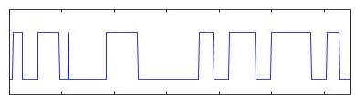

(a) Predictable

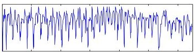

(b) Unpredictable

Figure 1. Readings for a manual control sensor.

example, a laden machine behaves differently from an unladen machine. Further, the relevant information pertaining to whether a machine is laden or unladen may not be available. The amount of load on a machine at a time may be unknown or change very frequently/abruptly, for example, in an earth digger. A machine may have multiple manual controls some of which may not be captured in the sensor data. Under such settings, it becomes difficult to predict the time-series, even for very near future (see Figure 1), rendering ineffective prediction-based time-series anomaly detection models, such as ones based on exponentially weighted moving average (EWMA) (Basseville & Nikiforov, 1993), SVR(Ma & Perkins, 2003), or Long Short-Term Memory (LSTM) Networks (Malhotra et al., 2015).

LSTM networks (Hochreiter & Schmidhuber, 1997) are recurrent models that have been used for many sequence learning tasks like handwriting recognition, speech recognition, and sentiment analysis. LSTM Encoder-Decoder models have been recently proposed for sequence-to-sequence learning tasks like machine translation (Cho et al., 2014; Sutskever et al., 2014). An LSTM-based encoder is used to map an input sequence to a vector representation of fixed dimensionality. The decoder is another LSTM network which uses this vector representation to produce the target sequence. Other variants have been proposed for natural language generation and reconstruction (Li et al., 2015), parsing (Vinyals et al., 2015), image captioning (Bengio et al., 2015).

We propose an LSTM-based Encoder-Decoder scheme for Anomaly Detection in multi-sensor time-series (EncDecAD). An encoder learns a vector representation of the input time-series and the decoder uses this representation to reconstruct the time-series. The LSTM-based encoder-decoder is trained to reconstruct instances of 'normal' time-

<!-- PDF_PAGE: 2 -->

series with the target time-series being the input time-series itself. Then, the reconstruction error at any future time instance is used to compute the likelihood of anomaly at that point. We show that such an encoder-decoder model learnt using only the normal sequences can be used for detecting anomalies in multi-sensor time-series: The intuition here is that the encoder-decoder pair would only have seen normal instances during training and learnt to reconstruct them. When given an anomalous sequence, it may not be able to reconstruct it well, and hence would lead to higher reconstruction errors compared to the reconstruction errors for the normal sequences.

EncDec-AD uses only the normal sequences for training. This is particularly useful in scenarios when anomalous data is not available or is sparse, making it difficult to learn a classification model over the normal and anomalous sequences. This is especially true of machines that undergo periodic maintainance and therefore get serviced before anomalies show up in the sensor readings.

## 2. EncDec-AD

Consider a time-series $ X=\{ \mathbf{x}^{(1)},\mathbf{x}^{(2)},\dots,\mathbf{x}^{(L)} \} $ of length L, where each point $ \mathbf{x}^{(i)}\in R^{m} $ is an m-dimensional vector of readings for m variables at time-instance $ t_{i} $ . We consider the scenario where multiple such time-series are available or can be obtained by taking a window of length L over a larger time-series. We first train the LSTM Encoder- Decoder model to reconstruct the normal time-series. The reconstruction errors are then used to obtain the likelihood of a point in a test time-series being anomalous s.t. for each point $ \mathbf{x}^{(i)} $ , an anomaly score $ a^{(i)} $ of the point being anomalous is obtained. A higher anomaly score indicates a higher likelihood of the point being anomalous.

## 2.1. LSTM Encoder-Decoder as reconstruction model

We train an LSTM encoder-decoder to reconstruct instances of normal time-series. The LSTM encoder learns a fixed length vector representation of the input time-series and the LSTM decoder uses this representation to reconstruct the time-series using the current hidden state and the value predicted at the previous time-step. Given $ X $ $ \mathbf{h}_{E}^{(i)} $ is the hidden state of encoder at time $ t_{i} $ for each $ i \in \{1,2,\dots,L\} $ , where $ \mathbf{h}_{E}^{(i)} \in R^{c} $ , c is the number of LSTM units in the hidden layer of the encoder. The encoder and decoder are jointly trained to reconstruct the time-series in reverse order (similar to (Sutskever et al., 2014)) i.e. the target time-series is $ \left\{\mathbf{x}^{(L)},\mathbf{x}^{(L-1)},\dots,\mathbf{x}^{(1)}\right\} $ . The final state $ \mathbf{h}_{E}^{(L)} $ of the encoder is used as the initial state for the decoder. A linear layer on top of the LSTM decoder layer is used to predict the target. During training, the decoder uses $ \mathbf{x}^{(i)} $ as input to obtain the state $ \mathbf{h}_{D}^{(i-1)} $ , and then

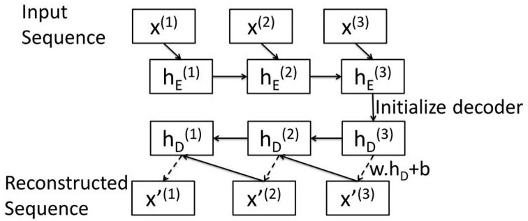

Figure 2. LSTM Encoder-Decoder inference steps for input $ \{ \mathbf{x}^{(1)},\mathbf{x}^{(2)},\mathbf{x}^{(3)} \} $ to predict $ \{ \mathbf{x}^{\prime(1)},\mathbf{x}^{\prime(2)},\mathbf{x}^{\prime(3)} \} $

predict $ \mathbf{x}^{\prime} $ $ ^{(i-1)} $ corresponding to target $ \mathbf{x}^{(i-1)} $ . During inference, the predicted value $ \mathbf{x}^{\prime} $ $ ^{(i)} $ is input to the decoder to obtain $ \mathbf{h}_{D}^{(i-1)} $ and predict $ \mathbf{x}^{\prime} $ $ ^{(i-1)} $ . The model is trained to minimize the objective $ \sum_{X\in s_N}\sum_{i=1}^{L}\| \mathbf{x}^{(i)}-\mathbf{x}^{\prime}(i)\|^{2} $ where $ s_{N} $ is set of normal training sequences.

Figure 2 depicts the inference steps in an LSTM Encoder Decoder reconstruction model for a sequence with $ L=3 $ The value $ \mathbf{x}^{(i)} $ at time instance $ t_{i} $ and the hidden state $ \mathbf{h}_{E}^{(i-1)} $ of the encoder at time $ t_{i}-1 $ are used to obtain the hidden state $ \mathbf{h}_{E}^{(i)} $ of the encoder at time $ t_{i} $ . The hidden state $ \mathbf{h}_{E}^{(3)} $ of the encoder at the end of the input sequence is used as the initial state $ \mathbf{h}_{D}^{(3)} $ of the decoder s.t. $ \mathbf{h}_{D}^{(3)}=\mathbf{h}_{E}^{(3)} $ . A linear layer with weight matrix w of size $ c\times m $ and bias vector $ b\in R^{m} $ on top of the decoder is used to compute $ \mathbf{x}^{\prime(3)}=\mathbf{w}^{\mathrm{T}}\mathbf{h}_{D}^{(3)}+\mathbf{b} $ . The decoder uses $ \mathbf{h}_{D}^{(i)} $ and prediction $ \mathbf{x}^{\prime(i)} $ to obtain the next hidden state $ \mathbf{h}_{D}^{(i-1)} $

## 2.2. Computing likelihood of anomaly

Similar to (Malhotra et al., 2015), we divide the normal time-series into four sets of time-series: $ s_{N}, v_{N1}, v_{N2} $ , and $ t_{N} $ , and the anomalous time-series into two sets $ v_{A} $ and $ t_{A} $ . The set of sequences $ s_{N} $ is used to learn the LSTM encoder-decoder reconstruction model. The set $ v_{N1} $ is used for early stopping while training the encoder-decoder model. The reconstruction error vector for $ t_{i} $ is given by $ \mathbf{e}^{(i)}=\left| \mathbf{x}^{(i)}-\mathbf{x}^{\prime^{(i)}} \right| $ . The error vectors for the points in the sequences in set $ v_{N1} $ are used to estimate the parameters $ \mu $ and $ \Sigma $ of a Normal distribution $ \mathcal{N}(\mu, \Sigma) $ using Maximum Likelihood Estimation. Then, for any point $ \mathbf{x}^{(i)} $ , the anomaly score $ a^{(i)}=(\mathbf{e}^{(i)}-\boldsymbol{\mu})^{T}\boldsymbol{\Sigma}^{-1}(\mathbf{e}^{(i)}-\boldsymbol{\mu}). $

In a supervised setting, if $ a^{(i)}> \tau $ , a point in a sequence can be predicted to be "anomalous", otherwise "normal". When enough anomalous sequences are available, a threshold $ \tau $ over the likelihood values is learnt to maximize $ F_{\beta}=(1+\beta^{2})\times P\times R/(\beta^{2}P+R) $ , where P is precision, R is recall, "anomalous" is the positive class and "normal" is the negative class. If a window contains an anomalous pattern, the entire window is labeled as "anomalous". This

<!-- PDF_PAGE: 3 -->

<table border="1"><tr><td>Datasets</td><td>Predictable</td><td>Dimensions</td><td>Periodicity</td><td>N</td><td>Nn</td><td>Na</td></tr><tr><td>Power Demand</td><td>Yes</td><td>1</td><td>Periodic</td><td>1</td><td>45</td><td>6</td></tr><tr><td>Space Shuttle</td><td>Yes</td><td>1</td><td>Periodic</td><td>3</td><td>20</td><td>8</td></tr><tr><td>Engine-P</td><td>Yes</td><td>12</td><td>Aperiodic</td><td>30</td><td>240</td><td>152</td></tr><tr><td>Engine-NP</td><td>No</td><td>12</td><td>Aperiodic</td><td>6</td><td>200</td><td>456</td></tr><tr><td>ECG</td><td>Yes</td><td>1</td><td>Quasi-periodic</td><td>1</td><td>215</td><td>1</td></tr></table>

Table 1. Nature of datasets. N, $ N_{n} $ and $ N_{a} $ is no. of original sequences, normal subsequences and anomalous subsequences, respectively.

<table border="1"><tr><td>Datasets</td><td>L</td><td>c</td><td>β</td><td>P</td><td>R</td><td>Fβ-score</td><td>TPR/FPR</td></tr><tr><td>Power Demand</td><td>84</td><td>40</td><td>0.1</td><td>0.92</td><td>0.04</td><td>0.77</td><td>33.0</td></tr><tr><td>Space Shuttle</td><td>500</td><td>50</td><td>0.05</td><td>0.83</td><td>0.08</td><td>0.81</td><td>4.9</td></tr><tr><td>Engine-P</td><td>30</td><td>40</td><td>0.05</td><td>0.94</td><td>0.02</td><td>0.82</td><td>13.8</td></tr><tr><td>Engine-NP</td><td>30</td><td>90</td><td>0.05</td><td>1.0</td><td>0.01</td><td>0.83</td><td>∞</td></tr><tr><td>ECG</td><td>208</td><td>45</td><td>0.05</td><td>1.0</td><td>0.005</td><td>0.65</td><td>∞</td></tr></table>

Table 2. $ \mathrm{F}_{\beta} $ -scores and positive likelihood ratios (TPR/FPR).

is helpful in many real-world applications where the exact position of anomaly is not known. For example, for the engine dataset (refer Section 3), the only information available is that the machine was repaired on a particular date. The last few operational runs prior to repair are assumed to be anomalous and the first few operational runs after the repair are assumed to be normal. We assume $ \beta<1 $ since the fraction of actual anomalous points in a sequence labeled as anomalous may not be high, and hence lower recall is expected. The parameters $ \tau $ and c are chosen with maximum $ F_{\beta} $ score on the validation sequences in $ v_{N2} $ and $ v_{A}. $

## 3. Experiments

We consider four real-world datasets: power demand, space shuttle valve, ECG, and engine (see Table 1). The first three are taken from (Keogh et al., 2005) whereas the engine dataset is a proprietary one encountered in a real-life project. The engine dataset contains data for two different applications: Engine-P where the time-series is quasi-predictable, Engine-NP where the time-series is unpredictable, for reasons such as mentioned earlier.

In our experiments, we consider architectures where both the encoder and decoder have single hidden layer with c LSTM units each. Mini-batch stochastic optimization based on Adam Optimizer (Kingma & Ba, 2014) is used for training the LSTM Encoder-Decoder. Table 2 shows the performance of EncDec-AD on all the datasets.

## 3.1. Datasets

Power demand dataset contains one univariate time-series with 35,040 readings for power demand recorded over a period of one year. The demand is normally high during the weekdays and low over the weekend. Within a day, the demand is high during working hours and low otherwise (see Figure 3(a), top-most subplot). A week when any of the first 5 days has low power demands (similar to the demand over the weekend) is considered anomalous (see

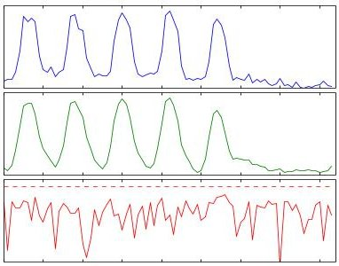

(a) Power-N

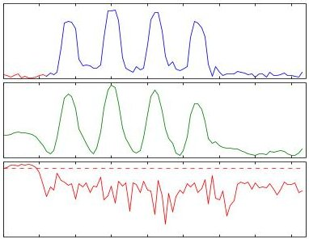

(b) Power-A

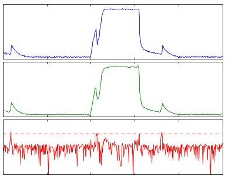

(c) Space Shuttle-N

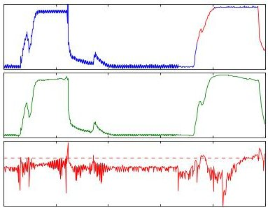

(d) Space Shuttle-A

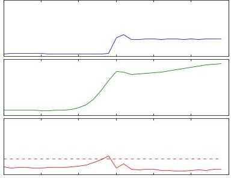

(e) Engine-P-N

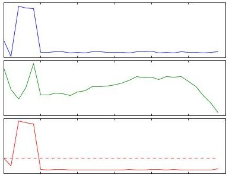

(f) Engine-P-A

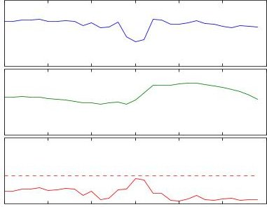

(g) Engine-NP-N

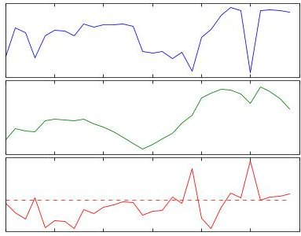

(h) Engine-NP-A

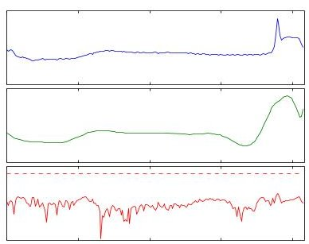

(i) ECG-N

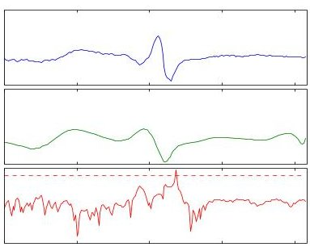

(j) ECG-A

Figure 3. Sample original normal (first column) and anomalous (second column) sequences (first row, blue color) with corresponding reconstructed sequences (second row, green color) and anomaly scores (third row, red color). The red regions in the original time-series for anomalous sequences correspond to the exact location of the anomaly in the sequence (whenever available). Plots in same row have same y-axis scale. The anomaly scores are on log-scale.

<!-- PDF_PAGE: 4 -->

Figure 3(b) where first day has low power demand). We downsample the original time-series by 8 to obtain nonoverlapping sequences with L=84 such that each window corresponds to one week.

Space shuttle dataset contains periodic sequences with 1000 points per cycle, and 15 such cycles. We deliberately choose $ L=1 5 0 0 $ such that a subsequence covers more than one cycle (1.5 cycles per subsequence) and consider sliding windows with step size of 500. We downsample the original time-series by 3. The normal and anomalous sequences in Figure 3(c)-3(d) belong to TEK17 and TEK14 time-series, respectively.

Engine dataset contains readings for 12 sensors such as coolant temperature, torque, accelerator (control variable), etc. We consider two differents applications of the engine: Engine-P and Engine-NP. Engine-P has a discrete external control with two states: 'high' and 'low'. The resulting time-series are predictable except at the time-instances when the control variable changes. On the other hand, the external control for Engine-NP can assume any value within a certain range and changes very frequently, and hence the resulting time-series are unpredictable. Sample sequences for the control variables from Engine-P and Engine-NP are shown in Figure 1(a) and 1(b), respectively. We randomly choose $ L=30 $ for both Engine-P and Engine-NP. We reduce the multivariate time-series to univariate by considering only the first principal component after applying principal component analysis (Jolliffe, 2002). The first component captures 72% of the variance for Engine-P and 61% for Engine-NP.

ECG dataset contains quasi-periodic time-series (duration of a cycle varies from one instance to another). For our experiment, we use the first channel from qtdb/sel102 dataset where the time-series contains one anomaly corresponding to a pre-ventricular contraction (see Figure 3(j)). We consider non-overlapping subsequences with $ L=2 0 8 $ (each subsequence corresponds to approximately 800ms). Since only one anomaly is present in the dataset, sets $ v_{N2} $ and $ v_{A} $ are not created. The best model, i.e. c, is chosen based on the minimum reconstruction error on set $ v_{N1} $ . We choose $ \tau=\mu_{a}+\sigma_{a} $ , where $ \mu_{a} $ and $ \sigma_{a} $ are the mean and standard deviation of the anomaly scores of the points from $ v_{N1} $ .

## 3.2. Observations

The key observations from our experiments are as follows: 1) The positive likelihood ratio is significantly higher than 1.0 for all the datasets (see Table 2). High positive likelihood ratio values suggest that EncDec-AD gives significantly higher anomaly scores for anomalous points as compared to normal points.

2) For periodic time-series, we experiment with varying window lengths: window length same as the length of one cycle (power demand dataset) and window length greater

than the length of one cycle (space shuttle dataset). We also consider a quasi-periodic time-series (ECG). EncDecAD is able to detect anomalies in all these scenarios.

3) A time-series prediction based anomaly detection model LSTM-AD (Malhotra et al., 2015) gives better results for the predictable datasets: Space Shuttle, Power and Engine-P (corresponding to Engine dataset in (Malhotra et al., 2015)) with $ F_{0.1} $ scores of 0.84, 0.90 and 0.89, respectively. On the other hand, EncDec-AD gives better results for Engine-NP where the sequences are not predictable. The best LSTM-AD model gives P, R, $ F_{0.05} $ and TPR/FPR of 0.03, 0.07, 0.03, 1.9, respectively (for a two hidden layer architecture with 30 LSTM units in each layer and prediction length of 1) owing to the fact that the time-series is not predictable and hence a good prediction model could not be learnt, whereas EncDec-AD gives P, R, $ F_{0.1} $ score and TPR/FPR of 0.96, 0.18, 0.93 and 7.6, respectively.

## 4. Related Work

Time-series prediction models have been shown to be effective for anomaly detection by using the prediction error or a function of prediction error as a measure of the severity of anomaly (Hayton et al., 2007; Ma & Perkins, 2003; Ye et al., 2000). Recently, deep LSTMs have been used as prediction models in LSTM-AD (Malhotra et al., 2015; Chauhan & Vig, 2015; Yadav et al.) where a prediction model learnt over the normal time-series using LSTM networks is used to predict future points, and likelihood of prediction error is used as a measure of anomaly. EncDecAD learns a representation from the entire sequence which is then used to reconstruct the sequence, and is therefore different from prediction based anomaly detection models. Non-temporal reconstruction models such as denoising autoencoders for anomaly detection (Sakurada & Yairi, 2014) and Deep Belief Nets (Wulsin et al., 2010) have been proposed. For time-series data, LSTM based encoder-decoder is a natural extension to such models.

## 5. Discussion

We show that LSTM Encoder-Decoder based reconstruction model learnt over normal time-series can be a viable approach to detect anomalies in time-series. Our approach works well for detecting anomalies from predictable as well as unpredictable time-series. Whereas many existing models for anomaly detection rely on the fact that the time-series should be predictable, EncDec-AD is shown to detect anomalies even from unpredictable time-series, and hence may be more robust compared to such models. The fact that EncDec-AD is able to detect anomalies from time-series with length as large as 500 suggests the LSTM encoderdecoders are learning a robust model of normal behavior.

<!-- PDF_PAGE: 5 -->

## References

Basseville, Michèle and Nikiforov, Igor V. Detection of Abrupt Changes: Theory and Application. PrenticeHall, Inc., Upper Saddle River, NJ, USA, 1993. ISBN 0-13-126780-9.

Bengio, Samy, Vinyals, Oriol, Jaitly, Navdeep, and Shazeer, Noam. Scheduled sampling for sequence prediction with recurrent neural networks. In Advances in Neural Information Processing Systems, pp. 1171-1179, 2015.

Chauhan, Sucheta and Vig, Lovekesh. Anomaly detection in ecg time signals via deep long short-term memory networks. In Data Science and Advanced Analytics (DSAA), 2015. 36678 2015. IEEE International Conference on, pp. 1-7. IEEE, 2015.

Cho, Kyunghyun, Van Merrienboer, Bart, Gulcehre, Caglar, Bahdanau, Dzmitry, Bougares, Fethi, Schwenk, Holger, and Bengio, Yoshua. Learning phrase representations using rnn encoder-decoder for statistical machine translation. arXiv preprint arXiv:1406.1078, 2014.

Hayton, Paul, Utete, Simukai, King, Dennis, King, Steve, Anuzis, Paul, and Tarassenko, Lionel. Static and dynamic novelty detection methods for jet engine health monitoring. Philosophical Transactions of the Royal Society of London A: Mathematical, Physical and Engineering Sciences, 365(1851):493-514, 2007.

Hochreiter, Sepp and Schmidhuber, Jürgen. Long shortterm memory. Neural computation, 9(8):1735-1780, 1997.

Jolliffe, Ian. Principal component analysis. Wiley Online Library, 2002.

Keogh, Eamonn, Lin, Jessica, and Fu, Ada. Hot sax: Efficiently finding the most unusual time series subsequence. In Data mining, Fifth IEEE International Conference on, pp. 8-pp. IEEE, 2005.

Kingma, Diederik P. and Ba, Jimmy. Adam: A method for stochastic optimization. CoRR, abs/1412.6980, 2014. URL http://arxiv.org/abs/1412.6980.

Li, Jiwei, Luong, Minh-Thang, and Jurafsky, Dan. A hierarchical neural autoencoder for paragraphs and documents. arXiv preprint arXiv:1506.01057, 2015.

Ma, Junshui and Perkins, Simon. Online novelty detection on temporal sequences. In Proceedings of the ninth ACM SIGKDD international conference on Knowledge discovery and data mining, pp. 613-618. ACM, 2003.

Malhotra, Pankaj, Vig, Lovekesh, Shroff, Gautam, and Agarwal, Puneet. Long short term memory networks for anomaly detection in time series. In ESANN, 23rd European Symposium on Artificial Neural Networks, Computational Intelligence and Machine Learning, 2015.

Sakurada, Mayu and Yairi, Takehisa. Anomaly detection using autoencoders with nonlinear dimensionality reduction. In Proceedings of the MLSDA 2014 2Nd Workshop on Machine Learning for Sensory Data Analysis, MLSDA'14, pp. 4:4-4:11, New York, NY, USA, 2014. ACM.

Sutskever, Ilya, Vinyals, Oriol, and Le, Quoc V. Sequence to sequence learning with neural networks. In Ghahramani, Z., Welling, M., Cortes, C., Lawrence, N. D., and Weinberger, K. Q. (eds.), Advances in Neural Information Processing Systems 27, pp. 3104-3112. Curran Associates, Inc., 2014.

Vinyals, Oriol, Kaiser, Lukasz, Koo, Terry, Petrov, Slav, Sutskever, Ilya, and Hinton, Geoffrey. Grammar as a foreign language. In Advances in Neural Information Processing Systems, pp. 2755-2763, 2015.

Wulsin, Drausin, Blanco, Justin, Mani, Ram, and Litt, Brian. Semi-supervised anomaly detection for eeg waveforms using deep belief nets. In Machine Learning and Applications (ICMLA), 2010 Ninth International Conference on, pp. 436-441. IEEE, 2010.

Yadav, Mohit, Malhotra, Pankaj, Vig, Lovekesh, Sriram, K, and Shroff, Gautam. Ode-augmented training improves anomaly detection in sensor data from machines. In NIPS Time Series Workshop 2015. URL http://arxiv.org/abs/1605.01534.

Ye, Nong et al. A markov chain model of temporal behavior for anomaly detection. In Proceedings of the 2000 IEEE Systems, Man, and Cybernetics Information Assurance and Security Workshop, volume 166, pp. 169. West Point, NY, 2000.