<!-- PDF_PAGE: 1 -->

Acta Astronautica Date: March 2024 Show more

Research article Full text access Get rights and content

Research Paper

# Systems design results of LunaCube: Dual-satellite lunar navigation system with 6U-CUBESATs

Toshiki Tanaka $ ^{a} $ Takuji Ebinuma $ ^{b} $ Shinichi Nakasuka $ ^{c} $ Takeshi Matsumoto $ ^{c} $ Rion Sobukawa $ ^{b} $ Yoshihide Aoyanagi $ ^{d} $

Show more

View PDF

Download full issue

Share

Article

Recommended articles

Cited by (8)

Metrics

## Highlights

- A dual-satellite lunar navigation system, called LunaCube, is proposed.

- LunaCube can provide 50 m user positioning accuracy relative to a reference station.

- MDPO algorithm is used to reduce the size and numbers of the navigation satellites.

- The system consists of two 6U CubeSats, each with a total wet mass of under 14 kg.

## Abstract

Aiming to establish a long-term presence on the Moon, interest in new and robust communication and navigation capabilities on the lunar surface is greater than ever before. In response, lunar navigation systems (LNS) have been conceptualized and put into action by space agencies. While we expect these services to be fully functional before the late 2020s, many missions are set to begin surface exploration before the initiation of these services. To meet the immediate needs of early missions, our group proposed a small-start technology demonstration mission called the Lunar Navigation CubeSat (LunaCube).

The mission aims to demonstrate a LNS transmitter and store-and-forward radio in the vicinity of the Moon and to provide lunar positioning services to lunar surface assets. The project was initiated with funding support from the Japanese

## Outline

Highlights

Abstract

Keywords

1. Introduction

2. Mission overview

3. Mission payload design

4. LunaCube systems design

5. Conclusions

Declaration of competing interest

Acknowledgments

Appendix A. Link budget analysis

References

Show full outline

## Figures (13)

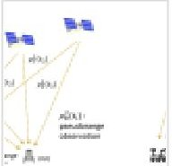

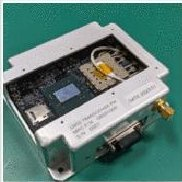

<!-- PDF_PAGE: 2 -->

Ministry of Education, Culture, Sports, Science, and Technology (MEXT) and completed preliminary design and detailed design in 2021 and 2022 respectively. As a result of the design study, the satellites consist of a 6U-size structure, a 50W-class deployed solar panel, a X-band transponder, three-axis attitude control using a star tracker, sun sensors, gyro, reaction wheels, and reaction control system thruster, as well as orbit control using a water-based resistojet. The total wet mass is less than 14 kg.

## Keywords

Lunar navigation system; Satellite navigation; Store and forward; Microsatellite; Cubesat

< Previous article in this issue

Next article in this issue >

## 1. Introduction

To date, a great number of lunar exploration missions are underway across both governmental and commercial sectors. Many of these missions focus on scientific observations or resource exploration on the lunar surface and involve the use of on-surface transportation, such as lunar rovers, to carry observation instruments to their regions of interest. To achieve successful transportation, infrastructure for navigation and communication on the lunar surface is essential. In particular, a multi-user navigation platform is considered key to supporting a wide range of on-surface transportation activities simultaneously.

To this end, several lunar navigation systems have been conceptualized. One approach is to use weak signals, such as the spill-over of beams irradiated from Earth-bound GNSS [1]. A precursor mission is planned to study GNSS signals at the Moon [2]. This approach is promising for providing navigational information to the near side of the Moon. However, due to limited visibility, the system cannot offer navigational service to the polar regions or far side of the Moon.

As another approach, the establishment of an independent navigation and communication satellites constellation around the Moon, referred to as lunar navigation systems (LNS), is in the planning phase. Notably, LCRNS of NASA [3], Moonlight of ESA [4], and LNSS by JAXA [5] are key projects in this endeavour. In a related effort, lunar pathfinder mission, which will demonstrate communication services to lunar missions, is scheduled for the mid 2020s [6].

While we expect these services to be fully functional by the late 2020s, a number of missions are set to begin surface exploration even before the LNS services are operational. To meet the immediate needs of these early missions, several groups have studied a navigation satellite constellation consisting of a smaller number of satellites, such as dual satellites or a single satellite. These concepts, in principle, reduce the number of required navigation satellites by using additional observations in combination with pseudorange observations, such as Doppler observation [7], [8], digital elevation models [8], [9], two-way

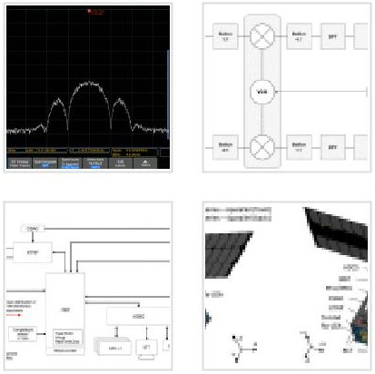

Show 7 more figures

## Tables (15)

Table 1. Comparison between the tr...

Table 2. Satellite trajectory and orb...

Table 3. Sequence of events (Initial ...

Table 4. Sequence of events (Nomin...

Table 5. Sequence of events (Specifi...

Table 6. LNS transmitter specificati...

Show 9 more tables

<!-- PDF_PAGE: 3 -->

ranging [10], and multi-epoch observation [9]. Achievable user positioning accuracy by dual-satellite or single-satellite navigation systems is typically several tens of meters within a few minutes of observation, which is lower than what can be achieved by a larger constellation. However, it can serve as a useful navigation aid for many early-stage exploration missions that require 100-meter positioning accuracy, as declared by [11]. Furthermore, rovers can improve their user positioning accuracy by integrating navigational information from their onboard sensors into navigational observations from satellites.

In this context, our group has proposed a LNS technology demonstration mission called the Lunar Navigation CubeSat (LunaCube) with the aim of demonstrating a LNS transmitter and store-and-forward (S&F) radio in the vicinity of the Moon, as well as providing positioning and communication services to lunar surface assets. The project received funding support from the Japan Ministry of Education, Culture, Sports, Science and Technology (MEXT) and completed the preliminary design, detailed design, and the development of a prototype LNS transmitter, S&F radio, and satellite structure-thermal model.

LunaCube is a dual-satellite lunar navigation system that uses the multi-epoch double-differenced pseudorange observations (MDPO) algorithm, as shown in Fig.1(a). The MDPO is a dual-satellite navigation algorithm that uses pseudorange observations from multiple epochs, providing a position fix to the user relative to a reference station. To support double-difference observations, data exchange between the user and reference station is required, which is achieved through S&F technology, as mentioned in the next paragraph. Previous simulation analysis has demonstrated that positioning two navigation satellites in a 300 km low lunar orbit enables users at the South pole to achieve 50 meters (95%) of user positioning accuracy relative to the reference station within a one-minute observation when both satellites are within view [9]. It is also important to note that the MDPO algorithm works for any satellite trajectory and with any number of satellites that is more than two. This leads to an important indication that the LunaCube is a scalable system and can serve a precursor mission to demonstrate technologies for large-size LNS constellations.

The LunaCube mission will also demonstrate S&F technology in the vicinity of the Moon. The S&F radio on the satellite serves to transfer messages from one ground terminal to one or more other terminals, as illustrated in Fig. 1(b). With the designed S&F payload, users on the lunar surface can upload/download telemetry at a maximum rate of 2 kbps when one or both satellites are in view. In this mission, S&F communication is also used to transfer pseudorange observation data from the reference station to the user segment, supporting the double-difference calculation process in the MDPO.

In this article, we present some key trade-offs with regard to the mission design and bus system design.

<!-- PDF_PAGE: 4 -->

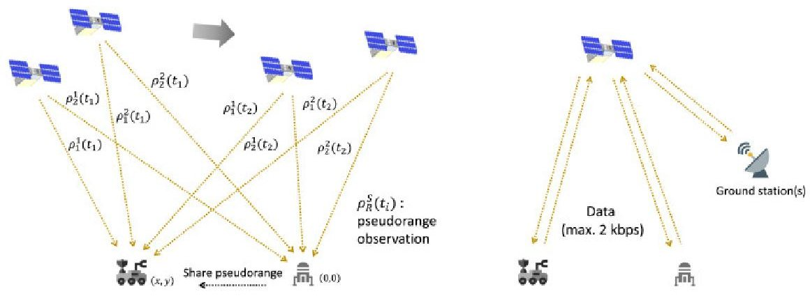

Download: Download high-res image (403KB)

Download: Download full-size image

Fig. 1. Overview of LunaCube mission. (a) MDPO-based dual-satellite navigation, (b) S&F communication.

## 2. Mission overview

## 2.1. Dual-satellite navigation

The proposed mission aims to provide reasonable 'relative' user positioning accuracy, on the order of several tens of meters, with minimal resources. Therefore, we limit the size of the satellites to 6U $ ( 1 0 \times2 0 \times3 0 \mathrm{c m}^{3} ) $ cube satellites, which can be accommodated by piggy-back payload interfaces. This inevitably prohibits the use of high-power or large-sized clock resources, such as an atomic clock, rubidium atomic frequency standard (RAFS), and optical lattice clock. As a result, the best clock resource that the system is allowed to use is a chip-scale atomic clock (CSAC), which can effectively reduce the frequency instability of the satellite clock to about 1 part per billion (ppb) over a 24 h period [12]. However, the accumulation of a 1 ppb frequency error over 24 h results in a clock time tag error equivalent to several tens to hundreds of meters in pseudorange observations, and this error increases over time.

One way to calibrate the satellite clock is through time transfer from Earth-based ground stations. However, short-cycle clock calibration, such as at intervals of 24 h, may face challenges due to the limited availability of large Earth-based ground stations capable of communicating with smaller satellites. Another option is time transfer from Earth-bound GNSS. In this case, a large high-gain satellite antenna is required to receive a weak signal from GNSS which is not compatible with a 6U-sized satellite.

Another approach, used in this mission, involves the use of double-difference observation [13] using a reference station on the lunar surface. Double difference procedure effectively eliminates both the receiver clock errors and the satellite clock errors from the baseline solution. Consequently, this scheme can decrease the frequency of time transfer from Earth-based ground stations or Earth-bound GNSS satellites. To perform double-difference observation, pseudorange measurements observed at the reference station will need to be transferred to the user segment. It is also important to emphasize that a user position is obtained only relative to the reference station. For absolute

<!-- PDF_PAGE: 5 -->

positioning, the location of the reference station must be determined through other means.

For the LunaCube mission, the MDPO algorithm, which is one of the positioning calculation algorithms using double-difference observation, was chosen. The MDPO algorithm offers two advantages. Firstly, it can reduce the required number of navigation satellites to as few as two. Secondly, the double-difference observation can effectively compensate for clock bias in both the space and user segments, as well as satellite orbit determination errors. This advantage contributes to the reduction in size of both the satellite and user systems. To serve as a reference station, a lander on the lunar surface can be utilized as illustrated in Fig. 1(a).

It is important to note that the navigation service is available only when two satellites are in the user's view, indicating that the system is regional, not global. As reported in [9], when two navigation satellites are injected into low lunar orbits, availability is capped at around 15% (availability: a percentage of time at which the navigation system provides the number of satellites required for position fixing). This limitation can be overcome by integrating other navigational sensors possessed by the user, such as an inertial navigation system (INS), and compensating for the user's positions in the absence of pseudorange signals. For instance, an INS/GNSS integrated algorithm proposed in [14] successfully extended the rover's total travel distance and improved user position estimation accuracy beyond that achieved by the original LNS positioning measurements.

Consequently, the LunaCube system comprises two micro-sized navigation satellites, user rovers, a reference station on the Moon (lander), and a ground station on Earth. Table 1 provides a summary of the comparison between traditional GNSS and the proposed MDPO-based dual-satellite navigation.

Table 1. Comparison between the traditional GNSS and the proposed MDPObased dual-satellite navigation system.

<table border="1"><tr><td>Item</td><td>Traditional GNSS</td><td>Proposed MDPO-based on nav. system</td></tr><tr><td>Number of satellites required in user&#x27;s view</td><td>At least four</td><td>Minimum of two</td></tr><tr><td>Receiver</td><td>User receiver</td><td>User receiver and referen</td></tr><tr><td>Onboard clock</td><td>Atomic clock</td><td>CSAC</td></tr><tr><td>Estimated valuables</td><td>Position, velocity, and time</td><td>Position</td></tr><tr><td>Positioning</td><td>Standalone</td><td>Relative positioning</td></tr><tr><td>Positioning accuracy</td><td>Better than a few meters</td><td>Tens of metersa</td></tr><tr><td>Coverage</td><td>Global</td><td>Regional</td></tr></table>

<!-- PDF_PAGE: 6 -->

## 2.2. Design constraints

The following are the assumptions on which the system design is based to ensure realistic resource availability:

- The ground station at Fukui University [15], which has a 13.5 m sized antenna, will primarily be used for telecommunication and orbit determination.

- The design life of the satellite is two years.

- The satellite must be compatible with a major piggyback launch interface.

- The satellites will be launched into a target lunar orbit by a rocket and will be responsible only for orbit maintenance maneuvers.

It is worth noting that some additional mass and system design will be required if the satellite has to be responsible for trans-lunar injection and correction maneuvers to a target orbit near the Moon.

## 2.3. Constellation design

Designing a dual-satellite navigation system requires careful consideration of the spatial position of the two satellites. To ensure accurate user positioning, it is necessary to maintain a small dilution of position (DOP) value, which requires a large spatial distribution of the satellites. However, a smaller distance between the satellites is preferred to keep them in the user's view for a longer time. Balancing these conflicting requirements is crucial in selecting the best compromise point for the satellite trajectory.

Another factor to consider is the power required for radio frequency (RF) communication between the satellites and users. Higher orbit altitudes result in larger free-space path loss, requiring more power for RF communication. To reduce the power required on both the satellite and user sides, a low lunar orbit is preferable.

Furthermore, the system must have the capability to perform orbit maintenance maneuvers to compensate for orbit perturbations. These maneuvers will adjust the satellite's position to counteract the effects of perturbations and maintain the desired spatial distribution of the two satellites. The magnitude of perturbations the satellites experience depends on their altitude, with lower orbit altitudes resulting in larger perturbations.

As a result, it is necessary to make a trade-off between the desired performance of the navigation service, the required RF power, and the required orbit maintenance maneuvers within the limitations of the satellite size and power capability. By conducting a multi-objective optimization search, as described in [16], we have determined an optimal low lunar orbit for the LunaCube mission,

<!-- PDF_PAGE: 7 -->

balancing the trade-off parameters mentioned above. Table 2 summarizes the key parameters of the selected orbit.

The proposed satellite trajectory results in the angle of the orbital plane in relation to the sun (known as the beta angle) shifting periodically from $ 0^{\circ} $ to $ 90^{\circ} $ due to the rotation of the orbital plane and orbit perturbation. As a result, the length of the operation window, defined as the period between acquisition of signal (AOS) and loss of signal (LOS) observed by an Earth ground station, will vary. The beta angle also affects the amount of sunlight, albedo, and lunar infrared radiation received by the satellites. These factors are especially taken into consideration during the power and thermal system design process, as discussed in Section 4.

Table 2. Satellite trajectory and orbit control quantities.

<table border="1"><tr><td>Initial orbital height</td><td>300km</td></tr><tr><td>Initial orbital inclination</td><td>80°</td></tr><tr><td>Initial orbital eccentricity</td><td>0</td></tr><tr><td>Initial phase difference</td><td>15°</td></tr><tr><td>Orbit control method</td><td>Scheduled circularization control(SCC)</td></tr><tr><td>Required delta-V</td><td>6.7m/s per year(13.4m/s for two years)</td></tr><tr><td>Phase difference variation</td><td>$\pm5^{\circ}(3\sigma)$</td></tr></table>

## 2.4. Concept of operation

Concept of operation (CONOPS) including sequences of events (SOE) must be carefully planned to ensure the successful operation of the LunaCube mission. At the same time, CONOPS will have a significant impact on the system design, including the spacecraft bus, payload, ground support equipment, and mission operations.

Table 3,Table 4,Table 5 cover the primary SOE of the LunaCube mission. It is important to note that only one of the orbiters is described in Table 3,Table 4, Table 5, and the two satellites will be controlled independently. Additionally, both satellites need to be in the user's view and in service mode to provide navigation service to surface vehicles.

Table 3. Sequence of events (Initial acquisition).

<table border="1"><tr><td>Event/Mode</td><td>Remarks</td><td>Attitude</td></tr><tr><td>Orbit injection</td><td>The satellite is injected into orbit.</td><td>Tumbling</td></tr><tr><td>Attitude stabilization</td><td>Angular momentum of the satellite is reduced by onboard reaction wheels.</td><td>Slow tumbling</td></tr><tr><td>Panel deployment</td><td>Solar panels are deployed.</td><td>Slow tumbling</td></tr></table>

<!-- PDF_PAGE: 8 -->

<table border="1"><tr><td>Event/Mode</td><td>Remarks</td><td>Attitude</td></tr><tr><td>First signal acquisition</td><td>The satellite starts to emit radio signal to ground stations(GS).</td><td>Slow tumbling</td></tr><tr><td>Sun pointing</td><td>The satellite starts to point to the sun to increase power generation.</td><td>Sun pointing</td></tr></table>

Table 4. Sequence of events (Nominal 24 h cycle).

<table border="1"><tr><td>Event/Mode</td><td>Remarks</td><td>Attitude</td></tr><tr><td>Signal acquisition</td><td>Daily operation starts with signal acquisition by GS.</td><td>Sun pointing</td></tr><tr><td>Health monitoring</td><td>GS operators confirm the housekeeping telemetry.</td><td>Sun pointing</td></tr><tr><td>Orbit determination</td><td>GS operators collect range and range rate data.</td><td>Sun pointing</td></tr><tr><td>Service</td><td>The satellite starts to provide LNS signal and S&amp;F communication to users on the lunar surface.</td><td>Lunar surface pointing</td></tr><tr><td>Stand-by</td><td>The satellite stops the service,and restart sun pointing until the next operation.</td><td>Sun pointing</td></tr></table>

Table 5. Sequence of events (Specific operations).

<table border="1"><tr><td>Event/Mode</td><td>Remarks</td><td>Attitude</td></tr><tr><td>Unloading</td><td>The satellite unloads the reaction wheels by the reaction control system thruster.</td><td>Sun pointing</td></tr><tr><td>Mission data transfer</td><td>The satellite points the middle gain antenna to the GS.</td><td>Earth pointing</td></tr><tr><td>Orbit maneuver</td><td>The satellite performs orbit maintenance. This is to be conducted on a monthly basis.</td><td>Orbital direction pointing</td></tr><tr><td>Emergency</td><td>The satellite halts attitude control due to off-nominal conditions.</td><td>Slow tumbling</td></tr></table>

## 3. Mission payload design

## 3.1. LNS transmitter

The signal processing hardware of the LNS transmitter is based on a softwaredefined radio (SDR), which allows us to adjust the modulation method in the

<!-- PDF_PAGE: 9 -->

later phase to ensure compatibility with other LNS missions in the future. To ensure signal stability, the clock is generated from CSAC. In terms of RF band, we use a transceiver IC that can accommodate the S-band frequency (2 GHz-3 GHz) allocated for communication between low lunar orbit and on-surface users according to the latest ITU recommendation [17] as well as the SFCG REC 32-2R5 recommendation [18].

The transceiver IC is equipped with a quadrature modulator, which can modulate the carrier wave with baseband signals generated by a processor or field programmable gate arrays (FPGA), enabling us to use the same hardware for the transmitter and receiver by changing FPGA logic and software.

Fig.2 displays the proof-of-concept model of the LNS transmitter, which is currently undergoing performance evaluation. The baseband signal generation and time synchronization blocks are designed and validated using MATLAB and Simulink. The Hardware Description Language (HDL) code is then generated by the HDL Coder and implemented into the FPGA. Fig.3 depicts the power spectrum density (PSD) measurement of a GPS-like navigation signal generated by the LNS transmitter prototype. It has been confirmed that the baseband block accurately generates the binary phase shift keying (BPSK) signal with a main lobe bandwidth of 2.046 MHz.

The observation error of the LNS pseudorange signal $ \sigma_{DLL} $ can be expressed by the following equation [19]:

$$
\sigma_ {D L L} = c T _ {c} \sqrt {\frac {B _ {n}}{2 C / N _ {0}} \left[ 1 + \frac {2}{T _ {C O} \cdot C / N _ {0}} \right]}
$$

where c is the speed of light, $ T_{c} $ is a chip rate, $ B_{n} $ is a noise equivalent bandwidth, $ C/N_{0} $ is a signal power to noise power spectral density ratio, and $ T_{CO} $ is a coherent averaging time. $ C/N_{0} $ is obtained as

$$
C / N _ {0} = 1 0 \log_ {1 0} W _ {t} + G _ {t} - 2 0 \log_ {1 0} \left(\frac {4 \pi r f _ {c}}{c}\right) + G _ {r} - N _ {0}
$$

where $ W_{t} $ is a transmit power, $ G_{t} $ is a transmit antenna gain, r is a propagation distance between the satellite and user/reference station, $ f_{c} $ is a central frequency, $ G_{r} $ is a receive antenna gain, and $ N_{0} $ is a noise level.

Table 6 summarizes the specifications of the designed LNS system. With the orbit selected in Section 2.3, and assuming that the user and reference station are located at the South pole, the propagation range changes from 600 km to 1100 km. With this configuration, $ \sigma_{DLL} $ is calculated to be 0.35 m root mean square (RMS) per simulated satellite trajectories and mission period. According to [9], an achievable user positioning accuracy of approximately 50 meters (95%), relative to the reference station, is reported.

<!-- PDF_PAGE: 10 -->

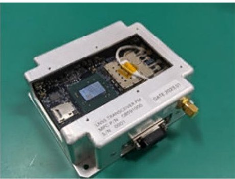

Download: Download high-res image (153KB)

Download: Download full-size image

Fig. 2. LNS transmitter prototype.

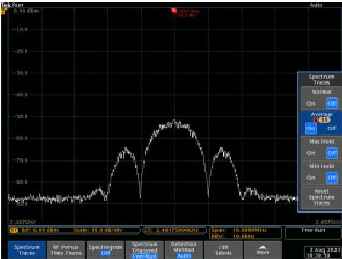

Download: Download high-res image (223KB)

Download: Download full-size image

Fig. 3. PSD measurement of the LNS transmitter signal.

<table border="1"><tr><td>Symbol</td><td></td><td>Value</td></tr><tr><td>$W_{t}$</td><td>Transmit power</td><td>1.0W</td></tr><tr><td>$G_{t}$</td><td>Antenna Gain Tx</td><td>0dBi</td></tr><tr><td>$f_{c}$</td><td>Central frequency</td><td>2.2GHz</td></tr><tr><td>r</td><td>Propagation distance</td><td>600km-1100km</td></tr><tr><td>$G_{r}$</td><td>Antenna Gain Rx</td><td>0dBi</td></tr><tr><td>$N_{0}$</td><td>Noise level</td><td>204.08dB</td></tr></table>

## 3.2. Store and forward

We have demonstrated S&F technologies at low Earth orbit in our previous missions, namely TRICOM-1R and JPRWASAT [20]. This time, we will update our technologies to provide S&F service in the vicinity of the Moon. S&F system employs LoRa-based protocol and supports dual band communications between low lunar orbit and on-surface users at a rate of maximum 2 kbps. Downlink and uplink frequency were selected respectively within S-band in compliant with the latest ITU recommendation as well as the SFCG REC 32-2R5

<!-- PDF_PAGE: 11 -->

recommendation [18]. A functional diagram of the S&F payload is depicted in Fig. 4. The dimension of the S&F payload is $ 9 8. 3 \times\quad 8 8. 0 \times\quad 2 5. 5 \mathrm{~ m m}^{3} $ excluding a RF cable and antenna.

A patch antenna with a size of $ 1 0 0. 0 \times1 0 0. 0 \times3. 0 \mathrm{~ mm}^{3} $ , achieving a gain greater than 8 dBi, is newly designed for this mission. In this mission, S&F communication can also be used to transfer pseudorange observation data from the reference station to the user segment to support the double-difference calculation process.

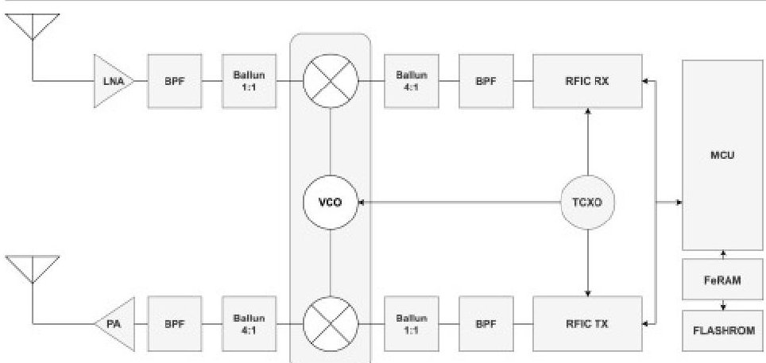

Download: Download high-res image (124KB)

Download: Download full-size image

Fig. 4. S&F functional block diagram.

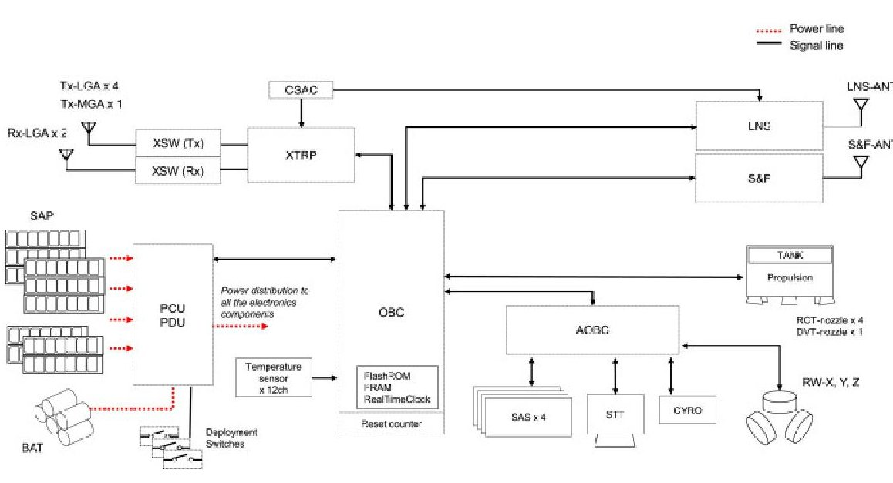

Fig. 5. Systems diagram.

## 4.1. Overview

## 4. LunaCube systems design

Based on the mission objectives, CONOPS, and mission payload design discussed in the previous sections, we designed the satellite bus system. An overview of the satellite bus specifications is summarized in Table 7. Each satellite consists of

<!-- PDF_PAGE: 12 -->

a 6U-size structure, 50W-class deployed solar array panels (SAP), a X-band transponder (XTRP), three-axis attitude and orbit control using a star tracker (STT), sun acquisition sensors (SAS), mems gyro (GYRO), reaction wheels (RW), reaction control system thruster (RCT), and delta-v thruster (DVT) based on a water-based resistojet, with a total wet mass of less than 14 kg. The system diagram of the LunaCube is shown in Fig. 5. In the system diagram, heaters are not illustrated, as they are internal to the battery (BAT) and propulsion unit.

The mechanical configuration of the LunaCube can be seen in Fig. 6. Solar cells have been installed on SAP to secure a sufficient amount of power generation that is required to realize the proposed CONOPS, while no solar cell has been mounted on the body to avoid excessive heat transfer between the satellite and outer space environment. The layout of the SAP has been designed symmetrically around the Z-axis to minimize the disturbance torque due to solar radiation particles (SRP) during sun-pointing.

The LNS and S&F antennas have been installed on the -Y panel, which will be pointed to the lunar surface during the Service event. Additionally, the SAP have been positioned to not block the field of view of the LNS antenna （ $ \pm 6 0^{\circ} $ ）or S&F antennas （ $ \pm 3 0^{\circ} $ ）.

<table border="1"><tr><td rowspan="2">Structure</td><td>Size</td><td>100×226.3×366mm3</td></tr><tr><td>Weight</td><td>≤14kg(wet)</td></tr><tr><td rowspan="3">Power</td><td>Solar array</td><td>7s-6p(front),7s-4p(back)</td></tr><tr><td>Power gen.</td><td>Max.44.7W(7series-6parallel)</td></tr><tr><td>Battery</td><td>77.7Whr</td></tr><tr><td rowspan="3">ADCS</td><td>Actuator</td><td>Reaction wheel(RW)×3</td></tr><tr><td>Sensor</td><td>Star tracker(STT)×1,Sun acquisition sensor(SAS)×4,3-axis mems gyro(GYRO)</td></tr><tr><td>Performance</td><td>≤1° pointing accuracy</td></tr><tr><td rowspan="2">Propulsion</td><td>Thrusters</td><td>Reaction control system thruster(RCT)×4,Delta-V thruster(DVT)×1</td></tr><tr><td>Propellant</td><td>≤0.9kgH2O(water)</td></tr><tr><td rowspan="4">Coomunication</td><td>Frequency</td><td>X-band</td></tr><tr><td>Antenna</td><td>Rx low gain antenna(Rx-LGA)×2,Tx low gain antenna(Tx-LGA)×4,Tx middle gain antenna(Tx-MGA)×1</td></tr><tr><td>Radiometric</td><td>Range and range rate(RARR)</td></tr><tr><td>Performance</td><td>1WRFoutput</td></tr></table>

<!-- PDF_PAGE: 13 -->

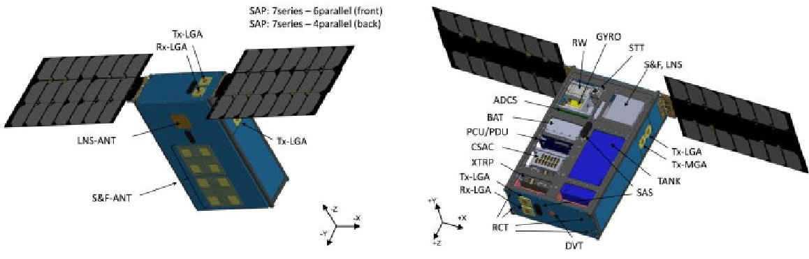

Download: Download high-res image (372KB)

Download: Download full-size image

Fig. 6. Mechanical configuration.

## 4.2. Structure

The LunaCube structure is designed to be compatible with the standard piggyback interface of the H-II Transfer Vehicle (HTV), in an attempt to add realistic constraints to the mechanical design process. At the same time, the interface among components has been kept simple enough to minimize future redesign work after the final launch interface is determined. Fig. 7 is a picture of the structure, taken during the engineering model integration, excluding body panels and SAP.

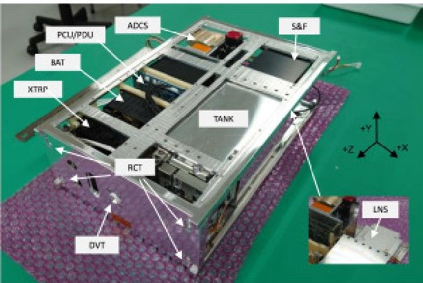

Download: Download high-res image (340KB)

Download: Download full-size image

Fig. 7. LunaCube structure.

## 4.3. Telecommunication

The telecommunication system of the LunaCube mainly consists of a XTRP, two Rx low gain antennas (Rx-LGA), four Tx low gain antennas (Tx-LGA), one middle gain antenna (Tx-MGA), hybrids (HYB), and RF switches, which are connected as depicted in Fig. 8.

Two Rx-LGA are connected through a HYB internal to the XTRP and are attached to $ \pm Z $ panels, each one covering a half of space in either + Z or $ -Z $ direction respectively. Four Tx-LGA are attached to $ \pm X $ panels and $ \pm Z $ panels, each one covering $ \pm 60^{\circ} $ from its center axis. According to the satellite attitude, a combination of Tx-LGA, which is combined through a HYB, is switched through an RF switch, allowing the satellite to communicate in all directions in X-Z plane

<!-- PDF_PAGE: 14 -->

in a time division manner. This design ensures communication with Earth-based ground station(s) throughout different operational events/modes, including sunpointing and service.

The Tx-MGA is installed on the -X panel for higher data-rate communication during the mission data downlink event, which will be used alternately with Tx-LGA through an RF switch internal to the XTRP.

The specifications of the communication system are summarized in Table 8. Additionally, link budget analysis is summarized in Appendix A.

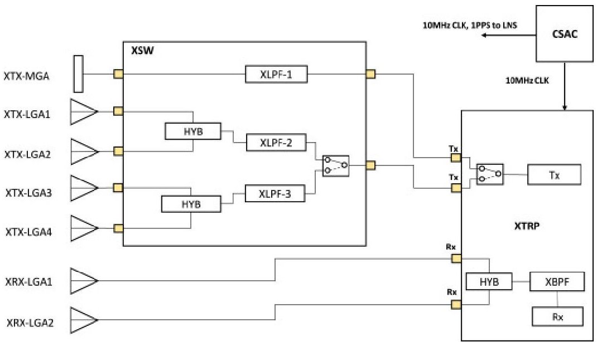

Download: Download high-res image (197KB)

Download: Download full-size image

Fig. 8. Telecommunication system diagram.

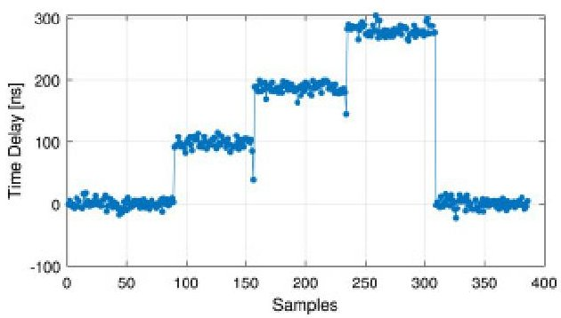

Download: Download high-res image (132KB)

Download: Download full-size image

Fig. 9. Time delay measurements at the received power of $ - 1 1 0 $ dBm.

<!-- PDF_PAGE: 15 -->

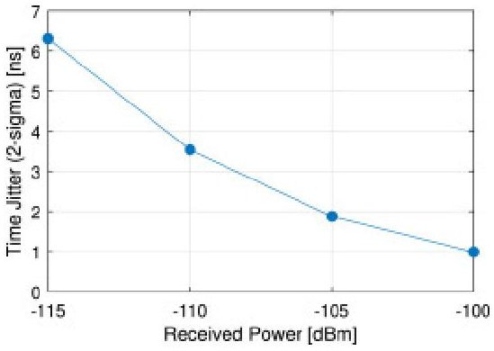

Download: Download high-res image (92KB)

Download: Download full-size image

Fig. 10. Time jitter measurement against received power.

Table 8. Communication system specification.

<table border="1"><tr><td>Frequency</td><td>Uplink:7.1GHz,Downlink:8.4GHz</td></tr><tr><td>Output power</td><td>High-power mode:1W,low-power mode:20mW</td></tr><tr><td>Carrier threshold level</td><td>-150dBm</td></tr><tr><td>Command bitrate</td><td>15.625bps,125bps,1kbps</td></tr><tr><td>Telemetry bitrate</td><td>8bps-32.768kbps</td></tr><tr><td>Modulation</td><td>PCM-PSK/PM</td></tr><tr><td>Ranging</td><td>Two-way range and range rate(RARR),Delta Differential One-way Ranging(DDOR)</td></tr><tr><td>Power consumption</td><td>13W(high power),8W(low power),5.6W(receiving only)</td></tr><tr><td>Antenna gain</td><td>LGA:6.75dBi,MGA:8.5dBi</td></tr><tr><td>Mass</td><td>XTRP:0.5kg,Tx-LGA:0.02kg($\times4$),Rx-LGA:0.02kg($\times2$),Tx-MGA:0.02kg</td></tr><tr><td>Size</td><td>XTRP:80$\times$80$\times$50mm3</td></tr></table>

## 4.4. Ranging

The telecommunication system also provides range and range rate (RARR) observations based on coherent two-way ranging for orbit determination [21]. The designed system aims to obtain 1 m (1 $ \sigma $ ) for range accuracy and 1 mm/s (1 $ \sigma $ ) for range rate accuracy, respectively.

In the LunaCube mission, orbit determination is required mainly for the following two purposes: (1) LNS service and (2) orbit maintenance maneuvers. In typical pseudorange-based navigation applications, the position of the transmitters (i.e., navigation satellites) is used as a reference to estimate a position of the user receiver. Therefore, accurate orbit determination is required to improve the estimated user positioning accuracy. However, in this specific mission, the MDPO algorithm effectively removes the influence of the orbit

<!-- PDF_PAGE: 16 -->

determination error from the observation through the double-difference process. As a result, the required orbit determination accuracy from a navigation mission point of view is not high, allowing an orbit determination error of a few kilometers.

On the contrary, the required orbit determination accuracy derived from the orbit maintenance maneuver is higher. During the orbit maintenance maneuver, the estimated satellite position is used to calculate the amount of delta-V thrust, as well as to determine the maneuver timing. Thrusting at an inappropriate timing will cause a deviation from ideal orbits. In general, satellite position error in the radial direction directly affects the estimated orbital period of the satellite. In our simulation described in Section 2.3, an orbit determination error of （20 $ \pm 3.3 $ m, 200 $ \pm 33.3 $ m, 200 $ \pm 33.3 $ m) (radial, along-track, cross-track) were used.

## 4.5. Time synchronization

The XTRP is also used to synchronize the onboard CSAC clock to the time system of the ground station. This function is integrated with the ranging function by adding a regenerative mode to the original bent-pipe mode. In the regenerative mode, the ranging subcarrier is demodulated, and the additional symbol tracking loop retrieves the symbol timing, which will then be used to calibrate the reference clock generation on the CSAC.

Fig. 9 illustrates experimental results of time delay measurements at a received power of $ - 1 1 0 $ dBm. Physical delay paths, which introduce approximately 100 ns of delay, were incrementally added between the signal generator and the XTRP, both of which were driven by the same CSAC. The result indicate that the XTRP successfully synchronized the incoming symbol timing.

Fig.10 summarizes the time jitter values （2 $ \sigma $ ）of the time delay measurements at different received powers. The implemented symbol tracking loop is capable of providing symbol timing accuracy better than 10 ns (approximately 3 m in range) at the expected received power of $ -114 $ dBm at the Moon (See Appendix A). To obtain the absolute time delay, the range between the satellite and the ground station must be resolved, and the receiver hardware's inner delay needs to be calibrated.

## 4.6. On-board computer

The on-board computer (OBC) unit of the LunaCube leverages the heritage of our prior project TRICOM-1&2 [22].

As one of the unique features of the OBC, it is periodically rebooted by the reset counter for failure recovery, regardless of its mode. This serves as a countermeasure against unexpected faults caused by single events. The status information is recorded in a ferroelectric random-access memory (FRAM) and read out immediately after the reboot for continuous operation.

<!-- PDF_PAGE: 17 -->

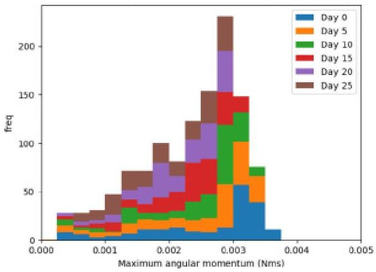

Download: Download high-res image (107KB)

Download: Download full-size image

Fig. 11. Accumulated angular momentum for a day (sun pointing). The X-axis represents the maximum angular momentum within a simulated day, and the Y axis represents the number of cases that fall into the corresponding value on the X-axis.

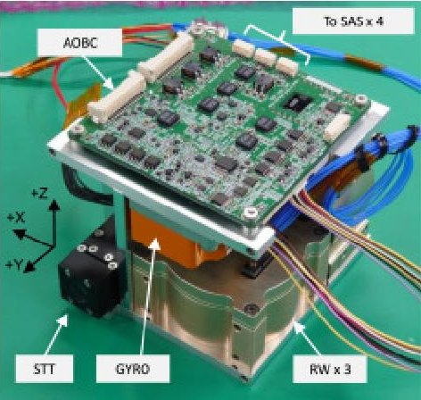

Download: Download high-res image (379KB)

Download: Download full-size image

Fig. 12. ADCS unit.

## 4.7. Attitude determination and control

The attitude determination and control system (ADCS) is designed to provide the necessary attitude estimation and pointing accuracy for each event and mode.

Table 9 summarizes the attitude control requirements for major events. During health monitoring and standby mode, sun pointing will be performed to maximize power generation. During the Mission Data Transfer event, the satellite will point the Tx-MGA to an Earth ground station to ensure sufficient antenna gain. During the Service event, the satellite will direct the LNS and S&F antenna, mounted on the $ - Y $ panel, to the Moon's center. The required pointing accuracy for the Service event is $ 15^{\circ} $ , which is set twice as small as the half power beam width (HPBW) of the S&F antenna. During orbit maneuver, the satellite will point its DVT to an orbit direction with an accuracy of $ 1^{\circ} $ .

Attitude determination sensors, including STT, SAS, and GYRO, have been selected to meet the required attitude determination accuracy depicted in Table

<!-- PDF_PAGE: 18 -->

9. 

As for the attitude control actuator, the size of the RW is designed to meet four major operational needs: (1) absorption of the satellite's angular momentum after the initial orbit injection, (2) absorption of environmental disturbances accumulated on the satellite, (3) attitude maneuver during the service operation, and (4) absorption of disturbance during the orbit maneuver operation.

It is assumed that the initial angular rate after orbit insertion does not exceed $ 7^{\circ} / \mathrm{s} $ , assuming a similar injection condition as the Epsilon rocket [23]. This initial angular rate will yield 26.4 mNms of angular momentum, which can be detumbled with one RW with a 15% margin. In reality, the angular momentum with respect to a satellite's axis can change during nutation, and this change can help detumble a satellite by using the other RWs, leaving more margin for the system.

The RWs are also used to stabilize the satellite attitude against environmental disturbances, including SRP and gravity gradient torque. Magnetic disturbance and air disturbance are negligible in the vicinity of the Moon.

Analytical calculation confirmed that the amount of torque caused by the environmental disturbances at a 300-km low orbit is no larger than $ 2. 5 7 \times1 0^{-7} $ Nm at the most undesirable satellite attitude. Assuming the worst-case scenario, where only one RW is used to absorb the calculated environmental disturbance, unloading by using RCT will be required every 33 h. In a realistic scenario, the satellite primarily points the + Z panel towards the sun for most of the time. Monte Carlo simulations, assuming the nominal controlled attitude and varying mission start dates in relation to lunar phase indicate that the expected daily accumulation of angular momentum is 3.46 mNms at the median, as shown in Fig. 11. This daily accumulation leads to an unloading interval of 150 h.

The RWs are also used to change the satellite attitude during the Service event, where continuous pointing to the Moon center is required while orbiting the Moon. From this point of view, the RWs are large enough to produce the required angular rate no greater than $ 1 2^{\circ} / \mathrm{m i n} $ . Finally, the RWs are also used to absorb disturbance torque during the orbit maneuver operation. The disturbance is mainly caused by the misalignment of thrusters and deviation of thrusting force.

All of these components are controlled by the ADCS on-board computer (AOBC), and integrated into a module which sizes to fit in a constrained volume ( <1U) as shown in Fig. 12. The specifications of the ADCS components are summarized in Table 10.

<table border="1"><tr><td>Mode</td><td>HM</td><td>MD</td><td>SB</td><td>SV</td><td>OM</td></tr><tr><td>Pointing direction</td><td>Sun</td><td>Earth</td><td>Sun</td><td>Moon</td><td>Orbit</td></tr></table>

<!-- PDF_PAGE: 19 -->

<table border="1"><tr><td>Mode</td><td>HM</td><td>MD</td><td>SB</td><td>SV</td><td>OM</td></tr><tr><td>Attitude stability(°/s)</td><td>1.0</td><td>1.0</td><td>1.0</td><td>1.0</td><td>0.1</td></tr><tr><td>Attitude determination(°)</td><td>3.0</td><td>6.0</td><td>3.0</td><td>6.0</td><td>0.1</td></tr><tr><td>Pointing accuracy(°)</td><td>15</td><td>10</td><td>15</td><td>15</td><td>1.0</td></tr><tr><td>Maneuver speed(°/min)</td><td>-</td><td>-</td><td>-</td><td>12</td><td>-</td></tr></table>

HM: Health monitoring, MD: Mission data transfer, SB: Standby, SV: Service, and OM: Orbit maintenance.

<table border="1"><tr><td>RW</td><td>Momentum30.6mNms,Max torque2.3mNm,Speed range±6000rpm</td></tr><tr><td>STT</td><td>Accuracy15arcseconds(1σ)cross-boresight,90arcseconds(1σ)aroundboresight</td></tr><tr><td>SAS</td><td>Field ofview±60°,Accuracy≤0.5°</td></tr><tr><td>Gyro</td><td>BiasStability&lt;0.3°/h,AngleRandomWalk&lt;0.15°/√h,Range&gt;±200°/s</td></tr></table>

## 4.8. Propulsion

The propulsion system uses water propellant resistojet thrusters, which are a customized product based on the AQUA ResIstojet Propulsion System (AQUARIUS) [24]. The system consists of an integrated propulsion system that supports two types of thrusters, DVT and RCT. Each thruster is equipped with a thermal insulator, a heater, and nozzle(s) as primary components.

The heater is used to warm the in-flowing gas to about 100 $ ^{\circ} \mathrm{C} $ . RCT nozzles are distributed to the four corners of the panel and have a cant angle to achieve three-dimensional attitude control. The DVT nozzle is located at the center of the panel to align its thrusting axis to the center of gravity (CoG) of the satellite. The water tank is made of aluminum and has an internal bladder that stores approximately 900 g of water. The bladder is pressurized from outside by argon gas and shrinks almost symmetrically to avoid offsets from the CoG as the remaining fuel is reduced.

In our mission, we use scheduled circularization control (SCC) for orbit control method [16]. Phase difference between two satellites (i.e., a difference of true anomalies) is observed before an orbit maintenance maneuver at each month, and the amount of thrust for each satellite is adjusted to obtain an orbital eccentricity which minimizes the phase difference during the following month. The orbit determination error and thrust force errors were modeled and accounted for in the numerical simulation analysis.

The propulsion fuel for both the DVT and RCT is stored in a shared tank. Based on the specification summarized in Table 11, the amount of required fuel for the DVT and RCT was determined respectively. According to the constellation design described in Section 2.3, two-year mission period necessitates 13.4 m/s of delta

<!-- PDF_PAGE: 20 -->

V for each satellite. This delta V requirement can be met with approximately 270 g of the propulsion fuel, assuming an Isp of 70 s for the DVT. For the RCT, the total environmental disturbance torque estimated through the realistic simulation in Section 4.7 over the course of the two-year mission period amounts to 2.53 Nms. This can be compensated by using approximately 100 g of the propulsion fuel, assuming Isp of 50 s for the RCT.

Consequently, the total propulsion fuel required for both the DVT and RCT in total is 370 g, leaving nearly 60% margin within the onboarded propulsion fuel capacity of 900 g. This margin, for instance, can be utilized for additional trajectory correction maneuvers and attitude control.

Table 11. Propulsion system specification.

<table border="1"><tr><td></td><td>DVT</td><td>RCT</td></tr><tr><td>Thrust level(mN)</td><td>4.0</td><td>1.0</td></tr><tr><td>Isp(s)</td><td>70</td><td>&gt;50</td></tr><tr><td>Fuel(g)</td><td>500</td><td>400</td></tr><tr><td>Cant angle(°)</td><td>0</td><td>30</td></tr></table>

## 4.9. Power

The power system is equipped with deployed SAP. The mechanical layout of the SAP is shown in Fig. 6. The front and back sides have different solar cell string configurations: 7-series/6-parallel and 7-series/4-parallel, respectively.

The front side is used for nominal power generation, while the back side is only used during tumbling. The front side of the SAP is kept pointed towards the sun to maximize power generation during the nominal operation phase, except for the service event that requires lunar surface pointing. The maximum power generation of the front solar cells is 44.7 W.

The battery system consists of six 18650 lithium batteries in a 3-series/2-parallel configuration, capable of accommodating a maximum of 77.7 Whr capacity. The power control unit (PCU) and power distribution unit (PDU) monitor and distribute power lines to each component.

At the system level, we confirmed that the designed solar panels can supply an adequate amount of power throughout the designed SOE events under the worst sun-lit condition, i.e., when the beta angle is 0 $ ^{\circ} $ . We also confirmed that the amount of battery capacity is sufficient to keep the depth of discharge (DoD) smaller than 30% throughout the mission but could experience a larger DoD during seasonal lunar eclipses.

## 4.10. Thermal

The thermal design of the LunaCube faces many constraints,coupled with the trajectory design and spacecraft operation. It also needs to cope with a variation of heat transfer that is coupled with the beta angle changing from $ 0^{\circ} $ to $ 90^{\circ}. $

<!-- PDF_PAGE: 21 -->

To cope with the predicted heat variation, the thermal system is made up of several key thermal control components, including surface materials, such as surface coating and multi-layer insulation (MLI), heat insulators, and heaters. The thermal conductivity between each solar panel and the body will be kept no greater than 0.1 W/K by using heat insulators to limit the amount of conductive heat. Heaters are installed internally in the battery unit as well as the propulsion unit to actively control the temperature of these components. For monitoring purposes, twelve temperature sensors are installed mainly at the unit level. Operation temperature of key components are summarized in Table 12.

Thermal analysis was conducted using a simplified thermal resistance model analytically, followed by numerical simulations using Thermal Desktop. We have confirmed that the temperature of electronic components will remain within their operational ranges under the hottest condition (i.e., beta angle is $ 9 0^{\circ} $ ) and the coldest condition (i.e., beta angle is $ 0^{\circ} $ ) during controlled attitude and uncontrolled tumbling around the Y-axis, with the assistance of heater control. Additionally, we have confirmed that the satellite can withstand scenarios where the SAP fail to deploy. This survival is achieved through natural tumbling around the Y-axis, which is facilitated by the mechanical design of the moment of inertia.

Temperature transitions during lunar eclipses have also been confirmed. The simulation utilized an eclipse duration of 5 h, by adding a margin to the longest eclipse duration (3 h 38 min) predicted between 2024 and 2026 in [25]. The numerical simulation results, shown in Fig.13, indicate that the temperatures of satellite components will experience a significant drop during the lunar eclipse but will still remain within their operational temperature ranges.

<table border="1"><tr><td>Component</td><td>Min. (℃)</td><td>Max. (℃)</td></tr><tr><td>PCU/PDU</td><td>-20</td><td>+50</td></tr><tr><td>BAT</td><td>0</td><td>+50</td></tr><tr><td>RW</td><td>-10</td><td>+60</td></tr><tr><td>GYRO</td><td>-40</td><td>+85</td></tr><tr><td>STT</td><td>-20</td><td>+75</td></tr><tr><td>SAS</td><td>-30</td><td>+80</td></tr><tr><td>AOBC/OBC</td><td>-20</td><td>+50</td></tr><tr><td>XTRP</td><td>-20</td><td>+60</td></tr><tr><td>CSAC</td><td>-10</td><td>+70</td></tr><tr><td>LNS</td><td>-10</td><td>TBC</td></tr><tr><td>S&amp;F</td><td>-30</td><td>+50</td></tr></table>

<!-- PDF_PAGE: 22 -->

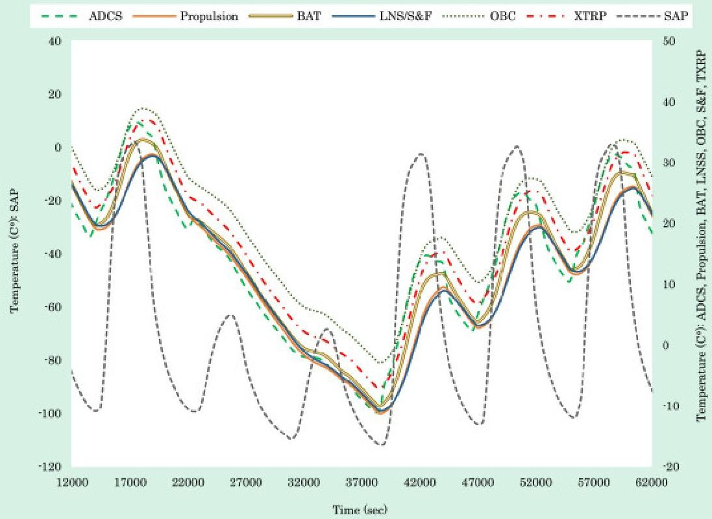

Download: Download high-res image (562KB)

Download: Download full-size image

Fig. 13. Thermal simulation including a 5-hr lunar eclipse, simulated with a beta angle of $ 0^{\circ} $ and with sun-pointing attitude control. The left Y-axis displays the temperature scale for SAP, while the right Y-axis depicts the temperature scale for ADCS, Propulsion, BAT, LNSS/S&F, OBC, and XTRP.

## 5. Conclusions

This paper presents the mission overview and system design of our 6U lunar navigation mission. We propose a dual-satellite constellation that will provide pseudorange-based positioning information to multiple users on the lunar surface, with a lunar lander acting as a reference station, by using multi-epoch double-difference pseudorange observation (MDPO) algorithm. Based on our prior simulation analysis, the proposed system can provide 50 m (95%) user positioning accuracy relative to the reference station, within one-minute observation when the two navigation satellites are in view, in case two satellites are placed in a 300 km low lunar orbit and the user and reference station are located at the South pole. The proposed system works with a minimum of two satellites but can be scaled to a larger constellation to provide a better user positioning accuracy. The system is also equipped with a store and forward (S&F) radio that provides low-power uplink/downlink communication to on-surface users at a maximum rate of 2 kbps.

This article discusses several important design trade-offs and preliminary results, such as the selected trajectory of two navigation satellites, concept of operations, mission payload design, and bus systems design. The designed satellite bus consists of a 6U-size structure, a 50W-class deployed solar panel, a X-band transponder, three-axis attitude control using a star tracker, sun sensors,

<!-- PDF_PAGE: 23 -->

gyro, reaction wheels, and reaction control system thruster, as well as orbit control using a water-based resistojet, with a total wet mass less than 14 kg.

## Declaration of competing interest

The authors declare that they have no known competing financial interests or personal relationships that could have appeared to influence the work reported in this paper.

## Acknowledgments

This work was supported by MEXT Coordination Funds for Promoting AeroSpace Utilization ; Grant Number JPJ000959.

## Appendix A. Link budget analysis

Table A.1, Table A.2, Table A.3 display link budget analysis for the default data-rate telemetry, high data-rate telemetry, and command uplink, respectively.

Table A.1. Downlink budget: default data-rate.

<table border="1"><tr><td>Frequency</td><td colspan="2">8400.0 MHz</td></tr><tr><td>Transmit Power</td><td>30.0 dBm</td><td>1W over the air</td></tr><tr><td>Transmit Feeder Loss</td><td>-8.35 dB</td><td>Including HYB, switch, LPF, and cable</td></tr><tr><td>Transmit Antenna Gain</td><td>6.75 dBi</td><td>LunaCube Tx-LGA</td></tr><tr><td>EIRP</td><td>28.4 dBm</td><td></td></tr><tr><td>Transmit Point. Loss</td><td>-3.23 dB</td><td>Max.45°off-pointing</td></tr><tr><td>Polarization Loss</td><td>-0.5 dBm</td><td></td></tr><tr><td>Range</td><td>400000km</td><td></td></tr><tr><td>Space Loss</td><td>-223.0dB</td><td></td></tr><tr><td>Absorb Loss</td><td>-0.32dB</td><td></td></tr><tr><td>Rain Loss</td><td>-0.41dB</td><td></td></tr><tr><td>Scintillation Loss</td><td>-0.25dB</td><td></td></tr><tr><td>Receive Antenna Gain</td><td>59.3dBi</td><td>GS antenna</td></tr><tr><td>Receive Point. Loss</td><td>-0.5dB</td><td></td></tr><tr><td>Receive Feeder Loss</td><td>NAdB</td><td>Included in GS antenna gain</td></tr><tr><td>G/T</td><td>39.01dB/K</td><td></td></tr><tr><td>Noise Power Density</td><td>-178.81dBm/Hz</td><td></td></tr><tr><td>Received Signal Power</td><td>-140.48dBm</td><td></td></tr><tr><td>C/No</td><td>38.33dB·Hz</td><td></td></tr><tr><td>Modulation Index</td><td>1.2rad</td><td></td></tr></table>

<!-- PDF_PAGE: 24 -->

<table border="1"><tr><td>Frequency</td><td colspan="3">8400.0 MHz</td></tr><tr><td>Modulation Loss</td><td>1.52 dB</td><td></td><td></td></tr><tr><td>Hardware Loss</td><td>1.0 dB</td><td></td><td></td></tr><tr><td>Bandwidth/Bit Rate</td><td>27.09 dB</td><td>Hz</td><td>512 bps</td></tr><tr><td>Coding Gain</td><td>5.2 dB</td><td></td><td></td></tr><tr><td>Required S/N</td><td>9.6 dB</td><td></td><td>BER＜10-5</td></tr><tr><td>Required C/No</td><td>34.02 dB</td><td>Hz</td><td></td></tr><tr><td>Margin</td><td>4.31 dB</td><td></td><td></td></tr></table>

Table A.2. Downlink budget: high data-rate.

<table border="1"><tr><td>Frequency</td><td colspan="2">8400.0 MHz</td></tr><tr><td>Transmit Power</td><td>30.0 dBm</td><td>1 W over the air</td></tr><tr><td>Transmit Feeder Loss</td><td>-6.25 dB</td><td>Including HYB, switch, LPF, and cable</td></tr><tr><td>Transmit Antenna Gain</td><td>8.50 dBi</td><td>LunaCube Tx-HGA</td></tr><tr><td>EIRP</td><td>32.25 dBm</td><td></td></tr><tr><td>Transmit Point. Loss</td><td>-0.5 dB</td><td>Max. 10° off-pointing</td></tr><tr><td>Polarization Loss</td><td>-0.5 dBm</td><td></td></tr><tr><td>Range</td><td>400000 km</td><td></td></tr><tr><td>Space Loss</td><td>-223.0 dB</td><td></td></tr><tr><td>Absorb Loss</td><td>-0.32 dB</td><td></td></tr><tr><td>Rain Loss</td><td>-0.41 dB</td><td></td></tr><tr><td>Scintillation Loss</td><td>-0.25 dB</td><td></td></tr><tr><td>Receive Antenna Gain</td><td>59.3 dBi</td><td>GS antenna</td></tr><tr><td>Receive Point. Loss</td><td>-0.5 dB</td><td></td></tr><tr><td>Receive Feeder Loss</td><td>NA dB</td><td>Included in GS antenna gain</td></tr><tr><td>G/T</td><td>39.01 dB/K</td><td></td></tr><tr><td>Noise Power Density</td><td>-178.81 dBm/Hz</td><td></td></tr><tr><td>Received Signal Power</td><td>-133.90 dBm</td><td></td></tr><tr><td>C/No</td><td>44.91 dB·Hz</td><td></td></tr><tr><td>Modulation Index</td><td>1.4 rad</td><td></td></tr><tr><td>Modulation Loss</td><td>1.04 dB</td><td></td></tr><tr><td>Hardware Loss</td><td>1.0 dB</td><td></td></tr><tr><td>Bandwidth/Bit Rate</td><td>36.12 dB·Hz</td><td>4,096 bps</td></tr><tr><td>Coding Gain</td><td>5.2 dB</td><td></td></tr></table>

<!-- PDF_PAGE: 25 -->

<table border="1"><tr><td>Frequency</td><td colspan="2">8400.0MHz</td></tr><tr><td>Required S/N</td><td>9.6dB</td><td>BER＜10-5</td></tr><tr><td>Required C/No</td><td>42.56dB·Hz</td><td></td></tr><tr><td>Margin</td><td>2.35dB</td><td></td></tr></table>

Table A.3. Uplink budget.

<table border="1"><tr><td>Frequency</td><td colspan="2">7166.0 MHz</td></tr><tr><td>Transmit Power</td><td>56.99 dBm</td><td>500 W over the air</td></tr><tr><td>Transmit Feeder Loss</td><td>-3.60 dB</td><td></td></tr><tr><td>Transmit Antenna Gain</td><td>58.90 dBi</td><td>GS antenna</td></tr><tr><td>EIRP</td><td>112.29 dBm</td><td></td></tr><tr><td>Transmit Point. Loss</td><td>-0.5 dB</td><td></td></tr><tr><td>Polarization Loss</td><td>-0.5 dBm</td><td></td></tr><tr><td>Range</td><td>400000 km</td><td></td></tr><tr><td>Space Loss</td><td>-221.59 dB</td><td></td></tr><tr><td>Absorb Loss</td><td>-0.28 dB</td><td></td></tr><tr><td>Rain Loss</td><td>-0.23 dB</td><td></td></tr><tr><td>Scintillation Loss</td><td>-0.24 dB</td><td></td></tr><tr><td>Receive Antenna Gain</td><td>7.03 dBi</td><td>LunaCube Rx-LGA</td></tr><tr><td>Receive Point. Loss</td><td>-3.62 dB</td><td>Max.45°off-pointing</td></tr><tr><td>Receive Feeder Loss</td><td>-6.15 dB</td><td>IncludingHYB,BPF,cable</td></tr><tr><td>G/T</td><td>-30.64 dB/K</td><td></td></tr><tr><td>Noise Power Density</td><td>-163.43 dBm/Hz</td><td></td></tr><tr><td>Received Signal Power</td><td>-113.79 dBm</td><td></td></tr><tr><td>C/No</td><td>49.64 dB·Hz</td><td></td></tr><tr><td>Modulation Index</td><td>1.5 rad</td><td></td></tr><tr><td>Modulation Loss</td><td>2.1 dB</td><td></td></tr><tr><td>Hardware Loss</td><td>2.0 dB</td><td></td></tr><tr><td>Bandwidth/Bit Rate</td><td>24.1 dB·Hz</td><td>256 bps</td></tr><tr><td>Coding Gain</td><td>NA dB</td><td></td></tr><tr><td>Required S/N</td><td>9.6 dB</td><td>BER&lt;10^{-5}$</td></tr><tr><td>Required C/No</td><td>37.7 dB·Hz</td><td></td></tr><tr><td>Margin</td><td>11.9 dB</td><td></td></tr></table>

<!-- PDF_PAGE: 26 -->

## References

[1] Delépaut A., Giordano P., Ventura-Traveset J., Blonski D., Schönfeldt M., Schoonejans P., Aziz S., Walker R. Use of GNSS for lunar missions and plans for lunar in-orbit development Adv. Space Res., 66 (12) (2020), pp. 2739-2756, 10.1016/j.asr.2020.05.018 View PDF View article View in Scopus Google Scholar

[2] Minetto A., Dovis F., Nardin A., Vouch O., Impresario G., Musmeci M. Analysis of GNSS data at the moon for the LuGRE project 2022 IEEE 9th International Workshop on Metrology for AeroSpace (MetroAeroSpace) (2022), pp. 134-139, 10.1109/MetroAeroSpace54187.2022.9855945 View in Scopus Google Scholar

[3] Giordano P., Swinden R., Gramling C., Crenshaw J., Ventura-Traveset J. Lunar navigation satellite system and positioning accuracy evaluation Proceedings of the 36th International Technical Meeting of the Satellite Division of the Institute of Navigation (2023), pp. 3577-3588, 10.33012/2023.19345 View in Scopus Google Scholar

[4] Giordano P., Malman F., Swinden R., Zoccarato P., Ventura-Traveset J. The lunar pathfinder PNT experiment and moonlight navigation service: The future of lunar position, navigation and timing Proceedings of the 2022 International Technical Meeting of the Institute of Navigation (2022), pp. 632-642, 10.33012/2022.18225 View in Scopus Google Scholar

[5] Murata M., Kawano I., Kogure S.

Lunar navigation satellite system and positioning accuracy evaluation

Proceedings of the 2022 International Technical Meeting of the Institute of Navigation (2022), pp. 582-586, 10.33012/2022.18220

View in Scopus Google Scholar

[6] Offord Harle N., Oates C., Bywater S., Cranstoun C., Friend J., Lay G., Schwarz B., Stevens P., Hufenbach B., Liuicci F., et al. Lunar comms and nav infrastructure-first data relay orbiter lunar pathfinder, operational in 2024, paves the way for full constellation by 2030s ASCEND 2021 (2021), p. 4132, 10.2514/6.2021-4132 Google Scholar

[7] Shilong W., Jingqing L., Liangliang G.

Joint FDOA and TDOA location algorithm and performance analysis of dual-satellite formations

2010 2nd International Conference on Signal Processing Systems, Vol. 2, IEEE (2010), pp. 339-342, 10.1109/ICSPS.2010.5555463

Google Scholar

<!-- PDF_PAGE: 27 -->

[8] Jun W.W., Cheung K.-M., Lightsey E.G., Lee C. Localizing in urban canyons using joint Doppler and ranging and the law of cosines method Proceedings of the 32nd International Technical Meeting of the Satellite Division of the Institute of Navigation (ION GNSS+ 2019) (2019), pp. 140-153, 10.33012/2019.16897 View in Scopus Google Scholar

[9] Tanaka T., Ebinuma T., Nakasuka S. Dual-satellite lunar global navigation system using multi-epoch double-differenced pseudorange observations Aerospace, 7 (9) (2020), p. 122, 10.3390/aerospace7090122 View in Scopus Google Scholar

[10] Music M., Newberry L., Peters D., Quetin G., Stickle A., Ackerman K., Bruun E., Cleveland T., Culver T., Deboever J., Do R., Grant J., Hanugan L., Haselfeld G., Heikell M., Mayberry J., Robbins J., Sabin A., Schmuland D., Trescott R. Luna POLARIS a lunar positioning and communications system (2022) Google Scholar

[11] Spudis P.D.

The Value of the Moon: How To Explore, Live, and Prosper in Space using the Moon's Resources

Smithsonian Institution (2016)

Google Scholar

[12] Rybak M.M., Axelrad P., Seubert J., Ely T. Chip scale atomic clock-driven one-way radiometric tracking for low-earth-orbit CubeSat navigation J. Spacecr. Rockets, 58 (1) (2021), pp. 200-209, 10.2514/1.A34684 View in Scopus Google Scholar

[13] Cheung K.-M., Lee C.

Differencing methods for 3D positioning of spacecraft

2019 Integrated Communications, Navigation and Surveillance Conference (ICNS) (2019), pp. 1-10, 10.1109/ICNSURV.2019.8735155

Google Scholar

[14] Tanaka T., Malki H. INS/GNSS integrated rover navigation designed with MDPO-based dual-satellite lunar global navigation systems IEEE Access, 10 (2022), pp. 41803-41812, 10.1109/ACCESS.2022.3168014 View in Scopus Google Scholar

[15] T. Nakajo, T. Aoyama, Overview of a Satellite Earth Station with 10 m Parabola Antenna at Awara Campus in Fukui University of Technology, in: Proceedings of Mechanical Engineering Congress, 2012. Google Scholar

<!-- PDF_PAGE: 28 -->

[16] H. Sekine, K. Toma, T. Tanaka, T. Ebinuma, S. Nakasuka, Optimal satellite orbit design for the dual-satellite lunar navigation system LunaCube, in progress. Google Scholar

[17] Recommendation ITU-R RA.479-5, Protection of Frequencies for Radioastronomical Measurements in the Shielded Zone of the Moon, International Telecommunication Union. Google Scholar

[18] Recommendation SFCG 32-2R5, Communication and Positioning, Navigation, and Timing Frequency Allocations and Sharing in the Lunar Region, Space Frequency Coordination Group. Google Scholar

[19] Kaplan E.D., Hegarty C.

Understanding GPS/GNSS: Principles and Applications

Artech house (2017)

Google Scholar

[20] Verspieren Q., Matsumoto T., Aoyanagi Y., Fukuyo T., Obata T., Nakasuka S., Kwizera G., Abakunda J.

Store-and-forward 3U CubeSat project TRICOM and its utilization for development and education: the cases of TRICOM-1R and JPRWASAT

Trans. Japan Soc. Aeronaut. Space Sci., 63 (5) (2020), pp. 206-211,

10.2322/tjsass.63.206

View in Scopus Google Scholar

[21] H. Takeuchi, A. Tomiki, W. Torii, J. Kikuchi, C. Hirose, R. Hirasawa, S. Nakajima, T. Hashimoto, Y. Kawabata, R. Funase, T. Ito, T. Ichikawa, Y. Sugimoto, T. Sakamoto, Orbit Determination using INS Observables for CubeSat Mission, in: 34th International Symposium on Space Technology and Science, 2023. Google Scholar

[22] Aoyanagi Y., Matsumoto T., Obata T., Nakasuka S.

Design of 3U-CubeSat bus based on TRICOM experience to improve versatility and easiness of AIT

Trans. Japan Soc. Aeronaut. Space Sci., 19 (2) (2021), pp. 252-258,

10.2322/tastj.19.252

Google Scholar

[23] Epsilon Launch Vehicle User's Manual, Revision A Japan Aerospace Exploration Agency (2018) Google Scholar

[24] Asakawa J., Koizumi H., Nishi K., Takeda N., Murohara M., Funase R., Komurasaki K. Fundamental ground experiment of a water resistojet propulsion system: AQUARIUS installed on a 6U CubeSat: EQUULEUS

<!-- PDF_PAGE: 29 -->

Trans. Japan Soc. Aeronaut. Space Sci., 16 (5) (2018), pp. 427-431, 10.2322/tastj.16.427

Google Scholar

[25] Summary of All Lunar Eclipses From 2021 Through 2030 https://eclipse.gsfc.nasa.gov/LEdecade/LEdecade2021.html (Accessed: 2023-07-06). Google Scholar

View Abstract

## Recommended articles

Based on reading popularity

Research article Full text access

Integrated orbit determination and maintenance in Earth-Moon unstable dynamics environment

Yang Zhou, ..., Panlong Wu

Acta Astronautica • Volume 163, Part B • 2019 • Pages 69-76

View PDF

Research article Full text access

Vibration suppression for a slice rotor supported by active magnetic bearings based on fractional-order adaptive backstepping control

Boyuan Xu, ..., Longxiang Xu

Mechanical Systems and Signal Processing Volume 210 2024 Article 111160

PDF View PDF

Research article Full text access

Development of a scaled model test method for a dynamic and continuous survey to detect variations in the lateral stability of ballasted tracks

Chong Xu, ..., Kimitoshi Hayano

Transportation Geotechnics Volume 45 2024 Article 101198

View PDF

Research article Full text access

Simple solar panels/battery modeling for spacecraft power distribution systems

Ángel Porras-Hermoso, ..., Santiago Pindado

Acta Astronautica • Volume 179 • 2021 • Pages 345-358

View PDF

Research article Full text access

Boundary control design for vibration suppression and attitude control of flexible satellites with multi-section appendages Mohammad Mahdi Ataei, ..., Hadi Jalili Acta Astronautica Volume 173 2020 Pages 22-30

View PDF

<!-- PDF_PAGE: 30 -->

Research article Full text access

Unsteady interaction and dynamic stability analysis of a two-stage-to-orbit vehicle during transverse stage separation Yue Wang, Yunpeng Wang

Acta Astronautica • Volume 216 • 2024 • Pages 488-503

View PDF

Cited by (8)

A Review of Cislunar Constellation Design and Optimization He Y., ..., Wang Y. Advances in Astronautics Volume 9 2026

3-D Fast Adaptive Beamforming Method for Satellite Uniform Planar Array Based on Improved Transformers Wang X., ..., Zhu C. IEEE Internet of Things Journal Volume 13 2026

Lunar Positioning and Time Transfer Via Single-Satellite Differential Dual One-Way Ranging Tanaka T., ..., Cheung K.-M. IEEE Transactions on Aerospace and Electronic Systems Volume 62 2026

FABRICATION AND MEASUREMENT OF A CIRCULARLY POLARIZED ALL-METAL PATCH ARRAY AND SINGLE PRS LAYER-BASED FABRY-PEROT ANTENNA FOR NASA INTERPLANETARY CUBESAT MISSIONS

Omari F., ..., El Bakkali M.

Journal of Applied Engineering and Technological Science Volume 7 2025

High-gain amplification of a weak RF signal based on cascade dual optoelectronic oscillators $ \rightharpoonup $

Wu R., ..., Liu H.

Optics Express Volume 33 2025

AI methods of control for distributed space systems: a review $ \rightharpoonup $

Granichin O., ..., Kopylova K.

Conference Proceedings - 8th Scientific School "Dynamics of Complex Networks and their Applications", DCNA 2024 - 2024

View all citing articles on Scopus

Metrics

Citations

Citation Indexes

Captures

Mendeley Readers

PLUMX

<!-- PDF_PAGE: 31 -->

All content on this site: Copyright 2026 Elsevier B.V., its licensors, and contributors. All rights are reserved, including those for text and data mining, AI training, and similar technologies. For all open access content, the relevant licensing terms apply.

