<!-- PDF_PAGE: 1 -->

# Lunar Volatile and Mineralogy Mapping Orbiter (VMMO): Viable Science from Lunar CubeSats

Samantha Rowe Surrey Satellite Technology Ltd. (SSTL) Tycho House, 20 Stephenson Road, Surrey Research Park, Guildford, GU2 7YE, UK; +44(0)1483 803803 SRowe@sstl.co.uk

Roman Kruzelecky, Piotr Murzionak, Ian Sinclair, Michel Corriveau MPB Communications Inc. (MPBC)

152 Hymus Blvd., Pointe Claire, Québec, H9R 1E9, Canada

roman.kruzelecky@mpbc.ca

Roger Walker, Johan Vennekens European Space Research and Technology Centre (ESTEC) Noordwijk, Netherlands roger.walker@esa.int

Yang Gao, Chris Bridges, Nicola Baresi, Andrea Lucca Fabris Surrey Space Centre University of Surrey, Guildford, GU2 7XH, UK yang.gao@surrey.ac.uk

Edward Cloutis University of Winnipeg 515 Portage Ave. Winnipeg, Manitoba, R3B 2E9, Canada e.cloutis@uwinnipeg.ca

Amelie St-Amour

NGC Aerospace Ltd.,

2995, Boul. Industriel, Sherbrooke, Québec, J1L 2T9 Canada

amelie.st-amour@ngcaerospace.com

Nuno Silva

Deimos Engenharia S.A.

Av. D. Joao II, No.41, 1998-023 Lisboa, Portugal

nuno.silva@deimos.com.pt

Mauro Gameiro

Critical Software

Parque Industrial de Taveiro, Lote 49, Coimbra, 3045-504, Portugal

mgameiro@criticalsoftware.com

## ABSTRACT

The Volatile and Mineralogy Mapping Orbiter (VMMO) is a low-cost 12U CubeSat concept that was originally selected by the European Space Agency (ESA) as one of the two winners of the 2018 SysNova Challenge. The VMMO spacecraft will carry out a volatiles and mineralogical survey of the lunar South Pole permanently shadowed regions using the Lunar Volatile and Mineralogy Mapper (LVMM) multi-wave chemical Lidar payload to detect and map volatiles and other resources such as ilmenite $ \mathrm{(FeT i O_{3})} $ down to a Ground Sample Distance (GSD) of approximately 100m. The exploitation of valuable lunar resources, such as water ice and other volatiles, will be crucial to the sustainability of future manned lunar bases. Although water ice has already been detected and mapped around the poles of the Moon by previous lunar missions, there is still considerable uncertainty with regards to the precise distribution of volatile content within the lunar regolith. There are a number of planned future missions to

<!-- PDF_PAGE: 2 -->

further locate and map water ice deposits around the lunar poles, but the spatial resolution of these observations is still expected to be on the order of kilometres.

This paper will describe the VMMO mission and CubeSat spacecraft design work that was carried out in the recent Phase A study for ESA. It also aims to address some of the key objectives and challenges involved in designing a low-cost, semi-autonomous CubeSat for beyond-Earth orbit.

## INTRODUCTION

NASA's Artemis programme aims to have humans return to the Moon by 2024. The long-term goal is to build a permanent habitat on the lunar surface, the exact location of which will depend on a number of factors. One of these factors will be its proximity to water ice deposits that could be used as a source of water for human consumption and for the growth of plants, as well as the generation of oxygen and rocket fuel $ ^{1} $

Our current knowledge and understanding of the presence and location of water on the Moon has come from a number of different lunar missions such as NASA's Lunar Prospector $ ^{2} $ in 1998, India's ISRO Chandrayaan-1 mission $ ^{3} $ in 2008, and the NASA LCROSS $ ^{4} $ mission in 2009.

Over the last decade, there has been a considerable improvement in the capability of technology as well as in the miniaturisation of satellite equipment and components. These advancements mean that it is now possible to carry out far more complex commercial and scientific missions on much smaller satellites than was previously possible, and that the cost and development time of these missions is significantly reduced. There is now a growing interest in using CubeSats for beyond Low Earth Orbit (LEO) missions, as demonstrated by the development of missions such as NASA's MarCO $ ^{5} $ CubeSats which successfully carried out near real-time communications from Mars in 2018, and the Milani $ ^{6} $ and Juventus $ ^{7} $ CubeSats which will fly to the Didymos asteroid system as part of ESA's Hera mission in 2024.

NASA also has a number of future lunar CubeSat missions already in development such as Lunar Flashlight $ ^{8} $ , Lunar Ice-Cube $ ^{9} $ and LunaH-Map $ ^{10} $ , which will be used to further detect and map water ice deposits and other volatiles on the lunar surface. Although the measurements from these spacecraft will help to improve our understanding of the location and magnitude of these deposits (so that more detailed maps can be created), the resolution of these observations is expected to be relatively low, on the order of kilometres $ ^{8,10} $ . In order for these maps to be of benefit to the inhabitants of future lunar bases and to ensure that smaller sub-kilometre deposits of water ice do not remain undetected, it is important that there is an

improvement in the spatial resolution of the maps, so that the exact location of the volatiles is known to a high degree of accuracy.

## MISSION OVERVIEW AND OBJECTIVES

The Volatile and Mineralogy Mapping Orbiter (VMMO) Phase-A study for the European Space Agency was completed in May 2021. The Phase A study follows on from the two previous VMMO studies (the ESA SysNova Challenge $ ^{11} $ in 2018 and the ESA VMMO Concurrent Design Facility (CDF) Study $ ^{12} $ in 2019). The design work was carried out by an international consortium composed of MPB Communications Inc. as the study prime, the University of Surrey, Surrey Satellite Technology Ltd, the University of Winnipeg, NGC Aerospace Ltd, Deimos (Portugal) and Critical Software. The primary aim of the mission is to image and map lunar volatiles and other in-situ resources such as ilmenite $ ( \mathrm{F e T i O_{3}} $ ）in the Permanently Shadowed Regions (PSRs) across the South Pole of the Moon with a resolution of 10 m (spot size) and a map spatial resolution of approximately 100 m. This resolution is significantly higher than any previous or future planned missions of a similar nature. The mission also provides an excellent opportunity to demonstrate the use of CubeSat technologies in beyond Earth orbit.

The primary scientific objective of the VMMO mission is as follows:

- Detect water-ice and other volatiles inside and near the Shackleton Crater with a GSD of 10m. More specifically, detect water-ice and other volatiles to better than 2% (goal is <0.5%) mass fraction inside and near the Shackleton, Faustini and Cabeus Craters with a GSD of approximately 10m using the LVMM active chemical Lidar at 532nm, 1064nm and 1560nm.

- The secondary science and technology demonstration objectives include:

- Detect water-ice and other volatiles in the shadowed regions of the Moon (beyond the Shackleton Crater);

<!-- PDF_PAGE: 3 -->

- Determine whether night-time frost deposition occurs, using both passive and active LVMM sensing;

- Detect in-situ resources (such as ilmenite) in the sun-lit portions of the Moon. More specifically, map lunar mineralogy and ilmenite near-surface content to better than 5% by mass fraction during the lunar day using multispectral measurements at 290nm, 512nm, 1064nm and 1560nm with a GSD of 24m (TBC) using the LVMM passive imaging mode;

## Payload Overview

- Study the lunar diurnal water ice cycle using geo co-located lunar day and night measurements;

- Perform an optical downlink communications demonstration to Earth;

- Test CubeSat components under the cis-lunar radiation environment.

In order to meet these scientific objectives, the VMMO spacecraft will fly the Lunar Volatile and Mineralogy Mapper (LVMM) multi-wave chemical Lidar payload which has been designed and developed by MPB Communications. A preliminary 3D CAD image of the LVMM payload can be seen in Figure 1. The payload itself weighs less than 7kg and includes 4W fibre lasers at 532nm, 1064nm and 1560nm, a broadband multispectral receiver with 76nm O.D. primary aperture operating near 300nm, 532nm, 690nm, 1064nm and 1560nm using one Prime BSI Express UV/Visible imager and two 640CSX SWIR InGaAs imagers, one dedicated to 1064nm and the other to 1560nm. It also contains a laser beam expander with a pan/tilt mirror, avionics including a Xiphos-developed Q8 microcontroller, laser drivers and DC-DC power.

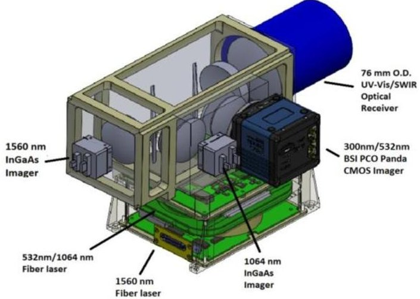

Figure 1: Preliminary 3D Model of the LVMM Payload

The LVMM payload will have two different modes of operation, Active Mode and Passive Mode:

- Active Mode: A nadir pointing mode during which the spacecraft captures images of the un-lit portions of the Moon using the LVMM Chemical Lidar Instrument at 532nm, 1064nm and 1560nm.

- Passive Mode: A nadir pointing mode during which the spacecraft captures images of the sunlit portions of the Moon at 300nm, 532nm, 690nm (optional), 1064nm and 1560nm (the lasers are powered off during this mode).

## Mission Constraints

As part of the spacecraft and mission design work carried out in the Phase A study, a number of key constraints had to be taken into consideration:

- Designing a low-cost 12U CubeSat with a net mass below 24kg including margin, but excluding the CubeSat deployer (ISIS-Space Quadpack-XL) which is currently ~6.2kg;

- Ensuring compatibility with the integration, environment and interfacing on a commercial lunar lander e.g. either as part of a NASA CLPS mission, as part of the Orion Stage Adapter for the NASA SLS Artemis 2 mission in 2023, or on a Falcon Heavy launch vehicle on one of the flights to the Lunar Gateway;

- UHF communications via the SSTL Lunar Pathfinder communications relay spacecraft to be carried out for uplink commands and data downlinks as per the SSTL Pathfinder Interface Control Document (ICD) specifications;

- Including X-band direct to Earth communications for uplink commands and data downlinking with ranging capability;

- Designing for a 76mm O.D. (Outer Diameter) LVMM receiver aperture as per the ESA VMMO CDF study in order to minimize the LVMM payload volume.

## MISSION DESIGN

The VMMO spacecraft is designed to be transported to the Moon within a 12U CubeSat deployer accommodated on a larger transport vehicle such as Astrobotic's Peregrine/Griffin lander as part of a NASA CLPS mission or on the Orion Stage Adapter as part of the NASA SLS Artemis 2 mission. During this time, the power connection between VMMO and the transport vehicle will allow the CubeSat battery to

<!-- PDF_PAGE: 4 -->

remain charged and it will also provide heater power to the spacecraft to ensure the units remain within their survival temperatures. A periodic health check of the spacecraft will also be carried out every 48 hours (TBC). The transportation phase of the mission is expected to last for approximately 30 days.

Once the transport vehicle reaches the lunar injection orbit, the process of heating the propellant for the electric thrusters will begin; the thrusters are needed to de-tumble the spacecraft once it is ejected from the transport vehicle. At this point, the batteries will also be charged and the final spacecraft health checks will be carried out.

Once these tasks have been completed, VMMO will be released by the transport vehicle and the commissioning phase will commence. For spacecraft spin rates below 30°/s (TBC), the solar arrays will be deployed and then the spacecraft will commence de-tumbling. If the initial spin rate is above 30°/s, the spacecraft will commence de-tumbling with the solar arrays in the stowed position; the arrays will only be deployed once the spin rate has reduced to 30°/s.

The electric thrusters will be used to de-tumble the spacecraft; they will be operated periodically in an "On/Off" configuration to ensure that the depth of discharge on the battery does not get too high. Once the spacecraft has fully de-tumbled, the platform commissioning will commence followed by the commissioning of the LVMM payload. During this time, the spacecraft will remain in the initial injection orbit and communications to Earth will be carried out in UHF via SSTL's Lunar Pathfinder spacecraft. The commissioning phase is expected to last for approximately 10-30 days.

Once the spacecraft commissioning phase has been completed, the orbit acquisition phase will begin. During this time the electric thrusters will be used to carry out a transfer manoeuvre to allow VMMO to reach its final operational orbit (details of the orbit are provided in the section titled "Orbit Overview"). The orbit acquisition phase is expected to last up to 100 days (TBC).

Once the spacecraft has reached the final orbit, the operational phase of the mission will commence, during which time VMMO will perform 210+ days of science and payload operations. As mentioned previously, the LVMM payload will be capable of carrying out two types of imaging, Active Mode imaging and Passive Mode imaging. All imaging operations will be carried out at the periapsis of the orbit, between the equator and the South Pole.

For the active imaging mode, once the spacecraft is below 80°S latitude in its orbit, the LVMM fibre lasers and imagers are powered on ready for data acquisition to commence. The active imaging mode will be used mainly during the lunar night for both the detection of water ice in the PSRs as well as for the detection of any night-time frosting outside of the PSR regions. It will also be possible to use the active imaging mode during the lunar daytime to carry out additional water ice mapping when the spacecraft is passing over PSRs, but these operations are not currently part of the baseline Concept of Operations (CONOPS).

For the passive imaging mode, the spacecraft will be able to map frosting on the surface of the Moon and also to detect in-situ resources such as ilmenite during the lunar day by detecting the solar radiation reflected from the lunar surface. The primary focus for this type of imaging is on locations that may be considered for future lunar bases.

Payload data downlink operations will be carried out at the apoapsis of the orbit, either via the Lunar Pathfinder spacecraft in UHF or direct to Earth using X-band.

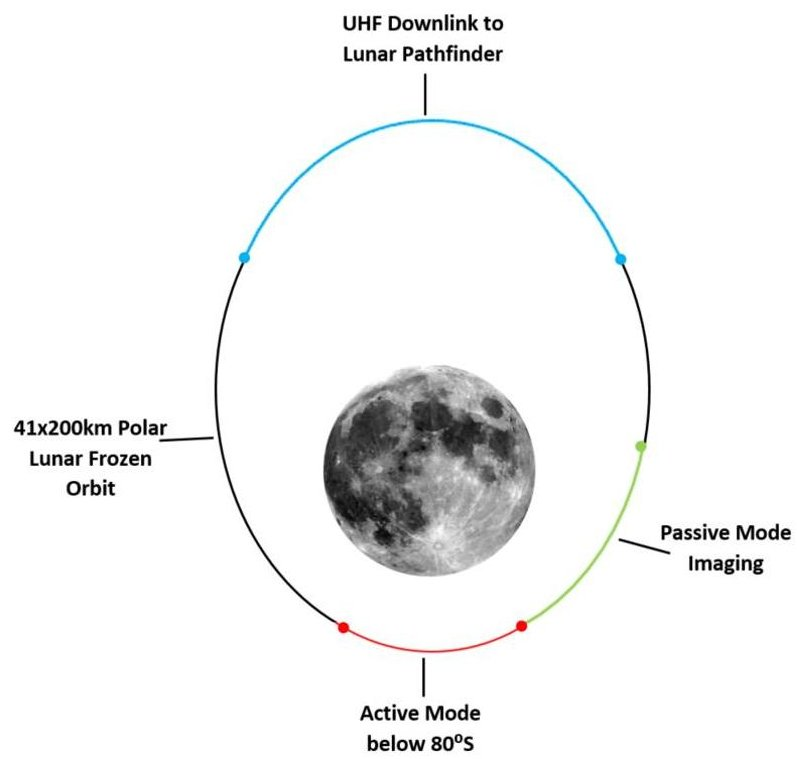

Figure 2: VMMO Mission Operations

## Orbit Overview

Shortly after the end of the commissioning phase, the VMMO spacecraft will carry out a transfer manoeuvre into a polar Lunar Frozen Orbit (LFO), details of which are provided in Table 1.

<!-- PDF_PAGE: 5 -->

Table 1: Orbit Overview

<table border="1"><tr><td>Parameter</td><td>Value</td></tr><tr><td>Epoch</td><td>1stSeptember2023,00:00:00UTC</td></tr><tr><td>Type</td><td>Lunar Frozen Polar Orbit</td></tr><tr><td>Periapsis Altitude</td><td>41km</td></tr><tr><td>Apoapsis Altitude</td><td>200km</td></tr><tr><td>Semi-Major Axis</td><td>1857.6km</td></tr><tr><td>Inclination</td><td>90°</td></tr><tr><td>Eccentricity</td><td>0.0428</td></tr><tr><td>RAAN</td><td>0°(TBD)</td></tr><tr><td>Argument of Periapsis</td><td>270°</td></tr><tr><td>Orbit Period</td><td>1.9952 hours</td></tr></table>

This particular orbit was selected due to its compliance with the VMMO science requirements and also due to its long term stability, which was verified by a series of high fidelity orbit propagations that were carried out as part of the study. A strong degree of stability is required over the course of the VMMO mission lifetime, to ensure that the orbital periapsis remains over the lunar South Pole.

In the orbit propagations, the periapsis was found to vary between 32 km and 57 km over the course of 365 days; both of these altitudes are deemed to be acceptable for Active Mode imaging to be carried out. Similarly, the apoapsis was found to vary between 200km and 220km, both of which are acceptable altitudes for Passive Mode imaging to be carried out at any point along the VMMO orbit. During this time, the argument of periapsis only varies by a few degrees from the desired value of 270°. The high level of orbital stability means that station-keeping manoeuvres will not be required during the spacecraft operational lifetime, which considerably reduces the amount of propellant required for the mission.

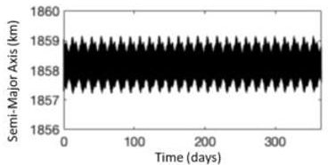

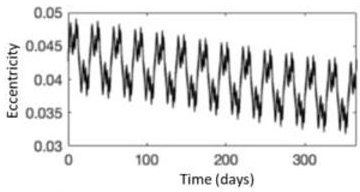

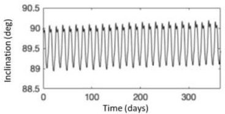

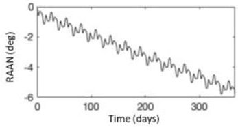

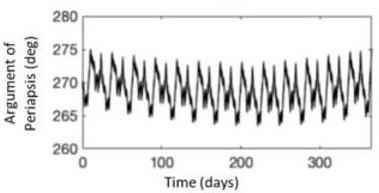

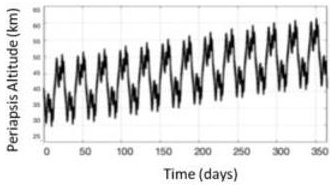

Figure 3: Evolution of the 41x200km Lunar Frozen Orbit over 365 Days

## SPACECRAFT DESIGN

VMMO is a 12U CubeSat that accommodates a single body-mounted solar array and two single-axis tracking arrays. The orbit average power (OAP) generated by the solar arrays varies throughout the year between 51W and 83W at End-Of-Life (EOL); the arrays are capable of providing a peak power generation of approximately 83W (EOL). The spacecraft is three-axis stabilised using four reaction wheels and is controlled using the LEON3 data processing and management board developed by the University of Surrey.

A high level of equipment redundancy is included within the various subsystems on the spacecraft; however the LVMM payload remains single string as a result of mass and volume constraints. The spacecraft wet mass is 22.44 kg including unit margins. In order for the spacecraft to be accommodated within the 12U CubeSat deployer, the mass must not exceed 24 kg, therefore there is currently 7% system margin still available for the VMMO platform before it reaches this mass limit.

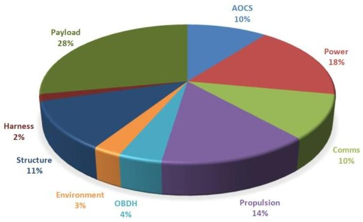

Figure 4: VMMO Spacecraft Mass Breakdown per Subsystem

## Structure

The overall dimensions of the spacecraft have been constrained to ensure that they are compliant with the ISIS Quadpack-XL 12U CubeSat deployer. The dimensions of the spacecraft (when the solar arrays are in both their stowed and deployed configurations as shown in Figure 5) are provided in Table 2.

Table 2: VMMO Spacecraft Dimensions

<table border="1"><tr><td rowspan="2">Dimensions</td><td>Stowed</td><td>24.6x24.5x40.6cm(X,Y,Z)</td></tr><tr><td>Deployed</td><td>162.3x24.5x40.6cm(X,Y,Z)</td></tr></table>

<!-- PDF_PAGE: 6 -->

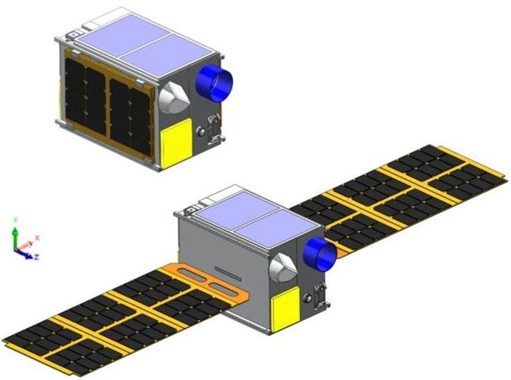

Figure 5: VMMO Spacecraft in the Stowed Configuration (Above) and Deployed Configuration (Below)

VMMO has been designed so that the body mounted solar panel is on the +Y facet of the spacecraft, and the tracking solar arrays are mounted on both the +X and -X facets. The -Y facet will primarily be utilized as a radiator. The two electric thrusters are mounted on the - Z facet, and on the +Z facet two of the "tuna can" volumes have been utilized to house the LVMM payload imager and one of the reaction wheels. The spacecraft structure itself is a 2.5mm thick aluminium shell, which will help to provide the required level of radiation shielding for the internal equipment.

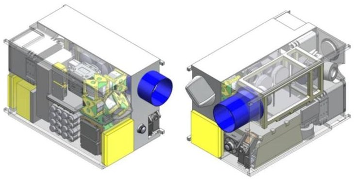

Figure 6: VMMO Equipment Internal Layout

## Power and Solar Arrays

Throughout the course of the mission lifetime, the position of the Sun with respect to the VMMO spacecraft changes considerably, and as a result, the position of the lunar terminator relative to the spacecraft orbital plane slowly drifts. As illustrated in Figure 7, at certain times of the year, the spacecraft orbits along the dawn-dusk plane and experiences no eclipses during this time, whilst at other times of the year the spacecraft orbits along the noon-midnight plane and experiences eclipses up to 47 minutes in

duration. For the rest of the year the spacecraft orbits somewhere between the two.

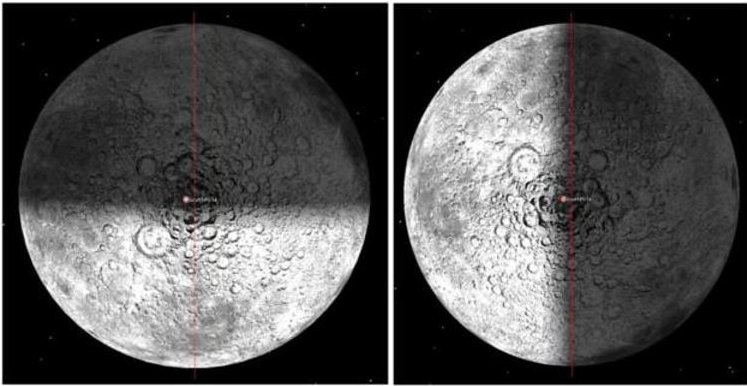

Figure 7: Variation in Relative Position between the Terminator and the VMMO Spacecraft between September and December 2023

An overview of the VMMO power system equipment is provided in Table 3.

Table 3: Power Subsystem Equipment

<table border="1"><tr><td>Quantity</td><td>Equipment</td></tr><tr><td>1</td><td>Fixed body-mounted solar panel(20x30cm)</td></tr><tr><td>2</td><td>Deployable single-axis tracking solar arrays(30x60cm) to allow for Sun tracking throughout the orbit</td></tr><tr><td>2</td><td>Solar array hold down and release mechanisms</td></tr><tr><td>1</td><td>Solar array drive assembly</td></tr><tr><td>2</td><td>Solar array yokes</td></tr><tr><td>1</td><td>Gomspace P60 Power System Dock(TBC)</td></tr><tr><td>2</td><td>Power Distribution Units(PDUs)</td></tr><tr><td>2</td><td>Array Conditioning Units(ACUs)</td></tr><tr><td>2</td><td>77Wh Li-Ion batteries with integrated temperature, voltage and current monitoring and battery survival heaters</td></tr><tr><td>112</td><td>29.3% efficiency,triple junction solar cells</td></tr><tr><td>N/A</td><td>28V Bus</td></tr></table>

The two single-axis tracking solar arrays help to maximise power generation during key operations such as Active Mode imaging and thruster firings. Each array will be capable of rotating by $ \pm 1 8 0^{\circ} $ . The most critical mode of operation for the spacecraft is the "thruster firing mode". During propulsion operations such as the orbit transfer, the thrusters are required to fire for an extended period of time. Currently, in order to ensure that the depth of discharge on the battery remains at an acceptable level, the thrusters cannot be operated continuously during this phase, but instead must be operated intermittently in and "On/Off" approach, to ensure that the battery can recharge between firings. The power system design will require optimisation during the Phase B study to ensure that the available thruster firing time has been maximized.

<!-- PDF_PAGE: 7 -->

## AOCS and Navigation

The VMMO spacecraft is 3-axis stabilised, and attitude control is primarily achieved using four reaction wheels. Three of the reaction wheels are positioned along the X, Y and Z axes of the spacecraft, with the fourth being positioned at an angle between the three axes. Satellites in orbit around the Earth also typically use magnetorquers for attitude control and reaction wheel momentum offloading, however this is not possible in lunar orbit due to the absence of a lunar magnetic field. For the VMMO mission, reaction wheel de-saturation will be carried out using the electric propulsion system.

X-Band ranging has been selected as the baseline method of spacecraft navigation for the VMMO mission. This will be supported by the imaging of landmarks on the lunar surface using a wide field of view camera ( $ \pm 4 5^{\circ} $ field of view TBC). The spacecraft will also accommodate a GNSS receiver and antenna which will be used as part of a GNSS technology demonstration for navigation purposes.

The baseline Attitude and Orbital Control subsystem is comprised of the following:

Table 4: AOCS Subsystem Equipment

<table border="1"><tr><td>Quantity</td><td>Equipment</td></tr><tr><td>4</td><td>Reaction Wheels</td></tr><tr><td>4</td><td>Sun Sensors</td></tr><tr><td>2</td><td>Sun Presence Sensors(Photodiodes)</td></tr><tr><td>2</td><td>Star Trackers</td></tr><tr><td>2</td><td>Inertial Measurement Units(IMU)</td></tr><tr><td>1</td><td>GNSS Receiver and Antenna</td></tr><tr><td>1</td><td>AOCS Electronics Interface Board</td></tr></table>

There are four Sun Sensors on the spacecraft, two of which are primary and two of which are redundant. Along with this, there are two Photodiodes located on the tracking solar arrays that can be used to detect the presence of the Sun for times when the Sun leaves the field of view of the main Sun Sensors. There are two Star Trackers (one primary and one redundant) and two IMUs (one primary and one redundant) on board, which will be used to determine the rate of rotation of the spacecraft.

## Propulsion

VMMO has an electric propulsion system with two IFM Nano Thrusters that utilise liquid Indium propellant and provide a delta-V of up to 571m/s. The selection of the propulsion system was based on the need to maximise the delta-V, and to provide a sufficient thrust level to maintain the duration of the orbit transfer manoeuvre at the start of the mission within the maximum time span allocated to this phase.

The system provides a thrust vectoring capability allowing the thrusters to be utilised for reaction wheel momentum offloading; this means that a separate set of thrusters dedicated to attitude control is not required. This is particularly important on such a small spacecraft with strict mass and volume limitations. This thrust vectoring capability also reduces the attitude control delta-V that is needed to correct for any misalignments encountered during thrusting manoeuvres. The downside to electric thrusters is the high power consumption required during thruster firings (up to ~80W), which has resulted in an increased solar array area and mass.

Monte Carlo analysis was carried out to model the transfer between the initial injection orbit and the final operational lunar frozen orbit using the electric thrusters. This analysis was carried out using constant biases drawn from the uniform distributions, as well as random components, drawn from the zero-mean Gaussian distributions, for both the elevation and azimuth angles.

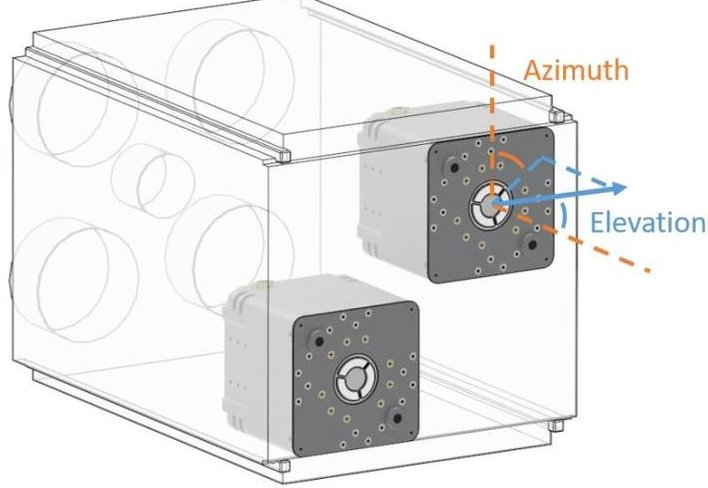

Figure 8: Positioning of the Two IFM Nano Thrusters on the -Z Facet of the Spacecraft

The subsequent delta-V budgets for the mission are shown in Table 5 below. A margin of 5% has been added to the deterministic components and a margin of 100% has been added to the stochastic components.

Table 5: Preliminary Estimated Delta-V Budget

<table border="1"><tr><td>Manoeuvre</td><td>Allocation(m/s)</td><td>Margin</td></tr><tr><td>Transfer from injection orbit to LFO(deterministic under worst-case eclipse scenario)</td><td>237.56</td><td>5%</td></tr><tr><td>Transfer from injection orbit to LFO(stochastic measured from $\Delta\mathrm{V}^{99}-\Delta\mathrm{V}$ deterministic)</td><td>281.0-237.56=43.44</td><td>100%</td></tr><tr><td>Orbit Maintenance</td><td>0</td><td>-</td></tr><tr><td>Reaction Wheel De-Saturation</td><td>3(TBC)</td><td>100%</td></tr><tr><td>End-of-Life Disposal</td><td>22.89</td><td>5%</td></tr><tr><td>Total delta-V(m/s)</td><td>306.89(without margin)</td><td>366.35(with margin)</td></tr></table>

<!-- PDF_PAGE: 8 -->

## Data Handling

The OBC for the VMMO mission is based on the GRXCKU development board (not currently released); this unit contains a Xilinx Kintex Ultrascale XCKU060 FPGA (1156 pin BGA package), 512MB SDRAM, 4MB SRAM and 64MB PROM for bootable operations. The board also provides dual CAN and four Space Wire interfaces to carry out TT&C and payload data handling; modifications will be made to incorporate an RS422 interface for the electric thrusters. Two of these OBC boards will fly on the VMMO mission. As with NASA Lunar CubeSat missions, VMMO will use ESA's LEON 3 processor system on a chip (SoC), for which the key IP cores will be:

- ESA/Gaisler LEON3FT, Memory Controller with EDAC/ECC, SpW, CAN2.0B interfaces on the AMBA bus;

- Xilinx XTMR and SEM core tools for handling data and bitstream reliability and error correction;

- Satellite FDIR/Safety VHDL cores;

- Payload specific compression and analysis cores;

- Subsystem specific cores for supporting communication standards (such as RS422/RS485 for the propulsion subsystem).

VMMO will primarily be operated via SSTL's Lunar Pathfinder spacecraft (further information is provided in the section titled "Communications"). In order to account for any outages that Pathfinder experiences, VMMO will be capable of operating autonomously for a minimum of two days in order to continue payload operations. This is possible through the use of a scriptbased system with fault monitoring and mitigation. During nominal operations, telemetry will be downlinked to the ground station via Lunar Pathfinder to assess the health and status of the spacecraft.

## Communications

The SSTL Lunar Pathfinder data relay spacecraft is currently being developed in partnership with ESA, and will provide a communications relay for any asset in lunar orbit or on the surface of the Moon. On VMMO, TT&C and payload data will be transferred to the ground station via Pathfinder using CCSDS Proximity-1 protocol over UHF. VMMO will also support an X-band system that will be used for direct to Earth communications and RF ranging.

The following baseline assumptions have been made about the VMMO communications:

- A UHF system is required at 10W RF power output to meet a 1Mbps Proximity-1 protocol link;

- An X-band system for direct to Earth communications is proposed to provide both TT&C and/or payload data downlink, as well as RF ranging capabilities. S-Band was avoided due to ESTRACK ground stations moving to only X-band and Ka-band services.

## Optical High-Speed Data Downlink Demonstration

A 50Mbps high-speed optical data downlink demonstration will be carried out as part of the VMMO mission using the 4W 1560nm fibre laser channel on the LVMM payload. One of the most challenging aspects of conducting optical communications from lunar orbit is the accurate pointing and tracking of the laser at the terrestrial ground station. An uplink beacon signal generated by the ground station will be used to assist with the communications link locking and tracking. This beacon will be detected by the Short Wave Infrared (SWIR) imager on the payload (1064nm or 1560m TBC). For VMMO, the initial coarse spacecraft pointing will be carried out by the AOCS subsystem. The fine pointing will then be achieved using the fibre-laser fore-optics pan/tilt mirror.

The 1560nm channel will be used for the optical downlink as this wavelength can be transmitted through the Earth's atmosphere. In terms of viable ground stations for this demonstration, ESA's optical ground station located in Tenerife, Spain has been identified as a possibility.

## Ground Segment

Figure 9 provides an overview of the preliminary ground segment architecture for the VMMO mission. Payload and telemetry data will be relayed to ground stations on Earth via the Lunar Pathfinder spacecraft before being transferred to the VMMO Mission Operations Centre. The 32m GHY6 deep space antenna located at the Goonhilly Earth Station in the UK is currently baselined as part of this network. LVMM payload command script updates will be carried out by MPBC in Canada in collaboration with the science team, and science operations and LVMM payload data processing and archiving will be carried out by the University of Winnipeg and York University in Canada, as well as the University of Surrey in England.

VMMO will also have the capability for direct to Earth X-band communications. Currently the Goonhilly Ground Station has also been baselined for this link.

<!-- PDF_PAGE: 9 -->

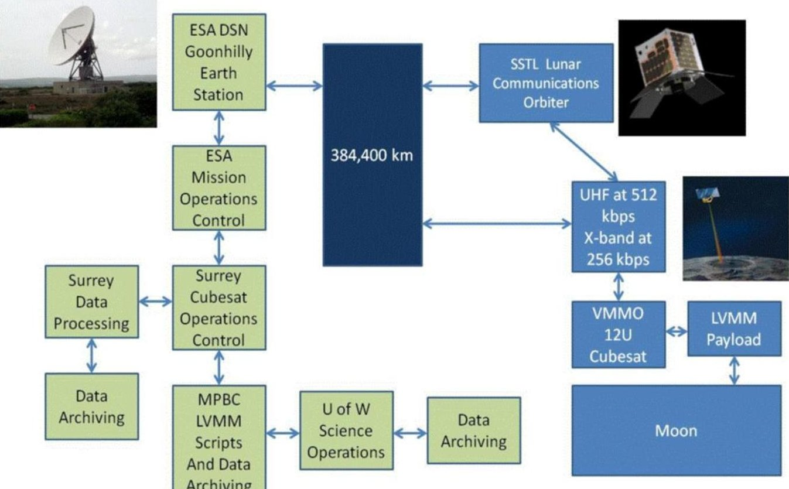

Figure 9: Schematic Summarising the Preliminary VMMO Ground Segment

## Conclusion

Some of the key challenges involved in designing the VMMO CubeSat for lunar orbit include:

- Accessing the lunar orbit;

- Deep space communications;

- Power generation and power requirements (e.g. for propulsion and communications);

- CubeSat deployer restrictions on spacecraft dimensions and mass.

A major challenge in getting a CubeSat to lunar orbit is the amount of propellant required to get there. The use of a transport vehicle to accommodate VMMO during the transfer from Earth to lunar orbit helps to solve this issue. The amount of propellant required for a CubeSat to carry out this transfer independently would be unfeasible. The transport vehicle also provides protection for the spacecraft as it passes through the radiation belts.

Due to their limited size and power, CubeSats typically cannot accommodate the kind of long range communications equipment needed for traditional deepspace missions. Although advancements in the miniaturisation of CubeSat communications systems have been made in recent years, there are currently no suitable commercial X-Band or UHF CubeSat

transponders available for this mission. Although direct to Earth communications using X-Band is feasible for VMMO, there are data rate limitations in such links especially at UHF and S-Band. As a result, the use of a data relay spacecraft for communications such as Lunar Pathfinder is preferred.

An electric propulsion system is required to carry out the transfer from the lunar release orbit to the final operational orbit. Since magnetorquers cannot be used in lunar orbit, the propulsion system will also be used to carry out attitude control and reaction wheel desaturation. The electric propulsion system has a very high power consumption (~80W), and as a result the unit can only be operated for short durations before it must be powered off so that the battery can recharge. As a result of the high power consumption of the propulsion system and other spacecraft equipment (such as the transmitter), along with the large variation in solar beta angle throughout the year, a body mounted solar panel and two tracking solar arrays were needed on VMMO in order to generate sufficient power.

As a result of the considerable advancements in technology over the last decade, as well as the miniaturisation of equipment and components, it is now possible to use CubeSats to carry out advanced science missions that previously would have required a much larger spacecraft. VMMO is an ambitious mission that will generate valuable data relating to the location and extent of water ice and other lunar volatiles across the permanently shadowed regions of the lunar South Pole.

<!-- PDF_PAGE: 10 -->

## Acknowledgements

The authors would like to acknowledge the European Space Agency (ESA) for enabling the initial mission concept study through the ESA LUCE CubeSat SysNova Challenge competition, the ESA CDF Study and follow-on Phase A study. Special thanks to Mr Harry Holt, Mr Nicolo Bernadini and Mr Xiaoyu Fu at the Surrey Space Centre and Eleanor Corran, Nikki Antoniou, Rupert Taylor, Ben Schwarz, Fergus Glen and Mike O'Sullivan at SSTL.

## References

1. National Aeronautics and Space Administration Artemis Plan - NASA's Lunar Exploration Program Overview, September 2020 https://www.nasa.gov/sites/default/files/atoms/files/artemis_plan-20200921.pdf

2. Prettyman, T.H., "Remote Sensing of Chemical Elements Using Nuclear Spectroscopy," Encyclopedia of the Solar System (Third Edition), Chapter 54, pp 1161-1183. 2014.

3. Pieters, C.M., Goswami, J.N., Clark, R.N., Annadurai, M., Boardman, J., Buratti, B., Combe, J.P., Dyar, M.D., Green, R., Head, J.W., Hibbitts, C., Hicks, M., Isaacson, P., Klima, R., Kramer, G., Kumar, S., Livo, E., Lundeen, S., Malaret, E., McCord, T., Mustard, J., Nettles, J., Petro, N., Runyon, C., Staid, M., Sunshine, J., Taylor, L.A., Tompkins, S., Varanasi, P., "Character and Spatial Distribution of $ \mathrm{O H / H_{2} O} $ on the Surface of the Moon seen by $ M^{3} $ on Chandrayaan-1," Science, Vol 326, pp. 568-572, 2009.

4. Colaprete, A., Ennico, K., Wooden, D., Shirley, M., Heldmann, J., Marshall, W., Sollitt, L., Asphaug, E., Korycansky, D., Schultz, P., Hermalyn, B., Galal, K., Bart, G.D., Goldstein, D., Summy, D., "Water and More: An Overview of LCROSS Impact Results," $ 4 1^{\mathrm{st}} $ Lunar and Planetary Science Conference, Texas, USA, 2010.

5. Klesh, A. and J. Krajewski, "MarCO: CubeSats to Mars in 2016", Proceedings of the 29th Annual AIAA/USU Conference on Small Satellites, SSC15-III-3, Logan, Utah, August 2015.

6. Wahlund, J-E., Kohout, T., Andrews, D., Penttilä, A., "Asteroid Prospection Explorer (APEX) CubeSat for the ESA Hera Mission," EPSC-DPS Joint Meeting 2019, Vol. 13, EPSC-DPS2019-1287-1, Geneva, Switzerland, September 2019.

7. Goldberg, H.R., Karatekin, O., Ritter, B., Herique, A., Tortora, P., Prioroc, C., Gutierrez,

B.G., Martino, P., Carnelli, I., "The Juventus CubeSat in Support of ESA's Hera Mission to the Asteroid Didymos," Proceedings of the 33rd Annual AIAA/USU Conference on Small Satellites, SSC19-WKIV-05, Logan, Utah, August 2019.

8. Cohen, B.A., Hayne, P.O., Greenhagen, B., Paige, D.A., Seybold, C., Baker, J., "Lunar Flashlight: Illuminating the Lunar South Pole," Feature Article from IEEE A&E Systems Magazine, pp 46-52. March 2020.

9. Malphrus, B.K. et al., "The Lunar IceCube EM-1 Mission: Prospecting the Moon for Water Ice," Feature Article from IEEE A&E Systems Magazine, pp 6-14. April 2019.

10. Hardgrove, C., Prettyman, T.H., Starr, R., Colaprete, T., Drake, D., Heffern, L., "Improved Hydrogen Maps of the Lunar South Pole by the Lunar Polar Hydrogen Mapper (LunaH-Map) CubeSat Mission," $ 51^{\mathrm{st}} $ Lunar and Planetary Science Conference, 2020.

11. Kruzelecky, R.V., Murzionak, P., Lavoie, J., Sinclair, I., Schinn, G., Underwood, C., Gao, Y., Bridges, C., Armellin, R., Lucca Fabris, A., Cloutis, E., Leijtens, J., "VMMO Lunar Volatile and Mineralogy Mapping Orbiter," 48th International Conference on Environmental Systems, ICES-2018-227, Albuquerque, New Mexico, July 2018.

12. Gao, Y., Kruzelecky, R.V., Murzionak, P., Lavoie, J., Sinclair, I., Schinn, G., Underwood, C., Bridges, C., Armellin, R., Lucca Fabris, A., Cloutis, E., Leijtens, J., Walker, R., Vennekens, J., "Lunar "Volatile and Mineralogy Mapping Orbiter (VMMO)" Mission," Proceedings of the 70th International Astronautical Congress (IAC), IAC-19-A3.2B.6x50377, Washington D.C., United States, October 2019.