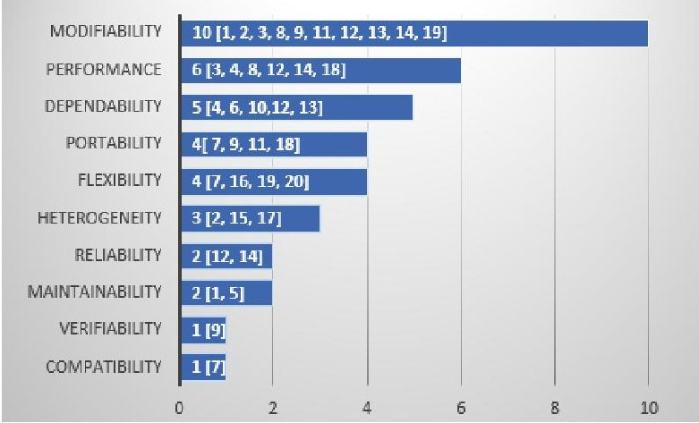
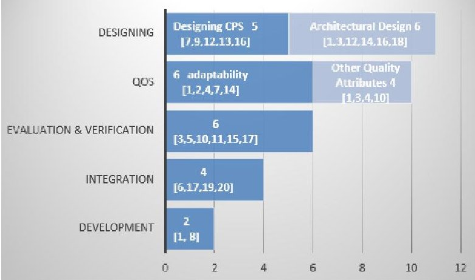
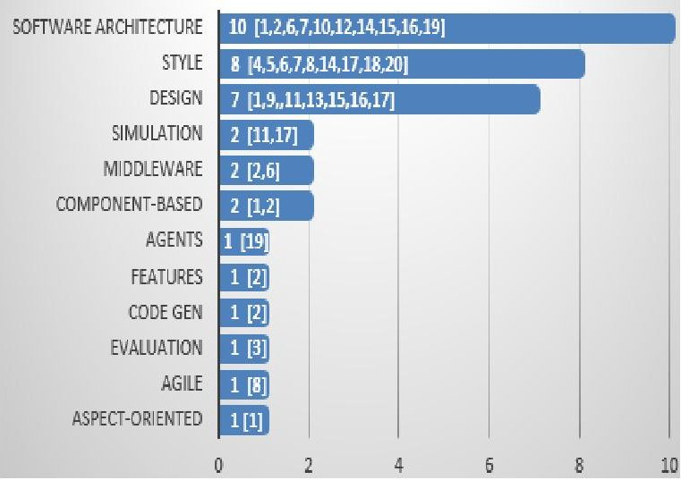

<!-- PDF_PAGE: 1 -->

# A Preliminary Study on Architecting Cyber-Physical Systems

Ivano Malavolta Gran Sasso Science Institute L'Aquila, Italy ivano.malavolta@gssi.infn.it

Henry Muccini

University of L'Aquila

DISIM Department

L'Aquila, Italy

henry.muccini@univaq.it

Mohammad Sharaf University of L'Aquila DISIM Department L'Aquila, Italy mohammad.sharaf@graduate.univaq.it

## ABSTRACT

Cyber-physical systems (CPSs) are deemed as the key enablers of next generation applications. Needless to say, the design verification and validation of cyber-physical systems reaches unprecedented levels of complexity, specially due to their sensibility to safety issues. Under this perspective, leveraging architectural descriptions to reason on a CPS seems to be the obvious way to manage its inherent complexity.

A body of knowledge on architecting CPSs has been proposed in the past years. Still, the trends of research on architecting CPS is unclear. In order to shade some light on the state-of-the art in architecting CPS, this paper presents a preliminary study on the challenges, goals, and solutions reported so far in architecting CPSs.

Categories and Subject Descriptors D.2.11 [Software Architectures]: Domain-specific architecture

## Keywords

Cyber-physical systems, architectures, preliminary survey

## 1. INTRODUCTION

Cyber-physical systems are combinations of computational elements with physical processes. CPSs involve the use of embedded devices, networks, and software components, with feedback loops where physical processes affect computations and vice versa [22]. CPSs are being (and are going to be) used in a wide range of fields, such as intelligent transportation, medical systems, robotics systems, environmental sensing networks, water infrastructure, smart military systems and so on [23]. A CPS has distributed objects that have to communicate through certain protocols. The heterogeneity of technology that interconnect system components, and the increased needs of information

As remarked in [24], to realize the full potential of CPSs, design processes have to be rethought, by raising the level of abstraction and adding new computing and networking abstractions. New middleware components, system services, and network protocols are required at different levels of abstractions to form a layered, distributed architecture for CPSs [25]. A large body of knowledge has been proposed in architecting CPSs; many architectures of CPSs have been proposed, each one dealing with certain challenges imposed by CPSs. Still, the trends of research on architecting CPS is still unclear. Even if the progress of research on the above mentioned areas has started more than eight years ago, and the various research communities are very active, we did not find any evidence that could help us in assessing the impact of existing research on architecting CPSs.

processing over distributed systems bring great challenges to the current Internet stack which is not sufficient to satisfy the requirements CPSs, mainly because of the integration of huge number of embedded system with the Internet, and the increasing need to satisfy non-functional requirements (e.g., reliability, adaptability, security, safety).

This research investigates the state-of-research on architecting CPS; more specifically, in this preliminary study we aim to identify, classify, and understand existing research on architecting CPSs. For this purpose, we define four research questions, a search and selection process, and inclusions and exclusion criteria (presented in Section 2). By looking at the most relevant conferences and journals related to architectures, architecting, and CPS, we scan more than four thousands titles, and select twenty primary studies. Section 3 classifies those studies based on four different parameters: domains and applications, challenges and problems, goals and focus area, and solutions. Section 4 provides some considerations, while Section 5 concludes this paper and delineates future work.

## 2. STUDY DESIGN

This study has been conducted by following the guidelines reported in [26]. Accordingly, four research questions have been identified.

RQ1- What are the application domains in which the activity of architecting CPSs has been used so far?

RQ2 - What are the type of challenges encountered when architecting CPSs?

RQ3- What are the goals and focus areas of the activity of architecting CPSs?

RQ4- What are the types of solutions to support the activity of architecting CPSs?

<!-- PDF_PAGE: 2 -->

The main objective of our research questions is to identify and classify the state-of-the-art of existing methods and techniques for architecting CPSs under various perspectives, such as the challenges and types of solutions in the activity of architecting CPSs. As outcome, we map challenges in architecting CPSs to architectural solutions.

The above listed research questions will drive the whole study, with a special influence on the primary studies search and selection process, the data extraction process, and the data analysis process.

We designed our search and selection process as a four-stage process in order to have full control on the number and characteristics of the studies being either selected or excluded during the various stages.

Stage 1. In this phase we performed a manual search on Google Scholar with search string "architecting cyber physical systems". The first 100 entries of this search have been scrutinized, to help defining inclusion and exclusion criteria, to refine the scope of this study, and to select 6 pilots studies.

Stage 2. We manually analyzed relevant journals and conference proceedings published after or within 2006 since the cyber-physical systems discipline emerged in that year [28]. Figure 1 shows the venues we selected for this stage. Since our focus is to make a preliminary analysis on how the software engineering/architecture community is being looking at CPSs from an architectural point of view, we mostly focusses on the main software engineering venues. In order to make this manual search less time-consuming, the search was based on the title of the studies only. We passed through more than 4.000 titles.

<table border="1"><tr><td>Venue</td><td>Type</td><td>Publisher</td></tr><tr><td>Transactions on Software Engineering (TSE)</td><td>Journal</td><td>IEEE</td></tr><tr><td>Transactions on Software Engineering and Methodology (TOSEM)</td><td>Journal</td><td>ACM</td></tr><tr><td>Information and Software Technology (IST)</td><td>Journal</td><td>Elsevier</td></tr><tr><td>Int. Conference on Cyber-Physical Systems (ICCPS)</td><td>Conference</td><td>IEEE/ACM</td></tr><tr><td>Int. Conference on Software Engineering (ICSE)</td><td>Conference</td><td>ACM</td></tr><tr><td>European Software Engineering Conference and the ACM SIGSOFT Symposium on the Foundations of Software Engineering (ESEC/FSE)</td><td>Conference</td><td>ACM</td></tr><tr><td>Int. Conference on Automated Software Engineering (ASE)</td><td>Conference</td><td>ACM</td></tr><tr><td>European Conference on Software Architecture (ECSA)</td><td>Conference</td><td>Springer</td></tr><tr><td>Working IEEE/IFIP Int. Conference on Software Architecture (WICSA)</td><td>Conference</td><td>IEEE</td></tr><tr><td>Int. ACM Sigsoft Symposium on Component-Based Software Engineering (CBSE)</td><td>Conference</td><td>ACM</td></tr></table>

Figure 1. Selected venues for manual search

Stage 3. We considered all the collected studies (68 studies) and filtered them according to a set of well-defined inclusion and exclusion criteria to be (39 studies). The inclusion criteria of our study are:

11) Studies proposing, leveraging, or analyzing an architectural solution, architectural method or technique (e.g., tactics, patterns, styles, views, models, reference architectures, or languages) specific for CPSs;

12) Studies subject to peer review (e.g., journal papers, papers published as part of conference proceedings will be considered,

whereas studies like white papers and technical reports will be discarded).

I4) Studies published after or in 2006.

The exclusion criteria of our study are:

E1) Studies that, while focusing on CPSs, do not explicitly deal with their architecture;

E2) Studies that are written in language other than English, or that are not available in full-text;

E3) Secondary studies (e.g., systematic literature reviews, surveys, etc.).

Stage 4. This stage has been performed in parallel with the data extraction activity. Indeed, when reading some specific study in details for extracting its information, we agreed that the currently analyzed study was semantically too far away from the scope of our research, and so it has been excluded to be (14 studies).

The main goal of the data extraction activity is to extract data from each primary study according to a well-defined classification framework. In our study, the classification framework is composed of four facets, each of them addressing a research question of our study (see above). We followed a systematic process called keywording [26] for defining the parameters of each specific facet of the data extraction form. Basically, keywording aims at reducing the time needed in developing the data extraction form and ensuring that it takes the existing studies into account. Keywording is done in two steps:

1. Collect keywords and concepts: researchers collect keywords and concepts by reading the abstract, introduction and conclusion of each primary study. When all primary studies have been analyzed, all keywords and concepts are combined together to clearly identify the context, nature, and contribution of the research according to an initial set of categories. The output of this stage is the set of keywords and concepts extracted from the primary studies.

2. Cluster keywords and form categories: when keywords and concepts have been finalized, we clustered them in order to group keywords according to the identified categories and, if needed, to create new categories that better fit with the identified keywords. The output of this stage is the final data extraction form containing all the identified categories, each of them representing a specific aspect of architecting CPSs.

Once the data extraction form has been defined, as suggested in [27], firstly it has been piloted before independently by two researchers and refined accordingly, and secondly the data from all the primary studies have been collected according to the final data extraction form.

The data analysis activity involves collating and summarizing the data extracted from the primary studies $ ^{1} $ with the main goal of producing the actual results of our study described in the next section.

## 3. RESULTS

Twenty studies where selected (Ref. [1]-[20]). Fourteen of them came from the manual search in the venues listed in Figure 1, while 6 primary studies (Ref. [4], [7], [17]-[20]) have been selected as pilots out of 100 studies we searched on Google Scholar. All the selected studies were published in the years from 2007 to 2014, with a growing trend in 2013 and 2014.

<!-- PDF_PAGE: 3 -->

67 authors out of 70 have an academic background, whereas only 3 of them come from industry. This reveals the need for support from industry. Since Architecting CPS is like multi-player game it needs collaboration from different fields and from different domains.

The data collected through this study are publicly available at http://goo.gl/WwATpn.

## 3.1 Domains and Applications (RQ1)

CPSs are being used in a wide range of fields, such as intelligent transportation, medical systems, robotics environmental sensing networks, water infrastructure, smart military systems. Based on our keywording activity, we could identify seven main categories in which the primary studies can be grouped. They are:

The robotics domain has enhanced many areas of our society, simplifying dangerous, complex daily tasks, see studies [5, 6]. In this domain we can find studies focusing on several applications, such as robotic tele-operation systems, which are software intensive systems that are used to perform tasks that human operators unable to fulfil, see study [1].

The electric vehicles domain includes diverse applications such as Plug-In Hybrid Electric Vehicle Controls System (study [3]), Battery management systems (BMSs) for electric vehicles (study [12]), Quadrotor air vehicle (study [15]), and a lunar rover space exploration vehicle (study [17]).

Supervisory systems is a category of applications aiming to gather real-time data from remote locations in order to constantly monitor a reference object or environment to avoid hazardous problems. This category appeared three times in our primary studies: networked supervisory medical systems (study [10]), health monitoring for damage detection and localization (study [16]), and an environmental monitoring systems [19].

A Federated Embedded Systems (FES) can be defined as a large group of embedded, interconnected, open, and heterogeneous devices that exchange data with each other in a decentralized manner to construct dynamic structure. This application domain has been identified twice in our study (see studies [6] and [13]). Another domain that appeared in our study is Ambient intelligence systems, i.e., systems that are constructed by a large variety of networked devices such as like smartphones, computer of vehicles, RFIDs and cameras with embedded software (see studies [2] and [6]). Two examples of those systems are Ambient Assisted Living (AAL) systems and Intelligent Transportation Systems (ITS) (see [2]).

In Sensors and Actuators networks (SANET), the actuators collaborate with the sensor nodes to perform specific actions in response to environmental events informed by the sensor (see studies [6] and [9]).

Finally, Smart Grid aims to integrate the existing power grid infrastructure with a communication and computation infrastructure to increase the performance and dependability of the electric power grid (see study [14]).

Overall, we can see that there is great variability of both domains and applications of CPSs. Based on this, we may conjecture that techniques and methods at the architectural level may be a valid instrument for taming the complexity of CPSs and

for understanding and assessing their properties and behavior in the early phases of development.

## 3.2 Challenges and Problems (RQ2)

By following the fourth stage in our protocol, we collected keywords related to challenges and problems in architecting CPS. The collected keywords have been successively clustered by following the categories reported in [21]. In a few cases, we had to add new categories not included in [21] (such as, heterogeneity and verifiability). Figure 2 shows our categories that are: Modifiability, Performance, Dependability, Portability, Flexibility, Heterogeneity, Reliability, Maintainability, Verifiability and Compatibility. For each category, we will discuss other related sub-categories (that are not included in Figure 2 for sake of space, but are presented in the discussion to provide a more detailed analysis).

Figure 2. Challenges of Architecting CPS

The category that receives the highest interest is modifiability (that includes evolvability [1][9], changeability [2], modifiability itself [3][8], scalability [12][19], configurability [2,11] and reconfigurability [12]). Then, performance has emerged as a relevant challenge for CPSs, especially when dealing with the sub-categories power consumption [3], resource utilization [4][14], performance [3], efficiency [12][14] and timing [3][6][14][18]. Then, dependability contains two sub-challenges of interest, that are dependability [6][12][13] and safety [4][10]. Portability has also two sub-challenges of interest: adaptability [7][9] and integrability [11][18]. Moreover, the flexibility challenge deals with dynamicity [7] and others minor aspects of flexibility [16][19][20]. The heterogeneity challenge is discussed in three primary studies [2][15][17]. Fault tolerance [12] and reliability [12][14] are underlie the reliability challenge, whereas the maintainability challenge has been discussed in two primary studies [1][5]. The last two challenges are verifiability [9] and compatibility [7] which received the least number of researches.

## 3.3 Goals and Focus Area (RQ3)

In this section we discuss how we categorized the primary studies of our research in terms of the goals they tackle. In this context, we identified five main categories that are: designing, QoS, evaluation and verification, integration, and development (see Figure 3).

In the context of architectural design, we can notice that there are groups of studies focussing on the architectural design of CPS to improve its software architecture [1][3][12], improve grid

<!-- PDF_PAGE: 4 -->

control architecture [14], provide efficient multi-level computing architecture [16] and describe an explicit standard of CPS architecture [18]. For other designing issues a light set into different areas like designing and combining hardware-software architecture [12], designing complex and resource consuming physical processes [7], designing cyber-physical systems software around intelligent physical worlds (IPW) [9]. Finally, an interesting work was devoted for providing co-design approach to structural health monitoring [16] and for providing an initial characterization of information presentation mechanisms [13].

Studies interested in QoS have good concerns in adaptability in which they target managing evolution changes [1] [2], improving maintenance [1], improving adaptability of the system at the application level [4], providing support for adaptability with changing management requirements [14], and ensuring service adaptability [7]. Other QoS concerns are for other quality attributes like verification for safety [10], evaluation of the use of quality attributes [3], and improving both the availability of CPS application [4] and their reuse aspect [1].

Figure 3. Focus Areas (Goals)

For what concerns evaluation and verification, we managed to spot many interesting points like verification for safety assurance [10], architecture evaluation [5], early system evaluation [11], evaluation of the consistency between the base architecture of a cyber-physical system and the heterogeneous models used for the design of such complex systems [15], and facilitating CPS modeling and simulation [17].

Heading to the fourth goal, integration, a seamless integration of physical and computer information flows has been proposed in [6] along with overcoming the difficulties in integration of CPS [17]. A related focusing area is also dealing with monitoring the environmental status in real-time [19] and making close interactions between the cyber and the physical worlds [20].

Finally, for what concerns the development of CPSs, we noticed an interest in improving their structure, reuse maintenance and evolution by aspect-oriented software development [1] and on agile development for CPSs [8].

## 3.4 Solutions (RQ4)

Based on our analysis, twelve are the type of solutions envisioned for architecting CPSs. We show them in Figure 4.

The most frequent solution provides CPS-specific software architectures. Ten papers, among those analyzed, propose a software architecture for a CPS. During the last few years, several solutions have been proposed to tackle challenges of architecting

CPSs. A wide range of approaches have been proposed in order to Architect Software of CPS using different strategies such as Aspect-oriented software architectures [1], FamiWare Middleware to compose a large variety of heterogeneous devices [2], architectural framework [6], service-based CPS architecture with three tiers [7], low-complexity coordination architecture for networked supervisory medical systems [10], a Dependable, Efficient, Scalable Architecture (DESA) that effectively monitors a large number of battery cells [12], distributed control architecture for smart grid [14], architectural view consistency to combine elements in meaningful ways [15], an energy-efficient, multi-level computing architecture designed to leverage the multiresolution feature[16], and an open architecture for environmental monitoring, consisting of three layers [19].

Figure 4. Solutions for architecting CPS.

Architectural styles are quite frequently proposed when considering the architecture of a CPS. The architecture design of cyber physical systems presents many challenges because of their heterogeneity, maintainability, distribution, and modifiability nature. Many approaches propose styles to simplify the complexity and to achieve highly reliable CPS design solutions. In this context, Service-Oriented Architecture (SOA) support relevant quality attributes, such as reusability, interoperability, and maintainability, subsequently affecting the overall quality of these systems [4, 5, 7, 18]. Also, the close interactions between such cyber parts and physical world make event-based approaches an accepted solution for the modeling and simulation of CPS [6, 17, 20]. The authors of [14] propose a computing infrastructure based on web services to support the development and control of a CPS with hard real-time constraints.

The Design of cyber-physical systems is a challenging process because of the tight interactions between software, network/platform, and physical components. A wide range of designing and modeling techniques have been proposed in order to design CPSs using different strategies. Examples of those strategies include the model-based design of cyber-physical systems software [9], a co-simulation framework that considers interacting CPS components for the design of time-triggered (TT) CPSs, multi-domain modeling [15], a cyber-physical co-design approach to structural health monitoring based on wireless sensor networks, and CPS modelling, including continuous time modeling [17].

<!-- PDF_PAGE: 5 -->

Simulation methods are one of the means to enable early system evaluation. Those methods hold great promise for reducing costs, and improving the quality of CPSs. In [11], a co-simulation framework for designing of time-triggered (TT) CPSs is proposed, while in [17] an event-based architecture used to facilitate CPS modeling and simulation has been presented.

Middleware can facilitate the development of robust and resilient cyber-physical systems (CPSs). The authors of [2] present a family of middlewares for ambient intelligence environments, while in [6] the generic-events architecture hosting middleware to support the events model is presented.

Other methods propose to enable reusability of software at different levels of granularity such as Component-based software development (CBSD) [1] and component-based software architectures [2].

Many other solutions contribute in architecting CPSs process, for instance by proposing the use of agents which are capable of modifying their physical and software resources without affecting the performance of the system [19], by expressing the structural variability with a cardinality-based feature model [1], by automatically generating code used to propagate and maintain a correspondence between the middleware architectural model and the code [2], and by using Agile approaches [8] and Aspect-Oriented Software Development and Aspect-Oriented Software Architectures [1].

## 4. CONSIDERATIONS

An interesting finding that emerges from this paper is that many research groups are dealing with the architecting activity of CPSs with many different goals, solutions, and focuses. This seems to be natural, as the (software) architecture research domain is very wide and heterogeneous, and the CPSs are an emerging type of system, still without a well-settled knowledge body.

In order to make clear what are the current research activities about architecting CPSs, we investigate on how actual challenges of architecting CPSs are related to the solutions proposed in the current state of the art.

Table 1 shows this relationship, highlighting some interesting trends. First of all, architectural style and specific software architectures for CPSs are the most spread solutions with respect to the challenges being tackled. This is due to the fact that (i) many different architectural styles and software architectures exist in research (each of them focusing on improving some specific aspect of the system being considered), and (ii) styles and software architectures are very heterogeneous and may help architects in managing very different challenges, depending on the nature of the system being considered. Also, designing and modeling techniques have been used for attacking a number of CPS challenges, such as their verifiability, maintainability, flexibility, etc.; we believe that this is due to the essence of software and modelling and design, which is a very versatile instrument for managing those issues, especially thanks to abstraction and information hiding. Moreover, there are some solutions that seem to be used for solving only specific challenges, such as: aspect-oriented, agile, evaluation, code generation, features, and agents; further research is needed to better investigate on this result of our study.

Modifiability has emerged as the most spread challenges, covering all the proposed solutions identified in our study. This

result can be seen as an indicator of the importance of this modifiability when architecting CPSs. Also heterogeneity has emerged as one of the most considered challenges throughout the varies solutions; we believe that this result is mainly due to the fact that managing the heterogeneity of the elements within the a (software) system is one of the main benefits of reasoning at the architectural level (e.g., by reasoning in a component-based manner, by adopting a communication middleware, etc.). In our study the least investigated challenges are verifiability and compatibility; this result may be an indicator about a potential gap in current research in the software and system architecture area.

Table 1. The relations between Solutions and Challenges

<table border="1"><tr><td rowspan="2">Challenges
Solutions</td><td rowspan="2">Compatibility</td><td rowspan="2" colspan="2">Verifiability</td><td rowspan="2">Maintainability</td><td rowspan="2">Reliability</td><td rowspan="2">Heterogeneity</td><td rowspan="2">Flexibility</td><td rowspan="2">Portability</td><td rowspan="2">Dependability</td><td rowspan="2">Performance</td><td rowspan="2">Modifiability</td></tr></thead><tbody><tr><td>Aspect-Oriented</td><td></td><td></td><td>✓</td><td></td><td></td><td></td><td></td><td></td><td></td><td>✓</td><td>✓</td></tr><tr><td>Agile</td><td></td><td></td><td></td><td></td><td></td><td></td><td></td><td></td><td></td><td>✓</td><td>✓</td></tr><tr><td>Evaluation</td><td></td><td></td><td></td><td></td><td></td><td></td><td></td><td></td><td></td><td>✓</td><td>✓</td></tr><tr><td>Code Gen</td><td></td><td></td><td></td><td></td><td>✓</td><td></td><td></td><td></td><td></td><td></td><td>✓</td></tr><tr><td>Features</td><td></td><td></td><td></td><td></td><td>✓</td><td></td><td></td><td></td><td></td><td></td><td>✓</td></tr><tr><td>Agents</td><td></td><td></td><td></td><td></td><td></td><td>✓</td><td></td><td></td><td></td><td></td><td>✓</td></tr><tr><td>Component-Based</td><td></td><td></td><td>✓</td><td></td><td>✓</td><td></td><td></td><td></td><td></td><td></td><td>✓</td></tr><tr><td>Middleware</td><td></td><td></td><td></td><td></td><td>✓</td><td></td><td></td><td>✓</td><td></td><td></td><td>✓</td></tr><tr><td>Simulation</td><td></td><td></td><td></td><td></td><td>✓</td><td></td><td>✓</td><td></td><td></td><td></td><td>✓</td></tr><tr><td>Design</td><td></td><td>✓</td><td>✓</td><td></td><td>✓</td><td>✓</td><td>✓</td><td>✓</td><td>✓</td><td></td><td>✓</td></tr><tr><td>Style</td><td>✓</td><td></td><td>✓</td><td>✓</td><td>✓</td><td>✓</td><td>✓</td><td>✓</td><td>✓</td><td>✓</td><td>✓</td></tr><tr><td>SW-Architecture</td><td>✓</td><td></td><td>✓</td><td>✓</td><td>✓</td><td>✓</td><td>✓</td><td>✓</td><td>✓</td><td>✓</td><td>✓</td></tr></tbody></table>

Finally, in Table 1 we can see that there are some relationship that did not emerged in our study and that may represent interesting opportunities for future research, such as: achieving reliability via a dedicated middleware, component-based reasoning for performance improvement, and flexibility by adopting the aspect-oriented programming model, portable agents. In any case, due to the very preliminary nature of our study, we cannot claim that there are no studies already focusing on some of those research themes, a more complete and extensive study is needed for providing evidence about it; such a study is part of future work.

## 5. CONCLUSIONS AND FUTURE WORK

This study has provided an initial roadmap to be followed in future research on architecting CPSs. The identified challenges point out the most relevant quality attributes a CPS architecture shall describe. Those challenges have been partially managed by proposing new CPS-specific architectures, styles, and designs.

This is only a preliminary study that partially reflects the trends on architecting CPS. In order to produce a more thorough study, we are currently working on a systematic mapping study to identify the main trends in architecting CPSs as retrieved by the major publication search engines. Industrial trends are important as well. In order to complement academic trends with industrial ones, we are planning to run an interview with industry in the field, and collect their view on challenges and solutions. As a way to improve the state of the art and practice in architecting CPS, we are also working on a model driven engineering approach to support the architecting of CPSs. We envision a multi-view, multi-stakeholder, extensible framework for designing and validating early design decisions taken when architecting CPS.

<!-- PDF_PAGE: 6 -->

## 6. BIBLIOGRAPHY

[1] Jennifer Pérez, Nour Ali, Jose A. Carsi, Isidro Ramos, Bárbara Álvarez, Pedro Sanchez, Juan A. Pastor, Integrating aspects in software architectures: PRISMA applied to robotic tele-operated systems, Information and Software Technology, Vol. 50, Issues 9-10, 2008, pp. 969-990.

[2] Nadia Gamez, Lidia Fuentes, Architectural evolution of FamiWare using cardinality-based feature models, Information and Software Technology, Volume 55, Issue 3, March 2013, Pages 563-580.

[3] Tsakiris, A.; Kristinsson, J.; McGee, R., "Evaluation of the Use of Quality Attribute Scenarios in a Plug-In Hybrid Electric Vehicle Controls System - Industrial Case Study," Software Architecture (WICSA), 2011 9th Working IEEE/IFIP Conference on , vol., no., pp.66,72, June 2011

[4] Chengyuan Yu; Song Jing; Xuan Li, "An Architecture of Cyber Physical System Based on Service," Computer Science & Service System (CSSS), 2012 International Conference on , vol., no., pp.1409,1412, 11-13 Aug. 2012

[5] Oliveira, Lucas Bueno R and Osorio, Fernando S and Oquendo, Flavio and Nakagawa, Elisa Yumi ,Towards a taxonomy of services for developing service-oriented robotic systems ,SEKE'14, 344-349, 2014

[6] La, Hyun Jung and Kim, Soo Dong ,A service-based approach to designing cyber physical systems, Computer and Information Science (ICIS), 2010 IEEE/ACIS 9th International Conference on,895--900}, 2010, IEEE

[7] Hyun Jung La; Soo Dong Kim, "A Service-Based Approach to Designing Cyber Physical Systems," Computer and Information Science (ICIS), 2010 IEEE/ACIS 9th International Conference on , vol., no., pp.895,900, 18-20 Aug. 2010

[8] Stefan Wagner. 2014. Scrum for cyber-physical systems: a process proposal. In Proceedings of the 1st International Workshop on Rapid Continuous Software Engineering (RCoSE 2014). ACM, New York, NY, USA, 51-56.

[9] Kaliappa Ravindran and Ramesh Sethu.. Model-based design of cyber-physical software systems for smart worlds: a software engineering perspective. In Proc. of the 1st Int. Workshop MoSEMInA 2014.

[10] Po-Liang Wu, Woochul Kang, Abdullah Al-Nayeem, Lui Sha, Richard B. Berlin, Jr., and Julian M. Goldman. 2013. A low complexity coordination architecture for networked supervisory medical systems. In Proc. of the ACM/IEEE 4th Int. Conf. on Cyber-Physical Systems (ICCPS '13).

[11] Zhenkai Zhang, Joseph Porter, Emeka Eyisi, Gabor Karsai, Xenofon Koutsoukos, and Janos Sztipanovits. Co-simulation framework for design of time-triggered cyber physical systems. In Proc. of the ACM/IEEE 4th Int. Conf. on CyberPhysical Systems (ICCPS '13), pp.119-128.

[12] Hahnsang Kim and Kang G. Shin. 2010. Dependable, efficient, scalable architecture for management of large-scale batteries. In Proc. of the 1st ACM/IEEE Int. Conf. on Cyber-Physical Systems (ICCPS '10). ACM, pp.178-187.

[13] Jakob Axelsson, Efi Papatheocharous, Jesper Andersson, Characteristics of software ecosystems for Federated

Embedded Systems: A case study, IST, Vol. 56, Issue 11, Nov. 2014, pp. 1457-1475.

[14] Muhammad Umer Tariq, Santiago Grijalva, and Marilyn Wolf. 2011. Towards a Distributed, Service-Oriented Control Infrastructure for Smart Grid. In Proc. of the 2011 IEEE/ACM Second Int. Conf. on Cyber-Physical Systems (ICCPS '11). IEEE Computer Society, pp. 35-44.

[15] Bhave, A.; Krogh, B.H.; Garlan, D.; Schmerl, B., "View Consistency in Architectures for Cyber-Physical Systems," Cyber-Physical Systems (ICCPS), 2011 IEEE/ACM International Conference on, pp.151,160, 12-14 April 2011

[16] Hackmann, G.; Weijun Guo; Guirong Yan; Zhuoxiong Sun; Chenyang Lu; Dyke, S., "Cyber-Physical Codesign of Distributed Structural Health Monitoring with Wireless Sensor Networks," Parallel and Distributed Systems, IEEE Transactions on , vol.25, no.1, pp.63,72, Jan. 2014

[18] Ahmed, S.H.; Gwanghyeon Kim; Dongkyun Kim, "Cyber Physical System: Architecture, applications and research challenges," Wireless Days (WD), 2013 IFIP , pp.1-5, 2013

[17] Xiaoyu Li; Yuying Wang; Xingshe Zhou, "An event-based architecture for cyber physical systems," Information Science and Technology (ICIST), 2014 4th IEEE International Conference on , pp.96,99, 26-28 April 2014.

[19] Sanislav, Teodora; Mois, George; Folea, Silviu; Miclea, Liviu; Gambardella, Giulio; Prinetto, Paolo, "A cloud-based Cyber-Physical System for environmental monitoring," Embedded Computing (MECO), 2014 3rd Mediterranean Conference on , pp.6,9, 15-19 June 2014.

[20] Ying Tan; Vuran, Mehmet C.; Goddard, S., "Spatio-Temporal Event Model for Cyber-Physical Systems" in Proc. ICDCSW '09, pp.44-50, June 2009.

[21] Sapienza, G.; Crnkovic, I.; Potena, P., "Architectural Decisions for HW/SW Partitioning Based on Multiple Extra-Functional Properties," 2014 IEEE/IFIP Conference on Software Architecture, pp.175,184, 7-11 April 2014.

[22] E. A. Lee and S. A. Seshia, Introduction to Embedded Systems - A Cyber-Physical Systems Approach, 1st ed. Lee and Seshia, 2010.

[23] J. Shi, J. Wan, H. Yan, and H. Suo, "A survey of cyberphysical systems," in Wireless Communications and Signal Processing (WCSP), 2011 Int. Conference on, Nov 2011.

[24] E. A. Lee, "Cyber Physical Systems: Design Challenges," in ISORC, 2008, pp. 363-369.

[25] T. Abdelzaher, "Towards an architecture for distributed cyber-physical systems," in Proc. of the 2006 NSF Workshop On Cyber-Physical Systems.

[26] K. Petersen, R. Feldt, S. Mujtaba, M. Mattsson, Systematic mapping studies in software engineering, in: Proc. of the 12th Int. Conf. on Evaluation and Assessment in Software Engineering, EASE'08, 2008, pp. 68-77.

[27] C. Wohlin, P. Runeson, M. Host, M. Ohlsson, B. Regnell, A. Wesslen, Experimentation in Software Engineering, Computer Science, Springer, 2012.

[28] E. A. Lee, "The Past, Present, and Future of Cyber-Physical Systems: A Focus on Models", Sensors, 15(3), p. 4837- 4869, 2015.