<!-- PDF_PAGE: 1 -->

# MakerSat: A CubeSat Designed for In-Space Assembly

Braden Grim, Mitch Kamstra, Aaron Ewing, Connor Nogales, Joshua Griffin, Stephen Parke Northwest Nazarene University 623 S. University Blvd., Nampa, Idaho: (208) 467-8881 sparke@nnu.edu

## ABSTRACT

MakerSat is a technology proof-of-concept mission from Northwest Nazarene University that will demonstrate microgravity additive manufacturing, assembly, and deployment of a CubeSat from the International Space Station (ISS). MakerSat is a 1U multi-project satellite, supporting up to four science payloads that can be developed by four independent teams. In the upcoming MakerSat mission, one university science team will measure the mass loss of several additively-manufactured polymers in orbit. The materials are expected to undergo mass loss due to monoatomic oxygen radicals, ultraviolet (UV) radiation, ionizing radiation, and outgassing. A high school science team payload will also be flown. The MakerSat concept will be demonstrated with two launches: MakerSat-0 will be placed in a sun-synchronous polar orbit through the Educational Launch of Nanosatellites (ELaNa) XX program in preparation for the eventual launch of MakerSat-1 from the ISS.

## MOTIVATION AND OVERVIEW

The relatively low cost and short development times of nano- and picosatellites, loosely referred to as CubeSats herein, have provided researchers at universities and small companies unprecedented access to space. In contrast to typical large-satellite missions, CubeSat missions typically reduce cost and development time by using commercial-off-the-shelf (COTS) components and launching with other missions on the same launch vehicle $ ^{1} $ . The result has been a significant number of satellite-based research and commercial space endeavors using CubeSats. However, one of the issues that have limited further reductions in a CubeSat's cost and development-time, as well as flexibility in potential structural frame designs, is the fact that satellites must be manufactured on earth and then launched into space. Consider how the launch affects each of these aspects:

Cost: The launch fee is typically one of the largest line-items in any CubeSat mission budget and is proportional to the payload mass.

Development time: The time from mission inception to launch is strongly affected by launch scheduling. Waiting for a launch can often add significant time to a CubeSat mission.

Structural frame design: The types of frames that can be used for a CubeSat are limited to those that can withstand the forces experienced in a typical high-g launch. If the high-g launch could be avoided, CubeSats would not be restricted to strong, rugged frames; instead, CubeSats could be made from a

myriad of fragile frames that will work well in a microgravity environment, but not survive a launch.

One way to avoid these launch problems is to manufacture the CubeSat in space using the "stash and deploy" technique proposed by NanoRacks and Made In Space $ ^{2} $ . Versatile electronic boards with different combinations of sensors could be manufactured on earth, delivered to and stored on the International Space Station (ISS), assembled as needed with a custom frame printed in the Additive Manufacturing Facility (AMF) from Made In Space, and deployed using the NanoRacks CubeSat Deployer (NRCSD) or other proven CubeSat deployment means. Such an approach would reduce CubeSat cost (by reducing payload volume and mass), development time, and allow for a host of new frame designs that are only possible to create in a microgravity environment. In fact, it may be possible to use frame structures and sensors that might not even support their own weight on Earth.

Additive manufacturing, also known as 3D printing, is not new to the CubeSat research community. Examples of such research include the use of additive manufacturing to create CubeSat frames and structures with embedded electronics $ ^{3-7} $ propulsion systems $ ^{8-10} $ , and radiation shields $ ^{11} $ . Work is also being done to fabricate spacecraft components outside the ISS using additive manufacturing and robotic assembly techniques $ ^{12} $ However, to create a CubeSat onboard the ISS, a new approach to the structural design and assembly procedure must be developed.

This paper describes MakerSat, the first CubeSat specifically designed to be additively manufactured,

<!-- PDF_PAGE: 2 -->

assembled by an ISS crew, and deployed into orbit all in a microgravity environment. MakerSat is an open-source, multi-user space research platform, available to students, teachers, and start-up companies permitting them to affordably implement their science in low earth orbit. The goal is to have up to four teams design and program their science experiments in their makerspaces on earth, and then upload their design/code files to the ISS for fabrication and deployment. MakerSat has a 1U CubeSat frame made of four polyetherimide (PEI) 3D printed rails that simply snap and slide together with six printed circuit board (PCB) assemblies without the use of tools. This approach makes it possible to assemble the satellite in approximately 5 minutes (on earth) without the dangers or difficulties of any free-floating small parts (e.g., screws, nuts, or washers). After the ISS crew assembles the six MakerSat boards with the frame, the satellite can be powered via a USB connection and its functionality verified by the illuminations of several LEDs (the communications system would be disabled until deployed). Once the satellite's functionality has been verified, it is ready to be gently deployed (i.e., no high g-forces) from the ISS via the NRCSD or other proven CubeSat deployment means.

The MakerSat concept will be demonstrated with two satellites: MakerSat-0 and MakerSat-1. MakerSat-0 will be completely manufactured and assembled on earth and launched into a sun-synchronous polar orbit through the ELaNa XX program via Virgin Galactic's LauncherOne vehicle. The frame will be 3D printed in Made In Space's terrestrial AMF. The purpose of this launch is to provide a test-run for the eventual launch of MakerSat-1. MakerSat-1 will be completely manufactured, assembled, and launched from the ISS. Efforts to make the necessary arrangements for the assembly and launch of MakerSat-1 are ongoing.

The remainder of this paper provides details of the MakerSat-1 architecture, frame design, assembly procedure, and the electrical subsystems. Any differences between the design of MakerSat-0 and MakerSat-1 are noted. When the discussion applies equally to both MakerSat-0 and MakerSat-1, the term MakerSat is used.

## MAKERSAT MULTI-USER ARCHITECTURE

MakerSat is a multi-project satellite that provides up to four science teams the opportunity to fly their experiments in space with very low project complexity

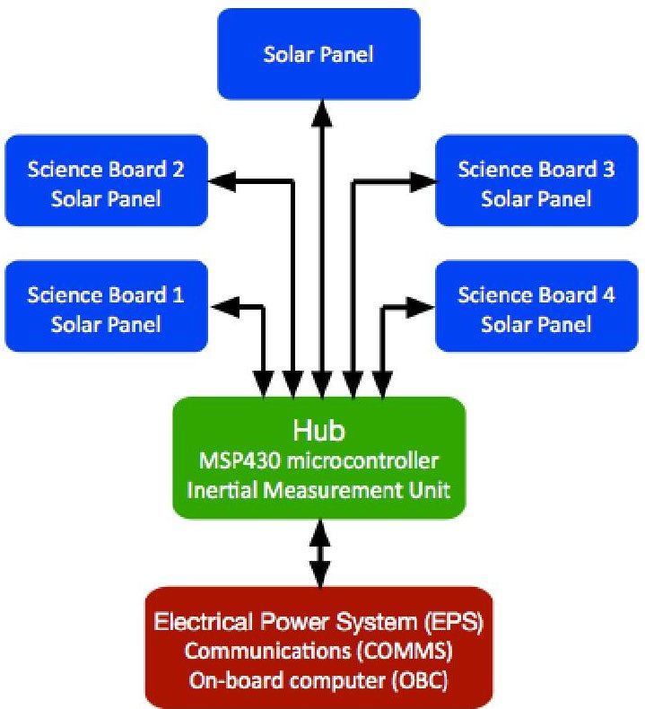

Figure 1: The MakerSat system block diagram showing the central Hub, electrical subsystems (i.e., the EPS, COMMS, and OBC), and the multiuser science boards and solar panel arrays.

and cost. All satellite power, control, computing, and radio communication tasks are made equally available to each of the four science boards by the core MakerSat system. Each science board can pass its data through a microcontroller on the Hub to the communication system (COMMS) for downlink. Figure 1 shows a block diagram of each MakerSat subsystem. The electrical power system (EPS), COMMS, and the on-board computer (OBC) are physically co-located, as shown in Figure 2.

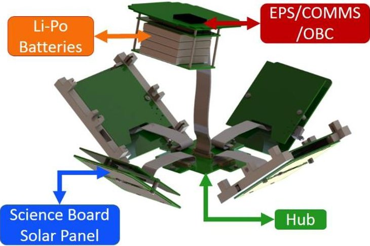

Figure 2: An exploded view of the MakerSat showing the OBC/EPS/COMMS board, batteries each solar panel array/science board assembly, and the Hub (bottom solar panel array omitted for clarity).

<!-- PDF_PAGE: 3 -->

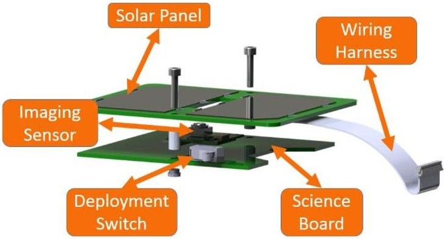

Figure 3: Four sides of the CubeSat will consist of a science board mounted directly behind the solar panel array. The science board contains an imaging sensor that will protrude between solar cells and a deployment switch mounted between the two PCB's.

Also shown are the science /solar array board assemblies and the Hub/solar array assembly, detailed in Figure 3 and Figure 4, respectively. The science boards and the Hub are mounted to the back of the solar array boards (which face the outside of the satellite). The solar array boards contain cutouts （32mm x 9mm) that allow sensors (such as a camera) to be exposed directly to space. The EPS/COMMS/OBC board and the science/solar array and Hub/solar array board assemblies are pre-assembled on earth before being delivered to the ISS. This approach eliminates the need for tools and fasteners when the satellite is assembled on the ISS.

Instead of the EPS, COMMS, and OBC systems connecting directly to the science boards, as might be done in a conventional CubeSat design, the EPS/COMMS/OBC subsystems are routed through the Hub. This configuration eases assembly by providing a common connection point for all boards and allows the Hub to provide each science board equal access to the

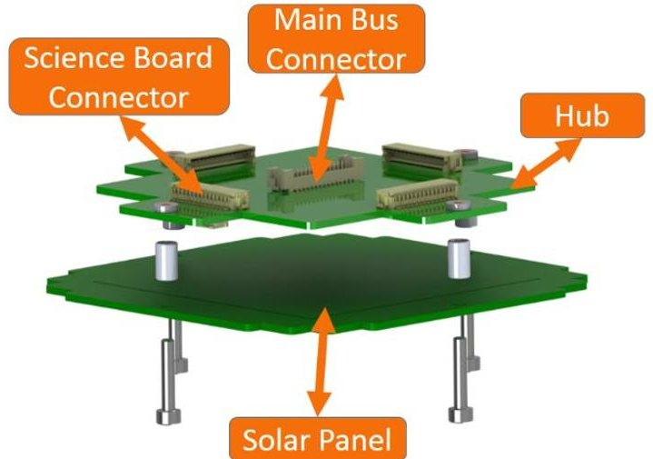

Figure 4: The Hub is mounted directly to the bottom solar array for ease of assembly.

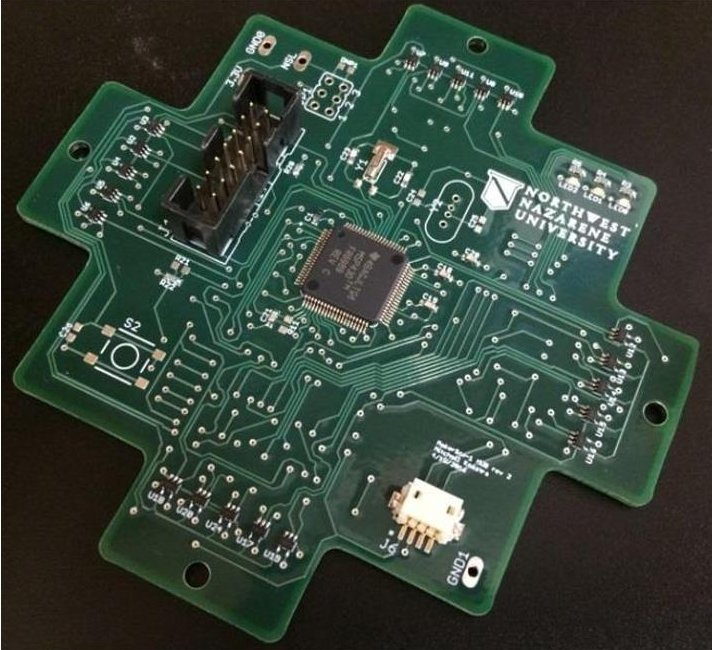

Figure 5: The Hub board showing the MSP430FR6989 microcontroller, science board interface hardware, and JTAG programming port. The connectors to the other MakerSat electrical boards are located on the reverse side (not shown). EPS, COMMS, and OBC subsystems. The following subsections will provide details of each.

## Hub

All of the electrical boards of MakerSat are connected through a Hub board, shown in Figure 5. The Hub board provides the following:

- A single connection point for all satellite boards simplifying assembly and reducing the probability of assembly errors.

- Sequencing control of all four science boards. The Hub operates in a peer-to-peer relationship with the OBC/EPS. The Hub can request the EPS to cycle power to any of the science boards to control their duty cycle.

- Computational power and additional memory that can be used by each science board. The computational power is provided by an ultra-low power MSP430FR6989 microcontroller with 128kB of FLASH memory for flight code and 130kB of nonvolatile, ferroelectric random access memory (FRAM) for computations. The FLASH and FRAM technologies provide increased resistance to single event errors caused by ionizing radiation.

- The ability to relay data from the science boards to earth. The Hub gathers data from each science board, prepares it for transmission, and sends the data to the COMMS for transmission to earth.

<!-- PDF_PAGE: 4 -->

## EPS/OBC, Solar Arrays, and Attitude Control

MakerSat uses an EPS/OBC board, solar array boards, lithium-polymer batteries, and passive attitude control provided by Near Space Launch (NSL). The EPS/OBC uses an 8-bit PIC microcontroller with extensive flight history including TSAT $ ^{13} $ , GEARRS1, and GEARRS2 $ ^{14} $ Each of these satellites was launched from the ISS, and hence, the boards and batteries have ISS approval. The EPS/OBC receives requests from the Hub to cycle power to the science boards, provides over current protection to all MakerSat boards, and uses energy from the solar arrays to charge the batteries.

The solar arrays are constructed using 28% ultra-efficient, triple-junction (UTJ) solar cells from Spectrolab, each providing 433mA at 2.35VDC. Each cell covers one-half of a 1U face and MakerSat uses two cells connected in series on each solar array board to provide 4.7 VDC at 433 mA ( $ \approx $ 2W) from each board, assuming full illumination and operation at the maximum power point. Each of the five solar array boards is connected in parallel. The EPS uses peak power tracking (PPT) to regulate the current extracted from the solar cell array so such that the array remains at its peak power point. The EPS charges four lithium-polymer batteries, configured as two series pairs of batteries in parallel. Together, they provide 4.4Ah at 7.4V. As mentioned previously, the batteries have flight history onboard the ISS.

MakerSat-0 will be launched into a polar sunsynchronous orbit at an altitude of 550km and is expected to last a few years. MakerSat-1, however, will be launched from the ISS. A power budget will be provided in a future publication since the exact power consumption of each MakerSat-1 subsystem is not yet known.

Passive attitude control for MakerSat is provided by a permanent magnet aligned in the z-axis of the satellite that will slowly align the satellite to the earth's magnetic field. The satellite's rotation is dampened by three orthogonal $ \mu $ -metal strips mounted on the OPC/EPS board.

## COMMS

The communication system (COMMS) is one of the most critical and challenging components of any CubeSat design. Many CubeSat missions use a ground station-to-CubeSat radio link for both sending commands to the satellite and receiving data from the satellite. Such grounds stations often operate in the 435 MHz amateur frequency band. While this approach is straightforward, the design and operation of a ground station adds significant complexity to mission planning and ground operations. Furthermore, because of the low

transmit power allowed in the 435 MHz band, the gain of the ground station antenna must be relatively high and hence, the ground station must track the satellite and point its antenna accordingly [13].

To avoid these issues, MakerSat uses an EyeStar Simplex radio, provided by NSL, which communicates with the GlobalStar satellite constellation to provide a 24/7 data downlink with near global coverage to 14 ground gateways. The data received by the groundgateways is made available to each participating science team via an internet portal. The data can be accessed ondemand anywhere in the world. MakerSat will transmit two types of packets from the EyeStar radio:

- Satellite Health Packet: an 18-byte packet will be transmitted at a regular interval to report the temperature and bus voltage of the satellite.

- Payload Packet: a 39-byte packet containing the data from the science boards will be transmitted at regular intervals.

The data rate is expected to be 50-100 kB/day, which is primarily limited by the expected power budget and data rate costs. Using the flight-proven Simplex radio ensures that a beacon will still be received independent of other satellite subsystems. This beacon will indicate satellite functionality in the event of Hub or science board failure.

## Multi-user Science Boards

MakerSat contains four science boards that can each contain an independent science experiment provided by different users. Each science board communicates to the Hub through a standard interface:

- ADC Interface: The EPS/OBC board contains an analog-to-digital converter (ADC) that can be used to directly sample and transmit analog science data to the COMMS.

- GPIO: Two 3.3V digital logic lines are available for each science board to communicate with the Hub microcontroller.

- Serial Communication: Each science board can choose to send serial data to the Hub microcontroller using either the $ \mathrm{I}^{2} \mathrm{C} $ or SPI interfaces.

Science boards are supplied 3.3VDC from the EPS and the Hub microcontroller controls the duty cycle of the science boards. Furthermore, the Hub uses analog switches to isolate the $ \mathrm{I}^{2} \mathrm{C} $ and SPI lines of science boards that are powered down.

The science boards on MakerSat-0 will consist of one imaging sensor board, two polymer mass loss experiment boards, and one board designed and built by

<!-- PDF_PAGE: 5 -->

Caldwell High School in Caldwell, Idaho. The MakerSat-1 science boards are not yet finalized. The following will briefly describe the imaging sensor board and polymer mass loss experiment boards for MakerSat-0.

Imaging sensor board: A COTS image sensor will be integrated into one of the science boards and used to take images of the Earth while in orbit. The images will be compressed, routed through the Hub to the communication system, and transmitted to earth via the GlobalStar network. Two challenges presented with this task are object recognition and image compression. First, since the satellite may tumble in orbit and the downlink bandwidth is limited, only images that contain definitive objects (such as the Earth) will be stored and forwarded to earth. Images that contain only the black of space will be discarded. Second, compressing the images will require light-weight algorithms since the MSP430FR6989 only has 130kB of FRAM.

Polymer mass loss experiment board: The use of 3D printed polymers in space can be difficult because the space environment degrades the polymer. This degradation can happen through monoatomic oxygen radicals, UV radiation, ionizing radiation and outgassing $ ^{15} $ . MakerSat will measure the mass loss of several different 3D printed polymers at regular intervals during orbit when the polymers are exposed to the conditions of space. The mass loss will be measured by placing samples of 3D printed polymers on the end of multiple cantilevers and measuring the resulting change in the resonant vibrational frequency of each cantilever. The resonant vibrational frequency $ f_{res} $ of each cantilever beam is inversely related to the square root of the mass at the end of the beam,

$$
f _ {r e s} = \frac {1}{2 \pi} \sqrt {\frac {3 E I}{L ^ {3} m}}
$$

where E is Young's modulus, I is the beam's moment of inertia, L is the length of the beam, and m is the mass on the end of the beam. By measuring the resonant frequency of the cantilever, the mass of the 3D printed polymer can be determined.

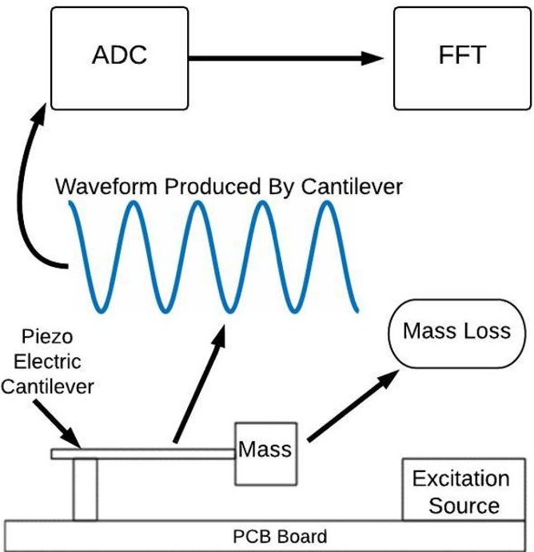

Figure 6: A diagram of the polymer mass loss experiment. The 3D printed polymer to be tested is attached to the end of a piezoelectric cantilever and

excited by a vibration source. The resonant frequency of the voltage output by the cantilever is related to the mass of the 3D printed polymer by (1).

By comparing the resonant frequency of the 3D printed polymer to the resonant frequency of a reference mass, the change in mass due to space exposure can be determined.

The sensor being used is a piezoelectric cantilever which provides an output voltage proportional to the deflection of the cantilever beam. The 3D printed polymer sample is attached to the end of the piezoelectric cantilever, as shown in Figure 6. The cantilever and the vibration source are soldered in close proximity to the same, rigid printed circuit board. When the vibration source excites the cantilever, the resulting voltage is sampled by an ADC and the spectrum of the signal is analyzed, using a Fast-Fourier transform (FFT) or similar algorithm, to determine the resonant frequency. The cantilever's response at the resonant frequency is then used to determine the mass of the 3D printed polymer, according to (1). This procedure will be repeated many times throughout the course of the MakerSat mission providing mass loss measurements as a function of time.

It is important to note that the experiment described above will be done differentially. In other words, the resonant frequency of several 3D printed polymers and a known reference mass, made of a material that will not degrade in a low-earth orbit, will be determined. By taking the measurements at the same time and positioning the reference mass close to the samples under test, systematic errors common to the measurements can

<!-- PDF_PAGE: 6 -->

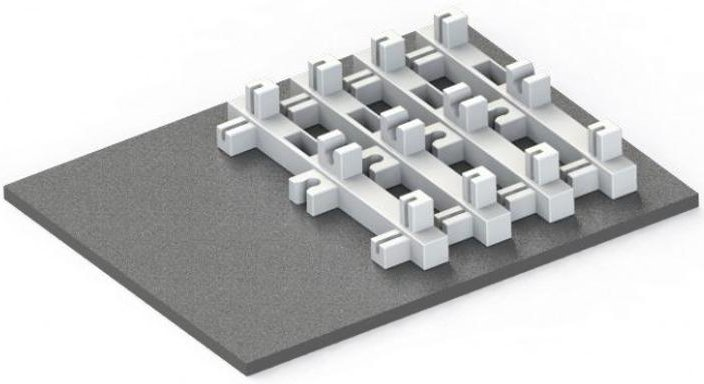

Figure 7: The MakerSat-1 3D printed PEI rails on the print bed. The rails were designed to be 3D printed without support material.

be removed by normalizing the data to the reference mass. Systematic errors include degradation of the piezoelectric cantilevers and thermal effects.

## STRUCTURE AND ASSEMBLY

As mentioned previously, the MakerSat concept will be demonstrated with two satellites: MakerSat-0 and MakerSat-1. MakerSat-0 will be completely manufactured and assembled on earth while MakerSat-1 will be manufactured, assembled, and launched from the ISS. MakerSat-1 uses a simple snap-together design that can be completed in approximately 5 minutes (on earth). The MakerSat-1 design uses four PEI rails, shown in Figure 7, to form the frame of the satellite which can be printed in the AMF. The rails contain snaps and slots that allow satellite boards to be assembled with no free-floating fasteners or

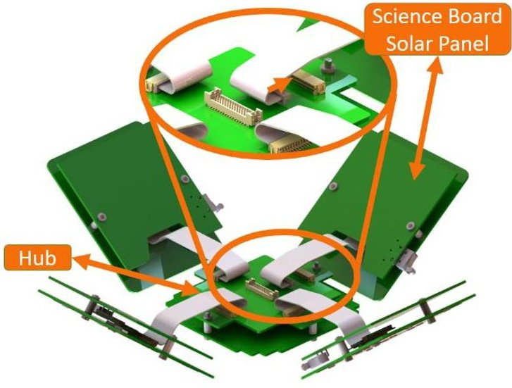

Figure 8: Four solar cell array/science board assemblies are plugged into the Hub.

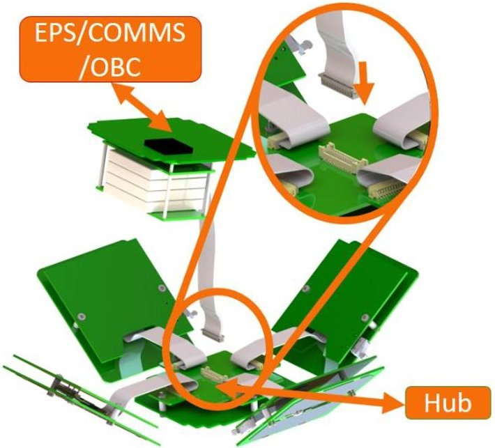

Figure 9: The EPS/COMMS module is plugged into the Hub.

tools. Furthermore, the rails are interchangeable reducing the chance of an assembly error and can be printed without support material. The MakerSat-1 hardware, which includes the EPS/OBC/COMM board the Hub assembly, and four solar panel/science board assemblies, will be manufactured on earth and stored on the ISS until assembled by the astronaut crew. The wiring harnesses that connect each board can be preinstalled on earth. Pre-assembling the boards on earth makes in-space assembly much faster and safer by avoiding the use of free-floating connectors, tools, and fasteners. The entire satellite can be assembled in six steps:

1. Connect the solar panel/science board assemblies and the EPS/OBC/COMM module to the Hub, as shown in Figure 8 and Figure 9

2. Remove the 3D printed rails from the print bed of the AMF, shown in Figure 7, and snap them into the solar panel/science board assemblies shown in Figure 10. Notice the slots for deployment switches in each rail. The rails should create an audible popping sound when correctly snapped onto the boards.

3. Snap two solar panel/science board assemblies into rails as shown in Figure 11.

4. Slide the Hub assembly and EPS/COMM module into respective slots in rails, shown in Figure 12 and Figure 13.

5. Line up remaining solar panel/science board assembly and snap into place as shown in Figure 13. The mechanical assembly is now complete, as shown in Figure 14.

<!-- PDF_PAGE: 7 -->

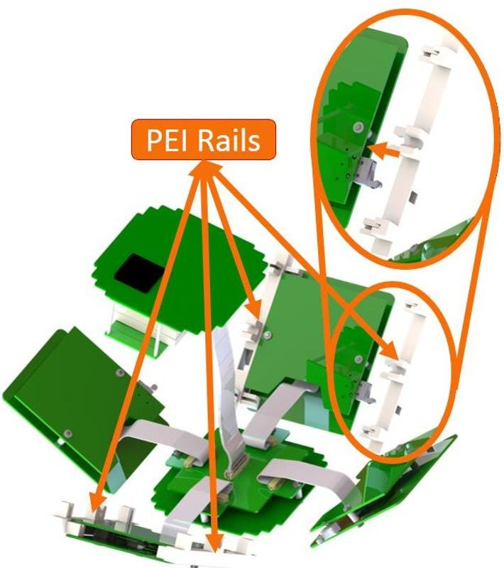

Figure 10: The 3D printed rails are snapped into place on opposite sides of the CubeSat.

6. Connect a USB cable from the satellite to a USB power source to power up the Hub board and test the satellite's functionality. LED indicators visible from the outside of the satellite will show astronauts whether or not the satellite is functional. The COMMS will not be operational until the satellite is deployed.

MakerSat-0 and MakerSat-1 use the same electronic boards. However, since MakerSat-0 will be assembled terrestrially, it will require a more rigid structure to survive the launch forces. To account for this, the snapping feature from MakerSat-1 will be replaced with through-hole mounts to eliminate the risk of structural failure during launch. It is also important to note that MakerSat-1 will not account for standard CubeSat spring plungers in the ends of the rails. Insertion of these plungers on the ISS poses a risk to the crew.

## SUMMARY

MakerSat is the first CubeSat specifically designed to be additively manufactured, assembled by an ISS crew, and deployed, all in a microgravity environment. The concept is to 3D print a satellite frame (uploaded from earth) on the ISS and assemble the CubeSat from a cache of core electrical boards and up to four experiment

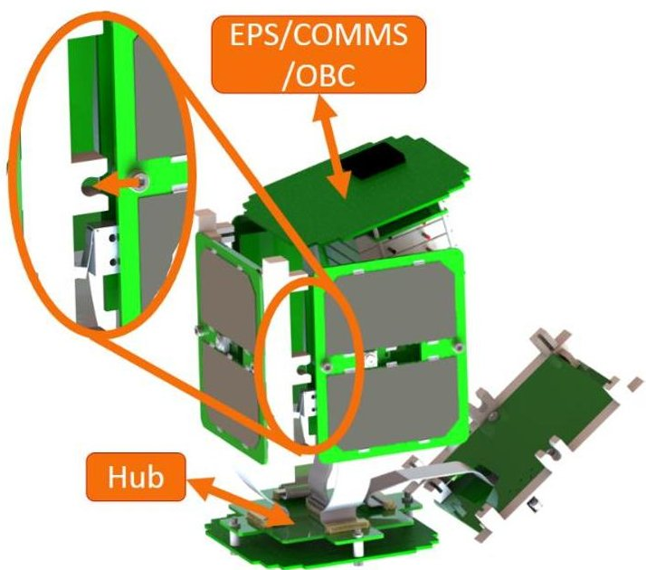

Figure 11: The two remaining sides are snapped into rails, leaving only one side assembly not attached.

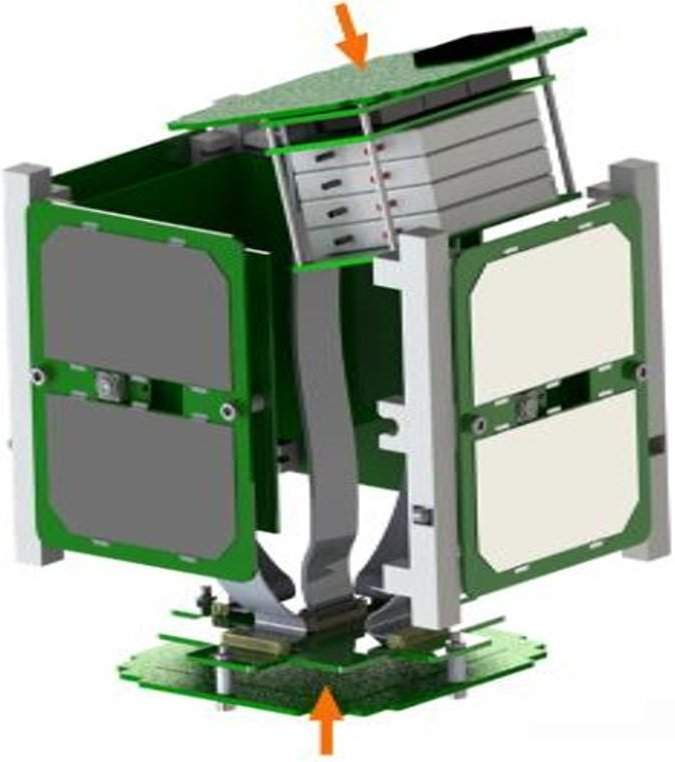

Figure 12: The Hub and EPS/COMMS are then pushed together towards the center of the CubeSat and lined up with their respective slots in the rails.

boards provided by students, teachers, and start-up companies. In this way, a CubeSat can be configured and assembled on-demand with significantly reduced development time. The MakerSat concept will be demonstrated with two launches: MakerSat-0 and MakerSat-1. MakerSat-0 will be completely manufactured in the terrestrial AMF from Made In

<!-- PDF_PAGE: 8 -->

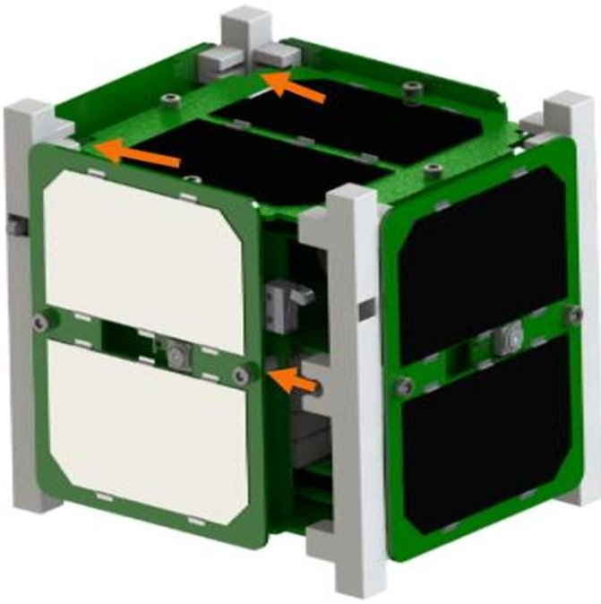

Figure 13: The Hub and EPS/COMM module are slid into their respective slots in the 3D printed rails.

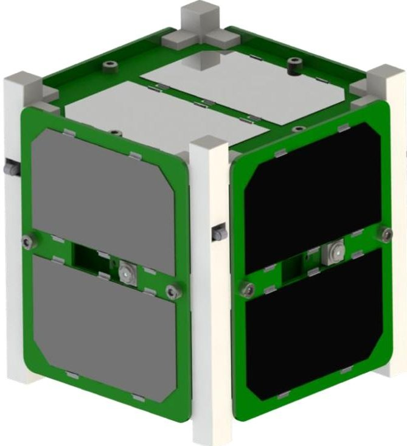

Figure 14: MakerSat CubeSat after assembly.

Space, assembled on earth, and launched into a sunsynchronous polar orbit through the ELaNa XX program. MakerSat-0 will contain four science boards: one to image the earth, two to measure the mass loss of 3D printed polymers in orbit, and one provided by Caldwell High School, in Caldwell, Idaho. MakerSat-0 will serve as a test-run for the eventual launch of MakerSat-1 from the ISS. MakerSat-1 will be completely manufactured, assembled, and launched from the ISS. Efforts to arrange the launch of MakerSat-1 are ongoing. The outcome of successful MakerSat

missions will be an approach to designing satellites with reduced cost, reduced development time, and greater flexibility in structural design since the satellite will not be subjected to a high g-force launch.

## ACKNOWLEDGEMENTS

This work has been generously funded by the Idaho Space Grant Consortium and Northwest Nazarene University. The authors owe special thanks to Jason Dunn, Matt Napoli, and Mike Snyder from Made In Space for their cooperation and input. The authors also thank Jason Budinoff (bSpace), Jeff Daily (Near Space Launch), and Hank Voss (Near Space Launch) for their assistance and advice; Dave Pahlas (Plexus) for his assistance assembling the circuit boards; Grant Johnson and Keith Moilanen for their assistance on this project.

## BIBLIOGRAPHY

2. B. Kohlenberg, "Made In Space and Nanoracks Take First Steps Towards On-Orbit Satellite Manufacturing, Assembly and Deployment," 11 August 2015. [Online]. Available: http://www.madeinspace.us/made-in-space-and nanoracks-take-first-steps-towards-on-orbit satellite-manufacturing-assembly-and deployment/.

3. D. Klumpar, "PrintSat," [Online]. Available: https://ssel.montana.edu/printsat.html. [Accessed 2 June 2016].

4. J. Staub, R. Marsh and S. Kerlin, "The Use of Additive Manufacturing for CubeSat Design and Testing," in Third Annual North Dakota Space Robotics Forum, 2015.

5. A. Kwas, E. MacDonald, C. J. Kief, R. Wicker, C. Soto, L. Bahuelos, J. Aarestad, B. Zufelt, J. D. Stegeman and C. Tolbert, "Printing Multi-Functionality: Additive Manufacturing for CubeSats," in AIAA SPACE 2014 Conference and Exposition, San Diego, 2016.

<!-- PDF_PAGE: 9 -->

6. C. Gutierrez, R. Salas, G. Hernandez, D. Muse, R. Olivas, E. MacDonald, M. D. Irwin, R. Wicker, M. Newton, K. Church and B. Zufelt, "CubeSat Fabrication through Additive Manufacturing and Micro-Dispensing," in International Symposium on Microelectronics, 2011.

7. A. Kwas, E. MacDonald, D. Muse, R. Wicker, C. Kief, J. Aarestad, M. Zemba, B. Marshall, C. Tolbert and B. Connor, "Enabling Technologies for Entrepreneurial Opportunities in 3D printing of SmallSats," in Proceedings of the AIAA/USU Conference on Small Satellites, Logan, UT, 2014.

8. G. Toy and D. Hawksworth, "The Next Generation of Space Manufacturing: Model Based and Digitally Assured," in Proceedings of the AIAA/USU Conference on Small Satellites, Logan, UT, 2015.

9. K. R. Gagne, D. L. Hitt and M. R. McDevitt, "Development of an Additively Manufactured Microthruster for Nanosatellite Applications," in 54th AIAA Aerospace Sciences Meeting, 2016.

10. G. Moore, W. Holemans, A. Huang, J. Lee, M. McMullen, J. White, R. Twiggs, B. Malphrus, N. Fite, D. Klumpar, D. Wilt, J. Lyke, S. Davis, W. Bradley, T. Chiasson, J. Heberle and P. Patterson, "3D Printing and MEMS Propulsion for the RAMPART 2U CUBESAT," in Proceedings of the AIAA/USU Conference on Small Satellites, 2010.

11. J. Wrobel, R. Hoyt, J. Cushing, M. Jaster, N. Voronka, J. Slostad and L. Paritsky, "Versatile Structural Radiation Shielding and Thermal Insulation through Additive Manufacturing," in Proceedings of the AIAA/USU Conference on Small Satellites, Logan, UT, 2013.

12 R. P. Hoyt, J. I. Cushing, J. T. Slostad, G. Jimmerson, T. Moser, G. Kirkos, M. L. Jaster and N. R. Voronka, "SpiderFab: An Architecture for Self-Fabricating Space Systems," in AIAA SPACE 2013 Conference and Exposition, 2013.

13. H. Voss, J. Dailey, J. Crowley, B. Bennett and A. White, "TSAT Globalstar ELaNa-5 Extremely Low-Earth Orbit (ELEO) Satellite," in Proceedings of the AIAA/USU Conference on Small Satellites, 2014.

14. H. D. Voss, A. White, S. Brandle and J. F. Dailey, "Globalstar Communication Link for CubeSats: TSAT, GEARRS1, and GEARRS2," in Proceedings of the AIAA/USU Conference on Small Satellites, 2015.

15. E. Grossman and I. Gouzman, "Space environment effects on polymers in low earth orbit," Nuclear Instruments and Methods in Physics Research, pp. 48-57, 2003.

16. D. Selva and D. Krejci, "A survey and assessment of the capabilities of Cubesats for Earth observation," Acta Astronautica, vol. 74, pp. 50- 68, 2012.

17. Made In Space, "Archinaut," November 2015. [Online]. Available: http://www.madeinspace.us/projects/archinaut/.