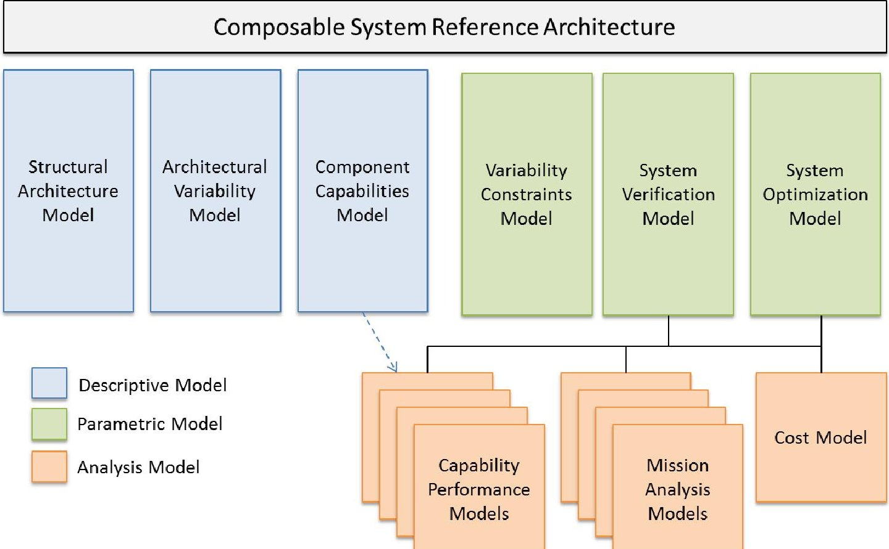
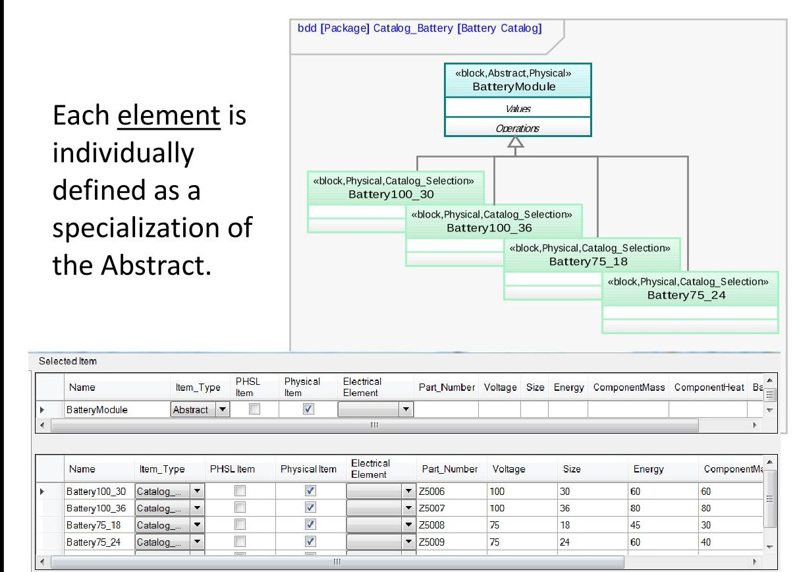
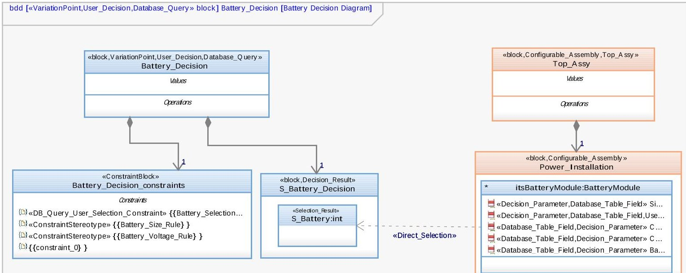
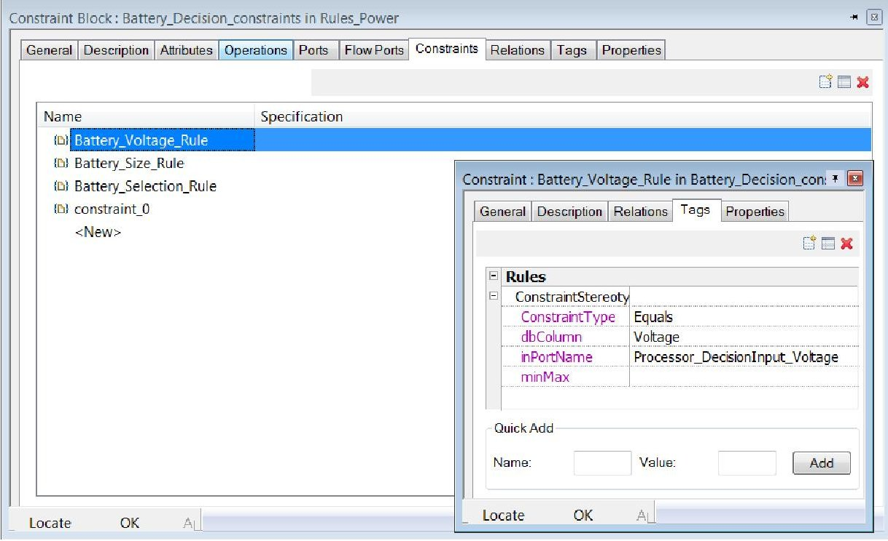
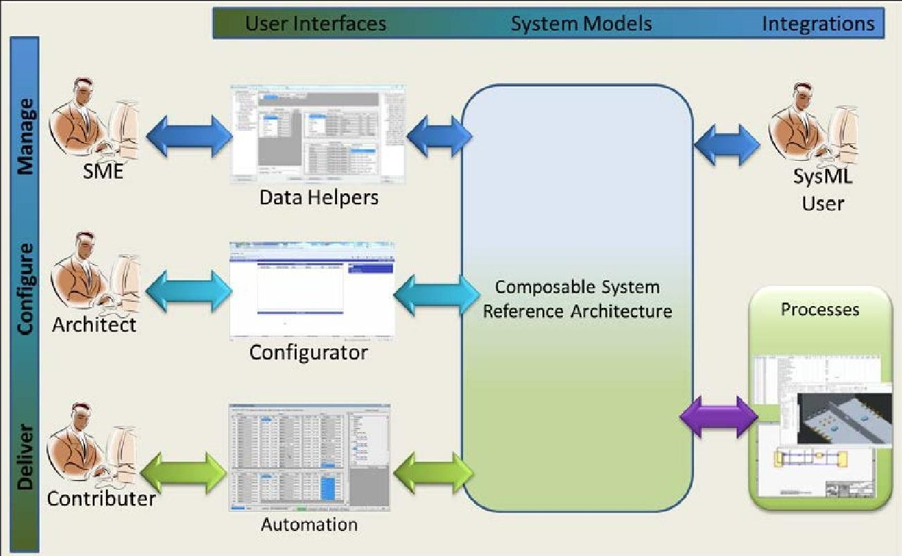
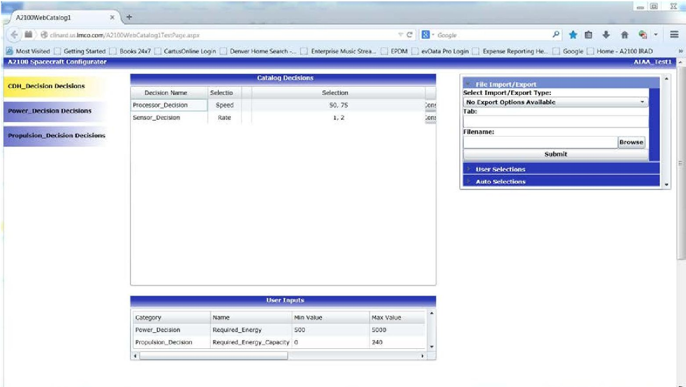
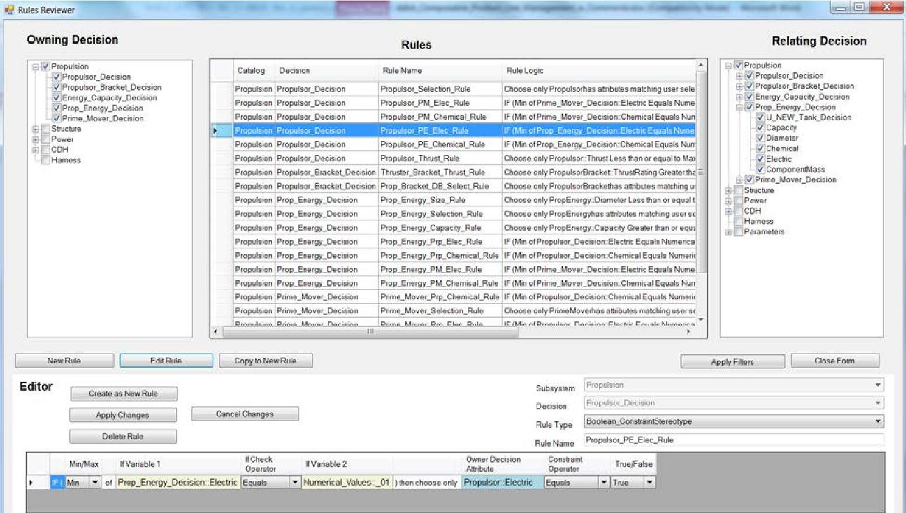
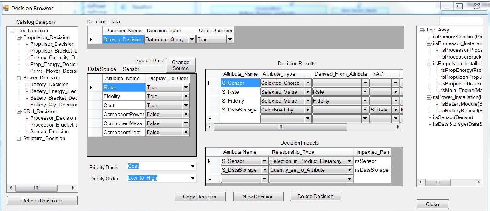

<!-- PDF_PAGE: 1 -->

# Managing a Satellite Product Line Utilizing Composable Architecture Modeling

Michael J. Kaiser $ ^{[1]} $ and Christopher Oster $ ^{[2]} $ Lockheed Martin Space Systems Company, Denver, Colorado, 80125

Lockheed Martin Space Systems Company has developed and piloted a composable modeling methodology in the update of the A2100 satellite product line. The composable design methodology leverages the model based systems engineering language, SysML, to formally define product line variation, relationships and decisions. The composable modeling methodology extends the SysML language through the use of specific relationships and modeling patterns. Managing a satellite product line which has flexibility to serve a variety of missions defines a large and varied design space; composable modeling offers a methodology to manage and control the commonality while enabling variation in an efficient and data-rich environment. Through application of these modeling techniques Lockheed Martin SSC has enabled rapid system configuration and evaluation. This paper explores the composable modeling methodology as implemented on the A2100 product line, as well as challenges and value of maintaining and operating in a composable modeling environment.

## I. Introduction

Composable design is a system architecture and development concept whereby new systems are composed from known components, designs, product line definitions and reference architectures. This is in contrast to "blank sheet" or "copied and modified" designs which focus on requirements decomposition or may require heavy revalidation to new requirements. $ ^{1} $ A composable architecture enables reuse of pre-defined designs at any level of the architecture, along with their associated representations for design, behavior, cost and performance, which can be easily implemented into new system architectures where the new architecture complies to product line defined design rules. $ ^{2} $ This paper investigates the application of this composable design methodology to the implementation of a spacecraft product line, specifically focusing on the lessons learned from the application of this methodology on the Lockheed Martin A2100 spacecraft product line, and discusses further efforts currently underway to mature and evolve this capability.

## II. A2100 Application Overview

The A2100 Spacecraft architecture defines a satellite product line providing catalog-to-order solutions that leverage common parts, components and subsystems to meet specific customer and mission needs. In order to improve efficiency, timeliness, reliability and cost-effectiveness of individual satellites a large percentage of the components, design techniques, assembly integrations, processes and procedures are common across variants. The opportunity exists, using system models, to leverage that commonality in a data-rich model driven environment, where all existing options can be evaluated for application to a new variant and product line extensions can immediately be made available to future variants.

Many other aerospace products have similar characteristics to a satellite application. Aerospace missions tend to be complex, have mission unique requirements and, despite heavy re-use, a given design is rarely identical to any previous system. In addition, the variation is often interwoven throughout the detailed design, not isolated to a single area. To accommodate such mission variability, the available design space and product offerings must be large, however the number of articles actually produced is small by comparison. This condition of large trade space and small production volume makes fully characterizing the viable and efficient design space by variant impractical

<!-- PDF_PAGE: 2 -->

and cost-prohibitive. The advantage of composable design over creating a variant tree typical with traditional product line development techniques is to expose and manage the entire suite of architecture options, maximize utilization of standardized elements, and standardize completed architectures without predefining solutions.

## III. Composable Modeling Overview

The A2100 Application leverages and extends the SysML $ ^{5} $ language to model the A2100 composable architecture through the use of both a composable modeling profile containing a structured constraint language (rules), stereotyped relationships and specific modeling patterns, as detailed by Oster, et al $ ^{2} $ and an A2100 specific profile created to capture A2100 specific datasets within the composable architecture.

The Composable System Architecture, as illustrated in Figure 1, consists of six key views that must be addressed. These including system structure, variation structure, a catalog of components and capabilities, constraints, and verification and optimization views. $ ^{2} $ This paper is primarily concerned with the value and effort associated with creating the structural, variation, capability and constraints models. Optimization and System Verification Models are discussed in Oster, et al $ ^{2} $ , and a Lockheed Martin Space Systems Company implementation of optimization is discussed by Miano $ ^{4} $ .

Figure 1- Architectural Views in a Composable System Reference Architecture $ ^{2} $

## A. Composable Modeling Profile

To implement the composable modeling architecture the SysML base language is extended with specific stereotypes and modeling constructs in a composable SysML profile. These constructs can then be leveraged by a reasoning engine and other tools. The key modeling constructs to note are:

- Abstract unit - Placeholder for an element (generic capability or component) with a known set of specific implementations of that element. Each specific implementation of that element is associated with the abstract unit via the SysML generalization relationship. Upon selection of a specialization for an abstract, the abstract will be replaced in the structural model by the chosen specialization. $ ^{2} $ An abstract specialization can be categorized as either Catalog_Selection or Configurable_Item. A

<!-- PDF_PAGE: 3 -->

Catalog_Selection is a fully defined capability or component. A Configurable_Item is a capability or component which will have some unique program definition, usually a performance value, such as a specific frequency value, and so is "standard" but requires some level of re-identification.

- Decision - A decision is represented by a SysML block and carries the VariationPoint stereotype. Each decision has a result block, which contains the resultant attributes of the decision and a SysML Constraint Property which contains the rules. $ ^{2} $ See Figure 3 for a representative decision.

- Rules - Rules govern how decisions interact with each other. There are five types of rules; each type is identified by a stereotype applied to a SysML Constraint. Each stereotype defines a structured type of relationship between decisions where SysML Tags are populated to complete the rule defined by the constraint. $ ^{2} $ Rules are constructed using a "fill-in-the-blank" logic where the tag values complete a logical query.

- Structural Model Variation & Impact - Variation in the structural model is represented via SysML composition relationships. Each relationship is instantiated as a SysML part. A part can be static, with no variation or can have three primary types of variation each impacted by an associated impact stereotype. Impacts are implemented utilizing the SysML dependency relationship, where the impacted part is dependent upon the resultant attribute on the Decision Result Block. $ ^{2} $ The three types of impact and variation are:

o Multiplicity - The multiplicity, or quantity, for the usage of an item can be varied based on the result of a decision.

o Type - A composition relationship with a type that carries the stereotype of "Abstract" is a placeholder, that composition shall be re-typed to the chosen element.

Variable Value - An attribute or value on the item can be defined by the result of a decision. The attribute may initially be populated by a default value or left unpopulated.

## B. A2100 Product Family Profile

In addition to the variation described through implementation of the composable profile, the A2100 product family has specific applications and domain terminology, as would many product lines. To accommodate these specifics, an A2100 specific profile, capturing the A2100 specific modeling patterns, was created to aid in the application of the composable profile. Profile definition was created to describe electrical composition, mass properties relationships and to stereotype items for applicability to specific processes. By defining the A2100 profile extensions in conjunction with the composable modeling profile, product line tools and processes were constructed to manage the elements and data. One example of this is shown in Figure 2 as an alternate means of managing an abstract and its specializations.

## IV. A2100 Application Methodology

In applying composable modeling to a spacecraft platform the primary effort has been to define the design space in terms of elements, architecture (how the elements interact) and decisions. The following sections will describe the A2100 application of these primary aspects of composable modeling.

## A. Elements

Elements represent the replaceable, constituent parts of the architecture. In the case of the A2100, design model elements were created to correspond directly with an end item or alternatively to a specified design concept or capability. An element can be a component, assembly, subsystem, or partially defined placeholder, such as a configurable payload element, or scalable structure.

The process of defining an element requires a focus on variation. Though a primary goal of composable modeling is to increase commonality, the modeling technique does not encourage or discourage variation, but rather identifies and scopes the variation such that it can be managed. Abstract elements must be evaluated to ensure that every specialization of the abstract is distinguishable, empirically, from each of the other specializations through some combination of attribute values initially defined on the abstract. Each specialization can add unique attributes and design definition, but all specializations of a single abstract element must, by definition, realize a common

<!-- PDF_PAGE: 4 -->

logical function and share some common attribute definition to distinguish between options. The collection of these specializations forms a catalog of elements which capture the range of a product line's capabilities.

Figure 2 - Two Views of Abstract Specialization

## B. Architecture

Applying composable design to manage a product line requires a composable system reference architecture that defines abstract, program unique and catalog elements and relationships between those elements to outline the way in which the product line can be instantiated. The product line reference architecture can have as much or as little detail defined in these elements and relationships as the application requires. As many aspects of a product architecture can vary substantially between variants, it should be anticipated that some detailed architectural definition will be performed during the development of specific point solutions. Certain areas of a product line architecture are common across applications, as are standard definitions and interfaces for configurable aspects of the architecture (such as the implementation of a payload), and therefor can be defined in detail even where variation remains. Establishing the product line reference architecture, including nomenclature and designations, is valuable to drive consistency and enable downstream engineering, production and business processes. As seen in Figure 3, the "Top_Assy" is composed of a "Power_Installation", which includes a "BatteryModule", this complete architecture including outside relationships is created. Upon instantiation, the specific "BatteryModule" will be set based on the results of the "BatteryDecision". The model doesn't simply describe the variation and variants, the result is a featured system model representing the desired configuration and containing meta-data associated with each element.

## C. Decisions and Rules

Decisions are constructed separately from the structural architecture definition. Decisions on a spacecraft may be at the level of selecting a particular component, or may be at a higher level, such as choosing electric or chemical propulsion. The decisions are first modeled and then related to the architecture via SysML relationships to either instantiate an abstract or modify composition relationships to an element as shown in Figure 3. An alternative viewer for managing decision construction is shown in Figure 8. Separating decisions from the structural architecture and using relationships to impose decisions for instantiation enables A2100 to have a single decision impact over 100 discrete instantiations of catalog elements. This abstraction enables an architect to focus on decisions that impact the overall solution most, which can be difficult in a model which is both structurally complex and contains a large quantity of elements.

<!-- PDF_PAGE: 5 -->

Decisions can be of two primary types, "Database_Query" and "Value_Selection". A "Database_Query" decision provides a choice between discrete selections based on an abstract and its specializations. "Database Query" rules impose themselves in the same manner as a SQL Query. The majority of composable decisions tend to be of this variety. However, there exist cases where greater variation is required, though within a defined scope. A "Value_Selection" Decision offers the user the opportunity to define specific values for a decision. These values are represented as attributes on the decision and can be used as the basis to process rules between decisions. For example a power requirement or mission life requirement is a mission unique parameter, the parameter can be input to a "Value_Selection" decision and rules can be executed to eliminate options from other decisions which are incompatible with the specific requirement.

Constraints, also called "rules", enable decisions to contain the compatibility definition of which choices are compatible or in conflict with other choices. Rules are established between decisions, rather than each choice within a decision, in order to enable management of the choices without necessitating an update to the constraints. This construct makes it much easier to add and remove options and to manage decisions where there may be a large quantity of choices. An example of rule structure is shown in Figure 4. Rules are captured as constraints, with a specific stereotype which defines the type of rule and tags which are populated by the elements to which a rule relates. A2100 created a viewer to aid in managing the rules as shown in Figure 7.

Figure 3 - Decision Structure and Impact Relationship

American Institute of Aeronautics and Astronautics

<!-- PDF_PAGE: 6 -->

Figure 4 - Composable Model Constraint Structure

Capturing the decision architecture also requires a revisit to the variation study performed while identifying elements and the reference architecture. Each element or architecture feature must account for the variation in the decision model. Rules must be established to prohibit incompatible solutions. Accounting for the variation provides the enterprise with a means of capturing the scope. Capturing the impact of decisions identifies under defined areas of the architecture. Often times this exercise leads to a maturation of the product line as managing and exercising the decisions highlights those decisions which may be constraining the architecture or which provide the greatest impact to the key performance parameters of the architecture.

One of the major benefits of composable modeling is the separation of the decision model from the architecture model, which enables a single decision or set of decisions to have a wider ranging impact. The decision rule structure also enables the decisions to interact with each other via the rules rather than the structural model elements making model element and constraint management more straightforward. Although the A2100 design model has primarily focused on elements and decisions which impact structural modeling, the same methodology can be applied to other aspects of the system such as behaviors. Behaviors can be related as specializations of more generic behavior, and the decision model can impose choices on behavioral models because the decision model is not inherently structural but rather is separated. A2100 is capturing non-structural data where a given decision may involve attributes which impact other efforts, such as cost prediction. An attribute or characteristic of a decision can be utilized in a cost model rather than directly reference a specific instance of an element. This is particularly valuable when attempting to use the decision model to characterize system complexity, quantities or other parameters which may span multiple element instances.

## V. Model Interaction User Interface

The value of a model is always defined by the user; as such, user interface for model management is a primary concern. The scope of the A2100 product line definition and ancillary applications, such as cost modeling, mass properties and electrical modeling, requires that contributors from all parts of the enterprise interface with the data set. The Architecture depicted in Figure 5 shows that surrounding the composable model are various interfaces. Modeling by systems engineers can be done directly, however data managers and automation have been created to serve specific purposes, such as electrical model definition, mass properties management and hierarchy maintenance. These data managers, or "Helpers," enable any user to contribute to the definition and implementation of the product line model.

Figure 5 - User Interface Architecture

<!-- PDF_PAGE: 7 -->

In order to rapidly configure a new configuration, an interface was required to enable an architect to easily comprehend the available options within the product line. The reasoning engine used to configure the A2100 composable model for specific mission needs is referred to as the Configurator and provides architects a Website interface. The configurator reads the modeling patterns of the decisions, presents the user with choices, and based on the user selections eliminates any incompatible solutions by processing the rules set. The user inputs can be in the form of a selection, a manually input numerical value, or, in special cases, a formatted file import. The resulting remaining choices are displayed to the user to continue defining the architecture. When the user has determined the architecture is sufficiently defined, the user can choose to instantiate, which completes the remainder of the decisions based on a pre-defined prioritization (usually cost, mass or other high level metric), ensuring a compatible solution, and executes the relationships which apply the decision results into the architecture definition. The result is a fully instantiated system model representing the target architecture. This process can be iterated upon until the resulting solution satisfies the intent of the architect for the mission. Some of the automation and processes shown in Figure 5 can then be executed from the configurator, allowing nearly immediate feedback on the new configuration.

Figure 6- Configurator

## VI. Value of Application

Defining the A2100 composable architecture using these modeling methods aids in management of the A2100 product line and increases understanding of variation. The update of the A2100 Product line increases the variation of missions that the A2100 can support, thus providing greater opportunity to gain value through understanding the variation and commonality associated with the capabilities. When defining a new architecture common words such as "similar" can be used without formally defining "similar". When system variation is not formally captured, there is opportunity to introduce risk if the communication is misinterpreted. The basic exercise of formally identifying variation throughout the system drives out misconceptions about design commonality or lack of commonality, fosters communication between subsystem teams, and encourages standardization and simplification of interfaces. Often standardization and variation are well understood, however the lack of clear definition of the variation requires additional effort to manage. Each of these items if left unchecked could result in additional system complexity and higher cost for specific implementations of the product.

<!-- PDF_PAGE: 8 -->

In addition to the exercise of modeling the architecture and traditional benefits of modeling, having a composable model specifically facilitates several organizational benefits.

## A. Initial Architecture Definition

The Configurator tool as described above, enabled by the composable design, allows the user to make key architectural decisions, then auto-generate a solution based on a priority for any remaining architectural decisions. The result may not be the optimal solution, but enables the user to rapidly generate a complete and valid solution and then make decisions about how to proceed in minutes or hours instead of weeks.

Composable modeling coupled with automation enables the rapid creation of multiple detailed architecture definitions. This enables iteration and characterization of undesirable outcomes. Generation of hardware lists and model-based bottoms-up mass estimates are two of the capabilities we have associated with the composable model. Additional integrations have been demonstrated and are in work for deployment, such as power, command and telemetry sizings.

## B. Program Instantiation

Utilizing a composable model to not only represent the product line specification in terms of available elements but to associate more detailed engineering data with those elements returns additional program value at very little cost. Electrical, mass and other engineering data can be digitally associated with elements and passed forward through the system architecture to detailed engineering activities reducing both translation error and recurring effort. Capturing data in a standardized electronic format also has yielded unanticipated opportunities to utilize data which previously was fragmented across multiple data sources. Composable modeling has enabled a level of commonality that encourages process definition based on the model construction. A2100 has initiated digital interfaces between system models and Mechanical CAD models, Electrical CAD models, and analysis models leveraging the design and specification data contained in the reference architecture and element models.

## C. Product Line Data Management

The composable model architecture as implemented on A2100 provides an enterprise the ability to manage intended variation through the decisions. In addition, element variants can be managed centrally, creating and maintaining a rich data set to be utilized by instantiating programs without manual translation. Elements can be added, updated and modified with understanding of the impact to using programs and without the need to manually propagate updates to potential users. This also provides a point of reference when discussing the expansion of the product line, or evaluating an existing or proposed element to determine if there is sufficient similarity to the product line, potentially reducing duplicated effort in parallel efforts.

## VII. Challenges and approaches

Challenges to incorporating a widespread modeling effort could generally be grouped into two groups: human adoption and tool adaptation.

## A. Human Adoption

Many subject matter experts across various domains are unfamiliar with SysML, and most have no intention of becoming experts. As SysML was chosen to capture the system definition of the product line, and the intent was to capture products across the full scope of the architecture, each subject matter expert is required to contribute in some way to the SysML definition of the architecture.. Because most enterprises don't have the time to have in-depth training, our effort was focused to ensure that those with appropriate knowledge could contribute and thus speed adoption.

As described in Section V, A2100 created interfacing tools to aid in model management. Data import and export tools designed for users were created to allow subject matter experts to input, extract and modify data in intuitive formats. These tools, referred to as "helpers", were designed to enforce the modeling patterns described previously. Views were tailored to specific tasks and it was often much faster to create a helper and enable an SME to utilize an existing data set or repeat a more efficient task than it was to manually enter and manage the data.

## B. Tool Adaptation

The biggest drawback from a tool adaptation standpoint has been the difficulty in sharing the information in the model. Model sharing (multiple contributors, reviewers, etc.) among novice or beginner users can be very difficult, and when the model data is valuable, but constitutes only a small part of a user's daily activity it can be difficult to

<!-- PDF_PAGE: 9 -->

scale a tool learning curve. Tools appear to be improving, but the ability to share a constructed system model for incorporation into other models or to be viewed by novice users, similarly to how a CAD assembly can be shared with a fully integrated CM solution, would go a long way to removing this hurdle entirely.

In addition to creating a profile extension, as would be expected, there have been several implementation specifics where tools were either not available to the team or did not exist. All data management tools were created based on a specified modeling pattern, querying the model for the pattern and allowing users to update information only by enforcing those patterns. Figures 7 and 8 below depict a Decision Constraint Editor and a Decision Editor. Tools allowing for abstracted definition of a modeling pattern and then model querying and enforcement of those patterns would greatly increase a novice or occasional user's ability to leverage the modeling capability.

Figure 7 - Decision Constraint Editor

Figure 8 - Decision Editor

American Institute of Aeronautics and Astronautics

<!-- PDF_PAGE: 10 -->

## VIII. Summary and Conclusion

A2100 has gained value from the application of composable modeling to the product line and anticipates more value on the near horizon. Though the initial learning curve was steep, we believe the potential opportunities for expansion will increase as the model fidelity and tools improve. Already in focus are opportunities for integrations with behavior driven composable design, trade space visualization and optimization $ ^{4} $ , nested composable models, and closed loop integrations with business processes.

In conclusion, composable modeling practices provide a valuable methodology for managing product line elements in any product line application where pre-definition of all viable variants is infeasible or ineffective. Modeling elements in a composable profile enables the enterprise level management of the elements, improves understanding of element relationships and encourages commonality across applications. Capturing a baseline architecture and a decision architecture is a valuable method for the enterprise to understand these relationships and applications, capture key decision points and understand their impacts and build efficiencies and tools around a standardized data structure. The reasoning engine to interpret the decision structure and enforce decisions into the architecture has a time saving and repeatability value. Increased capability in reasoning, data visualization, search and optimization will continue to increase the value returned from these data models, as will the interconnection with other related datasets.

## References

$ ^{1} $ Oster, C., Wade, J., "Ecosystem Requirements for Composability and Reuse: An Investigation into Ecosystem Factors that Support Adoption of Composable Practices for Engineering Design," Systems Engineering, Volume 16, 2013.

$ ^{2} $Oster, C., Kaiser, M., Kruse, J., Wade, J., Cloutier, R., "Applying Composable Architectures to the Design and Development of a Product Line of Complex Systems," Systems Engineering (Submitted for Publication - Reference# SYS-15-059)

$ ^{3} $Timothy W. Simpson, "Product Platform design and customization: Status and promise.", Artif. Intell.Eng.Des. Anal. Manuf. (Cambridge University Press) 18, no.1 (Jan 2004):3-20.

$ ^{4} $Miano, C., "Using Optimization to Exploit a Composable Satellite Product Line Architecture", AIAA Space Conference 2015 (Submitted for Publication).

$ ^{5} $OMG Systems Modeling Language Website, from URL: http:// http://www.omgsysml.org/ [cited 08-06-2015].