<!-- PDF_PAGE: 1 -->

# Managing Socio-Technical Complexity in Engineering Design Projects

## Mohammad Hassannezhad

Cambridge Engineering Design Centre Department of Engineering, University of Cambridge Trumpington Street, Cambridge CB2 1PZ, UK e-mail: mh844@eng.cam.ac.uk

Marco Cantamessa Department of Management and Production Engineering, Politecnico di Torino Corso Duca degli Abruzzi 24,10129 Torino, Italy e-mail: marco.cantamessa@polito.it

Francesca Montagna Department of Management and Production Engineering, Politecnico di Torino Corso Duca degli Abruzzi 24,10129 Torino, Italy e-mail: francesca.montagna@polito.it

## P. John Clarkson

Cambridge Engineering Design Centre Department of Engineering, University of Cambridge Trumpington Street, Cambridge CB2 1PZ, UK e-mail: pjc10@eng.cam.ac.uk

## ABSTRACT

Design project management is witnessing an increasing need for practitioners to rely on tools that can reflect the social and technical characteristics of design processes from an integrated perspective, as opposed to two parallel concepts. For practitioners, this integration has the potential value of predicting the future behaviour of the design process by allowing them to understand what task to do next and who to assign a task, given the availability of resource, and the levels of knowledge and expertise. In response to these challenges, this paper contributes to developing a new process modelling methodology called Actor-Based Signposting (ABS) that looks at the early stages of the product development processes from the perspective of integrated socio-technical systems. The objective is to support managers and decision makers on both typical planning issues, such as scheduling and resource allocation, as well as on unconventional issues relating to the organizational planning of a design project, such as identification of criticalities, and matching required skills and expertise, and factors of influence. Ultimately, the aim is to support organizations to be more adaptive in responding to changes and uncertainty levels. Two case studies in the automotive and aerospace

<!-- PDF_PAGE: 2 -->

industries with different properties and modelling objectives were selected to demonstrate the utility of the proposed methodology. Experimental analysis of these cases led to a range of insights regarding the future modelling developments for academia as well as the decision-making capabilities for managers and practitioners.

## 1 INTRODUCTION

Engineering design projects, even in their simplest or routine form, are complex to manage due to their integrated and multidisciplinary nature, which involves the properties of both complex physical-technical systems and networks of interdependent actors [1,2]. Furthermore, they comprise a set of activities that require collaboration between crossfunctional teams which adds to the complexity. Consequently, each design project might face somewhat unique problems that lead to different process behaviour even compared to the similar projects in the past. This substantial element of uniqueness makes management of design projects highly challenging and it becomes vital to understand how organisational factors affect the ways that work is done, and technical systems are used [2].

In reality, project managers make decisions based on what they see or perceive and since they cannot see the entire scope of the design project to predict future behaviour, they must rely on models to support planning [3]. Additional complexity pertains to the fact that no single model can address all purposes [4]. Therefore, development of more dynamic models that can properly reflect the complexity of design projects and are "richer" in providing helpful information is of value for managers. Multiple classes of models consequently developed to address this need, each one focusing on a particular aspect of design such as activities, agents, or decisions, and for which there are several comprehensive reviews in the literature [4-6].

However, a general criticism facing the majority of existing models is that they have mainly been focused on supporting what task to do and hence do not provide detailed information on how to perform design tasks, i.e., by whom and how [4,7]. Another general criticism is that social (organisational) and technical properties of the projects are typically embedded in the models separately and not in an integrated framework [6]: evidence in the literature shows omitting individual resources' properties (such as expertise and preferences) when modelling the activity duration [8,9], or conversely focusing on the organisational-behavioural properties such as communication and interactions when defining design activities [10,11]. As a result, there exists a gap between models that focus only on either organisational properties or technical performance, and consequently their

<!-- PDF_PAGE: 3 -->

mutual influences could be neglected in the modelling, especially when these variables change occurs simultaneously.

This interdisciplinary modelling is especially critical in early design phases where the information is imprecise or indeterminate (e.g., product requirements are not fully defined) and can affect the execution of design tasks in different ways. In such situations, finding the right individual or choice of agent for each design task is very challenging because it depends on a number of factors such as the composition of the team, availability of agent, knowledge on the task (availability of information), and feasibility in terms of manpower cost (i.e., the assumption is that more experienced agents usually infer more overhead costs to the system, comparing to junior ones).

To address these challenges, this paper focuses on modelling and simulation of early stages of product development processes (PDPs) - typically referred to design processes (DPs) - with an integrated socio-technical view. The socio-technical process modelling in the context of this paper therefore means to find the right choice of agent for each design task, considering the availability of knowledge and level of expertise. The paper is concerned with the development of a new process modelling methodology that is termed "Actor-Based Signposting" (ABS). It represents an alternative way of looking at engineering DPs that combines the Activity-based and Agent-based concepts of process modelling. The specific objectives are: (1) understanding how availability of knowledge and level of expertise affect the outcome of design tasks, in terms of duration, cost, and performance quality; and (2) supporting managers and decision-makers with insights on both technical planning (scheduling and resource allocation) and organizational planning (identifying critical tasks and actors based on their performance quality, matching required skills and expertise, and tasks-actors fit) issues.

In doing this, we are extending the widely-accepted Signposting approach [8], as a dynamic task-based model, to additionally consider the allocation of agents to tasks. It is postulated that, when modelling a sequence of tasks to be performed, taking the role of actors (agents) into consideration opens up additional challenges - and presumably new opportunities - to the modelling as the overall process behaviour will also depend on the actors' behaviour (e.g., interactions with other actors), on their performance (e.g., level of expertise), and on the mechanism by which actors are assigned to perform tasks (e.g., task execution strategy).

<!-- PDF_PAGE: 4 -->

The following Sec.2 outlines the theoretical foundations regarding socio-technical aspects of complexity in Engineering Design, the need for a new process modelling methodology, and the research methodology employed. Sec.3 presents the previous versions of the Signposting methodology, upon which the proposed model is built. The proposed ABS methodology is explained in Sec.4 in detail. After that, Sec.5 presents two applications of the model and some highlights on the practical implications. Finally, Sec.6 concludes the paper with future research opportunities.

## 2 THEORETICAL FOUNDATION

It is evident that adopting the social and technical properties of DPs together into the modelling can provide a better representation of the reality of design projects, in terms of addressing their mutual dependencies and delivering a better value to the design stakeholders [2,12,13]. This section argues that understanding the way that organisational factors, such as individuals' expertise, affect the performance of design tasks requires a detailed modelling of multiple types of dependencies between individuals and tasks. While this can provide managers with rich information on the content of the work, it also can add to the complexity of the modelling for such projects in terms of the number of elements that should be modelled.

Therefore, the challenge facing socio-technical modelling of DPs is to make the right compromise between the complexity of a model in capturing project properties and its utility to provide rich information. In the following, we first present aspects of socio- technical complexity in Engineering Design and continue by discussing the relevant literature to identify the needs for developing a new modelling methodology. The discussion will be followed by description of the research methodology.

## 2.1 Socio-technical complexity in Engineering Design

This section presents aspects of socio-technical design complexity from the perspective of the authors. In the broader scope of Systems Engineering, the term complexity can have multiple facets [14, p.57], yet in the context of Engineering Design, it has always been tied up with the challenges stemming from aspects of uncertainty, iteration, multidisciplinary, and dynamic behaviour of DPs [4,5,15-17]. The socio-technical aspect of design complexity is based on the premise that actors involved in the DP interact and negotiate a solution that can be considered as satisfactory. In this context, "satisfactory" can be considered at two levels: at the task-level, where it is related to the degree with

<!-- PDF_PAGE: 5 -->

which the involved actors perceive the outcome of their job (successful completion of a given task), and at the project-level, where it is related to the degree with which the same outcome complies with the constraints cast by the rest of the DP (impact of local success on the project behaviour).

Assuming the DP as a network of tasks, similar to what is shown in Fig.1, the sociotechnical aspect of design complexity advocates that the properties of a design task such as its duration, cost, and performance quality are not only affected by the technical properties of the product being designed (such as functions, computational resources, technology options). In addition, the way that cross-functional design teams act and interact (design organisation) can, either directly or indirectly, influence the performance of design tasks and the whole project [14,18].

Fig. 1. The socio-technical aspects of complexity influencing the performance of design tasks. Around here.

For example, successful completion of task D in Fig.1 is a function of the performance of the involved actor who has a sufficient knowledge and expertise on the task, can be available at the scheduled time, has access to the non-human (e.g. computational) resources, and can perform the given task in a feasible time $ (\Delta T) $ and at a good level of quality, satisfying project targets $ (1-P_{r}) $ . Compromising such situations is not always straightforward. Consider the situation in that task D can be accomplished by two actors (e.g., designer), a Junior and a Senior. Comparing to the Junior, the Senior is more knowledgeable on the task and has more confidence to deliver a high-quality task within the specified time yet at the double cost. However, because of their role in the organisation, the Senior actor is working on multiple projects simultaneously and cannot be available on time.

At the project-level, finding the right fit of actors to tasks is more challenging and depends on a number of factors such as the targets and objectives, criticality of the tasks, the project phase, expected quality/performance of the project, and composition of the team. An additional challenge, pertaining to the multi-disciplinary nature of such projects, is that many of the tasks are reliant on effective communication, collaboration, and coordination mechanism amongst cross-functional teams [12], whose performance can affect each other, sometimes without them necessarily being aware of it.

Another key source of design complexity is iteration. From a socio-technical point of view, design iteration implies a broader range of meanings, in the sense that it is not only about progression and correction of the content of the work towards successful completion of the design project, but also about coordination of the people involved in the process, in

<!-- PDF_PAGE: 6 -->

terms of how they act and interact, and how these issues can influence the project success [5]. Based on the classification of Wynn and Eckert on iteration [5], and by uncovering the role of actors involved in the DP, this paper is concerned with the following aspects of iterations: (1) Convergence: progressive increase in the quality level of project parameter; Sec. 4.3) to satisfy pre-defined targets; (2) Incremental completion: planned repetition of a task to gradually move towards a desired goal, which is the minimum quality level here; (3) Rework: redoing a task in a similar way (comparing to its original) because of imperfect inputs or outputs (e.g., failed quality or overtime duration); and (4) Comparison: repeating a task on multiple choices (of actors or levels of expertise) to decide between them, before eliminating the choices;

Overall, the integrated socio-technical perspective can be more pragmatic, in the sense that it is possible to get a better understanding of the reality of projects, which is of obvious value for research and practice. Simultaneously, it can be more problematic, since the interplay between socio-technical properties (with mutual and overlapping impacts) raises further challenges in modelling of the DPs to provide such a guidance on the content of the work (who should do what) and hints on how to carry this out.

## 2.2 The need for a new methodology

The term socio-technical was introduced first by the London Tavistock Institute in the early 1950s to oppose Taylorism, suggesting that technical systems need to respect social needs. From this perspective, a socio-technical system can be defined as a social system sitting on a technical base [19]. Bringing the socio-technical principles in today's Engineering Design processes reflects the importance of making the right choice of decision at the right time by the most appropriate actor; in other words, the right fit of actors to tasks. For instance, a design solution that may appropriate at one time may turn out to be inappropriate when new information unfolds [20].

To be able to cope with these challenges, managers commonly use a variety of process models because a single model may not contain the right information to best support multiple purposes [3]. Therefore, a "richer" model of DPs that are able to provide more relevant information on the reality of design projects is a need for both research and industry. To this end, the more recent models of DPs have attempted to propose richer models of DPs by combining two or more typical models in a single framework in order to make the most benefit from them in supporting multiple project purposes.

<!-- PDF_PAGE: 7 -->

As an example, Karniel and Reich [21] focus on understanding the impact of dynamic changes affecting multiple product-process levels on process planning and demonstrate that combination of DSM with Petri-Nets can provide a better representation of capabilities of PDPs. Kasperek [22] argues that structural modelling tools such as DSM and MDM show a static view on the system and therefore, uses MDMs as a basis to derive System Dynamics models for being able to capture the dynamic behaviour of the engineering DPs. Further examples of the literature of design process models can be found in reviews such as [4-6,23]. However, in spite of the capability of these models in providing rich information to support DP planning, many of them do not consider organisational-related factors into modelling.

Depending on the capability of models in providing detailed information as the output, research in socio-technical DP modelling can be considered at different levels of abstraction. The common assumption between them is that the way people (e.g., designer) behave and interact can affect both the organizational structure and the technical decisions. At a more abstract level, for example, De Bruijn and Herder [1] looked at the similarities of the social and technical perspectives to investigate their multiple forms of combination. The authors concluded that full integration is not always the best way, and the two perspectives should therefore be used alongside each other. Ouertani [24] highlighted the impact of conflict as a critical element of collaborative design and developed DEPNET: an integrated data management tool to support designers with information on identifying the negotiators based on the previous knowledge of the product. Parraguez et al. [25] focused on the DP interface level and developed a process improvement approach based on a dynamic monitoring and analysis of project progress. The authors utilised the concepts of centrality and clustering from network science to quantify the information dependencies between design activities and design organisation. Nevertheless, these types of model have looked at the interface level between any of product, process, and organisation domains, by highlighting the mechanism of information flows between the domains. Therefore, they are not detailed enough on the design tasks to provide rigorous information on the content of work, i.e., the way that individuals' expertise affects the duration and performance quality of design tasks.

At a more detailed level, the previous studies combined task dependencies with models of agent behaviour to get a deeper insight into the dependencies between organisational dynamics and project performance. For example, Danesh and Jin [26] combined the concepts of decision network and agent-based design to support collaborative decision-making through facilitating the negotiation process in downstream concurrent

<!-- PDF_PAGE: 8 -->

activities. Crowder et al. [27] proposed a multi-agent system to simulate team working at individual, task, and team levels, aiming to support multi-disciplinary organisational decision-making. The "virtual design team" (VDT) [10] was another simulation-based methodology that was developed and applied in several case studies to analyse the impact of organization structure on team performance. Other relevant studies can be found in the references [28-32].

Overall, reviewing the current body of literature of socio-technical DP modelling implies the need for continuous research to address several limitations that are still remained with the existing models, including: (1) multiple types of dependencies between tasks and actors are not explicitly defined; (2) majority of the existing models assume that the organisation structure is static, and all tasks are ex-ante assigned to actors; (3) when iteration occurs, it is assumed to be accomplished in the same way as the original task (using the same actor at the same level of information); (4) the mechanisms of communication and interaction among cross-functional teams and their impact on actors' performance is not explicitly defined; and (5) there is not explicit understanding of how to measure performance of actors with respect to the outcomes of a given task.

This paper therefore contributes a process modelling methodology to address some of the limitations of the existing models that mentioned above, specifically: dependencies between tasks and actors, dynamic assignment of actors to tasks, flexible iteration policy, and performance measurement of actors based on the number of successful task completion. Instead of starting from scratch, the authors extend the widely-accepted Signposting approach [8] to additionally consider the allocation of agents' properties to design tasks. This is due to several reasons, such as the flexibility of Signposting in capturing multiple sources of uncertainty at the same time, capability of modelling of multiple types of dependencies between design tasks, being rich in output information, and the industry-independent structure [14, p.93]. The next section explains the underlying methodology behind this research.

## 2.3 The research method

To address the need for developing a methodology for socio-technical modelling of DPs, this research follows a systematic procedure which is the Design Research Methodology (DRM) proposed by Blessing and Chakrabarti [33]. The DRM builds a detailed elaboration of research towards a clear objective, including methods, deliverables and potential iterations,

<!-- PDF_PAGE: 9 -->

which is quite beneficial for development of support methodologies. It consists of four main phases:

Research clarifications. This research started with a systematic review of Engineering Design literature with a focus on the capability of existing models in supporting management needs [14, Sec.2]. In doing this, the authors examined the characteristics of the existing models, with a focus on activity, process and management, and their ability to deal with aspects of design complexity. This resulted in the identification of the specific requirements that can influence performance of design tasks, such as activity duration, information quality, concurrency, resource allocation, rework, risk, and dependency within and across product, process, and organisation domains [14, P.28].

Descriptive study I. The authors then expanded the scope of the literature review to (1) obtain an overview of the most frequently used approaches for dealing with socio- technical project complexity in Systems Engineering [14, P.63], and (2) get a deeper understanding of aspects of socio-technical uncertainty levels in Engineering Design, which resulted in a classification framework [17]. At the same time, the authors described the fundamental elements of DP management and their interrelations in the context of an Integrated Reference Model and defined a range of analyses to conceptually improve process understanding and planning [14, Sec.3.5]. Together, the first two phases resulted in an expanded definition of the requirements (Sec. 2.1), which were continuously refined during the literature review, and a description of the context against which the results may be evaluated (Sec. 2.2).

Prescriptive study. By the end of the previous phases, the authors focused on the way that design tasks are carried out (by whom and how) and discussed that "understanding the impact of design organisation on design activities (who is doing what) requires the development of a new methodology" (Sec. 2.2). The conceptual descriptions of the modelling requirements (method elements) and their dependencies were then converted into detailed definitions and quantifiable functions (Table 2) that can be simulated and implemented. Subsequently, the Signposting methodology was selected as the baseline for development of ABS, capturing the specified requirements (Sec. 4). In parallel to the development of the ABS methodology, a survey of Discrete-Event Simulations was performed to identify the most appropriate simulation engine [14, Sec.6.1].

Descriptive study II. From the earlier stages of the model development, ABS was developed concurrently, through a process of iterative refinement guided by frequent

<!-- PDF_PAGE: 10 -->

interactions with practitioners when applying the model to the case studies (Sec. 5) and by extensive discussions with experts in the field. In addition, several small-scale examples from the literature were used during the method development to continuously evaluate the simulation model before using real-case applications. Finally, the proposed ABS model was validated against the success (performance) criteria (listed in Table 2) by application to two case studies in the automotive (Sec. 5.2) and aerospace (Sec. 5.3) industries which have different objectives and specific requirements. A range of workshops and discussions were arranged in each case to support data collection, sharing of primary results, gathering of feedback, and sharing of advanced results, including sensitivity analyses (Sec. 5.4). Further information on the verification method is provided when describing the case studies in Sec. 5. By the end of these applications, the practitioners confirmed the plausibility and practical utility of the proposed model against the initial modelling targets.

## 3 EVOLUTION OF SIGNPOSTING MODELS

Structurally, Signposting is a dynamic task-based model of DP, aiming to provide as an output a "sophisticated" sequence of tasks based on their information input and output properties [8]. In this sense, sophisticated refers to obtaining the highest level of quality in task parameters. This is done through the concept of current confidence for a set of tasks, as an indicator of quality parameter state, in the sense that output parameters of a precedent task are used as the inputs for the next task [34].

The original Signposting was developed as a response to an industry challenge and goaled to provide guidance on "what task to do next". This was done by colour-coding tasks based on four contextual levels of confidence: zero, low, medium, and high [8]. Due to the potential confusion on choosing tasks at any point of the process, Melo [35] proposed a Markovian chain analysis, aiming to optimise the whole process route, instead of only the next task.

In the model developed by O'Donovan [36], several developments were added to the original Signposting mainly in terms of the possibility of modelling multiple-class resource constraints and in-process learning through parameter evolution. In addition, to complementing the previous versions, modelling non-Markovian processes is possible by dedicating numerical values to the parameters, thus enabling the model to consider all types of real-life parameters. Connectivity and parallelism were the focus of the model proposed by Flanagan [37]. The core of the model was concerned with project planning and

<!-- PDF_PAGE: 11 -->

representation in general, by investigating the impact of multiple sources of uncertainty, process properties such as scale and connectivity, and the product-process link.

To increase the practicality of Signposting in modelling real-life projects, Wynn [34] combined the concepts of DSM with Signposting and developed a tool so-called Applied Signposting Model (ASM). The model was based on a hierarchical structure of tasks and parameters as a support to model representation, that was enriched by a user-friendly platform. Due to the dependency-driven nature of ASM (as a task-precedence network) comparing to the original Signposting as an information-driven model, the concept of iteration was largely expanded in ASM.

Based on the ASM, Shapiro [38] recently concentrated on the properties of a design task, in particular, design confidence and iteration. The goal was to support process planning and execution through identifying and prioritising changes in task properties. In another recent study, Chen [39] combined ASM with Bayesian Networks to investigate the impact of different types of resource on the project outcomes and support agile resource management. The next section describes the proposed version of Signposting system.

## 4 THE PROPOSED METHODOLOGY

Built on the limitations of the relevant literature, this section presents the configuration and formulation of the proposed methodology that is termed Actor-Based Signposting, referred to as ABS hereafter. As clarified in Sec. 2, the fundamental objective behind ABS is to understand the interplay between design organisation (e.g., designer's expertise level) and design task, in terms of total process duration, cost, and performance quality, and by highlighting the role of individuals who perform the tasks. It is based on the premise that individuals involved in a DP with a similar set of skills or roles within the organisation have the potential to perform the same set of tasks. However, depending on their degree of competency and experiences, they might have different levels of knowledge on a task.

The proposed methodology presents an alternative way to identify the most appropriate choice of actor for each task to satisfy quality parameters. Therefore, the model is expected to provide insights on optimal allocation of actors to tasks (task-actor fits) to support who should do the next task and how, rather than just what task to do next. This section starts with an overview of the proposed methodology and continues with a description of the mechanism of the model.

<!-- PDF_PAGE: 12 -->

## 4.1 Overview of the ABS model

Overview of the ABS methodology is presented in Fig. 2. Structurally, it consists of four iterative steps:

Fig. 2. Overview of the ABS modelling methodology. Around here.

(a) Modelling requirements (Fig. 2-a): the proposed model starts with identifying the business case, i.e., what is the purpose of modelling? what are the main properties of the DP? How much detail in modelling can properly reflect the process behaviour? Depending on the case, the user requires some basic information on the product, its associated design process, the design organisation, and the dependencies between them. Information of the product and process will later be used to ensure successful completion of design tasks, while organisation-related information (e.g., expertise level, influences) will be used to compare and choose the best choice of actor for each task. All the required information will be converted into the inputs and variables of the model. Modelling inputs (listed in Table 1) are those elements whose values are fixed during the simulation and should be directly added by the user. Variables (listed in Table 2) are those elements whose values are changing during the simulation and will mainly be used to measure the performance of the simulated process.

Table 1. The list of inputs in the ABS simulation model. Around here.

(b) Modelling dependencies (Fig. 2-b): the result of a primary study of the case is information about the modelling requirements. This includes information on tasks to be done to achieve the purpose, quality parameters associated with the tasks, and a list of actors involved in the DP. The next step is to understand the dependencies between these requirements. The dependency between tasks (binary task precedence matrix) is an essential input to understand the next alternative task in the process, where number 1 in the matrix (Fig. 2-b) means precedency and 0 otherwise. Upon completion of a precedent task, the model searches for the next alternative: this may be a new task in the precedent matrix or may be a rework task waiting for its associated actors to be available. Accordingly, the model will be terminated upon completion of all tasks which is why it is called task-forward. Understanding the actors who influence task properties (binary task-actor association matrix) is an essential input to understand the potential choices of actors for each task, where number 1 means the actor can potentially perform the task and 0 otherwise. Eventually, understanding the parameters associated with each task (numerical task-parameter association matrix) is essential to ensure completion of the task at a desired level of quality. This matrix represents the minimum level of (quality) confidence in the

<!-- PDF_PAGE: 13 -->

parameters associated with the tasks: numbers 1, 2, and 3 respectively show the low, medium, and high level of confidence. Furthermore, ABS view the DP as a network of tasks, characterised by the associated parameters, which are performed by a group of actors at different levels of expertise (as the main organisational parameter). Therefore, there is no direct dependency between actors and task-related parameters (Fig. 2-b). Additional input of the model is related to influences between actors. This information is helpful in comparing multiple choices of actor for a given task, when they represent the same level of confidence in performing the task (Sec. 4.5).

(c) Modelling tasks (Fig. 2-c): providing the input information, the rest of the model is concerned with pre-processing (finding the precedence task), processing (assigning the right choice of actor based on the chosen execution strategy in Sec. 4.5), and post-processing (checking the quality of output against the minimum quality levels and finding the right iteration policy). Detailed information on the functionality of tasks in ABS is presented in Sec. 4.4. The goal of modelling tasks in ABS is to ensure successful completion of all tasks while maximising the quality of outputs with respect to the minimum quality levels and minimising waiting time for alternative actors which means optimal resource allocation.

(d) Modelling iterations (Fig. 2-d): in ABS, iteration is assumed to be occurred at the task level (within a task) and hence, the model does not allow the possibility of an iteration loop that encompasses multiple tasks. Furthermore, task iteration in ABS has two facets: when the output confidence level of a task (output state) cannot satisfy the minimum confidence level (input state) or based on the likelihood of success of a task. Therefore, when iteration occurs, the model iterates until achieving the target output of the task and then continues with the next precedent task. In such cases, depending on the availability of actors, two iteration policies are embedded into the model: re-running the task using the same actor or a different choice of actor.

## 4.2 Mechanism of the ABS model

Technically, the core elements of ABS are parameters, tasks and actors. Fig. 3 shows the relationships between these elements in ABS. All the requirements that affect the quality of performing tasks are captured in the form of parameters into the model. It is previously mentioned that product and process parameters are used to represent the performance quality of tasks during execution, while organisation-related parameters (e.g., expertise level) reflect the performance of design team, improving the fit of the actor-task.

<!-- PDF_PAGE: 14 -->

The model starts with identifying the precedent task amongst the pool of tasks, i.e., all tasks that should be performed to complete the design project (pre-processing). As part of the task model, the actor model then helps to find the right choice of actor, based on the preadjusted task execution strategy (processing). Eventually, task-related parameters ensure successful completion of the task with respect to the minimum quality requirements.

Fig. 3. Core elements of the ABS model and the interplay between them. Around here.

## 4.3 Modelling parameters

Rooted in Signposting, ABS is a parameter-driven model, in that successful execution of a task depends on satisfying the minimum level of quality on the system parameters. Parameters in this sense can be any kind of requirement, attribute, or function related to the product, the design process, or the design organization (Fig. 2-a). Quality levels in Signposting are represented by the concept of confidence levels. Therefore, Confidence is an abstract of quality parameters which may be described qualitatively using parameter quality levels (represented as numerical ordinal scales), or quantitatively using process variables [34]. The relationship between parameter, quality levels, and confidence levels is presented in Fig. 4, given the example of a qualitative product parameter namely "surface coverage".

Fig. 4. An example of mapping a product parameter in the ABS model. Around here.

Since the actual value of the parameter is not used in Signposting, the quality levels are defined as an abstract representation of the quality or maturity of the parameter [36]. Therefore, their exact meaning varies with the parameter type, and there is no boundary in the number of quality levels. In the given example, it is assumed that the quality of surface coverage can be represented in three levels: low, medium, and high coverage. Confidence levels are a translation of quality levels into numerical values, so there is one confidence level associated with each quality level in the model.

In ABS, confidence levels are used to reflect the properties of design tasks (e.g., geometry) and actors (e.g., expertise level, influence level), and also to reflect the progress of work being done in terms of the number of completed tasks. It means that a task cannot be completed until a certain actor with the necessary skills is assigned to a given task in such a way as to satisfy the minimum level of confidence required for the task parameters. Accordingly, if a task is associated with three different parameters, all of them should be satisfied to ensure the successful completion of the task.

<!-- PDF_PAGE: 15 -->

## 4.4 Modelling tasks

ABS is a task-forward model, in that the progress of the model depends on the number of tasks being successfully executed. Properties of the tasks (such as the total duration to complete all the tasks) are also identified as key criteria against which the performance of the design project will be evaluated. Representation of tasks in Signposting is typically based on its input and output states on the associated parameters [8]. They respectively represent the minimum level of confidence that is required for the task to be executed, and the new state of the parameters indicating new (or unchanged) confidence levels after execution of the task [34]. In ABS, representation of a task in the simulation model can be considered at three consequent stages of Pre-processing, Processing, and Post-processing.

## 4.4.1 Pre-processing task

The model identifies the next alternative task in the task precedence matrix (Fig. 2-b) and checks whether all its precedent tasks $ ( T P r_{n} ) $ are completed: $ T P r_{n} $ equal to 1 means all completed and 0 means at least one of the precedent tasks is still pending. This is accomplished by applying the following formula (1), where $ T S_{n} $ (task state) is equal to 1 when the task is executed, and 0 otherwise. After that, the model checks whether there is any expected waiting time $ ( W T O_{n} ) $ , i.e., waiting to obtain the prerequisite information. This expected waiting time is in fact different from the holding time which is due to the "busyness" of the required actor. The former waiting time is specified by the user and represents the time uncertainty in acquiring all the task information, while the latter holding time is automatically computed by the simulation environment and represents the time uncertainty in completing the precedent task. If the task was not ready for execution, the model then searches the availability of the next alternative task from the task precedence matrix by following the same procedure.

$$
T P r _ {n} = \prod_ {n = 1} ^ {N} T S _ {n} \in \{0, 1 \}, \forall n: t a s k n u m b e r
$$

When an alternative task being executed fails, regardless of the reason, it goes back to the pre-processing stage to check the feasibility of resources and the waiting time. In ABS, the waiting time for a rework task $ ( W T R_{n} ) $ follows the same format (using Triangular Distribution Function) as the waiting time for original task $ ( W T O_{n} ) $ . However, to reflect the impact of information evolvement and learning during process, $ W T R_{n} $ is expected to be less than the $ W T O_{n} $ . The value of $ W T R_{n} $ usually varies depending on the task (n), such as the case of aircraft engine design (Sec. 5.3). However, if the information was not available, it is

<!-- PDF_PAGE: 16 -->

considered to be equal to 80% of $ W T O_{n} $ as the default, such as the case of engine oil pipe (Sec. 5.2).

## 4.4.2 Processing task

When the alternative task is ready for execution, the next step is to identify the choice of actor (to answer who should do that) and the task execution strategy (to answer how to do that). At this step, it is assumed that actors with different levels of knowledge on a task commonly perform it differently in terms of duration and performance quality level. Therefore, an underlying model of the task, referred to the Actor Model, was developed to evaluate multiple choices of actors for a given task and assign the best choice to the task. The Actor Model acts as a task performance meta-model, in the sense that the outcome of a task (in terms of duration and performance quality) depends on the choice of actor and their expertise level.

Understanding the best way of doing a task (best execution strategy) is not always straightforward, particularly when the information regarding actors is indeterminate or illdefined. Through an example of processing task A using two choices of actors, Fig. 5 illustrates that predicting the best task execution scenario amongst all possible options can be very challenging, even when the organisation structure is assumed to be static. One way to cope with this challenge is to compare all possible scenarios, where the total number of simulation scenarios depends on how well the task and actor parameters are defined and also on the execution strategy. For example, assuming the expertise of actors is represented at three levels of novice, junior, and senior in Fig. 5 (each one associated with a $ P_{A i j} $ ) and the quality of the task is defined at three levels of low, medium, and high (each one associated with a $ PE_{jk} $ ), there will be a maximum number of 18 simulation scenarios in the given example; 2 (choices of actors) multiplied by 3 (levels of expertise) multiplied by 3 (levels of confidence).

## Fig. 5. Functionality of the task performance meta-model (Actor Model) in ABS. Around here.

However, depending on the context, all possible scenarios might not always seem relevant to the managers. In projects, such the case of aircraft engine design in this study (Sec. 5.3) with a well-established DP, most of the tasks are handled by using a single actor. In such cases, the challenge facing managers is to identify the minimum level of actor's expertise that can satisfy the quality requirements of a task. On the other hand, in more flexible DPs, such as designing a completely new product, there might be multiple choice of actors for doing the same job. To enhance usability of the model in handling multiple

<!-- PDF_PAGE: 17 -->

situations (being industry-independent), we propose a flexible actor selection policy in ABS that is called "task execution strategy", in order to control the number of simulation scenarios in the model. Description of different task execution strategies are presented in the next Sec. 4.5, when talking about Actor Model.

## 4.4.3 Post-processing task

The post-processing stage is essentially concerned with checking satisfactory completion of the whole task, evaluating the performance of the ABS model, and making reports. As the result of processing tasks by different choices of actors (or by an actor at different levels of expertise), there will a range of output states at different quality (confidence) levels (Fig. 5). In generating (low, medium, and high) output states we assumed that actors with higher level of expertise are more likely to perform the task at a higher level of quality. For example, the probability of performing a task at {low, medium, and high} level for a senior-level actor is set to {10%, 30%, and 60%}. This probability for a junior-level and a novice-level actor is respectively equal to {20%, 60%, 20%} and {60%, 30%, 10%}.

If the information on the minimum (confidence) levels of quality parameters was available (as the input), such as the case of engine oil pipe (Sec. 5.2), the model then checks for satisfactory completion of the task by following formula (2). For each parameter associated with task n, if the output confidence level $ ( T C_{n j} ) $ was equal or great than the input (minimum) confidence level $ ( M T C_{j} ) $ , then the task is passed and the different between output and input states will be calculated as the increment in quality of the task $ ( T I_{n} ) $ .

$$
I f T C _ {n j} \geq M T C _ {j}, t h e n T I _ {n} = T C _ {n j} - M T C _ {j}, \forall j: n u m b e r o f p a r a m e t e r
$$

Functionality of the task quality increment in the proposed model is twofold: (1) it can determine the tasks with highest potential of improvement in terms of the quality of associated parameters, and (2) the cumulative value of increments for all the tasks $ ( T T I= \sum_{n=1}^{N} T I_{n} ) $ gives an idea of the difference between minimum (required) quality of tasks and the quality of outcomes for a single simulation run. When running the Monte-Carlo simulation for example 1000 times, the distribution of TTI over project duration can provide insight on the average capacity of learning that can be acquired with respect to the desired project duration. If the information on the minimum confidence levels were not available, such as in the case of aircraft engine design (Sec. 5.3), the model then runs with respect to the different levels of minimum confidence to find out a compromise between minimum quality levels and project outcomes (e.g., total number of rework or project duration). An

<!-- PDF_PAGE: 18 -->

alternative way for checking the satisfactory completion of the task is to rely on the "likelihood of iteration" for each task $ ( I L O_{n} ) $

If the task failed, the simulation model re-runs the task based on the adjusted iteration policy (Fig. 2-d). It is previously mentioned that ABS has offered two iteration policies in terms of using the same choice of actor at the same level of expertise or using a different choice or the same actor yet at a different level of expertise. Similar to the task execution strategy, different options might not be usable in different contexts. The rationale behind this flexible iteration policy is that in the early phases of a design project, the design teams interact to negotiate a solution. When a task is failed by an actor (e.g., a novice designer), there might be further interactions and negotiations to figure out the source of failure, thus helping to perform the task with a higher level of knowledge (e.g., information).

This follows by assigning the same actor yet with more expertise assuming that information has evolved, or the actor has learned during the process, or by finding another choice of actor (e.g., a senior designer) from the design team. The authors nevertheless believe that adapting flexible iteration policy (including the learning during process) can be a way to capture the indirect impact of interactions and negotiations on task execution. Regardless of the iteration policy, impact of information evolvement or learning during process has reflected into the proposed model by means of a particular percentage of improvement in duration and cost of the reworked task, when assigned to the same choice of actor. In the context of this work, the percentage comes from the experts (during the workshops) who have sufficient knowledge about the nature of design tasks.

By completing each task in the process successfully, the model checks the current status of the project in terms of the number of completed tasks (to determine the remaining tasks to complete the project), and project duration and cost (to determine the validity of the project). If all the tasks were completed successfully or the project deadline or budget was overrun, the simulation model will be terminated. Otherwise, the model goes back to the pre-processing stage to identify the next alternative task. This is referred to the term "trajectory of the next task" in Fig. 2-d. In such situations, the value of the variable $ T S_{i} $ in the precedence matrix will be changed from 0 to 1, and a signal will be sent back to the preprocessing stage (using a separate variable) to search for the next alternative task.

In addition, by completing each task in the simulation model, the performance variables of the design project will be updated. In defining the list of performance variables, the authors were concerned about the value of information that the model can provide

<!-- PDF_PAGE: 19 -->

managers. In particular, what sort of information should be included or disregarded in the model to support managers in making specific decisions [40]. Nevertheless, the authors considered the project performance at two levels, as it was previously discussed in theoretical foundation (Sec. 2.1): individual task-level and overall project-level. They are shown in Table 2.

Table 2. Understanding the performance of design projects: the list of criteria used in the ABS simulation. Around here.

According to the table, the project-level criteria include information on the progress of design project, the total amount of duration, cost, rework, and increment (in the quality of parameters) to perform the jobs, as well as resource utilisation in terms of the number of completed tasks by a specific choice of actor (e.g., novice designer). At the individual tasklevel, similar performance criteria according to the duration (waiting time and processing time), cost, rework, and increment in quality of a task is applied. These performance criteria will consequently give insights on sequencing, scheduling, and resource utilisation of the project (conventional process planning issues), and also further information relating to the identification of the critical tasks and actors, multiple combinations of actors' expertise with tasks and their impact, and impact of using different strategies for task execution (organisational planning issues).

## 4.5 Modelling actors

ABS is an actor-based model, in that the permission of tasks for being executed is subject to finding the choice of actor. Previously, the term actor in Signposting [8] and in a broader sense, in activity-models [6], has been referred to an audience (i.e., the user) of the model or as a resource in task mapping. From this perspective, the way that actors are assigned to tasks, and the result of their influence in altering design decisions are missing. Some attempts such as the recent study of Chen [39] used Bayesian Theory to understand how different resource properties can affect design project performance, and execution of the task in particular. However, in this study, similar to VDT [10], the design organisation (e.g., choice of actor, expertise levels) are pre-assigned to the tasks and therefore, their performance cannot affect the quality of the project.

Functionality of the actor model in ABS is to find and assign the right choice of actor to a task. The model requires two types of information as the input: the complete list of actors involved in the DP and, for each specific task, the potential candidates who can perform the job. This information is provided to the model using a binary task-actor

<!-- PDF_PAGE: 20 -->

dependency matrix $ ( A C_{j n} $ in Table 1), where number 1 implies actor j is associated with the task n and 0 otherwise.

As far as this research is concerned, there are two challenges in finding the right choice of actor for a task: what is the best alternative among multiple options, and what is his/her most appropriate level of expertise (knowledge on the task) to satisfy the minimum quality requirements? Addressing these challenges might be different according to different contexts. When there is one choice of actor for a task, for example in aircraft engine design with a well-established DP (Sec. 5.3), the challenge is to identify the minimum level of actor's expertise that can satisfy the quality requirements of a task. In more flexible DPs, such as designing a completely new product, there might be multiple choice of actors for doing the same job. In such cases, the challenge is to identify the right choice and the right level of expertise in satisfying the task requirements.

When discussing the task execution strategies with the practitioners, based on the experience of the authors of this paper, they might react differently: (1) they know who the best choice is, according to the experience, or they do not have any other option at hand for that job; (2) they know who is doing the job but want to know what-if somebody else do the same job; or (3) they just know somebody have the relevant skills to potentially do the job. In all the above situations, understanding the minimum level of expertise on performing a task has nevertheless been a serious challenge.

Depending on the research context, the above challenges might be taken into modelling consideration in different ways. In ABS, when setting up the simulation model, we proposed three types of task execution strategies (Fig. 2-c) in order to (1) consider multiple forms of allocating actors to the project tasks to address the above-mentioned challenges, (2) keep the number of simulation scenarios as relevant as possible (Sec. 4.4.2), and (3) not to immerse the essential information (from managers' perspective) in many extraneous information [3]. The preferred execution strategy needs to be adjusted by the user before simulation starts.

(1) Deterministic assignment of the actor: in this case, the actor is already assigned to the task and this is fixed throughout the simulation, but his/her level of expertise on the task is unknown and should be set up by the user before simulation start. This setting is more appropriate for large mature DPs where the design organisation is less concerned with the composition of the team and is more concerned with increasing the performance of the team. From a simulation point of view, this strategy significantly reduces the number of

<!-- PDF_PAGE: 21 -->

modelling scenarios, but cannot provide much information on what-if the task is performed by somebody else. In the example given in Fig. 5, deterministic assignment of an actor (to the choice 1 or 2) reduces the number of simulation scenarios to a half.

(2) Comparative analysis of different actors: in this case, there is more than one choice of actor for a task and it is assumed that they can perform the task at different levels of expertise. In other words, both actor choice and expertise level are uncertain. Therefore, the model runs the same task using all different choices and at different levels of expertise. It then compares the output states in terms of the quality confidence level to find the best possible choice. In the example of Fig. 5, there are two choices of actors associated with task A. Given three levels of expertise for an actor (novice, junior, senior) and three levels of quality confidence (low, med, high), applying the Comparative execution strategy results into 18 different scenarios when running the task A. Comparative execution policy can be helpful when building up a design team, for example in early phases of a DP, where there is not explicit information on what actor should what task and at what level of quality to improve project outcomes. As the result of scenario analysis, if there were two or more actors representing the same outcome, the model assigns the actor with the higher level of influence. The information comes from the numerical actors influence matrix (Fig. 2-b). The matrix can get numbers 1, 2, and 3, respectively to represent the low, medium, and high level of influence between actors. The rationale comes from the reality of design projects where people in the organisational hierarchy usually reflect different levels of influence and power, as the result of their roles.

(3) Probabilistic assignment of actors: it is the expanded version of deterministic assignment, in the sense that the input information is not sufficient to confidently assign an actor to a task, but it can represent the suitability of multiple choices in terms of probability values. In the example of Fig. 5, the user may not be able to explicitly say, between actor 1 and 2, who is the better choice for running task A, but the user can say which one is more likely to be a better choice. Therefore, he/she can distinguish the choice 1 and 2 by assigning the probability of respectively equal to 60% and 40% to them. Similarly, the user can fix a choice of actor and distinguish different levels of expertise by assigning different probability values, given the sum of the probabilities be equal to 1. The default setting of the ABS simulation model in this case is 60% to a senior, 30% to a junior, and 10% to a novice. These values are modifiable before each round of simulation.

<!-- PDF_PAGE: 22 -->

## 5 APPLICATIONS OF THE ABS AND IMPLICATIONS

This section discusses the utility of the proposed methodology in practice. It first presents an overview of the algorithm that was used for ABS simulation. Then, the two real case applications are presented to demonstrate the effectiveness of the model in dealing with real-world challenges. The case studies contain a range of analysis of experiments to show the relevance of model outcomes in supporting dynamic process planning. The section ends with some implications for addressing managerial concerns.

## 5.1 Setting up the simulation

Built on the previous discussion, the Arena software package from Rockwell Automation has been selected as the main simulation platform to codify the methodology. The overview of the ABS simulation algorithm is illustrated in Fig. 6. The simulation model comprises three sub-models corresponding to the Pre-process, Processing, and Post-processing phases of the tasks. The Processing phase itself contains three sub-models related to the different task execution strategies. Overall, we used 26 attributes, 27 variables, and 6 queueing types to simulate the ABS methodology.

Fig. 6. Summary of the ABS simulation algorithm. This is repeated multiple times for Monte-Carlo simulation. Around here.

To offer a better functionality to the user, the Arena simulation platform was integrated with an Excel plugin. This has the potential to facilitate simplicity of reading, scalability of input data, and interactive visualisation of outcomes. In doing so, an Excel file transfers the input data (listed in Table 1) into the simulation model (specifically the preprocessing sub-model), by linking to the appropriate module in Arena. This includes the information on the initial task precedence, probabilistic waiting and execution times, minimum quality levels of parameters, and the human and non-human (computational) resource required to accomplish each task. The duration uncertainty of the tasks (both waiting and processing times) is represented in the simulation model using Triangular probability distributions (lower limit, mode, upper limit). However, technically the simulation model accepts all types of probability distributions.

Another file was created to automatically record the outputs from post-processing sub-model and export them into multiple Excel sheets, each one of which is responsible for recording a specific type of outputs (for example, task-related or actor-related data). This file is continuously updated when the simulation is running and provides information on the performance of the project (Table 2). To provide a better visualisation of the outputs, the

<!-- PDF_PAGE: 23 -->

Excel sheets were integrated with a range of Scatter Plots, Gantt Charts, and Matrices. This information together with the typical information provided by Arena is then used for further statistical analysis. The following section presents the result of applying ABS to two real-case DPs.

## 5.2 Case study 1: Flexible re-design process

The first case study performed in collaboration with a consulting company that provides re-engineering and design services for large players in the automotive sector. During the five months stay of the first author in the company, the method was applied to the case of an Engine Oil Pipe. The primary finding of this application has been previously reported in [17] and will be elaborated in the following.

Problem description. Being a re-engineering situation, the product was already designed and hence the main parameters, albeit not their values, were roughly determined. The design team was asked to re-design the product. Six concepts were generated, each one of which characterised by different technical performance, resource composition, and overall costs. While being flexible on the time taken to deliver the final solution, the client had a particular emphasis on satisfying the product requirements at a lower cost. It was therefore fundamental for the managers in charge to be precise in cost estimation. Satisfying client needs, which led to the product requirements, was very challenging for the design team, because of product-related changes in the client needs to stay competitive in the market, and also process-related changes in properties, such as activity durations, number of designers, or availability of the right competencies that could affect the process performance.

In such situation, the ABS methodology contributed to the concept selection as a process improvement tool to support managers in finding the most appropriate composition of design team considering project duration and cost. In particular, rather than offering an optimal design solution, the objective was to predict the process behaviour by offering a range of possible scenarios and quantifying their impacts on project outcomes. The situation is displayed in Fig. 7, illustrating the concept selection process from the primary design concept to the final best proposal as the decision made based on the modelling and analysis results.

Fig. 7. Concept selection during the re-design process of Engine Oil Pipe. Around here.

The required data for simulating the process for Engine Oil Pipe concept design comes from a range of workshops and individual discussions with managers and decision-

<!-- PDF_PAGE: 24 -->

makers during the five-month stay of the first author in the company. During this time, the first author also had access to the relevant documents and the chance to visit a number of laboratories and workshops where product design and development were carried out. This close collaboration with practitioners provided the authors with detail information on the requirements, clients' expectations, and objectives of the re-design process which was quite helpful when simulating and verifying the model.

Structurally, the DP was composed of four main phases: requirement analysis, concept design, detail design, and testing. In particular, 22 tasks were identified for the redesign process at a certain level of abstraction that could be accomplished on a regular time (usually with overtime) or on-time (without delay). Accordingly, eight technical parameters (such as temperature pressure and process technology options) were recognised with potential impact on the execution of these tasks. In addition, up to four actors including a senior and junior designer, and a senior and junior cost engineer - were assigned to perform the redesign process. However, allocation of actors was subject to the condition that there should be a combination of designers and cost engineers: two designers could not work together and at least one cost engineer should be involved. As the consequence of this rule, the task execution strategy in the simulation model adjusted to "deterministic".

Simulation result. The primary simulation of the case performed using two actors (one designer and one cost engineer) and based on the on-time completion (without delay). To reflect the learning during the DP, experts in the company suggested to consider the duration of a rework task as 80% of the original duration, but at the same cost. Figures 8 and 9 show the performance evaluation of the ABS simulation model respectively, at the individual task-level (based on a single simulation run) and overall project-level (based on 1000 simulation runs). Improving and verifying the simulation results was achieved during several workshops with managers and experts over a period of two months.

Fig. 8. Simulating Engine Oil Pipe by ABS: task-level project performance based on a single simulation run. Around here.

Regarding the discussion on socio-technical complexity that presented in Sec. 2.1 (and displayed in Fig.1), the task-level performance criteria (Fig.8) provides detailed information on the way that design tasks should be carried out, i.e., how much effort is required to accomplish each task in terms of duration (as a Gantt Chart), cost, rework, and performance quality. The parallel bars in Fig. 8 provides a simple and visual way to compromise different properties of the tasks (cost-benefit trade-off) to identify the criticalities, through representing the interplay between different properties such as

<!-- PDF_PAGE: 25 -->

duration, cost, rework, and quality. For example, the tasks CD03-1 and CD02-1 represent a shorter execution time, but the highest number of reworks required to satisfy minimum quality levels. Tracking these tasks back in the process shows that they are related to the documentation and investment analysis of the production process. Some other tasks are more effort-intensive, such as CD01-3 (idea generation) and DD02 (concept testing) but can significantly improve the overall project quality at fewer iterations. This sort of trade-offs will help managers to identify criticalities and mutual impacts between individual task properties.

Fig. 9. Simulating Engine Oil Pipe by ABS: overall project-level performance based on 1000 simulation runs. Around here.

The project-level performance criteria (Table 2) focuses on high-level properties of the design project, such as the total project duration, cost, rework, and increment in quality levels. To verify the simulation model in capturing the effect of uncertainty levels (e.g., associated with waiting time, processing time, expertise level, etc.) on project properties, 1000 simulation runs were executed. The result is graphically shown in Fig. 9 by using Parallel Coordinates plots, including the full view (at the top right corner) and the customised business view. Each column-type dimension in the figure is associated with one of the project properties: respectively total duration, cost, number of reworks, and increment in quality levels.

The customised view in Fig.9 illustrates the example of the situation (range of scenarios) which was more of interest to managers: indicating the range of project properties when focusing on delivery of a quality product to the client at a lower cost. From a modelling point of view, delivery of a quality product means achieving the higher confidence levels in quality parameters, which in turn depends on the expertise level of actors. Tasks accomplished by more experienced actors (seniors) are expected to deliver a higher confidence level but also an increase in the total cost. Inversely, task performed by less experienced actors seems to be cheaper, it is expected to result to increase the cost because of the higher number of reworks to be done to achieve the targeted quality. Parallel visualisation of the simulation outputs, as it is represented in Fig.8 and 9, helps finding the right composition of the design team as well as work packages.

Sensitivity analysis. At least three extended meetings were organised in the company to evaluate aspects of sensitivity analysis of the proposed model. A set of five what-if scenarios were studied, mainly in relation to the impact of change in the probability of successful completion of the tasks, in rework policies, in client needs (change in the

<!-- PDF_PAGE: 26 -->

quality parameter levels), in product requirements (in terms of task-parameter associations), and in composition of the design team (the number of actors involved in the process). As an example, in the following, we show how a change in the composition of the design team can affect the total project duration. To get an idea about the rest of sensitivity analyses, the reader is referred to the reference [17].

We previously mentioned that the redesign process can be accomplished at a regular time or on-time. In addition, up to four actors have been involved in the process subject to the condition that there should be a combination of designers and cost engineers. Reflecting these rules into the simulation model was resulted into the creation of four different scenarios of performing tasks: (S1) two actors with normal (regular) completion, (S2) two actors with on-time completion, (S3) four actors with regular completion, and (S4) four actors with on-time completion. 1000 simulation runs were executed to study the impact of using different combinations of design team on project duration. Fig. 10 compares the histogram graph for each scenario.

## Fig. 10. Populating the impact of different design teams on project duration. Around here.

From the practitioners' perspective, it was interesting to see how multiple project planning policies hang together. As expected, in average, normal completion (usually with overtime) gave a higher project duration comparing to the on-time completion, yet at a lower variance. Moreover, using four actors represented a higher project duration than using two actors. It might be due to the expected waiting time for the alternative actors who are dealing with other in-progress tasks. This sort of sensitivity analyses nevertheless will be more helpful when taking other project properties (such as reworks and cost) into consideration. It can support managers to uncover the interplay between design team and design tasks, and eventually to compromise the feasibility of multiple design packages in a broader scope of project portfolio.

## 5.3 Case study 2: Well-structured preliminary design process

The second case study carried out in collaboration with a world pioneering company specialised in power and aviation systems. During the eight-month engagement of the first author in a collaborative project with the company, the ABS methodology was applied to the case of a preliminary DP of Fan sub-systems for civilian aircraft engines. The general objective of the project was to develop and deliver different design support methods, with each method concentrating on a specific range of challenges facing DPs. The present work

<!-- PDF_PAGE: 27 -->

focused on modelling and analysing the impact of actors' knowledge and expertise on project execution.

In order to avoid redundant work (relating to data collection in the company), all the research studies used the same case of Fan sub-system in their work. In terms of research method, part of the input information in this study was adapted from the outcome of workshops that has been conducted by two PhD candidates (as the other contributors), as reported in [38,39]. However, several individual discussions with an expert in the company and knowledgeable persons on the case in academia were made to convert the primary data into the ABS modelling requirements, and to verify the findings with respect to the company needs.

Problem description. The fan subsystem is a performance-driven product whose properties such as weight, cost, and efficiency can heavily affect the performance of the whole system. Accordingly, the fan preliminary DP aims at achieving a mechanically acceptable quality in a given time. Hence, unlike our former case, time to achieve the expected quality here plays a significant role. However, a large number of tasks in the project was handled using a single actor for each task. Therefore, the choice of actors for each task (Fig. 5) in this case was considered to be fixed and the main challenge facing the design organisation was related to identifying the appropriate level of actors' expertise for each task. In a broader sense, total project duration became a fundamental issue that could have been affected by several properties such as the quality of actors, quality of outcomes, and task execution strategies. Through the application of ABS methodology, we aimed to address the above challenge and compare different task execution strategies to determine the best fit between tasks and actors. The ultimate objective was to support managers and decision-makers in making resource management more dynamic in response to uncertain conditions.

Following the data collection process, the process contains three principal phases: concept generation, aero-thermal design, and mechanical design which includes primary stress analyses, impact analyses, and manufacturing assessment. As the result of interviews and workshops with practitioners (presented in [38,39]), 52 tasks were identified for modelling, and 14 associated actors were found to be involved in the DP including designers, engineers, analyst, and managers. A more detailed information on the structure of the Fan DP can be found in the reference [38, p.159].

<!-- PDF_PAGE: 28 -->

Simulation result. The primary simulation of this case performed based on the "comparative" task execution strategy (Fig. 2-c) in that each task can be executed at three levels of expertise: novice, junior, and senior. The purpose of this comparison was to ensure that each task is executed at its highest level of quality (in confidence levels). As mentioned before (Sec. 4.4.2), the probability of delivering a low-, medium-, and high-quality task by a novice is {60%, 30%, 10%}, by a junior is {20%, 60%, 20%}, and by a senior is {10%, 30%, and 60%}. The impact of learning during the process on task duration, similar to the previous study, is equal to 80% of the original duration for the rework task. However, due to confidentiality issues, the information of project cost is not available in this case study. Instead, due to their importance for the practitioners, human resource-related information such as the best actor choice for each task as well as overall resource utilisation will be presented in more detail in the simulation results. As the result of ABS simulation, performance evaluation of the model is presented in Figures 11 and 12, respectively at the individual task-level (based on a single simulation run) and overall project-level (based on 1000 simulation runs).

Fig. 11. Simulating Fan sub-system by ABS: task-level project performance based on a single simulation run. Around here.

The parallel bars in Fig. 11 represents the effort (duration and rework) that was required to perform the task by the best choice of actor at its highest level of quality satisfying the minimum confidence levels. The output quality bar in the figure confirms that all the task is performed at least at medium level of quality. To achieve the target quality, a few tasks show a considerable number of reworks. Among the five tasks with the highest number of reworks, four of them belong to the mechanical design phase. This was not surprising to the practitioners since the majority of the tasks in this phase are so far concerned with the evaluation of product properties such as stress test, impact analysis, and manufacturing assessment.

Measuring the actors' performance in the proposed model is based on the number of assigned tasks to them (Sec. 4.5). Given the comparative task execution strategy as the default scenario, the result of a single-run simulation indicates that almost half of the tasks (52%) are performed by a kind of novice actor, while one-fourth of them performed by a high degree of rework. The statistics for junior and senior levels of expertise are respectively equal to 21% and 27%. This result worth further investigations, since the project manager should make a trade-off between the cost of running tasks by less experienced actors, given

<!-- PDF_PAGE: 29 -->

a higher chance of iteration at a lower individual cost, or by more experienced actors, accepting a higher waiting time and at a higher individual cost.

Fig. 12. Simulating Fan sub-system by ABS: overall project-level performance based on 1000 simulation runs. Around here.

Similar to the previous study, 1000 simulation runs executed to verify the simulation performance in capturing the effect of uncertainty levels on project duration. The columntype dimensions in the Parallel Coordinates (Fig. 12) respectively shows the total duration, number of reworks, and novice, junior, and senior levels of expertise as the best choice of actor. The objective of this study was to understand possible combinations of the work package that result in minimising the project duration. This is reflected in Fig. 12 by focusing on the lower range of project durations. An additional limitation was applied to the results by focusing on scenarios that used more novice actors to achieve that durations. Based on of 1000 simulation runs, it is shown that getting into that situation is not very probable. Finding the right compromise in such situations depends on the management preferences and perhaps considering the design project in a broader scale of project portfolio.

Sensitivity analysis. One of the main contributions of this study has been to understand the impact of design organisation on project execution. This has been accomplished in this case study by designing a set of scenarios as the result of using different task execution strategies: (1) Deterministic assignment: all tasks done by novices, (2) Deterministic assignment: all task done by juniors, (3) Deterministic assignment: all task done by seniors, (4) Comparative assignment, and (5) Probabilistic assignment. Fig. 13 compares the histogram distributions of project duration for each scenario, which are based on 1000 Monte-Carlo simulation runs.

Fig. 13. Impact of deploying different task execution strategies on project duration. Around here.

It is not surprising that using different execution strategies, and in particular changes in the expertise level of people involved in the process, have led to the different project behaviours. According to Fig. 13, in terms of average project duration, using all senior actors has resulted into the minimum project duration comparing to the others. The possibilities are respectively probabilistic assignment of actors to tasks and using all junior actors. However, the simulations are based on the assumption that senior actors can perform a high-quality job at the chance of {10%, 30%, and 60%}; should a different set of probabilities be used, the results might differ. Nevertheless, the result implies that if the objective of the project is to reduce uncertainty, then scenarios 2 and 3 might be a better option. On the contrary, if the objective is to remove project constraints or shifting the target duration,

<!-- PDF_PAGE: 30 -->

then scenario 4 (comparative assignment) can be considered. For the decision-makers, it has also the implication that when allocating actors to the tasks, the way that actors communicate to deliver a better design solution (as the result of sharing knowledge) can affect execution of such tasks: a design task can be run by a novice who is advised by a senior.

## 5.4 Summary of case studies and implications

In this section, the authors illustrated the utility of the proposed model through the two real-case applications, which have substantially been different in their structure and specific objectives. All of the results summarised above were discussed with managers and decision-makers, who verified the practical usefulness and plausibility of the proposed methodology. The simulation model for the ABS methodology has been continuously refined throughout the case studies based on the feedback received from experts and practitioners. Some of the suggested improvements applied to the model and re-discussed with the practitioners during the sensitivity analysis. The rest remains as future opportunities that will be presented later in this section.

It is widely accepted that a single model cannot cover all aspects of a DP [3,4]. Through the integration of Arena with Excel in the proposed methodology, attempts made to broaden the range of visualisation tools so that can provide a better decision-making support. Using a range of views to support decision-making was due to the fact that each modelling view emphasises some information while omitting others [3]. While in each case, the company was using a range of tools and techniques to support process improvement, the usefulness of the proposed model confirmed by experts comparing to its development cost.

In particular, the company that we applied the first case study continued at least for six months, as far as the authors are concerned using the ABS methodology as a predictive tool to suggest business opportunities (To-Be scenarios) through its extensive sensitivity analysis mechanism. They found this helpful in helping to determine the range of predictable outcomes. Due to their familiarity of the visualisation tools (Parallel Coordinates, Charts, Histograms), interpretation of the results was not a challenge. By the end of the first case study, the company suggested to expand the scope of the modelling to the entire product lifecycle in order to provide a range of PDP leverages.

Concerning the latter Fan case study, the ABS methodology was more a roadmap identifying whom should do what and how the quality of actors affects the quality of process

<!-- PDF_PAGE: 31 -->

execution. The DP of Fan sub-system is highly sequential in most parts, and it does not allow a full interaction between design team to negotiate a design solution. As the result, when performing a task, an actor should consider both the outcome of his/her job (local success) and its global impact on overall system performance (see the discussion in Sec. 2.1). ABS addressed this critical challenge for the company by providing implicit knowledge on the impact of actors' (local) quality on the project (global) quality. The company verified the usefulness of the proposed methodology in capturing the mutual impact of uncertainties. They expressed much interest in improving the model to deliver a better representation of each role in the case study. "This is indeed a never-ending challenge and worth further investigation", said a Systems Engineer.

Overall, the proposed methodology aimed to provide a more realistic modelling of design projects, that is rich in proving helpful supporting information for decision-makers. Rather than delivering one optimal solution, the proposed methodology provided a landscape of the project in that managers could explore business opportunities based on possible outcome scenarios. In spite of practical utilities, technically there are several points of improvements reported by the practitioners and can be considered as opportunities for future research.

(1) The main limitation of the proposed model is related to its knowledge-intensive structure. This might work when the information is uncertain and tacit, as the mechanics of the model allows to react to any change in the input information. However, when the information is scarce or indeterminate, such as the information on actors' influences, this might lead to imperfect results;

(2) Measuring the mechanism of communication and interaction in ABS is implicit: it was just relied on an actor influence matrix (as the input) to capture the mechanism of interaction between people. In addition, in reality, people might interact and influence each other indirectly through the organisation hierarchy. Even if the relevant information is available, as it was in our two case studies, it is represented in a subjective way or completely inaccessible due to confidentiality issues. The studied cases have been fully aware of this limitation and accept the consequence;

(3) Resource sharing among tasks of multiple projects were not considered in the current version of ABS. In large companies, people usually work on more than one project at a time. Therefore, their availability is subject to considering the design project in a portfolio.

<!-- PDF_PAGE: 32 -->

From a modelling viewpoint, it is very challenging to make the balance between richness in information and generality of the model in a project portfolio;

(4) Finally, in the current version of ABS, the dependency between parameters was not considered into the modelling. This was due to the difficulty in explicitly understanding the dependency between product-process-organisation parameters. This point was not reported by practitioners, but it is worth looking into it in future development attempts.

## 6 CONCLUSIVE HIGHLIGHTS

This paper proposed a simulation-based model to support management of DPs. It is discussed that answering the current needs of managers for understanding the interplay between technical system and design organisation requires process modelling to be viewed from a perspective of the socio-technical system. Built on the relevant literature, some of the socio-technical aspects of uncertainties whose simultaneous occurrence can have a great impact on design decisions were included.

As a response to the above challenges, a methodology was proposed, referred to Actor-Based Signposting (ABS), and its efficiency and effectiveness in supporting decision makers were demonstrated by two real-case applications. As a result, considering the managerial insights, ABS could offer managers an actionable and potentially scalable tool that can support a range of planning issues ranging from traditional scheduling and sequencing ones being used to help identify content of the work to the realisation of organisational planning factors to help identify the way that DP should be carried out.

To summarise its development and application, ABS can support:

- Predictive process planning: thanks to task-forward construction, restructuring tasks in ABS is much simpler than with similar dynamic modelling tools (e.g., DSM, Petri-Nets, and ATP). To the authors' belief, it can eventually support managers with much further unconventional information on for instance, how to speed up tasks to achieve a certain level of quality, how to make project plans predictable, how to achieve best task-actor planning system, and the distinction between good decision and better decision;

- Dynamic organizational planning: modelling actors in ABS provides a mechanism to measure the impact of organizational preferences on technical decisions. The result is assigning the most appropriate choice of

<!-- PDF_PAGE: 33 -->

actor to a task in order to, for example, achieve the most reasonable number of reworks in an acceptable project length. Furthermore, it creates an opportunity for stepping towards organisational design issues, such as identifying the mechanism by which actors should communicate to achieve the highest quality in project outcomes;

- Integrated modelling of socio-technical systems: from this perspective, DP would be more complex and more problematic to model. The proposed methodology attempted to come across some hidden issues of the DP that had previously been neglected, and at the same time, to uncover new challenges for modellers. However, it remains a challenge to find the right balance between the complexity of the model and its utility in modelling real-life issues;

- Support managers in locally dealing with uncertainty: through the stochastic formulation of the problem, i.e., process variables at both task- and projectlevel. This allows modelling various types of uncertainties with respect to project objectives. Consequently, further analysis of uncertainty levels during the simulation makes it possible to assess the overall process behaviour through sensitivity analysis. Finding a cheap set of reworks, as the result, can be a relevant example.

Overall, the experience of a number of case studies including those presented here showed that there should be an effective compromise between the time spent to build a model and the usability of its output in the company.

## ACKNOWLEDGEMENTS

The authors would like to thank Peter Holloway (Rolls-Royce plc) and Daniel Shapiro and Hillario Xin Chen (Cambridge EDC) for their valuable inputs and assistance during the Fan sub-system case study. We also gratefully acknowledge all STC-srl employees, for their valuable feedback and support during the development and application (including the case study and knowledge transfer) of the methodology. Eventually, the authors wish to thank the anonymous reviewers for providing constructive feedback on earlier versions of the manuscript. Some material in this manuscript was adapted and substantially extended from the earlier works of [14,17,41,42].

<!-- PDF_PAGE: 34 -->

## NOMENCLATURE

$ A C_{j} $ choice of actor $ j $

$ E C O_{n} $ execution cost for original task $ n $

$ E T R_{n} $ execution cost for rework task $ n $

$ E T O_{n} $ execution time for original task $ n $

$ E T R_{n} $ execution time for rework task $ n $

$ M T C_{i} $ minimum confidence level of parameter $ i $

$ n $ task number

PDe project deadline

PPr progress of the project (percentage)

TBu total budget of project

$ T C_{ni} $ output confidence level of parameter $ i $ on task $ n $

$ T I_{n} $ increment in quality of task $ n $

$ T R e_{n} $ number of reworks per task $ n $

TTC total number of completed tasks

TTI total increment in quality of tasks

TPC total project cost

TPD total project duration

TPR total number of reworks in a project

$ T S_{n} $ state of a task (binary)

$ U R_{j} $ utilisation of human resource (actor) $ j $ in process

$ W T O_{n} $ waiting time for original task $ n $

$ W T R_{n} $ waiting time for rework task $ n $

<!-- PDF_PAGE: 35 -->

## REFERENCES

[1] De Bruijn, H, and PM Herder. 2009. "System and Actor Perspectives on Sociotechnical Systems." IEEE Transactions on Systems, Man, and Cybernetics - Part A: Systems and Humans 39 (5): 981-92.

[2] Baxter, G. and Sommerville, I., 2011. Socio-technical systems: From design methods to systems engineering. Interacting with computers, 23(1), pp.4-17.

[3] Browning, TR. 2010. "On the Alignment of the Purposes and Views of Process Models in Project Management." Journal of Operations Management 28:316-32.

[4] Wynn, D.C. and Clarkson, P.J., 2018. "Process models in design and development." Research in Engineering Design, 29(2), pp.161-202.

[5] Wynn, D.C. and Eckert, C.M., 2017. "Perspectives on iteration in design and development." Research in Engineering Design, 28(2), pp.153-184.

[6] Browning, TR, and RV Ramasesh. 2007. "A Survey of Activity Network-Based Process Models for Managing Product Development Projects." Production and Operations Management 16 (2): 217-40.

[7] Gericke, K. and Blessing, L., 2012. An analysis of design process models across disciplines. In DS 70: Proceedings of DESIGN 2012, the 12th International Design Conference, Dubrovnik, Croatia, pp. 171-180.

[8] Clarkson, P.J., and JR Hamilton. 2000. "Signposting', A Parameter-Driven Task-Based Model of the Design Process." Research in Engineering Design 12 (July): 18-38.

[9] Belhe, U. and Kusiak, A., 1996. Modeling relationships among design activities. Journal of mechanical design, 118(4), pp.454-460.

[10] Levitt, R.E., Thomsen, J., Christiansen, T.R., Kunz, J.C., Jin, Y., and Nass, C., 1999, "Simulating Project Work Processes and Organizations: Toward a Micro-Contingency Theory of Organizational Design." Management Science, 45(11), pp. 1479-95.

[11] Casati, F. and Discenza, A., 2001. Modeling and managing interactions among business processes. Journal of systems integration, 10(2), pp.145-168.

[12] Sosa, M.E., 2014. Realizing the need for rework: From task interdependence to social networks. Production and Operations Management, 23(8), pp.1312-1331.

[13] Braha, D. and Bar-Yam, Y., 2007. The statistical mechanics of complex product development: Empirical and analytical results. Management Science, 53(7), pp.1127-1145.

[14] Hassannezhad, M., 2015, "Model-Based Support for Management of Engineering Design Processes." PhD Thesis. Politecnico di Torino.

[15] Summers, J.D., and Shah, J.J., 2010, "Mechanical engineering design complexity metrics: size, coupling, and solvability." ASME Journal of Mechanical Design, 132(2), p. 021004.

[16] Sinha, A., Bera, N., Allen, J.K., Panchal, J.H., and Mistree, F., 2013, "Uncertainty management in the design of multiscale systems." ASME Journal of Mechanical Design, 135(1), p. 011008.

[17] Hassannezhad, M., and Montagna, F., 2016, "An Empirical Investigation on Modelling of Socio-Technical Uncertainty Levels to Support Design Process Planning." In DESIGN2016, pp. 1875-84. Dubrovnik.

[18] Sosa, ME, SD Eppinger, and CM Rowles. 2004. "The Misalignment of Product Architecture and Organizational Structure in Complex Product Development." Management Science 50 (12):1674-89.

[19] Whitworth, B. 2009. "The Social Requirements of Technical Systems." In Handbook of Research on Socio- Technical Design and Social Networking Systems, edited by B. Whitworth and A. DeMoor, 3-22. IGI Global.

[20] Mumford, E. 2000. "A Socio-Technical Approach to Systems Design." Requirements Engineering 5 (2):125- 33.

[21] Karniel, A., and Reich, Y., 2013, "Multi-Level Modelling and Simulation of New Product Development Processes." Journal of Engineering Design, 24(3), pp. 185-210.

[22] Kasperek, D., 2016. Structure-Based System Dynamics Analysis of Engineering Design Processes. PhD Dissertation. Technical University of Munich.

[23] Browning, T., 2016. Design Structure Matrix Extensions and Innovations: A Survey and New Opportunities. IEEE Transactions on Engineering Management, 63(1), pp.27-52.

[24] Ouertani, M.Z., Grebici, K., Gzara, L., Blanco, E., and Rieu, D., 2007, "DEPNET: A methodology for identifying and qualifying dependencies between engineering data." In: The Future of Product Development, Springer, Berlin, pp. 319-330.

<!-- PDF_PAGE: 36 -->

[25] Parraguez, P., Eppinger, S.D., and Maier, A.M., 2015, "Information Flow through Stages of Complex Engineering Design Projects: A Dynamic Network Analysis Approach." IEEE Transactions on Engineering Management, 62(4), pp. 604-17.

[26] Danesh, M. & Jin, Y., 2001. An Agent-Based Decision Network for Concurrent Engineering Design. Concurrent Engineering: Research and Applications, 9(1), pp.37-47.

[27] Crowder, R.M., Robinson, M.A., Hughes, H.P.N., and Sim, Y.-W., 2012, "The Development of an AgentBased Modeling Framework for Simulating Engineering Team Work." IEEE Transactions on Systems, Man, and Cybernetics Part A: Systems and Humans, 42(6), pp. 1425-39.

[28] Sun, J., Zhang, Y.F., and Nee, A.Y.C., 2001, "A Distributed Multi-Agent Environment for Product Design and Manufacturing Planning." International Journal of Production Research, 39(4), pp. 625-45.

[29] Zha, X.F., Sriram, R.D., Fernandez, M.G., and Mistree, F., 2008, "Knowledge-Intensive Collaborative Decision Support for Design Processes: A Hybrid Decision Support Model and Agent." Computers in Industry, 59(9), pp. 905-22.

[30] Fernandes, J.M.V., 2015, "Requirements Change in Complex Product Development: Understanding Causes, Managing Uncertainty and Planning for Change." PhD Thesis. Instituto Superior Tecnico.

[31] Lewis, K., and Mistree, F., 1998, "Collaborative, sequential, and isolated decisions in design." ASME Journal of Mechanical Design, 120, pp.643-652.

[32] Movahed-Khah, R., Ostrosi, E., and Garro, O., 2010, "Analysis of Interaction Dynamics in Collaborative and Distributed Design Process." Computers in Industry, 61(1), pp. 2-14.

[33] Blessing, L.T. and Chakrabarti, A., 2009. DRM, a design research methodology. Springer Science & Business Media.

[34] Wynn, D.C., Eckert, C.M., and Clarkson, P.J., 2006, "Applied signposting: a modeling framework to support design process improvement." In Proceedings of the ASME International Design Engineering Technical Conferences (IDETC/CIE2006), Philadelphia, PA, US.

[35] Melo, A.F., 2002, "A State-Action Model for Design Process Planning." PhD Thesis. University of Cambridge.

[36] O'Donovan, B.D., 2004, "Modelling and Simulation of Engineering Design Processes." PhD Thesis. University of Cambridge.

[37] Flanagan, T.L., 2006, "Supporting Design Planning Through Process Model Simulation." PhD Thesis. University of Cambridge.

[38] Shapiro, D., 2016, "Modelling and Analysing Changes in Evolutionary Design Processes." PhD Thesis. University of Cambridge.

[39] Chen, H.L.X., Moullec, M.L., Ball, N., and Clarkson, P.J., 2016, "Improving Design Resource Management Using Bayesian Network Embedded in Task Network Method." In Proceedings of the ASME International Design Engineering Technical Conferences (IDETC/CIE2016).

[40] Bendoly, E. and Speier, C., 2008. Commentary: Silver bullet junkies and the codifiers that love them: Behavioral roots behind a legacy of bad modelling and use. Decision sciences, 39(2), pp.157-173.

[41] Hassannezhad, M., Cantamessa, M., and Montagna, F., 2015, "Actor-Based Signposting: A Modeling Tool to Improve the Socio-Technical Design Processes." In ICED'15, pp. 1-10. Milan, Italy.

[42] Hassannezhad, M., Cantamessa, M., and Montagna, F., 2014, "Actor-Based Signposting: A Social Perspective on Modelling Design Processes." In DESIGN2014, pp. 841-50. Dubrovnik.

<!-- PDF_PAGE: 37 -->

Figure Captions List

<table border="1"><tr><td>Fig.1</td><td>The socio-technical aspects of complexity influencing the performance of design tasks</td></tr><tr><td>Fig.2</td><td>Overview of the ABS modelling methodology</td></tr><tr><td>Fig.3</td><td>Core elements of the ABS model and the interplay between them</td></tr><tr><td>Fig.4</td><td>An example of mapping a product parameter in the ABS model</td></tr><tr><td>Fig.5</td><td>Functionality of the task performance meta-model(Actor Model)in ABS</td></tr><tr><td>Fig.6</td><td>Summary of the ABS simulation algorithm.This is repeated multiple times for Monte-Carlo simulation</td></tr><tr><td>Fig.7</td><td>Concept selection during the re-design process of Engine Oil pipe</td></tr><tr><td>Fig.8</td><td>Simulating Engine Oil Pipe by ABS:task-level project performance based on a single simulation run</td></tr><tr><td>Fig.9</td><td>Simulating Engine Oil Pipe by ABS:overall project-level performance based on 1000 simulation runs</td></tr><tr><td>Fig.10</td><td>Populating the impact of different design team on project duration</td></tr><tr><td>Fig.11</td><td>Simulating Fan sub-system by ABS:task-level project performance based on a single simulation run</td></tr><tr><td>Fig.12</td><td>Simulating Fan sub-system by ABS:overall project-level performance based on 1000 simulation runs</td></tr><tr><td>Fig.13</td><td>Impact of deploying different task execution strategies on project duration</td></tr></table>

<!-- PDF_PAGE: 38 -->

## Table Caption List

Table 1 The list of inputs in the ABS simulation model

Table 2 Understanding the performance of design projects: the list of criteria used in the ABS simulation

<!-- PDF_PAGE: 39 -->

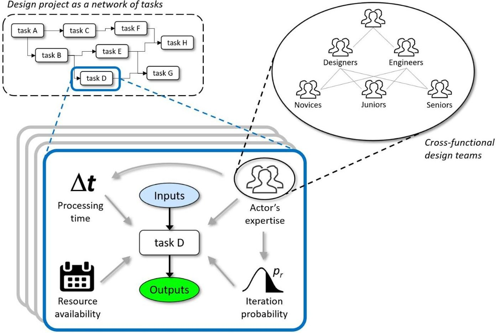

Factors influencing the outcome of a task

Fig. 1. The socio-technical aspects of complexity influencing the performance of design tasks

<!-- PDF_PAGE: 40 -->

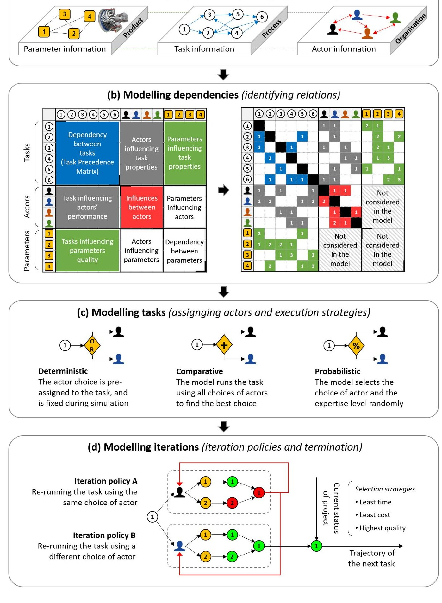

Fig. 2. Overview of the ABS modelling methodology

<!-- PDF_PAGE: 41 -->

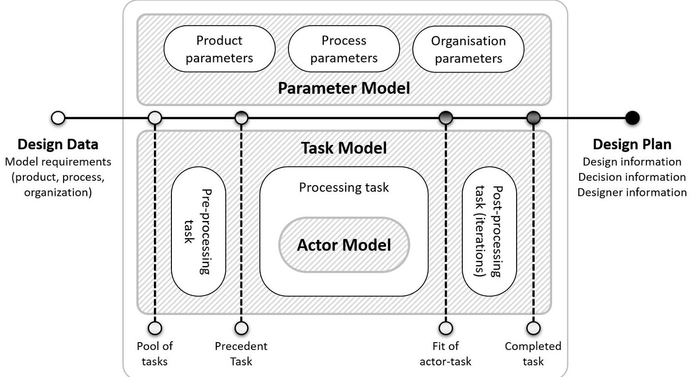

Fig. 3. Core elements of the ABS model and the interplay between them

<!-- PDF_PAGE: 42 -->

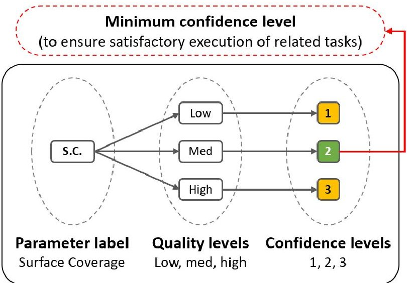

Fig. 4. An example of mapping a product parameter in the ABS model

<!-- PDF_PAGE: 43 -->

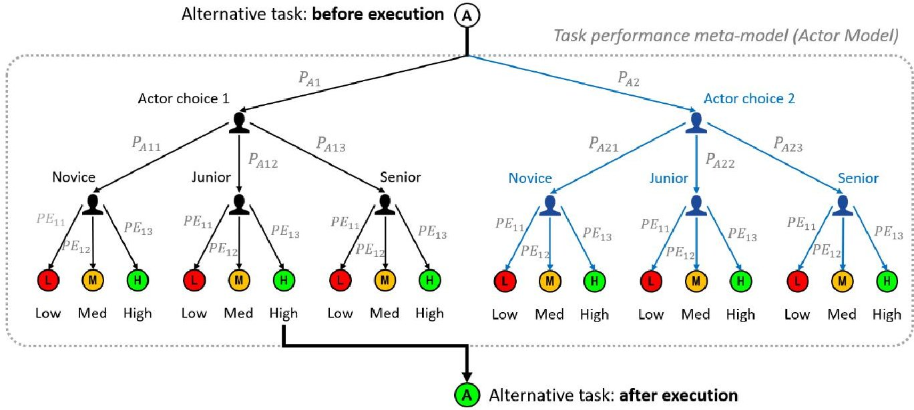

$ P_{A j} $ : Probability of assigning task A to actor j (this probability depends on the task execution strategy)

P Ajk: Probability of assigning actor j with k level of expertise to task A (this probability depends on the task execution strategy)

PEkm: Probability of performing task A at quality level m by expertise level k (the default case in the ABS simulation model is equal to {60%, 30%, 10%}, {20%, 60%, 20%}, and {10%, 30%, 60%} respectively for novice, junior, and senior levels od expertise)

Fig. 5. Functionality of the task performance meta-model (Actor Model) in ABS

<!-- PDF_PAGE: 44 -->

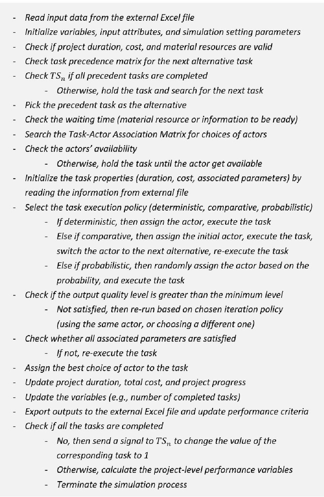

Fig. 6. Summary of the ABS simulation algorithm. This is repeated multiple times for Monte-Carlo simulation

<!-- PDF_PAGE: 45 -->

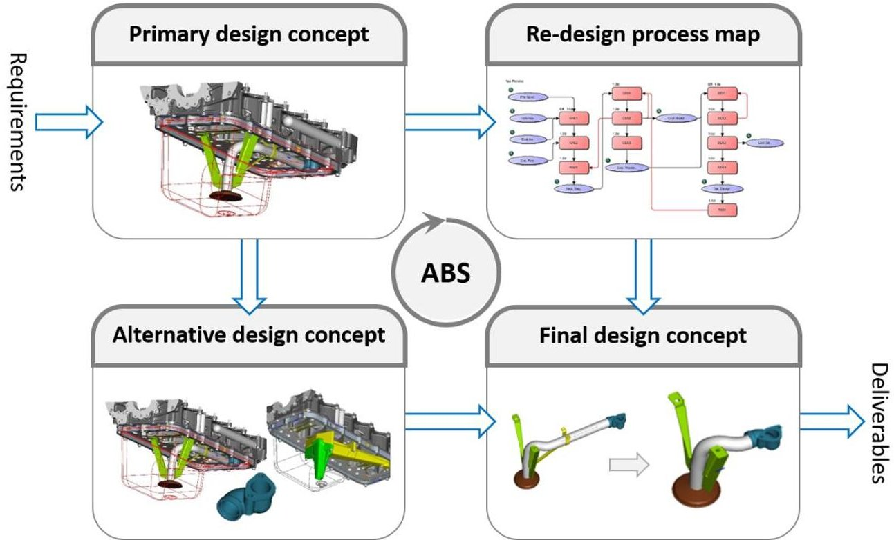

Fig. 7. Concept selection during the re-design process of Engine Oil Pipe

<!-- PDF_PAGE: 46 -->

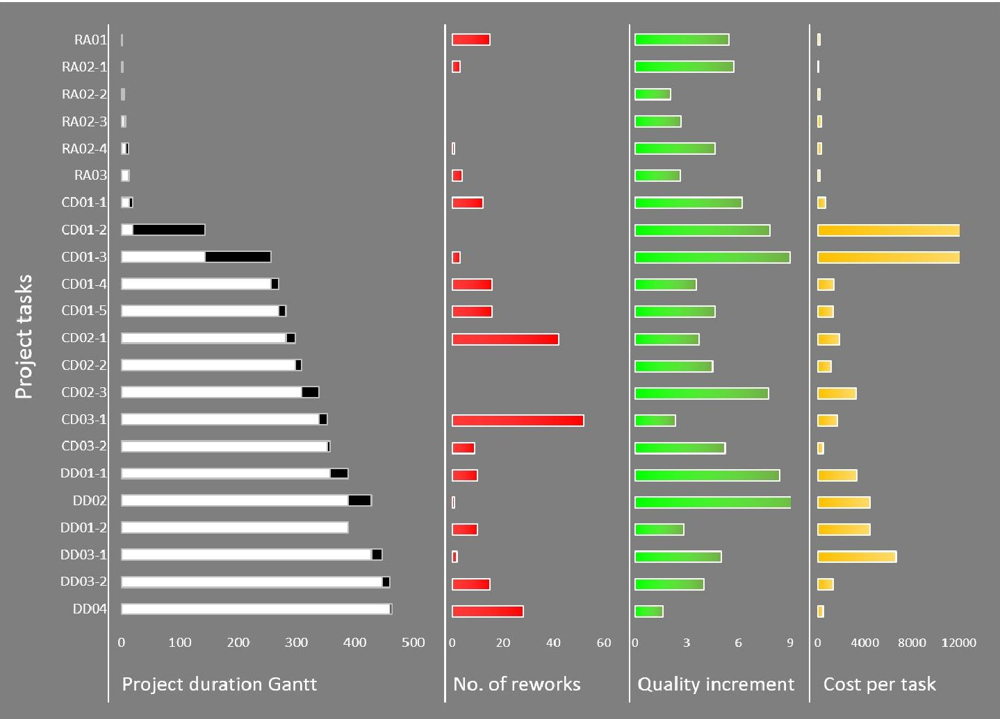

Fig. 8. Simulating Engine Oil Pipe by ABS: task-level project performance based on a single simulation run

<!-- PDF_PAGE: 47 -->

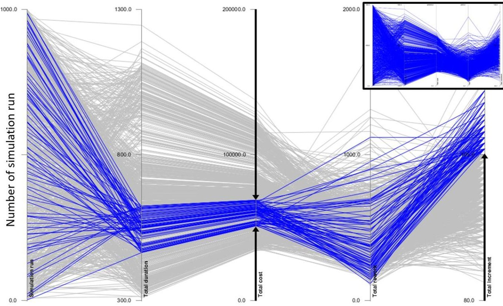

Fig. 9. Simulating Engine Oil Pipe by ABS: overall project-level performance based on 1000 simulation runs

<!-- PDF_PAGE: 48 -->

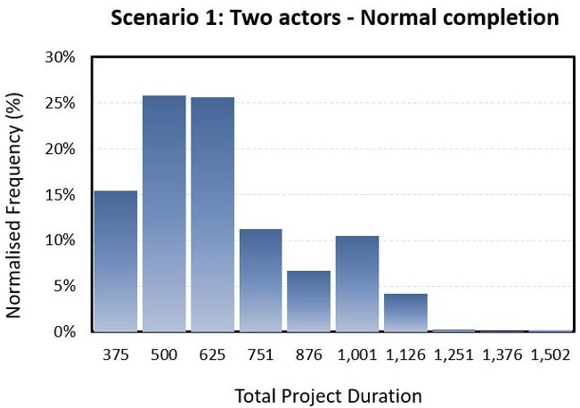

Scenario 2: Two actors - On-time completion

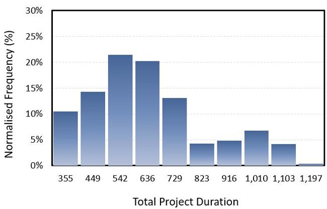

Scenario 3: Four actors - Normal completion

Scenario 4: Four actors - On-time completion

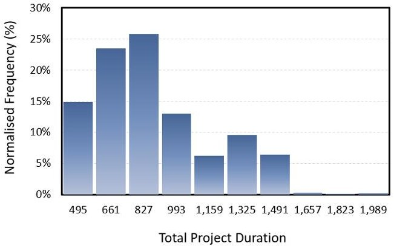

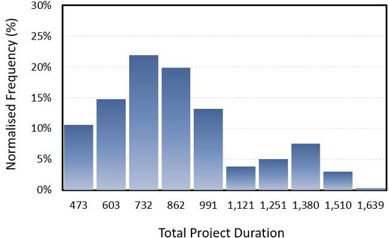

Fig. 10. Populating the impact of different design teams on project duration

<!-- PDF_PAGE: 49 -->

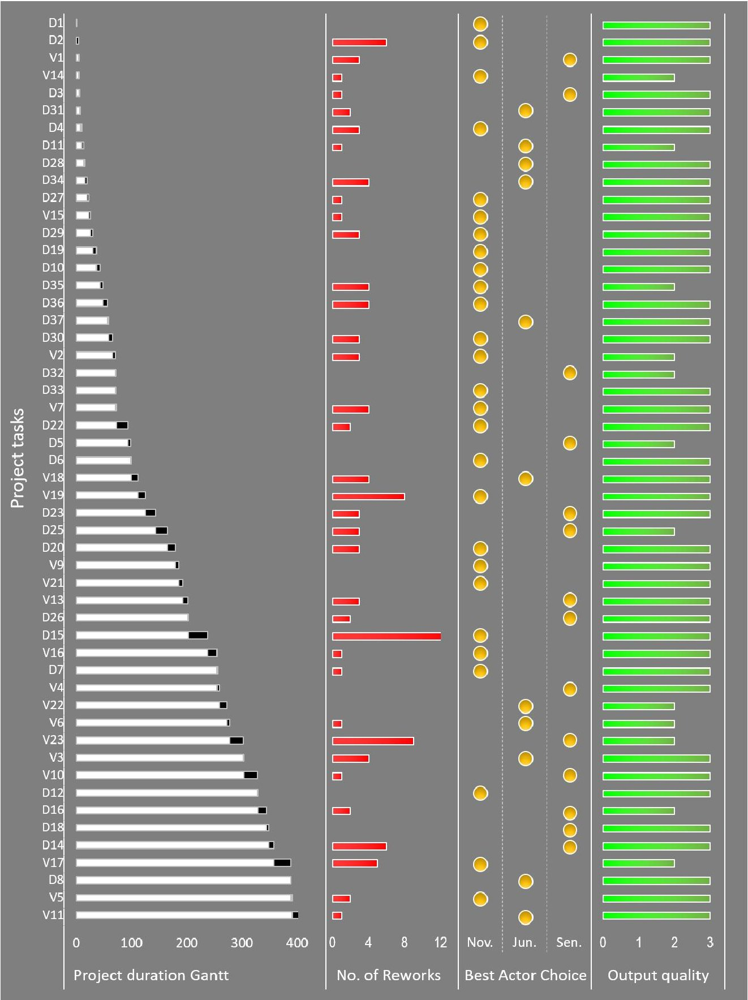

Fig. 11. Simulating Fan sub-system by ABS: task-level project performance based on a single simulation run

<!-- PDF_PAGE: 50 -->

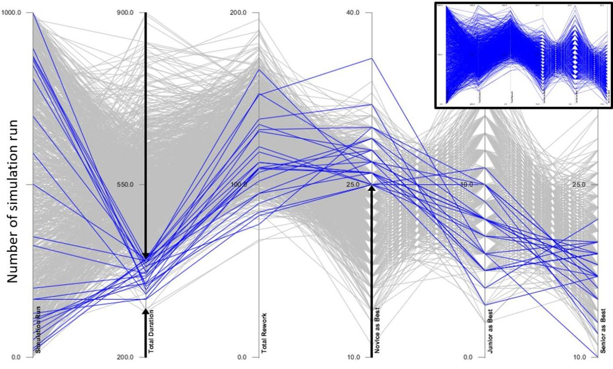

Fig. 12. Simulating Fan sub-system by ABS: overall project-level performance based on 1000 simulation runs

<!-- PDF_PAGE: 51 -->

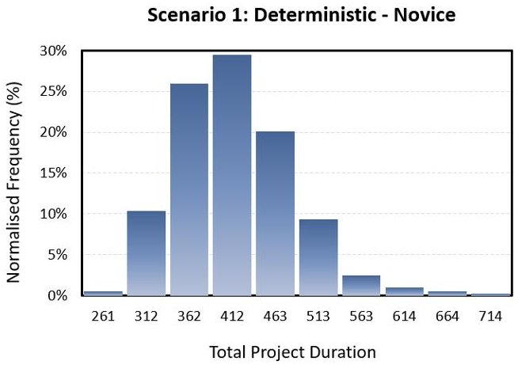

Scenario 2: Deterministic - Junior

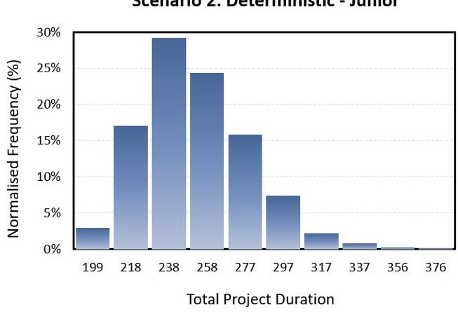

Scenario 3: Deterministic - Senior

Scenario 4: Comparative Assignment

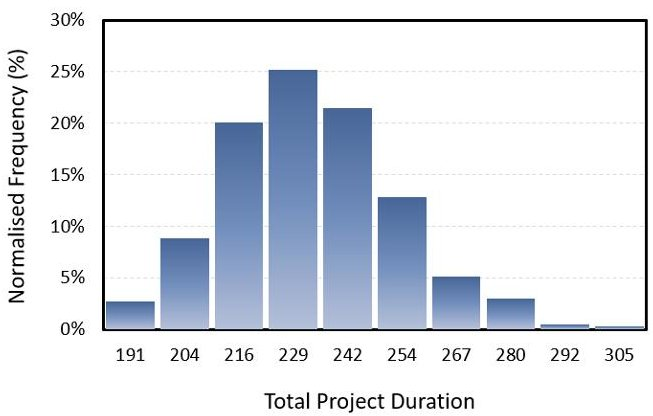

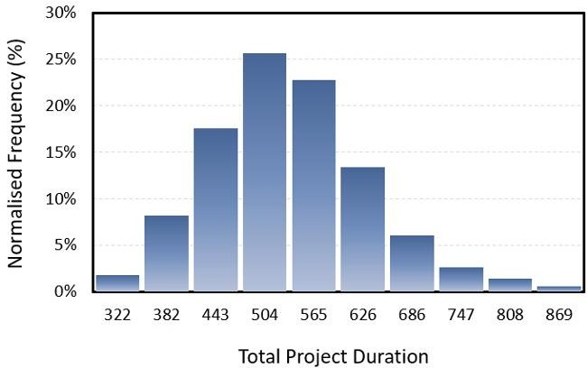

Scenario 5: Probabilistic Assignment

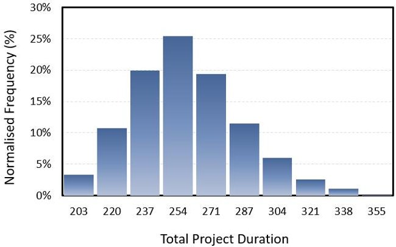

Fig. 13. Impact of deploying different task execution strategies on project duration

<!-- PDF_PAGE: 52 -->

Table 1. The list of modelling inputs and their associated variables in ABS

<table border="1"><tr><td>Model Input</td><td>Formulation in the ABS model</td></tr><tr><td>Task precedence (TPr)</td><td>$TPr_{n}=\prod_{n=1}^{N}TS_{n}=1,\forall n:tasknumber$</td></tr><tr><td>Waiting time for original task(WTO)</td><td>Triangular Distribution，$\forall WTO\in(WTO_{a},WTO_{m},WTO_{b})$</td></tr><tr><td>Execution time for original task(ETO)</td><td>Triangular Distribution，$\forall ETO\in(ETO_{a},ETO_{m},ETO_{b})$</td></tr><tr><td>Project deadline(PDe)</td><td>$PDe\in\mathbb{N}$</td></tr><tr><td>Project available budget(TBu)</td><td>$TBu\in\mathbb{N}$</td></tr><tr><td>Task execution strategy(ES)</td><td>$ES\in\{1,2,3\}\forall1:Deterministic,2:Comparative,and3:Probabilistic$</td></tr><tr><td>Iteration likelihood of original task(ILO)</td><td>$ILO_{n},\forall n:tasknumber$</td></tr><tr><td>Computational resource for each task(CR)</td><td>$CR_{n}\in\mathbb{N}$</td></tr><tr><td>Minimum Confidence Level(MTC)</td><td>$MTC_{ni}\in\{low,medium,high\},\forall i:parameternumber$</td></tr><tr><td>Actors associated with each task(AC)</td><td>$AC_{j}=\prod_{j=1}^{P}AC_{nj},\forall j:actornumber$</td></tr><tr><td>Degree of influence between actors(DInf)</td><td>$DInf_{j}=\prod_{j=1}^{P}Inf_{j},\forall j:actornumber$</td></tr><tr><td>Probability of performing task n at m level of quality(PE_{jk})</td><td>$PE_{jk}\in[0,1],ifES=1$</td></tr></table>

<!-- PDF_PAGE: 53 -->

Table 2. Understanding the performance of design projects: the list of criteria used in the ABS simulation

<table border="1"><tr><td>Performance criteria</td><td>Formulation in the ABS simulation model</td></tr><tr><td>Overall Project-level performance</td><td></td></tr><tr><td>Total number of completed tasks</td><td>TTC=TSn+TSn+1;∀TSn∈{0,1}</td></tr><tr><td>Project progress(completed tasks/total tasks)</td><td>PPr=TTC/n</td></tr><tr><td>Total project duration before reaching the deadline using a pre-defined execution strategy</td><td>TPD=∑n=1N(ETOn+ETRn);∀TPD≤PDe</td></tr><tr><td>Total project cost before reaching the budget using a pre-defined execution strategy</td><td>TPC=∑n=1N(ECOn+ECRn);∀TPC≤TBu</td></tr><tr><td>Total number of reworks per project run using a pre-defined execution strategy</td><td>TPR=∑n=1N(TRen)</td></tr><tr><td>Total increment in quality of tasks using a pre-defined execution strategy</td><td>TTI=∑n=1N TIn;∀TIn=TCni-MTCi</td></tr><tr><td>Utilisation of human resource(number of completed tasks by specific choice of actor)</td><td>URj=∑n=1NBestChoicen=ACjn</td></tr><tr><td>Individual Task-level performance</td><td></td></tr><tr><td>Expected waiting time to perform the task</td><td>WTOn∈(WTOa,WTOm,WTOb)</td></tr><tr><td>Expected processing time to perform the task</td><td>ETOn∈(ETOa,ETOm,ETOb)</td></tr><tr><td>Expected cost to perform the task</td><td>ECOn∈(ECOa,ECOm,ECOb)</td></tr><tr><td>Number of reworks per task</td><td>TRen=TRen+1</td></tr><tr><td>Increment in quality of a task(after execution)</td><td>TIn=TCni-MTCi;∀i∈{1,M}</td></tr><tr><td>Best level of actor&#x27;s expertise for each task</td><td>BestExpertisejn∈{Novice,Junior,Senior}</td></tr></table>