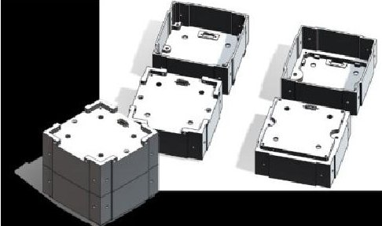

<!-- PDF_PAGE: 1 -->

# ManitobaSat-1: Making Space for Innovation

Amin Yahyaabadi* , Matt Driedger* , Varsha Parthasarathy* , Rishabh Sahani* , Aimee Carvey* , Tamkin Rahman~,

Valorie Platero $ ^{*} $ , Jaime Campos $ ^{*} $ , Philip Ferguson $ ^{\vee} $

* Mechanical Engineering, University of Manitoba, Winnipeg, Canada

Computer Engineering, University of Manitoba, Winnipeg, Canada

NSERC / Magellan Aerospace Industrial Research Chair in Satellite Engineering, University of Manitoba, Winnipeg, Canada

Email: yahyaaba@myumanitoba.ca, matt.driedger@umsats.ca, parthasv@myumanitoba.ca sahanir@myumanitoba.ca, carveya@myumanitoba.ca, rahmant3@myumanitoba.ca,

platerov@myumanitoba.ca, camposj1@myumanitoba.ca, philip.ferguson@umanitoba.ca

Abstract—CubeSat missions provide an excellent, low-cost platform for demonstrating new technologies while raising public awareness for space science and technology. This paper presents novel technologies and design approaches used for the ManitobaSat-1 CubeSat mission including innovative project management and teaming strategies, modularity, technology readiness level advancement, sophisticated test and verification methods, and a comprehensive educational outreach strategy.

Keywords—CubeSat, nanosatellite, satellite, agile, education

## I. INTRODUCTION

While humans have been exploiting space for more than half a century, many space companies have been slow to adopt new technologies, despite considerable advances by prominent Canadian and international space researchers. Fear of the untested has resulted in a general industrial reluctance to incorporate modern engineering technologies such as state of art control algorithms and hardware, smart structures, advanced multi-sensor data fusion, composite manufacturing and other cost-saving advancements that promise to revolutionize our access to space by reducing the cost of engineering development and shortening the time from mission conception to mission execution [1].

The Space Technologies and Advanced Research Laboratory (STARLab) at the University of Manitoba is dedicated to research aimed at improving access to space through innovative technology development, verification, and collaboration. The ManitobaSat-1 program is the first of many CubeSat demonstration platforms that will challenge the norms of the satellite industry to develop, characterize and validate new spacecraft technologies, processes, and sub-systems that will revolutionize the space industry. We aim to improve the accessibility of space, allowing for smaller organizations to benefit from valuable satellite services by improving the development of space technologies. This paper introduces several enabling technologies and methodologies which improves access to space.

## II. SATELLITE OVERVIEW

ManitobaSat-1 is a 3U sized CubeSat mission under development by STARLab at the University of Manitoba in collaboration with York University, the University of Winnipeg, the Interlake School Division and Magellan Aerospace. The mission contains three primary purposes: The Geological Sample Exposure Mission, the Gnomon

Educational Outreach Mission, and the CubeSat Control Technology Demonstration Mission.

## A. Geological Sample Exposure Mission

The Geological Sample Exposure Mission will expose a set of geological and lunar samples to the space environment while observing changes in their optical reflectance over time. Measuring this change will provide data on how spaceweathering factors such as solar heating, vacuum desiccation, and solar wind bombardment change the optical properties of asteroids and other celestial bodies over time [2].

Presently, characterizing space weathering is a major challenge which restricts our ability to relate specific meteorite samples to asteroids which are still in space [3]. This is because weathering changes the optical properties of in-space bodies, but these weathered surfaces are significantly modified by entry into Earth's atmosphere.

The best method for determining the surface composition of asteroids and other celestial objects is spectroscopic analysis, which compares the optical properties of astromaterials and simulants measured on Earth to bodies observed in space [3][4]. However, space weathering introduces a large amount of uncertainty into this analysis and hinders our ability to determine the surface composition of asteroids and other space objects [3]. Studying how geological samples are affected by a space environment will allow us to relate the composition of asteroids, as seen by spacecraft and telescopes, to in-lab samples and will enhance other exploration missions, including the OSIRIS-Rex asteroid sample return mission [5]. To measure the change in sample optical reflectance over time, ManitobaSat-1 includes a sample plate containing vacuum sintered geological and lunar samples. Commercial imagers will characterize the samples' reflectance as it changes over time.

## B. Gnomon Outreach Mission

The Gnomon Outreach Mission is an educational outreach activity in partnership with the Interlake School Division, located just north of Winnipeg, Manitoba Canada. Middle and high school students from the school division are developing a gnomon to act as a pointing indicator for our Geological Sample Exposure Mission. A gnomon is a measurement device that indicates time or direction by the position and length of its shadow. Typically, gnomons are used in sundials but they have also been included in space missions such as the MarsDial on the Spirit and Opportunity Mars rovers to determine the sun

<!-- PDF_PAGE: 2 -->

vector [6]. Our gnomon will be used to determine the geological sample illumination conditions by measuring the gnomon shadow's length and direction.

The ManitobaSat-1 program will expose students participating in the Gnomon Outreach Mission to modern space systems design strategies, concepts, and equipment. As key members of the design team, the Interlake students work closely with the University research teams as well as our industrial partner, Magellan Aerospace, to design, build, test and ultimately operate their gnomon during the mission, providing unparalleled experiential learning.

## C. CubeSat Control Technology Demonstration Mission

A key cost and schedule driver for many small space missions is the selection and procurement of accurate thermal, navigation and pointing sensors that can fit on a CubeSat. The CubeSat Control Technology Demonstration Mission consists of two experimental sun sensors, three electromagnetic torque rods, and 3D-printed thick-film heaters.

ManitobaSat-1's sun sensor design is a novel low-cost CubeSat-class sensor employing two orthogonal arrays of photodiodes with a slit pattern for enhanced sensing and calibration precision [7]. Two sun-sensors from York University will provide fine-pointing sun direction telemetry to within 0.1 degrees accuracy.

York University's Microfabrication facility (part of the Suborbital Payload Research Centre - SPaRC) is fabricating the sun sensors and torque rods for ManitobaSat-1. This facility allows for the end-to-end production of advanced materials and miniaturized payloads for orbital and suborbital platforms. The SPaRC micro-fabrication laboratory is specifically configured to enable space research and payload technology development activities, such as the pointing control equipment for ManitobaSat-1.

The heaters used on ManitobaSAT-1 will be 3D printed thick film heaters provided by Datec Coatings. The Datec heaters are inexpensive, customizable, and provide quick response and extremely accurate temperature control. ManitobaSAT-1 will demonstrate the viability of this heater technology in space, thereby advancing their technology readiness level from 4 to 9.

## II. ENABLING TECHNOLOGIES FOR SPACE

In addition to the submissions of the ManitobaSat-1 program (described above), our team is exploring other new and at, at times, disruptive technologies that aim to bring more efficiency and reliability to small space programs. The following subsections describe these innovative aspects of ManitobaSat-1:

## A. Innovative Project Management Strategies

Project management is critical to fostering a high-paced and responsive satellite engineering project. Traditionally, the role of project management has been to put processes in place that prevent failures and delays [8]. These processes have been quite rigid in the past which tended to curb creativity. As such, the ManitobaSat-1 team is experimenting with unconventional

techniques of documentation and collaboration methodologies from other industries.

Documentation: Designing a satellite spans across multiple engineering disciplines, closely interlinked and integrated as a whole system, making coordination and documentation tedious and time-consuming. In pursuit of new Concurrent Engineering methods [9] and an Agile philosophy for communication and schedule management [10], we document the ManitobaSat-1 project using web-based tools.

The ManitobaSat-1 team uses a website for compiling project information into a Wikipedia-like format, making it easy to access information in a familiar manner for all team members. Although it may appear simple, it is a new "information-pull" method that simplifies knowledge transfer for new team members and gives thorough insight for external viewers. The ManitobaSat-1 team continually updates the website which timely informs collaborators of design choices and interfaces. The website also communicates our progress and upcoming activities. Important information, such as the risk registry, system-level design, mission operations concepts, sub-system design, important contacts, outreach programs, and requirements can be found by the whole team.

Agile project management: Small satellite development processes must remain agile to efficiently respond to new technologies and changing requirements as the mission evolves. This is in stark contrast to traditional space programs whose project inertia makes them reluctant to new directions, even if they might benefit the mission. As a result, the ManitobaSat-1 team sought out a management approach where changes can be easily accommodated and implemented even when it affects design processes at the system level. An iterative process like Agile project management provides this flexibility as part of this ManitobaSat-1 project.

While Agile development and management methods have been used on a large scale in the Information Technology (IT) sector, ManitobaSat-1 is one of the first projects to apply Agile methodologies to a space engineering project. Most spacecraft projects end up following the traditional waterfall design process. Researchers have associated the waterfall methodology with "requirement freezing" very early in the development life cycle, making the project inflexible and unable to respond to changing requirements and/or use cases. Also, high costs and efforts seem to be a major downside to the waterfall design process [11].

In contrast, the ManitobaSat-1 project manager is constantly paying attention to technical excellence and design decisions to boost agility. Each sub-system lead focuses on their design and implementation while building interfaces for smooth integration. The risk registry and requirements are reviewed regularly to update them according to any changes at the system, subsystem or component level. This allows the team to reflect on any issues, learn from them and adjust its engineering strategy at regular intervals.

In keeping with our Agile philosophy, we are following a Spiral Product Development model [12]. Using this spiral model, subsystems are developed iteratively with more frequent prototyping to identify design shortcomings and

<!-- PDF_PAGE: 3 -->

increase quality. Our team embraces the "fail fast" mantra, leading to multiple and rapid design/test/iterate cycles. To this end, we are embracing 3D printing and frequent prototype development throughout our design process.

Playbook: To effectively provide agility to the ManitobaSat-1 project, the team has adopted a tool called Playbook - a project management platform that provides visibility to invisible work and guidance in the Agile philosophy and methods. The ManitobaSat-1 team uses Playbook's Kanban user interface to track the tasks performed by every team member and the team as a whole, highlighting the critical path, identifying potential blocks and monitoring activities. With frequent reminders from the software via email and calendar alarms, our team ensures optimal coordination while minimizing missed milestones.

The project manager and system leads are aware of what each subsystem lead is working on and directing the team's priorities for holistic project oversight. At a subsystem level, Playbook allows each member to plan, prioritize and execute their own tasks. The high-level project schedule reflects the changes team members make in real-time. Every week, the team reviews the near-term project schedule to assess project feasibility, making changes to ensure priorities and tasks are clear for everyone.

Playbook aids in prioritizing tasks according to imminent deadlines and informing team members of expectations and concurrent work, visualizing all real or potential task blockages, preventing time mismanagement and improving communication. The team also holds short, 5-minute meetings (known as 'huddles') every day on Playbook to review everyone's task loading. Playbook hosts these meetings online, enabling team members to participate from anywhere. The huddles facilitate optimal workload distribution and foster frequent team communication.

## B. Teaming Strategies and Educational Outreach

The ManitobaSat-1 project is a collaborative effort between various universities, along with industry and elementary school students to establish an effective and versatile team. In order to achieve a well-rounded mission objective and a robust spacecraft design, we draw upon each collaborator's strengths and responsibilities. Three universities in Canada (the University of Manitoba, the University of Winnipeg and York University) are collaborating to provide mission oversight, scientific guidance, and controls equipment. Inter-university collaboration strengthens the team by fostering a wide breadth of expertise while enabling depth where required (e.g., in the area of space geology).

Industrial participation through Magellan Aerospace strengthens the already strong partnership between the University of Manitoba and the Canadian aerospace industry. Dr. Ferguson (ManitobaSat-1 PI) holds the NSERC / Magellan Aerospace Industrial Research Chair in Satellite Engineering, which brings with it a tight coupling between the space engineering staff at Magellan and the researchers in STARLab. Through this existing partnership, the University of Manitoba and Magellan developed a jointly-owned spacecraft assembly and test facility (including a cleanroom,

vibration table, and thermal vacuum chamber) that the ManitobaSat-1 team will use. Access to these facilities is not common for CubeSats, as the costs of performing these tests or accessing a clean room can be prohibitive to a typical CubeSat budget. This industrial/academic alliance exposes Highly Qualified Personnel (HQP) to real space-systems engineering, providing valuable engineering and research experiences to support future careers.

A major component of the ManitobaSat-1 program is outreach. Spearheaded by the Interlake School Division in Manitoba, the ManitobaSat-1 team has dedicated an entire sub-team to facilitate public engagement and involve students at all educational levels in the spacecraft development process. The elementary students are not merely observers of ManitobaSat-1 they are integral members of the design team. In addition, we have planned educational programs for the Ontario Science Centre and the Manitoba Museum that aim to raise public awareness of the Canadian CubeSat Program and space science/engineering in general. A province-wide competition is kicking off early in 2019 to formally name ManitobaSat-1 and design the mission patch.

## C. Advanced Test and Verification methods

Space technology development has long been hampered by the need to thoroughly verify and qualify space technology prior to commercial deployment. The CubeSat philosophy promotes inexpensive designs and hardware, while simultaneously enabling and verifying boundary-pushing technology. To this end, the ManitobaSat-1 team has adopted a number of modern verification methods that sufficiently derisk new components while encouraging innovation and advancement in the Canadian space industry.

A key challenge with control system development for satellites is performance verification on representative hardware. Satellite engineers rely on high-fidelity simulation to ensure adequate performance. In extreme cases, the parabolic flight has been used to mimic microgravity, however, those experiments are costly, difficult to schedule, and can only last for approximately 25 seconds at a time. A UAV-based testbed located in the STARLab with an intuitive software interface for rapidly prototyping and validating new control technologies supports easy and inexpensive control systems research. This testbed enables systems designers to define custom dynamics that the drones will exhibit (e.g., continuous microgravity). Gimbals mounted below the drones facilitate three-axis rotational motion for small spacecraft. Drones will carry duplicates of the ManitobaSat-1 controls avionics, enabling real hardware-in-the-loop testing [13].

Modern thermal simulation tools are an excellent and qualified way to evaluate the thermal performance of the spacecraft. The ManitobaSat-1 team will use the NX Space Systems Thermal software package which is popular in the space industry. Heavy reliance on simulations for thermal subsystem requirement verification reduces or eliminates the need for thermal vacuum thermal characterization when combined with wide thermal design margins.

<!-- PDF_PAGE: 4 -->

## D. Modularity and Design-For-Reuse

Presently, there is a trend amongst CubeSat developers to redevelop spacecraft subsystems for each new mission. While numerous subsystem vendors are available if a team wishes to purchase units, these are often too expensive for university teams. Open source designs are available but are often difficult to integrate due to the lack of interface standards.

To this end, the ManitobaSat Team has is chosen to embrace the University of Manitoba Space Applications and Technology Society (UMSATS) inter-module interface standard [14]. Using this interface (Fig. 1), we have segmented the spacecraft into computer, payload, control, and power modules. By using a common mechanical, electrical and software interface between modules, we aim to make our subsystems easier to integrate into future missions, enabling easier collaboration and less redevelopment for future spacecraft. Additionally, using this system aids assembly, integration, and testing by allowing for concurrent testing and simulation of subsystems through the common interface.

Fig. 1. Modular structure using the UMSATS inter-module interface

This modularity and design-for-reuse concept extends beyond the structure and harnessing into the development of our command and data handling subsystem and flight software. Selecting and designing the onboard satellite computer is a trade between performance, power consumption, and size. ManitobaSat-1 uses the Microsemi Smartfusion2 System on a Chip (SoC) as the main processing unit, providing a compact, powerful and flexible, single-event upset-immune and ultra-low power platform rarely used in space. This processing unit consists of two modules: (1) The ARM Cortex-M3 which runs the software; and (2) the FPGA fabric that supports custom cores for specific applications, such as image analysis for our payload.

The computer's modularity also facilitates several reliability enhancements. We have employed a new magnetically-based non-volatile memory known as MRAM which is intrinsically immune to single event upsets and has unlimited and fast Read/Write cycles (unlike FLASH and FRAM [15]). Additionally, single and double error correction schemes are used in the Work memories along with a triple-voting architecture for improved data integrity.

To add to reliability, keep the subsystems modular and reduce the harnessing, we use a CAN Bus interface within the FPGA fabric. This modular design also makes it easy to verify inter-subsystem communication with a test tool designed to mimic the CAN messages.

also modular, abstracting out the hardware logic. This approach makes the software easier to test and reuse. In addition, in order to simplify the software design and implementation, we use FreeRTOS as the real-time operating system while employing middleware (ARM-CMSIS) for controlling peripherals.

Since the software design is tightly coupled with the design of other subsystems, the ManitobaSat-1 software is

## IV. CONCLUSION

As discussed throughout this paper, the ManitobaSat-1 mission includes many aspects that push the boundaries of space technology. Innovative teaming strategies and verification methodologies, combined with Agile project management, considerable community outreach and HQP training avenues all make ManitobaSat-1 much more than just a satellite. The ManitobaSat-1 program challenges almost every aspect of satellite development in a disruptive, yet technically responsible manner. By exploring and adopting new technologies in the space industry, we will make space more accessible to everyone.

## REFERENCES

[1] P. Ferguson, "Making Space For Everyone: A Research Program Aimed At Breaking Down Barriers To New Technology Adoption In Space," in Canadian Aeronautics and Space Institute, 2019.

[2] C. M. Pieters and S. K. Noble, "Space weathering on airless bodies," J. Geophys. Res. Planets, vol. 121, no. 10, pp. 1865-1884, Oct. 2016.

[3] R. Brunetto, M. J. Loeffler, D. Nesvorny, S. Sasaki, and G. Strazzulla, "Asteroid Surface Alteration by Space Weathering Processes," in Asteroids IV, Tucson: University of Arizona Press, 2015, pp. 597-616.

[4] B. Hapke, "Space weathering from Mercury to the asteroid belt," J. Geophys. Res. Planets, vol. 106, no. E5, pp. 10039-10073, May 2001.

[5] D. S. Lauretta et al., "The OSIRIS-REx target asteroid (101955) Bennu: Constraints on its physical, geological, and dynamical nature from astronomical observations," Meteorit. Planet. Sci., vol. 50, no. 4, pp. 834-849, Apr. 2015.

[6] W. Sullivan and J. B. Report, "The MarsDial: a sundial for the red planet," Planet. Rep., vol. XXIV, no. 1, pp. 6-11, 2004.

[7] U. Bindra et al., "DESCENT: Mission Architecture and Design Overview," in AIAA SPACE and Astronautics Forum and Exposition, 2017.

[8] S. Spalek, "Traditional vs. Modern Project Management Methods. Theory and Practice," in Smart and Efficient Economy, 2016.

[9] X. Koufteros, M. Vonderembse, and W. Doll, "Concurrent engineering and its consequences," J. Oper. Manag., vol. 19, no. 1, pp. 97-115, Jan. 2001.

[10] M. Hummel, C. Rosenkranz, and R. Holten, "The Role of Communication in Agile Systems Development," Bus. Inf. Syst. Eng., vol. 5, no. 5, pp. 343-355, Oct. 2013.

[11] W. Van Casteren, The Waterfall Model and the Agile Methodologies: A comparison by project characteristics - short. 2017.

[12] B. Boehm, "A spiral model of software development and enhancement," ACM SIGSOFT Softw. Eng. Notes, vol. 11, no. 4, pp. 22-42, Aug. 1986.

[13] A. Yahyaabadi and P. Ferguson, "A multi-vehicle drone testbed for space systems and remote sensing verification," in ASM - Articnet conference, Ottawa, Dec. 2018

[14] M. Driedger, M. Mike Lambeta, M. Graham Rigby, M. Marc Roy, P. Glowacki, and A. Byagowi, "Design of a Modular Nanosatellite System for T-SAT3," in International Astronautical Congress, 2016.

[15] Everspin, "MRAM Replaces FRAM (FeRAM) | Everspin." [Online]. Available: https://www.everspin.com/mram-replaces-fram-feram.