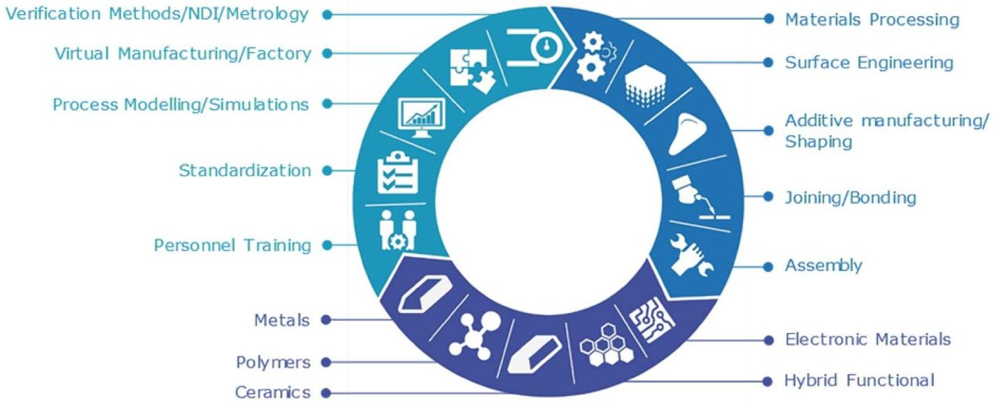

<!-- PDF_PAGE: 1 -->

EDITORIAL

# Advanced manufacturing for space applications

Andrew Norman $ ^{1} $ $ \cdot $ Shumit Das $ ^{1} $ $ \cdot $ Thomas Rohr $ ^{1} $ $ \cdot $ Tommaso Ghidini $ ^{1} $

Published online: 10 November 2022

$ \textcircled{c} $ The Author(s), under exclusive licence to Council of European Aerospace Societies 2022

It is a great pleasure for us to present this special issue of the CEAS Space Journal on the topic of advanced manufacturing for space applications. This editorial explains the history and background of the advanced manufacturing initiative since its introduction as a cross-cutting technology theme in 2015. It also summarizes the major achievements to date, and provides an outlook on the future of the program.

## 1 Origins of the advanced manufacturing program

Since the beginning of the space era, materials and manufacturing processes have proven to be enabling and in many cases have led to game changing technologies for all major achievements in space exploration and lately settlement missions. They are exposed to stringent requirements coming from highly demanding and hostile mission operating environments. The challenges already start on Earth, during assembly, manufacturing, transport, storage and qualification testing. Lift-off and launch phases generate significantly high vibrations, acoustic and shock levels, and thermal fluxes. Once in orbit, materials and structures are exposed to a thermal environment that is often in the range of $ - 1 8 0^{\circ} \mathrm{C} $ to $ + 1 8 0^{\circ} \mathrm{C} $ , in the presence of solar/cosmic radiation and charged particles, vacuum and space debris (micrometeoroids or orbital debris) as well as atomic oxygen in the Low Earth Orbits. Extremely low or extremely high temperatures and increased thermal excursions may occur in Extraterrestrial planetary exploration missions, where landing probes and robots (and crew vehicles in future) must endure extremely high re-entry fluxes and dynamic pressures. Lately a further requirement has been imposed to all European satellites and launcher upper stages, which shall be

disposed by atmospheric re-entry at the end of their operational life. Materials demisability becomes a key driver for achieving the design for demise of spacecraft and launchers structures. And all must be achieved, while ensuring the overarching and omnipresent need for low mass, high reliability and low production volumes [1].

The challenges described above are coupled with a limited leverage on materials supply chains, and low volume production with highly specialized manufacturing processes due to complex geometries or special material properties. In the past, this has led the supply chain landscape of Europe to be very rigid with only limited opportunities for designers to break the barriers of innovation. In addition, the requalification of new manufacturing processes or materials entails major non-recurrent cost for the space project and consequently, the supply chain is dominated by established players with heritage manufacturing concepts. European legislation, such as REACH (Registration, Evaluation, Authorisation and Restriction of Chemicals) and RoHS (Restriction of Hazardous Substances Directive), further restricts this already challenging supply chain, reducing the availability of suitable and sustainable technologies. Consequently, safer and environmentally more sustainable materials and processes solutions must be adopted for space missions manufacturing, while ensuring an equivalent or improved performances during operation. Lately, larger production volumes are required for satellite constellations (particularly in the Navigation, Earth Observation and Telecommunication markets) as well as the manufacturing of launch vehicles. In both cases, the traditional low volume set-up of space hardware production is shifting toward larger manufacturing capabilities, requiring lower costs, shorter lead times, and COTS (Components off the shelf), that can be realized through highly automated facilities.

To address many of these challenges, the Advanced Manufacturing Cross-Cutting Initiative [2] was introduced by the European Space Agency (ESA) in 2015. It has the central aim of enabling the European space industry to create new high performance space products by actively reducing the limitations induced by the traditional manufacturing

<!-- PDF_PAGE: 2 -->

technologies and processes. This cross-cutting initiative is designed to complement the other ESA initiatives Design to Produce (D2P) [3] and Clean Space [4]. The advanced manufacturing cross-cutting initiative is expected to achieve several benefits. First, industry will be able to take advantage of design freedom, and enable design for performance, leading to significant cost savings and lead-time reduction. Second, it is anticipated that multi-sectorial cross-fertilization will be fostered, facilitating spin-in/out opportunities across different high-end technology and industrial domains, and infrastructure, opening new fields of innovation. Third, it will promote the creation and dissemination of design as well as verification, qualification, and standardization methodologies. This will mature the market and its uptake, or even create new market opportunities. Finally, it will increase the manufacturing competence of established stake-holders, and also lead to increasing involvement and growth of Small and Medium Enterprises (SME's), securing European technological independence and create, develop and retain highly qualified personnel in Europe.

## 2 Outreach to the European space community

Since the implementation of the program, there have been a number of important announcements. In November 2016, the concept of Space 4.0 was introduced together with ESA's digital agenda for space [5]. Practically all space applications have expressed the need for more flexibility to adapt late in the space system design and development process to new requirements and the availability of new technologies. The Advanced Manufacturing Cross-Cutting Initiative has consolidated, aligned and maintained its strategy up to date with all major European stake-holders, starting with the space industrial primes, Large System Integrators (LSI) and SME's, and including research centers, academia and national space agencies.

This was achieved through dedicated workshops that not only provided an update of state-of-the-art, but to invite all stake-holders to contribute with their insight and vision to develop a common strategy. The first workshop in 2019 was the starting point to introduce the concept of smart manufacturing, which refers to the use in industrial production of interconnected, digital technologies. Digitalization enables an additional paradigm shift not only enhancing the original goals, but also to enable unprecedented agility and adaptability of manufacturing processes. The second workshop in 2021 followed the same logic, introducing again a new theme of Out-of-Earth Manufacturing. This covers new capabilities to manufacture parts on orbit to realize infrastructure enabling novel capabilities and services not accessible through traditional launch services. It also covers the

technologies to build infrastructure and habitation on moon and planetary surface for future exploration missions. The last event in this series was the 1st International Conference on Advanced Manufacturing for Air, Space and Land Transportation in 2022. This conference was co-organized by ESA and NASA and will be continued as biannual event.

In 2021, the ESA Technology Strategy document was issued [6] which identified a number of high level targets. This includes:

- 30% improvement of spacecraft development time by 2023 through the implementation of a fully digitized workflow (early concept to integration and testing),

- increased flexibility scalability and adaptability through modular space system designs,

- 30% faster development and adoption of said innovative technologies into spacecraft production,

- an order of magnitude of cost efficiency with every space system generation,

- a more responsible and sustainable use of space is pursued, targeting at inverting European contributions to space debris by 2030.

## 3 Smart manufacturing (the drive toward digitalisation)

The engineering part of the general digital transformation is described in ESA's digital agenda for space [6]. Practically all space domains have expressed the need for more flexibility to improve the agility in space system design, development, and verification. This flexibility is required to react quickly to market needs and infuse new technologies faster into space systems. This includes the full modelization of products and services from the early design phases, and to be able to anticipate and react to changes in the systems in which their services are integrated.

The transition to a full digital engineering workflow needs to be based on trusted, authoritative data sources shared among the full supply chain on a need to know basis. The full digitalisation and the transition to model-based system engineering is also a key enabler to increase the opportunities for in orbit demonstration and verification. The technology requirements from space transportation, dictated by needs for increased price competitiveness, and to be achieved via enhanced versatility and low-cost production, equally call for the full introduction of digital engineering in the transportation system engineering workflow.

With the objectives of advanced manufacturing to improve design freedom, performance, cost, or lead time of production, digitalization enables an additional paradigm shift not only enhancing the original goals, but also to enable unprecedented agility and adaptability. In this context, the

<!-- PDF_PAGE: 3 -->

term smart manufacturing is used. It refers to the use in industrial production of interconnected, digital technologies that enable new and more efficient processes, and which in some cases yield new goods and services. The associated technologies are many, from developments in machine learning and data science, which permit increasingly autonomous and intelligent systems, to low-cost sensors, which underpin the Internet of Things (IoT), to new control devices that make second-generation industrial robotics possible [7-10].

Smart Manufacturing enables all information about the manufacturing process to be available when it is needed, where it is needed, and in the form that allows systematic analysis and feedback across entire manufacturing supply chain. This will necessitate the intensified application of advanced intelligence systems to enable rapid manufacturing of new products, dynamic response to product demand, and real-time optimization of manufacturing production and supply chain networks.

Furthermore, unprecedented data acquisition during manufacturing and subsequent data manipulation capabilities are allowing the generation of high fidelity digital twins. With real-time physical data fed into a virtual testing environment, significant reduction of time to market and costs as well as improvement in part reliability can be realized. The test pyramid is progressively reducing the physical elements getting more and more hybrid, with physical and digital testing (under validation) building blocks. New qualification routes, personnel training and standardization approaches shall be matured accordingly, to ensure a safe and reliable market uptake in the digital domain.

## 4 Out-of-earth manufacturing

A further and highly strategic paradigm shift introduced by the Advanced Manufacturing program is what has been defined as the Out-Of-Earth (OOE) Manufacturing program. The ability to manufacture spacecraft and associated hardware in orbit as well as moon and planetary surfaces has the potential to generate a profoundly transformative impact on a wide range of space activities.

On-orbit manufacturing, by alleviating fairing size limitations and launch load structural requirements, can lead to larger spacecraft components (e.g., antennae reflectors, solar arrays, radiators) thereby enabling higher performance higher power available for payloads and lighter structures while reducing the launch costs and logistics. Such capability can lead to novel servicing and maintenance approaches, including repair and recycling of entire un-operational spacecraft (e.g. to be transferred to the Moon and used as construction material), lifetime extension and new business models for space assets. These benefits can enhance mission scenarios for various applications, including

Telecommunications, Earth Observation, Navigation and Science.

In addition, in situ manufacturing and recycling capability enables on-demand production of tools and hardware used during long-term exploration missions, thereby reducing the dependence on cargo missions and the amount of supplies to be carried from Earth. Recent developments in relevant manufacturing and assembly technologies, as well as ongoing progress toward on-orbit servicing and active debris removal have generated a vibrant context for the development of in-space manufacturing technologies, with several processes being tested and on-orbit demonstrations of spacecraft parts manufacturing scheduled for the next few years.

While several past and ongoing ESA studies look at the system-level impacts of in-space manufacturing, the identified benefits are dependent on the development of manufacturing technologies able to produce the targeted parts and structures in the challenging space conditions. Through Out-of-Earth Manufacturing, ESA aims to foster and support the development of manufacturing and assembly technologies adequate for implementation in space. The contexts of application on in-space manufacturing include:

- Manufacturing in a controlled environment i.e., in a pressurized module on orbit (microgravity) or on a planetary body (reduced gravity): this could include manufacturing in the context of an orbital station or a lunar/Martian base;

- On-orbit manufacturing in an uncontrolled environment: this could include manufacturing of spacecraft parts (e.g., solar array, antennae) on orbit;

- In situ manufacturing in an uncontrolled environment on a planetary body: this could include manufacturing and construction of structures in a lunar or Martian settlement.

## 5 Structure of the program and papers published as part of this special edition

The technology program is primarily divided into five pillars, as shown in Fig.1.

## 5.1 Shaping (additive manufacturing; forming)

The domain of shaping is wide ranging and includes topics, such as advanced forming, spin forming, incremental flow forming, magnetic pulse forming, near net shape and precision casting. However, by far the most dominant technology to be developed in this area is that of additive manufacturing (3D printing). Additive manufacturing has the potential to change how future space products are designed, integrated and operated. The technology

<!-- PDF_PAGE: 4 -->

Fig.1 A schematic diagram of the advanced manufacturing program. The manufacturing processes are grouped in five main categories (blue, top right) and are applied to five main materials categories

encompasses a wide range of techniques and materials for building solid parts by adding material in layers upon layers. With additive manufacturing, each part is built by placing material where it is necessary to obtain a fit-forpurpose hardware, instead of removing large quantities of material from a bulk block, as performed by traditional (subtractive) manufacturing technology. The additive manufacturing process comprises both direct methods where parts are built using the desired material, and indirect methods where molds or preforms are built and used for making the final part.

Additive manufacturing will enable design for performance, mass customisation, and allow a full digital workflow facilitating integrated design adaptations. At the same time, the process offers substantial benefits in design and manufacturing costs, lead time, and assembly effort, and offers design solutions for multi-functional performance. Additive manufacturing will also provide an environmentally friendly alternative to conventional machining through more economic use of raw materials (e.g., reduced waste) and is considered as key enabling technology for miniaturization of complex small systems (e.g., propulsion systems for nano-satellites, and RF equipment). Furthermore, additive manufacturing is a key technology allowing production under limited resources including In-Situ Resource Utilization for human exploration missions, and In-Orbit manufacturing. There is general consensus among stake-holders of the European Space community, that this technology is a key enabler for their future production. The papers published on the topic of shaping in this special edition are:

(dark blue, lower center). The disciplines shown in light blue (upper left) are equally applicable to all processes and materials

- P. Martín-Iglesias et al. "Metal 3D printing for RF/microwave high-frequency part"

- B. Bonvoisin et al. "Additive manufacturing based bellows"

- L. Kiener et al. "Compliant mechanism based on additive manufacturing"

- J. Schneider et al. "Additive manufacturing of a metallic optical bench—process development, material qualification and demonstration"

- Makaya et al. "Towards out of earth manufacturing: overview of the ESA materials and processes activities on manufacturing in space"

- M. Rinaldi et al. "Additive manufacturing of polyether ether ketone-based composites for space application: a mini-review"

## 5.2 Electronic assembly (HDI printed circuit boards; printed and embedded electronics)

The miniaturization of the circuit in Printed Circuit Boards (PCBs) is generally named High Density Interconnect (HDI) technology, which enables more functions per unit area. It specifically requires various advanced manufacturing processes, materials and test methods, and it can lead to newly discovered failure mechanisms, which need to be assessed. In addition, more complex component functionality with large package size and high number of interconnects and constantly increasing clock speed of processors require advanced PCB technologies. The circuit on the PCB must provide improved signal integrity by shorter routing among a denser environment of other electronic signals on the PCB.

The assembly of Area Array Devices (AAD) and other high pin count devices includes a high number of interconnects spaced at a small pitch. The routing in the PCB becomes more complex because of signal integrity for high

<!-- PDF_PAGE: 5 -->

speeds and because of the dense volume for interconnecting the high number of I/Os. This necessitates the use of multiple layers of microvias (Advanced HDI PCBs), high aspect ratio core vias and small track width and spacing. The manufacturing processes are a delicate balance of capability and reliability, as changes to accommodate benefits in one area, typically cause disadvantages elsewhere. Several advanced manufacturing technologies and processes need to be developed in order make advanced HDI PCBs available for future high-speed applications.

Regulatory pressure for the use of metallic lead (RoHS REACH) is driving the commercial market for the utilization of Pb-free solder alloys including pure Sn. This is also impacting the space community in terms of component selection and Commercial off the Shelf (COTS) parts and units. Risks of whisker growth, solder temperature, and general reliability of the solder joint under thermal and mechanical fatigue are challenges for space applications, addressed by a dedicated technology development roadmap for the Pb-free transition. The papers published on the topic of electronic assembly in this special edition are:

- S. Heltzel et al. "Advanced PCB technologies for space and their assessment using up-to-date standards"

- M. Cauwe et al. "Challenges in introducing high-density interconnect technology in printed circuit boards for space applications"

- C. Soldano et al. "Atomic layer deposition for environmental protection and whisker mitigation of electronic assemblies"

## 5.3 Joining (solid state welding; metallic to non-metallic joints)

Joining and welding are considered to be core technologies for the space industry and are widely used. The most common techniques include Tungsten Inert Gas and Metal Inert Gas, both manual and automated, and Laser and Electron Beam welding. With the advent of additive manufacturing, coupled with the introduction of non-metallic materials such as CFRP, there is now the need to develop welding techniques which are capable of joining metals to nonmetals and metals to dissimilar metals. This is particularly important in the area of Demisability where a number of higher melting point alloys such as titanium will need to be replaced with lower melting point alloys such as aluminum. For this new type of joint combination, traditional fusion welding techniques do not work very well as the difference in melting point is often too great to allow a fusion weld to be produced. Therefore, a number of solid state welding techniques are currently being developed by industry. These include rotary friction welding which can be used to join tubes of different materials, and linear friction welding

which is currently used by Rolls Royce to manufacture BLISKS (Bladed Disks) for aero-engines. Other techniques, which are also under consideration, include Comeld $ ^{\mathrm{TM}} $ , and magnetic pulse joining. The papers published on the topic of joining in this special edition are:

- A.F. Norman et al. "Advanced manufacturing of titanium propellant tanks for space applications part 1: tank design and demonstrator manufacturing"

- M. Meisnar et al. "Advanced manufacturing of titanium propellant tanks for space applications part 2: a comparative study of residual stresses"

- J. Gandra et al. "Development of linear friction welding to add external features to spacecraft and launchers systems"

- E. Carrolo et al. "Development of metallic transition joints for space propulsion systems applications"

## 5.4 Materials processing (composite manufacturing; demisability; ceramics)

Materials processing encompasses a number of different manufacturing technologies including composite materials, ceramics and powder metallurgy. It also includes process improvements to enhance demisability of spacecraft as well as the fabrication of biomimetic designs. As an example of composite manufacturing, Out of Autoclave (OOA) processing is a key technology for composite materials (both thermosets and thermoplastics). The central feature of OOA is the use of low-cost equipment for curing composite materials. This processing method overcomes a number of limitations imposed by the use of the traditional high-cost autoclave systems. In particular OOA allows for complex geometry and large component size manufacturing, improves the overall time schedule of processing (allowing more flexible project planning) by automation in lay-up, lowers the overall cost of manufacturing, and uses less energy required by traditional autoclave curing processes (green technology). The papers published on the topic of materials processing in this special edition are:

- F. De Nicola et al. "An efficient and scalable manufacturing method for CFRP lattice structures for satellite central tube and large deployable antenna boom applications"

- M. Putz et al. "3D honeycomb for advanced manufacturing for space applications"

- B. Bonvoisin et al. "Demisability assessment of space materials"

- E. Banken et al. "Biomimetic space debris removal: conceptual design of bio-inspired active debris removal scenarios"

<!-- PDF_PAGE: 6 -->

## 5.5 Surface engineering (coatings; corrosion protection; surface preparation and cleaning)

The domain of surface engineering includes the preparation and cleaning of surfaces, the modification of surfaces using techniques, such as laser shock peening and nano-texturing as well as the development of corrosion protection systems. Materials obsolescence, particularly in the area of surface engineering, is becoming an increasingly significant issue for the space community. In recent years, obsolescence of materials has been driven by a variety of factors including legislation (such as REACH or RoHS), national and international trade restrictions (for example, the International Traffic in Arms Regulations; ITAR) and economic factors within the supply chain of materials manufacturers (consolidation of second-tier suppliers, modification of manufacturing processes). The most prominent example is the Alodine 1200 anticorrosion coating containing the hazardous substance chromium trioxide. Aluminum and its alloys are widely used on board space vehicles due to a good combination of low mass versus mechanical properties. To protect aluminum alloys against corrosion on ground, it was common to apply a coating system consisting of a coating scheme and a pretreatment on the metal surface of the alloy. Alodine 1200 was the most successful aerospace-grade pre-treatment for aluminum alloys. Although it is still allowed to be applied by European aerospace industries due to a joint effort for REACH authorization until September 2024, the space community is actively working on qualifying safer and environmentally friendlier pre-treatments. Examples of such alternatives include the commercial systems SurTec 650 and Bonderite M-NT-65000. The papers published on the topic of surface engineering in this special edition are:

- T. Vlcek et al. "Eco-friendlier and non-isocyanate-based polyurethane materials for space applications"

- C. S. Proença et al. "Alternative chemical conversion pre-treatment for aeronautical aluminium alloy: characterisation and anticorrosion performance"

## 6 Outlook

The introduction of the advanced manufacturing initiative within ESA has led to a systematic mapping and maturing of production technologies, resulting in their utilization within the European space community. This will continue to create new industrial capabilities in terms of design freedom, while streamlining and optimizing production lead times. This will also allow reduced costs coupled with an enhanced performance of the final product. It is likely that in future a more

hybrid approach to manufacturing will be pursued, that is to select the most appropriate technologies and combine them in such a way to get the highest benefit in terms of performance while minimizing production costs. This will also address issues relating to sustainability, materials criticality and independence.

Furthermore, there is great potential through the digital transition to improve or even revolutionize further process agility and product performance. Potential game changing technologies include the virtual testing and digital twinning, the use of embedded sensors in combination with smart materials, and the application of machine learning and artificial intelligence for data analysis, performance prediction, and process control. With the right mix of vision and execution, acceleration in digital technology adoption, such as a digital supply network and data analytics, can result in a more flexible and multi-tiered response to supply chain disruptions. This will also help to foster a European manufacturing community which is inclusive, flexible, quick to react, and agile.

Guest Editors: A. Norman, S. Das, T. Rohr, T. Ghidini.

Acknowledgements We would like to thank Udo Becker and ESA's Technology Programmes Office team for their continued support helpful discussions, and realisation of the advanced manufacturing initiative.

## References

1. Ghidini, T.: Materials for space exploration and settlement. Nat. Mater. (2018). https://doi.org/10.1038/s41563-018-0184-4

2. https://technology.esa.int/program/advanced-manufacturing. Accessed 1 June 2022

3. https://technology.esa.int/program/design-to-produce. Accessed 1 June 2022

4. https://technology.esa.int/program/clean-space. Accessed 1 June 2022

5. https://www.esa.int/About_Us/Ministerial_Council_2016/What is_space_4.0. Accessed 1 Oct 2016

6. https://technology.esa.int/page/esa-technology-strategy. Accessed 1 June 2022

7. Paritalaa, P.K., Prasad, S.M., Yarlagadda, K.D.V.: Digital manufacturing- applications past, current, and future trends. Procedia Eng. 174, 982-991 (2017)

8. OECD: The next production revolution: implications for governments and business. OECD Publishing, Paris (2017)

9. World Economic Forum: Technology and Innovation for the Future of Production: Accelerating Value Creation, March (2017)

10. The 2018 World Manufacturing Forum Report, Recommendations for the Future of Manufacturing, World Manufacturing Foundation, (2018)

Publisher's Note Springer Nature remains neutral with regard to jurisdictional claims in published maps and institutional affiliations.

