# Markov Decision Processes: Discrete Stochastic Dynamic Programming

Authors: Puterman, M. L

<!-- PDF_PAGE: 1 -->

Markov Decision
Processes

<!-- PDF_PAGE: 2 -->

10.1002/9780470316887.fmatter, Downloaded from https://onlinelibrary.wiley.com/doi/10.1002/9780470316887.fmatter by Ecole De Technologie Superieur, Wiley Online Library on [08/09/2026]. See the Terms and Conditions (https://onlinelibrary.wiley.com/terms-and-conditions) on Wiley Online Library for rules of use; OA articles are governed by the applicable Creative Commons License
                                   Markov Decision
                                                                                                                                                                                                                                                                                                                                          A JOHN WILEY & SONS, INC., PUBLICATION

                                                                               Discrete Stochastic
                                                                                                                                                                             MARTIN L. PUTERMAN

                                                                                                                                                                                                                                                                                                                WILEY-
                                   Processes                                   Dynamic Programming                                                                                                University of British Columbia
                                                                                                                                                                                                                                                                                                                INTERSCIENCE

<!-- PDF_PAGE: 3 -->

10.1002/9780470316887.fmatter, Downloaded from https://onlinelibrary.wiley.com/doi/10.1002/9780470316887.fmatter by Ecole De Technologie Superieur, Wiley Online Library on [08/09/2026]. See the Terms and Conditions (https://onlinelibrary.wiley.com/terms-and-conditions) on Wiley Online Library for rules of use; OA articles are governed by the applicable Creative Commons License
Copyright 8 1994,2005 by John Wiley & Sons, Inc. All rights reserved.
Published by John Wiley & Sons, Inc., Hoboken, New Jersey.
Published simultaneously in Canada.
No part of this publication may be reproduced, stored in a retrieval system or transmitted
in any form or by any means, electronic, mechanical, photocopying, recording, scanning
or othcrwisc, cxccpt as permittcd under Scctions 107 or 108 of the 1976 Unitcd Statcs
Copyright Act, without either the prior written permission of the Publisher, or
authorization through payment of the appropriate per-copy fee to the Copyright
Clearance Center, 222 Rosewood Drive, Danvers, MA 01923.(978)750-8400,fax
(978)750-4470. Requests to the Publisher for permission should be addressed to the
Permissions Department, John Wiley & Sons, Inc., 1 1 1 River Street, Hoboken, NJ 07030,
(201) 748-6011, fax (201) 748-6008.
Limit of Liability/Disclaimer of Warranty: While the publisher and author have used their best
efforts in preparing this book, they make no representation or wamnties with respect to the accuracy
or completeness of the contents of this book and specifically disclaim any implied warranties of
merchantability or fitness for a particular purpose. No warranty may be created or extended by sales
representatives or written sales materials. The advice and strategies contained herein may not be
suitable for your situation. You should consult with a professional where appropriate. Neither the
publisher nor author shall be liable for any loss of profit or any other commercial damages, including
but not limited to special, incidental, consequential,or other damages.

For general information on our other products and services please contact our Customer Care
Department within the U S . at 877-762-2974, outside the U S . at 317-572-3993 or fax 317-572-4002.

Wiley also publishes its books in a variety ofelectronic formats. Some content that appears in print,
however, may not be available in electronic format.

Library of Congress Cataloging-in-Pubiication is available.

ISBN 0-47 1-72782-2

Printed in the United States of America.

10 9 8 7 6 5 4 3 2 1

<!-- PDF_PAGE: 4 -->

10.1002/9780470316887.fmatter, Downloaded from https://onlinelibrary.wiley.com/doi/10.1002/9780470316887.fmatter by Ecole De Technologie Superieur, Wiley Online Library on [08/09/2026]. See the Terms and Conditions (https://onlinelibrary.wiley.com/terms-and-conditions) on Wiley Online Library for rules of use; OA articles are governed by the applicable Creative Commons License
                                             To my father-in-law
                                             Dr. Fritz Kutzenstein
                                                  1908-1 993
                                       who never lost his love for learning

<!-- PDF_PAGE: 5 -->

10.1002/9780470316887.fmatter, Downloaded from https://onlinelibrary.wiley.com/doi/10.1002/9780470316887.fmatter by Ecole De Technologie Superieur, Wiley Online Library on [08/09/2026]. See the Terms and Conditions (https://onlinelibrary.wiley.com/terms-and-conditions) on Wiley Online Library for rules of use; OA articles are governed by the applicable Creative Commons License
     Contents

Preface                                                                       xv

 1. Introduction                                                               1

     1 . 1 . The Sequential Decision Model, I
     1.2. Inventory Management, 3
     1.3. Bus Engine Replacement, 4
     1.4. Highway Pavement Maintenance, 5
     1.5. Communication Models, 8
     1.6. Mate Desertion in Cooper’s Hawks, 10
     1.7. So Who’s Counting, 13
     Historical Background, 15

2. Model Formulation                                                          17
     2.1. Problem Definition and Notation, 17
           2.1.1. Decision Epochs and Periods, 17
           2.1.2. State and Action Sets, 18
           2.1.3. Rewards and Transition Probabilities, 19
           2.1.4. Decision Rules, 21
           2.1.5. Policics. 22
           2.1.6. Induced Stochastic Processes, Conditional Probabilities,
                  and Expectations, 22
     2.2. A One-Period Markov Decision Problem, 25
     2.3. Technical Considerations, 27
           2.3.1. The Role of Model Assumptions, 28
           2.3.2. The Bore1 Model, 28
     Bibliographic Remarks, 30
     Problems, 31

3. Examples                                                                  33
     3.1. A Two-State Markov Decision Process, 33
     3.2. Single-Product Stochastic Inventory Control, 37

                                                                             vii

<!-- PDF_PAGE: 6 -->

10.1002/9780470316887.fmatter, Downloaded from https://onlinelibrary.wiley.com/doi/10.1002/9780470316887.fmatter by Ecole De Technologie Superieur, Wiley Online Library on [08/09/2026]. See the Terms and Conditions (https://onlinelibrary.wiley.com/terms-and-conditions) on Wiley Online Library for rules of use; OA articles are governed by the applicable Creative Commons License
viii                                                                   CONTENTS

             3.2.1. Model Formulation, 37
             3.2.2. A Numerical Example, 41
       3.3. Deterministic Dynamic Programs, 42
             3.3.1. Problem Formulation, 42
             3.3.2. Shortest Route and Critical Path Models, 43
             3.3.3. Sequential Allocation Models, 45
             3.3.4. Constrained Maximum Likelihood Estimation, 46
       3.4. Optimal Stopping, 47
             3.4.1. Problem Formulation, 47
             3.4.2. Selling an Asset, 48
             3.4.3. The Secretary Problem, 49
             3.4.4. Exercising an Option, 50
       3.5. Controlled Discrete-Time Dynamic Systems, 51
             3.5.1. Model Formulation, 51
             3.5.2. The Inventory Control Model Revisited, 53
             3.5.3. Economic Growth Models, 55
             3.5.4. Linear Quadratic Control, 56
       3.6. Bandit Models, 57
             3.6.1. Markov Decision Problem Formulation, 57
             3.6.2. Applications, 58
             3.6.3. Modifications, 61
       3.7. Discrete-Time Queueing Systems, 62
             3.7.1. Admission Control, 62
             3.7.2. Service Rate Control, 64
       Bibliographic Remarks, 66
       Problems, 68

4. Finite-Horizon Markov Decision Processes                                 74
       4.1. Optimality Criteria, 74
            4.1.1. Some Preliminaries, 74
            4.1.2. The Expected Total Reward Criteria, 78
            4.1.3. Optimal Policies, 79
       4.2. Finite-Horizon Policy Evaluation, 80
       4.3. Optimality Equations and the Principle of Optimality, 83
       4.4. Optimality of Deterministic Markov Policies, 88
       4.5. Backward Induction, 92
       4.6. Examples, 94
            4.6.1. The Stochastic Inventory Model, 94
            4.6.2. Routing Problems, 96
            4.6.3. The Sequential Allocation Model, 98
            4.6.4. The Secretary Problem, 100
       4.7. Optimality of Monotone Policies, 102
            4.7.1. Structured Policies, 103
            4.7.2. Superadditive Functions, 103

<!-- PDF_PAGE: 7 -->

10.1002/9780470316887.fmatter, Downloaded from https://onlinelibrary.wiley.com/doi/10.1002/9780470316887.fmatter by Ecole De Technologie Superieur, Wiley Online Library on [08/09/2026]. See the Terms and Conditions (https://onlinelibrary.wiley.com/terms-and-conditions) on Wiley Online Library for rules of use; OA articles are governed by the applicable Creative Commons License
CONTENTS                                                                         ix

             4.7.3. Optimality of Monotone Policies, 105
             4.7.4. A Price Determination Model, 108
             4.7.5. An Equipment Rcplaccrnent Model, 109
             4.7.6. Monotone Backward Induction, 1 11
       Bibliographic Remarks, 112
       Problems, 113

 5.   Infinite-Horizon Models: Foundations                                       119
      5.1.  The Value of a Policy, 120
      5.2.  The Expected Total Reward Criterion, 123
      5.3.  The Expected Total Discounted Reward Criterion, 125
      5.4.  Optimality Criteria, 128
            5.4.1. Criteria Based on Policy Value Functions, 128
            5.4.2. Overtaking Optimality Criteria, 130
            5.4.3. Discount Optimality Criteria, 133
      5.5. Markov Policies, 134
      5.6. Vector Notation for Markov Decision Processes, 137
      Bibliographic Remarks, 138
      Problems, 139

 6.   Discounted Markov Decision Problems                                        142

       6.1. Policy Evaluation, 143
       6.2. Optimality Equations, 146
            6.2.1. Motivation and Definitions, 146
            6.2.2. Properties of Solutions of the Optimality Equations, 148
            6.2.3. Solutions of the Optirnality Equations, 149
            6.2.4. Existence of Optimal Policies, 152
            6.2.5. General State and Action Spaces, 157
       6.3. Value Iteration and Its Variants, 158
            6.3.1. Rates of Convergence, 159
            6.3.2. Value Iteration, 160
            6.3.3. Increasing the Efficiency of Value Iteration with Splitting
                    Methods, 164
       6.4. Policy Iteration, 174
            6.4.1, The Algorithm
            6.4.2. Finite State and Action Models, 176
            6.4.3. Nonfinite Models, 177
            6.4.4. Convergence Rates, 181
       6.5. Modificd Policy Iteration, 185
            6.5.1. The Modified Policy Iteration Algorithm, 186
            6.5.2. Convergence of Modified Policy Iteration, 188
            6.5.3. Convergence Rates, 192
            6.5.4. Variants of Modified Policy Iteration, 194
       6.6. Spans, Bounds, Stopping Criteria, and Relative
            Value Iteration, 195

<!-- PDF_PAGE: 8 -->

10.1002/9780470316887.fmatter, Downloaded from https://onlinelibrary.wiley.com/doi/10.1002/9780470316887.fmatter by Ecole De Technologie Superieur, Wiley Online Library on [08/09/2026]. See the Terms and Conditions (https://onlinelibrary.wiley.com/terms-and-conditions) on Wiley Online Library for rules of use; OA articles are governed by the applicable Creative Commons License
X                                                                   CONTENTS

          6.6.1. The Span Seminorm, 195
          6.6.2. Bounds on the Value of a Discounted Markov Decision
                   Processes, 199
          6.6.3. Stopping Criteria, 201
          6.6.4. Value Iteration and Relative Value
                   Iteration, 203
    6.7. Action Elimination Procedures, 206
          6.7.1. Identification of Nonoptimal Actions, 206
          6.7.2. Action Elimination Procedures, 208
          6.7.3. Modified Policy Iteration with Action Elimination
                   and an Improved Stopping Criterion, 213
          6.7.4. Numerical Performance of Modified Policy Iteratian
                   with Action Elimination, 216
    6.8. Convergence of Policies, Turnpikes and Planning Horizons, 218
    6.9. Linear Programming, 223
          6.9.1. Model Formation, 223
          6.9.2. Basic Solutions and Stationary Policies, 224
          6.9.3. Optimal Solutions and Optimal Policies, 227
          6.9.4. An Example, 229
    6.10. Countable-State Models, 231
          6.10.1. Unbounded Rewards, 231
          6.10.2. Finite-State Approximations to Countable-State
                   Discounted Models, 239
          6.10.3. Bounds for Approximations, 245
          6.10.4. An Equipment Replacement Model, 248
    6.11. The Optimality of Structured Policies, 255
          6.11.1. A General Framework, 255
          6.1 1.2. Optimal Monotone Policies, 258
          6.1 1.3. Continuous and Measurable Optimal Policies, 260
    Bibliographic Remarks, 263
    Problems, 266

7. The Expected Total-Reward Criterion                                   217
    7.1. Model Classification and General Results, 277
         7.1.1. Existence of the Expected Total Reward, 278
         7.1.2. The Optimality Equation, 280
         7.1.3. Identification of Optimal Policies, 282
         7.1.4. Existence of Optimal Policies, 283
    7.2. Positive Bounded Models, 284
         7.2.1. The Optimality Equation, 285
         7.2.2. Identification of Optimal Policies, 288
         7.2.3. Existence of Optimal Policies, 289
         7.2.4. Value Iteration, 294
         7.2.5. Policy Iteration, 295
         7.2.6. Modified Policy Iteration, 298
         7.2.7. Linear Programming, 299
         7.2.8. Optimal Stopping, 303

<!-- PDF_PAGE: 9 -->

10.1002/9780470316887.fmatter, Downloaded from https://onlinelibrary.wiley.com/doi/10.1002/9780470316887.fmatter by Ecole De Technologie Superieur, Wiley Online Library on [08/09/2026]. See the Terms and Conditions (https://onlinelibrary.wiley.com/terms-and-conditions) on Wiley Online Library for rules of use; OA articles are governed by the applicable Creative Commons License
CONTENTS                                                                   xi
    7.3. Negative Models, 309
          7.3.1. The Optimality Equation, 309
          7.3.2. Identification and Existence of Optimal Policies, 31 1
          7.3.3. Value Iteration, 313
          7.3.4. Policy Iteration, 316
          7.3.5. Modified Policy Iteration, 318
          7.3.6. Linear Programming, 319
          7.3.7. Optimal Parking, 319
    7.4. Comparison of Positive and Negative Models, 324
    Bibliographic Remarks, 325
    Problems, 326

8. Average Reward and Related Criteria                                    331
     8.1. Optimality Criteria, 332
           8.1.1. The Average Reward of a Fixed Policy, 332
           8.1.2. Average Optimality Criteria, 333
     8.2. Markov Reward Processes and Evaluation Equations, 336
           8.2.1. The Gain and Bias, 337
           8.2.2. The Laurent Series Expansion, 341
           8.2.3. Evaluation Equations, 343
     8.3. Classification of Markov Decision Processes, 348
           8.3.1. Classification Schemes, 348
           8.3.2. Classifying a Markov Decision Process, 350
           8.3.3. Model Classification and the Average
                   Reward Criterion, 351
    8.4. The Average Reward Optimality Equation-
          Unichain Models, 353
          8.4.1. The Optimality Equation, 354
          8.4.2. Existence of Solutions to the Optimality Equation, 358
          8.4.3. Identification and Existence of Optimal Policies, 360
          8.4.4. Models with Compact Action Sets, 361
    8.5. Value Itcration in Unichain Models, 364
          8.5.1. The Value Iteration Algorithm, 364
          8.5.2. Convergence of Value Iteration, 366
          8.5.3. Bounds on the Gain, 370
          8.5.4. An Aperiodicity Transformation, 371
          8.5.5. Relative Value Iteration, 373
          8.5.6. Action Elimination, 373
    8.6. Policy ltcration in Unichain Models, 377
          8.6.1. The Algorithm, 378
          8.6.2. Convergence of Policy Iteration for Recurrent Models,
                  379
          8.6.3. Convergcnce of Policy ltcration for Unichain Models,
                  380
    8.7. Modified Policy Iteration in Unichain Models, 385
          8.7.1. The Modified Policy Iteration Algorithm, 386

<!-- PDF_PAGE: 10 -->

10.1002/9780470316887.fmatter, Downloaded from https://onlinelibrary.wiley.com/doi/10.1002/9780470316887.fmatter by Ecole De Technologie Superieur, Wiley Online Library on [08/09/2026]. See the Terms and Conditions (https://onlinelibrary.wiley.com/terms-and-conditions) on Wiley Online Library for rules of use; OA articles are governed by the applicable Creative Commons License
xii                                                                    CONTENTS

            8.7.2. Convergence of the Algorithm, 387
            8.7.3. Numerical Comparison of Algorithms, 388
      8.8. Linear Programming in Unichain Models, 391
            8.8.1. Linear Programming for Recurrent Models, 392
            8.8.2. Linear Programming for Unichain Models, 395
      8.9. State Action Frequencies, Constrained Models and Models
            with Variance Criteria, 398
            8.9.1. Limiting Average State Action Frequencies, 398
            8.9.2. Models with Constraints, 404
            8.9.3. Variance Criteria, 408
      8.10. Countable-State Models, 412
            8.10.1. Counterexamples, 413
            8.10.2. Existence Results, 414
            8.10.3. A Communications Model, 421
            8.10.4. A Replacement Model, 424
      8.11. The Optimality of Structured Policies, 425
            8.11.1. General Theory, 425
            8.11.2. Optimal Monotone Policies, 426
      Bibliographic Remarks, 429
      Problems, 433

 9. The Average Reward Criterion-Multichain and Communicating Models        441
      9.1. Average Reward Optimality Equations: Multichain Models, 442
           9.1.1. Multichain Optimality Equations, 443
           9.1.2. Property of Solutions of the Optimality Equations, 445
           9.1.3. Existence of Solutions to the Optimality Equations, 448
           9.1.4. Identification and Existence of Optimal Policies, 450
      9.2. Policy Iteration for Multichain Models, 451
           9.2.1. The Algorithm, 452
           9.2.2. An Example, 454
           9.2.3. Convergence of the Policy Iteration in Multichain
                   Models, 455
           9.2.4. Behavior of the Iterates of Policy Iteration, 458
      9.3. Linear Programming in Multichain Models, 462
           9.3.1. Dual Feasible Solutions and Randomized Decision
                   Rules, 463
           9.3.2. Basic Feasible Solutions and Deterministic Decision
                   Rules, 461
           9.3.3. Optimal Solutions and Policies, 468
      9.4. Value Iteration, 472
           9.4.1. Convergence of u" - ng*, 472
           9.4.2. Convergence of Value Iteration, 476
      9.5. Communicating Models, 478
           9.5.1. Policy Iteration, 478
           9.5.2. Linear Programming, 482
           9.5.3. Value Iteration, 483

<!-- PDF_PAGE: 11 -->

10.1002/9780470316887.fmatter, Downloaded from https://onlinelibrary.wiley.com/doi/10.1002/9780470316887.fmatter by Ecole De Technologie Superieur, Wiley Online Library on [08/09/2026]. See the Terms and Conditions (https://onlinelibrary.wiley.com/terms-and-conditions) on Wiley Online Library for rules of use; OA articles are governed by the applicable Creative Commons License
CONTENTS                                                                   xiii

       Bibliographic Remarks, 484
       Problems, 487

10. Sensitive Discount Optimality                                          492
      10.1. Existence of Optimal Policies, 493
             10.1.l. Definitions, 494
             10.1.2. Blackwell Optimality, 495
             10.1.3. Stationary n-Discount Optimal Policies, 497
      10.2. Optimality Equations, 501
             10.2.1. Derivation of Sensitive Discount Optimality
                     Equations, 501
             10.2.2. Lexicographic Ordering, 503
             10.2.3. Properties of Solutions of the Sensitive Optimality
                     Equations, 505
      10.3. Policy Iteration, 511
             10.3.1. The Algorithm, 511
             10.3.2. An Example, 513
             10.3.3. Convergence of the Algorithm, 515
             10.3.4. Finding Blackwell Optimal Policies, 517
      10.4. Thc Expected Total-Rcward Criterion Revisited, 519
             10.4.1. Relationship of the Bias and Expccted
                     Total Reward, 519
             10.4.2. Optimality Equations and Policy Iteration, 520
             10.4.3. Finding Average Overtaking Optimal Policies, 525
       Bibliographic Remarks, 526
       Problems, 528

11.   Continuous-Time Models                                               530
      11.1. Model Formulation, 531
              11.1.1. Probabilistic Structure, 531
              11.1.2. Rewards or Costs, 533
              11.1.3. Decision Rules and Policies, 534
              11.1.4. Induccd Stochastic Processes, 534
      1 I .2. Applications, 536
              11.2.1. A Two-State Semi-Markov Dccision Proccss, 536
              11.2.2. Admission Control for a G/M/l
                      Queueing System, 537
              11.2.3. Service Rate Control in an M/G/l
                      Queueing System, 539
      11.3. Discounted Models, 540
              11.3.1. Modcl Formulation, 540
              11.3.2. Policy Evaluation, 540
              11.3.3. The Optimality Equation and Its Properties, 545
              11.3.4. Algorithms, 546
              11.3.5. Unbounded Rewards, 547

<!-- PDF_PAGE: 12 -->

10.1002/9780470316887.fmatter, Downloaded from https://onlinelibrary.wiley.com/doi/10.1002/9780470316887.fmatter by Ecole De Technologie Superieur, Wiley Online Library on [08/09/2026]. See the Terms and Conditions (https://onlinelibrary.wiley.com/terms-and-conditions) on Wiley Online Library for rules of use; OA articles are governed by the applicable Creative Commons License
xiv                                                                         CONTENTS

        11.4. Average Reward Models, 548
               11.4.1. Model Formulation, 548
               11.4.2. Policy Evaluation, 550
               11.4.3. Optimality Equations, 554
               11.4.4. Algorithms, 558
               11.4.5. Countable-State Models, 559
        11.5. Continuous-Time Markov Decision Processes, 560
               11.5.1. Continuous-Time Markov Chains, 561
               11.5.2. The Discounted Model, 563
               115 3 . The Average Reward Model, 567
               11.5.4. Queueing Admission Control, 568
         Bibliographic Remarks, 573
         Problems, 574

Afterword                                                                        579

Notation                                                                         581

Appendix A. Markov Chains                                                        587
                A.l. Basic Definitions, 587
                A.2. Classification of States, 588
                A.3. Classifying the States of a Finite Markov Chain, 589
                A.4. The Limiting Matrix, 591
                AS.  Matrix Decomposition, the Drazin Inverse
                     and the Deviation Matrix, 594
                A.6. The Laurent Series Expansion of the Resolvent, 599
                A.7. A. A. Markov. 600

Appendix B. Semicontinuous Functions                                             602

Appendix C. Normed Linear Spaces                                                 605
               C.l.    Linear Spaces, 605
               C.2.    Eigenvalues and Eigenvectors, 607
               C.3.    Series Expansions of Inverses, 607
               C.4.    Continuity of Inverses and Products, 609

Appendix D. Linear Programming                                                   610

Bibliography                                                                    613

Index                                                                            643

<!-- PDF_PAGE: 13 -->

10.1002/9780470316887.fmatter, Downloaded from https://onlinelibrary.wiley.com/doi/10.1002/9780470316887.fmatter by Ecole De Technologie Superieur, Wiley Online Library on [08/09/2026]. See the Terms and Conditions (https://onlinelibrary.wiley.com/terms-and-conditions) on Wiley Online Library for rules of use; OA articles are governed by the applicable Creative Commons License
       Preface

 The past decade has seen a notable resurgence in both applied and theoretical
 research on Markov decision processes. Branching out from operations research roots
 of the 1950’s, Markov decision process models have gained recognition in such diverse
 fields as ecology, economics, and communications engineering. These new applica-
 tions have been accompanied by many theoretical advances. In response to the
 increased activity and the potential for further advances, I felt that there was a need
 for an up-to-date, unified and rigorous treatment of theoretical, computational, and
 applied research on Markov decision process models. This book is my attempt to
 meet this need.
     I have written this book with two primary objectives in mind: to provide a
 comprehensive reference for researchers, and to serve as a text in an advanced
 undergraduate or graduate level course in operations research, economics, or control
 engineering. Further, I hope it will serve as an accessible introduction to the subject
 for investigators in other disciplines. I expect that the material in this book will be of
 interest to management scientists, computer scientists, economists, applied mathe-
 maticians, control and communications engineers, statisticians, and mathematical
 ecologists. As a prerequisite, a reader should have some background in real analysis,
 linear algebra, probability, and linear programming; however, I have tried to keep the
 book self-contained by including relevant appendices. I hope that this book will
 inspire readers to delve deeper into this subject and to use these methods in research
 and application.
    Markov decision processes, also referred to as stochastic dynamic programs or
stochastic control problems, are models for sequential decision making when out-
comes are uncertain. The Markov decision process model consists of decision epochs,
states, actions, rewards, and transition probabilities. Choosing an action in a state
generates a reward and determines the state at the next decision epoch through a
transition probability function. Policies or strategies are prescriptions of which action
to choose under any eventuality at every future decision epoch. Decision makers seek
policies which are optimal in some sense. An analysis of this model includes

   1. providing conditions under which there exist easily implementablc optimal
      policies;
   2. determining how to recognize these policies;
  3. developing and enhancing algorithms for computing them; and
  4. establishing convergence of these algorithms.

<!-- PDF_PAGE: 14 -->

10.1002/9780470316887.fmatter, Downloaded from https://onlinelibrary.wiley.com/doi/10.1002/9780470316887.fmatter by Ecole De Technologie Superieur, Wiley Online Library on [08/09/2026]. See the Terms and Conditions (https://onlinelibrary.wiley.com/terms-and-conditions) on Wiley Online Library for rules of use; OA articles are governed by the applicable Creative Commons License
mi                                                                                PREFACE

Surprisingly these analyses depend on the criterion used to compare policies. Because
of this, I have organized the book chapters on the basis of optimality criterion.
   The primary focus of the book is infinite-horizon discrete-time models with
discrete state spaces; however several sections (denoted by * ) discuss models with
arbitrary state spaces or other advanced topics. In addition, Chap. 4 discusses
finite-horizon models and Chap. 11 considers a special class of continuous-time
discrete-state models referred to as semi-Markov decision processes.
    This book covers several topics which have received little or no attention in other
books on this subject. They include modified policy iteration, multichain models with
average reward criterion, and sensitive optimality. Further I have tried to provide an
in-depth discussion of algorithms and computational issues. The Bibliographic
Remarks section of each chapter comments on relevant historical references in the
extensive bibliography. I also have attemptcd to discuss recent research advances in
areas such as countable-state space models with average reward criterion, constrained
models, and models with risk sensitive optimality criteria. I include a table of symbols
to help follow the extensive notation. As far as possible I have used a common
framework for presenting results for each optimality criterion which

     explores the relationship between solutions to the optimality equation and the
     optimal value function;
     establishes the existence of solutions to the optimality equation;
     shows that it characterizes optimal (stationary) policies;
     investigates solving the optimality equation using value iteration, policy iteration,
     modified policy iteration, and linear programming;
     establishes convergence of these algorithms;
     discusses their implementation; and
     provides an approach for determining the structure of optimality policies.

    With rigor in mind, I present results in a “theorem-proof’ format. I then elaborate
on them through verbal discussion and examples. The model in Sec. 3.1 is analyzed
repeatedly throughout the book, and demonstrates many important concepts. I have
tried to use simple models to provide counterexamples and illustrate computation;
more significant applications are described in Chap. 1, the Bibliographic Remarks
sections, and left as exercises in the Problem sections. I have carried out most of the
calculations in this book on a PC using the spreadsheet Quattro Pro (Borland
International, Scott’s Valley, CA), the matrix language GAUSS (Aptech Systems, Inc.,
Kent, WA), and Bernard Lamond’s package MDPS (Lamond and Drouin, 1992).
Most of the numerical exercises can be solved without elaborate coding.
    For use as a text, I have included numerous problems which contain applications,
numerical examples, computational studies, counterexamples, theoretical exercises,
and extensions. For a one-semester course, I suggest covering Chap. 1; Secs. 2.1 and
2.2; Chap. 3; Chap. 4; Chap. 5; Secs. 6.1, 6.2.1-6.2.4, 6.3.1-6.3.2, 6.4.1-6.4.2,
6.5.1-6.5.2, 6.6.1-6.6.7, and 6.7; Secs. 8.1, 8.2.1, 8.3, 8.4.1-8.4.3, 8.5.1-8.5.3, 8.6, and
8.8; and Chap. 11. The remaining material can provide the basis for topics courses,
projects and independent study.
    This book has its roots in conversations with Nico van Dijk in the early 1980’s.
During his visit to the University of British Columbia, he used my notes for a course

<!-- PDF_PAGE: 15 -->

10.1002/9780470316887.fmatter, Downloaded from https://onlinelibrary.wiley.com/doi/10.1002/9780470316887.fmatter by Ecole De Technologie Superieur, Wiley Online Library on [08/09/2026]. See the Terms and Conditions (https://onlinelibrary.wiley.com/terms-and-conditions) on Wiley Online Library for rules of use; OA articles are governed by the applicable Creative Commons License
 PREFACE                                                                              xvii

  on dynamic programming, and suggested that I expand them into a book. Shortly
  thereafter, Matt Sobel and Dan Heyman invited me to preparc a chapter on Markov
  decision processes for The Handbook on Operations Research: Volume II, Stochasfic
 Models, which they were editing. This was the catalyst. My first version (180 pages
  single spaccd) was closer to a book than a handbook article. It served as an outline for
  this book, but has undergone considerable revision and enhancement. I have learned
  a great deal about this subject since then, and have been encouraged by the breadth
  and depth of renewed research in this area. I have tried to incorporate much of this
  recent research.
      Many individuals have provided valuable input and/or reviews of portions of this
 book. Of course, all errors remain my responsibility. I want to thank Hong Chen,
  Eugene Feinbcrg, and Bernard Lamond for their input, comments and corrections. I
 especially want to thank Laurence Baxter, Moshe Haviv. Floske Spieksma and Adam
  Shwartz for their invaluable comments on several chapters of this book. I am indebted
 to Floske for detecting several false theorems and unequal equalities. Adam used the
 first 6 chapters while in proof stage as a course text. My presentation benefited great-
 ly from his insightful critique of this material. Linn Sennott deserves special thanks
 for her numerous reviews of Sects. 6.10 and 8.10, and I want to thank Pat Kennedy for
 reviewing my presentation of her research on Cooper’s hawk mate desertion, and pro-
 viding the beautiful slide which appears as Fig. 1.6.I . Bob Foley, Kamal Golabi, Tom
 McCormick, Evan Porteus, Maurice Queyranne, Matt Sobel, and Pete Veinott have
 also provided useful input. Several generations of UBC graduate students have read
 earlier versions of the text. Tim Lauck, Murray Carlson, Peter Roorda, and Kaan
 Katiriciougulu have all made significant contributions. Tim Lauck wrote preliminary
drafts of Sects. I .4, 1.6, and 8.7.3, provided several problems, and pointed out many
 inaccuracies and typos. I could not have completed this book without the support of
my research assistant, Noel Paul, who prepared all figures and tables, most of the Bib-
liography, tracked down and copied many of the papers cited in the book, and ob-
tained necessary permissions. I especially wish to thank the Natural Sciences and En-
gineering Research Council for supporting this project through Operating Grant
A5527, The University of British Columbia Faculty of Commerce for ongoing sup-
port during the book’s development and the Department of Statistics at The Universi-
ty of Newcastle (Australia) where I completed the final version of this book. My sin-
cere thanks also go to Kimi Sugeno of John Wiley and Sons for her editorial
assistance and to Kate Roach of John Wiley and Sons who cheerfully provided advice
and encouragement.
     Finally, I wish to express my appreciation to my wife, Dodie Katzenstein, and my
children, Jenny and David, for putting up with my divided attention during this book’s
six year gestation period.

                                                                 MARTIN
                                                                      L. PUTEKMAN

<!-- PDF_PAGE: 16 -->

Markov Decision Processes

<!-- PDF_PAGE: 17 -->

Markov Decision Processes Discrete Stochastic Dynamic Programming
                                                        Edited by MARTIN L. PUTERMAN
                                           Copyright 0 1994,2005 by John Wiley & Sons, Inc

CHAPTER 1

      Introduction

Each day people make many decisions; decisions which have both immediate and
long-term consequences. Decisions must not be made in isolation; today’s decision
impacts on tomorrow’s and tomorrow’s on the next day’s. By not accounting for the
relationship between present and future decisions, and present and future outcomes,
we may not achieve good overall performance. For example, in a long race, deciding
to sprint at the beginning may deplete energy reserves quickly and result in a poor
finish.
    This book presents and studies a model for sequential decision making under
uncertainty, which takes into account both the outcomes of current decisions and
future decision making opportunities. While this model may appear quite simple, it
encompasses a wide range of applications and has generated a rich mathematical
theory.

1.1 THE SEQUENTIAL DECISION MODEL

We describe the sequential decision making model which we symbolically represent in
Figure 1.1.1. At a specified point in time, a decision maker, agent, or controller
observes the state of a system. Based on this state, the decision maker chooses an
action. The action choice produces two results: the decision maker receives an
immediate reward (or incurs an immediate cost), and the system evolves to a new
state at a subsequent point in time according to a probability distribution determined
by the action choice. At this subsequent point in time, the dccision maker faces a
similar problem, but now the system may be in a different state and there may be a
different set of actions to choose from.
   The key ingredients of this sequential decision model are the following.

  1. A set of decision epochs.
  2. A set of system states.
  3. A set of available actions
  4. A set of state and action dependent immediate rewards or costs.
  5. A sct of state and action dependcnt transition probabilities.

<!-- PDF_PAGE: 18 -->

10.1002/9780470316887.ch1, Downloaded from https://onlinelibrary.wiley.com/doi/10.1002/9780470316887.ch1 by Ecole De Technologie Superieur, Wiley Online Library on [08/09/2026]. See the Terms and Conditions (https://onlinelibrary.wiley.com/terms-and-conditions) on Wiley Online Library for rules of use; OA articles are governed by the applicable Creative Commons License
2                                                                          INTRODUCTION

                          ACTlON                          ACTION
                              I

                                                             t
                         REWARD                           REWARD

                   PRESENT DECISION                   NEXT DECISION
                        EPOCH                            EPOCH
           Figure 1.1.1 Symbolic representation of a sequential decision problem.

With the exception of some models which we refer to in the Afterword, we assume
that all of these elements are known to the decision maker at the time of each
decision.
    Using this terminology, we describe the probabilistic sequential decision model as
follows. At each decision epoch (or time), the system state provides the decision
maker with all necessary information for choosing an action from the set of available
actions in that state. As a result of choosing an action in a state, two things happen:
the decision maker receives a reward, and the system evolves to a possibly different
state at the next decision epoch. Both the rewards and transition probabilities depend
on the state and the choice of action. As this process evolves through time, the
decision maker receives a sequence of rewards.
    At each decision epoch, the decision maker chooses an action in the state occupied
by the system at that time. A policy provides the decision maker with a prescription
for choosing this action in any possible future state. A deckion rule specifies the
action to be chosen at a particular time. It may depend on the present state alone or
together with all previous states and actions. A policy is a sequence of decision rules.
Implementing a policy generates a sequence of rewards. The sequential decision
problem is to choose, prior to the first decision epoch, a policy to maximize a function
of this reward sequence. We choose this function to reflect the decision maker’s
intertemporal tradeoffs. Possible choices for these functions include the expected
total discounted reward or the long-run average reward.
    This book focuses on a particular sequential decision model which we refer to as a
Murkou decision process model. In it, the set of available actions, the rewards, and the
transition probabilities depend only on the current state and action and not on states
occupied and actions chosen in the past. The model is sufficiently broad to allow
modeling most realistic sequential decision-making problems.
    We Address the following questions in this book.

    1. When does an optimal policy exist?
    2. When does it have a particular form?
    3. How do we determine or compute an optimal policy efficiently?

<!-- PDF_PAGE: 19 -->

10.1002/9780470316887.ch1, Downloaded from https://onlinelibrary.wiley.com/doi/10.1002/9780470316887.ch1 by Ecole De Technologie Superieur, Wiley Online Library on [08/09/2026]. See the Terms and Conditions (https://onlinelibrary.wiley.com/terms-and-conditions) on Wiley Online Library for rules of use; OA articles are governed by the applicable Creative Commons License
INVENTORY MANAGEMENT                                                                   3

We will see that the choice of the optimality criterion and the form of the basic model
elements has significant impact on the answers to these questions.
   Often you see these models referred to as dynamic programming models or
dynamic programs. We reserve the expression “dynamic programming” to describe an
approach for solving sequential decision models based on inductive computation.
   In the remainder of this chapter, we illustrate these concepts with significant and
colorful applications from several disciplines. The Bibliographic Remarks section
provides a brief historical review.

1.2 INVENTORY MANAGEMENT

 Sequential decision models have been widely applied to inventory control problems
 and represent one of the earliest areas of application. The scope of these applications
 ranges from determining reorder points for a single product to controlling a complex
 multiproduct multicenter supply network. Some of the earliest and most noteworthy
 results in stochastic operations research concern the form of the optimal policy under
 various assumptions about the economic parameters. We describe an application of a
 model of this type.
    Through local dealerships, Canadian Tire, Inc. operates a chain of automotive
 supply stores throughout Canada. The 21 stores in the Pacific region are operated by
 a single management group. Backup inventory for these 21 stores is maintained at a
 central warchouse in Burnaby, British Columbia. It stocks roughly 29,000 products.
 Periodically, inventory is delivered from the central warehouse to each of its stores to
 maintain target stock levels.
    The timing of inventory replenishment varies with store size, At stores designated
 as “small,” the inventory position of each product is reviewed once a week. For each
product the inventory position (stock on hand) at the time of review determines the
quantity, if any, to order. Orders arrive in about three days. Associated with an order
for a particular product is a fixed charge associated with the time spent locating the
item in the warehouse and shelving the item at the store. In addition to the fixed
charge for filling the order, there is a daily carrying charge for keeping an item in
 inventory at a store. Management policy also dictates that at least 97.5% of demand
be satisfied from stock on hand.
    We now describe a sequential decision model for determining optimal reorder
points and reorder levels for a single product at a single store. Decision epochs are
the weekly review periods, and the system state is the product inventory at the store
at the time of review. In a given state, actions correspond to the amount of stock to
order from the warehouse for delivery at the store. Transition probabilities depend on
the quantity ordered and the random customer demand for the product throughout
the week. A decision rule specifies the quantity to be ordered as a function of the
stock on hand at the time of review, and a policy consists of a sequence of such
restocking functions. Management seeks a reordering policy which minimizes long-run
average ordering and inventory carrying costs subject to the above constraint on the
probability of being unable to satisfy customer demand.
    Desirable properties for optimal policies in this setting are that they be simplc to
implement and not vary with time. Without the constraint on the probability of
satisfying customer demand, the optimal policy may be shown to be of the following
type: when the stock level falls below a certain threshold, order up to a target level;

<!-- PDF_PAGE: 20 -->

10.1002/9780470316887.ch1, Downloaded from https://onlinelibrary.wiley.com/doi/10.1002/9780470316887.ch1 by Ecole De Technologie Superieur, Wiley Online Library on [08/09/2026]. See the Terms and Conditions (https://onlinelibrary.wiley.com/terms-and-conditions) on Wiley Online Library for rules of use; OA articles are governed by the applicable Creative Commons License
4                                                                     INTRODUCTION

otherwise do not order. With the inclusion of such a constraint, a policy of this form
may not be optimal.
   The importance of effective inventory control to effective cost management cannot
be overemphasized. Sir Graham Day, chairman of Britain’s Cadbury-Schweppes PLC
notes (The Globe and Mail, October 20, 1992, p. C24):

    “I believe that the easiest money any business having any inventory can save lies
    with the minimization of that inventory.”

   The roots of sequential decision making lie in this discipline. The book by Arrow,
Karlin, and Scarf (1958) provides a good overview of the foundations of mathematical
inventory theory; Porteus (1991) provides a recent review.

1.3 BUS ENGINE REPLACEMENT

Markov decision process models have been applied to a wide range of equipment
maintenance and replacement problems. In these settings, a decision maker periodi-
cally inspects the condition of the equipment, and based on its age or condition
decides on the extent of maintenance, if any, to carry out. Choices may vary from
routine maintenance to replacement. Costs are associated with maintenance and
operating the equipment in its current status. The objective is to balance these two
cost components to minimize a measure of long-term operating costs.
    Howard (1960) provided a prototype for such models with his “automobile replace-
ment problem.” In it, an individual periodically decides whether or not to trade in an
automobile and, if so, with what age automobile to replace it. Subsequently, many
variants of this model have been studied and analyzed. In this section and the next,
we describe two applications of such models.
    Rust (1987) formulates and analyzes the following problem. Harold Zurcher,
superintendent of maintenance at the Madison (Wisconsin) Metropolitan Bus Com-
pany, has the responsibility of keeping a fleet of buses in good working condition. One
aspect of the job is deciding when to replace the bus engines.
    Zurcher’s replacement problem may be formulated as a Markov decision process
model as follows. Replacement decisions are made monthly and the system state
represents the accumulated engine mileage since the last replacement. Costs include
an age-dependent monthly operating cost and a replacement cost. The monthly
operating costs include a routine operating and maintenance cost component and an
unexpected failure cost component. The failure cost accounts for the probability of
breakdown for a bus of a given age and costs associated with towing, repair, and lost
goodwill. If Zurcher decides to replace an engine, then the company incures a (large)
replacement cost and, subsequently, the routine maintenance and operating cost
associated with the replacement engine. Transition probabilities describe changes in
accumulated mileage and the chance of an unplanned failure for a bus engine of a
particular age. For each engine, Zurcher seeks an age-dependent replacement policy
to minimize expected total discounted or long-run average costs.
   The algorithms in Chaps. 4,6, or 9 can be used to compute such an optimal policy
for Harold Zurcher. However, the theory shows that, under reasonable assumptions,
an optimal policy has a particularly simple and appealing form; at the first monthly

<!-- PDF_PAGE: 21 -->

10.1002/9780470316887.ch1, Downloaded from https://onlinelibrary.wiley.com/doi/10.1002/9780470316887.ch1 by Ecole De Technologie Superieur, Wiley Online Library on [08/09/2026]. See the Terms and Conditions (https://onlinelibrary.wiley.com/terms-and-conditions) on Wiley Online Library for rules of use; OA articles are governed by the applicable Creative Commons License
HIGHWAY PAVEMENT MAINTENANCE                                                           5

inspection at which the mileage exceeds a certain level, referred to as a control limit,
the engine must be replaced; otherwise it is not. Rust examines whether Zurcher
adopts such a policy using data from the Madison Metropolitan Bus Company.
   Operating, maintenance, and replacement costs vary with engine type. The table
below summarizes Zurcher’s data on replacement costs and average mileage at
replacement for two main engine types.

                                                               Average
     Engine Type                Replacement Cost          Mileage at Replacement
     1979 GMC T8H203                  $9499                      199,733
     1975 GMC 5308A                   $7513                      257,336

This data shows that, although the replacement cost for a 1979 engine exceeded that
of a 1975 engine by $2000, Zurcher decided to replace the 1979 engines 57,600 miles
and 14 months earlier than the 1975 engines. This suggests that routine maintenance
and operating costs differ for these two engine types and that they increase faster with
mileage in the 1979 engines. Rust’s analysis of the data suggests that these costs may
be modeled by linear or “square-root” functions of age.
   Further data suggests that Zurcher’s decisions departed from a simple control limit
policy. Between 1974 and 1985, 27 T8H203 engines and 33 5308A engines were
replaced. The mileage at replacement varied from 124,800 to 273,400 for the T8H203
engine and between 121,200 and 387,300 for the 530814 engine. Thus we might infer
that Zurcher is making his decisions suboptimally. Rust adopts a different viewpoint.
He hypothesizes that Zurcher’s decisions coincide with an qptimal policy of a Markov
decision process model; however, Zurcher takes into account many measurements
and intangibles that are not known by the problem solver. In his extensive paper, Rust
(1987) provides an approach for accounting for these factors, estimating model
parameters, and testing this hypothesis. He concludes that, after taking these unob-
servables into account, Zurcher’s behavior is consistent with minimizing long-run
averagc opcrating cost.

1.4 HIGHWAY PAVEMENT MAINTENANCE

The Arizona Department of Transportation (ADOT) manages a 7,400 mile road
network. Up to the mid 1970s its primary activity was construction of new roadways.
As the Arizona roadway system neared completion, and because of changing federal
guidelines, ADOT’s emphasis shifted in the late 1970’s to maintaining existing roads.
Between 1975 and 1979, highway preservation expenditures doubled from $25 million
to $52 million, and evidence suggested that such an increase would continue. By this
time it was evident to ADOT management that a systematic centralized procedure for
allocation of these funds was needed. In 1978, in conjunction with Woodward-Clyde
Consultants of San Francisco, ADOT developed a pavement rnanagcment system
based on a Markov decision process model to improve allocation of its limited
resources while ensuring that the quality of its roadways was preserved. In 1980, the
first year of implementation, this system saved $14 million, nearly a third of Arizona’s
maintenance budget, with no decline in road quality. Cost savings over the next four
years were predictcd to be $101 million. Subsequently, this model was modified for

<!-- PDF_PAGE: 22 -->

10.1002/9780470316887.ch1, Downloaded from https://onlinelibrary.wiley.com/doi/10.1002/9780470316887.ch1 by Ecole De Technologie Superieur, Wiley Online Library on [08/09/2026]. See the Terms and Conditions (https://onlinelibrary.wiley.com/terms-and-conditions) on Wiley Online Library for rules of use; OA articles are governed by the applicable Creative Commons License
6                                                                       INTRODUCTION

use in Kansas, Finland, and Saudi Arabia. Related models have been developed for
bridge and pipeline management. In this section, we describe the Arizona pavement
management model. We base our presentation on Golabi, Kulkarni, and Way (1982),
and additional information provided by Golabi in a personal communication.
    The pavement management system relies on a dynamic long-term model to identify
maintenance policies which minimize long-run average costs subject to constraints on
road quality. To apply the model, the Arizona highway network was divided into 7,400
one-mile sections and nine subnetworks on the basis of road type, traffic density, and
regional environment. For each category, a dynamic model was developed that
specified the conditions of road segments, maintenance actions that could be used
under each condition, and the expected yearly deterioration or improvement in
pavement conditions resulting from each such action. In addition, costs associated
with each maintenance action were determined. Developing categories for system
states, actions, costs, and the state-to-state dynamics under different actions was a
nontrivial task requiring data, models of road conditions, statistical analysis, and
subject matter expertise.
    We describe the management model for asphalt concrete highways; that for
Portland cement concrete roadways had different states and actions. Decisions were
made annually. The system state characterized the pavement condition of a one-mile
segment by its roughness (three levels), its percentage of cracking (three levels), the
change in cracking from the previous year (three levels), and an index which
measured the time since the last maintenance operation and the nature of the
operation (five levels). Consequently, a road segment could be described by one of 135
(3 X 3 X 3 X 5) possible states, but, since some combinations were not possible, 120
states were used.
   Actions corresponded to available pavement rehabilitation activities. These ranged
from relatively inexpensive routine maintenance to costly actions such as thick
resurfacing or recycling of the entire roadway. A list of possible actions and associated
construction costs appear in Table 1.4.1 below. For each state, however, only about six
of the actions were considered feasible.
   Costs consisted of the action-dependent construction costs (Table 1.4.1) and
annual routine maintenance costs (Table 1.4.2). Annual routine maintenance costs
varied with the road condition and rehabilitation action. When only routine mainte-
nance was carried out, these costs varied with the roughness and degree of cracking of
the road segment; when a seal coat was applied, these costs varied only with
roughness; and if any other rehabilitation action was taken, maintenance costs were
independent of previous road condition. These costs were determined through a
regression model based on existing data.
   Transition probabilities specify the likelihood of yearly changes in road condition
under the various maintenance actions. These were estimated using existing data,
under the assumption that each dimension of the state description varied indepen-
dently. Since in each state only a limited number of subsequent states could occur,
most of the transition probabilities (97%) were zero.
   The performance criteria was cost minimization subject to constraints on the
proportion of roads in acceptable and unacceptable states. For example, ADOT
policy requires that at least 80% of high traffic roadways must have a roughness level
not exceeding 165 inches/mile, while at most 5% of these roads could have roughness
exceeding 256 inches/mile. Similar constraints applied to levels of cracking.

<!-- PDF_PAGE: 23 -->

10.1002/9780470316887.ch1, Downloaded from https://onlinelibrary.wiley.com/doi/10.1002/9780470316887.ch1 by Ecole De Technologie Superieur, Wiley Online Library on [08/09/2026]. See the Terms and Conditions (https://onlinelibrary.wiley.com/terms-and-conditions) on Wiley Online Library for rules of use; OA articles are governed by the applicable Creative Commons License
HIGHWAY PAVEMENT MAINTENANCE                                                             7

 Table 1.4.1 Rehabilitation Actions and Construction Costs
                                                                  Construction Cost
 Action Index                 Action Description"                      $/Yd2
         1            Routine Maintenance                                0
         2            Seal Coat                                          0.55
         3            ACFC                                               0.75
         4            ACFC + AR                                          2.05
         5            ACFC + HS                                          1.75
         6            1.5 inch AC                                        1.575
         7            1.5 inch AC + AR                                   2.875
         8            1.5 inch AC + HS                                   2.575
         9            2.5 inch AC                                        2.625
        10            2.5 inch AC + AR                                   3.925
        11            2.5 inch AC + HS                                   3.625
        12            3.5 inch AC                                        3.675
        13            3.5 inch AC + AR                                   4.975
        14            3.5 inch AC + HS                                   4.675
        15            4.5 inch AC                                        4.725
        16            5.5 inch AC                                        5.775
        17            Recycling (equivalent to 6 inch AC)                6.3
    ~

 'Abbreviations used in table: ACFC-Asphalt concrete fine coat, AR-Asphalt Rubber,
 HS-Heater Scarifier, AC-Asphalt concrete

 Table 1.4.2 Annual Routine Maintenance Costs
             State After Rehabilitation Action              Rehabilitation        Cost
 Roughness (in/mile)         Percentage of Cracking           Action'            $/Yd2
120(*45)                                                         RM              0.066
        *
120 ( 45)                                                        RM
                                                                 RM
                                                                                 0.158
                                                                                 0.310
120 ( f45)
120 ( f 4 5 )                                                   sc               0.036
210 ( I t 4 9                                                    RM              0.087
210 (145)                                                        RM              0.179
210 ( f 45)                                                      RM              0.332
210 ( f45)                                                      sc               0.057
300 ( f45)                                                      RM               0.102
300 ( f45)                                                      RM               0.193
300(*45)                                                        RM               0.346
300 ( f 4 5 )                                                   sc               0.071
  Any                                                           OT               0.036

"Action Abbreviations; RM-routine maintenance, SC-seal coat, OT-any other

<!-- PDF_PAGE: 24 -->

10.1002/9780470316887.ch1, Downloaded from https://onlinelibrary.wiley.com/doi/10.1002/9780470316887.ch1 by Ecole De Technologie Superieur, Wiley Online Library on [08/09/2026]. See the Terms and Conditions (https://onlinelibrary.wiley.com/terms-and-conditions) on Wiley Online Library for rules of use; OA articles are governed by the applicable Creative Commons License
8                                                                      INTRODUCTION

   This model is an example of a constrained average reward Markov decision process
model and can be solved using the linear programming methodology in Chaps. 8 and
9. This model was designed not only to yield a single solution but also to interactively
examine the consequences of regulatory policies and budget changes. Examples of
solutions are too lengthy to be presented here, but one aspect of the solution is worth
noting. Because of the addition of constraints, the optimal policy may be randomized.
This means that in some states, it may be optimal to use a chance mechanism to
determine the course of action. For example, if the road segment is cracked, 40% of
the time it should be resurfaced with one inch of asphalt concrete (AC) and 60% of
the time with two inches of AC. This caused no difficulty because the model was
applied to individual one-mile road segments so that this randomized policy could be
implemented by repairing 40% of them with one inch of AC and 60% with two inches
of AC. Also, in a few instances, the model recommended applying a different
maintenance action to a road segment than to its two adjacent segments. In such
cases the solution was modified to simplify implementation yet maintain the same
level of overall cost and satisfy road quality constraints.
   In addition to producing significant cost reductions, the model showed that

    “ . ..corrective actions in the past were too conservative; it was common to
    resurface a road with five inches of asphalt concrete.. . . The policies recom-
    mended by the pavement management system.. . are less conservative; for exam-
    ple, a recommendation of three inches of overlay is rather rare and is reserved for
    the worst conditions. (Golabi, Kulkarni, and Way, 1982, p. 16).”

Observations such as this are consistent with the findings of many operations research
studies. For example, preliminary results in the inventory control study described in
Sect. 1.2 suggest that current in store inventory levels are 50% too high.

1.5 COMMUNICATIONS MODELS

A wide range of computer, manufacturing, and communications systems can be
modeled by networks of interrdlated queues (waiting lines) and servers. Efficient
operation of these systems leads to a wide range of dynamic optimization problems.
Control actions for these systems include rejecting arrivals, choosing routings, and
varying service rates. These decisions are made frequently and must take into account
the likelihood of future events to avoid congestion.
   These models are widely applied and have had significant impact as noted by the
following article in The New York Times, May 12, 1992, p . C2.

                           “More Dial Mom Than Expected”

    Even greater numbers of people called their mothers on Mother’s Day than AT&T
    had expected.
    ... A call-routing computer technique enabled the American Telephone and
    Telegraph Company to complete more calls than last year, when it logged 93.4
    million calls.

<!-- PDF_PAGE: 25 -->

10.1002/9780470316887.ch1, Downloaded from https://onlinelibrary.wiley.com/doi/10.1002/9780470316887.ch1 by Ecole De Technologie Superieur, Wiley Online Library on [08/09/2026]. See the Terms and Conditions (https://onlinelibrary.wiley.com/terms-and-conditions) on Wiley Online Library for rules of use; OA articles are governed by the applicable Creative Commons License
COMMUNICATIONS MODELS                                                                  9

   On Sunday, there were about 1.5 million uncompleted calls, where customers got a
   recorded announcement advising them to call later, compared with 3.9 million last
   year.
   A new computer technique called real-time network routing helped AT&T
   shepherd a larger number of calls through the labyrinth of telephone computers
   known as switches. By creative zigzagging around the country, AT&T could
   direct calls so that they were more likely to avoid congestion, especially in suburbs,
   which do not have the high-capacity telephone lines that big cities do.

    We now describe a sequential decision process model for a particular communica-
tion system. Many packet communications systems are configured so that multiple
terminals generating low rate, bursty traffic and must share a single channel to
communicate with each other or with a central hub (Fig. 1.5.1).
    This system architecture is typical of satellite broadcast networks where multiple
earth stations communicate over the same radio frequency, and computer local area
networks (LAN’s) where many computers send job requests to a central file server
over a single coaxial cable. Since a single channel may only carry one stream of traffic,
the problem arises as to how to coordinate the traffic from the terminals to make the
most efficient use of the channel.
    The Slotted ALOHA Protocol is a popular and especially simple technique for
providing such coordination. We describe the slotted ALOHA channel model and the
mechanism by which it controls channel access. Stations communicate over a slotted
ALOHA channel through equal-length packets of data. Time on the channel is
divided into slots of the same length as the packets, and all terminals are synchro-
nized so that packet transmissions always begin at the leading edge of a time slot and
occupy exactly one slot. New packets are randomly generated at any idle terminal
during a slot, and are transmitted in the following slot. If no other stations transmit a
packet in that slot, the transmission is considered successful and the terminal returns
to idle mode. If more than one terminal generates a packet, a collision occurs, the
data become garbled, and the station goes into retransmission mode and must re-
transmit the packet in a future slot. If a collision occurs and all involved terminals
always retransmit in the next slot, collisions will continue endlessly. To avoid this
situation, the slotted ALOHA protocol specifies that stations in retransmission mode
transmit in the next slot with a specified retransmission probability, thus achieving a
random backoff between retransmission attempts. When a terminal successfully
retransmits the packet, it returns to idle mode and waits for a new packet to be

                      SHARED CHANNEL                     ,           , TRANSMISSION

             PACKET QU(EIUIW?O TERMINNS
                    Fimre 1.5.1   Multiple access channel confiiuralion.

<!-- PDF_PAGE: 26 -->

10.1002/9780470316887.ch1, Downloaded from https://onlinelibrary.wiley.com/doi/10.1002/9780470316887.ch1 by Ecole De Technologie Superieur, Wiley Online Library on [08/09/2026]. See the Terms and Conditions (https://onlinelibrary.wiley.com/terms-and-conditions) on Wiley Online Library for rules of use; OA articles are governed by the applicable Creative Commons License
10                                                                     INTRODUCTION

generated. We see then that, although the slotted ALOHA protocol does not avoid
collisions on the channel, the use of a random retransmission backoff provides a
scheme for effective contention resolution among terminals.
    Since the message generating probability is fixed, the only means available to
control channel access within this model is by regulating the retransmission probabil-
ity. If it is held constant and the number of terminals in retransmission mode becomes
large, the probability of a collision in the next slot will also become large. As the
collisions become more frequent, newly arriving packets tend to become backlogged,
increasing the number of terminals in retransmission mode. Thus, with a fixed
retransmission probability, the system is prone to become highly congested, reducing
the chance of a successful transmission to close to zero. This instability may be
alleviated (for certain values of the packet generation probability) by taking into
account the current number of terminals in retransmission mode when choosing a
retransmission probability.
    We now describe a Markov decision process model for this control problem.
Decision epochs correspond to time slots, and the system state is the number of
terminals in retransmission mode. Actions correspond to choosing a retransmission
probability. The system generates a reward of one unit for each packet successfully
transmitted, and transition probabilities combine the probabilities that new packets
are generated in a time slot and a successful packet transmission occurs when the
retransmission probability has been set at a particular level. The objective is to choose
a retransmission probability-setting policy which maximizes the long-run average
expected channel throughput (rate of successful packets per slot).
    Feinberg, Kogan, and Smirnov (1985) show that the optimal retransmission proba-
bility is a monotonically decreasing function of the system state whenever the mean
packet arrival rate (number of terminals times packet generation probability) is less
than one. If this rate exceeds one, the system will become congested and other
optimality criteria may be used. This control policy agrees with intuition in that the
system will react to increasing congestion by decreasing retransmission probabilities
and thus maintaining a reasonable probability of successful packet transmission.
    In practical applications, the number of stations in retransmission mode and the
packet generation probability are rarely known. They must be estimated on the basis
of the history of channel observations (idle, successful, and collision slots). In this
case, incorporation of both state and parameter estimation into the Markov decision
process model is necessary to find the optimal retransmission policy. We provide
references for models of this type in the Afterword.

1.6 MATE DESERTION IN COOPER’S HAWKS

Markov decision process models are becoming increasingly popular in behavioral
ecology. They have been used in a wide range of contexts to gain insight into factors
influencing animal behavior. Examples include models of social and hunting behavior
of lions (Clark, 1987; Mangel and Clark, 19881, site selection and number of eggs laid
by apple maggots and medflys (Mangel, 1987), daily vertical migration of sockeye
salmon and zooplankton (Levy and Clark, 1988; Mangel and Clark 1988), changes in
mobility of spiders in different habitats (Gallespie and Caraco, 1987), and singing
versus foraging tradeoffs in birds (Houston and McNamara, 1986).

<!-- PDF_PAGE: 27 -->

10.1002/9780470316887.ch1, Downloaded from https://onlinelibrary.wiley.com/doi/10.1002/9780470316887.ch1 by Ecole De Technologie Superieur, Wiley Online Library on [08/09/2026]. See the Terms and Conditions (https://onlinelibrary.wiley.com/terms-and-conditions) on Wiley Online Library for rules of use; OA articles are governed by the applicable Creative Commons License
MATE DESERTION IN COOPER’S HAWKS                                                    11

    The theory of natural selection suggests that organisms predisposed to behavioral
characteristics that allow them to adapt most efficiently to their environment have the
greatest chance of reproduction and survival. Since any organism alive today has a
substantial evolutionary history, we might infer that this organism has adopted
optimal or near-optimal survival strategies which can be observed in day-to-day
activity.
    Models have been based on regarding the behavior of an organism as its reaction
or response to its environment, conditional on its state of well being. Throughout its
life, it makes behavioral choices which affect its chances of survival and successful
reproduction. Investigators have used probabilistic sequential decision process models
to determine state- and time-dependent strategies which maximizes a function of its
survival and reproductive success probabilities and then compared model results to
observed behavior. If there is “reasonable agreement,” then the derived optimal
policy may provide insight into the behavioral strategy of the organism.
    We describe Kelly and Kennedy’s (1993) use of this methodology in their study of
mate desertion in Cooper’s hawks (Acceipiler cooperii). Over a five-year period, they
studied nesting behavior of several birds near Los Alamos National Laboratory in
north-central New Mexico (Fig. 1.6.1.) They observed that more than 50% of the
females deserted their nests before the young reached independence, and noted that
the male of this species continued to feed the young regardless of whether or not a
female was present. At issue was determining factors that influenced the female’s
decision to desert and the female’s tradeoffs between her survival and that of her
offspring.
    In the study, the physical conditions of both the nestlings (young birds) and the
female were monitored, assisted by the use of radiotelemetry. Females were trapped
and tagged early in the breeding season, providing an opportunity to assess the initial
health of the females. Birds with greater body mass had larger energy reserves and
were considered healthier. Rather than disturb the nestlings, their health was deter-
mined by assuming that nestlings were initially healthy. A developmental model was

Figure 1.6.1 A female Cooper’s hawk and her brood. (Photograph courtesy of Patricia L.
Kennedy.)

<!-- PDF_PAGE: 28 -->

10.1002/9780470316887.ch1, Downloaded from https://onlinelibrary.wiley.com/doi/10.1002/9780470316887.ch1 by Ecole De Technologie Superieur, Wiley Online Library on [08/09/2026]. See the Terms and Conditions (https://onlinelibrary.wiley.com/terms-and-conditions) on Wiley Online Library for rules of use; OA articles are governed by the applicable Creative Commons License
12                                                                      INTRODUCTION

used to account for parental hunting behavior, captures, and nestling growth rates.
   Kelly and Kennedy developed a model for a single nesting season based on the
assumption that behavioral choices of the female hawk maximized a weighted average
of the probability of nestling survival and the probability of the female’s survival to
the next breeding season. The sequential decision model was used to determine an
optimal behavioral strategy.
   The nesting season was divided into four periods representing basic stages of
development of the young.

     1. Early nestling period.
     2. Late nestling period.
     3. Early fledgling dependence period.
     4. Late fledgling dependence period.

The end of the late fledgling period marked the point at which the brood reaches
independence.
   The system state is a two-dimensional health index representing female and brood
energy reserves. The states were constrained to lie between lower levels which
represented the minimum physical condition for survival, and upper levels corre-
sponding to limiting physical attributes of the birds.
   Three basic behavioral strategies were observed for the female.

     1. Stay at the nest to protect the young.
     2. Hunt to supplement the food supplied by the male.
     3. Desert the nest.

Decisions were assumed to have been made at the start of each of the above periods.
    From one developmental stage to the next, the change in energy reserves of both
the female and the young depends on the female’s behavioral strategy and the
amount of food captured, a random quantity. At the time of independence, the
female’s and brood’s states of health depend on their initial energy reserves,
the female’s behavior, and the availability of food. The respective health indices at the
end of the decision making period determine the probability of survival of the female
and of the brood to the subsequent nesting period.
    Using data estimated from the five-year study, results in the literature, and some
intelligent guesswork, Kelly and Kennedy determined transition probabilities for the
above model. They then solved the model to determine the optimal policy using
inductive methods we describe in Chap. 4. Figure 1.6.2, which we adopt from their
paper, shows the optimal policy under a specified degree of tradeoff between female
and brood survival.
    The four graphs show the optimal behavioral action as a function of the health of
the female and the brood at each of the four decision periods. The vertical axis
represents the female’s health index and the horizontal axis represents the brood’s
health index. Low values indicate states of low-energy reserve.
    Observe that, in all periods, if both the female’s and the brood’s health index
exceed 4, the optimal strategy for the female is to stay at the nest and protect the
young. At the other extreme, if the health index of both the female and the brood is
at its lowest value, the optimal strategy for the female is to desert the nest.

<!-- PDF_PAGE: 29 -->

10.1002/9780470316887.ch1, Downloaded from https://onlinelibrary.wiley.com/doi/10.1002/9780470316887.ch1 by Ecole De Technologie Superieur, Wiley Online Library on [08/09/2026]. See the Terms and Conditions (https://onlinelibrary.wiley.com/terms-and-conditions) on Wiley Online Library for rules of use; OA articles are governed by the applicable Creative Commons License
SO WHO’S COUNTING                                                                                      13

                                                         PERIOD
         EARLY NESTLING                  LATE NESTLING               EARLY FLEDGLING   LATE FLEDGLING
                                                                 7

             ....        .
                                     4       ._..._  ---.-.

         2   3   4   5       0   7       2   3   4   5   0   7

         BROOD HEALTH                    BROOD HEALTH                 BROOD HEALTH      BROOD HEALTH
Figure 1.6.2 Symbolic representation of optimal desertion strategy under a specific tradeoff
parameter choice. Quantities on axes denote health indices. (Adapted from Kelly and Kennedy,
1993.)

   There are other patterns to this optimal strategy. For a fixed value of the brood
health index, as the female’s health index increases the optimal strategy changes from
desert to hunt to stay. Similarly, if the female’s health index is fixed, as the brood’s
energy reserves increase the strategy changes from desert to hunt to stay. Thus there
is a form of monotonicity in the optimal strategy. One might conjecture that the
behavioral strategy of the female will have this form under any parameter values.
Observing such patterns can sometimes yield insight into theoretical results beyond a
specific numerical scenario. In subsequent chapters, we will provide methods for
identifying models in which optimal strategies have a particular form.
   Kelly and Kennedy (p. 360-361) conclude

   “The agreement of model predictions and observed strategies supported, but did
   not prove, the modelling hypotheses that:

   1. a female’s strategy during brood rearing maximizes the weighted average of the
      expected probability of survival of her current offspring and her future repro-
      ductive potential, and
   2. the female’s strategy choices were influenced by multiple factors including her
      state, the state of her brood, the risks to nestlings associated with each strategy,
      and the male’s and female’s foraging capabilities.

         dynamic state variable models are powerful tools for studying the complexities
         of animal behavior from an evolutionary standpoint because they lead to
         quantitative testable predictions about behavioral strategies.”

1.7 SO WHO’S COUNTING

Games of chance and strategy provide natural scttings for applying sequential
decision models. Dubins and Savage (1965) in their monograph How to Gamble if You
Must developed a model for gambling, not unlike the sequential decision model
herein, and developed a rich mathematical theory for analyzing it. Their basic
observation was that, even in an unfair game, some betting strategies might be better
than others. Markov decision process models apply to such games of chance and also
to a wide range of board and computer games. In this section we show how such a

<!-- PDF_PAGE: 30 -->

10.1002/9780470316887.ch1, Downloaded from https://onlinelibrary.wiley.com/doi/10.1002/9780470316887.ch1 by Ecole De Technologie Superieur, Wiley Online Library on [08/09/2026]. See the Terms and Conditions (https://onlinelibrary.wiley.com/terms-and-conditions) on Wiley Online Library for rules of use; OA articles are governed by the applicable Creative Commons License
14                                                                     1NTRODUCTlON

               UzJIEl
                   TEAM 1
                                                          cIXmTEAM 2
                      Figure 1.7.1 Spinner for “So Who’s Counting.”

model can be used to determine an optimal strategy in a challenging yet easy to
describe television game show.
    The mock game show But Who ’s Counting appeared on Square One, a mathemati-
cally oriented educational television program on the U.S. public broadcasting net-
work. The game is played as follows. There are two teams of players. At each of five
consecutive rounds of the game, a spinner (Fig. 1.7.1)produces a number between 0
and 9, each with equal probability. After each spin, the teams select an available digit
of a five-digit number to place the number produced by the spinner. The team which
generates the largest number wins the game.
    Figure 1.7.1illustrates the status of the game immediately following the third spin.
At the two previous spins, the numbers 2 and 7 had appeared. At this point in time,
the order in which they previously appeared is immaterial. Team 1 placed the 7 in the
1,OOOs place and the 2 in 1s place, while team 2 placed the 2 in the 100s place and the
7 in the 10s place. Each team must now decide where to place the 5. What would you
do in this case if you were on team l? On team 2?
    Now ignore the competitive aspect of this game and suppose you were in the game
alone with the objective of obtaining the highest five-digit number. Reflect on what
strategy you would use. If you observed a 9, surely you would want to get the best out
of it, and, thus, place it in the highest digit available. However, what would you do if
you had a 5 or a ti?
   We formulate the single-player game as a sequential decision problem. Decision
epochs correspond to the instant immediately after the spinner identifies a number.
We take as the system state the locations of the unoccupied digits and the number
which has appeared on the spinner. Actions correspond to placing the number into
one of the available digits and the reward equals the number times the place value for
that digit. The objective is to choose a digit-placing strategy which maximizes the
expected value of the five-digit number.
   We can use the methods of Chap. 4 directly to derive an optimal policy. It has the
property that the decision into which unoccupied digit to place the observed number

<!-- PDF_PAGE: 31 -->

10.1002/9780470316887.ch1, Downloaded from https://onlinelibrary.wiley.com/doi/10.1002/9780470316887.ch1 by Ecole De Technologie Superieur, Wiley Online Library on [08/09/2026]. See the Terms and Conditions (https://onlinelibrary.wiley.com/terms-and-conditions) on Wiley Online Library for rules of use; OA articles are governed by the applicable Creative Commons License
HISTORICAL BACKGROUND                                                                   15

     Table 1.7.1    Optimal Policy for “But Who’s Counting.”

     Observed                         Optimal Digit Locations
     Number         Spin 1        Spin 2      Spin 3       Spin 4           Spin 5
         0             5             4             3            2              1
         1             5             4             3            2              1
         2             5             4             3            2              1
         3             4             3             3            2              1
         4             3             3             2            2              1
         5             3             2             2            1              1
         6             2             2             1            1              1
         7             1             1             1            1              1
         8             1             1             1            1              1
         9             1             1             1            1              1

 should be based on the number of unoccupied positions remaining, and not on their
 place values or the values of the previously placed digits. This observation enables us
 to summarize succinctly the optimal policy as in Table 1.7.1.
    In this table, the entries represent the location of the unoccupied digit (counting
from the left) into which to place the observed number. For example, consider the
decision faced by a player on team 1 in Fig. 1.7.1 after observing a 5 on spin 3. Table
 1.7.1 prescribes that the 5 should be placed in the 100’s position. To proceed
optimally, a player on team 2 should place the 5 in the 1000’s position.
    Furthermore, using methods in Chap. 4, we can show that using this policy yields
an expected score of 78,734.12, compared to that of a random-digit choice policy
which would result in an expected score of 49,999.5. Of course, in a particular game,
this strategy may not always yield the greatest score, but in the long run, it will do best
on average.
    This problem is a special case of a sequential assignment problem. Ross ( I 983,
p. 124) provides a clever approach for solving these problems in general. He
establishes existence of and gives a method for computing a set of critical levels which
in this context determine the optimal placement of the number. If the number is
above the highest critical level, then it should be placed in the leftmost digit available.
If it is between the highest and second highest, it should be placed in the second-left-
most unoccupied digit, and so on. His approach shows that the optimal policy would
still be the same if we had any other increasing values for the contribution of digits to
the total reward instead of 1, 10, 100, 1000, or 10,OOO.
    It is not hard to think of variations of this problem. We may view it from a game
theoretic point of view in which the objective is to derive a strategy which maximizes
the probability of winning the game, or we may consider a single-person game in
which the numbers have unequal probabilities.

HISTORICAL BACKGROUND

The books by Bellman (1957) and Howard (1960) popularized the study of sequential
decision processes; however, this subject had earlier roots. Certainly some of the basic

<!-- PDF_PAGE: 32 -->

10.1002/9780470316887.ch1, Downloaded from https://onlinelibrary.wiley.com/doi/10.1002/9780470316887.ch1 by Ecole De Technologie Superieur, Wiley Online Library on [08/09/2026]. See the Terms and Conditions (https://onlinelibrary.wiley.com/terms-and-conditions) on Wiley Online Library for rules of use; OA articles are governed by the applicable Creative Commons License
16                                                                       INTRODUCTION

concepts date back to the calculus of variations problems of the 17th century. Cayley’s
paper (Cayley, 18751, which did not resurface until the 1960s, proposed an interesting
problem which contains many of the key ingredients of a stochastic sequential
decision problem. We describe and analyze this problem in detail in Chaps. 3 and 4.
   The modern study of stochastic sequential decision problems began with Wald’s
work on sequential statistical problems during the Second World War. Wald em-
barked on this research in the early 1940’s, but did not publish in until later because
of wartime security requirements. His book (1947) presents the essence of this theory.
   Pierre Masst, director of, 17 French electric companies and minister in charge of
French electrical planning, introduced many of the basic concepts in his extensive
analysis of water resource management models (1946). Statistician Lucien Le Cam
(1990), reflecting on his early days at Electricit6 de France, noted

     “Mass6 had developed a lot of mathematics about programming for the future.
     What had become known in this country (the United States) as “dynamic program-
     ming,’’ invented by Richard Bellman, was very much alive in MassC’s work, long
     before Bellman had a go at it.”

A description of MassC’s reservoir management model appears in Gessford and
Karlin (1958).
  Arrow (1958, p. 131, in his colorful description of the economic roots of the
dynamic stochastic inventory model, comments

         .
     “ . . it was Wald’s work (rather than MassC’s, which was unknown in this country

     at the time) which directly led to later work in multi-period inventory.”

  A precise time line with proper antecedants is difficult to construct. Heyman and
Sobel (1984, p. 192) note

     “The modern foundations were laid between 1949 and 1953 by people who spent
     at least part of that period as staff members at the RAND Corporation in Santa
     Monica, California. Dates of. actual publication are not reliable guides to the order
     in which ideas were discovered during this period.”

    Investigators associated with this path breaking work include Arrow, Bellman,
 Blackwell, Dvoretsky, Girschik, Isaacs, Karlin, Kiefer, LaSalle, Robbins, Shapley, and
 Wolfowitz. Their work on games (Bellman and Blackwell, 1949; Bellman and LaSalle,
 1949; Shapley, 1953), stochastic inventory models (Arrow, Harris, and Marschak,l951;
 Dvoretsky, Kiefer, and Wolfowitz, 1952), pursuit problems (Isaacs, 1955, 1965) and
 sequential statistical problems (Arrow, Blackwell, and Girshick, 1949; Robbins, 1952;
 Kiefer, 1953) laid the groundwork for subsequent developments.
   Bellman in numerous papers identified common ingredients to these problems and
through his work on functional equations, dynamic programming, and the principle of
optimality, became the first major player. Bellman (1954) contains a concise presenta-
tion of many of his main ideas and a good bibliography of early work. His 1957 book
contains numerous references to his own and other early research and is must reading
for all investigators in the field. Karlin (1955) recognized and began studying the rich
mathematical foundations of this subject.

<!-- PDF_PAGE: 33 -->

Markov Decision Processes Discrete Stochastic Dynamic Programming
                                                         Edited by MARTIN L. PUTERMAN
                                            Copyright 0 1994,2005 by John Wiley & Sons, Inc

CHAPTER 2

      Model Formulation

This chapter introduces the basic components of a Markov decision proccss and
discusses some mathematical and notational subtleties. Chapters 1 and 3 contain
many examples of Markov decision processes. We encourage you to refer to those
examples often to gain a clear understanding of the Markov decision process model.
Section 2.2 illustrates these concepts and their interrelationship in the context of a
one-period model.
   A Markov decision process model consists of five elements: decision epochs, states,
actions, transition probabilities, and rewards. We describe these in detail below.

2.1 PROBLEM DEFINITION AND NOTATION

A decision maker, agent, or controller (who we refcr to as he with no sexist overtones
intended) is faced with the problem, or some might say, the opportunity, of influenc-
ing the behavior of a probabilistic system as it evolves through time. He does this by
making decisions or choosing actions. His goal is to choose a sequence of actions
which causes the system to perform optimally with respect to some predetermined
performance criterion. Since the system we model is ongoing, the state of the system
prior to tomorrow's decision depends on today's decision. Consequently, decisions
must not be made myopically, but must anticipate the opportunities and costs (or
rewards) associated with future system states.

2.1.1 Decision Epochs and Periods
Decisions are made at points of time referred to as decision epochs. Let T denote the
set of decision epochs. This subset of the non-negative real line may be classified in
two ways: as either a discrete set or a continuum, and as either a finite or an infinite
set. When discrete, decisions are made at all decision epochs. When a continuum,
decisions may be made at

   1. all decision epochs (continuously),
   2. random points of time when certain events occur, such as arrivals to a queueing
      system, or
   3. opportune times chosen by the decision maker.

                                                                                        17

<!-- PDF_PAGE: 34 -->

10.1002/9780470316887.ch2, Downloaded from https://onlinelibrary.wiley.com/doi/10.1002/9780470316887.ch2 by Ecole De Technologie Superieur, Wiley Online Library on [08/09/2026]. See the Terms and Conditions (https://onlinelibrary.wiley.com/terms-and-conditions) on Wiley Online Library for rules of use; OA articles are governed by the applicable Creative Commons License
18                                                               MODEL FORMULATION

             Period 1    ’   Period 2      ’
                        Figure 2.1.1 Decision Epochs and Periods.
                                                                      Period N- 1

When decisions are made continuously, the sequential decision problems are best
analyzed u&g control theory methods based on dynamic system equations.
    In discrete time problems, time is divided into periods or stages. We formulate
models so that a decision epoch corresponds to the beginning of a period (see Fig.
2.1.1). The set of decision epochs is either finite, in which case T = (1,2,. . . , N ) for
some integer N < 00, or infinite, in which case T = {1,2, ...1. We write T =
         .
(1,2,. . , N ) , N s 00 to include both cases. When T is an interval, we denote it by
either T = [0, N ] or T = [O, 00). Elements of T (decision epochs) will be denoted by t
and usually referred to as “time t.” When N is finite, the decision problem will be
called a finite horizon problem; otherwise it will be called an infinite horizon problem.
Most of this book will focus on infinite horizon models. We adopt the convention that,
in finite horizon problems, decisions are not made at decision epoch N we include it
for evaluation of the final system state. Consequently, the last decision is made at
decision epoch N-1. Frequently we refer to this as an N-1 period problem.
   The primary focus of this book will be models with discrete T . A partic-
ular continuous time model (a semi-Markov decision process) will be discussed
(Chapter 11).

2.1.2 State and Action Sets
At each decision epoch, the system occupies a sfate. We denote the set of possible
system states by S.If, at some decision epoch, the decision maker observes the system
in state s E S, he may choose action a from the set of allowable actions in state s, A,.
Let A = U S E ,A, (Fig. 2.1.2.) Note we assume that S and A, do not vary with t . We
expand on this point below.
   The sets S and A, may each be either

     1. arbitrary finite sets,
     2. arbitrary countably infinite sets,
     3. compact subsets of finite dimensional Euclidean space, or
     4. non-empty Borel subsets of complete, separable metric spaces.

In nondiscrete settings, many subtle mathematical issues arise which, while interest-
ing, detract from the main ideas of Markov decision process theory. We expand on
such issues in Section 2.3 and other sections of this book. These more technical
sections will be indicated by asterisks. Otherwise, we assume that S and A, are
discrete (finite or countably infinite) unless explicitly noted.
   Actions may be chosen either randomly or deterministically. Denote by 9 ( A , ) the
collection of probability distributions on (Borel) subsets of A, and by 9 ( A ) the set of
probability distributions on (Bore0 subsets of A. (We may regard q ( * ) E ~ ( A ,as) an

<!-- PDF_PAGE: 35 -->

10.1002/9780470316887.ch2, Downloaded from https://onlinelibrary.wiley.com/doi/10.1002/9780470316887.ch2 by Ecole De Technologie Superieur, Wiley Online Library on [08/09/2026]. See the Terms and Conditions (https://onlinelibrary.wiley.com/terms-and-conditions) on Wiley Online Library for rules of use; OA articles are governed by the applicable Creative Commons License
PROBI.EM DEFINITION AND NOTATION                                                         19

               A

                                                1
                                               S
            Figure 2.1.2   Relationship between action sets when S is a continuum.

element of &@(A)with support A,.) Choosing actions randomly means selecting a
probability distribution q ( - ) E ~ ( A , ) , in which case action a is selected with proba-
bility q(a). Degenerate probability distributions correspond to deterministic action
choice.
    This model may be generalized by allowing both or either of S and A, to depend
explicitly on t. Such generality is unnecessary for most applications and has little
effect on theory. It can be included in the formulation above by setting S = U T S 1 ,
where S, denotes the set of possible states at time t and A, = U , e T A s , , ,where A,,,
denotes the set of allowable actions in state s at time f . Transition probabilities and
rewards (defined below) must be modified accordingly.
    We might restrict the model by requiring that A , = A for all s E S. This simplifies
notation and doesn’t impact theory but limits the applicability of the model since
applications as simple as those in Sections 3.1 and 3.3 are not easily included.
(Problem 2.7)
   Sometimes a distinction is made between a model in which decisions are made at
every decision epoch, and one in which the system is uncontrolled and interventions
or decisions are made only when necessary. We take the view that this distinction is
unnecessary; the latter model is a special case of that model proposed here, in which,
for each s E S, A, includes an action “do not intervene” (Problem 2.3).

2.1.3 Rewards and Transition Probabilities
As a result of choosing action a E A, in state s at decision epoch t ,

   1. the decision maker receives a reward, r,(s, a ) and
   2. the system state at the next decision epoch is deterrnincd by the probability
      distribution p t ( . l s ,a ) .

   Let the real-valued function r,(s, a ) defined for s E S and a E A, denote the
value at time t of the reward received in period f. When positive, r , ( s , a ) may be
regarded as income, and when negative as cost. From the perspective of the models

<!-- PDF_PAGE: 36 -->

10.1002/9780470316887.ch2, Downloaded from https://onlinelibrary.wiley.com/doi/10.1002/9780470316887.ch2 by Ecole De Technologie Superieur, Wiley Online Library on [08/09/2026]. See the Terms and Conditions (https://onlinelibrary.wiley.com/terms-and-conditions) on Wiley Online Library for rules of use; OA articles are governed by the applicable Creative Commons License
20                                                                    MODEL FORMULATION

studied herein, it is immaterial how the reward is accrued during the period. We only
require that its value or expected value be known before choosing an action, and that
it not be effected by future actions. The reward might be

     1. a lump sum received at a fixed or random time prior to the next decision epoch,
     2. accrued continuously throughout the current period,
     3. a random quantity that depends on the system state at the subsequent decision
       epoch, or
     4. a combination of the above.

   When the reward depends on the state of the system at the next decision epoch,
we let r,(s, a, j ) denote the value at time t of the reward received when the state of
the system at decision epoch t is s, action a E A, is selected, and the system occupies
state j at decision epoch t + 1. Its expected value at decision epoch t may be
evaluated by computing

                                                                                        (2.1.1)

In (2.1.11, the non-negative function p,(jls, a ) denotes the probability that the system
is in state j E S at time t + 1, when the decision maker chooses action a E A , in
state s at time t . The function p , ( j ( s ,a ) is called a transition probabi&y function. Note
that many system transitions might occur in the time period between decision epoch t
and decision epoch t + 1. We formulate the model so that transitions which occur
between decision epochs do not influence the decision maker. Under most notions of
optimality, all of the information necessary to make a decision at time t is summa-
rized in rib, a ) and p,( jls, a); however, under some criteria we must use r,(s, a, j )
instead of r,(s, a).
    We usually assume that

                                      c P,(.ils,a) 1 .
                                     j€S
                                                      =                                 (2.1.2)

Not requiring equality in (2.1.2) increases the range of systems which we may model
(cf. Rothblum and Whittle, 1982 and Chapter 11).
    In finite horizon Markov decision processes, no decision is made at decision epoch
N. Consequently, the reward at this time point is only a function of the state. We
denote it by r&) and sometimes refer to it as a salvage value or scrap ualue.
    We refer to the collection of objects

as a Markov decision process. The qualifier “Markov” is used because the transition
probability and reward functions depend on the past only through the current state of
the system and the action selected by the decision maker in that state. Under certain
policies, the induced stochastic process need not be Markov. Some authors refer to
the above collection of objects as a Markou decision problem; here that expression is
reserved for a Markov decision process together with an optimality criterion.

<!-- PDF_PAGE: 37 -->

10.1002/9780470316887.ch2, Downloaded from https://onlinelibrary.wiley.com/doi/10.1002/9780470316887.ch2 by Ecole De Technologie Superieur, Wiley Online Library on [08/09/2026]. See the Terms and Conditions (https://onlinelibrary.wiley.com/terms-and-conditions) on Wiley Online Library for rules of use; OA articles are governed by the applicable Creative Commons License
PROBLEM DEFINITION AND NOTATION                                                                           21

2.1.4     Decision Rules
A decision rule prescribes a procedure for action selection in cach state at a specified
 decision epoch. Decision rules range in generality from determinktic Markovian to
 randomized history dependent, depending on how they incorporate past information
 and how they select actions. Our primary focus will be on deterministic Markovian
 dccision rules because they are easiest to implcment and evaluate. Such decision rules
 are functions d , : S + A , , which specify the action choice when the system occupies
state s at decision epoch t . For each s E S, d , ( s ) E A,. This decision rule is said to
be Markovian (memoryless) because it depends on previous system states and actions
only through the current state of the system, and deterministic because it chooses an
action with certainty.
     We call a deterministic decision rule history dependent if it depends on the past
 history of the system as represented by the sequence of previous states and actions.
That is, d , is a function of the history h, = (s,, a , , . . . ,s,- a , I , s,) where s, and a,
                                                                                ~

denote the state and action of the system at decision epoch u. As conoention, when
the history is h , , s, denotes the state at decision epoch t . The history h, follows the
recursion h, = ( h , - a , . 3,). When using a history-dependent decision rule and
observing h,, the decision maker chooses actions from A , . We let H, denote the set
 of all histories h,. Note that H, = S, H, = S x A x S and H, = S x A x S x . , . x
S, and that H, satisfies the recursion H, = H, .I x A x S. For sets C and D,C x D
denotes the Cartesianproduct of C and D . That is, C X D = {(c,d):cE C, d E D). A
deterministic history-dependent decision rule d , maps H, into A , subject to the
restriction that d , ( h , ) E As,.
     A randomized decision rule d , specifies a probability distribution 4d,(.)                     on the set
of actions. Randomized Markovian decision rules map the set of statcs into the sct of
probability distributions on the action space, that is d , : S + 9 ( A ) , and randomized
history-dependent decision rules according to d , : H, -+9 ( A ) . When Markovian,
                              and! when history dependent, q d , ( , , ) ( . )€ 9 ( A s , )for all h, E H,. A
q d , ( s , ) ( . )E ~ ( A , ~ )
deterministic decision rule may be regarded as a special case of a randomized
decision rule in which the probability distribution on the set of actions is degenerate,
that is, qd,(,,!(a)= 1 or qd,(h,)(a)        = 1 for some a E A,.
    We classify decision rules as history dependent and randomized (HR),history
dependent and deterministic (HD), Markovian and randomized (MR), or Markovian
and deterministic (MD) depending on their degree of dependence on past informa-
tion and on their method of action selection. We denote the set of decision rules at
time t by D:, where K designates a class of decision rules ( K = HR, HD, MR,
MD); D,! is called a decision rule set. A summary of this classification scheme appears
in Table 2.1.1.
    A fundamental question in Markov decision problem theory is

   For a given optimality criterion, under what conditions is it optimal to use a
   deterministic Markovian decision rule at each stage?

   The rewards and transition probabilities become functions on S or H, after
specifying decision rules. For d , E D,"", the reward equals r,(s, d , ( s ) ) and the
transition probability equals p,(jls, d , ( s ) ) and for d , E D,"",they cqual r,(s, d , ( h , ) )
and p , ( j l s d , ( h , ) ) whenever h, = ( h , l,a,-,,s). If d , is a randomized Markov

<!-- PDF_PAGE: 38 -->

10.1002/9780470316887.ch2, Downloaded from https://onlinelibrary.wiley.com/doi/10.1002/9780470316887.ch2 by Ecole De Technologie Superieur, Wiley Online Library on [08/09/2026]. See the Terms and Conditions (https://onlinelibrary.wiley.com/terms-and-conditions) on Wiley Online Library for rules of use; OA articles are governed by the applicable Creative Commons License
22                                                                 MODEL FORMULATION

 Table 2.1.1 Classificationof Decision Rules and Decision Rule Sets

 History Dependence                 Deterministic                   Randomized
 Markovian                          d,(s,) € 4 ,                 qd,(s,)(’)E 9 (   AsI)

                                        Of“”                             Of“”
 History
 Dependent

decision rule the expected reward satisfies

and the transition probability satisfies

                       p,(jIs, d , ( s ) ) =    C Pl(ilS7a)qd,(s)(a)a                 (2.1.4)
                                               a €A,

Analogous constructions apply to randomized history-dependent rules.

2.1.5    Policies
A policy, contingency plan, plan, or strategy specifies the decision rule to be used at
all decision epoch. It provides the decision maker with a prescription for action
selection under any possible future system state or history. A policy T is a sequence
of decision rules, i.e., T = ( d l ,d,, . .. ,d,- I ) where d , E DF for t = 1,2,. . . , N - 1
for N I m, with K representing any of the above classes. Let IIK denote the set of all
policies of class K ( K = HR, HD, MR, MD); that is, nK= Df X 0: X . . * X DC-
N 5 00.
    We call a policy stationary if d , = d for all t E T. A stationary policy has the form
T = ( d , d , . . , we denote it by d”. We let IIsDbe the set of stationary deterministic
policies and IIsR be the set of stationary randomized policies. We sometimes refer to
stationary deterministic policies as pure policies. Stationary policies are fundamental
to the theory of infinite horizon Markov decision processes.
    The relationship between the various classes of policies is as follows: IIsD c llsR
 c nMR    c nHR,     HSD c nMD    c nMR     c nHR,    and nSDc IIMDc llHDc nHR.           Thus
randomized, history-dependent policies are most general and stationary deterministic
policies most specific.

*2.1.6 Induced Stochastic Processes, Conditional Probabilities,
and Expectations
In this section we provide a formal model for the stochastic process generated by a
Markov decision process. To simplify presentation we assume discrete S and A . Section
2.3.2 discusses extension of this construction to a more general model.

<!-- PDF_PAGE: 39 -->

10.1002/9780470316887.ch2, Downloaded from https://onlinelibrary.wiley.com/doi/10.1002/9780470316887.ch2 by Ecole De Technologie Superieur, Wiley Online Library on [08/09/2026]. See the Terms and Conditions (https://onlinelibrary.wiley.com/terms-and-conditions) on Wiley Online Library for rules of use; OA articles are governed by the applicable Creative Commons License
PROBLEM DEFINITION AND NOTATION                                                               23

    A probability model consists of three elements: a sample space a,a cr-algebra of
(Borel) measurable subsets of 0, Ha),and a probability measure P on B(Q). An
elaborate discussion of these concepts is beyond the scope of this book but note that
when f2 is a,finite set B(R) equals the set of all subsets of R and a probability measure
is a probability mass function.
    In a finite horizon Markov decision process, we choose

               R = S X A x s X A x . . * X A x s = ( s x A } N - lx s ,

and in an infinite horizon model, 0 = (S X A}". A typical element w E R consists of
a sequence of states and actions, that is

                            w =( ~ ~ , a ~ , ~ ~ , a ~ , . . . , a ~ - , , s N ) I

and, in an infinite horizon model,
                                  w = (slral,s2,aZ,...)

We refer to w as a samplepath. Given a set C , let (C)kdenote the Cartesian product
of C with itself k times. In finite horizon models, with horizon length N , B(R) =
B((S X A ] N - ' X S ) and in infinite horizon models, B(R) = B((S X A}").
   We define the random variables X, and Y, which take values in S and A ,
respectively, by

                                 X , ( o ) = s, and Y , ( w ) = a ,                      (2.1.5)

for t = 1,2,. . . , N , N s 00. This means that when the observed sequence of states
and actions is w, the random variable X,denotes the state at time t, and Y, denotes
the action at time t. Define the history process Z , by

          Z , ( O ) = s, and Z , ( w )   = ( s l , a l ,..., s,) for 1 5 t I N; N 5 a.

   Let the probability distribution P I ( + )
                                           denote the initial distribution of the system
state. In most applications, wc assume degenerate P,(*),   that is, P , ( s , ) = 1 for some
s, E s.
   A randomized history-dependent policy T = (dl, d , , . . . , dN-          N 5 a,induces a
probability P" on (a,B ( 0 ) ) through

so that the probability of a sample path w = (sir a , , s,, . . . , s N ) is given by

<!-- PDF_PAGE: 40 -->

10.1002/9780470316887.ch2, Downloaded from https://onlinelibrary.wiley.com/doi/10.1002/9780470316887.ch2 by Ecole De Technologie Superieur, Wiley Online Library on [08/09/2026]. See the Terms and Conditions (https://onlinelibrary.wiley.com/terms-and-conditions) on Wiley Online Library for rules of use; OA articles are governed by the applicable Creative Commons License
24                                                                                  MODEL FORMULATION

Note that the policy determines P" explicitly through (2.1.7) and implicitly through
(2.1.8). The Markovian nature of the model is reflected through (2.1.8).
  For computation, we require conditional probabilities of the process from I
onward conditional on the history at time r. Under the discreteness assumptions, we
compute these probabilities as follows:

provided the quantity in the denominator is nonzero; otherwise the probability equals
zero. We evaluate the denominator of (2.1.10) by summing P'Ys,, a,, . . .,s N ) over all
sample paths which equal s,, a , , .. , ,s, in the first 2t - 1 components. This reduces
to

so that upon substitution (2.1.10) simplifies to

By similar arguments,

   Observe that P ? X 1 + , = slZ, = ( h                   ,-,,
                                             a,- I, s,), Y , = a,) is a function of Z, only
through X I = s,; however, because of the dependence on the history through (2.1.71,
the process need not be a Markov chain. For Markovian r (i.e., for 7 E nMD               or
P E IIMR),   d , depends on the history only through the current state of the process, so
that (2.1.7) becomes

Consequently,

            P " ( a , , s,+ 1 , . '   - 1   SNlS,, a , ,   ...,s,) = P"( a,,S,+I,. - * , SNIS,),
so that the induced stochastic processes ( X I ;t E T } is a discrete time Markov chain.

<!-- PDF_PAGE: 41 -->

10.1002/9780470316887.ch2, Downloaded from https://onlinelibrary.wiley.com/doi/10.1002/9780470316887.ch2 by Ecole De Technologie Superieur, Wiley Online Library on [08/09/2026]. See the Terms and Conditions (https://onlinelibrary.wiley.com/terms-and-conditions) on Wiley Online Library for rules of use; OA articles are governed by the applicable Creative Commons License
A ONE-PERIOD MAKKOV DECISION PROBLEM                                                              25

When T is Markovian, we refer to the bivariatc stochastic process ((A',, r , ( X , , x ) k
t E T ) as a Markov reward process (a Markov chain together with a real-valued
function defined on its state space). This process represents the sequence of system
states and stream of rewards received by the decision maker when using policy 7.
    Let W denote a (real-valued) random variable defined on {a,   B ( f l ) , P"). When n
is finite we define the expected value of W with respect to policy 7 by

               E"(W) =              W(w)P"(w)=                w P " ( o : W(o)= w),         (2.1.13)
                            w e n                      weR'

where, as above, o = (sl, a,, s2, a , , . . . , a,- .),s When N is infinite integrals re-
place sums in (2.1.13). Usually we will evaluate the expectation of quantities of the
form
                                                N- 1
                                  = C ~ , ( s , , a , )+ r N ( s N ) .
                       W(.~1,a1,...,s,)                                                    (2.1.14)
                                                 I=1

Expression (2.1.13) does not provide an efficient procedure for computing such
expectations and ignores the dynamic aspccts of the problem. When ( X , ; I E T }
is a Markov chain, such an expectation can be calculated by standard matrix methods
(Appendix A); however, induction methods are more suitable for history-
dependent T .
    Suppose we observe h , = ( s l r a l , .. . , s t ) , and W is a function of s,, a,, . . . , s N .
Then

where the summation ranges over ( a t ,s,, I , . . . , s,) E A x S X . . . x S and the
conditional probability P"( .Is1, a l , . . . , s,) is evaluated according to (2.1.11). For
Markovian 7,

2.2   A ONE-PERIOD MARKOV DECISION PROBLEM

We now describe a one-period Markov decision problem (MDP) in detail to illustrate
notation, indicate the flavor of analyses to follow, and provide a focus for discussing
some technical issues in Sec. 2.3. We assume finite S and A, for each s E S.
   In a one-period model N = 2 so that T = {1,2). We assume that whenever the
system occupies state s' at the end of period 1, the decision maker receives a terminal
reward u(s'), where u is a specified real-valued function on S . Suppose the decision
maker finds the system in state s at the start of stage 1 and his objective is to choose
an action a E A, to maximize the sum of the immediate reward, r , ( s , a ) , and the
expectcd terminal reward. If the decision maker chooses a deterministic policy

<!-- PDF_PAGE: 42 -->

10.1002/9780470316887.ch2, Downloaded from https://onlinelibrary.wiley.com/doi/10.1002/9780470316887.ch2 by Ecole De Technologie Superieur, Wiley Online Library on [08/09/2026]. See the Terms and Conditions (https://onlinelibrary.wiley.com/terms-and-conditions) on Wiley Online Library for rules of use; OA articles are governed by the applicable Creative Commons License
26                                                                          MODEL FORMULATION

T = ( d l ) ,which selects action a’ E A, at decision epoch 1, the total expected reward
equals

               r l ( s , a ’ ) + E:( u ( x , ) )= rl(s, a ’ ) + C p,(jIs, a f ) o ( j ) .   (2.2.1)
                                                               jeS

   To achieve his objective, the decision maker will choose an a’ E A, to make the
expression in (2.2.1) as large as possible. To find such an action, evaluate (2.2.1) for
each a’ E A, and select any action that achieves this maximum. Denote such an
action by a* and the maximum value of the expected total reward by

                                                                                            (2.2.2)

Any maximizing action satisfies

                                                                                            (2.2.3)

   The following additional notation simplifies describing maximizing actions. Let X
be an arbitrary set, and g ( x ) a real-valued function on X. Define

                argmaxg(x) E ( x ’ E X : g ( x ’ ) 2 g ( x ) for all x E X } .
                 xsx

Using this notation we see that any a: which satisfies (2.2.3) may be represented by

Because A, is finite, at least one maximizing action exists. If it is unique, it is the
optimal decision in state s. If not, choosing any maximizing action yields the
maximum expected reward.
   We stress that the operation “max” results in a value and “arg max” in a set. The
following simple example illustrates this point.

     Example 2.2.1.     Suppose X = ( a , 6 , c, d ) , g ( a ) = 5, g(6) = 7, g(c) = 3, and
g ( d ) = 7. Then

                    max(g(x)) = 7 and              argmax(g(x)) = { b , d ) .
                    *EX                              *ex

   Note that when the maximum of a function is not attained, we instead seek a
supremum. We write this as “sup.” In this case the “arg max” is the empty set.

<!-- PDF_PAGE: 43 -->

10.1002/9780470316887.ch2, Downloaded from https://onlinelibrary.wiley.com/doi/10.1002/9780470316887.ch2 by Ecole De Technologie Superieur, Wiley Online Library on [08/09/2026]. See the Terms and Conditions (https://onlinelibrary.wiley.com/terms-and-conditions) on Wiley Online Library for rules of use; OA articles are governed by the applicable Creative Commons License
TECHNICAL CONSIDERATIONS                                                               27

    Example 2.2.2. Suppose X = (1, 2 , . . . ) and g ( x ) = 1 - l / x . Then
max,,,(g(x))    does not exist, arg max,,,Ig(x))        = 0 but sup,,,(g(x)l         = 1.
Further, for any E > 0, there exists a subset of X,say X,,for which g ( x ’ ) > 1 - E for
all Y’ E X,.

   It is natural to ask whether the decision maker can obtain a larger reward by using
a random mechanism to select actions in state s. If action a € A , is selccted with
probability 4(a), the expected total reward equals

where         q ( a ) = 1 and q ( a ) 2 0 for a E A,.
        a€As
Since

we cannot obtain a larger expected reward in state s by randomization. Note,
however, that any decision rule which randomizes over actions satisfying (2.2.4)
obtains the maximum expected reward.
    If s is not known prior to determining the optimal action, for example, if it is
determined by an initial distribution P I , then the decision maker must choose an
action for each possible s E S, that is, he must specify a decision rule. To find an
optimal decision rule, he maximizes (2.2.2) independently for each s E S. Therefore
any decision rule d * ( s ) = a: where a: satisfies (2.2.41, would yield the largest total
expected reward. In thi- case, the deterministic policy T* = ( d * ) maximizes the total
expected reward within the class of all Markov randomized policies. Since h , = sI in
this one-period model, we need not distinguish between Markov and history-depen-
dent policies.
   Thus we have provided a method for finding a P* = IIMDfor which

                    ET*{b(XI,Y , ) + W,))2 E “ { r , ( X , , Y , ) + V ( X 2 ) )

for all T E   nHR.Furthermore, the same choice of IT* satisfies

for all IT E IIHRand each s E S.

* 2.3 TECHNICAL, CONSIDERATIONS
This section discusses some technical issues and provides a more general formulation
of a Markov decision process model.

<!-- PDF_PAGE: 44 -->

10.1002/9780470316887.ch2, Downloaded from https://onlinelibrary.wiley.com/doi/10.1002/9780470316887.ch2 by Ecole De Technologie Superieur, Wiley Online Library on [08/09/2026]. See the Terms and Conditions (https://onlinelibrary.wiley.com/terms-and-conditions) on Wiley Online Library for rules of use; OA articles are governed by the applicable Creative Commons License
28                                                                    MODEL FORMULAHON

2.3.1   The Role of Model Assumptions

The model in Sec. 2.2 provides a focus for discussing the role of assumptions about S
and A,. Suppose first that S is a Borel measurable subset of Euclidean space. Let
.rr = ( d , ) E IIMDand suppose d,(s) = a. In this case (2.2.1) becomes

if the density p,(uls, a) exists. In greater generality the integral in (2.3.1) may be
                                                    ss
represented by the Lebesgue-Stieltjes integral v(u)p,(duls,a). For the above expres-
sions to be meaningful requires that u ( . ) p , ( * ( sa, ) be Lebesgue integrable, or u ( * ) be
Lebesgue-Stieljes integrable with respect to p,(du(s,a ) for each s E S and a E A,.
    We now consider (2.3.1) as a function on S. Upon substitution’of d,, it becomes

For analyzing multi-period models we require this to be a measurable and integrable
function on S. This necessitates imposing assumptions on rl(s, . ), p,(uls, ), and
d,( 1. At a minimum we require d,(s) to be a measurable function from S to A , which
means that we must restrict the set of admissible decision rules to include only
measurable functions. To identify measurable functions requires a topology on A.
    In Sec. 2.2, we constructed an optimal decision rule d* by setting d * ( s ) equal to
a: for each s E S where a: satisfied (2.2.4). That is, we solved a separate maximiza-
tion problem for each s E S.For discrete S, d* E D,,since D,consisted of the set of
all functions from S to A , but, as discussed above, we require that d* be measurable.
To ensure this we need a selection theorem which ensures that x,         A t contains a
measureable function from S to A where

Such a result does not hold without further assumptions on r , , p , , and A,, so even in
a one-period model an optimal policy need not exist (Sect. 6.3.5).
   Assumptions about the form of the action sets affect the maximization in (2.2.3).
When A, is finite, a maximizing action always exists. If A, is a compact subset of
Euclidean space and the expression inside the brackets in (2.2.3) is upper semicontin-
uous (Appendix B), then the maximum is attained, but when A, is countable the
maximum need not exist. In this latter case, we replace “max” by ‘‘sup’’ (supremum)
and seek actions or decision rules that yield valucs within some prespecified small
E > 0 of the supremum.

2.3.2   The Borel Model
A formulation in greater generality follows. We refer to ( X , B(XN as a Borel space or
Polish space if X is a Borel subset of a complete separable metric space and ( B ( X ))
its family of Borel subsets. For Borel spaces { X , B ( X ) ) and {Y,B(Y)},we refer to 4

<!-- PDF_PAGE: 45 -->

10.1002/9780470316887.ch2, Downloaded from https://onlinelibrary.wiley.com/doi/10.1002/9780470316887.ch2 by Ecole De Technologie Superieur, Wiley Online Library on [08/09/2026]. See the Terms and Conditions (https://onlinelibrary.wiley.com/terms-and-conditions) on Wiley Online Library for rules of use; OA articles are governed by the applicable Creative Commons License
 TECHNICAL CONSIDERATIONS                                                                   29

as a conditional probability on Ygiucn X or a transition kernel if for x E X,q ( . ) x ) is a
probability measure on B ( Y ) and for G E B ( Y ) , q(C/ . ) is a Bore1 measurable
function from X into [O, 11.
   In this generality a Markov decision process consists of

   1. A Borel space (S, B(S)).
   2. A Borel space ( A , B ( A ) ) and a collection of sets A,, for which A, E B ( A ) for
      each s E S. Let B ( A , ) denote the induced collection of Borel subsets of A,.
      Furthermore, we require existence of a measurable function 6 mapping S into
      A with S ( s ) E A, for each s E S.
   3. A family 9 ' ( A , ) of probability measures on B ( A , ) for each s E S.
   4. Real-valued reward functions rI(s,a ) which for each t E T satisfy
      a. r l ( . , . ) is measurable with respect to B(S X A s ) ,
      b. r,(s, . ) is integrable with respect to all q E 9 ( A , ) for all s E S .
   5. Conditional probabilities pl(.Is, a ) which for t E T satisfy
      a. p,(GI . , . ) is measurable with respect to B(S X A , ) for G E B(S),
      b. p l ( G ( s ,. ) is integrable with respect to each q E . 9 ( A s ) for each s E S and
          G E B(S).

   We now define sets of decision rules. As before, let HI = S X A X * * . X S denote
the set of histories up to time t and now let B( H I ) denote the derived family of Borel
subsets on H I . Then

   0,""= (6: HI + A : 6 is measurable and 6 ( h , - l , a , - , , s) E A , for all s E S )
   0,""= (6: S - + A : 6 is measurable and 6(s) E A, for all s E S),
   0:'" = {conditional probabilities q on A given H I : q ( A , l h , - , , a , ,,s) = 1 for
                each s E S),
   0,""= (conditional probabilities q on A given S: q(A,ls) = 1
                for each s E S).

The policy sets n K , K = HR, MR, HD, MD, are the Cartesian products of the
corresponding decision sets.
   Given 6 E 0,""  for h, = ( h , , , a , , s,) = HI we generalize (2.1.3) to

Since r, is measurable in S and qs!,,) is a conditional probability, r , ( . ,6(.)) is a
measurable function on H,. By a similar argument, the above assumptions imply that
p , ( G J. ,6( .)) is a measurable function on H,for every Borel subset G of S. Likcwise
for 6 E D;",rl( ., S( .)) and p,(G1 . ,6(.)) arc measurable functions on S for K = MR,
MD,HD.

<!-- PDF_PAGE: 46 -->

10.1002/9780470316887.ch2, Downloaded from https://onlinelibrary.wiley.com/doi/10.1002/9780470316887.ch2 by Ecole De Technologie Superieur, Wiley Online Library on [08/09/2026]. See the Terms and Conditions (https://onlinelibrary.wiley.com/terms-and-conditions) on Wiley Online Library for rules of use; OA articles are governed by the applicable Creative Commons License
30                                                              MODEL FORMULATION

    The construction of induced stochastic processes in Section 2.1.6 applies with the
following modifications

     1. B(S)and B ( A ) are the respective Bore1 sets of S and A.
     2.    is endowed with the product o-algebra.
     3. The coordinate mappings X,and Y, in (2.1.5) are measurable mappings from SZ
        to S and A , respectively.
     4. The expressions in (2.1.7) and (2.1.8) are conditional probabilities.
     5. For T E IIHR the probability measure P” satisfies

              P“( ds,da,ds, . * ds,)

where its existence and uniqueness is guaranteed by a result of Ionescu-Tulcea
(Hinderer, 1970; p. 149, Bertsekas and Shreve, 1978, pp. 140-144).
   We regard the theory of Markov decision problems as sufficiently rich and complex
without having to confront these additional mathematical subtleties. Several excel-
lent books including Hinderer (19701, Bertsekas and Shreve (19781, Dynkin and
Yushkevich (19791, and Hernandez-Lerma (1989) develop results at this level of
generality. Our main focus will be models in which S and A, are finite or countable.
Results which hold in greater generality will be noted.

BIBLIOGRAPHIC REMARKS

Bellman (1954) coined the expression “Markov decision process.” His early papers,
many of which are summarized in his classic book (1957), provide the basis for the
Markov decision process model. In this book, he introduces the concepts of states,
actions, and transitions, and develops functional equations for finding optimal poli-
cies. Karlin (1955) elaborates on these concepts and provides a more abstract
mathematical basis for these models. Shapley (1953) introduces and analyzes a
two-person stochastic game which is very close in spirit to a Markov decision process.
Howard’s monograph (1960) played a major role in establishing the importance of the
Markov decision process model.
   Rigorous foundations for the Markov decision model were established by Dubins
and Savage (1965) and Blackwell (1965). Blackwell’s classic paper (1965) provides the
model we analyze in this book. It defines state and action sets and rewards and
transition probabilities in considerable generality, distinguishes randomized, deter-
ministic (degenerate), Markov, and history-dependent policies and emphasizes the
importance of stationary policies.
   How to Gamble if You Must by Dubins and Savage (1965), which first appeared in
mimeograph form in 1960, analyzes a gambling model which possesses a similar
mathematical structure to the Markov decision model. Their development raises and
addresses many of the mathematical subtleties that are still the subject of research
efforts. Their terminology is quite different, so, when referring to their book, note the

<!-- PDF_PAGE: 47 -->

10.1002/9780470316887.ch2, Downloaded from https://onlinelibrary.wiley.com/doi/10.1002/9780470316887.ch2 by Ecole De Technologie Superieur, Wiley Online Library on [08/09/2026]. See the Terms and Conditions (https://onlinelibrary.wiley.com/terms-and-conditions) on Wiley Online Library for rules of use; OA articles are governed by the applicable Creative Commons License
PROBLEMS                                                                                  31

equivalence between fortunes and states, gambling houses and action sets, and
gambles and transition probabilities. The gambling model does not explicitly contain a
reward function, and the system state represents the gambler's current wealth.
   Hinderer (1970) addresses foundational questions for both countable and arbitrary
state spaces models. His model is more general than ours in that rewards and
transition probabilities may depend on the entire history of the process. The books by
Bertsekas and Shreve (1978) and Dynkin and Yushkevich (1979) provide a detailed
analysis of many of the deeper measurability questions. These two books also provide
considerable insight into the underlying probabilistic structure of the Markov dccision
process model.
   Fleming and Rishel (1975) and Bertsekas (1987) provide nice treatments of
dynamic optimization problems formulated in terms of stochastic control models.
Fleming and Rishel's focus is on continuous time problems with continuous state
spaces while Bertsekas presents results for discrete time problems with continuous
state spaces. We discuss the relationship between these models and the Markov
decision process model in Sec. 3.5.
   Royden (1963) is a suitable reference for the topological foundations of this
chapter and Breiman (1968) and Lamperti (1966) for the more advanced probabilistic
concepts.

PROBLEMS

2.1. Derive r,(s, a ) for a discrete-time Markov decision process in which a reward
    g,(s, a ) arrives in a lump sum at a random point T betwecn two decision epochs
    according to a probability distribution q,(s, a).

2.2. Consider the discrete-time Markov decision process model of this chapter but
     suppose instead that decisions are made at every second period and are used for
     two consecutive periods. That is, if the decision maker chooses dccision rule d ,
     at time f , he will use the identical decision rule at time I + 1. The next decision
     epoch is t + 2.
          Reformulate this as a Markov dccision process model. Clearly identify the
     reward and transition functions. Be sure to account for the possibility of a
     randomized decision rule.

2.3. Suppose a discrete-time Markov chain evolves according to a fixcd transition law
     p,(s')s)and it generates rewards r , ( s ) if the system occupies state s at time 1 . At
     any stage, the decision maker may either let the system cvolve uninterrupted or
     instead intervene and choose an action from a state-dependent set A, which
     determines a one-period transition law p,(s'Is, a ) and reward r,(s, a ) .
     a. Formulate this as a Markov decision process. Clcarly identify the action sets,
        rewards, and transition probabilities.
     b. Explicitly provide expression (2.2.2) for this model.

2.4. Consider a finite horizon Markov decision problem in which the only reward is
     received at termination. Define the reward functions for such a problem.

<!-- PDF_PAGE: 48 -->

10.1002/9780470316887.ch2, Downloaded from https://onlinelibrary.wiley.com/doi/10.1002/9780470316887.ch2 by Ecole De Technologie Superieur, Wiley Online Library on [08/09/2026]. See the Terms and Conditions (https://onlinelibrary.wiley.com/terms-and-conditions) on Wiley Online Library for rules of use; OA articles are governed by the applicable Creative Commons License
32                                                                        MODEL FORMULATION

2.5. Consider a one-period model with S = (sl,s2) A , , = (al,1, ~ 1 , ~and                     )  AS2=
     (a2,,, a2,tk rl(sI,a1,,) = 5, rl(sl, al,,) = 10, rl(s2, a2,1)= - 1, and rl(s2, a 2 , 2 )
     = 2; and p,(s,ls,, a l , l ) =pl(s21sl,a,,,) = 0.5,pl(s1ls,,a , , , ) = 0, pl(s2hl,a I , 2 )
                         2 ., , ) = 0.8, ~ , ( s , l s ~ ,u 2 , , ) = 0.2, p,(s,ls2,a 2 , 2 ) = 0.1, and
     = 1, ~ , ( s ~ l sa ~
     P,(s~~s,    , = 0.9.
              a2.2)
     a. Find the deterministic policy that maximizes the total one-period expected
         reward provided that the terminal reward 4 s ) is identically 0.
     b. Find the deterministic policy that maximizes the total one-period expected
        reward provided that the terminal reward u ( s I )= d and u ( s 2 ) = e. Investigate
        the sensitivity of this policy to the values of d and e.
     c. Compute rI(s,dl(s)) and p , ( j l s , d, ( s ) ) for the randomized decision rule d ,
        which in state s1 chooses action       with probability q and action a l , 2with
        probability 1 - q, and in state s2 uses action a 2 , ]with certainty.
     d. Find the randomized policy that maximizes the total one-period expected
        reward provided that the terminal reward u(sI) = 5 and u ( s 2 ) = -5.

2.6. Consider the model in Problem 2.5. Suppose the initial state is determined by the
     distribution P,(sl) = P I ( s 2 )= 0.5. Let T = ( d , )be the randomized policy which
     in s l uses action            with probability 0.6 and in s2 uses action u2,1 with
     probability 0.3. Let u ( s , ) = 0 and u ( s 2 ) = 1.
     a. Compute P" as defined by (2.1.9) for all possible sample paths.
     b. Compute the expected total reward using this policy by using the representa-
         tion for W in (2.1.14) and then computing the expectation using each formula
         in (2.1.13). Compare these to values computed using (2.2.1).

2.7. Consider the model in Problem 2.5. Reformulate it so that the set of actions is
     not state dependent. To do this, let A = A,, U A,* and redefine the rewards and
     transition probabilitites. Note that this necessitates adding many superfluous
     components.

2.8. Prove for a one-period Markov decision problem that there always exists a
     deterministic policy with a reward at least as great as that of any randomized
     policy.

2.9. Suppose P" has been given for each sample path of a deterministic Markov
     policy T in a two-period finite state and action Markov decision model. Find
     conditions under which you can recover the transition probabilities of the model
     and show how to compute them.

<!-- PDF_PAGE: 49 -->

Markov Decision Processes Discrete Stochastic Dynamic Programming
                                                            Edited by MARTIN L. PUTERMAN
                                               Copyright 0 1994,2005 by John Wiley & Sons, Inc

CHAPTER 3

       Examples

In Chap. 1, we described some significant applications of Markov decision process
models. In this chapter we provide further applications and, through them, illustrate
notation and concepts from Chap. 2. With the exception of Secs. 3.1 and 3.2, in which
the models are quite specific and used to illustrate many points throughout this book,
we have chosen to present Markov decision process formulations for classes of models
that have wide applicability. We delay discussing optimality criteria until Chaps. 4 and
5 because in most cases, especially those which have an economic basis, they do not
influence the identification of states and actions. An exception is the “secretary
problem” of Sec. 3.4.3. To place models in an optimization context, assume for now
that the decision maker seeks a policy which maximizes the expected total reward.

3.1 A TWO-STATE MARKOV DECISION PROCESS

The following simple abstract example illustrates the basic components of a Markov
decision process. We refer to it often in later chapters.
      We assume stationary rewards and transition probabilities; that is the rewards and
transition probabilities are the same at every decision epoch. At each decision epoch the
system occupies either state s1 or s2. In state s l , the decision maker chooses either
action a l , Lor action a l , 2 ;in state s2, only action a 2 , , is available. Choosing action
a l ,I in sI provides the decision maker with an immediate reward of five units, and at
the next decision epoch the system is in state sI with probability 0.5 and state s2 with
probability 0.5. If instead he chooses action a 1 , 2in state sl, he receives an immediate
reward of ten units and at the next decision epoch the system moves to state s2 with
probability 1. In state s2, the decision maker must choose action a 2 , 1 .As a conse-
quence of this choice, the decision maker incurs a cost of one unit and the system
occupies state s2 at the next decision epoch with certainty.
     Figure 3.1.1, which illustrates this specific model, provides a convenient symbolic
representation for any stationary model. In it, circles represent states and directed
arcs represent possible transitions corresponding to actions. The first expression in
brackets below the arc is the reward achieved when that action is selected and a
transition between states connected by that arc occurs. The second quantity in
brackets is the probability that the transition occurs. For example, if action a , , 1 is
selected, the process travels the arc between s, and s2 with probability 0.5 and, when

                                                                                            33

<!-- PDF_PAGE: 50 -->

10.1002/9780470316887.ch3, Downloaded from https://onlinelibrary.wiley.com/doi/10.1002/9780470316887.ch3 by Ecole De Technologie Superieur, Wiley Online Library on [08/09/2026]. See the Terms and Conditions (https://onlinelibrary.wiley.com/terms-and-conditions) on Wiley Online Library for rules of use; OA articles are governed by the applicable Creative Commons License
34                                                                                                 EXAMPLES

                                                        flol1)
 Figure 3.1.1 Symbolic representation of the two-state Markov decision process in this section.

it does so, the decision maker receives a reward of five units. Note that this
representation allows the reward to depend on the subsequent state as well as the
present state.
   A formal description of this problem in terms of the notation of Chap. 2 follows.
Decision Epochs:
                                    T s ( 1 . 2 ,...y N ) ,N s m .

Actions:

Rewards:

Transition Probabilities:

                                                                                          -
                     P f ( s l l s l * q * l ) = 0.59            P f ( ~ 2 l ~ l d l . l=) 0.59

                     P I ( s1Is11 a1.2) = 09                     P f ( s Z l s 1 ~a1.2)       1.
                     P , ( s , I s z , a 2 , , ) = OY            PftszIszYa2.1) = 1.

  Suppose instead that the quantities below the arcs corresponding to action u l , l
were (3,O.S) and (7,OS). Then using the notation of (2.1.1)

                                                                    = 7.
                      r f ( ~ l r a l , l , s l=) 3 and rf(s1,a1,1,~2)

In this case, the reward received when action u l , , is chosen in state s1 depends on the
state at the next decision epoch; if it is sl, the reward is 3, and if it is s2,the reward is

<!-- PDF_PAGE: 51 -->

10.1002/9780470316887.ch3, Downloaded from https://onlinelibrary.wiley.com/doi/10.1002/9780470316887.ch3 by Ecole De Technologie Superieur, Wiley Online Library on [08/09/2026]. See the Terms and Conditions (https://onlinelibrary.wiley.com/terms-and-conditions) on Wiley Online Library for rules of use; OA articles are governed by the applicable Creative Commons License
 A TWO-STATE MARKOV DECISION PROCESS                                                         35

 7. As before, the cxpected reward r,(s, a ) is 5. This is because from (2.1.1)

   We now provide examples of the policies distinguished in Sec. 2.1.5. We assume
that N = 3, that is, decisions are made at decision epochs 1 and 2. These policies may
be represented by r K= (df,d:) with K = MD, MR,HD, or HR.
                            A deterministic Markov policy wMD:
Decision epoch 1:

Decision epoch 2

                            A randomized Markov policy wMR,
Decision epoch 1:

Decision epoch 2

      Because of the transition structure of the above model, the set of history-depen-
dent policies equals the set of Markov policies. To see this, note that if the system is
in state s, at any decision epoch, then the history must have been
       ,,
(sl, a,, s,, a , , , , . .. , s,, a,, ,) so that knowing the history would be redundant to the
decision maker. In state s2, the situation is different. Many possible histories could
result in the process being in state s2, but in s2, there is only one available action
a2, so that the decision maker must choose it regardless of the history.
     We modify the model to illustrate history-dependent policies (Figure 3.1.2). In sl,
we add an action a,,3 which causes the system to rcmain in state s1 with certainty,
that is, pt(slIsI,a1,3)          = 1. We assume also that T , ( S ~ , ~ =~ ,0.~ )Note that A,, =
{ a , , , ,a , , 2 ,a , , J We now provide an example of a history-dependent policy for this
modified model.
                     A deterministic history-dependent-policy w       ”’.
Decision epoch 1:

<!-- PDF_PAGE: 52 -->

10.1002/9780470316887.ch3, Downloaded from https://onlinelibrary.wiley.com/doi/10.1002/9780470316887.ch3 by Ecole De Technologie Superieur, Wiley Online Library on [08/09/2026]. See the Terms and Conditions (https://onlinelibrary.wiley.com/terms-and-conditions) on Wiley Online Library for rules of use; OA articles are governed by the applicable Creative Commons License
36                                                                                         EXAMPLES

Decision epoch 2:

                        Decision epoch 1
                        (s, a )       dyD(s,a , sl)            dyD(s,a, s 2 )
                        (s1*a1,1)              a1.3                   az. 1
                        (Slt a1,d            infeasible               a2.1
                        ('1, a l , 3 )          a1, 1            infeasible
                        (s2t a2.1)           infeasible               a2.1

                            A randomized history-dependent policy aHR:
Decision epoch 1:

Decision epoch 2:
When the system is in state sl at decision epoch 2, probabilities are chosen according
to the following probability distribution:

        Dccision epoch 1                                  qdpR(s,o.
        (s, a )                          Q   = a1.1         a = a1.z            a = a1,3
        ($1,   a1,J                          0.4               0.3                0.3
        (SI? 01.2)                       infeasible        infeasible         infeasible
        (sl? a1,3)                          0.8                0.1                0.1
        ( S 2 l a2.1)                    infeasible        infeasible         infeasible

and, for every (s, a),

   Some comments regarding history-dependent decision rules follow. Since there is
only one action in s2, a 2 , 1 ,both deterministic and randomized policies choose it. In
the history-dependent case, specifying actions for h2 = (s,,a 1 , 2 ,sl) or h2 =
(s2, a*, s l ) is unnecessary since neither of these histories can occur. However, if
action a l , l or a,,3 were chosen at decision epoch 1, then several distinct histories are
possible. For example, if we adopt rHR      for the model in Fig. 3.1.2, and the history at
decision epoch 2 is (sI,a l ,l r sI), then the randomized decision rule d y R chooses
action a , , with probability 0.4, action a 1 , 2with probability 0.3, and action a1,3with
probability 0.3.
   We return to the model in Fig. 3.1.1. Suppose the decision maker uses the
deterministic Markov policy rMD.         Then the system evolves as a nonstationary
two-period Markov chain with transition probability matrices

<!-- PDF_PAGE: 53 -->

10.1002/9780470316887.ch3, Downloaded from https://onlinelibrary.wiley.com/doi/10.1002/9780470316887.ch3 by Ecole De Technologie Superieur, Wiley Online Library on [08/09/2026]. See the Terms and Conditions (https://onlinelibrary.wiley.com/terms-and-conditions) on Wiley Online Library for rules of use; OA articles are governed by the applicable Creative Commons License
SINGLE-PRODUCT STOCHASTIC INVENTORY CONTROL                                         37

                                           t10,11
                      fQ 1)
                Figure 3.1.2   Symbolic representation of the modified model.

The corresponding rewards are

and

We leave it as an exercise (Problem 3.1) to derive thc analogous expressions for the
randomized Markov policy rMR.

3.2 SINGLE-PRODUCT STOCHASTIC INVENTORY CONTROL

In Sec. 1.3, we described how Markov decision processcs may be used to model
inventory control systems. This section prcsents a simplified version of that model. We
also include a numerical example which we refer to in later chapters. Inventory
models were among the first problems solved using Markov decision problem meth-
ods, and their study has motivated many theoretical developments. Thesc models are
widely applicable; they can also be used to manage fisheries, forests, and cash
balances. We expand on the model herein in Sec. 3.5.2.

3.2.1   Model Formulation
Each month, the manager of a warehouse determines current inventory (stock on
hand) of a single product. Based on this information, he decides whether or not to
order additional stock from a supplier. In doing so, he is faced with a tradeoff
between the costs associated with keeping inventory and the lost sales or penalties
associated with being unable to satisfy customer demand for the product. The
manager's objective is to maximize some measure of profit (sales revenue less
inventory holding and ordering costs) over the decision-making horizon. Demand for
the product is random with a known probability distribution.

<!-- PDF_PAGE: 54 -->

10.1002/9780470316887.ch3, Downloaded from https://onlinelibrary.wiley.com/doi/10.1002/9780470316887.ch3 by Ecole De Technologie Superieur, Wiley Online Library on [08/09/2026]. See the Terms and Conditions (https://onlinelibrary.wiley.com/terms-and-conditions) on Wiley Online Library for rules of use; OA articles are governed by the applicable Creative Commons License
38                                                                                  EXAMPLES

        Start of     Ordered         External demand                        Start of
        month        stock           In month t occurs                      month
           t         arrives                  D                              t+l
                         I                        t

        Stock   Ordera units                                       Flll   Stock
        on hand        t                                           orders onhand
          S
                of new stock                                                   S
           t                                                                    t+l
              Figure 3.2.1 Timing of events in the inventory model of Sec. 3.2.1.

   We formulate a model under the following set of simplifying assumptions. Gener-
alizations which make the model more realistic are explored through problems at the
end of the chapter.

     1. The decision to order additional stock is made at the beginning of each month
       and delivery occurs instantaneously.
     2. Demand for the product arrives throughout the month but all orders are filled
        on the last day of the month.
     3. If demand exceeds inventory, the customer goes elsewhere to purchase the
        product; that is, there is no backlogging of unfilled orders so that excess
        demand is lost.
     4. The revenues, costs, and the demand distribution do not vary from month to
        month.
     5. The product is sold only in whole units.
     6. The warehouse has capacity of M units.

    Figure 3.2.1 illustrates the timing of arrival of orders and demands implied by the
above assumptions.
    Let s, denote the inventory on hand at the beginning of month t , a , the number of
units ordered by the inventory manager in month t and D, the random demand in
month i . We assume that the demand has a known time-homogeneous probability
distribution pi = P{D, = j), j = 0,1,2,. .. . The inventory at decision epoch t + 1,
s,,~, is related to the inventory at decision epoch f , s,, through the system equation

                   s,+, = max(s, + a , - D,,O) = [s,       + a , - D,]'.               (3.2.1)

Because backlogging is not permitted, the inventory level cannot be negative. Thus
whenever s, + a, - D,< 0, the inventory level at the subsequent decision epoch is 0.
   We now describe the economic parameters of this model. We express them as
values at the start of the month so that we are implicitly considering the time value of
money when defining these quantities. We refer to them as present values to

<!-- PDF_PAGE: 55 -->

10.1002/9780470316887.ch3, Downloaded from https://onlinelibrary.wiley.com/doi/10.1002/9780470316887.ch3 by Ecole De Technologie Superieur, Wiley Online Library on [08/09/2026]. See the Terms and Conditions (https://onlinelibrary.wiley.com/terms-and-conditions) on Wiley Online Library for rules of use; OA articles are governed by the applicable Creative Commons License
SINGLE-PRODUCT STOCHASTIC INVENTORY CONTROL                                                 39

emphasize this point. The present value of the cost of ordering u units in any month
is O(u).We assume it is composed of a fixed cost K > 0 for placing orders and a vari-
able cost c(u) that increases with quantity ordered. Hence

                                                                                        (3.2.2)

The present value of the cost of maintaining an inventory of u units for a month
(between receipt of the order and releasing inventory to meet demand) is represented
by the nondecreasing function h(u). In finite-horizon problems, the remaining inven-
tory at the last decision epoch has value g(u). Finally, if the demand is j units and
sufficient inventory is available to meet demand, the manager receives revenue with
present value f( j ) . Assume fC0) = 0.
   In this model the reward depends on the state of the system at the subsequent
decision epoch; that is,

               r / ( s / , a / , st/ 1)=-O(a,)-h(s,+a,)+.T(s, + a / - % + I ) .

   For subsequent calculations, it is more convenient to work with r,(s,, a,), which we
evaluate using (2.1.1). To this end we compute F,(u), the expected present value (at
the start of month I ) of the revenue received in month,r when the inventory prior to
receipt of customer orders is u units. It is derived as follows. If inventory u exceeds
demand j , the present value of the revenue is f( j ) . This occurs with probability pi.If
demand exceeds inventory, the present value of the revenue equals,f((u).This occurs
with probability qu = X,?= PI. Thus
                                        U-1

                              F(u)       C f ( j ) P j + f(u)sua
                                        j-0

  A Markov decision process formulation follows.
Decision epochs:

                              T - (1,2 ,..., N } ,       N s ~ .

States (the amount of inventory on hand at the start of a month):

                                   S - ( O , 1 , 2 )...,M).

Actions (the amount of additional stock to order in month I):

                                A, = {0,1,2 )...,M - s}

Expected rewards (expected revenue less ordering and holding costs):

         T,(s, U ) = F(s   + U ) - O ( U )- h ( s + a),         I = 1,2,.   . ., N - 1 (3.2.3)
(the value of terminal inventory)

<!-- PDF_PAGE: 56 -->

10.1002/9780470316887.ch3, Downloaded from https://onlinelibrary.wiley.com/doi/10.1002/9780470316887.ch3 by Ecole De Technologie Superieur, Wiley Online Library on [08/09/2026]. See the Terms and Conditions (https://onlinelibrary.wiley.com/terms-and-conditions) on Wiley Online Library for rules of use; OA articles are governed by the applicable Creative Commons License
40                                                                                    EXAMPLES

Transition probabilitles:

                                               if M 2 j > s a   +
                                               if M z s + a r j > O
                                     4s+a      if M 2 s   + a and j = 0,
where        is defined above.
    A brief explanation of the derivation of the transition probabilities follows. If the
inventory on hand at the beginning of period t is s units and an order is placed for a
                                                            +
units, the inventory prior to external demand is s a units (Assumption 1). An
inventory level of j > 0 at the start of period I + 1 requires a demand of s + a - j
units in period t . This occurs with probability P ~ + , - . ~ .
                                                             Because backlogging is not
permitted (Assumption 31, if the demand in period t exceeds s + a units, then the
inventory at the start of period t + 1 is 0 units. This occurs with probability 4,+a. The
probability that the inventory level exceeds s + a units is 0, since demand is
non-negative. Assumption 6 constrains the inventory always to be less than or equal
to M.
   Assumption 2 implies that the inventory throughout a month is s + a, so that
the total monthly holding cost is h(s + a). If instead, the demand D,arrives at the
                                                                    +
beginning of a month, the expected holding cost E(h([s a - D,]')) replaces the
holding cost in (3.2.3).
   Deterministic Markov decision rules assign the quantity of inventory to be ordered
each month to each possible starting inventory position. A policy is a sequence of such
ordering rules. An example of such a decision rule is:
   Order sufficient stock to raise the inventory to P units whenever the inventory level at
the beginning of a month is less than u units. when the inventory level at the beginning
of a month is u units or greater, do not place an order.

             4

                                                                        ~~

                                                   Tlm
            Figure 3.2.2   Realization of an inventory model under a (u,2 ) policy.

<!-- PDF_PAGE: 57 -->

10.1002/9780470316887.ch3, Downloaded from https://onlinelibrary.wiley.com/doi/10.1002/9780470316887.ch3 by Ecole De Technologie Superieur, Wiley Online Library on [08/09/2026]. See the Terms and Conditions (https://onlinelibrary.wiley.com/terms-and-conditions) on Wiley Online Library for rules of use; OA articles are governed by the applicable Creative Commons License
SINGLE-PRODUCT STOCHASTIC INVENTORY CONTROL                                           41

This decision rule may be represented by

We refer to a policy which uses decision rules of the above form as a (u,Z) policy.
Figure 3.2.2 illustrates a realization of an inventory process under this policy. Such
policies have practical appeal and are optimal under various assumptions on the
model components. In practice, C is referred to as the target stock and C - u as the
minimum fill.

3.2.2 A Numerical Example
We provide values for the parameters of the above model. We choose K = 4,
c ( u ) = 2u, g(u) = 0, h(u) = u, M = 3, N = 3, f ( u ) = 8u, and

                                          f   ifj=O

                                         4    ifj-2.

   This model can be interpreted as follows. The inventory is constrained to be 3 or
fewer units. All costs and revenues are linear. This means that for each unit ordered
the per unit cost is 2, for each unit held in inventory for one month, the per unit cost
is 1 and for each unit sold the per unit revenue is 8. The expected revenue when u
units of stock are on hand prior to receipt of an order is given by

                     0                        0
                     1                 Ox$+8X$=6
                     2             0X   a+8X f     +
                                                  16 X f = 8
                     3             OX f + 8 X   + 16 X = 8  a
    Combining the expected revenue with the ordering and holding costs gives the
expected profit in period t if the inventory level is s at the start of the period and an
order for a units is placed. If a = 0, the ordering and holding cost equals s, and if a
is positive, it equals 4 + s + 3a. It is summarized in the table below where X denotes
an infeasible action. Transition probabilities snly depend on the total inventory on
hand prior to receipt of orders. They are the same for any s and a which have the
same value for s + a and are functions of s + a only. The information in the
following tables defines this problem completely.

<!-- PDF_PAGE: 58 -->

10.1002/9780470316887.ch3, Downloaded from https://onlinelibrary.wiley.com/doi/10.1002/9780470316887.ch3 by Ecole De Technologie Superieur, Wiley Online Library on [08/09/2026]. See the Terms and Conditions (https://onlinelibrary.wiley.com/terms-and-conditions) on Wiley Online Library for rules of use; OA articles are governed by the applicable Creative Commons License
42                                                                            EXAMPLES

                      rI(s, a )                                    p,(jls, a )
       a ,O       1           2    3                       j 0      1      2      3
  S                                                 s+a
  0       0       -1         -2    -5                 0       1     0      0      0
  1       5       0      -     3   x                  1       :    4     0       0
                                                              1     1
  2       6       -1          X    X                  2       a     z     $       O
  3       5       x           X    X                  3       o     $     +       f

3.3 DETERMINISTIC DYNAMIC PROGRAMS

Deterministic dynamic programs (DDPs) constitute an important and widely studied
class of Markov decision processes. Applications include finding the shortest route in
a network, critical path analysis, sequential allocation, and inventory control with
known demands.

3.3.1 Problem Formulation
In a deterministic dynamic program, choice of an action determines the subsequent
state with certainty. Standard formulations take this into account by using a transfer
function instead of a transition probability to specify the next state. By a transfer
function, we mean a mapping, T , ( s , a), from S X A, to S, which specifies the system
state at time t + 1 when the decision maker chooses action a E A, in state s at time
t . To formulate a DDP as a Markov decision process, define the transition probability
function as

                                                                                 (3.3.1)

The rewards are given by r,(s, a).

33.2 Shortest Route and Critical Path Models
When the total reward is used to compare policies, every DDP with finite S, A , and T
is equivalent to a shortest or longest route problem. We introduce such a problem and
discuss this equivalence.
    A finite directed graph consists of a set of nodes and directed arcs. By a path we
mean a sequence of arcs that connects one node to another node. We call such a
graph acyclic whenever there are no paths which begin and end at the same node. An
example of an acyclic directed graph appears in Fig. 3.3.1. In it, nodes are labeled by
              .
integers (1,. . ,8) and directed arcs are represented by lines with arrows. Node 1 is
called the origin and node 8 the destination. The value above the arc give the
“distance,” “cost,” or “time” associated with traversing the arc. A “shortest route
problem” corresponds to ‘finding a path or sequence of arcs from the origin to the

<!-- PDF_PAGE: 59 -->

10.1002/9780470316887.ch3, Downloaded from https://onlinelibrary.wiley.com/doi/10.1002/9780470316887.ch3 by Ecole De Technologie Superieur, Wiley Online Library on [08/09/2026]. See the Terms and Conditions (https://onlinelibrary.wiley.com/terms-and-conditions) on Wiley Online Library for rules of use; OA articles are governed by the applicable Creative Commons License
DETERMINISTIC DYNAMIC PROGRAMS                                                          43

              1                   2                      3                  4
                                       Doclrlon epoch
                        Figure 3.3.1 Example of a routing problem.

 destination (node 1 to node 8) of minimal total value, while a “longest route probiem”
 seeks a path of greatest total value.
    Applications of shortest route problems include optimization of shipping and
 communication networks. Longest route problems are the basis for critical path
analysis. In critical path analysis, each arc represents a task and its length the time to
 complete the task. The task cannot begin until completion of all tasks which
 immediately precede it (those with arcs ending at the node from which the designated
 arc originates). The length of the longest path from the first node to the last node
 gives the minimum time to complete all tasks and hence the entire project. It is the
 “critical path” because if any task on it is delayed, the time to complete the project
 increases. In addition to the critical path, earliest and latest start dates for each task
 may be easily obtained from a solution to this problem.
    Formulation of a shortest route problem as a deterministic dynamic program
involves identifying nodes with states, arcs with actions, transfer functions with
transition probabilitities and values with rewards. However direct identification of
decision epochs or stages is not always possible and not necessary for solution. In the
example in Fig. 3.3.1, node 1 can be identificd with decision epoch 1, nodes 2, 3, and 4
with decision epoch 2, nodes 5, 6, and 7 with decision epoch 3, and node 8 with
decision epoch 4. However, if the example was modified to contain an arc connecting
nodes 3 and 4 (Fig. 3.3.21, an obvious identification of decision epochs would not be
available. The lower portion of Fig. 3.3.2 shows that adding nodes to the graph and
modifying arc lengths allows identification of decision epochs.
    Figure 3.3.3 provides a graphical representation for an arbitrary DDP. At each
decision epoch, there is a node corresponding to each state. Arcs originate at each
state, one for each action, and end at the next stage at the node determined by the
corresponding transfer function. Arc lengths give rewards. We add a “dummy” origin
“0” and destination “D.”Arc lengths from nodes at stage N to the destination give
terminal rewards rN(s). If a solution is sought for a particular initial state s‘ and the
problem is one of maximization, then we give the arc from the origin to s‘ a large

<!-- PDF_PAGE: 60 -->

10.1002/9780470316887.ch3, Downloaded from https://onlinelibrary.wiley.com/doi/10.1002/9780470316887.ch3 by Ecole De Technologie Superieur, Wiley Online Library on [08/09/2026]. See the Terms and Conditions (https://onlinelibrary.wiley.com/terms-and-conditions) on Wiley Online Library for rules of use; OA articles are governed by the applicable Creative Commons License
44                                                                             EXAMPLES

     1                  2                   3                   4                  5
                                  Ddrlon epoch
Fipre 3.3.2 Identification of decision epochs in a modification of the routine problem of
Figure 3.3.1.

positive length, say L , and set lengths of all other arcs starting from the origin equal
to the zero as in Figure 3.3.3.

3.3.3 Sequential Allocation Models
A decision maker has M units of resource to utilize or consume over N periods.
 Denote by x , the quantity of resource used or consumed in period t and by
f ( x l , . . ., x,) the utility of this allocation pattern to the decision maker. Regard
 negative f ( x , , . . . , x , ) as disutility or cost. The problem of choosing an optimal
consumption pattern is given by the following mathematical program.

                               maximize f( x , , . .. ,x,,,),

<!-- PDF_PAGE: 61 -->

10.1002/9780470316887.ch3, Downloaded from https://onlinelibrary.wiley.com/doi/10.1002/9780470316887.ch3 by Ecole De Technologie Superieur, Wiley Online Library on [08/09/2026]. See the Terms and Conditions (https://onlinelibrary.wiley.com/terms-and-conditions) on Wiley Online Library for rules of use; OA articles are governed by the applicable Creative Commons License
DETERMINISTIC DYNAMIC PROGRAMS                                                        4s

                          1               2        . . .         N
                                        Declslonepoch
                 Figure 3.3.3 Graphical representation of an arbitrary DDP.

subject to

                                   x,   + ’.’ +x, = M
and

                                 x,>O,     t = l , ..., N .

Direct formulation as a DDP or a Markov decision process is easiest for separable
objective functions f ( x , , . . . , x,,,), that is those which satisfy

To define this as a Markov decision process model, let the state at time f represent
the total quantity of resources available for consumption in periods f , f + 1,. . . , N
and the action represent the quantity chosen to be consumed in period 1. If thc state
at time t is s, and a units are consumed in period f , then s-a units are available for
consumptions in periods t + 1, t + 2,. .., N. N o decisions are made in period N
because specifying the allocations in periods 1,. . . , N - 1 fixes the allocation in
period N. Note that, in this model, the sets of states and actions are not discretc; they
are compact intervals of the rcal line.
   The Markov decision process formulation for this problem follows.
Decision epochs:

                              T = 11,..., N ) ,      N < m.

<!-- PDF_PAGE: 62 -->

10.1002/9780470316887.ch3, Downloaded from https://onlinelibrary.wiley.com/doi/10.1002/9780470316887.ch3 by Ecole De Technologie Superieur, Wiley Online Library on [08/09/2026]. See the Terms and Conditions (https://onlinelibrary.wiley.com/terms-and-conditions) on Wiley Online Library for rules of use; OA articles are governed by the applicable Creative Commons License
46                                                                                  EXAMPLES

States:

                                       S = [ 0, MI,     M < 00.
Actions:

                                    A, = [0, s],      0 5 s s M.

Rewards:

                r r ( s ,a ) = g , ( a ) ,   s E S , a E A,, f = 1,. . . , N - 1,

Transition probabilities:

           p,(jts,a)   -(    1 j=s-a
                             0 otherwise,
                                                   s E S,a E A,, t = 1,..., N - 1.

3.3.4 Constrained Maximum Likelihood Estimation
We now formulate the problem of finding maximum likelihood estimators of the
parameters of a multinomial distribution as a sequential allocation model. The
multinomial probability function may be represented as

where yi is the number of observations of type i , qi is the probability of an
observation of type i , K is total number of observations, and N is the number of
observation types. Note that C K , y j = K. Since qi is a probability, it is non-negative
and satisfies
                                              N
                                              cqi = 1.                                 (3.3.2)
                                             i-1

                                                                                        .
Maximum likelihood estimators are found by regarding the observations ( y l , . . , y N )
                                                              ..
as fixed and choosing values of the parameters ( q l , . ,9,) to maximize the multino-
mial log likelihood

Since the first two terms in (3.3.3) do not effect the choice of the maximizing values of
q j , the problem of finding a maximum likelihood estimator becomes the following.

<!-- PDF_PAGE: 63 -->

10.1002/9780470316887.ch3, Downloaded from https://onlinelibrary.wiley.com/doi/10.1002/9780470316887.ch3 by Ecole De Technologie Superieur, Wiley Online Library on [08/09/2026]. See the Terms and Conditions (https://onlinelibrary.wiley.com/terms-and-conditions) on Wiley Online Library for rules of use; OA articles are governed by the applicable Creative Commons License
OPTIMAL STOPPING                                                                          47

Maximize

                                                                                     (3.3 -4)

subject to (3.3.2) and 9, 2 0 for i = I , . . . , N .
   This is a sequential allocation problem with S = [0, I J and g,(x,) = y , log (x,).

3.4     OPTIMAL STOPPING

This section formulates and provides examples of optimal stopping problems. These
represent a colorful collection of problems that often have elegant structured solu-
tions.

3.4.1     Problem Formulation
 In an optimal stopping problem, the system evolves as an uncontrolled, possibly
 nonstationary, Markov chain with state space s’.At each decision epoch, the decision
 maker has two actions available in each state: to stop or to continue. If he decides to
stop in state s at time f , he receives reward g,(s), and if he decides to continue, he
incurs a cost f&s)and the system evolves until the next decision epoch according to
the transition probability matrix of the Markov chain. The problem may be finite
horizon, in which case a function h ( s ) represents the reward if the system reaches
decision epoch N without stopping. The objective is to choose a policy to maximize
the expected total reward. When stopped, it remains in the stopped state, yielding
zero reward.
    Applications of these models include selling an asset, choosing a candidate for a
job (the secretary problem), exercising and valuing a financial option, sequential
hypothesis testing, and gambling. A MDP formulation of the optimal stopping
problem follows.
Decision epochs:

                               T = {1,2,. . . , N ) ,           N I m.
States:
                                            S = S’U {A].
Actions:

Rewards:

                   r , ( s * a )=   (   -f,(s)
                                    :,(S)
                                                  s ES’,
                                                  S E S’,
                                                 s = A,
                                                                a =
                                                                a =Q
                                                                      c
                                                                          I <N,

                                            rN(s) = h ( s ) .

<!-- PDF_PAGE: 64 -->

10.1002/9780470316887.ch3, Downloaded from https://onlinelibrary.wiley.com/doi/10.1002/9780470316887.ch3 by Ecole De Technologie Superieur, Wiley Online Library on [08/09/2026]. See the Terms and Conditions (https://onlinelibrary.wiley.com/terms-and-conditions) on Wiley Online Library for rules of use; OA articles are governed by the applicable Creative Commons License
48                                                                           EXAMPLES

Transition probabilities:

   The state space consists of S‘, the state space for an uncontrolled Markov chain
with transition probabilities p,( jls), in addition to a distinguished absorbing state A.
In S’, two actions are available in each state: continue, C, or quit, Q. Continuation
causes the process to move to state j in S‘ with probability p,(jIs). Termination
moves the system to state A, where it remains forever and receives reward zero.
Usually, for some states g,(s) is large, so that the decision maker’s objective is to
terminate the process in these states.

3.4.2   Selling an Asset
An “investor” owns an expensive property or asset which he expects to appreciate in
value over time. At the end of each week, the investor decides whether to accept the
best offer he received during the preceding week and sell the property, or else decline
this offer and solicit new offers in the next week. We assume he must sell the property
within one year, although we also consider infinite-horizon variants of this problem in
Chap. 7.
   We formulate this as a finite-horizon optimal stopping problem as follows. Deci-
sion epochs correspond to the times at which decisions are made. Number them 1 to
53 corresponding to the weeks of the year. The state is the best offer available at the
end of a week (supposedly the market value of the property). The state space S’
represents the set of all possible offers over the decision-making horizon. It can be
either discrete or a continuum but it is usually bounded. The best available offer at
decision epoch r + 1 is related to the best available offer at decision epoch f through
the nonstationary transition probability matrix or function p,( jls). Nonstationarity
reflects changing market conditions. If the investor accepts an offer s, his reward is
s - H s ) , where K ( s ) includes fixed and variable costs associated with selling a
property of value s. The continuation cost f,(s) includes advertising expenses, interest
charges, and taxes associated with carrying the property for one week. If he holds the
property for the entire year without sale, he must sell it at the end of the year and
receive a terminal reward of s - K(s).
   Good policies for this problem use decision rules of the form

We refer to this as a control limit policy; the number B, is the control limit. Solving
the problem reduces to determining the boundary B, between the continuation and
stopping regions. Of course, the solution depends on the forecasts of p , ( j l s ) for
t = 1, ..., 52.

<!-- PDF_PAGE: 65 -->

10.1002/9780470316887.ch3, Downloaded from https://onlinelibrary.wiley.com/doi/10.1002/9780470316887.ch3 by Ecole De Technologie Superieur, Wiley Online Library on [08/09/2026]. See the Terms and Conditions (https://onlinelibrary.wiley.com/terms-and-conditions) on Wiley Online Library for rules of use; OA articles are governed by the applicable Creative Commons License
OPTIMAL STOPPING                                                                          49

3.4.3    The Secretary Problem
This classic dynamic programming problem was first proposed by Cayley (1875) in the
context of finding an optimal policy for playing a lottery. We provide a more colorful
description. An employer seeks to hire an individual to fill a vacancy for a secretarial
position. There are N candidates or applicants for this job, with N fixed and known
by the employer. Candidates are interviewed sequentially. Upon completion of each
interview, the employer decides whether or not to offer the job to the current
candidate. If he does not offer the job to this candidate, that individual seeks
employment elsewhere and is no longer eligible to receive an offer.
    Formulation of this problem depends on the decision maker’s objective. Here we
assume that the employer wishes to maximize the probability of giving an offer to the
best candidate.
    A more rigorous statement of the problem follows. A collection of N objects is
ranked from 1 to N, with that ranked 1 being the most desirable. The true rankings
are unknown to the decision maker. He observes the objects one at a time in random
order. He can either select the current object and terminate the search, or discard it
and choose the next object. His objective is to maximize the probability of choosing
the object ranked number 1. We assume that the decision maker’s relative rankings
are consistent with the absolute rankings. That is, if object A has a lower numerical
ranking than object B , the decision maker will prefer object A to object B.
    Decisions are made after observing each object, so that the horizon N equals the
number of candidates. The state space S’= (0,l); 1 denotes that the current object is
the best object (rank closest to 1) seen so far, and 0 that a previous object was better.
    In either state, the action Q means select the current object (give an offer to the
current candidate) and C means do not select the current object and continue the
search (interview the next candidate). Rewards are received only when stopping; that
is, choosing action Q. They correspond to the probability of choosing the best
candidate. In the notation above, the continuation cost f , ( s ) = 0, s = 0 , l ; the
rewards at stopping, g,(O) = 0 and g,(l) = t / N ; and the terminal rewards, h(O) = 0
and h(1) = 1. A derivation of g, and h follows.
    Suppose after observing f objects that the decision maker ranks the current object
as the best of those seen so far. Then g,(l), the probability that object is the best
among all objects, is determined as follows.

                 P (Best object is in first f )

                          Number of subsets of (1,2,. . . , N) of size f containing 1
                        -
                        -
                              Number of subsets of (1,2, . . . , N ) of size f

where   ( 7 ) denotes a binomial coefficicnt. if all objects have bcen seen, the last object

<!-- PDF_PAGE: 66 -->

10.1002/9780470316887.ch3, Downloaded from https://onlinelibrary.wiley.com/doi/10.1002/9780470316887.ch3 by Ecole De Technologie Superieur, Wiley Online Library on [08/09/2026]. See the Terms and Conditions (https://onlinelibrary.wiley.com/terms-and-conditions) on Wiley Online Library for rules of use; OA articles are governed by the applicable Creative Commons License
50                                                                                   EXAMPLES

                                                            -
must be chosen. If that object is best, that is s = 1, then the probability of choosing
the best object is 1 so that h(1) = 1; otherwise, h(0) 0.
     Transition probabilities for the uncontrolled system are independent of the system
state, that is, the status of the current object. Therefore p , ( j l s ) = p , ( j ) for s = 0,l.
The probability that the subsequent candidate is the best among the first f + 1,
p , ( l l s ) = I/(t + I), and the probability that the subsequent candidate is not the best
among the first t + l,p,(OJs)= t / ( t + 1) for s = 0, 1.
      Variants of this model include random numbers of candidates, maximization of the
probability of choosing one of the k best candidates, minimization of the expected
rank of the candidate who receives the offer, or a candidate selection rule in which,
after interviewing the current candidate, the employer may make an offer to the
current candidate and some designated subset of previous candidates whose availabil-
ity depends on a specified probability distribution.

3.4.4   Call Options
In financial markets, a cull option gives the owner the right to purchase an asset such
as shares of common stock, at a fixed price W (the strike price) at any time prior to a
specified expiry date. For example we might purchase a call option to buy 100 shares
of Sun Microsystems at $40 per share at or before June 30. Suppose, at some day
prior to June 30, the stock price reached $45 per share. Then we might exercise the
option and buy 100 shares of Sun Microsystems stock for $4000 and immediately sell
them for $4500 to make a profit of $500 less transaction costs (commissions). If the
stock price lies below $40 per share, we would not exercise the option.
      Options are traded in financial markets and values vary on a day-to-day basis in
relationship to the price of the underlying stock. A fundamental problem in invest-
ment theory is how to determine the value of an option. Clearly its value should
depend on using it as efficiently as possible. A sequential decision process formulation
provides insight into how to do this.
      We formulate a simplified form of the option holder’s decision problem as an
optimal stopping problem by ignoring the impact of dividends and the real life
possibilities of selling the options on any day. At the start of each trading day prior to
the expiry date, the option holder decides whether or not to exercise the option.
Decision epochs correspond to the times when the option holder decides whether or
not to exercise the option, and the state represents the market price of the underlying
asset (stock). The choice of actions is to exercise the option (stop) or not exercise the
option (continue). After the expiry date, the option has no value. By exercising an
option for 100 shares with strike price W when the security has value s, the option
holder receives 1OO(s - W )- K, where K represents the transaction costs. In the
above notation, h(s) = g,(s) = 10Ns - W )- K for all t . Since not exercising the
option has no financial implications, f,(s) = 0. The transition probability function
p , ( j l s ) gives the probability that the next day’s stock price equals j given that the
stock price on day t equals s. Clearly it is not affected by the action of the option
holder.
      There are,many intricate uses of call options ranging from the conservative to the
highly speculative. We refer the interested reader to references noted in the Biblio-
graphic Remarks section.

<!-- PDF_PAGE: 67 -->

10.1002/9780470316887.ch3, Downloaded from https://onlinelibrary.wiley.com/doi/10.1002/9780470316887.ch3 by Ecole De Technologie Superieur, Wiley Online Library on [08/09/2026]. See the Terms and Conditions (https://onlinelibrary.wiley.com/terms-and-conditions) on Wiley Online Library for rules of use; OA articles are governed by the applicable Creative Commons License
CONTROLLED DISCRETE-TIME DYNAMIC SYSrEMS                                                 51

3.5 CONTROLLED DISCRETE-TIME DYNAMIC SYSTEMS

In many settings, especially when the states represent real-valued quantities such as
wealth or inventory levels, it is natural to describe the evolution of the system in terms
of sample paths and system equations instead of in terms of transition probabilities.
We refer to this as the conrrof theory approach. In this section we introduce the
control theory model, show how it may be reformulated as a Markov decision process,
and provide illustrations from operations research, economics, and engineering.

3.5.1 Model Formulation
Let the stale space S, control set U,and disturbance set W be subsets of Rk, Rm, and
R”, respectively. We allow, but do not require, that k = m = n, or even that they all
equal 1. The state of the system at time t + 1 , s , + ~ , is related to the state of the
system at time 1 , s,, the control used at time t , u , , and the disturbance at time t , w,,
through the system equation or “law of motion”

                                                                                    (3.5.1)

where f , is a Rk-valued function mapping S X U X W into S. (Note an inconsistency
in notation in this section; in contrast to Sec. 3.1 where we distinguished states as s,
and s2, here s, denotes the state at decision epoch t . ) The unobservable disturbance
w, is the realization of a random variable W, that assumes values in W, is independent
of w, for all T < f , and has a distribution that does not depend on s, or u,. We
assume that the distribution of W, is expressed in terms of a density or probability
function q , ( .1.
    When the system is in state s, and the decision maker, who in this context is
frequently referred to as “the controller,” chooses control u , from the set of
admissible controls in state s,, Us, c U , the system receives a reward of g,(s,, u , ) [or
incurs a cost -g,(s,, u,)]. The externally generated disturbance effects this evolution
by interacting with the state, s, and control u , , to determine the state s , + ~through
(3.5.1). When the horizon is finite and the system terminates in state s, at time N, it
receives a terminal reward g(s,,,). The time evolution of this system is depicted in
Fig. 3.5.1.
   An equivalent Markov decision process formulation follows.
Decision epochs:

                            T = ( 1 , 2,...,N ) ,     N I ~ .

States:

                                        S c Rk.

Actions:

                                        A, = Us.

<!-- PDF_PAGE: 68 -->

10.1002/9780470316887.ch3, Downloaded from https://onlinelibrary.wiley.com/doi/10.1002/9780470316887.ch3 by Ecole De Technologie Superieur, Wiley Online Library on [08/09/2026]. See the Terms and Conditions (https://onlinelibrary.wiley.com/terms-and-conditions) on Wiley Online Library for rules of use; OA articles are governed by the applicable Creative Commons License
52                                                                                               EXAMPLES

                  c
                  L          8t I U I           SYSTEM EQUATION .                   8t+1   __
                                                    (3.5.1)

            Figure 3.5.1         Time evolution of the discrete-time control theory model.

Rewards:

     r,(s,a) = g,(s,a),                   f <N,       r N ( s ) = g,,,(s),     t = N when N < m.

Transition probabilities:

    We see from the above that the only substantial difference in these two approaches
to modeling stochastic sequential control problems is the way in which transition
probabilities are incorporated. In the Markov decision process formulation, the
transition probabilities are fundamental, while in the stochastic control formulation
they must be derived. Equations (3.5.2) and (3.5.3) appear quite formidable, but in
applications their evaluation is usually straightforward.
    When S and W are continuous, p , ( j l s , a ) in (3.5.2) and q , ( w ) in (3.5.3) are
densities, and integration replaces summation. In either case, the state space is
usually discretized prior to numerical solution.
    In control theory language, decision rules are referred to as feedback controls
because they use the current state information to feedback into the system equation
f, and influence future states of the system as in Fig. 3.5.1. An open loop control is a
decision rule d, in which d,(s) = a for all s E S. Since it uses the same action
regardless of the state, it does not require observation of the system for implementa-
tion. In practicc, open loop controls are easier to implement and evaluate but are
usually suboptimal.
   The system equation (3.5.1) may be generalized to include controls, states, and
disturbances from some or all previous periods. In such generality it may be repre-
sented by

             s,+1 = f , ( S , , S , - I , .   * .,Sl.U,,U,-),.   . .tUl,W,,W,-l,.   9   .,w,).     (3.5.4)

<!-- PDF_PAGE: 69 -->

10.1002/9780470316887.ch3, Downloaded from https://onlinelibrary.wiley.com/doi/10.1002/9780470316887.ch3 by Ecole De Technologie Superieur, Wiley Online Library on [08/09/2026]. See the Terms and Conditions (https://onlinelibrary.wiley.com/terms-and-conditions) on Wiley Online Library for rules of use; OA articles are governed by the applicable Creative Commons License
CONTROLLED DISCRETE-TIME DYNAMIC SYSTEMS                                               53

This increases the flexibility of the model by allowing correlated disturbances and
delays in the effect of control actions. Equation (3.5.4) can usually be reduced to
(3.5.1) by reparameterizing the model in terms of vectors which account for previous
systems states, controls, or disturbances.

3.5.2     The Inventory Control Model Revisited
We reformulate the single-product inventory model of Sec. 3.2 as a controlled
discrete-time dynamic system and discuss some generalizations.
   The state space S = (O,l, ..., M),the control set U = (0,1,. . .,M),          and the
disturbance set W = (0,1,, . .) are all subsets of R'. In state s, the set of admissible
controls is Us= (0, 1, . . . , M - s) c U. The system equation (3.5.1) is given by (3.2.11
that is,

                                s,+1 = [s,   + u, -   4'
where u , is identified with a , and w, with D,in (3.2.1). The rewards are as derived in
Sec. 3.2.
   We now illustrate the calculation of transition probabilities based on (3.5.2). Since

   (w E W :j = [s + a - w ] + ) =
                                      i"
                                       s + a -i
                                                                    j>s+a
                                                                    O<jSs+a
                                                        + 1, . . . } j = o

                                      r
                                       (s + a , s f a

where 0 represents the empty set, the transition probabilities satisfy

                                                  j>s+a
                         p,(jls,a)=     Ps+o-J    O<jSs+a
                                        4s+a      j=O

for a E (0,1,.., M - s) where qu = ZT=up,.
   We now describe some modifications of this model.

Backlogging
Suppose that unfilled orders may be backlogged, that is, orders which cannot be filled
from current inventory are filled when sufficient stock arrives. We modify the above
model as follows.

  a. The state space S = ( . . . , - 1,0,1,. . . , M),where negative states correspond to
     backlogged orders.
  b. The holding cost h ( x ) is also defined for negative values of x . When x < 0, it
     may be regarded as a penalty cost associated with unsatisfied demand. A typical
     form for h ( x ) is

                                  h(x) =
                                             i  -4x
                                                 qx
                                                        x < o
                                                        x r o

        where 4 and q are positive constants.

<!-- PDF_PAGE: 70 -->

10.1002/9780470316887.ch3, Downloaded from https://onlinelibrary.wiley.com/doi/10.1002/9780470316887.ch3 by Ecole De Technologie Superieur, Wiley Online Library on [08/09/2026]. See the Terms and Conditions (https://onlinelibrary.wiley.com/terms-and-conditions) on Wiley Online Library for rules of use; OA articles are governed by the applicable Creative Commons License
54                                                                           EXAMPLES

     c. The system equation is

                                     s,,,   = s,   + u, - w,

Lag in Deliuery of Orders (Lead Times)
Assume an L-month lag ( L > 0) between the time of placing an order to replenish
inventory and its delivery to the supply facility. That is, an order placed at the
beginning of month t is not available to meet demand until the start of month L + t .
We assume that demand that cannot be satisfied from stock on hand is never filled.
   From system equation (3.5.4), we obtain

where u , - ~is the quantity ordered in month t - L for delivery to meet demand in
month t .
  Since the stock level at time f may exceed MI it is more natural to formluate this
model with S = (O,l,.. . I and V, = (OJ,.. .I.

Correlated Demands
In practice, demands in successive periods may be correlated. The simplest represen-
tative scheme is one in which we assume a correlation between demand in month
t + 1 and month t of p , , - 1 s p , I; 1. When p , is negative, high demands are usually
followed by low demands, and when p , is positive, high demands usually follow high
demands. We refer to such a correlation scheme as first-order autocorrelation.
    This situation may be modeled directly using (3.5.4); however, we formulate it in
terms of (3.5.1) by using a two-dimensional state vector in which the first component
represents the inventory level and the second component the demand level. Let sf
represent the inventory level at the start of period t , and s/ represent the demand in
period t. Assuming no backlogging and no restriction on warehouse capacity, S =
{0,1,. . .1 X (011,. ..) c R2. In this model, w, denotes an externally generated distur-
bance that is uncorrelated with wI-,and sf. This model may be represented by the
system of dynamic equations

                                                                                (3.5.5)

                                  sf,, = p , s p + w , .                        (3.5.6)

Equation (3.5.5) is the familiar inventory balance equation while equation (3.5.6)
provides a representation for a first-order autocorrelated system commonly used in
statistical modeling.
   When p , = p for all t , we show that (3.5.6) yields a sequence of demands with
approximate correlation p. For a pair of random variables X and Y,denote the
covariance of X and Y by codX,Y) and the variance of X by var(X). Recall that

<!-- PDF_PAGE: 71 -->

10.1002/9780470316887.ch3, Downloaded from https://onlinelibrary.wiley.com/doi/10.1002/9780470316887.ch3 by Ecole De Technologie Superieur, Wiley Online Library on [08/09/2026]. See the Terms and Conditions (https://onlinelibrary.wiley.com/terms-and-conditions) on Wiley Online Library for rules of use; OA articles are governed by the applicable Creative Commons License
CONTROLLED DISCRETE-TIME DYNAMIC SYSTEMS                                                  55

the correlation between X and                   Y, denoted corr(X, Y ) E cov(X, Y ) /
[var(X)var(Y)]’/’. Using (3.5.61,

Since for large t , var(s/) = var(s;+ the conclusion follows.
   When applying such a model, we often assume that p is unknown. Since p cannot
be observed, the controller must estimate p prior to deciding on the order level. The
model may also be generalized with p , described by a dynamic equation.

Multiproduct Inventory, No Backtogging, and Unlimited Warehouse Capacity
Assume that the inventory manager controls the level of k products. They are
managed together because of correlated demands and a fixed cost component
associated with placing an order for any product. Let S = S’ X S2 x . . * X Sk c R k ,
where S‘ = (0, l , . . .) is the set of possible stock levels of the ith product and
U = U ’ x U 2X . x U k c R k , where U‘ = (0, 1,. . . ) is the set of possible order
quantities of product i, i = 1,2,. . . , k .
   In this model, the dynamic equation holds for each product individually; that is

                       st+l=[sf+u;-w,!.+,                i = 1 , 2 ,..., k ,

where w: is the realized demand for product i in month t . Transition probabilities are
derived from the joint demand distribution f(W,’= w,!,. . . , Y k= w:). Under the
assumed timing of placement and arrival of orders in Sec. 3.2, the holding cost can be
represented by h(s: + uf, . . . ,:s + uf),and the ordering cost by

                                                           ul=o,          i = 1, ..., k
          O(u’, . . . ,u k ) =
                                 K + c ( u ’ , . . . u k ) , u’ > 0       for some i,

where c is non-decreasing in each component of U.

3.5.3 Economic Growth Models
We formulate a dynamic model for optimal consumption and investment in a
single-good planned economy. The good, which we refer to as capital, may be either
invested or consumed. When invested, it produces capital according to a production
function F,, and when consumed it yields “utility” q,. The economic planner chooses
a sequence of investments to maximize total utility of consumption. When most
consumption occurs early in the planning period, little capital is available to finance
subsequent growth. Conversely, little early consumption permits a big “splurge” at the
end of the planning horizon.
   More formally, let s, denote the capital available for consumption in period t ;
s, E S = [O,m). By restricting s, to be non-negative, we are assuming the economy to

<!-- PDF_PAGE: 72 -->

10.1002/9780470316887.ch3, Downloaded from https://onlinelibrary.wiley.com/doi/10.1002/9780470316887.ch3 by Ecole De Technologie Superieur, Wiley Online Library on [08/09/2026]. See the Terms and Conditions (https://onlinelibrary.wiley.com/terms-and-conditions) on Wiley Online Library for rules of use; OA articles are governed by the applicable Creative Commons License
56                                                                            EXAMPLES

be debt free. After observing the level of capital at decision epoch t, the planner
chooses a level of consumption u , from Us,= [0, s I ] , and invests the remaining capital
s, - u,. The consumption generates immediate utility Y,(u,)           and the investment
produces capital at the next decision epoch according to the dynamic equation

                                                                                  (3.5.7)

where the function F, represents existing technology and anticipated inflation, and
the quantity w, denotes a random disturbance which accounts for unanticipated
inflation and random shocks to the system. We regard w, as the realization of a
non-negative random variable with a mean of one.
   We model the dynamics in (3.5.7) using a multiplicative disturbance instead of an
additive disturbance. This implicitly assumes that the disturbance produces a constant
percentage change over the range of possible capital levels; a value of 1.1 for w,
corresponds to a 10% appreciation due to unforeseen events, and a w, of 0.9
corresponds to a 10% decrease. This percentage change effects all levels of capital
similarly.
   Taking logarithms of the expression in (3.5.7) yields the transformed system
equation

In this equation, the error enters additively on the logarithmic scale. For empirical
investigations, we often assume that log(w,) has a normal distribution with mean 0
and variance ( r 2 ; consequently, w, has a lognormal distribution.
   Generalization of this model include multiple-goods economies and dynamic
competitive equilibrium models.

3.5.4   Linear Quadratic Control
Linear systems with quadratic costs play a central role in control engineering. Such
problems arise when a controller attempts to guide an observable system along a
predetermined trajectory or maintain a system near some desirable operating level.
Departures from this trajectory are penalized proportionally to the square of the
distance. We refer to this as the linear regulator or linear quadratic control problem.
   The state of the system s, E S = Rk follows the linear dynamic equation

                                                                                  (3.5.8)

where the control u1 E Us,     = R"', the disturbance w, is the realization of an R"-Val-
ued random variable with mean 0, and covariance matrix HI,A, is a k x k matrix, E,
is a k x m matrix, and C, is a k x n matrix.
    Normalizing the model so that the desirable trajectory is the origin (the zero vector
in Rk),the cost components consist of a quadratic penalty for deviations from the
origin and a quadratic penalty for using control u,. In guidance applications, we may
think of the u , as fuel utilization at decision epoch t . We represent the combined cost

<!-- PDF_PAGE: 73 -->

10.1002/9780470316887.ch3, Downloaded from https://onlinelibrary.wiley.com/doi/10.1002/9780470316887.ch3 by Ecole De Technologie Superieur, Wiley Online Library on [08/09/2026]. See the Terms and Conditions (https://onlinelibrary.wiley.com/terms-and-conditions) on Wiley Online Library for rules of use; OA articles are governed by the applicable Creative Commons License
BANDIT MODELS                                                                            57

in any period by

where Q, is a k x k positive definite matrix, R, is an m X tn positive definite matrix,
and the superscript T denotes transposition. In a finite-horizon problem, the ultimate
deviation from the objective is penalized at cost s$QNsN. The objective is to choose a
sequence of controls to minimize total expected cost.

3.6 BANDIT MODELS

The expression bandit model refers to a sequential decision model in which, at each
decision epoch, the decision maker observes the state of each of K Markov reward
processes and, based on the states, the transition probabilities, and rewards of each,
selects a process to use in the current period. The selected process changes state
according to its transition probabilities, and the state of all other processes remain
fixed.
   The effects of choosing process i when it is in state s‘ E S‘, i = 1,2,. . . , K are that

   1. it changes state according to a transition law p;(j’ls’),
   2. the decision maker receives a reward r,Ys’), and
   3. all other processes remain in their current state.

    At each decision epoch, the state of process i changes while all others remain
fixed, so that a process which is attractive to choose at the current decision epoch may
be in an unattractive state at the subsequent decision epoch. The decision maker’s
objective is to choose a process selection sequence to maximize some function of the
expected total reward over the planning horizon.
    This model receives its colorful name because it applies (in a rather complicated
fashion) to the decision problem facing a casino gambler when deciding whether or
not to play a particular slot machine or “one-armed bandit” when the probability of
winning is unknown. When K > 1, we refer to the model as a multiarmed bandit; the
gambler must choose between K different slot machines with unknown win probabili-
ties.
    After formulating this model as a Markov decision process, we describe some
applications.

3.6.1 Markov Decision Problem Formulation
We formulate this model as a Markov decision problem.
Decision epochs:

                              T = ( 1 , 2 , . . . ,N } , N s m .

States:

                               s = s’x s*x . . . x S K .

<!-- PDF_PAGE: 74 -->

10.1002/9780470316887.ch3, Downloaded from https://onlinelibrary.wiley.com/doi/10.1002/9780470316887.ch3 by Ecole De Technologie Superieur, Wiley Online Library on [08/09/2026]. See the Terms and Conditions (https://onlinelibrary.wiley.com/terms-and-conditions) on Wiley Online Library for rules of use; OA articles are governed by the applicable Creative Commons License
58                                                                                 EXAMPLES

Actions (process to be selected):

Rewards:

                         rl((s',s' ,...,s " ) , a ) = r l ( s i ) if a = i.

Transition probabilities:

                                           p( jilsi)   ui = j' and urn= s"'   for m # i
pl((u' ,..., uk)l(s' ,..., s k ) , i ) =
                                                             Urn + s m        for some m # i

    Actions correspond to the process chosen in the current period and rewards and
transition probabilities reflect this choice. Observe that when action i is selected, only
component i of the state vector changes. A Markovian decision rule assigns a specific
process to each possible configuration of process states.
    The Markov decision process formulation requires a very large state space, making
direct computation prohibitive. The beauty of this model is that, under most optimal-
ity criteria, the optimal policy can be computed by decomposing it into K one-dimen-
sional problems and analyzing each separately.

3.6.2 Applications
Applications of the bandit model include project selection, gambling, allocation of
treatments in a clinical trial, random search, and job scheduling. We describe the
details of the first three applications below.

Prqiect Selection
In any period a decision maker (such as the author of this book) can choose to work
on any of K available projects (such as writing a book, working on a research paper,
responding to e-mail, or exercising). The state si represents the degree of completion,
or status, of project i , and r i b i )the expected reward for working on project i for one
period. For example, when S' = [0,11, si E S' represents the fraction of the project
that has been completed. Hopefully, working on a project for an additional period will
draw us closer to completion, but, as we all know, there is a chance that we might not
be any further along and in fact we may be further behind. If state C corresponds to
completion of the project, and a reward of R' is received only upon completion of the
project, then r i ( s i )= Ripi(CJsi).  Since most of us can only do one thing at a time, by
working on project i , its state changes but the status of all other projects remain
unaltered.

Gambling--The One-Armed Bandit
This model is considerably more complicated than any model encountered so far
because it requires the state space to be a set of functions. A gambler in a
smoke-filled casino may either pay c units and pull the lever on a slot machine that
pays one unit with probability q and zero units with probability 1 - q, or decide not
to play. Unfortunately, the gambler does not know q; instead she summarizes her

<!-- PDF_PAGE: 75 -->

10.1002/9780470316887.ch3, Downloaded from https://onlinelibrary.wiley.com/doi/10.1002/9780470316887.ch3 by Ecole De Technologie Superieur, Wiley Online Library on [08/09/2026]. See the Terms and Conditions (https://onlinelibrary.wiley.com/terms-and-conditions) on Wiley Online Library for rules of use; OA articles are governed by the applicable Creative Commons License
BANDIT MODELS                                                                          59

beliefs regarding its values through a probability density f(q), on [O, 11. By playing the
game several times, the gambler acquires information about the distribution of q and
revises her assessed probability density accordingly.
   We model this as a bandit model as follows. Let process 1 correspond to the “do
not play” option; S’= (l}, r’(1) = 0, and ~‘(111)= 1. Let process 2 correspond to
the “play” option. We let the state of the system be the gambler’s current assessment
of the density of q; that is,

                    S 2 = (f:f is a density with support on [0,1])

The quantity f is referred to as a prior distribution in a Bayesian setting. Since the
probability that the gambler wins one unit is q,

where Q denotes the random variable with density f , and Ef an expectation with
respect to f.
   Transitions in this model take place between densities according to Bayes’ rule. If
the current estimate of the density is f and the gambler decides to play and wins,
then the revised density f’ (posterior probability) will put more weight on larger
values of p than f. The transition probabilities between densities satisfy

   To see this, observe that the probability of the gambler winning in the current
round is E,[Q], and, if she wins, she revises her probability assessment of the value of
Q according to Bayes’ theorem as follows. Writing Q = q instead of Q E [q, q + dq],
we have

                                                                                  (3.6.1)

   This formulation is quite different than those encountered previously in that the
system state corresponds to a non-negative real-valued function on [0, I]. This makes
the problem computationally infeasible. In practice such generality is unnecessary;
instead we may adopt either of the following two approaches:

   1. Choose a parametric family of densities that is closed under the calculation in
      (3.6.1). Sometimes this is referred to as a conjugate family of distributions. For

<!-- PDF_PAGE: 76 -->

10.1002/9780470316887.ch3, Downloaded from https://onlinelibrary.wiley.com/doi/10.1002/9780470316887.ch3 by Ecole De Technologie Superieur, Wiley Online Library on [08/09/2026]. See the Terms and Conditions (https://onlinelibrary.wiley.com/terms-and-conditions) on Wiley Online Library for rules of use; OA articles are governed by the applicable Creative Commons License
60                                                                                EXAMPLES

        example, if the initial state s: = f l is a beta density, that is

        where a > 0 and /3 > 0 and r(.)denotes the gamma function (T(a)= (a - l)!
        if a is a non-negative integer), then sx will be a beta density for all n and hence
        can be described completely by the number of trials, the number of wins, and
        the initial parameters. Suppose that after n plays of the game there have been
                                                                        +
        k wins, then s i + will be a beta density with parameters a k and /3 + n - k.
        Therefore, the state space can be represented instead as either S 2 = (0,m) X
        (0, m) corresponding to the parameters of the beta distribution or S2 =
        (0,1, . . . ) x (0,1, . . .) corresponding to the number of wins and losses.
     2. In general, represent the state space as S2 = (0, 1,. . . ) x (0, 1, .. . } correspond-
        ing to the number of wins and losses and recompute f in state ( k , n - k)
        according to

        prior to each play of the game.

Sequential Clinical Trials
Controlled clinical trials are the basis of most applied medical research. They date
back to James Lind’s studies of the use of citrus fruits for prevention of scurvy among
British seamen. In a clinical trial, the investigator compares a new treatment with
unknown properties to an existing treatment with known properties, or to an inactive
treatment referred to as a placebo.
    We provide a bandit model for a controlled clinical trial in which successive
subjects are allocated to one of two treatments sequentially. We assume that there are
two outcomes of the treatment, one of which can be designated as a “success” and
the other as “failure,” and, furthermore, that the treatment is fast acting so that its
outcome is known prior to allocating the next subject to a treatment. This assumption
may be valid in a trial comparing headache remedies, but not in oncology (cancer)
trials, in which success is not determined until a subject has been in remission for
several years.
    Let process 1 represent the new treatment and process 2 the existing or placebo
treatment, and let q‘ represent the respective success probabilities. We assume that
q 1 is unknown with prior distribution f ’ , and that q 2 is unknown with prior
distribution f2. The prior distribution on the success probability of existing therapy
may be derived from published studies or investigator experience. We assume a
distribution for q2 instead of a fixed probability because responses vary considerably
from subject to subject and study to study. Further, it might be expeditious to initially
assume that f ’ = f 2 .
    Let ci denote the cost of treating a subject with treatment i, i = 1,2, and R the
reward associated with successful treatment. Note that instead of a reward for a

<!-- PDF_PAGE: 77 -->

10.1002/9780470316887.ch3, Downloaded from https://onlinelibrary.wiley.com/doi/10.1002/9780470316887.ch3 by Ecole De Technologie Superieur, Wiley Online Library on [08/09/2026]. See the Terms and Conditions (https://onlinelibrary.wiley.com/terms-and-conditions) on Wiley Online Library for rules of use; OA articles are governed by the applicable Creative Commons License
BANDIT MODELS                                                                              61

success, we might include the cost to society (and the individual) of a treatment
failure. Also c 1 and c 2 might differ considerably.
    We represent the state of each process as the density of success probabilities. The
model for the one-armed bandit in Sec. 3.6.1 now applies to each treatmcnt sepa-
rately, as do the modifications discussed at the end of that section. Consequently this
is a two-armed bandit problem.
    This approach to designing clinical trials differs from actual practice since we do
not address the problem from the hypothesis-testing perspective. Instead we view the
trial as continuing indefinitely, with the objective being to determine an adaptive
treatment allocation sequence to maximize total expected reward or minimize ex-
pected cost. Once the evidence is convincing that one treatment dominates the other,
then the allocation rule will assign subjects to that treatment. Of course, in practice
we must be sure to have ample numbers of subjects receiving each treatment to
ensure that results are convincing to the medical community, not biased by erroneous
prior information and generalizable to a larger population.

3.6.3     Modifications
The bandit model above may be modified in several ways.

Restkss Bandits
This model relaxes Assumption 3 at the beginning of this section, by allowing the
other processes to change states between decision epochs. The effect of this modifica-
tion is that the transition probability structure of Sec. 3.6.1 must be made more
general. This modification is appropriate for the project selection models, but not
realistic for models in which the state space represents a probability density. In the
restless bandit model, the decomposition approach may not lead to optimal policies
but can be used to obtain policies that are close to optimal.
   This formulation might provide a conceptual model for a sequential clinical trial in
which there is a time lag between treatment and its outcome.

Arm-Acquiring Bandas
In this model, the number of processes does not remain fixed over the decision-mak-
ing horizon. Instead new arms (projects) become available in each decision epoch
according to a Poisson process. Thereforc K,,the number of projects available at
time t , increases with t. Of course this model may be modified so that projects also
disappear.

The Tax Problem
In this model, Assumption 2 is modified. Instead of receiving a reward for choosing
process k, a tax is charged for all projects that remain idle. That is, if project j is not
selected at decision epoch t , the system incurs a cost c i ( s i ) for that period. Therefore
thc cost of choosing project k when the state of the projects is (s', s',. . . ,s K ] is
X k f ,cj(sj).

Continuous-Time Bandits
Instead of choosing processes periodically, the decision maker might instead be able
to switch between processes at any time (preemptively) or at fixed random times

<!-- PDF_PAGE: 78 -->

10.1002/9780470316887.ch3, Downloaded from https://onlinelibrary.wiley.com/doi/10.1002/9780470316887.ch3 by Ecole De Technologie Superieur, Wiley Online Library on [08/09/2026]. See the Terms and Conditions (https://onlinelibrary.wiley.com/terms-and-conditions) on Wiley Online Library for rules of use; OA articles are governed by the applicable Creative Commons License
62                                                                        EXAMPLES

corresponding to state changes in a process (nonpreemptively). In the latter case, the
individual processes may be better modeled by semi-Markov processes and methods
(Chap. 11).

3.7 DISCRETE-TIME QUEUEING SYSTEMS

Queueing systems model a wide range of phenomenon including multi-user computer
systems, communication networks, manufacturing systems, supermarket checkout
lines, or even a waiting room at a physician’s office. A controlled queueing system
consists of three components: queues, servers, and controllers. In a single-server
uncontrolled queueing system, jobs arrive, enter the queue, wait for service, receive
service, and depart from the system. In the absence of a controller, system behavior
can be quite erratic with periods of long queues followed by periods in which the
server remains idle. Controllers may improve system utilization by reducing expected
throughput time or queue length.
    In this section we consider discrete-time queueing systems, even though continu-
ous-time formulations are usually more natural. Chapter 11 provides some continu-
ous-time queueing control models.
   We assume the system is observed every q > 0 units of time and that the
controller makes decisions at times O,q, 29,. . . . These are the decision epochs for
the model. We sometimes refer to the period between two decision epochs as a time
slot and refer to time as slotted.
    In this section, we formulate models for two types of controlled single-server
queueing systems; one in which the controller decides on the number of arriving jobs
to admit to the eligible queue (admission control), and one in which the controller
adjusts the service rate (service rate control). For both models, we assume indepen-
dent probability distributions for the number of arrivals and the number of service
completions during each time slot. Section 1.5 and the problems at the end of this
chapter provide other examples of queueing control models.

3.7.1 Admission Control
Jobs arrive for service and are placed in a “potential job queue.” At each decision
epoch, the controller observes the number of jobs in the system (“eligible queue” plus
server), and on this basis decides how many jobs, if any, to admit from the potential
job queue into the eligible queue. These jobs eventually receive service; those not
admitted never enter the system. (Fig. 3.7.1).
   We now provide a Markov decision process model for this system. Let X,
represent the number of jobs in the system immediately prior to decision epoch 1, and
2, the number of arrivals in period 1. Arriving jobs during period t - 1 enter the
“potential job queue.” At decision epoch t , the controller admits uI jobs from the
potential job queue into the system. Let Y, denote the number of “possible service
completions” during period t . We include the adjective “possible” because if
exceeds XI+ u,, then only X I + u I jobs are serviced. Table 3.7.1 represents the
content of the components of the queueing system throughout period t . In it t +
denotes a point in time immediately after the control has been implemented but prior
to any service completions.

<!-- PDF_PAGE: 79 -->

10.1002/9780470316887.ch3, Downloaded from https://onlinelibrary.wiley.com/doi/10.1002/9780470316887.ch3 by Ecole De Technologie Superieur, Wiley Online Library on [08/09/2026]. See the Terms and Conditions (https://onlinelibrary.wiley.com/terms-and-conditions) on Wiley Online Library for rules of use; OA articles are governed by the applicable Creative Commons License
DISCRETE-TIME OUEUEING SYSTEMS                                                      63

                                                  I                          I

                  Figure 3.7.1   A queueing system with admission control.

   We represent the system state by the pair (XI,V,), where V, denotes the content of
the potential job at decision epoch t. Following the notation of Sec. 3.5, the system
equation (3.5.I ) for these two components may be written as

Note that we can only admit as many jobs as are present, so that 0 5 u , 5 V,. Because
of this, we must retain V, in the state description.
   The random variable Y, assumes non-negative integer values and follows a time
invariant probability distribution f ( n ) = P(Y, = n), t = 0,1,. . . , and 2, assumes
non-negative values and follows a time invariant probability distribution g(n) =
P(Z,= n), t = 0,1,. .. . We assume no partial service completions during any period
and that all serviced jobs depart the system at the end of the period.
   The stationary reward structure consists of two components: a constant reward of
R units for every completed service, and an expected holding cost of h ( x ) per period
when there are x jobs in the system.
   A Markov decision process formulation follows.
Decision epochs:

                            T - ( O , q , 2 7 , ..., N q ) , N 5 00.

States (S, is the number in the system, and S, the number in the potential job
queue):

                         s = ( 0 , l )...) x ( 0 , l )...) =s, xs,.

           Table 3.7.1
               Time          Potential Job Queue                   System

<!-- PDF_PAGE: 80 -->

10.1002/9780470316887.ch3, Downloaded from https://onlinelibrary.wiley.com/doi/10.1002/9780470316887.ch3 by Ecole De Technologie Superieur, Wiley Online Library on [08/09/2026]. See the Terms and Conditions (https://onlinelibrary.wiley.com/terms-and-conditions) on Wiley Online Library for rules of use; OA articles are governed by the applicable Creative Commons License
64                                                                                         EXAMPLES

Actions (number of jobs to admit):

Rewards:
                   r , ( s 1 , s 2 , a )-R-E{min(Y,,s, + a ) ) - h ( s , + a ) .              (3.7.1)

                                       1
Transition probabilities:

                                       A s , + -s;)g(s;)                a  + $1 > s; > 0

           Pt(s;, s;ls1,   s29 a ) =   [   i-s,+a         ]
                                                     f ( i ) g(s;)      s; = 0, a + s1 > o

                                                                        s; = a + $1 = 0
                                       g(s9
                                                                        s; > a + s1 2 0.
                                       0
   Some comments on the model formulation follow. Note that the set of states need
not be finite and that the reward is bounded above but may be unbounded below. It is
natural to formulate the model as one in which the reward depends on the system
state at the next decision epoch, as in (2.1.11, since it depends on the number of
service completions in period 1. That is the basis for the expression (3.7.1). The
                       +
quantity min(Y,, sl a ) gives the number of jobs completed in period t . To see this,
note that if the number of possible services Y, exceeds the number of eligible jobs
                 +
sl + a , only s, a receive service. The expectation of this quantity satisfies
                                             s, + a - I                          OD

               E{min(Y,s,       + a)) = C                 if(i)+Oi-a)         C f(i).
                                               i-1                          i-sl+d

Note that this is a concave, nondecreasing function of a. To derive the transition
probabilities, we use the same argument and note that the number of arrivals is
assumed to be independent of the number of service completions.

    Example 3.7.1. We now consider a special case of this model with deterministic
 service rate of one job per period; that is, Y, = 1, so that fCl) = 1 and f ( J ) = 0 for
j Z 1. For this model (3.7.1) becomes

and the transition probabilities reduce to

                                   g(s;)        s', = s l + a - 1 Z O o r s ; a s 1 + a - 0
        P,(s;,S;ISl,S**a)      =
                                                                     otherwise.

3.7.2    Service Rate Control
In this model, all arriving jobs enter the eligible queue and are served on a first come
first serve (FCFS) basis. At each decision epoch, the controller observes the number

<!-- PDF_PAGE: 81 -->

10.1002/9780470316887.ch3, Downloaded from https://onlinelibrary.wiley.com/doi/10.1002/9780470316887.ch3 by Ecole De Technologie Superieur, Wiley Online Library on [08/09/2026]. See the Terms and Conditions (https://onlinelibrary.wiley.com/terms-and-conditions) on Wiley Online Library for rules of use; OA articles are governed by the applicable Creative Commons License
DISCRETE-TIME QUEUEING SYSTEMS                                                           65

            Figure 3.7.2   Dynamics in a service rate controlled queueing system.

of jobs in the system and selects the service rate from a set of probability distributions
indexed by elements of a set B. In most applications, we model the service distribu-
tion by a parametric family such as the geometric or Poisson, so that B might
represent the set of possible parameter values. For each b E B, we let f b ( n ) denote
the corresponding probability function. As in Sec. 3.7.1, let Y , represent the number
of possible service completions in time slot t .
    The reward structure for this model augments that of the model in Sec. 3.7.1 by
including a fixed cost K for changing the service rate and a per period cost d ( b ) for
using service distribution f J . 1 for one period. Suppose the controller uses f J - 1 in
period I and uses f J . 1 in period t + 1; then the extra cost component c(b, b') equals

                            c ( b , b ' ) = (;(;)d(b')      b' # b
                                                            b' = b .

   The Markov decision process formulation below assumes that any arrivals during a
period do not receive service in that period. Consequently the system equation
becomes

                                X I + , = [ X , - Yl'+      z,,                      (3.7.2)

where the distribution of Y, depends on u,, the index of the distribution chosen in
period f (Fig. 3.7.2). Otherwise the notation follows chat of Sec. 3.7.1.
Decision epochs:
                              T = ( O , q ,..., N q ] , N s m .

States (number of jobs in the system and the current service rate):

                                    S = { O , l , ...) x B .
Actions:
                                          As,a = B .
Rewards:

               r , ( ( s , a ) , a ' ) =R.E{min(Y,,s)} - h ( s ) - c ( u , a ' ) .

<!-- PDF_PAGE: 82 -->

10.1002/9780470316887.ch3, Downloaded from https://onlinelibrary.wiley.com/doi/10.1002/9780470316887.ch3 by Ecole De Technologie Superieur, Wiley Online Library on [08/09/2026]. See the Terms and Conditions (https://onlinelibrary.wiley.com/terms-and-conditions) on Wiley Online Library for rules of use; OA articles are governed by the applicable Creative Commons License
66                                                                              EXAMPLES

Transition probabilities:

        P,(S’, a‘l(s, a ) , a‘) =   c f,t(n)g(s‘ - + n) + c
                                    S-1

                                    n-0
                                                   s               f,p(n)

                                                                            I
                                                                            &-($’I.

    We derive the transition probability by appealing to (3.7.2) and using the law of
total probabilities. The first term in the expression for the transition probability is the
sum over n, the number of service completions, of the product of the probability of n
                                    +
service completions and s‘ - s n arrivals, while the second term gives the probabil-
ity of at least s service completions and s’ arrivals.

BIBLIOGRAPHIC REMARKS

Bellman’s path breaking book (1957) contains many interesting and novel applica-
tions, especially in the problem sections. They include optimal search, sequential
allocation, experimental design, optimal replacement, scheduling, and inventory con-
trol. Many of these appeared in his earlier publications. Howard (1960) provides some
colorful examples including strategy choice in- baseball and taxicab routing. His
automobile replacement model has often been used as a test problem for computa-
tional algorithms.
    Inventory models have their origins in work of Arrow, Harris, and Marschak (1951)
and Dvoretsky, Kiefer, and Wolfowitz (1952). These papers were a driving force in
popularizing dynamic programming methods. The former paper introduces the con-
cept of a penalty cost as follows:

   “The organization-whether commercial or noncommercial-has a general idea
   of the value it would attach to the damage that would be caused by the nonavail-
   ability of an item. It knows the cost and the poorer performance of emergency
   substitutes. The penalty for depleted stocks may be very high: ‘A horse, a horse,
   my kingdom for a horse,’ cried defeated Richard 111.”

    Arrow, Karlin, and Scarf (1958) provide many interesting models and applications.
Conditions for the optimality of (s, S) or (u,2)policies were first provided by Scarf
(1960). There exists a voluminous literature on the inventory model and its applica-
tions. Noteworthy surveys include Veinott (1966) and Porteus (1991).
    Early papers on shortest-path models include Minty (19571, Dantzig (19571, and
Dijkstra (1959). Ford and Fulkerson (1962) made important contributions to theory
and methods for these models. A review article by Pollack and Wiebenson (1960) and
papers by Dreyfus (1969) and Denardo and Fox (1979) provide extensive bibliogra-
phies on such models. Denardo’s text (1982) serves as an excellent reference for many
aspects of deterministic dynamic programming models. The critical path model has its
origins of the PERT charts of the early days of operations research. Kelly (1961) and
Bigelow (1962) summarize and review some of the earlier references on this model
and its application. This technique has become more popular of late with many
readily available PC software packages. Sequential allocation models are among the
first applications of dynamic programming (Bellman, 1957). Apparently the applica-
tion to constrained maximum likelihood estimation is new.

<!-- PDF_PAGE: 83 -->

10.1002/9780470316887.ch3, Downloaded from https://onlinelibrary.wiley.com/doi/10.1002/9780470316887.ch3 by Ecole De Technologie Superieur, Wiley Online Library on [08/09/2026]. See the Terms and Conditions (https://onlinelibrary.wiley.com/terms-and-conditions) on Wiley Online Library for rules of use; OA articles are governed by the applicable Creative Commons License
RIELIOGRAPtilC R E M A R K S                                                         67

   Optimal stopping problems have roots in the sequential hypothesis testing models
of Wald (1947) and subsequent papers by Wald and Wolfowitz (1948), Arrow,
Blackwell, and Girshick (1949). Karlin (1962) proposed and solved the asset selling
problem. The secretary problem, or candidate problem, originates in Cayley (18751,
where he formulates it in the following way:

   “A lottery is arranged as follows:-There          are n tickets representing a , b, c
   pounds respectively. A person draws once; looks at his ticket; and if he pleases,
   draws again (out of the remaining n - 1 tickets); looks at his ticket, and if he
   pleases draws again (out of the remaining n - 2 tickets); and so on, drawing in all
   not more than k times; and he receives the value of the last drawn ticket. Supposing
   he regulates his drawings in the manner most advantageous to him according to the
   theory of probabilities, what is the value of his expectation?”

    The model presented in this chapter relates to those studied by Gilbert and
 Mosteller (1966) and Chow, Moriguti, Robbins, and Samuels (1964). This appealing
 problem has generated a voluminous literature which explores many variants; recent
 references include Hlynka and Sheahan (1988) and Reeves and Flack (1988). The
book by Chow, Robbins, and Siegmund (1971) provides a comprehensive study of the
optimal stopping problem.
    Option pricing models have been studied extensively in the financial literature.
The classical references are the papers by Black and Scholes (1973) and Merton
(1973). Cox and Rubenstein (1985) is a comprehensive book on this topic, with an
extensive bibliography.
    The discrete-time dynamic equation approach has its origins in continuous-time
control theory and the calculus of variations. Bellman (1961) provides a lively
presentation discussing some of its origins and many applications. The advent of
computers and Bellman’s dynamic programming approach seem to have gotten the
ball rolling on the discrete-time dynamic model. Its earliest applications were to
inventory models as described above; Arrow, Harris, and Marschak (1951) provide a
dynamic equation for the inventory state. Applications in economics are the subject of
Stokey and Lucas (1990). Simon (1956) and Theil (1957) provide early results on the
linear quadratic control model with the latter paper among the first to use matrix
methods. A special issue of IEEE Transactions of Automalic Control, edited by
Athans (1971) focuses on the linear quadratic control problem providing an overview
of theory together with applications in chemical process control and satellite naviga-
tion. The excellent book by Bertsekas (1987) approaches dynamic programming from
the system equation perspective.
    Bandit problems originate in the work of Thompson (1933 and 1935). They seem to
have evolved fairly independently in the statistical and engineering/operations re-
search literature with different emphases. The former approach is reflected in the
gambling model, the latter in the project selection model. Gittins and Jones (1974)
demonstrate the optimality of dynamic allocation indices and hence the separability of
the model. Whittle (1980~)refines and extends these results using Markov decision
process methods. Bandit problems are the subject of the book by Berry and Fristedt
(1985). It contains a thorough annotated bibliography. Colton (1963) provides an early
reference to the application of bandit models in clinical trials.
    Queueing control represents an active area of current research and one of the
main areas of application of Markov decision process methodology. Early research in

<!-- PDF_PAGE: 84 -->

10.1002/9780470316887.ch3, Downloaded from https://onlinelibrary.wiley.com/doi/10.1002/9780470316887.ch3 by Ecole De Technologie Superieur, Wiley Online Library on [08/09/2026]. See the Terms and Conditions (https://onlinelibrary.wiley.com/terms-and-conditions) on Wiley Online Library for rules of use; OA articles are governed by the applicable Creative Commons License
68                                                                            EXAMPLES

queueing control primarily concerned single-server models; examples include Yadin
and Naor (19671, Heyman (1968), Naor (1969), Sobel (1969), and Bell (1969). Sobel
(1974) and Crabill, Gross, and Magazine (1977) survey this research. Stidham (1985)
surveys admission control models paying particular attention to Markov decision
process approaches. Most of the recent work on queueing control has been concerned
with controlling networks of queues and allocating jobs of different classes to one of
several servers. The book by Walrand (1988) and his handbook article (1991) provide
good overviews of formulations and results for these models.
    White (1985b) and (1988a) surveys a wide range of applications of Markov decision
processes. He provides short summaries of each application and comments on the
extent of implementation. Some areas of application included in the survey are
fisheries, forestry, water resources, airline booking, and vehicle replacement. In the
1985 paper, White notes that

     “I identified only five pieces of work that have been directly implemented.. .   ”

     However, he goes on to conclude that

     “. . .it appears that in the last few years more efforts are being made to model
     phenomena using Markov decision processes.”

PROBLEMS

 3.1. Derive transition probabilities and expected one-period rewards for the ran-
      domized Markov policy of Sec. 3.1.

 3.2. Consider a generalization of the inventory model of Sec. 3.2 in which unfilled
      orders may be backlogged indefinitely with a cost of b(u) if u units are
      backlogged for one period. Assume revenue is received at the end of the period
      in which orders are placed and that backlogging costs are charged only if a unit
      is backlogged for an entire month, in which case the backlogging cost is incurred
      at the beginning of that month.
      a. IdentifL the state space and derive transition probabilities and expected
          rewards.
      b. Calculate r,(s, a ) and p,(jls,a ) for the above model with b(u) = 3u and all
          other model parameters identical to Sec. 3.2.2.
      c. Formulate the model under the assumption that payment for an order is
          received at the end of the month in which the order is filled.

 3.3. Consider the network in Fig. 3.3.1, but suppose in addition that it contains an
      arc connecting node 1 to node 5 with length 10. Give a modified network in
      which nodes are grouped by stages. Be sure to indicate all arc lengths in the
      modified network.

 3.4. Formulate the following stochastic version of the shortest-route problem in Fig.
         3.3.1 as a Markov decision problem. In this model, when the decision maker
         chooses to traverse a particular arc, there is a positive probability of actually

<!-- PDF_PAGE: 85 -->

10.1002/9780470316887.ch3, Downloaded from https://onlinelibrary.wiley.com/doi/10.1002/9780470316887.ch3 by Ecole De Technologie Superieur, Wiley Online Library on [08/09/2026]. See the Terms and Conditions (https://onlinelibrary.wiley.com/terms-and-conditions) on Wiley Online Library for rules of use; OA articles are governed by the applicable Creative Commons License
PROBLEMS                                                                               69

      traversing an alternative arc. The probabilities are as follows. If there are two
      adjacent arcs, such as at node 1, and the decision maker chooses to traverse the
      arc between nodes 1 and 2, then the probability of traversing that arc is 0.6 and
      the probability of traversing each of the adjacent arcs is 0.2. When there is only
      one adjacent arc, then the probability of traversing the chosen arc is 0.7. If there
      are no adjacent arcs, the chosen arc is traversed with certainty.

 3.5. Provide a graphical representation for a deterministic version of the stochastic
      inventory model of Sec. 3.2, in which the demand is known with certainty prior
      to placing an order. Assume parameter values of Sec. 3.2.2, and that the
      demand in period 1 is two units and demand in period 2 is one unit.

 3.6. In most situations where critical path analyses are applied, the length of time to
      complete a task is not known with certainty. Formulate such a model as a
      longest-route model’ and discuss appropriate and practical optimality criteria for
      such a model.

 3.7. Provide a graphical representation for the sequential allocation model of Sec.
      3.3 in which we restrict each x , to be an integer.

 3.8. At each round of a game of chance, a player may either pay a fee of C units
      and play the game or else quit and depart with his current fortune. Upon paying
      the fee he receives a payoff which is determined by a probability distribution
      F ( . ) . The player’s objective is to leave the game with the largest possible
      fortune.
      a. Formulate this gambling problem as an optimal stopping problem.
      b. Explicitly give transition probabilities and rewards when the cost of playing
          the game is one unit and the player receives two units with probability p and
          zero units with probability 1 - p if he plays.

 3.9. When going out for dinner, I always try to park as close as possible to the
      restaurant. I do not like to pay to use a parking lot, so I always seek on-street
     parking. Assume my chosen restaurant is situated on a very long street running
     east to west which allows parking on one side only. I approach the restaurant
     from the east starting at a distance of Q units away. Because traffic is heavy I
     can only check one potential parking spot at a time.
        Formulate the parking problem as an optimal stopping problem. Assume the
     street is divided into one-car-length sections, and the probability that a parking
     spot at distance s from the restaurant is unoccupied is p , independent of all
     others.

3.10. Form,ulate a variant of the secretary problem in which thc objective is to
     maximize the probability that the decision maker chooses
     a. one of the two best candidates,
     b. one of the k best candidates.

3.11. Formulate the secretary problem when the employer’s objective is to minimize
     the expected rank of the candidate who receives an offer. Assume the best
     candidate has rank 1 and the least dcsirable candidate has rank N.

<!-- PDF_PAGE: 86 -->

10.1002/9780470316887.ch3, Downloaded from https://onlinelibrary.wiley.com/doi/10.1002/9780470316887.ch3 by Ecole De Technologie Superieur, Wiley Online Library on [08/09/2026]. See the Terms and Conditions (https://onlinelibrary.wiley.com/terms-and-conditions) on Wiley Online Library for rules of use; OA articles are governed by the applicable Creative Commons License
70                                                                          EXAMPLES

3.12. Provide a dynamic equation formulation for a two-product inventory model in
     which there is a constraint on total warehouse capacity. Derive the appropriate
     transition probabilities.

3.13. Formulate the inventory model in which there is a random lag between placing
     and receiving orders; that is, the lead time is a random variable with a known
     probability distribution.

3.14. Provide a dynamic equation for an inventory model in which a fixed random
     fraction q of the stock deteriorates and is unavailable for use in the subsequent
     period.

3.15. (Love, 1985; Controlling a two city rental car agency) A rental car agency serves
     two cities with one office in each. The agency has M cars in total. At the start of
     each day, the manager must decide how many cars to move from one ofice to
     the other to balance stock. Let fi(q); i = 1 and 2; denote the probability that
     the daily demand for cars to be picked up at city i and returned to city i equals
     q. Let g i ( q ) , i = 1 and 2; denote the probability that the daily demand for
     “one-way” rentals from city i to the other equals q. Assume that all rentals are
     for one day only, that it takes one day to move cars from city to city to balance
     stock, and, if demand exceeds availability, customers go elsewhere. The eco-
     nomic parameters include a cost of K per car for moving a car from city to city
     to balance stock, a revenue of R , per car for rentals returned to the rental
     location, and R , per car for one-way rentals.
     a. Provide dynamic equations for this system and formulate it as a Markov
        decision process.
     b. Suppose, in addition to relocating cars to balance stock, the manager may
        reserve a certain number of cars for one-way rental only. Formulate this
        modified model as a Markov decision process.

3.16. (Stengos and Thomas, 1980; The blast furnace problem) Two identical machines
     are used in a manufacturing process. From time to time, these machines require
     maintenance which takes three weeks. Maintenance on one machine costs c ,
     per week while maintenance on both machines costs c2 per week. Assume
     c2 > 2c,. The probability that a machine breaks down if it has been i periods
     since its last maintenance is pi, with pi nondecreasing in i. Maintenance begins
     at the start of the week immediately following breakdown, but preventive
     maintenance may be started at the beginning of any week. The decision maker
     must choose when to carry out preventive maintenance, if ever, and, if so, how
     many machines to repair. Assume the two machines fail independently.
     a. What is the significance of the condition c2 > 2c,?
     b. Formulate this a Markov decision problem.
     c. Provide an educated guess about the form of the optimal policy when the
        decision maker’s objective is to minimize expected operating cost.

3.17. (Rosenthal, White, and Young, 1978; A dynamic location model) A repairman
     who services Q facilities moves between location s and location j in any period

<!-- PDF_PAGE: 87 -->

10.1002/9780470316887.ch3, Downloaded from https://onlinelibrary.wiley.com/doi/10.1002/9780470316887.ch3 by Ecole De Technologie Superieur, Wiley Online Library on [08/09/2026]. See the Terms and Conditions (https://onlinelibrary.wiley.com/terms-and-conditions) on Wiley Online Library for rules of use; OA articles are governed by the applicable Creative Commons License
PROBLEMS                                                                                71

      according to the stationary transition probability p ( j Is). An equipment trailer
      which carries spare parts and tools may be located at any one of M sites. If the
      trailer is at site m and the repairman is at facility j , the cost of obtaining
      material from the trailer is c(m, j ) . The cost of moving the trailer from site m to
      site j is d(m,j ) . The decision maker’s objective is to dynamically relocate the
      trailer so as to minimize expected costs. Assume that the decision maker
      observes the location of the repairman and trailer, relocates the trailer, and
      then the repairman moves and services a facility.
         Formulate this as a Markov decision process clearly identifying states, actions,
      transition probabilities, and rewards. What other timing scenarios might be
      realistic?

3.18. (Stokey and Lucas, 1989; Employment seeking) At the start of each week, a
     worker receives a wage offer of w units per week. He may either work at that
     wage for the entire week or instead seek alternativc employment. If he decides
     to work in the current week, then at the start of the next week, with probability
     p , he will have the same wage offer available while, with probability 1 - p, he
     will be unemployed and unable to seek employment during that week. If he
     seeks alternative employment, he receives no income in the current week and
     obtains a wage offer of w’ for the subsequent week according to a transition
     probability pf(w’Iw).Assume his utility when receiving wage w in week t is
      fk,(W).
      a. Formulate the worker’s decision problem as a Markov decision process in
         which his objective is to maximize his total expected utility over a finite
         horizon.
      b. Formulate the worker’s decision problem as a bandit problem.

3.19. (Morrison, 1976 and 1986; A hockey coach’s dilemma) A hockey team is losing
      with a few minutes remaining in a game. The coach may either replace his
      goalie by an extra player or leave his goalie in. By removing the goalie he
      increases the probability that his team scores the only goal in the next h
      seconds from pG to pNG;however, the probability of the opposing team scoring
      the only goal in that h-second interval increases from qG to qNC, where q N G is
      much larger than qc. Of course, pG + q G < 1 and pNG + q N G < 1. Assume
      that events in successive h-second intervals are independent.
        Formulate the problem facing the coach as a discrete-time Markov decision
      process in which the objective is to maximize the probability of achieving at least
      a tie. To do this, let the state represent the point differential between the two
      teams and let the terminal reward be 1 if the point differential is non-negative
      and 0 if it is negative. (Note that a continuous-time formulation is more natural
      for this problem.)

3.20. Provide system equations and a Markov decision process formulation for a
      modification of the admission control problem of Sec. 3.7.1, in which each job in
     the “potential job” queue which is not admitted for service returns in the next
     period, with probability p independent of the number of new arrivals and the
     number of jobs in the “potential job queue.”

<!-- PDF_PAGE: 88 -->

10.1002/9780470316887.ch3, Downloaded from https://onlinelibrary.wiley.com/doi/10.1002/9780470316887.ch3 by Ecole De Technologie Superieur, Wiley Online Library on [08/09/2026]. See the Terms and Conditions (https://onlinelibrary.wiley.com/terms-and-conditions) on Wiley Online Library for rules of use; OA articles are governed by the applicable Creative Commons License
72                                                                                EXAMPLES

3.21. Provide system equations and a Markov decision process formulation for the
      following modification of the admission control problem of Sec. 3.7.1, in which
      there are two parallel servers each accompanied by its own-eligible job queue.
      In this model, the controller may allocate jobs from the potential job queue to
      either eligible job queue or decide to not serve a job in which case it leaves the
      system. See Fig. P3.21. Assume that the “possible service distribution” for
      server i, i = 1 and 2, equals f i ( n ) , and that the holding cost equals h j ( x ) per
      period when there are x jobs in total at server i and its eligible queue. Provide a
      guess regarding the most efficient operating policy for this system.

                                                uKllBL€
                                              JOB WEUE 1                                  *

                                                EUQIBLE
                                              JOB QUEUE 2              SERVER 2          *
                   REJECT

                            t
                            I

                Flpre P3.21 Admission control to a parallel queueing system.

3.22. Provide system equations and a Markov decision process formulation for the
      following modification of the admission control problem of Sec. 3.7.1, in which
      there are two servers in series each accompanied by its own eligible job queue.
       In this model, the controller may allocate some or all jobs from the potential job
      queue to the first queue only or decide to refuse to service the job, in which case
      it leaves the system. Jobs which complete service at the first queue immediately
      join the eligible job queue preceding the second server. See Fig. P3.22. Assume
      that the “possible service distribution” for server i, i = 1 and 2, equals fi(n),
      and that the holding cost equals h j ( x ) per period when there are x jobs in total
      at server i and its eligible queue. Provide a guess regarding the form of the most
      efficient operating policy for this system.

                Figure pJ.22 Admission control to a series queueing system.

3.23. Consider a variant of the queueing admission control model in Sec. 3.7.1 in
      which there are two classes of jobs and a single-server. Suppose f ( n , , n , )
      denotes the probability that n , class-1 jobs and n, class-2 jobs arrive in a time
      slot, and g ( n , , n,) denotes the probability of n I potential class-1 and n,

<!-- PDF_PAGE: 89 -->

10.1002/9780470316887.ch3, Downloaded from https://onlinelibrary.wiley.com/doi/10.1002/9780470316887.ch3 by Ecole De Technologie Superieur, Wiley Online Library on [08/09/2026]. See the Terms and Conditions (https://onlinelibrary.wiley.com/terms-and-conditions) on Wiley Online Library for rules of use; OA articles are governed by the applicable Creative Commons License
PROBLEMS                                                                              73

      potential class-2 service completions in a time slot. Let R, denote the revenue
      from completing a class-i job and h,(u) denote the cost of holding u class-i jobs
      for one period. At the start of each time slot, the controller determincs the
      number of jobs of each class to admit to service.
      a. Provide dynamic equations for this model.
      b. Formulate it as a Markov decision process.
      c. Speculate on the form of an optimal policy.

3.24. A put option gives the holder the right to sell shares of a stock at a specified
     price at any time up to its expiry date. Formulate the problem of when to
     exercise a put option as a optimal stopping problem.

3.25. (Mangel and Clark, 1988) Suppose that in each period an animal “chooses” in
      which of K “patches” of land to forage. Each patch has a different predation
     risk, different energy reserve requirements, and also yields a random energy
     return. The energy return probability distribution varies from patch to patch.
     Suppose that the animal has a minimal energy threshold that will keep it alive,
     and that it has a maximum energy capacity. Formulate the patch selection
     problem as a Markov decision problem in which the animal’s objective is to
     maximize its probability of survival for T periods.

3.26. (Mangel and Clark, 1988;The lazy adaptable lion) An adult female lion requires
     about 6 kg of meat per day and has a gut capacity of about 30 kg; which means
     that, with a full gut, it can go six days without eating. Zebras have an average
     edible biomass of 164 kg, large enough to meet the food demands of many lions.
     If a female selects to hunt in a group, the probability of a successful kill per
     chase has been observed to increase with group size to a point, and that each
     chase consumes 0.5 kg of energy. Suppose that the probabilities of a successful
     hunt are given by p(l) = 0.15, p ( 2 ) = 0.33, p(3) = 0.37, p(4) = 0.40, p ( 5 ) =
     0.42, and p ( 2 6) = 0.43, where p(n) represents thc kill probability per chase
     for lions hunting in a group of size n.
        Formulate this as a Markov decision process, in which the state represents
     the lion’s energy reserves, the action is whether to hunt, and, if so, in what size
     group. Assume one hunt per day and that lion’s objective is to maximize its
     probability of survival over T days. Assume that if the hunt is successful, lions in
     the hunting group share the meat equally.

3.27. (Feinberg, Kogan, and Smirnov, 1985). Consider the slotted ALOHA model of
      Sec. 1.5, in which the controller is faced with the problem of dynamically
      choosing the retransmission probability. Formulate it as a Markov decision
     process under the assumption that the number of packets generated in a time
     slot follow a Poisson distribution with parameter w .

3.28. Consider the game “But Who’s Counting” described in Sec. I .7. Formulate the
     problem of maximizing the expected five-digit number as a Markov decision
     process. Hint: Let the state represent the occupied digits, the numbers in each
     location and the number observed on the spinner.

<!-- PDF_PAGE: 90 -->

Markov Decision Processes Discrete Stochastic Dynamic Programming
                                                                    Edited by MARTIN L. PUTERMAN
                                                       Copyright 0 1994,2005 by John Wiley & Sons, Inc

CHAPTER 4

        Finite-Horizon Markov Decision
        Processes

This chapter concerns finite-horizon, discrete-time Markov decision problems. In it,
we introduce and discuss many basic concepts including optimality criteria, inductive
computation, The Principle of Optimality, optimality equations, and structored poli-
cies. Section 4.5 contains the key algorithm and Section 4.6 illustrates its use through
numerical examples and applications. We suggest reviewing Chap. 2 before delving
into this chapter. (We assume throughout thar N < 04)

4.1 OPTIMALITY CRITERIA

As a result of choosing and implementing a policy, the decision maker receives
rewards in periods 1, ..., N. Since they are not known prior to implementing the
policy, the decision maker must view the reward sequence as random. The decision
maker’s objective is to choose a policy so that the corresponding random reward
sequence is as ‘‘large’’ as possible. This necessitates a method of comparing random
reward sequences. We discuss approaches to comparing random sequences below and
provide some justification for comparing policies on the basis of their expected total
reward.

4.1.1 Some Preliminaries
                         .
Let ?r = (dl, d 2 , . , ,dN- ,) denote a randomized history-dependent policy. That is,
for each t = 1 , . . .,N - 1, d,: HI + 9 ( A ) . (Recall that H,= S X A X S X * . X                        -
A x S is the set of all histories of states and actions prior to decision epoch 1). As
described in Sec. 2.1.6, each T E IIHRgenerates a probability distribution P T ( . )on

                                       -
(Bore1 subsets 00 H N , the set of histories (sample paths) up to time N. For each
realization of the history hN (s,, a , , s,, . , . ,s N ) there corresponds a sequence of
rewards (rl(sl, a ] ) ,r2(s2, a J , . . . ,r N - I ( s N - 1 , a N - l ) r rN(sN)). Let R , = r , ( X , , Y ) de-
note the random reward received in period t < N, R N = r N ( X N )denote the terminal
                             ..
reward, R 3 ( R l , R , , . ,RN) denote a random sequence of rewards, and 3 the set
of all possible reward sequences. A policy ?r induces a probability distribution P$(.)
74

<!-- PDF_PAGE: 91 -->

10.1002/9780470316887.ch4, Downloaded from https://onlinelibrary.wiley.com/doi/10.1002/9780470316887.ch4 by Ecole De Technologie Superieur, Wiley Online Library on [08/09/2026]. See the Terms and Conditions (https://onlinelibrary.wiley.com/terms-and-conditions) on Wiley Online Library for rules of use; OA articles are governed by the applicable Creative Commons License
 OPTIMALITY CRITERIA                                                                                       75

 on (Bore1 subsets of) 3:

 In this definition, P * [ - ] denotes the probability distribution on the set of all realiza-
 tions of the Markov decision process under 7.
    For a deterministic history-dependent T , we may write this reward sequence as

and, for 7 E nMD,
                as

    We compare policies on the basis of the decision maker's preference for different
realizations of R and the probability that each occurs. We now discuss approaches for
such comparisons based on stochastic orderings, expected utility, and other criteria.
    Let W be an arbitrary set and let t denote a partial ordering on that set. By a
partial ordering we mean a transitive, reflexive, and antisymmetric relationship
between elements in the set. That is, for u, u , and w in W, u + u and u + w implies
that u t w (transitivity) and w + w (reflexivity), and u t w and w + u implies w = u
(antisymmetry). Examples of partial orderings include component-wise ordering on
R" and C on a collection of sets. Two elements u and u are comparable if either
u + u or u * u. A partial ordering is a total ordering or linear ordering on W if every
pair of elements in W is comparable. Under the usual component-wise ordering the
real line is totally ordered while n-dimensional Euclidean space is not.
    Since the models we study are stochastic, we require partial orderings for random
vectors or, equivalently, for probability distributions of random vectors. We first
define stochastic orderings for random variables. We say that the random variable U
is stochastically greater than the random variable V if

                                         P [ V > t ] I P [ U > f]

for all f E R ' . If PI and Pz are two probability distributions on the same real
probability space, then P' is stochastically greater than P2 if

for all t < m.
    Many generalizations to random vectors have been proposed; we adopt the
following. We say that the random vector U = ( U l , . . . , U,,)is stochasfically greater
than the random vector V = ( V , , . . . , V , ) if

                             E [ f( V , . . ,v,)J I E [ f(U1 I . . ., U,)]
                                        1 .                                                         (4.1.1)

for all f: R" + R' for which the expectation exists and which prescrvc the partial
ordering on R" (that is, if II, I u, for i = 1,. . . , N ; f ( u , , . . . , u,) s f ( u , ,, . . , u N ) ) .

<!-- PDF_PAGE: 92 -->

10.1002/9780470316887.ch4, Downloaded from https://onlinelibrary.wiley.com/doi/10.1002/9780470316887.ch4 by Ecole De Technologie Superieur, Wiley Online Library on [08/09/2026]. See the Terms and Conditions (https://onlinelibrary.wiley.com/terms-and-conditions) on Wiley Online Library for rules of use; OA articles are governed by the applicable Creative Commons License
76                                         FINITE-HORIZON MARKOV DECISION PROCESSES

   From a decision-making perspective, the following result which relates the vector
and single component stochastic orderings provides a notion of ordering which is
more consistent with sequential decision making. It is one of few results on stochastic
orderings which takes the order of the vector components into account. We state it
without proof.

   Proposition 4.1.1. Suppose U = CU,,. . . ,U,> and V = (V,, . . . ,V,) are random
vectors such that PIVl > I ] s P[U,> t ] for all t E R', and for j = 2,. . . ,n , u, s u i
for i = l , . . .,j - 1 implies

Then U is stochastically greater than V . Further, for any nondecreasing function g:
R' + R',

   The following example illustrates a serious drawback of using stochastic partial
orders to compare policies.

   Example 4.1.1. Let N = 2 and suppose that there are two policies T and v with
distributions of rewards given by

      P " [ R = ( O , O ) ] = P " [ R = (0, l ) ] = P " [ R   (l,O)] = P " [ R I ( 1 , l ) ] =

and

                            P " [ R = (O,O)]    = P " [ R = (1, l ) ] =   i.
We compare these policies on the basis of E " [ f ( R , ,R2)1 and E " [ f ( R , ,R2)1. For
f(u,u) = u + 0 ,

And, for f(u, u ) = sup(u, 01,

Thus, even in this simple model, the policies P and v are not comparable under the
vector stochastic partial order defined through (4.1.1).

<!-- PDF_PAGE: 93 -->

10.1002/9780470316887.ch4, Downloaded from https://onlinelibrary.wiley.com/doi/10.1002/9780470316887.ch4 by Ecole De Technologie Superieur, Wiley Online Library on [08/09/2026]. See the Terms and Conditions (https://onlinelibrary.wiley.com/terms-and-conditions) on Wiley Online Library for rules of use; OA articles are governed by the applicable Creative Commons License
 OPTIMALITY CRITERIA                                                                           77

    The difficulty with using a stochastic ordering to compare policies is that for the
 decision maker to prefer T to u , then

must hold for a large class of functions f, many of which do not reflect the decision
maker's attitude toward risk. By requiring that (4.1.2) hold only for a specified
function, utility theory provides an attractive basis for policy comparison. By a utility
*(*I, we mean a real-valued function on a set W which represents the decision
maker's preference for elements in W. If he does not prefer u over w , then
V ( u )I W w ) . Conversely, if W u ) IW W ) , then the decision maker does not prefer
u over w. He is indifferent to o and w if V(u) = V(w).Under V(*),        all elements of
W are comparable.
   When the elements of W represent outcomes of a random process, expected utility
provides a total ordering on equivalence classes of outcomes. For a discrete random
vector Y , its expected utility is given by

and for a continuous random vector by

where F ( . ) represents the probability distribution of the W-valued random vector Y .
   For finite-horizon Markov decision processes with discrete state spaces, the ex-
pected utility of policy T may be represented by

Under the expected utility criterion, the decision maker prefers policy T to policy u if

                      E*[ V( R , , . . . , R , ) ] > E " [ Y(R , , . . . , R , ) ] .

The policies are equivalent if E " [ W R , , . . . , R,)1 = E ' i W R , , . . . , RN)I.
    For arbitrary utility V, the above computation is difficult to carry out because it
requires explicit determination of the probability distribution of the vector R , or the
joint distribution of the histories. However, by exploiting properties of conditional
expectations, inductive computation appears possible.
   This book will focus on models using linear additiue utility, that is, if ( p l , . . . ,p , )
represents a realization of the reward process, then

Such utilities represent the preferences of a risk neutral decision maker who is

<!-- PDF_PAGE: 94 -->

10.1002/9780470316887.ch4, Downloaded from https://onlinelibrary.wiley.com/doi/10.1002/9780470316887.ch4 by Ecole De Technologie Superieur, Wiley Online Library on [08/09/2026]. See the Terms and Conditions (https://onlinelibrary.wiley.com/terms-and-conditions) on Wiley Online Library for rules of use; OA articles are governed by the applicable Creative Commons License
78                                    FINITE-HORIZON MARKOV DECISION PROCESSES

indifferent to the timing of rewards. We may account for time preferences by
including a discount factor in this expression. We discuss this alternative in Sec. 4.1.2.
If rl(s,a ) denotes the utility (instead of the reward) associated with choosing action a
in state s, then Y ( r l ,rz, . . .,r N )= EE denotes the decision maker's total utility. A
formulation with rl as utility may be appropriate when the state of the system
represents a measure of wealth such as in the economic examples of Sec. 3.5.3.
                                                              nz
Multiplicative utilities of the form W p , , p z , . . .,p N ) =  , u ( p , ) can also be ana-
lyzed using Markov decision process methods.
    As an alternative to expected utility criteria, the decision maker might use a
criteria which explicitly takes into account both the total expected value and the
variability of the sequence of rewards. As a consequence of using such a criteria, he
might forego the policy with the largest expected total reward because its variance is
too large. Policies with large reward variances are undesirable because, when using
them, the chance of receiving a small total reward might be prohibitively high. Using
such an approach in Example 4.1.1, a decision maker might prefer policy P with
variance of the total reward of f instead of policy v which has variance 1, even
though both have total expected reward of 1.

4.1.2 The Expected Total Reward Criterion
Let u G ( s ) represent the expected total reward over the decision making horizon if
policy P is used and the system is in state s at the first decision epoch. For P E nHR,
it is defined by

                                                                                      (4.1.3)

For T E nHD,
           the expected total reward can be expressed as

since at each decision epoch Y, = d,(h,).
   Under the assumption that lrf(s,a)l s M < m for (s, a ) E S X A and t I N, and
that S and A are discrete, uE(s) exists and is bounded for each P E nHR       and each
finite N.In greater generality, we also require measurability assumptions on r, and T .
   To account for the time value of rewards, we often introduce a discount factor. By
a discount factor, we mean a scalar A, 0 5 A < 1 which measures the value at time n
                                            +
of a one unit reward received at time n 1. A one-unit reward received t periods in
the future has present value A'. For P E nHR,    the expected total discounted reward

Note that the exponent of A is t - 1 and not t because rl represents the value at
decision epoch t of the reward received throughout period t , i.e., r , is the value at

<!-- PDF_PAGE: 95 -->

10.1002/9780470316887.ch4, Downloaded from https://onlinelibrary.wiley.com/doi/10.1002/9780470316887.ch4 by Ecole De Technologie Superieur, Wiley Online Library on [08/09/2026]. See the Terms and Conditions (https://onlinelibrary.wiley.com/terms-and-conditions) on Wiley Online Library for rules of use; OA articles are governed by the applicable Creative Commons License
OPTlMALlTY CRI'I'ERIA                                                                 79

the first decision epoch of the reward received in period 1. Substitution of A = 1 into
(4.1.5) yields the expected total reward (4.1.3).
   Taking the discount factor into account does not effect any theorctical results or
algorithms in the finite-horizon case but might effect the decision maker's preference
for policies. The discount factor plays a key analytic rolc in the infinite-horizon
modcls we discuss in Chaps. 6-10.

4.1.3   Optimal Policies
Markov decision process theory and algorithms for finite-horizon modcls primarily
concern dctermining a policy a* E nHR      with the largest expectcd total reward, and
characterizing this value. That is, we seek a policy a* for which

                               UN"*(S)      1 uN"(s), s E s                      (4.1.6)

for all T E nliR.We refer to such a policy as an opfimal policy. In some models such
a policy need not exist, so instead we seek an eoptimalpolicy, that is, for an E > 0, a
policy T: with the property that

                             u$(s)      +   &   > uN"(s), s E s                  (4.1.7)

for all a E nHR.
   We seek to characterize the ualue of the Markov decision problem, u z , defined by

                           uC(s) =       sup uN"(s), s E s,                      (4.1.8)
                                        wenHR

and when the supremum in (4.1.8) is attained, by

                           u:(s)    =    max u G ( s ) ,    s E S.               (4.1.9)

    The expected total reward of an optimal policy a* satisfies

                               UN"*(S)      = uC(s),   s Es

and the value of an &-optimal policy a,*satisfies

                            u$(s)       +& > Ui(S),        s E s.

As a consequence of the definition of the supremum, such a policy exists for any
& > 0.
   We have implicitly assumed above that the decision makcr wishcs to choose an
optimal policy for all possible initial-system states. In practice, all that might be
required is an optimal policy for some specified initial state. Altcrnatively, he might
seek a policy prior to knowing the initial state. In this case he seeks a a E IIHR which
maximizes C s e su c ( s ) P , { X ,= s). Clearly he may find such a policy by maximizing
u;(s) for each s for which P , { X , = s) > 0.

<!-- PDF_PAGE: 96 -->

10.1002/9780470316887.ch4, Downloaded from https://onlinelibrary.wiley.com/doi/10.1002/9780470316887.ch4 by Ecole De Technologie Superieur, Wiley Online Library on [08/09/2026]. See the Terms and Conditions (https://onlinelibrary.wiley.com/terms-and-conditions) on Wiley Online Library for rules of use; OA articles are governed by the applicable Creative Commons License
80                                             FINITE-HORIZON MARKOV DECISION PROCESSES

    We use the expression Markou decision problem (MDP) for a Markov decision
process together with an optimality criteria. The problems defined above are
discrete-time, finite-horizon Markov decision problems with expected total reward
criteria.

4.2      FINITE-HORIZON POLICY EVALUATION

Markov decision problem theory and computation is based on using backward
induction (dynamic programming) to recursively evaluate expected rewards. In this
section, we introduce the fundamental recursion of dynamic programming by provid-
ing an efficient method to evaluate the expected total reward of a fixed policy.
                            .
   Let r = ( d , , d , , . .,d N - 1) be a randomized history-dependent policy. Let u::
H, + R' denote the total expected reward obtained by using policy T at decision
epochs t , t + l , . .., N - 1. If the history at decision epoch I is h, E H,,
                                                                             then define
u: for t < N by

where the conditional expectation is as defined in (2.1.151, and let u;(h,) = r,(s)
when h, = ( h N - l r u N - ls),. When h , = s, u r ( s ) = uz(s). The difference between u:
and u; is that u; includes rewards over the enfire future, while u: only incorporates
rewards from decision epoch t onward.
    We now show how to compute u; by inductively evaluating 14:. We call it the
finite-horizon policy eualuation algorithm. To simplify the notation, assume that a
deterministic T E IIHDhas been specified and that S is discrete. In practice, we will
not need to evaluate randomized policies, because subsequent results establish that
deterministic policies are optimal under the expected total reward criteria.

     The Finite Horizon-Policy Evaluation Algorithm (for fixed w E IIHD)

      1. Set t = N and ug(h,) = rN(s,) for all hN = ( h N - a,+  ,, ,,
                                                                    s N ) E HN.
      2. If t = 1, stop, otherwise go to step 3.
      3. Substitute t - 1 for t and compute u:(h,) for each h , = ( h , - , , a , - , , s,) E H,
         bY

         noting that ( h , , d , ( h , ) j, ) E H,,,.
      4. Return to 2.

     Some motivation for (4.2.2) follows. The expected value of policy T over periods
t , t + 1,..., N when the history at epoch t is h , equals the immediate reward
received by selecting action d , ( h , ) plus the expected reward over the remaining
periods. The second term contains the product of the probability of being in state j at

<!-- PDF_PAGE: 97 -->

10.1002/9780470316887.ch4, Downloaded from https://onlinelibrary.wiley.com/doi/10.1002/9780470316887.ch4 by Ecole De Technologie Superieur, Wiley Online Library on [08/09/2026]. See the Terms and Conditions (https://onlinelibrary.wiley.com/terms-and-conditions) on Wiley Online Library for rules of use; OA articles are governed by the applicable Creative Commons License
    FINITE-HORIZON POLICY EVALUATION                                                      81

decision epoch t + 1 if action d , ( h , ) is used, and the expected total reward obtained
                                   +
using policy T over periods t 1,. . . , N when the history at epoch t + 1 is h , , =     ,
( h , , d,(h,), j ) . Summing over all possible j gives the desired expectation expressed in
terms of uy+ ,; that is,

                                                                                     (4.2.3)

   This inductive scheme reduces the problem of computing expected total rewards
over N periods to a sequence of N - 1 similar one-period calculations having
immediate rewards r, and terminal rewards u:+ I as in Section 2.2. This reduction is
the essence of dynamic programming:

     Multistage problems may be solved by analyzing a sequence of simpler inducriuely
     defined single-stage problems.

By doing this, we avoid the onerous task of explicitly determining the joint probability
distribution of histories under T.The procedure for finding optimal policies in the
next section generalizes these calculations.
   We now formally show that this algorithm does in fact yield u y . The proof is by
induction where the index of induction is t . Contrary to usual mathematical conven-
tion, we apply the induction backwards. This simplifies the subscripts in the recur-
sions.

    Theorem 4.2.1. Let T E I I H D and suppose u:, 1 I N, has been generated by the
policy evaluation algorithm. Then, for all t I N, (4.2.1) holds, and u $ ( s ) = u;(s) for
all s E S.

     froof. The result is obviously true when I = N. Suppose now that (4.2.1) holds for
t   + 1, I + 2 , . . . , N. Then by using representation (4.2.3) and the induction hypothesis

                                          I N-l                           \

Since s, and h, are known at decision epoch I , .XI = s,, so that the first term in (4.2.5)
can be included inside the expectation yielding the desired result.             0

   Observc that in (4.2.31,when taking an expectation conditional on the history up to
                   ,
time t + 1 , X, + is known, but when taking conditional expectation with respect to
the history up to time t, X , + I is random. Thus, since the algorithm evaluates
~ y + ~ ( h , +for
                 , ) all h l + l , before evaluating uy the expectation over    can be
computed.
    Fundamental to justifying the validity of this algorithm is the assumption of linear
additive utility. A recursive scheme is also possible for models with multiplicative
exponential utility.

<!-- PDF_PAGE: 98 -->

10.1002/9780470316887.ch4, Downloaded from https://onlinelibrary.wiley.com/doi/10.1002/9780470316887.ch4 by Ecole De Technologie Superieur, Wiley Online Library on [08/09/2026]. See the Terms and Conditions (https://onlinelibrary.wiley.com/terms-and-conditions) on Wiley Online Library for rules of use; OA articles are governed by the applicable Creative Commons License
82                                   FINITE-HORIZON MARKOV DECISION PROCESSES

   In presenting and analyzing this algorithm, we have assumed discrete state space
and arbitrary action sets. In theory, this algorithm is also valid for general state and
sets provided that integration replaces summation in (4.2.2) and the functions in the
expectations are measurable and integrable. From a computational perspective, this
degree of generality is unnecessary since numerical calculations are implementable
only for problems with finite-state and action sets. On the other hand, results on the
structure of optimal policies require such generality.
   A key feature of this algorithm is that the induction is backwards. This is required
because of the probabilistic nature of the MDP. If the model were deterministic,
policies could be evaluated by either forward or backward induction because expecta-
tions need not be computed. To evaluate a conditional expectation from decision
epoch t onward, we require the conditional expectation from decision epoch r + 1
onward for each possible history at decision epoch t + 1. Proceeding in a forward
fashion would require enumeration of all histories, and derivivg the probability
distribution of each under policy P .
   We have stated the algorithm for nonrandomized history-dependent policies. To
generalize it to randomized policies would require an additional summation in (4.2.2)
to account for the probability distribution of the action at decision epoch t under
decision rule d , as follows:

Theorem 4.2.1 may be extended to P E nHR
                                       as follows.

   Theorem 4.2.2. Let IT- E llHRand suppose uT, t s N has been generated by the
policy evaluation algorithm with (4.2.6) replacing (4.2.2). Then, for all f 5 N, (4.2.1)
holds and u$s) = uT(s) for all s E S.

     The policy evaluation algorithm for deterministic Markovian policies replaces
(4.2.2) by

Because histories need not be retained, this simplifies computation through reduced
storage and fewer arithmetic operations. An algorithm based on (4.2.7) evaluates the
right-hand side above only once for each history that includes s, in its realization at
time t . In contrast, the right-hand side of (4.2.2) requires evaluation for each history
up to time t because a different decision rule might be used at time t for each
realization.
   When there are K states and L actions available in each state, at decision epoch t
there are K f + ' L fhistories. Since each pass through step 3 of the evaluation algorithm
requires K multiplications, evaluation of a nonrandomized history-dependent deci-
sion rule requires K *C:;'(Kt)' multiplications. For Markov policies, the number of
multiplications decreases to (N - O K 2 .

<!-- PDF_PAGE: 99 -->

10.1002/9780470316887.ch4, Downloaded from https://onlinelibrary.wiley.com/doi/10.1002/9780470316887.ch4 by Ecole De Technologie Superieur, Wiley Online Library on [08/09/2026]. See the Terms and Conditions (https://onlinelibrary.wiley.com/terms-and-conditions) on Wiley Online Library for rules of use; OA articles are governed by the applicable Creative Commons License
 OPTIMALITY EOUATIONS AND THE PRINCIPLE OF OPTIMALITY                                      83

 4.3   OPTIMALITY EQUATIONS AND THE PRINCIPLE OF OPTIMALITY

In this section we introduce optimality equations (sometimes referred to as Bellman
equations or functional equations) and investigate their properties. We show that
solutions of these equations correspond to optimal value functions and that they also
provide a basis for determining optimal policies. We assume either finite or countable
S to avoid technical subtleties.
   Let

                                 u?(h,) =     sup u T ( h , ) .                       (4.3.1)
                                            TIE nHR

Ir denotes the supremum over all policies of the expected total reward from decision
epoch I onward when the history up to time t is h,. For t > 1, we need not consider
all policies when taking the above supremum. Since we know h,, we only consider
portions of policies from decision epoch t onward; that is, we require only the
                           ,,
supremum over ( d , , d, . . . ,d N - I ) E 0,“”
                                               x 02; X * * . x DIR,. When minimiz-
ing costs instead of maximizing rewards, we sometimes refer to ur as a cost-to-go
function.
    The optimality equations are given by

for I = 1 , . . . , N - 1 and h, = ( h , .. a , - I, s,) E H,. For t = N, we add the boundary
condition

for h, = (h,- ,,a,-      s,) E H,.
   These equations reduce to the policy evaluation equations (4.2.1) when we replace
the supremum over all actions in state s, by the action corresponding to a specified
policy, or equivalently, when A, is a singleton for each s E S.
   The operation “sup” in (4.3.2) is implemented by evaluating the quantity in
brackets for each a E As, and then choosing the supremum over all of these values.
When A,, is a continuum, the supremum might be found analytically. If the supre-
mum in (4.3.2) is attained, for example, when each As, is finite, it can be replaced by
“max” so (4.3.2) becomes

    A solution to the system of equations (4.3.2) or (4.3.4) and boundary condition
(4.3.3)is a sequence of functions u,: H, --+ R, t = I , . , . , N, with the property that u N
satisfies (4.3.3), u , - , satisfies the ( N - 1)th equation with u , substituted into the
right-hand side of the ( N - 1)th equation, and so forth.

<!-- PDF_PAGE: 100 -->

10.1002/9780470316887.ch4, Downloaded from https://onlinelibrary.wiley.com/doi/10.1002/9780470316887.ch4 by Ecole De Technologie Superieur, Wiley Online Library on [08/09/2026]. See the Terms and Conditions (https://onlinelibrary.wiley.com/terms-and-conditions) on Wiley Online Library for rules of use; OA articles are governed by the applicable Creative Commons License
84                                    FINITE-HORIZON MARKOV DECISION PROCESSES

   The optimality equations are fundamental tools in Markov decision theory, having
the following important and useful properties.

     a. Solutions to the optimality equations are the optimal returns from period t
        onward for each 1.
     b. They provide a method for determining whether a policy is optimal. If the
        expected total reward of policy P from period t onward satisfies this system of
        equations for f = 1,. . .,N it is optimal.
     c. They are the basis for an efficient procedure for computing optimal return
        functions and policies.
     d. They may be used to determine structural properties of optimal policies and
        return functions.

    Before stating and proving the main result in this chapter, we introduce the
following important yet simple lemma.

    Lemma 4.3.1. Let w be a real-valued function on an arbitrary discrete set W and
let q ( * ) be a probability distribution on W.Then

     Proof. Let w* = supuEWw(u).Then,

                         w* =   c
                                U€W
                                      q(u)w* 2   c
                                                 ucw
                                                       q(u)w(u).

    Note that the lemma remains valid with W a Bore1 subset of a measurable space,
w ( u ) an integrable function on W ,and the summation replaced by integration.
    The following theorem summarizes the optimality properties of solutions of the
optimality equation. Its inductive proof illustrates several dynamic programming
principles and consists of two parts. First we establish that solutions provide upper
bounds on u: and then we establish existence of a policy IT' for which u y is
arbitrarily close to u,.

   Theorem 4.3.2. Suppose u , is a solution of (4.3.2) for t = 1 , . . . ,N - 1, and u,,,
satisfies (4.3.3). Then

     a. u,(h,) = uT(h,) for all h, E H,, t = 1,. .., N,and
     b. uI(sl) = u$(sI) for all s, E S.

     Pq$    The proof is in two parts. First we establish by induction that u,,(h,,) 2
uE(h,) for all h , E H, and n = 1,2,. . . ,N.
    Since no decision is made in period N, u N ( h N )= r,(s,) = u;(h,) for all
h , E H, and r E nHR.   Therefore u,(h,) = u*,(h,) for all h , E HN.Now assume

<!-- PDF_PAGE: 101 -->

10.1002/9780470316887.ch4, Downloaded from https://onlinelibrary.wiley.com/doi/10.1002/9780470316887.ch4 by Ecole De Technologie Superieur, Wiley Online Library on [08/09/2026]. See the Terms and Conditions (https://onlinelibrary.wiley.com/terms-and-conditions) on Wiley Online Library for rules of use; OA articles are governed by the applicable Creative Commons License
OPTIMALITY EQUATIONS AND THE PRINCIPLE OF OPTIMALITY                                                85

that u,(h,) 2 ur(h,)for all h, E H, for t = n         +
                                                   1,. . . , N. Let IT' = ( d i , dk,. . . , d h - ,)
be an arbitrary policy in H H R . For I = n, the optimality equation is

By the induction hypothesis

                   = ur(h,).

The inequality in (4.3.5) follows from the induction hypothesis and the non-negativity
of p,, and that in (4.3.6) from the definition of u;,,. That in (4.3.7) follows from
Lemma 4.3.1 with W = A , , and w equal to the expression in brackets. The last
equality follows from (4.2.6) and Theorem 4.2.2. Since IT' is arbitrary,

Thus u,(h,) 2 u t ( h , ) and the induction hypothesis holds.
  Now we establish that for any E > 0, there exists a 7'E DI',               for which

                               u$(h,)    + ( N - n ) 2~ u,(h,)                             (4.3.8)

for all h, E H,, and n = 1 , 2,... N. To do this, construct a policy                          IT'   =
(dl, d , , . . . , d N - l ) by choosing d,(h,) to satisfy

    We establish (4.3.8) by induction. Since u$(h,) = u,(h,), the induction hypothe-
sis holds for I = N. Assume that u:(h,) + ( N - t ) E 2 u , ( h , ) for I = n + 1,. . . , N .

<!-- PDF_PAGE: 102 -->

10.1002/9780470316887.ch4, Downloaded from https://onlinelibrary.wiley.com/doi/10.1002/9780470316887.ch4 by Ecole De Technologie Superieur, Wiley Online Library on [08/09/2026]. See the Terms and Conditions (https://onlinelibrary.wiley.com/terms-and-conditions) on Wiley Online Library for rules of use; OA articles are governed by the applicable Creative Commons License
86                                            FINITE-HORIZON MARKOV DECISION PROCESSES

Then it follows from Theorem 4.2.1 and (4.3.9) that

Thus the induction hypothesis is satisfied and (4.3.8) holds for n = 1,2,. ..,N .
  Therefore for any E > 0, there exists a ?I’E IIHRfor which

so that (a) follows. Part (b) follows from the definitions of the quantities.        0

    Part (a) of Theorem 4.3.2 means that solutions of the optimality equation are the

                           -
optimal value functions from period t onward, and result (b) means that the solution
to the equation with n 1 is the value function for the MDP, that is, it is the optimal
value from decision epoch 1 onward.
   The following result shows how to use the optimality equations to find optimal
policies, and to verify that a policy is optimal. Theorem 4.3.3 uses optimality
equations (4.3.4) in which maxima are attained. Theorem 4.3.4 considers the case of
suprema.

    Theorem 4.3.3. Suppose u:, t = 1 , . . , , N are solutions of the optimality equa-
tions (4.3.4) subject to boundary condition (4.3.3), and that policy T * =
( d r , d:, . . .,d % - l ) E IIHDsatisfies

for t = 1, ..., N - 1.
   Then

     a. For each t = 1 , 2 , .   . .,N ,
                                       u:*(h,) = u:(h,),           h, E H I .   (4.3.11)

     b. T* is an optimal policy, and

                                           LIEr($) = u $ ( s ) ,   s E s.       (4.3.12)

<!-- PDF_PAGE: 103 -->

10.1002/9780470316887.ch4, Downloaded from https://onlinelibrary.wiley.com/doi/10.1002/9780470316887.ch4 by Ecole De Technologie Superieur, Wiley Online Library on [08/09/2026]. See the Terms and Conditions (https://onlinelibrary.wiley.com/terms-and-conditions) on Wiley Online Library for rules of use; OA articles are governed by the applicable Creative Commons License
OPTIMALITY EQUATIONS AND THE PRINCIPLE OF OPTIMALITY                                        87

   P m J We establish part (a); part (b) follows from Theorem 4.2.1 and Theorem
4.3.2b. The proof is by induction. Clearly

Assume the result holds for t = n + 1,. . . , N.Then, for h, = ( h n - I , d,*- l(hn- I)), sn),

The second equality is a consequence of (4.3.101, and the induction hypothesis and
the last equality follows from Theorem 4.2.1. Thus the induction hypothesis is
satisfied and the result follows.     0

   We frequently write equation (4.3.10) as

where “argmax” has been defined in Sec. 2.2.
    The theorem implies that an optimal policy is found by first solving the optimality
equations, and then for each history choosing a decision rule which selects any action
which attains the maximum on the right-hand side of (4.3.10) for t = 1,2,. . . ,N.
When using this equation in computation, for each history the right-hand side is
evaluated for all a E A,, and the set of maximizing actions is recorded. When there is
more than one maximizing action in this set, there is more than one optimal policy.
    Note that we have restricted attention to history-dependent deterministic policics
in Theorem 4.3.3. This is because if there existed a history-dependent randomized
policy which satisfied the obvious generalization of (4.3.101, as a result of Lemma
4.3.1, we could find a deterministic policy which satisfied (4.3.10). We expand on this
point in the next section,
   This theorem provides a formal statement of “The Principle of Optimality,” a
fundamental result of dynamic programming. An early verbal statement appeared in
Bellman (1957, p. 83).

   “An optimal policy has the property that whatever the initial state and initial
   decision are, the remaining decisions must constitute an optimal policy with regard
   to the state resulting from the first decision.”

Denardo ( 1 982, p. 15) provides a related statement.

   “There exists a policy that is optimal for every state (at every stage).”

<!-- PDF_PAGE: 104 -->

10.1002/9780470316887.ch4, Downloaded from https://onlinelibrary.wiley.com/doi/10.1002/9780470316887.ch4 by Ecole De Technologie Superieur, Wiley Online Library on [08/09/2026]. See the Terms and Conditions (https://onlinelibrary.wiley.com/terms-and-conditions) on Wiley Online Library for rules of use; OA articles are governed by the applicable Creative Commons License
88                                     FINITE-HORIZON MARKOV DECISION PROCESSES

Any deterministic policy T * satisfying (4.3.10) has these properties and such a policy
must exist because maxima are attained. Alternatively, Theorem 4.3.3 provides
sufficient conditions for verifying the optimality of a policy.
    Note that “The Principle of Optimality” may not be valid for other optimality
criteria. In Sec. 4.6.2, we provide an example in which it does not hold, albeit under a
nonstandard optimality criteria.
    In case the supremum in (4.3.2) is not attained, the decision maker must be
content with &-optimal policies. To account for this we modify Theorem 4.3.3 as
follows. Arguments in the second part of the proof of Theorem 4.3.2 can be used to
establish it.

    Theorem 43.4. Let E > 0 be arbitrary and suppose u:, t = 1,. . .,N are solutions
                                                                          .
of the optimality equations 14.3.2) and (4.3.3). Let T‘ = (df, d ; , . . , d k - ,) E IIHD
satisfy

for t = 1,2,. . . ,N - 1. Then,

     a. For each t = 1,2,.   . . ,N - 1,
                       u:‘(h,) + ( N - t)-
                                                  &
                                                      2 uT(h,),      h, E HI.   (4.3.14)
                                              N-1

     b. T‘ is an &-optimalpolicy, that is

                                   uiU(s)   + 2 u i ( s ) , s E s.
                                              &                                 (4.3.15)

4.4 OPTIMALITY OF DETERMINISTIC MARKOV POLICIES

This section provides conditions under which there exists an optimal policy which is
deterministic and Markovian, and illustrates how backward induction can be used to
determine the structure of an optimal policy.
   From the perspective of application, we find it comforting that by restricting
attention to nonrandomized Markov policies, which are simple to implement and
evaluate, we may achieve as large an expected total reward as if we used randomized
history-dependent policies. We show that when the immediate rewards and transition
probabilities depend on the past only through the current state of the system (as
assumed throughout this book), the optimal value functions depend on the history
only through the current state of the system. This enables us to impose assumptions
on the action sets, rewards, and transition probabilities which ensure existence of
optimal policies which depend only on the system state.

<!-- PDF_PAGE: 105 -->

10.1002/9780470316887.ch4, Downloaded from https://onlinelibrary.wiley.com/doi/10.1002/9780470316887.ch4 by Ecole De Technologie Superieur, Wiley Online Library on [08/09/2026]. See the Terms and Conditions (https://onlinelibrary.wiley.com/terms-and-conditions) on Wiley Online Library for rules of use; OA articles are governed by the applicable Creative Commons License
OPTlMALlTY OF DETERMINISTIC MARKOV POLICIES                                                                 89

   Inspection of the proof of Theorem 4.3.2 reveals that it constructs an &-optimal
determinktic history-dependent policy. Theorem 4.3.3 and 4.3.4 identify optimal and
&-optimalpolicies. We summarize these results as follows.

   Theorem 4.4.1.

   a. For any E > 0, there exists an &-optimal policy which is deterministic history
      dependent. Any policy in nHD      which satisfies (4.3.13) is &-optimal.
   b. Let ut be a solution of (4.3.2) and (4.3.3) and suppose that for each f and
      s, E S , there exists an a’ E A , for which

                  r l ( s l ta ’ ) + C P,( ih,,a‘)u?, d h , , a ’ , i )
                                  Jes

                          = sup ( r , ( s l , a ) +
                             a=As,                    IES
                                                          c p , ( j l s , , ~ ) u ~ + l ( h l . a , j ) }(4.4.1)
       for all h , = (s,-], a , s,) E HI. Then there exists a deterministic history-de-
       pendent policy which is optimal.

   Proof. Part (a) follows from the second part of the proof of Theorem 4.3.2. The
policy 7~~ in Theorem 4.3.4 is optimal and deterministic. When there exists an
a’ E As, for which (4.4.1) holds, the policy T* E ntiD of Theorem 4.3.3 is
optimal .        0

   We next show by induction that there exists an optimal policy which is Markovian
and deterministic.

   Theorem 4.4.2.     Let u?, t = 1 , . . . , N be solutions of (4.3.2) and (4.3.3). Then

   a. For each f = 1,. . . , N, u:(h,) depends on h, only through s,.
   b. For any E > 0, there exists an &-optimal policy which is deterministic and
       Markov.
   c. If there exists an a‘ E As, such that (4.4.1) holds for each s, E S and I =
      1,2,. . . , N - 1, there exists an optimal policy which is deterministic and Markov.

   Proof     We show that (a) holds by induction. Since u*,(h,) = ~ g ( h , , - u~N, - s)
= r,,,(s) for all h,- I E H N - I and a N - , E A + - , , u*,(h,) = u*,(s,). Assume now
that (a) is valid for n = I + 1,. . . , N. Then

             u ~ ( h , )= sup ( r , ( s , . a ) +
                          OEA,,
                                                    c~,(j~s,,~)~~+l(~,,~,j)),
                                                    j€S

which by the induction hypothesis gives

                 u:(h,) =      SUP
                              aEA,,
                                      (r,(s,,a)+
                                                      JEs
                                                          c   p,(jls,,a)4+l(j)}.                      (4.4.2)

Since the quantity in brackets depend on h , only through s,, (a) holds for all 1 .

<!-- PDF_PAGE: 106 -->

10.1002/9780470316887.ch4, Downloaded from https://onlinelibrary.wiley.com/doi/10.1002/9780470316887.ch4 by Ecole De Technologie Superieur, Wiley Online Library on [08/09/2026]. See the Terms and Conditions (https://onlinelibrary.wiley.com/terms-and-conditions) on Wiley Online Library for rules of use; OA articles are governed by the applicable Creative Commons License
90                                           FINITE-HORIZON MARKOV DECISION PROCESSES

     Choose E > 0, and let 7p’ = ( d : , d ; , . . .,             be any policy in nMD
                                                                                     satisfying

Then, by part (a), 7 p E satisfies the hypotheses of Theorem 4.3.4b so it is &-optimal.
   Part (c) follows by noting that under the hypotheses of Theorem 4.4.lb, there
                            .
exists a T* = ( d ; , d r , .., d g - E nMD,  which satisfies

                     rl ( s f , d:(s, 1) +   C P,( ils, d:(s, )by+d i )
                                             j€S

                                                                                          (4.4.4)

Therefore by part (a) and Theorem 4.3.3b, 7p* is optimal.                          0

     Thus we have established that

                      UZ(S) =       sup      UG(S) =     sup u ; ( s ) ,   s ES.
                                  W€iJ”R                W € P D

   We now provide conditions under which the supremum in (4.4.1) is attained, so
that we may easily determine when there exists a deterministic Markovian policy
which is optimal. Following Appendix B, we say that a set X is compact if it is a
compact subset of a complete separable metric space. In many applications we
consider only compact subsets of R“. The proof of part (c) below is quite technical
and relies on properties of semicontinuous functions described in Appendix B. Note
that more subtle arguments are required for general S.

     Proposition 4.4.3.     Assume S is finite or countable, and that

     a. A, is finite for each s E S, or
     b. A, is compact, r,(s, a ) is continuous in u for each s E S, there exists an M < m
        for which lrl(s,a)l 5 M for all a E A,, s E S , and p,( jls, a ) is continuous in u
        for each j E S and s E S and t = 1,2,. . . ,N, or
     c. A, is a compact, r,(s,a ) is upper semicontinuous (u.s.c.) in a for each s E S,
        there exists an M < 00 for which 1r,(s, all s M for all a E A,, s E S, and for
        each j E S and s E S , p,( jls, a ) is lower semi-continuous (1. s. c.) in a and
        t = 1,2,..., N.

     Then there exists a deterministic Markovian policy which is optimal.

   Ruoj We show that there exists an a‘ which satisfies (4.4.1) under hypothesis (a),
(b), or (c), in which case the result follows from Theorem 4.4.2. Note that as a
consequence of Theorem 4.4.2c, we require that, for each s E S, there exists an

<!-- PDF_PAGE: 107 -->

10.1002/9780470316887.ch4, Downloaded from https://onlinelibrary.wiley.com/doi/10.1002/9780470316887.ch4 by Ecole De Technologie Superieur, Wiley Online Library on [08/09/2026]. See the Terms and Conditions (https://onlinelibrary.wiley.com/terms-and-conditions) on Wiley Online Library for rules of use; OA articles are governed by the applicable Creative Commons License
OPTlMALlTY OF DETERMINISTIC MARKOV POLICIES                                                       91

a’ E A,r,for which

Clearly such an a’ exists when A,, is finite so the result follows under a.
   Suppose that the hypotheses in part (c) hold. By assumption (r,(s,a ) [ IM for all
s E S and a E A,, lu:(s)l 5 NM for all s E S and t = 1,2,. . . ,N. Therefore, for
each I , u:(s) - NM s 0. Now apply Proposition B.3, with s fixed and X identified
with S,, A, identified with q ( x , y), p,(j)s, a ) identified with f ( w , x ) and u:(s) - NM
identified with f ( x ) , to obtain that

is u.s.c., from which we conclude that Xj sp,(jls, a)uT+ ,(j ) is U.S.C. By Proposition
B.l.a, rI(s,a ) + E , E s p , ( j l s ,a)uT+,(j)is U.S.C. in a for each s E S. Therefore by
Theorem B.2, the supremum over a in (4.4.5) is attained, from which the result
follows.
    Conclusion (b) follows from (c) since continuous functions are both upper and
lower semicontinuous.                    0

   To illustrate this result, consider the following example which we analyze in
further detail in Sec. 6.4.

    Example 4.4.1. Let N = 3; S = (sir sJ; ASI= [O, 21, and A,? = ( u ~ , ~r l)(;s I ,a ) =
- a 2 , r r ( s 2 , a Z , , )= - f , pl(sllsl,a) = ;a, pl(szlsl,a)= 1 - $a, and p l ~ s z l s 2 , u z ~ l ~
= 1 for I = 1,2, r3(sI)= - 1, and rj(s2) =           -    $. (See Fig. 4.4.1)
    Since A,, is compact and r,(sl, . ) and p,(jIs,, . ) are continuous functions on ASI
there exists a deterministic Markov policy which is optimal.

                                               a

                    Figure 4.4.1   Graphical representation of Example 4.4.1.

<!-- PDF_PAGE: 108 -->

10.1002/9780470316887.ch4, Downloaded from https://onlinelibrary.wiley.com/doi/10.1002/9780470316887.ch4 by Ecole De Technologie Superieur, Wiley Online Library on [08/09/2026]. See the Terms and Conditions (https://onlinelibrary.wiley.com/terms-and-conditions) on Wiley Online Library for rules of use; OA articles are governed by the applicable Creative Commons License
92                                            FINITE-HORIZON MARKOV DECISION PROCESSES

4.5      BACKWARD INDUCTION

Backward induction provides an efficient method for solving finite-horizon discrete-
time MDPs. For stochastic problems, enumeration and evaluation of all policies is
the only alternative, but forward induction and reaching methods provide alternative
solution methods for deterministic systems. The terms “backward induction” and
“dynamic programming” are synonymous, although the expression “dynamic pro-
gramming” often refers to all results and methods for sequential decision processes.
This section presents the backward induction algorithm and shows how to use it to
find optimal policies and value functions. The algorithm generalizes the policy
evaluation algorithm of Sec. 4.2.
   We present the algorithm for a model in which maxima are obtained in (4.3.21, so
that we are assured of obtaining an optimal (instead of an &-optimal) Markovian
deterministic policy. The algorithm solves optimality equations (4.3.4) subject to
boundary condition (4.3.3). Generalization to models based on (4.3.2) is left as an
exercise.

      The Backward Induction Algorithm

      1. Set t = N and

                                     u % ( s N )= r N ( s N ) for all SN E S,

      2. Substitute t - 1 for t and compute u:(s,) for each s, E S by

         Set

                                argmax(r,(s,,o) + j ~e Sp , ( j I s , , a ) u : + , ( j ) ) .
                         AT,,, = a €As,                                                         (4.5.2)

      3. If t = 1, stop. Otherwise return to step 2.

    As a consequence of Theorem 4.4.2, which among other results shows that u:
depends on h, = ( S , ~ ~ , U , ~ ~ , S , )
                                       only through s,, we need not evaluate u: for all
h , E HI. This significantly reduces computational effort. Combining results from
Theorems 4.3.2 and 4.4.2 yields the following properties of the iterates of the
backward induction algorithm.

   Theorem 4.5.1. Suppose u:, t = 1,. . . , N and AT,,, t = 1,. .., N - 1 satisfy
(4.5.1) and (4.5.2); then,

      a. f o r t = 1, ...,N a n d h , - ( h , - ~ , ~ , - ~ , s , )

<!-- PDF_PAGE: 109 -->

10.1002/9780470316887.ch4, Downloaded from https://onlinelibrary.wiley.com/doi/10.1002/9780470316887.ch4 by Ecole De Technologie Superieur, Wiley Online Library on [08/09/2026]. See the Terms and Conditions (https://onlinelibrary.wiley.com/terms-and-conditions) on Wiley Online Library for rules of use; OA articles are governed by the applicable Creative Commons License
BACKWARD INDUCTION                                                                    93
   b. Let d : ( s , ) E AT,,, for all s, E S, t = 1 , . . . , N - 1, and let     T*   =
      ( d y , . . . , d E - I ) . Then T * E nMDis optimal and satisfies

                              UN"*(S)   =     sup uN"(s), s E S
                                            TTE 1I"R

      and

      for t = 1 , ..., N .

   This theorem represents a formal statement of the following properties of the
backward induction algorithm.

   a. For t = 1,2,. .., N - 1, it finds sets A:,,, which contain all actions in As,
      which attain the maximum in (4.5.1).
   b. It evaluates any policy which selects an action in A:,,, for each s, E S for all
      t = 1 , 2 ,..., N - 1 .
   c. It computes the expected total reward for the entire decision-making horizon,
      and from each period to the end of the horizon for any optimal policy.

     Let 0: = x S t sAT,,. Then any T * E TI* = 0: X . . . X DE-I is an optimal pol-
 icy. If more than one such T * exists, each yields the same expected total reward. This
occurs if for some s,, AT,,, contains more than one action. To obtain a particular
optimal policy, it is only necessary to retain a single action from AT,,, for each
t I N - 1 and s, E S.
    Although this chapter emphasizes models with finite S and A , the algorithm and
results of Theorem 4.5.1 are valid in greater generality. It applies to models with
countable, compact, or Polish state and action spaces. In nondiscrete models, regular-
ity conditions are required to ensure that u , is measurable, integrals exist, and
maxima are attained. Often we discretize the state and action spaces prior to
computation; however, backward induction may be used to find optimal policies when
the maxima and maximizing actions can be determined analytically. More importantly,
a considerable portion of stochastic optimization literature uses backward induction
to characterize the form of optimal policies under structural assumptions on rewards
and transition probabilities. When such results can be obtained, specialized algo-
rithms may be developed to determine the best policy of that type. We expand on this
point in Scc. 4.7.
    When thcre are K states with L actions in each, the backward induction algorithm
requires ( N - l ) L K 2 multiplications to evaluate and determine an optimal policy.
Since there arc (LK)"- ') deterministic Markovian policies, and direct evaluation of
each requires ( N - I )P multiplications, this represents considerable reduction in
computation.
    A further advantage of using backward induction is that, at pass t through the
algorithm, only r , , p , and         need be in high-speed memory. The data from
iterations t + I, t + 2, ..., N are not required since they are summarized through
u:, ,, and the data from decision epochs 1,2,. . . , t - 1 are not needed until subse-
quent iterations. Of course, ATs, must be stored for all t to recover all optimal
policies.

<!-- PDF_PAGE: 110 -->

10.1002/9780470316887.ch4, Downloaded from https://onlinelibrary.wiley.com/doi/10.1002/9780470316887.ch4 by Ecole De Technologie Superieur, Wiley Online Library on [08/09/2026]. See the Terms and Conditions (https://onlinelibrary.wiley.com/terms-and-conditions) on Wiley Online Library for rules of use; OA articles are governed by the applicable Creative Commons License
94                                   FINITE-HORIZON MARKOV DECISION PROCESSES

4.6 EXAMPLES

In this section, we use the backward induction algorithm to find optimal policies for
several finite-horizon Markov decision problems. In the first two problems, we use
enumeration to perform maximization. The deterministic model of Sec. 4.6.3 illus-
trates the use of analytic methods. In Sec. 4.6.4, we solve the secretary problem,
Recall that u:, r = 1,2, . . . ,N denote solutions of the optimality equations.

4.6.1 The Stochastic Inventory Model
We find the optimal policy for the model of Sec. 3.2. Because the model parameters
are stationary, we drop the time index on the transition probability and the reward.
Numerical values for these quantities appear in Sec. 3.2.2. Define u:(s, a ) by

     We implement the backward induction algorithm as follows.

                                     -
     1. Set I = 4 and uX(s) = r&s) 0, s = 0,1,2,3.
     2. Since I f 1, continue. Set I = 3 and

                       = max(r(s,a)}.
                         arA,

       Inspecting the values of r(s, a ) shows that in each state the maximizing action is
       0, that is, do not order. We obtain

     3. Since t Z 1, continue. Set I = 2 and

 where, for example,

<!-- PDF_PAGE: 111 -->

10.1002/9780470316887.ch4, Downloaded from https://onlinelibrary.wiley.com/doi/10.1002/9780470316887.ch4 by Ecole De Technologie Superieur, Wiley Online Library on [08/09/2026]. See the Terms and Conditions (https://onlinelibrary.wiley.com/terms-and-conditions) on Wiley Online Library for rules of use; OA articles are governed by the applicable Creative Commons License
EXAMPLES                                                                                      95

      The quantities u;(s, a), u:(s) and AS,2 are summarized in the following table
      with x’s denoting infeasible actions.

                                    uz(s, a )
      S        a=O          a = l            a=2              a-3         U:(d    4       2

      0          0            -I
                               4                2                -I
                                                                  2         2         2
       1         -
                 2s
                 4            4                 -5
                                                 2               X
                                                                           -
                                                                           25
                                                                           4          0
      2          10           -Y2               X               X          10         0
      3          -
                 21
                  2           X                 X                X
                                                                           -
                                                                           21
                                                                            2         0

   4. Since I + 1, continue. Set I = 1 and

                                    u : ( s ) = max ( u : ( s , a ) ) .
                                                a =AI

     The quantities u;(s, a), uT(s), and AS,, are summarized in the following table.

                                    u;(s, a )
      S        a=O          a = l            a=2              a=3         U?(S)

      0          2            -
                              33
                              16
                                                -
                                                66
                                                16
                                                                -
                                                                67
                                                                16
                                                                           -67
                                                                            16
      1         -
                I2Y
                 16
                              -
                              Yn
                               16
                                                w
                                                -
                                                16
                                                                X          -
                                                                           129
                                                                            16
      2         -
                1514
                 I6
                             -131
                             16
                                                X               X          -
                                                                           IY4
                                                                            16
      3         -
                227
                 16           X                 X               X
                                                                           -
                                                                           227
                                                                            16

  5. Since I = 1, stop.

   This algorithm yields the optimal expected total reward function u$(s) and the
optimal policy T * = (d:(s),d:(s),d:(s)), which is tabulated below. Note in this
example that the optimal policy is unique.

   The quantity u t ( s ) gives the expected total reward obtained using the optimal
policy when the inventory at the start of the month is s units. The optimal policy has a
particularly simple form; if at the start of month 1 the inventory is 0 units, order three
units, otherwise do not order; if at the start of month 2 the inventory is two units,
order two units, otherwise do not order, and do not order in month 3 for any
inventory level. This policy is a nonstationary ( 0 ,Z) policy as defined in Sec. 3.2. The
reordering point cr, = 0 at each decision epoch and the target stock 2, equals 3 at

<!-- PDF_PAGE: 112 -->

10.1002/9780470316887.ch4, Downloaded from https://onlinelibrary.wiley.com/doi/10.1002/9780470316887.ch4 by Ecole De Technologie Superieur, Wiley Online Library on [08/09/2026]. See the Terms and Conditions (https://onlinelibrary.wiley.com/terms-and-conditions) on Wiley Online Library for rules of use; OA articles are governed by the applicable Creative Commons License
96                                    FINITE-HORIZON MARKOV DECISION PROCESSES

decision epoch 1; 2 at decision epoch 2; and 0 at decision epoch 3. For example,

                                           (
                                          0 s>o
                                  dT(s) = 3 s-0.

   Policies of this form are optimal in inventory models in which the ordering cost has
the form

                                                   u=o
                               O(u) = &+CU         u>o,

where K > 0 and c > 0, the shortage and holding cost M u ) is convex, and backlog-
ging of unfilled orders is permitted. A proof that (a, 2) policies are optimal under
these assumptions may be based on backward induction; however, the technical
details are quite complicated. We refer the interested reader to references in the
bibliographic summary for more on results of this type.

4.6.2    Routing Problems
In this section, we apply backward induction to find the longest route in the model in
Fig. 3.3.1. Here states correspond to nodes and action sets correspond to the
collection of arcs originating at each node. Below, the action ( i , j ) corresponds to
choosing the arc between nodes i and j .

     1. Set t = 4 and u38) = 0.
     2. Since t # 1, continue. Set t = 3 and

                     ug(5) = 1   + @(8) = 1, u1$(6) = 2 + uZ(8) = 2,
                     4 ( 7 ) = 6 + uZ(8) = 6 .

        Because there is only one action in each state,

     3. Since t # 1, continue. Set t = 2 and

                   u:(2) = max(4   + u : ( 5 ) , 5 + u :(6 ) ) = max(5,7) = 7,
            4 ( 3 ) = max{5 + u:(5),6 + u:(6), 1 + u:(7)) = max{6,8,7) = 8,

                                  uf(4) = 2 + UT(7) = 8.

        The optimal action sets are

<!-- PDF_PAGE: 113 -->

10.1002/9780470316887.ch4, Downloaded from https://onlinelibrary.wiley.com/doi/10.1002/9780470316887.ch4 by Ecole De Technologie Superieur, Wiley Online Library on [08/09/2026]. See the Terms and Conditions (https://onlinelibrary.wiley.com/terms-and-conditions) on Wiley Online Library for rules of use; OA articles are governed by the applicable Creative Commons License
EXAMPLES                                                                                97

   4. Since t # 1, continue. Set t = 1 and

         u:(l)   = max(2     + u ; ( 2 ) , 4 + u;(3), 3 + u;(4)} = max{9,12,11} = 12.
      The optimal action set is

                                             AT,, = (193).

   5. Since t = 1, stop.

   Since the optimal action set at each state is a singleton, there is a unique optimal
policy IT* = (d:, d;, d,*) where

                 d:(l)     = (1,3),

                 d;(2)     = (2,6),     dT(3) = (3,6), @(4) = (4,7),
                 d T ( 5 ) = ( 5 , 8 ) , d:(6)   = (6,8),    d;(7)   = (7,8).

                                                                                -
This policy selects which arc to traverse from each node in order to travel the longest
route from that node to node 8. Starting at node 1, the optimal path is 1
While starting at node 2, the optimal path is 2 + 6 + 8.
                                                                           3 + 6 + 8.

   From the critical path analysis perspective, if the distances represent weeks, this
result means that the project requires 12 weeks to complete and the critical path
consists of the tasks represented by arcs (1,3), (3,6), and (6,8). If any of these are
delayed, the entire project will be delayed.
   This example illustrates both statements of the Principle of Optimality in Sec. 4.3.
Starting at node 1 and using the optimal policy moves the system from node 3 to node
6 to node 8. However, if the system started at node 3, the optimal policy would be to
go to node 6 and then node 8. This is identical to the optimal policy for the whole
problem as stated in the Principle of Optimality. Because the policy T * above gives
the optimal path from each node to node 8, the second statement of the Principle of
Optimality is also satisfied.
   We now provide an example in which the Principle of Optimality docs not hold.
Consider the network in Figure 4.6.1. Define the “value” of a path from a given node

                         Figure 4.6.1   Network example for Sec. 4.6.2.

<!-- PDF_PAGE: 114 -->

10.1002/9780470316887.ch4, Downloaded from https://onlinelibrary.wiley.com/doi/10.1002/9780470316887.ch4 by Ecole De Technologie Superieur, Wiley Online Library on [08/09/2026]. See the Terms and Conditions (https://onlinelibrary.wiley.com/terms-and-conditions) on Wiley Online Library for rules of use; OA articles are governed by the applicable Creative Commons License
98                                  FINITE-HORIZON MARKOV DECISION PROCESSES

to node 6, to be the length of the second-longest arc on that path when there are two
or more arcs between that node and node 6; if there is a single arc, then its length is
the arc length. Our objective is to find the path from node 1 to node 6 with greatest
value. Clearly this is the routing 1 + 3 + 4 -B 6. Its value is 5 corresponding to arc

        -
(1,3). Applying the optimal decision in node 1 moves the system to node 3. If the
Principle of Optimality were valid, the optimal path from that node to node 6 would
be 3 4 + 6. Clearly it is not. The optimal path is 3 + 5 + 6 with value 2
corresponding to arc ( 5 6 ) while the value of 3 -+ 4 + 6 is 1 corresponding to (4,6).
Under this optimality criterion, backward induction does, not yield an optimal policy.
This is because to find an optimal policy using backward induction requires a
separable policy evaluation function such as expected total reward (see also Prob.
4.2).

4.6.3 The Sequential Allocation Model
In this section we adapt the backward induction algorithm to find an optimal solution
to the sequential allocation model of Sec. 3.3.3 and use it to solve the problem with
        .                     --
f(xl,. . , x,) = -x: - x i - * - x i . Since maximization of a negative function is
equivalent to minimization of a positive function, this problem has the following
nonlinear (quadratic) programming representation:

                            Minimize x: + x: +         - - - +xi
subject to
                               XI + X ,   +   * * *   +XN=M                     (4.6.1)

                     .
and x , 2 0, t = 1,. .,N. We solve this problem using backward induction with
“min” replacing “max” throughout.
    We first describe the algorithm for a separable sequential allocation problem. Let

               -              -
u I ( s )be the minimal cost if s units are available for use in periods t through N.
Clearly u N ( s ) g N ( s ) .For t 1,... ,N - 1,

where B,(s)= {x,: x, z 0, n = t, . . . , Nand x, + . + xN = s}. To solve the problem,
we seek u , ( M ) and the corresponding allocations. These are found by first using
the backward induction algorithm to find u I ( s ) for each 1. Since the problem is
deterministic, we require actions only at states that can be achieved by implementing
the optimal policy. We find these by applying the optimal decision rule in period 1 at
the specified initial system state, determining the resulting state at decision epoch 2,
applying the optimal decision epoch 2 decision rule at this state to determine the state
at decision epoch 3, etc.
   The optimality equations for this problem are

0 s s 5 M and t = 1,. ..,N - 1 and uN(s)= gN(s). We derive them by noting that
the optimal value over periods t through N equals the minimal value that can be
found by allocating a units in period t and then optimally allocating the remaining
s - a over periods t + 1 to N.

<!-- PDF_PAGE: 115 -->

10.1002/9780470316887.ch4, Downloaded from https://onlinelibrary.wiley.com/doi/10.1002/9780470316887.ch4 by Ecole De Technologie Superieur, Wiley Online Library on [08/09/2026]. See the Terms and Conditions (https://onlinelibrary.wiley.com/terms-and-conditions) on Wiley Online Library for rules of use; OA articles are governed by the applicable Creative Commons License
 EXAMPLES                                                                                  99

   We solve problem (4.6.1) by applying backward induction for a few iterations to
suggest the form of the optimal policy and the corresponding cost-to-go functions and
then using mathematical induction to prove that the optimal policy has this form.
Notation follows Sec. 3.3.3 with g , ( s ) = s’ for t = 1,. . . , N . Implementation of the
algorithm proceeds as follows.

    1. Set f = N and u*,(s) = g,,,(s) = s2, for s E [0, MI.
    2. Since t # I , set t = N - 1 and

         Differentiating the expression in brackets with respect to a , setting the
       derivative equal to zero and solving for a shows that

                                  - = argmin(a2 + (s - a ) ’ } ,
                                   S

                                   2     aE[~,s]

      so that A:,  ,,,.
                      = s/2 and u:- Js) = s’/2.
   3. Since t # 1, set t = N - 2, and

       We find that AT,,,,-’ = s/3 and u*,-,(s) = s2/3.

    The pattern is now obvious. We hypothesize that AXN ,+ = s / n and that
uz-,   , Js) = s 2 / n and apply induction. As a consequence of the induction hypothe-
sis, the optimality equation becomes

so that AT, N - n = s / ( n + 1) and u*,-,,(s) = s 2 / ( n + 1). Thus A:. ,,-=  , s / ( n + 1)
and u*,-,(s) = s 2 / ( n + 1) for all n.
     The optimal value of the objective function is u : ( M ) = M ’ / N and the optimal
decision in period 1 is the unique element of               M / N . Whcn action s / N is used
in period 1, the state of the system at decision epoch 2 is M - ( M / N ) = [ ( N -
l ) / N ] M , so the optimal decision in period 2 is the unique element of A;,,,- I),NlM,2
which equals ( [ ( N - l ) / N ] M ) / N - 1 ) or M / N . Applying a formal induction argu-
ment shows that the optimal allocation in each period is M / N so that the optimal
solution to the problem is x , = M/N for t = 1,. . .,N .
     The same procedure applied to (3.3.4) subject to (3.3.2) and 9, L 0, i = 1,. . . , N
yields the following maximum likelihood estimates for the multinomial distribution:

                                        Yi
                           8, = Y , + . * . + Y N , i = 1, . . . , N .               (4.6.3)

Demonstrating this is left as an exercise.

<!-- PDF_PAGE: 116 -->

10.1002/9780470316887.ch4, Downloaded from https://onlinelibrary.wiley.com/doi/10.1002/9780470316887.ch4 by Ecole De Technologie Superieur, Wiley Online Library on [08/09/2026]. See the Terms and Conditions (https://onlinelibrary.wiley.com/terms-and-conditions) on Wiley Online Library for rules of use; OA articles are governed by the applicable Creative Commons License
100                                 FINITE-HORIZON MARKOV DECISION PROCESSES

4.6.4    The Secretary Problem
We now solve the secretary problem of Sec. 3.4.3. Recall that N candidates are
available. Let u:(l) denote the maximum probability of choosing the best candidate,
when the current candidate has the highest relative rank among the first t inter-
viewed, and uT(0) denote the maximum probability of choosing the best overall
candidate if the current candidate does not have highest relative rank among the first
I interviewed. Recall that A denotes the stopped state.
   Then u: satisfies the following recursions:

               ~ g ( 1 )= h(1) = 1, u g ( 0 ) = h ( 0 ) = 0, u*,(A) = 0,

and, for t < N,

                                                                                (4.6.4)

                      1                   t
           = max     -
                   ( t+l
                   0,
                                        t+1
                                                                                (4.6.5)

and

                                $(A)   = u?+l(A) = 0.

Noting that u: 2 0 allows simplification of (4.6.5) and (4.6.4) to:

                                                                                (4.6.6)

   Solution of (4.6.6) and (4.6.7) yields an optimal policy for this problem as follows.
In state 1 when t / N > u:(O) the optimal action is to stop, when t / N < u:(O) the
optimal action is to continue and when r/N = u:(O) either action is optimal. In state
0 the optimal action is to continue.
   Applying induction formally or appealing to intuition suggests that the optimal
policy has the form “Observe the first r candidates; after that, select the first
candidate who is better than all the previous ones.” This translates to the policy
T* = ( d ; , d:, . . .,d:-l), with dT(0) = C, d?(l) = C if f 5 r and dfr(1) = Q if
t > 7.
    We now show that an optimal policy has this form by demonstrating that if
u:(l) > T / N or u:(l) = T / N = u:(O) for some T , in which case it is optimal to
continue, then uT(1) > t / N for t < T so that it is again optimal to continue. Assume

<!-- PDF_PAGE: 117 -->

10.1002/9780470316887.ch4, Downloaded from https://onlinelibrary.wiley.com/doi/10.1002/9780470316887.ch4 by Ecole De Technologie Superieur, Wiley Online Library on [08/09/2026]. See the Terms and Conditions (https://onlinelibrary.wiley.com/terms-and-conditions) on Wiley Online Library for rules of use; OA articles are governed by the applicable Creative Commons License
EXAMPLES                                                                                    101

                                1                    7 -     1                     T
                  u;   , ( O ) = -u:(l)     + -u:(o)                   = u;(o) 2   -.
                                T                        T                         N
Thus

Repeating this argument with T - I replacing T and so forth shows that the result
holds for all t < T . This implies that an optimal policy cannot have the form
d : ( l ) = C for f s f ' , d : ( l ) = Q for t' < t II", and d:(l) = C for t > I".
     By definition T < N . We show that, if N > 2, T 2 1. Supposing it is not, then, for
all t , uT(l) = t / N , so that, by (4.6.6),

                         1     f + 1             l                      1     t
            U Y ( 0 ) = --
                       t + l    N
                                          +-
                                           t + 1
                                                 UT+,(O) = - + -
                                                           N   t + 1
                                                                      do).
                                                                     4,                  (4.6.8)

Noting that u*,(O) = 0, and solving Eq. (4.6.8) by backward induction yields

                                                                                         (4.6.9)

for N > 2. This implies that u:(O) > 1 / N = u:(l) 2 u:(O); the second inequality is a
consequence of (4.6.7). This is a contradiction, so we may conclude that T L 1 when
N > 2.
   Thus, when N > 2,

                       uT(0) = ut(1)        =        . . . = uT(0) = u : ( l ) ,        (4.6.10)

Thus it is optimal to continue to observe candidates as long as uT(0) > t / N , so that

                    7 = -ax(     [- + -
                                    1        1           + ...   +-]    1    >    I).   (4.6.11)
                         121        f      i +       1             N - 1

When N I 2, choose T = 0, but of course, any policy is optimal in this case.
   For example, suppose N = 4, since 1 + $ + \ > 1 and              + < 1, T = 1. This
means that, with four candidates, the decision maker should observe the first candi-
date and then choose the next candidate whose relative rank is 1. Figure 4.6.2 shows
how T / N and u t ( l ) , the probability of choosing the best candidate, vary with N . It
suggests that, as N becomes large, T / N and u:(l) approach limits. Let T ( N )denote
the optimal value of T when there are N candidates to consider. Further calculations

<!-- PDF_PAGE: 118 -->

10.1002/9780470316887.ch4, Downloaded from https://onlinelibrary.wiley.com/doi/10.1002/9780470316887.ch4 by Ecole De Technologie Superieur, Wiley Online Library on [08/09/2026]. See the Terms and Conditions (https://onlinelibrary.wiley.com/terms-and-conditions) on Wiley Online Library for rules of use; OA articles are governed by the applicable Creative Commons License
102                                      FINITE-HORIZON MARKOV DECISJON PROCESSES

                                                          1

                                                      I"[I,
                                                         M

                                                         U

                                                         LI

                                                          S
       i   s   H   IS    a   I I   I I   a   ss
                   IlunLndQn*U.
       Fipre 4.6.2 Graphical representation of the solution of the secretary problem.

reveal that ~(1oOo)= 368, ~(10,oOO)= 3679, and ~(100,OOo)= 36788. From (4.6.10),
it follows that, for N sufficiently large,

                                                      ... +- 1
                         [m T ( N ) -+ 1
                             1           1        +                       -dr,
                                                                        N 1        (4.6.12)
                   iil             +                          N - I]=

so that, for large N,

This implies that

and, as a consequence of (4.6.101,(4.6.11)and the first equality in (4.6.121,

   Thus with a large number of candidates the decision maker should observe Ne-'
or 36.8% of them and subsequently choose the first candidate with highest relative
rank. The probability of choosing the best candidate using this policy is l/e or
0.36788,which agrees to five places with the value when N = 100,000.

4.7   OpIlMALITY OF MONOTONE POLICIES

In Sec. 4.4,we provided conditions under which there exists a deterministic Markov
optimal policy. In this section we investigate more detailed results concerning the
structure of an optimal policy. We provide conditions which ensure that optimal

<!-- PDF_PAGE: 119 -->

10.1002/9780470316887.ch4, Downloaded from https://onlinelibrary.wiley.com/doi/10.1002/9780470316887.ch4 by Ecole De Technologie Superieur, Wiley Online Library on [08/09/2026]. See the Terms and Conditions (https://onlinelibrary.wiley.com/terms-and-conditions) on Wiley Online Library for rules of use; OA articles are governed by the applicable Creative Commons License
OPTIMALITY OF MONOTONE POLICIES                                                              103

policies are monotone (nondecreasing or nonincreasing) in the system state, interpret
them in thc context of a product price determination model, and show that they are
satisfied in an equipment replacement model. For such a concept to be meaningful,
we require that the state have a physical interpretation and some natural ordering.
Throughout this book the expression “monotone policy” refers to a monotone
deterministic Markov policy.

4.7.1    Structured Policies
One of the principal uses of Markov decision process methods is to establish the
existence of optimal policies with special structure. The importance of results regard-
ing thc optimality of structured policies lies in

   a. their appeal to decision makers,
   b. their ease in implementation, and
   c. their enabling efficient computation.

The last point is particularly noteworthy because, when the optimal policy has simple
form, specialized algorithms can be developed to search only among policies that have
the same form as the optimal policy. This avoids the need for the less efficient general
backward induction algorithm.
   Examples of policies with simple structure are b,Z) policies in inventory models,
and control limit or critical number policies in queueing control models. A control
limit policy is a deterministic Markov policy composed of decision rules of the form

                                               a,    s <s*
                                               a,    s ;is*,

where a , and a, are distinct actions and s* is a control limit. We interpret such a
policy as follows; whcn the state of the system is less than s*, it is optimal to use
action a , , and when the system state is s* or greater, it is optimal to use action a2. In
a queueing control model, s might represent the number of customers in the system,
a , the minimum service rate, and a, the maximum service rate; while, in a replace-
ment problem, s might represent the age or condition of the component, a , the action
not to replace, and a , the action to replace. If we establish that such policies are
optimal, the problem of finding an optimal policy reduces to that of determining s*.

4.7.2 Superadditive Functions
We begin with some technical material. Let X and Y be partially ordered sets and
g ( x , y ) a real-valued function on X X Y. We say that g is superaddifiue if for x t 2 x -
in X and y + ; i y - in Y ,

If the reverse inequality above holds, g ( x , y ) is said to be subadditiue. Thus g ( x , y ) is

<!-- PDF_PAGE: 120 -->

10.1002/9780470316887.ch4, Downloaded from https://onlinelibrary.wiley.com/doi/10.1002/9780470316887.ch4 by Ecole De Technologie Superieur, Wiley Online Library on [08/09/2026]. See the Terms and Conditions (https://onlinelibrary.wiley.com/terms-and-conditions) on Wiley Online Library for rules of use; OA articles are governed by the applicable Creative Commons License
104                                      FINITE-HORIZON MARKOV DECISION PROCESSES

                                                                  awlv3
                                                       3-            //
                                                                     ......
                                                                                             a(rf1#)

                                                                                '.._
                                                                                       ...
                                                                                              .'.e
                                                       yr-
Figure 4.7.1   In a superadditive function, the                   awlv)                      a(rf,f)
sum of the quantities joined by the solid line
exceeds that of the sum of the quantities joined
by the dashed line.

subadditive if - g ( x , y ) is superadditive. We sometimes refer to functions satisfying
(4.7.1) as supermodular and expression (4.7.1) as the quadrangle inequality (Fig. 4.7.1).
    Equivalently, we say that g ( x , y ) is superadditive if it has monofune increasing
differences; that is,

                   g ( x + , y')   -g(x+, y - ) 2   d x - 9   Y + ) - d x - 9 y-1.                   (4.7.2)

   Examples of superadditive functions include the following.

   1. g ( x , y) = h ( x )+ e ( y ) , where h and e are arbitrary functions on X and Y
      respectively.
                         +
   2. g ( x , y ) = h ( x y ) , where X = Y = R' and h is convex increasing.
   3. g ( x , y ) = xy, where X = Y = R'.

     In particular, ( x + y)' and - ( x - y)' are superadditive while ( x - y)' and
-(x      + y ) 2 are subadditive. A consequence of (4.7.2) is that, when X = Y = R', and
g ( x , y ) is twice differentiable, then g is superadditive whenever

  The following lemma provides the key property of superadditive functions from
our perspective.

   Lemma 4.7.1. Suppose g is a superadditive function on X x Y and for each
x E X , max g ( x , y ) exists. Then
        YSY

                                                                                                     (4.7.3)

is monotone nondecreasing in x .

<!-- PDF_PAGE: 121 -->

10.1002/9780470316887.ch4, Downloaded from https://onlinelibrary.wiley.com/doi/10.1002/9780470316887.ch4 by Ecole De Technologie Superieur, Wiley Online Library on [08/09/2026]. See the Terms and Conditions (https://onlinelibrary.wiley.com/terms-and-conditions) on Wiley Online Library for rules of use; OA articles are governed by the applicable Creative Commons License
OPTIMALITY OF MONOTONE POLICIES                                                          105

   Proof.   Let x' 2 x - and choose y 5 f ( x - 1 . Then, by the definition of f ,

                            g ( x - , f ( x - ) ) - g ( x - , Y ) 2 0,

and by (4.7.11,

Rewriting the second inequality as

and combining it with the first inequality above yields

      When arg maxya ,,g(x, y ) contains a unique element, (4.7.3) may be written as
/ ( x ) = argmax,, y g ( x , y). Problems at the end of the chapter address analogous
conditions for minimization problems.

4.7.3 Optimality of Monotone Policies
We now provide conditions on the states, actions, rewards, and transition probabili-
ties under which monotone policies are optimal. Assume that S represents the set of
non-negative integers and A , = A' for all s E S. Define

for I = 1 , . . , , N - 1. It represents the probability that the statc at decision epoch
t + 1 exceeds k - 1 when choosing action a in state s at decision epoch 1.
   W e demonstrate optimality of monotone policies by

   1. Inductively showing that the optimal value functions from t onward, u:(s), are
      nondccreasing or nonincreasing in S,and
   2. then showing that

                                                                                     (4.7.4)

      is supcradditive or subadditive.

  We begin with the following important technical lemma.

<!-- PDF_PAGE: 122 -->

10.1002/9780470316887.ch4, Downloaded from https://onlinelibrary.wiley.com/doi/10.1002/9780470316887.ch4 by Ecole De Technologie Superieur, Wiley Online Library on [08/09/2026]. See the Terms and Conditions (https://onlinelibrary.wiley.com/terms-and-conditions) on Wiley Online Library for rules of use; OA articles are governed by the applicable Creative Commons License
106                                               FINITE-HORIZON MARKOV DECISION PROCESSES

   Lemma 4.7.2.          Let {xi), ( x i ) be real-valued non-negative sequences satisfying

                                                      $ xj 2 2 XJ
                                                      m              m

                                                                                                               (4.7.5)
                                                  j-k               j-k

for ail k, with equality holding in (4.7.5) for k = 0.
   Suppose uj+ 2 uj for j = 0,1,. .. , then

                                                c                   c
                                                 m                   m

                                                      ujxj 2              ujx;,                                (4.7.6)
                                                j-0                 j-0

where limits in (4.7.6) exist but may be infinite.

   proof. Let k be arbitrary and v - ~= 0. Then

      C ujxj = c xi c ( U i - U j - 1 ) = c (u, - U j - 1 ) c x i
      m            m           i                           m                        m
                                                                                                               (4.7 -7)
    j-0           j-0      i-0                            j-0                      i-j

                  c                                         c                                      E x : + 00 c x:
                   m                      m                     m            m                      m

                                                                             E
                                                                                                             m

              =          (Uj   - Uj-1) E X i + ug                   xi 2          (Uj    - uj-1)
                  j- 1                   i -j              i-0              j-1                    j=j      1-0

                  c
                    m
              =          ujx;.
                  j-0

The last equality follows by reversing the steps in (4.7.7). As a consequence of
representation (4.7.7), both limits in (4.7.6) exist.   0

   Note that Lemma 4.7.2 allows us to derive an important property of stochastically

                   -
ordered random variables. Suppose Y and Y’ denote random variables with xi =
P(Y = j ) and x; P(Y’ = j ) . When (4.7.5) holds, Y is stochastically greater than Y‘
(Sec. 4.1). As a consequence of (4.7.6), it follows that, for any nondecreasing function
fW,
  E{f(YN 2 Etf(Y’N.
   We now provide conditions under which u: is monotone. We assume that A’, r,,
and p I are such that
                                     I                          m                          \

                                                                                                              (4.7.8)

is attained for all monotone u. This occurs under the conditions in Proposition 4.4.3.
Note Proposition 4.7.3 is also valid when “sup” replaces “max” in (4.7.8).

   Proposition 4.7.3.          Suppose the maximum in (4.7.8) is attained and that

   1. r,(s, a ) is nondecreasing (nonincreasing) in s for all a E A’ and t = 1,. . . ,
      N - 1,
   2. q,(kls, a ) is nondecreasing in s for all k E S, a E A’, and f = 1,. . ., N - 1,
       and
   3. rN(s) is nondecreasing (nonincreasing) in s.

Then uT(s) is nondecreasing (nonincreasing) in s for t = 1,. . .,N .

<!-- PDF_PAGE: 123 -->

10.1002/9780470316887.ch4, Downloaded from https://onlinelibrary.wiley.com/doi/10.1002/9780470316887.ch4 by Ecole De Technologie Superieur, Wiley Online Library on [08/09/2026]. See the Terms and Conditions (https://onlinelibrary.wiley.com/terms-and-conditions) on Wiley Online Library for rules of use; OA articles are governed by the applicable Creative Commons License
OPTIMALITY OF MONOTONE POLICIES                                                          107

   Proof. We prove the result in the nondecreasing case by using backward induc-
tion to show that u:(s) is nondccreasing for all t. Since u*,(s) = rN(s), the result
holds for t = N by 3.
   Assume now that u:(s) is nondecreasing for n = f + 1,. . . , N. By assumption,
there exists an a: E A‘ which attains the maximum in

so that

Lct s‘ 2 s. By ( I ) and (2), the induction hypothesis, and Lemma 4.7.2 applied with
x,’ =p,(jIs, at), x, =p,(jls‘, a t ) and u, = u,*+ d j ) ,
                                            m

            4 ( s ) Ir , ( s ’ , a : ) +   C P,( j b ’ , af)u:+,(j)
                                           J=o

                               (                                         i
                                                   W

                     Im y          r,(s’, a ) +   C P,(jIs‘, a)u?, ,(i) = u: ( s ’ ) .
                        aeA                       J=o

Thus u:(s) is nondecreasing, the induction hypothesis is satisfied, and the result
follows.       0

   The following theorem provides conditions under which there exist monotone
optimal policies. Note there might exist other optimal policies which arc not mono-
tone.

   Theorem 4.7.4.     Suppose for f = 1,. . ., N - 1 that

   1. r,(s, a ) is nondecreasing in s for all a E A‘,
   2. q,(kls, a ) is nondecreasing in s for all k E S and a E A‘,
   3. r,(s, a ) is a superadditive (subadditive) function on S x A‘,
   4. q,(kls, a ) is a superadditive (subadditive) function on S x A’ for all k E S, and
   5. r N ( s ) is nondecreasing in s.

Then there exist optimal decision rules d:(s) which are nondecrcasing (nonincreas-
ing) in s for f = 1,. . . , N - 1.

   Prooj We prove the result in the superadditive case. We show that w , ( s , u )
defined in (4.7.4) is superadditive whenever q and r are. By condition (41, and the
definition of superadditivity, for s-s s + and all k E S,
      m                                                 m

<!-- PDF_PAGE: 124 -->

10.1002/9780470316887.ch4, Downloaded from https://onlinelibrary.wiley.com/doi/10.1002/9780470316887.ch4 by Ecole De Technologie Superieur, Wiley Online Library on [08/09/2026]. See the Terms and Conditions (https://onlinelibrary.wiley.com/terms-and-conditions) on Wiley Online Library for rules of use; OA articles are governed by the applicable Creative Commons License
108                                            FINITE-HORIZON MARKOV DECISION PROCESSES

By Proposition 4.7.3, uT(s) is nondecreasing in s for all t, so applying Lemma 4.7.2
yields
 OD                                                          W

 C [ p , ( j l s - , a - ) + p , ( j I s + , a + ) ] u , ( j ) 2 C [p,(jIs-,a+) + p , ( j I s + , a - ) ] u , ( j ) .
j-0                                                         j-0

Thus for each 1, Zy-op,( j l s , a)ut( j ) is superadditive.
   From condition (31, r,(s, a ) is superadditive and, since the sum of superadditive
functions is superadditive, w,(s, a ) is superadditive. The result follows from Lemma
4.7.1.              0

   Theorem 4.7.5 below provides alternative conditions which lead to monotone
optimal policies. It follows from the last three lines of the proof of Theorem 4.7.4.
Note that, although condition (4) includes the function u which is not part of the
basic problem data, the condition may be verified directly in many applications.

      Theorem 4.7.5.       Suppose for f = 1,. . . ,N - 1 that

      1. rI(s, a ) is nonincreasing in s for all a .EA’,
      2. q,(kls, a ) is nondecreasing in s for all k E S and a E A’,
      3. r,(s, a ) is a superadditive function on S X A’,
      4. q - o p l ( j ( s ,a)u( j ) is a superadditive function on S x A‘ for nonincreasing u ,
         and
      5. rJs)   is nonincreasing in s.

Then there exist optimal decision rules d r ( s ) which are nondecreasing in s for
t = 1,   ..., N .
   For applications to queueing and inventory models, the assumption that A, = A’
for all s E S is often overly restrictive. Slight modifications of the theorem hypotheses
above allow extension to A, which satisfy

      1. A, cA’ for s E S,
      2. A, c A,, for s’ 2 s, and
      3. for each s, a E A, and a’ 5 a implies a’ E A,.

4.7.4 A Price Determination Model
We apply Theorem 4.7.4 to a product price determination model to interpret
conditions under which the optimal price level is monotone nondecreasing in sales. A
statement of the problem follows.
   A marketing manager wishes to determine optimal price levels based only on
current sales. Let the system state s E S = { 0, 1, . . .} represent the monthly sales of a
particular product. At the start of each month, the manager notcs sales in the
previous month. Based on this information, he selects the product price a , for the
current month from the set A’ = ( a : a,- 5 a 5 u,}, where aL and a, represent
the minimum and maximum price levels. Price effects both current revenue and sales.

<!-- PDF_PAGE: 125 -->

10.1002/9780470316887.ch4, Downloaded from https://onlinelibrary.wiley.com/doi/10.1002/9780470316887.ch4 by Ecole De Technologie Superieur, Wiley Online Library on [08/09/2026]. See the Terms and Conditions (https://onlinelibrary.wiley.com/terms-and-conditions) on Wiley Online Library for rules of use; OA articles are governed by the applicable Creative Commons License
OPTIMALWY OF MONOTONE POL.ICIES                                                                        109

The quantity r,(s, a ) represents expected revenue in month f if the previous month's
sales were s and the price in month f was set at a . The probability that sales in month
I are j units when the price is a and sales in month f - 1 were s equals p , ( j l s , a ) .
The product lifetime is N - 1 months so that r N ( s ) = 0 for all s. The manager's
objective is to choose an adaptive price setting rule that maximizes expected total
revenue over the product lifetime.
   We discuss the hypotheses of Theorem 4.7.4 in the context of this model. Assume
that r,(s, a ) and p , ( j l s , a ) are continuous in a for fixed s and that A' is compact so
that the maximum in (4.7.8) is attained.

   1. That r , ( s , a ) is nondecreasing in s for fixed a means that, for a tixed price a ,
      the expected revenue in the current month will be greater when previous
      months sales are greater.
   2. That q , ( k l s , a ) is nondecreasing in s for fixed a and k means that the
      probability that sales exceed k in the current month is greater when the
      previous month's sales are greater. In other words, sales one month ahead are
      stochastically increasing with respect to current sales.
   3. From (4.7.21, the superadditivity of r,(s, a ) implies

                      r , ( s + , a + ) - r , ( s + , a - ) ;r r , ( s - , a ' ) - r , ( s . , a - )

      for s 2 s - ~and a + > a ~ - .
            +                        This condition is satisfied whenever the incremental
      effect on revenue of decreasing price is greater when the previous month's sales
      is greater. If r,(s, a ) is differentiable in a , superadditivity is equivalent to the
      partial derivative of r,(s, a ) with respect to a being nondecreasing in s.
   4. Superadditivity of 9,(kls, a ) implies that

                q , ( k l s + , a + )- 9 , ( k l . y t , a - ) 2 4,(klL9-,at) - q , ( k l s , a - )

      This condition is satisfied when the incremental effect of a price decrease on
      the probability that sales exceed a fixed level is greater if current sales are
      greater.

   When all of these conditions are satisfied, the optimal pricing level is a nonde-
creasing function of sales. Thus the higher the current sales, the higher the optimal
pricc in thc subsequent period.

4.7.5 An Equipment Replacement Model
In this section, we apply Theorem 4.7.5 to the following cquipment replacement
model to establish that a control limit policy is optimal.
    The condition of a piece of equipment used in a manufacturing process detcrio-
rates over time. Let the state s E S = (0,1,. . . ), represent the condition of the
equipment at each decision epoch. The higher the value of s, the worse the condition
of the equipment. At each decision epoch, the decision maker can choose one of two
actions from the set A' = (0,l). Action 0 corresponds to operating the equipment as
is for an additional period, while action 1 corresponds to scrapping the equipment
and replacing it immediately with a new and identical piece of equipment. Wc assume
that, in cach period, the equipment deteriorates by i states with probability p(i)

<!-- PDF_PAGE: 126 -->

10.1002/9780470316887.ch4, Downloaded from https://onlinelibrary.wiley.com/doi/10.1002/9780470316887.ch4 by Ecole De Technologie Superieur, Wiley Online Library on [08/09/2026]. See the Terms and Conditions (https://onlinelibrary.wiley.com/terms-and-conditions) on Wiley Online Library for rules of use; OA articles are governed by the applicable Creative Commons License
110                                       FINITE-HORIZON MARKOV DECISION PROCESSES

independent of the state at the beginning of the period. The transition probabilities
for this model satisfy

and p,(jls, 1 ) = p ( j ) , j 2 0.
   The reward consists of three parts: a fixed income of R units per period; a
state-dependent operating cost h(s), with h(s) nondecreasing in s; and a replacement
cost of K units. Consequently,

                                            R - h(s),            a=O
                            r , ( s , a ) = R - K - h(O),        u = 1.

The scrap value of the equipment at the end of the planning horizon is r N ( s )which
we assume to be nonincreasing in s.
  We show that this model satisfies the hypotheses of Theorem 4.7.5.

   1. By the assumption on h, r f ( s ,a ) is non-increasing in s for a = 0 , l .
   2. For a = 1 , q , ( k l s , a ) is independent of s so it is nondecreasing. For a = 0,
      define

                              Aq,(k,s)        qr(klS   + 1 , O ) - q,(kls,O)
      so that

      Thus Aq,(k, s) 2 0, and it follows that qr is nondecreasing.

  We apply the following easily proved lemma to verify conditions (3) and (4) of
Theorem 4.7.5.

        -
   Lemma 4.7.6.
and S
                         Let g(s, a ) be a real-valued function on S X A , with A = ( 0 , l )
            (0, 1,. .. ). If g(s, a ) satisfies

                  [g(s   + 1 , l ) - g(s + LO)] - [g(s, 1 ) - g(s,O)l 2 0                     (4.7.9)

for all s, it is superadditive.

   3. Since

        [ r l ( s + 1 , 1 ) - r,(s + 1,0>] - [ r , ( s , l )- r 1 ( s , ~ )=] h(s + 1 ) - h ( s ) 2 0,

      where the last inequality follows from the assumed monotonicity of h, Lemma
      4.7.6 establishes that r,(s,a ) is superadditive.

<!-- PDF_PAGE: 127 -->

10.1002/9780470316887.ch4, Downloaded from https://onlinelibrary.wiley.com/doi/10.1002/9780470316887.ch4 by Ecole De Technologie Superieur, Wiley Online Library on [08/09/2026]. See the Terms and Conditions (https://onlinelibrary.wiley.com/terms-and-conditions) on Wiley Online Library for rules of use; OA articles are governed by the applicable Creative Commons License
OPTlMALlTY OF MONOTONE POLICIES                                                   111

   4. We show that CT-,p,(jls, n ) u ( j ) is superadditive for nonincreasing u . The
      left-hand side of (4.7.9) applied to this quantity equals
          m                    m                              m              m

         C p(i)u(i) - C p ( j - s - l)u(j) - Cp(j)u(j) + Cp(j -s)u(j)
         ]=0                j=s+l                            j=O            ]=s
                    m

               =   C p ( j ) [ u ( j + s) - u ( j + s + I ) ] 2 0.
                   j=O

  The inequality follows because u is nonincreasing and p is non-negative. Thus, by
Lemma 4.7.6, CT=,p,( j l s , n)u( j ) is superadditive.

   Consequently, this model satisfies the hypotheses of Theorem 4.7.5, so that for
each t there is an optimal decision rule which is nondecreasing. Since there are only
two actions, a control limit policy is optimal. That is, for each f there exists an s:
with thc property that if s exceeds s:, the optimal decision is to replace the
equipment; and if s Is: then it is optimal to operate the equipment as is for another
period.

4.7.6     Monotone Backward Induction
We now develop an efficient backward induction algorithm for finding optimal
monotone decision rules. We assume that for each I there is a monotone optimal
decision rule, that S = (0, 1 , . . . , M )with M finite and A , = A’ for all s E S.

   The Monotone Backward Induction Algorithm

   1. Set t = N a n d

                                    u L ( s ) = r N ( s ) for all s E S .

  2. Substitute f - 1 for 1, set s = 1 and A; = A ‘
     2a. Set

        2b. Set

        2c. If s = M ,go to 3, otherwise set

                              A : , ~= ( a E A‘: n 2 max[n’ E A : , , ] )

     2d. Substitute s + 1 for s, and return to 2a.
  3. If f = 1 , stop, otherwise return to (2).

<!-- PDF_PAGE: 128 -->

10.1002/9780470316887.ch4, Downloaded from https://onlinelibrary.wiley.com/doi/10.1002/9780470316887.ch4 by Ecole De Technologie Superieur, Wiley Online Library on [08/09/2026]. See the Terms and Conditions (https://onlinelibrary.wiley.com/terms-and-conditions) on Wiley Online Library for rules of use; OA articles are governed by the applicable Creative Commons License
112                                 FINITE-HORIZON MARKOV DECISION PROCESSES

   Any decision rule which chooses actions from AT,, in state s at decision epoch t is
monotone and optimal.
   This algorithm differs from the backward induction algorithm of Sec. 4.5 in that
maximization is carried out over the sets A’*which become smaller with increasing s.
In the worse case, A’, = A’ for all s and computational effort equals that of backward
induction; however, when an optimal decision rule is strictly increasing, the sets A:
will decrease in size with increasing s and hence reduce the number of actions which
need to be evaluated in step (2). If at some s’, A:, contains a single element, say a * ,
then no further maximization is necessary since that action will be optimal at all
s 2 s’. In this case we need not carry out any further maximizations at iteration t , and
instead set

for all s 2 S‘. For this reason, such an algorithm is particularly appealing in a two
action model such as those in Secs. 3.4 and 4.7.5. Note also that in countable state
models, this algorithm provides the only way of explicitly finding an optimal control
limit policy.

BIBLIOGRAPHIC REMARKS

Heyman and Sobel (1984) provide background on utility theory relevant to sequential
decision making. Our discussion on stochastic partial orderings in Sec. 4.1 follows
Chap. 17 in Marshall and Olkin (1979). Example 4.1 is adopted from Example A.2
therein. Howard and Matheson, (19721, Jaquette (19761, and Rothblum (1984) study
models with multiplicative utilities. Kreps (1977) adopts a different approach which
defines utilities on histories instead of reward sequences. His model may be trans-
formed into one with rewards by expanding the state space. White (1988b) and Sobel
(1988) provide surveys of Markov decision processes with nonstandard optimality
criteria such as expected utility, preference orderings, mean and variance compar-
isons, and constraints. These topics are currently receiving considerable attention in
Markov decision process theory research.
    Section 4.2 introduces inductive computation. The algorithm therein is a special
case of the general dynamic programming algorithm of Sec. 4.5 in which each A,
contains a single action.
    Bellman’s book (1957) presented the optimality equations and the Principle of
Optimality together with references to his earlier papers (dating back to 1952) which
introduced and illustrated many of the key ides of dynamic programming. Karlin
(19551, recognizing the need for a formal proof of the Principle of Optimality,
introduced a formal mathematical structure for the analysis of dynamic programming
models and demonstrated its validity within this context. Hinderer (1970) discussed
the relationship between the Principle of Optimality and the optimality equations in
considerable generality, distinguishing and identifying many mathematical subleties.
The results in Sec. 4.4 are in the spirit of Chap. 2 of Derman (1970).

<!-- PDF_PAGE: 129 -->

10.1002/9780470316887.ch4, Downloaded from https://onlinelibrary.wiley.com/doi/10.1002/9780470316887.ch4 by Ecole De Technologie Superieur, Wiley Online Library on [08/09/2026]. See the Terms and Conditions (https://onlinelibrary.wiley.com/terms-and-conditions) on Wiley Online Library for rules of use; OA articles are governed by the applicable Creative Commons License
PROBLEMS                                                                          113

   Proofs of the optimality of (u,2) or (s,S) policies appear in Heyman and Sobel
(1984) and Bertsekas (1987). As mentioned earlier, the first proof of this result was
provided by Scarf (1960). Notable extensions include works of Veinott (1966), Porteus
(19711, Schal (1976), and Zheng (1990). Kalin (1980) extends these concepts to
multidimensional problems. Johnson (1968), Federgruen and Zipkin (1984), Tijms
(1986) and Zhcng and Federgruen (1991) provide algorithms for computing u and 2.
   Our solution of the secretary problem in Sec. 4.6.4 follows Bather (1980). The
result seems to have some empirical validity. We note the following article which
appeared in The Globe and Mail on September 12, 1990, page A22.

                                 “The Last Shall be First
   The last person interviewed for a job gets it 55.8 per cent of the time according to
   Runzheimer Canada, Inc. Early applicants are hired only 17.6 per cent of the time;
   the management-consulting firm suggests that job-seekers who find they are among
   the first to be grilled ‘tactfully ask to be rescheduled for a later date.’ Mondays
   are also poor days to be interviewed and any day just before quitting time is
   also bad.”

   The elegant paper of Serfozo (1976) and the development in Albright and Winston
(1979) provide the basis for Sec. 4.7. Our proof of Lemma 4.7.2 is adapted from
Marshall and Olkin (1979), which contains considerable details on superadditive
functions. They attribute the concept of superadditivity to Fan (1967). Derman (1970)
gives an alternative proof of Lemma 4.7.2. Topkis (1978) provides a general theory of
submodular functions on lattices which extends our results. His work appears to be
responsible for introducing these ideas in the operations research literature. Further
discussions of monotonicity appear in Ross (1983) and Heyman and Sobel (1984).
Stidham (1985) discusses the use of superadditivity in queueing control models.

PROBLEMS

 4.1. Provide a policy evaluation algorithm analogous to that in Sec. 4.2, which
     computes the expected total reward for a randomized history-dependent policy.
     Use it to evaluate the randomized history-dependent problem defined in
     Sec. 3.1.

 4.2. (Howard and Matheson, 1972) Consider a Markov decision problem in which
     the decision maker wishes to maximize the expected utility of the random
     rcward over a finite horizon where the utility is multiplicativc and has the form

     a. Provide a backward algorithm for solving this problem when the reward is a
        function of the current state, the current action, and the subsequent state.
        How would the algorithm simplify when the reward depends only on the
        current state and action?
     b. Solve a two-period ( N = 3) version of the example in Sec. 3.1 with I/&) =
        e Y x , r 3 ( s ) = 0, and y = 0.2.

<!-- PDF_PAGE: 130 -->

10.1002/9780470316887.ch4, Downloaded from https://onlinelibrary.wiley.com/doi/10.1002/9780470316887.ch4 by Ecole De Technologie Superieur, Wiley Online Library on [08/09/2026]. See the Terms and Conditions (https://onlinelibrary.wiley.com/terms-and-conditions) on Wiley Online Library for rules of use; OA articles are governed by the applicable Creative Commons License
114                                   FINITE-HORIZON MARKOV DECISION PROCESSES

      c. Show by example that there exist random variables X and Y for which
         E [ X l > E [ Y l but E [ e Y X ]< E[eYY].Conclude that different policies may be
         optimal under the expected total reward and the expected utility criteria.

 4.3. Prove Theorem 4.3.4.

 4.4. For the separable sequential allocation problem of Sec. 4.6.3 show that if g, is
      concave and has a maximum on 10, MI then the optimal allocation pattern is to
      consume M / ( N - 1) units each period.

 4.5. For the separable sequential allocation problem, show that, if g, is convex, then
      an optimal consumption pattern is to consume M units in one period and 0
      units in all other periods.

 4.6. Solve Problem 3.4 using backward induction. Explicitly state the optimal policy.

 4.7. Show that the maximum likelihood estimates, for parameters of a multinomial
      probability distribution are given by (4.6.3).

 4.8. For the secretary problem, show by induction that, for all t < T , u:(l) > t / n .

 4.9. Solve the secretary problem, in which the objective is to maximize the probabil-
      ity of choosing one of the two best candidates, i.e., a candidate with rank 1 or 2.

4.10. Solve the secretary problem when the objective is to maximize the expected
      rank of the candidate selected.

4.11. Verify directly that each of the functions in Sec. 4.7.2 is superadditive.

4.12. Show that a twice differentiable function g ( x , y) on R' x R' is superadditive
      (subadditive) whenever its second mixed partial derivatives are non-negative
      (nonposit ive).

4.13. Prove the following generalization of Lemma 4.7.6. Let g(s, a) be a function on
      S x A , where S = A = (0,1,... 1, and suppose

                  g(s   + 1,a + 1) + g ( s , a ) r g ( s , a + 1) + g ( s + 1,a)
      for all a E A and s E S. Then g is superadditive.

4.14. Show that the sum of superadditive functions is superadditive. Is the product of
      superadditive functions superadditive?

4.15. Generalize Theorem 4.7.4 to a model in which S is the non-negative real line.

4.16. Prove a result analogous to Lemma 4.7.1 for g subadditive. That is, show that,
      whenever g is subadditive, f ( x ) defined by (4.7.3) is nonincreasing.

<!-- PDF_PAGE: 131 -->

10.1002/9780470316887.ch4, Downloaded from https://onlinelibrary.wiley.com/doi/10.1002/9780470316887.ch4 by Ecole De Technologie Superieur, Wiley Online Library on [08/09/2026]. See the Terms and Conditions (https://onlinelibrary.wiley.com/terms-and-conditions) on Wiley Online Library for rules of use; OA articles are governed by the applicable Creative Commons License
PROBLEMS                                                                             115

4.17. Show that, if g ( x , y ) is superadditivc (subadditive) on X x Y,then

                          f ( x ) = min y ’ : y’ = argming(x, y ) }
                                       (            EY

      is nonincreasing, (nondecreasing) in x .

4.18. In a deterministic problem show that the graph corresponding to an optimal
     policy is always a maximal spanning tree.

4.19. Prove Proposition 4.7.3 in the case where all quantities are nonincreasing.

4.20. Solve a two-period ( N = 3) version of the replacement model in Sec. 4.7.5 using
      the monotone backward induction algorithm. Take p ( j ) to be geometric with
      T = 0.4, R = 0, K = 5, h ( s ) = 2s, and r 3 ( s ) = max(5 - s,0). Recall that a
      geometric random variable has a probability mass function p ( j ) = (1 - r ) r ’
      for j = 0, 1,2,. . . , and equals 0 otherwise. Compare the computational effort to
     that for the general backward induction algorithm.

4.21. (A simple bandit model) Suppose there are two projects available for selection
     in each of three periods. Project 1 yields a reward of one unit and always
     occupies state s and the other, project 2, occupies either state f or state u .
     When project 2 is selected, and it occupies state u , it yields a reward of 2 and
     moves to state f at the next decision epoch with probability 0.5. When selected
     in state t , it yields a reward of 0 and moves to state u at the next decision epoch
     with probability 1. Assume a terminal reward of 0, and that project 2 does not
     change state when it is not selected.
        Using backward induction determine a strategy that maximizes the expected
     total reward.

4.22. Consider the hockey model described in Problem 3.19. Suppose your team is
     losing by one goal with two minutes remaining in the game, and decisions to
     “pull the goalie” may be made every 20 seconds. Assume that pG = qG = 0.02.
     a. Assume that pNG = 0.05 and qNC = 0.10; find the strategy that maximizes
        the probability of winning the game; of obtaining at least a tie. Find the
        indicated probabilities.
     b. Repeat part (a) when qNG = 0.20.
     c. Determine the optimal strategy as a function of the model parameters.

4.23. Consider the employment seeking model in Problem 3.18.
     a. Impose assumptions on p , ( w ( w ’ ) and vl,(w) so that the optimal policy is
        monotone in the wage w .
     b. Explicitly solve the problem with N = 3, when vl,(w) = w , and p,(wlw‘) is
        uniform on 10, W ] .

<!-- PDF_PAGE: 132 -->

10.1002/9780470316887.ch4, Downloaded from https://onlinelibrary.wiley.com/doi/10.1002/9780470316887.ch4 by Ecole De Technologie Superieur, Wiley Online Library on [08/09/2026]. See the Terms and Conditions (https://onlinelibrary.wiley.com/terms-and-conditions) on Wiley Online Library for rules of use; OA articles are governed by the applicable Creative Commons License
116                                     FINITE-HORIZON MARKOV DECISION PROCESSES

4.24. Prove the following modification of Theorem 4.7.4 in which we drop the
      assumption that A, = A ‘ for all s E S.
      Suppose that
        i. A, c A’ for s E S,
       ii. A, c A,, for s’ 2 s, and
      iii. for each s, a E A, and a’ E a implies a’ E A,,
                         .
      and, for t = 1,. .,N - 1,
      1. r,(s, a ) is nondecreasing in s for all a E A,,
      2. q,(k(s,a ) is nondecreasing in s for all k E S and a E A,,
      3. rl(s, a ) is a superadditive (subadditive) function,
      4. q,(k(s,a ) is a superadditive (subadditive) function for all k E S, and
      5. r J s ) is nondecreasing in s.
      Then there exist optimal decision rules d:(s) which are nondecreasing (nonin-
      creasing) in s for I = 1,. , ., N.

4.25. Use the following approach to establish that u:, t = 1,2,. . . ,N, satisfies the
      optimality equations (4.3.2) subject to (4.3.3).
      a. Show inductively that

                    u:(h,) 2 sup ( r , ( s , , a ) +
                                a €AS
                                                       c p,(j~~,,a)u~+,(~,,~,i)
                                                       jsS

         by observing that, since

                                  4+1(4+1)      =      SUP e + , ( h + l )
                                                    ,,enHR
         for every E > 0, there exists a T‘ E IIHRsuch that ~ y ~ ~ ( h2 ,~ +: +~, () h , + ~ )
         - E . Show that this implies that, for all a E A,,

                     u:(h,) 2 rf(sl,a) +       C p l ( j I s , , a ) u ~ ~ l ( h , , a-, j )
                                                                                          E,
                                              jsS

         from which the result follows.
      b. Show inductively that

         by using the result that, for every E > 0, there exists a T’ =
         (dl, d,, , . . ,d N L l ) E nHR,
                                        for which uT(h,) 2 u:(h,) - E , to establish that

           u:(h,)        C qd,(,,,)(a) r f ( s f 9 a ) + C Pl(jISI,a)u:;I(h,,a,i) + E .
                        a €AS                            j€S                                   1
      c. Combine (a) and (b) to conclude the result.

<!-- PDF_PAGE: 133 -->

10.1002/9780470316887.ch4, Downloaded from https://onlinelibrary.wiley.com/doi/10.1002/9780470316887.ch4 by Ecole De Technologie Superieur, Wiley Online Library on [08/09/2026]. See the Terms and Conditions (https://onlinelibrary.wiley.com/terms-and-conditions) on Wiley Online Library for rules of use; OA articles are governed by the applicable Creative Commons License
PROBLEMS                                                                                117

4.26. Numerically solve the following version of the service rate control model of Sec.
     3.7.2. Objectives are to determine if there is any obvious structure for the
     optimal policy and to investigate its sensitivity to model parameters.
        Assume that there is a finite system capacity of eight units; that is, if arriving
     jobs cause the system content to exceed eight units, excess jobs do not enter the
     system and are lost. Let R = 5 , h ( s ) = 2s, B = (0,1,2), K = 3, d(0) = 0,
     d( 1 ) = 2, and 4 2 ) = 5. Take rN(s, b ) = 0 for all s and b and N = 10. Assume that
     jobs arrive followong a Poisson distribution with a rate of 1.5 jobs per period so
     that

      and that the service distribution f b ( s ) satisfies fo(0)= 0.8, fo(l) = 0.2; fl(0) =
      0.5, f,(l) = 0.5; and f2(0) = 0.2, fi(l) = 0.8.
           Of coursc this problem requires developing a computer program to carry
      out calculations.

4.27. Find an optimal policy for the game “But Who’s Counting” described in Sec. I .7,
      using the description of the state space suggested in Problem 3.28. Show that
      the optimal policy depends only on the position of the unoccupied digits; that is,
      it docs not depend on the numbers previously placed in the occupied digits.

4.28. In the model in Problem 3.25, suppose there are three patchs in which the
     animal can forage. In patch 1, the risk of predation is 0, the probability of
     finding food is 0.0, and its energy value is 0. In patch 2, the risk of predation is
     0.004 in each period, the probability of finding food is 0.4, and the energy gain is
     3 if food is found. In patch 3, the predation risk is 0.020, the probability of
     finding food is 0.6, and its energy gain is 5 . Foraging in any patch uses one unit
     of energy reserves. Energy rcserves below 4 indicate death and the animal’s
     maximum energy capacity is ten units. Solve this problem for 20 foraging
     periods t o find a patch selection strategy which maximizes the animal’s probabil-
     ity of survival over this period.

4.29. Consider the model in Problem 3.26 regarding hunting group size selection
     in lions.
     a. Find a strategy (determining whether or not to hunt, and selection of hunting
        group size) that maximizes the probability of survival of the lion over 30
        hunting days, assuming one h u n t per day seeking a prey of zebras.
     b. Investigate the sensitivity of this policy,to the number of hunts per day and
        the edible biomass of available prey.
     c. Suppose a lion’s stomach content is known at the beginning of the 30-day
        period. How could the model results be compared to field observations?

4.30. Suppose the current price of some stock is $30 per share, and its daily price
     increases by $0.10 with probability 0.6, remains the same with probability 0.1
     and decreases by $0.10 with probability 0.3. Find the value of a call option to

<!-- PDF_PAGE: 134 -->

10.1002/9780470316887.ch4, Downloaded from https://onlinelibrary.wiley.com/doi/10.1002/9780470316887.ch4 by Ecole De Technologie Superieur, Wiley Online Library on [08/09/2026]. See the Terms and Conditions (https://onlinelibrary.wiley.com/terms-and-conditions) on Wiley Online Library for rules of use; OA articles are governed by the applicable Creative Commons License
118                                    FINITE-HORIZON M A R K O V DECISION PROCESSES

      purchase 100 shares of this stock at $31 per share any time in the next 30 days
      by finding an optimal policy for exercising this option. Assume a transaction cost
      of $50. Investigate the effect of the time value of money and the stock price
      change distribution on the optimal policy and option value.

431. Suppose the current price of some stock is $30 per share and its daily price
      increases by $0.10with probability 0.4,remains the same with probability 0.1,
      and decreases by $0.10 with probability 0.5. Find the value of a put option to
      sell 100 shares of this stock at $29 per share any time in the next 30 days by
      finding an optimal policy for exercising this option. Assume a transaction cost of
      $50. Investigate the effect of the time value of money and the stock price change
      distribution on the optimal policy and option value.

4.32. Find an optimal policy for a variant of the inventory model of Secs. 3.2.2and
      4.6.2which allows backlogging of unfilled orders, and in which there is a penalty
      cost for backlogged orders of 0.5 per unit per period.

4.33. (Canadian Tire inventory control, Section 1.2)Daily demand for paint brushes
      at a particular store follows the demand distribution:

                        demand 0
                        _-_--_______-_____-_----------
                                 1  2  3  4
                         probability    0.7 0.15 0.1       0.04 0.01

      The stock level is reviewed in the evening every four days and when warranted
      an order is placed at the central warehouse to augment stock. Orders arrive two
      days later (a two day lead time) and are available to meet demand on the
      morning of the third day following the review. For example, an order placed
      Sunday evening can be used to meet demand on Wednesday. Demand not
      satisfed from stock on hand is never filled. Management imposes a penalty to
      account for this.
      a. Find a reodering policy that minimizes expected total ordering, holding and
      shortage costs under the assumption that the fixed cost for placing an order is
      $0.20,the daily per unit holding cost is $0.01 and the per unit penalty cost for
      unfilled orders is $0.50. Assume a planning horizon of 84 days and assign a
      value of $0.70 for each unit on hand at the end of this period.
      b. Investigate the sensitivity of the optimal policy to the penalty cost.
      c. Investigate the sensitivity of the expected total cost to the review period. In
      particular what is the effect of reviewing the inventory level every 7 days instead.
      (Hint: Write a system equation which describes the system state every review
      period as a function of the system state at the previous review period and the
      daily demand at each day between reviews. Note further that the two day
      demand can be found by computing the convolution of the above demand
      distribution with itself. Of course, solving this problem involves writing a
      computer program.)

<!-- PDF_PAGE: 135 -->

Markov Decision Processes Discrete Stochastic Dynamic Programming
                                                         Edited by MARTIN L. PUTERMAN
                                            Copyright 0 1994,2005 by John Wiley & Sons, Inc

CHAPTER5

      Infinite-Horizon Models:
      Foundations

This chapter provides an introduction to the infinite-horizon models of Chaps. 6-10
by

   1. defining, illustrating, and discussing optimality criteria for infinite-horizon
      MDP’s,
   2. establishing the relationship between stochastic processes derived from history-
      dependent and Markov policies, and
   3. providing notation for subsequent chapters.

   Throughout the next four chapters, we assume stationary (time-homogeneous)
problem data, that is, the rewards r(s, a), the transition probabilities p( jls, a), and
the decision sets D K ( K = HR, HD, MR, and MD) do not vary from decision epoch
to decision epoch. Further, we assume discrete (finite or countable) S, except where
noted.
   Infinite-horizon models require evaluation of infinite sequences of rewards at all
states in S. Consequently, we need some notions of convergence of functions on S. In
most cases when we write convergence we mean pointwise conoergence, that is, limits
are defined separately for each s in S. In models with expected total discounted
reward, we analyze Convergence of algorithms and series in terms of Convergence in
supremum norm. Appendix C provides background on normed spaces, operators, and
matrices.
   We say that the limit of a series exists whenever the series has a unique limit point,
even though it might be + m or - m. This distinguishes a divergcnt series, that is, one
with limits of either + m or -03, from a non-convergent series which has multiple
limit points.
   Stationary policies assume a particularly important role in infinite-horizon models.
To avoid statements such as “the stationary policy which uses decision rule d every
period,” we use the notation d” = ( d , d , . . . ) to denote this policy.

                                                                                       119

<!-- PDF_PAGE: 136 -->

10.1002/9780470316887.ch5, Downloaded from https://onlinelibrary.wiley.com/doi/10.1002/9780470316887.ch5 by Ecole De Technologie Superieur, Wiley Online Library on [08/09/2026]. See the Terms and Conditions (https://onlinelibrary.wiley.com/terms-and-conditions) on Wiley Online Library for rules of use; OA articles are governed by the applicable Creative Commons License
120                                             INFINITE-HORIZON MODELS: FOUNDATIONS

5.1 THE VALUE OF A POLICY

In a stationary infinite-horizon Markov decision process, each policy v = ( d l ,d , , . . .I,
induces a bivariate discrete-time reward process; ((XI,   r ( X , , Y,)h I = 1,2,. . .). The
first component X I represents the state of the system at time I and the second
component represents the reward received when using action Y, in state X I . The
decision rule d , determines the action V, as follows.
    For deterministic d , ,

          Y, = d , ( X , )     for d , E DMD and Y , = d , ( Z , )    for d , E DHD,

where the random variable Z , denotes the history up to time t. For randomized d,,

                             P(Y, = a } = qd,cx,,(u)     f o r d , E DMR

and

For Markovian T , ((A',, r ( X , , Y,>>;t = 1,2,. ..} is a Markov reward process.
   The following functions assign values to the reward streams generated by a fixed
policy when the system starts in a fixed state.

   a. The expected total reward of policy T E nHR,
                                                 U" is defined to be

                                                                                     (5.1.1)

      where as in (4.1.3), u$+ ,(s) denotes the expected total reward in a model with
      N decision epochs and terminal reward 0. Note that the limit in (5.1.1) may be
      +  m or - 00; as in a one-state Markov decision process with a single action and a
      nonzero reward. In some models, for instance that in Example 5.1.2 below, the
      limit in (5.1.1) need not exist. When the limit exists and when interchanging the
      limit and expectation is valid, for example under the conditions in Section 5.2,
      we write

                                     u " ( s ) = E,"
                                                                 1
                                                       xr(X,,Y,) .                   (5.1.2)

      Consequently this performance measure is not always appropriate. In the next
      section, we distinguish infinite-horizon models which have finite expected total
      reward. Example 5.1.1 below provides further insight into this issue.

<!-- PDF_PAGE: 137 -->

10.1002/9780470316887.ch5, Downloaded from https://onlinelibrary.wiley.com/doi/10.1002/9780470316887.ch5 by Ecole De Technologie Superieur, Wiley Online Library on [08/09/2026]. See the Terms and Conditions (https://onlinelibrary.wiley.com/terms-and-conditions) on Wiley Online Library for rules of use; OA articles are governed by the applicable Creative Commons License
THE VALUE OF A POLICY                                                                          121

    b. The expected total discounted reward of policy T E nliRis defined to be

                                                          N
                                u r ( s ) = lim E:(
                                              N-m        r-l
                                                               A ' ~' r ( X , ,   x))       (5.1.3)

       for 0 j A < 1 . The limit in (5.1.3) exists when

                                       sup sup I r( s , a ) I = M < OD,                     (5.1.4)
                                       s€S a€A,

       in which case, IvT(s)l 5 ( I - A ) - ' M for all s E S and -IT E IIHR.When the
       limit exists and interchaning the limit and expectation are valid, for example
       when ( 5 . I .4) holds, we write

      Note that u%) = lim, I u r ( s ) whenever (5.1.2) holds.
        In (5.1.3), the present value of the reward received in the first period is not
      multiplied by A because we assume that rewards are received immediately after
      choice of the decision rule.
   c. The auerage reward or gain of policy T E nHRis defined by

                                               (,$                 }
                                          1                                      1
                   g"(s)    = lim -E:                  r(X,,x)         =    lim -uGtI(s).   (5.1.6)
                                N + - N                                    N - m N

      When the limit in (5.1.6) does not exist, we define the liminf auerage reward, g -
      and the lim sup auerage reward g + by

                                       1                                                1
                g ? ( s ) = liminf - U ; + ~ ( S ) ,      g:(s)        = limsup-u;,,(s).
                               N-.m   N                                     N-+m

      The reward functions provide upper and lower bounds on the average reward
      per period attainable by policy -IT. Note that g" exists if and only if g" = g:.
        When lim,         E,T[r(X,, Y,)] exists, for example, when S is infinite, -IT is
                           I

      Markovian and stationary and the corresponding Markov chain is aperiodic, it
      equals g"fs) as defined in (5. I .6). (See Problem 5.2.)

   We calculate and discuss the above quantities in the following examples.

    Example 5.1.1. Consider the model in Sec. 3.1 (Fig. 3.1.1). The only deterministic
Markovian decision rules are d and e where d ( s l )= u ~ , e~( s,, ) = a l , * and d ( s , ) =
e(sJ) =       For N 2 1, ug(sl) = 10 - ( N - 11, u i (sI)5 10 - 0 S ( N - 1) and
u i (sz) = u$s2) = - N provided rN = 0. Therefore lim, .,m u$(;;(s) = lim, -.m u$"(s) =
- m for s = s,, s2. However, if instead, r(s2,a2,I ) = 0, finite limits exist with u d = ( s l )
= ue-(sl) = 10 and ud"(s2) = ue"(s2) = 0.

<!-- PDF_PAGE: 138 -->

10.1002/9780470316887.ch5, Downloaded from https://onlinelibrary.wiley.com/doi/10.1002/9780470316887.ch5 by Ecole De Technologie Superieur, Wiley Online Library on [08/09/2026]. See the Terms and Conditions (https://onlinelibrary.wiley.com/terms-and-conditions) on Wiley Online Library for rules of use; OA articles are governed by the applicable Creative Commons License
122                                                  INFINITE-HORIZON MODELS: FOUNDATIONS

                  Figure 5.1.1 Symbolic representation of model in Example 5.1.2.

   With the original data, the expected total discounted rewards, for 0 5 A < 1 may
be shown to be equal to

                                           A        10 - 11A                              1
                u:"(sl) = 10 - -=
                                         1-A          1-A '
                                                                     u:"(s2) = -         -
                                                                                         1-A
and

                         5 - 5.5A           10 - 1lA                                             1
      lf(s1)     =                     =                                        uf(s2)   = --
                     (1 - 0.5h)(l - A)   (2 - A ) ( l - A ) '                                   1-A'

   Observe that both ufb) and u;%) diverge as A increases to 1. The expected
average reward or gain of both policies is - 1 since, under each policy, the process is
absorbed in state s2 where the reward per period is - 1, i.e., gdP(s) = g e h ) = - 1
for s = sl, s2.

    The following countable state example with an unbounded reward function illus-
trates some other possible limiting behavior for these quantities.

     Example 5.1.2. Let S = ( 1 , 2 , . .. }, and suppose for each s E S there is a single
                             +
action a, with p ( s l(s,a,) = 1, p(jls, a,) = 0 for j # s + 1, and ds,a,) =
( - lY+ls. (See Fig. 5.1.1)
     Starting in any state, only one policy is available; denote it by T . Assuming that
r,,,(s) = 0, u;(l) = 0,u;(l) = 1, and, in general, for N > 1,

                       u,"(l) =
                                         (1, NN = 22kk + 1 ,
                                                    =
                                                                     k = 1 , 2 , ... .

Thus lim, --lm ~ $ 1 ) does not exist because

               limsup,,,,,   u,"(l) = + m               and    liminfN,,        u,"(l) = -00,        (5.1.7)

and the gain gTl) does not exist because

                                 g:(l)         = limsup N-lu;+l(l)      =   $
                                                  N+m

and

<!-- PDF_PAGE: 139 -->

10.1002/9780470316887.ch5, Downloaded from https://onlinelibrary.wiley.com/doi/10.1002/9780470316887.ch5 by Ecole De Technologie Superieur, Wiley Online Library on [08/09/2026]. See the Terms and Conditions (https://onlinelibrary.wiley.com/terms-and-conditions) on Wiley Online Library for rules of use; OA articles are governed by the applicable Creative Commons License
THE EXPECTED TOTAL REWARD CRITERION                                                       123

Even though r(s, a,$)is unbounded, we can use some tricks for summing infinite series
to show that the expected total discounted reward is finite and satisfies

                                   uf(1) = 1/(1         + A)2.                        (5.1.8)

5.2   THE EXPECTED TOTAL REWARD CRITERION
The most obvious objective in an infinite-horizon model is to find a policy T with the
largest value of

                                   u " ( s ) = lim u $ ( s ) .                        (5.2.1)
                                                 N-rm

In many applications, uG(s) diverges for some or all policies, or, as in Example 5.1.2,
lim,,,u$(s)   need not exist. We consider three approaches to analysis in such
situations.

   a. Restrict attention to models in which limN+mu$(s;(s)cxists for all policies.
   b. Restrict attention to models in which the limit exists and is finite for at least
      one policy T * , with the property that

                                     u T * ( s ) 2 tim sup u ~ ( s )
                                                     N-m

      for all other T .
   c. Use optimality criteria which are sensitive to the rate at which u$(s) diverges.

In this section, we concentrate on approach (a) by providing conditions on rewards
and transition probabilities which ensure that the limit in (5.2.1) exists for all policies
and is finite for at least one. Sections 5.4.2 and 5.4.3 expand on approach (c).
   In Example 5.1.2, the limit in (5.2.1) did not exist because of the presence of
arbitrarily large negative and positive rewards. Noting this, we impose a condition
which cnsures the existence of this limit. Define

                                                                                      (5.2.2)

and
                                             I   m               \

                                                                                      (5.2.3)

where r -(s, a ) = max( -r(s, a ) , 0) and r '(s, a ) = max(r(s, a ) , 0). Both of these quan-
tities are well defined because thc summands are non-negative. The most gcncral

<!-- PDF_PAGE: 140 -->

10.1002/9780470316887.ch5, Downloaded from https://onlinelibrary.wiley.com/doi/10.1002/9780470316887.ch5 by Ecole De Technologie Superieur, Wiley Online Library on [08/09/2026]. See the Terms and Conditions (https://onlinelibrary.wiley.com/terms-and-conditions) on Wiley Online Library for rules of use; OA articles are governed by the applicable Creative Commons License
124                                         INFINITE-HORIZON MODELS: FOUNDATIONS

model we consider assumes:
                              each s E S, either v f ( s ) or v?(s) is,finite.
           For all P E nHR..for

Under this assumption, u%)       = lim,,,+mu$s)     exists and satisfies
                                u"(s) = q ( S ) - u?(s).                             (5.2.4)

   On the basis of these quantities we distinguish some particular models we will
further analyze using the expected total reward optimality criterion.

Positive bounded models
For each s E S, there exists an a E A,, for which r ( s , a ) 2 0 and u ; ( s ) is finite for
all P E nHR.

Negative models
For each s E S and a E A,, r ( s , a ) _< 0 and, for some P E nHR,
                                                                 L J " ( S ) > --oo for all
sE   s.
Convergent models
For each s E S, both u T ( s ) and u Y ( s ) are finite for all 7~ E nHR.

    The categories above exclude models such as that in Example 5.1.2 in which both
u : ( s ) and u ? ( s ) are infinite. Notc that lim,,,,u$(s)   exists for each s E S for
negative, positive bounded, and convergent models.
    In a positive bounded model, at each state there exists an action with a non-nega-
tive reward so that there exists a stationary policy with a non-negative expected total
reward. Consequently, in a positive bounded model, the optimal value function is
non-negative. Further, in a finite-state positive bounded model, the boundedness
assumption assures that under every policy the system is absorbed in a set of states
with non-positive reward as was the case in Example 5.1.1 in which r ( s 2 ,a2,,) = 0.
    In a negative model, u : ( s ) = 0 for each P E IIHR.We also require that u ? ( s ) < m
for at least one P E nHR,        so that the expected total reward criterion distinguishes
between policies. Convergent models require that both quantities in (5.2.4) are finite,
or, equivalently, that

                                      e
                                ET( ( = I lr(xfml)< O0

for each P E nHR   and s E S.
   When we seek to maximize expected total reward, negative models are not
equivalent to positive models with signs reversed, because in positive models the
decision maker seeks policies with a large expected total reward, and in negative
models policies with an expected total reward close to zero.
   Examples of positive models include

   a. optimal stopping problems (Sec. 3.4);
   b. problems in which the objective is to maximize the probability of reaching a
      certain desirable state or set of states, such as in a gambling model where the
      state represents the gamblers current wealth; and

<!-- PDF_PAGE: 141 -->

10.1002/9780470316887.ch5, Downloaded from https://onlinelibrary.wiley.com/doi/10.1002/9780470316887.ch5 by Ecole De Technologie Superieur, Wiley Online Library on [08/09/2026]. See the Terms and Conditions (https://onlinelibrary.wiley.com/terms-and-conditions) on Wiley Online Library for rules of use; OA articles are governed by the applicable Creative Commons License
THE EXPECTED TOTAL DISCOUNTED REWARD CRITERION                                        125

   c. problems in which the objective is to maximize the time to reach a undesirable
      set, such as the end of a computer game.

   Negative models arise in the context of minimization of expected total costs when
costs arc non-negative. Changing signs converts all costs to negative rewards, and
minimization to maximization. The condition that at least one policy has u"(s) > - m
means that there exists a policy with finite total expected cost. In a finite-state model,
under such a policy the system is absorbed in a set of states with zero reward. Other
examples of negative models include

   a. minimizing the probability of reaching an undesirable state,
   b. minimizing the expected time (or cost) to reach a dcsirable target state, and
   c. optimal stopping with minimum expected total cost criterion.

   In a positive bounded model, the decision maker seeks policies which prolong
termination, so that he may continue to obtain non-negativc rewards as long as
possible, while in a negative model the decision maker seeks termination so that he
may avoid incurring costs. This suggests that methods of analysis may differ between
these two cases. We discuss these models in detail in Chap. 7 by deriving results which
hold in general, and then analyzing positive bounded and negative models separately.
Section 10.4 uses a different approach to analyze these models.

5.3 THE EXPECTED TOTAL DISCOUNTED REWARD CRITERION

Discounted models play a central role in this book because they apply directly to
economic problems, because they have a very complete theory, and because numerous
computational algorithms are available for their solution. Discounting arises naturally
in applications in which we account for the time value of the rewards. The discount
factor A measures the present value of one unit of currency received one period in the
future, so that u;(s) represents the expected total present value of the income stream
obtained using policy T . From a mathematical perspective, discounting together with
the finite reward assumption (5.1.4) ensures convergence of series (5.1.3).
    Discounting may be viewed in another way. The decision maker values policies
according to the expected total reward criterion; however, thc horizon length v is
random and independent of the actions of the decision maker. Such randomness in
the horizon lcngth might be due to bankruptcy of the firm in an economic model,
failure of a system in a production model, or death of an animal in an ecological
model.
    Let u:(s) denote the expected total reward obtained by using policy i7 when the
horizon lcngth v is random. We define it by

                                                                                  (5.3.1)

where E , denotes expectation with respcct to the probability distribution of v.

<!-- PDF_PAGE: 142 -->

10.1002/9780470316887.ch5, Downloaded from https://onlinelibrary.wiley.com/doi/10.1002/9780470316887.ch5 by Ecole De Technologie Superieur, Wiley Online Library on [08/09/2026]. See the Terms and Conditions (https://onlinelibrary.wiley.com/terms-and-conditions) on Wiley Online Library for rules of use; OA articles are governed by the applicable Creative Commons License
 126                                        INFINITE-HORIZON MODELS: FOUNDATIONS

    We now direct attention to a model in which the horizon length v follows a
geometric distribution with parameter A, 0 5 A < 1 independent of the policy. That
is,

                       P ( ~ = ~ ) = ( I - A ) A ~ - n~=, i , 2 ,....

Such probability distributions arise when modeling the time to the first “failure” in a
sequence of independent, identically distributed Bernoulli trails with “success” proba-
bility A. Generalizations include the negative binomial distribution which provides a
model for the time to the kth failure in such a sequence.
    The following result relates these two criteria in the case of geometrically dis-
tributed u.

   Proposition 5.3.1. Suppose that (5.1.4) holds and v has a geometric distribution
with parameter A. Then u z ( s ) = u r ( s ) for all s E S.

   Proof. Rewriting (5.3.1) gives

As a consequence of (5.1.41, and the assumption that A < 1, for each realization of
((XI,?>; t = 1,2, . . . I , the series converges so that we may reverse the order of
summation within the brackets to obtain

Using the identity

                                      m              1

yields

    In terms of a Markov decision problem, the calculation in the above proof
corresponds to augmenting the state space S with an absorbing state A and a
corresponding set of actions A, = {aA, and transforming p ( j l s , a ) and r ( s , a , j ) to
B( jls, a ) and P(s, a , j ) as follows:

<!-- PDF_PAGE: 143 -->

10.1002/9780470316887.ch5, Downloaded from https://onlinelibrary.wiley.com/doi/10.1002/9780470316887.ch5 by Ecole De Technologie Superieur, Wiley Online Library on [08/09/2026]. See the Terms and Conditions (https://onlinelibrary.wiley.com/terms-and-conditions) on Wiley Online Library for rules of use; OA articles are governed by the applicable Creative Commons License
THE EXPECTED TOTAL DISCOUNTED REWARD CRITERION                                              127

                                            (a 1-
    Fibre 5.3.1   Modified version of Example 5.1.1 showing effect of random termination.

Note we requirc the rewards to depend on both the current and subsequent states.

   Example 5.3.1. Figure 5.3.1 illustrates the effect of this transformation on the
data in Sec. 3.1. We use the notation of Example 5.1.1. Observe that u;=(s2) satisfies
the recursion

so that u;*(sz) = - 1/(1 - A) and uf=(sI) = 10 + Au;=(s2) = 10 - A / ( l       - A), as was
shown directly in Example 5.1.1.

   Several extensions of the random horizon model and its equivalent MDP formula-
tion include models in which

   I. the random variable v has a probability distribution that is not geometric
      (Problem 5.9);

<!-- PDF_PAGE: 144 -->

10.1002/9780470316887.ch5, Downloaded from https://onlinelibrary.wiley.com/doi/10.1002/9780470316887.ch5 by Ecole De Technologie Superieur, Wiley Online Library on [08/09/2026]. See the Terms and Conditions (https://onlinelibrary.wiley.com/terms-and-conditions) on Wiley Online Library for rules of use; OA articles are governed by the applicable Creative Commons License
128                                          INFINITE-HORIZON MODELS: FOUNDATIONS

  2. the "success" probability A depends on the state of the system, for example, in
     models of equipment deterioration; and
  3. the 'Lsuccess'' probability A depends on both the state and action.

5.4     OPTIMALITY CRITERIA

We begin this section by presenting optimality criteria based on the policy value
functions introduced in Sec. 5.1; quite simply, a policy with the largest value function
is optimal. A difficulty with such optimality criteria is that there may be several
optimal policies for each criterion, yet each will have a distinct reward process.
Because of this, we provide more refined optimality criteria in Sec. 5.4.2 and 5.4.3.

5.4.1     Criteria Based on Policy Value Functions
We say that a policy T * is total reward optimal whenever

                  u"*(s) 2 u"(s)       for each s E S and all P E nHR.

This criterion applies to the positive bounded, negative, and convergent models
distinguished in Sec. 5.2. Define the ualue of the MDP by

                                   u*(s) 3     sup u " ( s ) .                   (5.4.1)
                                             n E I1 HR

An optimal policy P* E Il ( K = HR,HD, MR,or MD)exists whenever

      We say that a policy ?r* is discount optimal for fixed A , 0 s A < 1, whenever

                  oT*(s) 2 u T ( s )   for each s E S and all P E nHR.

In discounted models, the value of the MDP,uf(s), is defined by

                                                                                 (5.4.2)

A discount-optimal policy P* E nK( K = HR,HD,MR,or MD) exists whenever

When g"(s) exists for all s E S and P E nHR,
                                           we say that a policy ?r* is average
optimal or gain optimal whenever

                  g"*(s) 2 g " ( s )   for each s E S a n d all P E nHR

<!-- PDF_PAGE: 145 -->

10.1002/9780470316887.ch5, Downloaded from https://onlinelibrary.wiley.com/doi/10.1002/9780470316887.ch5 by Ecole De Technologie Superieur, Wiley Online Library on [08/09/2026]. See the Terms and Conditions (https://onlinelibrary.wiley.com/terms-and-conditions) on Wiley Online Library for rules of use; OA articles are governed by the applicable Creative Commons License
 OPTIMALITY CRITERIA                                                                                 129

When using this criterion, the value or optimal gain g* is defined by

                                                                                                (5.4.3)

An average optimal policy P* E nK( K = HR, HD, MR, or MD) exists whenever

                                g f f * ( s ) = g*(s)     for ail s E S.

   When the limits in (5.1.61, which define g"(s), do not exist for some policies, for
example when induced Markov chains are periodic, we consider related conccpts of
optimality. In this case we call a policy P* auerage opfimal if the infimum of its limit
points is at least as great as any limit point of any other policy. That is, for each
s E s,

for all IT E nHR.   Weaker optirnality criteria may be based on comparing the same
limit points for all policies. We say that a policy P* is limsup auerage optimal if the
supremum of the limit points of its average reward sequences is at least as great as
any limiting average reward of any other policy. That is, for each s E S,

                                           g      m 2 gT(s)

for all P E IIHR.We say that a policy P* is liminfauerage optimal if the infinum of
limit points of its average reward sequences is at least as great as the smallest limiting
average reward of any other policy. That is, for each s E S,

                                           gT*(s) 2 gT(s)

for all IT E TIrrR. Examples in Chap. 8 distinguish these criteria.
   We will primarily be concerned with models in which lim N . ' u i + , ( s ) exists.
                                                                N.+ m
However, even in this case, the average optimality criterion has limitations in
distinguishing policics, as illustrated by the following simple example.

    Example 5.4.1. Take S = (sl,s2,s3)and choose the action sets, rewards, and
transition probabilities as in Figure 5.4.1: A J I = ( a , , ' ) , r ( s l , a i , , ) = 0, and
p(s,Is,, a , , , ) = 1; As* = {a2,,,a2,Jr d s z , a2.1) = 1, r ( s 2 , a2,,) = 0, p(s,ls,, a 2 , , ) = 1,
and p(s3Is2,a 2 , 2 )= 1; and As, = (a3,I, r ( s j ,a 3 , , )= 1, and p(s21s3,a3,I ) = 1.
    Action choicc in s2 determines stationary policies. Denote the stationary policy
which uses action a2,I by d", and that which uses a2,2by em.Clearly g d b ) = ge%)
= 0.5 for all s E S, and the average reward for every other policy also equals 0.5.
Consequently, all policies are average optimal.

   This example shows that the average reward criteria does not distinguish betwcen
policics which might have different appeal to a decision maker. Starting in state s2,
policy d" with reward stream (1,0,1,0,. . . ) would clearly be preferred to em with
reward stream (0, l,O, 1,. . . ) because it provides a reward of one unit in the first

<!-- PDF_PAGE: 146 -->

10.1002/9780470316887.ch5, Downloaded from https://onlinelibrary.wiley.com/doi/10.1002/9780470316887.ch5 by Ecole De Technologie Superieur, Wiley Online Library on [08/09/2026]. See the Terms and Conditions (https://onlinelibrary.wiley.com/terms-and-conditions) on Wiley Online Library for rules of use; OA articles are governed by the applicable Creative Commons License
130                                       INFINITE-HORIZON MODELS: FOUNDATIONS

                                t l                                  cs

                               W)                                   (1.1)

                         Flpre 5.4.1   Symbolic representation of Example 5.4.1.

period which can be used or invested to yield a reward exceeding one in the second
period (assuming positive interest rates). We call a criterion such as the average
reward unselecfiue because under it, there may be several optimal policies, each with
a different reward stream.
   In the next two subsections, we discuss several more selective criteria based on
either

   a. the comparative finite-horizon expected total reward as the number of periods
      becomes large, or
   b. the comparative expected discounted reward as the discount factor A increases
      to 1.

*5.4.2   Overtaking Optimality Criteria
We base the criteria in this section on the comparative asymptotic behavior of u;,
without requiring that lim,,,u,"    exists. We say that a policy T* is ouerraking
optimal, if, for each s E S,

                   lim inf [v;*(s) - v:(s)] 2 0        for all 7r E nHR.            (5.4.4)
                   N-%

  Example 5.4.1 (ctd.). We evaluate the limit in (5.4.4)for policies d" and em of
Example 5.4.1. Observe that the (u$(s 1 N 2 1) = {1,1,2,2,3,3,..) and (u$b2):
N 2 1) = (O,l, 1,2,2,3,..) so that (u,6( S J - uF(sz): N 2 1) = (1,0, LO, 1,0,.. .).
Thus

      lim inf [ us'( sz) - uim(sz)] = 0 and      lim inf [ r$(   s2) - us-( sz)] = - 1,
      N-rm                                        N-r m

so that d" dominates emin the overtaking optimal sense. In fact, we can show that d"
is overtaking optimal.

   The following example shows that an overtaking optimal policy need not exist.

<!-- PDF_PAGE: 147 -->

10.1002/9780470316887.ch5, Downloaded from https://onlinelibrary.wiley.com/doi/10.1002/9780470316887.ch5 by Ecole De Technologie Superieur, Wiley Online Library on [08/09/2026]. See the Terms and Conditions (https://onlinelibrary.wiley.com/terms-and-conditions) on Wiley Online Library for rules of use; OA articles are governed by the applicable Creative Commons License
OPTIMALITY CRITERIA                                                                                     131

     Example 5.4.2. (Denardo and Millcr, 1968) Take S = (s,, s2, s3) and choose the
action sets, rewards, and transition probabilities as follows (see Fig. 5.4.2): A,$,=
{al,,,               d s l ,a l ,I ) = 1, r(sl, a 1 , 2 )= 0, p(s2/sl,a , ?j ) = I, and p(s3Is1,a 1 , 2 )= 1;
As, = (az,l}, 4 s z , a 2 , , )= 0, and p(s3Is2, a2,1)= 1; and As?= (a3,1), d s 3 , a 3 , 1 )= 2,
and p(szl.~3,a3,1)            = 1.
     Let d" be the stationary policy which uses action f 1 , , in state s1 and e m be the
stationary policy which uses a,,* in state sl. Clearly g d (s) = gCa(s) = 1, so that both
policies arc average optimal. Since ( u $ 7 s 1 ) - u i Y s , ) : N 2 I ) =
{ l , - t , l , - l , l , - t )...1,

Hence neither d" nor e mdominates the other in terms of ovcrtaking optimality. In
fact, for this model there exists no overtaking optimal policy (even after admitting
randomized policies as in Problem 5.8).

    This example shows that this criterion is ouerselectiue, that is, there exists no
optimal policy with respect to this criterion. We next consider a less selective
criterion. Call a policy IT* auerage-ouertakingoptimal if, for each s E S,

    Example 5.4.2 (ctd.). We evaluate the limit in (5.4.5) for policies d" and e m from
Example 5.4.2. Observe that the {EF=lup=(s,): N 2 1) = (1,2,5,8, 13,18,. . . ) and
( C f l l u : % , ) : N r 1)=(0,2,4,8,12,18,... l s o t h a t ( ~ ~ = ' = , [ u ~ ~u (: sb,l))-] : N 2 1 ) =

                                1,1

                                                     (0.1)

                      Figure 5.4.2    Symbolic representation of Example 5.4.2.

<!-- PDF_PAGE: 148 -->

10.1002/9780470316887.ch5, Downloaded from https://onlinelibrary.wiley.com/doi/10.1002/9780470316887.ch5 by Ecole De Technologie Superieur, Wiley Online Library on [08/09/2026]. See the Terms and Conditions (https://onlinelibrary.wiley.com/terms-and-conditions) on Wiley Online Library for rules of use; OA articles are governed by the applicable Creative Commons License
132                                       INFINITE-HORIZON MODELS: FOUNDATIONS

(1,0,1,0,1,0,. . .I. Thus

so that d" and em are equivalent under the average-overtaking optimality criterion. In
fact both dm and emare average-overtaking optimal.
   Note further that

                                                                                 (5.4.6)

and
                                 N

so that clearly d" is superior to e m under the criterion implicit in (5.4.6).

     We say that a policy T* is cumulative-ouertaking optimal whenever

In Example 5.4.2, d" is cumulative overtaking optimal.
   It is easy to see that, if T* is overtaking optimal, it is average-overtaking optimal;
the above example illustrates that the converse need not hold. Further, whenever a
policy i s cumulative-overtaking optimal it is also average-overtaking optimal, so that
the cumulative-overtaking optimality criterion is more selective than the avcrage-over-
taking optimality criterion.
   The average-overtaking optimal criterion may be generalized further. Let v;.
denote the expected total return for policy ?T up to period N, and define vESn
recursively for n 2 1 by

We say that a policy T* E I'l is n-auerage optimal for n = -l,O, 1, ... if, for all
sE    s,

for all ?T E n. Observe that ( - 1) - average optimality and gain optimality are
equivalent, as are 0-average optimality and average-overtaking optimality. Overtaking
optimality and cumulative-overtaking optimality are distinct criteria.

<!-- PDF_PAGE: 149 -->

10.1002/9780470316887.ch5, Downloaded from https://onlinelibrary.wiley.com/doi/10.1002/9780470316887.ch5 by Ecole De Technologie Superieur, Wiley Online Library on [08/09/2026]. See the Terms and Conditions (https://onlinelibrary.wiley.com/terms-and-conditions) on Wiley Online Library for rules of use; OA articles are governed by the applicable Creative Commons License
OPTIMALITY CRITEKIA                                                                     133

5.4.3   Sensitive Discount Optimality Criteria
The family of sensitive-discount optimality criteria are based on the comparative
limiting behavior of the expected total discounted reward as the discount rate
increases to 1. We say that a policy w* is n-discounf optimal for n = - l,O, 1 , . . . , if,
for each s E S,

             liminf(1 - A)-n[uT*(s) - u , " ( s ) ] 2 0      for all w E nHR        (5.4.8)
               At1

   Further, a policy is d i s c o u n t optimal if it is n-discount optimal for all n 2 - 1
and that a policy w* is I-optimal or Blackwell optimal if for each s E S there exists a
A*(s) such that

             ur*(s) - uT(s) 2 0          for all 7~ E nHR
                                                        for A*(.$)   I A < 1.       (5.4.9)

Blackwell (1962) proposed this criterion for finite S,in which case A* = supsp A*(s)
is attained. In countable-state problems, this supremum might equal 1; we call
policies strongly Blackwell optimal when A* < 1.
   We will subsequently show that

   a. average or gain optimality is equivalent to ( - 1)-discount optimality, and
   b. Blackwell optimality is equivalent to w-discount optimality.

We will also justify referring to 0-discount optimality as bias optirnality.
    Blackwell optimality is the most selectivc of the n-discount optimality criteria as it
implies n-discount optimality for all finite n . Hence, it implies gain and bias optimal-
ity. In general, n-discount optimality implies m-discount optimality for all m < n, so
that bias optimality ( n = 0 ) is more selective than gain optjmality ( n = - 1).
    The following example illustrates some of these ideas.

   Example 5.4.3. We again consider the data from the example in Sec. 3.1 and note
the expected discounted rewards computed in Example 5. . I . Since
                                                     I l A - 10
                             Uf"(Sl)   - u;=(s,) =                                (5.4.10 )
                                                      2-A
it follows that, for s = s,, s2,

Thus d" and e m are equivalent in the ( - 1)-discount optimality or average optimality
sense (as already noted in Sec. 5.1) and in fact are both ( - 1)-discount optimal. But,
since
                             lirninf[uf=(s,) - ui'(sI)] = 1,
                               AT1

d" dominates em with respect to the 0-discount (bias) optimality criterion and can be
shown to be 0-discount optimal. Note further that, for n 2 1,

<!-- PDF_PAGE: 150 -->

10.1002/9780470316887.ch5, Downloaded from https://onlinelibrary.wiley.com/doi/10.1002/9780470316887.ch5 by Ecole De Technologie Superieur, Wiley Online Library on [08/09/2026]. See the Terms and Conditions (https://onlinelibrary.wiley.com/terms-and-conditions) on Wiley Online Library for rules of use; OA articles are governed by the applicable Creative Commons License
134                                          INFINITE-HORIZON MODELS: FOUNDATIONS

so that d" is n-discount optimal for all n 2 0. From the discussion preceding this
example, this means that d" is Blackwell optimal. We can also see this from (5.4.101,
which shows that u,d*(s,) 2 u~"Cs,>for A >        3.

5.5   MARKOV POLICIES

In this section, we show that given any history-dependent policy and starting state,
there exists a randomized Markov policy with the same expected total reward,
expected total discounted reward, and average reward. We derive this result by
constructing for each history-dependent policy a randomized Markov policy with the
same joint probability distribution of states and actions. The important consequence
of this result is that for each fiwed initial state we may restrict attention to Markov
policies when computing and implementing optimal policies. In subsequent chapters,
we will show that, for most Markov decision problems, we can further restrict
attention to deterministic Markov policies when seeking optimal policies. State-action
frequencies, which are the essence of Theorem 5.5.1, also play an important role in
linear programming formulations of Markov decision processes and models with
constraints. To simplify the proof of the main result, we assume finite or countable S,
but the results hold in greater generality (Strauch, 1966).

   Theorem 5.5.1. Let T = ( d , ,d,, . .. ) E nHR.
                                                Then, for each s E S, there exists a
policy T' = ( d : ,d;,. . .) E ITMR,satisfying

for t = 1,2, ... .

   Proof. Fix s E S. For each j E S and a E Ai, define the randomized Markov
decision rule d; by

                         ~ 7 ~ ; ( , , (=a )p n ( x = alX, = j , XI = s)               (5 5 2 )

for t = 1,2,. . . . Let d = ( d ; ,d;, . . .), so that, as a consequence of (5.5.2),

   We show by induction that (5.5.1) holds with d; defined through (5.5.2). Clearly it
holds with t = 1. Assume (5.5.1) holds for t = 2,3, . . . ,n -1. Then

<!-- PDF_PAGE: 151 -->

10.1002/9780470316887.ch5, Downloaded from https://onlinelibrary.wiley.com/doi/10.1002/9780470316887.ch5 by Ecole De Technologie Superieur, Wiley Online Library on [08/09/2026]. See the Terms and Conditions (https://onlinelibrary.wiley.com/terms-and-conditions) on Wiley Online Library for rules of use; OA articles are governed by the applicable Creative Commons License
MARKOV POLICIES                                                                                               135

where the equality in (5.5.4) follows from the induction hypothesis. Therefore

       P"'{X, = j , y,, = U l X , = s} = P"' { Y, =ulX,, = j } P W ' { X , = j l X , = s}
                                       = P " ( y , , = u ( X , , = j , X ,= s } P " { X , , = j ~ X=,s }
                                       -
                                       - P "( Y, = j , Y, = UlX, = s},                                     (5.5.5)

where the equality in the line above (5.5.5) follows from (5.5.4) and (5.5.3). Thus the
induction hypothesis is satisfied and (5.5.1) holds for t = 1,2, . . . .      0

    Note that, in the above theorem, the derived randomized Markov policy T'
depends on the initial state XI.When the state at decision epoch 1 is chosen
according to a probability distribution, the Markov policy will not depend on the
initial statc but might depend on the probability distribution. We state this result
without proof.

   Corollary 5.5.2. For each distribution of XI,and any history-dependent policy T ,
there exists a randomized Markov policy T' for which

                            P'(X I = j , U, = a ) =            X,= j , U, = a ) .

  The key step in the proof of Theorem 5.5.1 is the construction of an equivalent
Markov policy though (5.5.2). We illustrate this construction with an example.

   Example 5.5.1. We illustrate the construction in the proof of Theorem 5.5.1 for
the model in Fig. 3.1.2. Set N = 3 and define the randomized history-dependent
policy 7r = ( d , , d , ) by

and,

                   History             a = al, I             a = a1.2              a = a1,3
                   (SI* al, 1)             0.4                  0.3                   0.3
                   (sly                    0.8                  0.1                   0.1

and, for every (s, a ) ,

<!-- PDF_PAGE: 152 -->

10.1002/9780470316887.ch5, Downloaded from https://onlinelibrary.wiley.com/doi/10.1002/9780470316887.ch5 by Ecole De Technologie Superieur, Wiley Online Library on [08/09/2026]. See the Terms and Conditions (https://onlinelibrary.wiley.com/terms-and-conditions) on Wiley Online Library for rules of use; OA articles are governed by the applicable Creative Commons License
136                                              INFINITE-HORIZON MODELS: FOUNDATIONS

Fipre 5.5.1 Tree diagram illustrating the calculation in Example 5.5.1. Probabilities on the
right most arcs correspond to the randomized history-dependent policy T ( * indicates quantities
used in the example).

We now construct P' = (d',, d i ) . Of course d', = d,. Applying (5.5.2) (see Fig. 5.5.1)
yields

      qdi(s,)(aI,l)= p"'{y2 = a I , , l X 2 =SI) = p w ( y 2 = a l , l l x 2 = s I ?   x,= s I )
                         P"(Y, = U I , l , x, = 8,. XI = SI)
                             P"(X, = s o x,= s,}
                     E

                     - (0.6)(0.5)(0.4) + (0.1)( 1.0)(0.8) = 0.5
                            (0.6K0.5) + (0.1)( 1 .O)

We leave it as an exercise to compute qd;(,,)(a)for a = a , , * ,a,,3.

   One might conjecture that, if in the hypotheses of Theorem 5.5.1, P E nHD,    then
P' could be chosen from nMD.      This is not the case because even though the action
chosen by P is deterministic, the distribution of state and actions at any decision
epoch is random, so that d: defined by (5.5.2) must be random (Problem 5.11). We
return to this point in Sec. 6.2.
   Noting that
                             N-1
               L';(S)    =    C C C r( j , a ) ~X ,( = j , Y, = UJX,= s)
                             f-   1 j s S aEA,

                             + C C r N ( j ) P " { X, = j , yN= UIX,        = s}
                                  jES aEA,

<!-- PDF_PAGE: 153 -->

10.1002/9780470316887.ch5, Downloaded from https://onlinelibrary.wiley.com/doi/10.1002/9780470316887.ch5 by Ecole De Technologie Superieur, Wiley Online Library on [08/09/2026]. See the Terms and Conditions (https://onlinelibrary.wiley.com/terms-and-conditions) on Wiley Online Library for rules of use; OA articles are governed by the applicable Creative Commons License
VECTOR NOTATION FOR MARKOV DECISION PROCESSES                                           137

and

the following important theorem follows directly from Theorem 5.1.1.

  Theorem 5.5.3. Suppose T E nHR,        then for each s E S there exists a T ' E nMR
(which possibly varies with s) for which

5.6 VECTOR NOTATION FOR MARKOV DECISION PROCESSES

This section provides notation we will use in the remainder of the book. We refer the
reader to Appendix C and the references therein for background on normed linear
space concepts.
   Let V denote the set of bounded real valued functions on S with componentwise
partial order and norm JIuII = supseslds)I. Further, let V, denote the subspace of V
of Bore1 measurable functions. For finite or countable S (endowed with a discrete
topology), all real-valued functions are measurable so that V and VM coincide, but,
when S is a continuum, V, is a proper subset of V. Let e E V denote the function
with all components equal to 1; that is, e(s) = 1 for all s E S.
   For discrete S, we often refer to elements of V as vectors and linear operators on
V as matrices. When using the above norm on V, the corresponding matrix norm is
given by

where H( jls) denotes the (s, j)th component of H.
     For discrete S, let IS1 denote the number of elements in S. For d E DMD,define
r J s ) and pd(jls) by

and for d E D M Hby

In either case, let rd denote the ISI-vector, with sth component r d ( s ) , and Pd the
IS1 X IS1 matrix with (s, j h h entry given by pd( jls). We refer to rd as the reward oecfor

<!-- PDF_PAGE: 154 -->

10.1002/9780470316887.ch5, Downloaded from https://onlinelibrary.wiley.com/doi/10.1002/9780470316887.ch5 by Ecole De Technologie Superieur, Wiley Online Library on [08/09/2026]. See the Terms and Conditions (https://onlinelibrary.wiley.com/terms-and-conditions) on Wiley Online Library for rules of use; OA articles are governed by the applicable Creative Commons License
138                                      INFINITE-HORIZON MODELS: FOUNDATIONS

and P,,as the transition probability matrix corresponding to Markovian decision rule
d. For 0 s A 5 1, r,, + Apdu equals the expected total one-period discounted (undis-
counted when A = 1) reward obtained using decision rule d with terminal reward u.

   Lemma 5.6.1. Suppose S is discrete, I&, all s M for all a E A,t and s E S, and
0 -< A 4 1. Then, for all u E V and d E DMR,rd + A P d U E V.

   proof. As a consequence of the assumption on r ( s , a), llrdll s M for all d E DMR,
so that rd E V. When p d is a probability matrix, llpdlt = 1, so that llpdull s llpdtlllull
                                                           +
= )lull. Consequently, Pdu E V for all u E V, so that rd hPdU E V .                0

   Under policy T = ( d , ,d,, . . . ) E IIMR,
                                             the (s, j)th component of the r-step transi-
tion probability matrix P; satisfies

Expectations with respect to the Markov chain corresponding to this policy are
computed according to

                    EY(U(X,))= P;-’u(s)= C P k - ’ ( j I s ) u ( j )             (5.6.4)
                                                 jcS

for u E V and 1 5 t < m.
    As a consequence of this representation for the expectation, and the definition of
u:, for 0 s A s 1,

                                                                                 (5.6.5)

provided the limit exists.

BIBLIOGRAPHIC REMARKS

Bellman (1957) and Howard (1960) were the first researchers to explicitly consider the
infinite-horizon Markov decision process model. Bellman considered a model without
reward and provided an iterative procedure for obtaining a policy with maximum
growth rate. Howard introduced the model studied here and provided an algorithm
for finding optimal policies under the discounted and average reward criteria. Howard
(1978) later related that his development of this model was motivated by a consulting
project with the catalog division of Sears, Roebuck and Company, which he partici-
pated in while a graduate student at MIT. The problem he modeled was that of
determining an optimal catalog mailing policy based on customer’s purchasing behav-
ior in the current period. He noted that

   “The net result was a predicted few percent increase in profitability of the catalog
   operation, which, however, amounted to several million dollars per year.” (p. 203)

   Blackwell was an early and significant contributor to Markov decision problem
theory. He studied the expected total-reward criterion (1960, ( - 1)-, 0-, and co-dis-
count optimality (1962), discounted models in considerable generality (19651, and

<!-- PDF_PAGE: 155 -->

10.1002/9780470316887.ch5, Downloaded from https://onlinelibrary.wiley.com/doi/10.1002/9780470316887.ch5 by Ecole De Technologie Superieur, Wiley Online Library on [08/09/2026]. See the Terms and Conditions (https://onlinelibrary.wiley.com/terms-and-conditions) on Wiley Online Library for rules of use; OA articles are governed by the applicable Creative Commons License
PROBLEMS                                                                             139

 positive models (1967). Strauch (1966), provided a thorough analysis of negative
 modcls. Hordijk (1974) and van Hee, Hordijk, and van der Wal (1976) analyzed
 convergent models. Derman (1970) established the relationship between discounting
 and random termination according to a geometric distribution as presented in
 Proposition 5.3.1; Haviv and Puterman (1992) extended this result to negative bino-
 mial stopping times.
    The overtaking optimality criteria appears to originate in the economic accumula-
 tion models of von Weizsacker (1965) and Gale (1967). Veinott (1966a) introduced the
 average overtaking optimality criterion in the Markov decision process framework.
 Denardo and Miller (1968) contributed to this theory by introducing and studying the
overtaking optimality criterion. Other contributors to this theory include Sladky
(1974), Hordijk and Sladky (19771, Denardo and Rothblum (1979), and Leizarowitz
(1987).
    Rothblum and Veinott (1975) and Rothblum (1984) generalize and unify the
overtaking optimality criteria through the introduction of the family of ( n , kboptimal-
ity criteria. The equivalence between their criteria and those referred to in Sec. 5.3
are that: (0, 0)-optimality is equivalent to overtaking optimality, (0, 1)-optimality is
equivalent to average-overtaking optimality, and ( n , 1)-optimality is equivalent to
n-average optimality. Their concept of (1, Oboptimality might be characterized as
cumulative-overtaking optimality.
    Using a partial Laurent series expansion of the expected discounted reward,
Blackwell (1962) introduced two optimality criteria that were latter shown by Veinott
(1969) and (1974) to be specific sensitive optimality criteria; Blackwell’s notion of a
nearly optimal policy is equivalent to Veinott’s notion of a 0-discount optimal policy,
and Blackwell’s concept of an optimal policy is equivalent to Veinott’s concept of an
m-discount optimal policy. The family of sensitive discount optimality criteria provide
a rich and unified framework for analysis of undiscounted Markov decision problems.
Dekker (198.51, Lasserre (1988) and Dekker and Hordijk (1988, 1991 and 1992)
studied sensitive discount optimality criteria in countable-state problems.
    Derman and Strauch ( I 966) provided Theorem 5.5.1, which demonstrated that, in
countable-state models for any history-dependent policy and any initial state, there
exists a randomized Markov policies with equivalent-state action frequencies. Strauch
(1966) proved this result in greater generality. Results on the existence of optimal
deterministic policies and stationary policies are easiest to dcrive separately for each
optimality criterion, and appear in appropriate chapters.

PROBLEMS

 5.1. Verify the calculations of the expected total reward and the expected total
     discounted reward of policies d” and em in Example 5.1.1.

5.2. Thc purpose of this example is to cxplore the need for averaging when
     computing the gain. Suppose S = {1,21, A , = ( a ) , A , = (b), p(211,a) =
     ~(112,b ) = 1, and r(1, a ) = r(2, b ) = 1. Let 6 be the unique decision rule.
     a. Show that lim,,,+mE;=(r(X,, Y,))) exists for s E S, and equals g s ( s ) as
        defined in (5.1.6).
     b. Suppose instead that r(1, a ) = 2 and r(2, b ) = 1, then show that the limit in
        part (a) does not exist, but that defined in (5.1.6) does.

<!-- PDF_PAGE: 156 -->

10.1002/9780470316887.ch5, Downloaded from https://onlinelibrary.wiley.com/doi/10.1002/9780470316887.ch5 by Ecole De Technologie Superieur, Wiley Online Library on [08/09/2026]. See the Terms and Conditions (https://onlinelibrary.wiley.com/terms-and-conditions) on Wiley Online Library for rules of use; OA articles are governed by the applicable Creative Commons License
140                                            INFINITE-HORIZON MODELS: FOUNDATIONS

5.3. Modify the rewards in Example 5.1.2 to show that lim inf,,,                      u;   and
     lim sup, -. u; may be finite and unequal.

5.4. Show that a nonstationary model with S = (s}, A, = (a}, r , ( s , a ) = ( - l ) ' + ' t ,
     and p,(sls, a ) = 1 for t = 1,2,. . . gives the same results as Example 5.1.2.

5.5. Show for the data in Example 5.1.2 that

      exists. Interpret this quantity in the context of the problem and discuss the
      advantages and disadvantages of using g" defined by ( * ) as an optimality
      criterion. Veinott (1969) refers to the limit in ( * ) as a Cesaro limit of order 2.

5.6. Show that when the limit in (5.1.6) exists, it has the same value as the limit in
     ( * ) in Problem 5.5.

5.7. Consider the following example in which S = {sl,s2, s3,s4), A,, = (al,
     r(sI,              = 0, and p(sllsl, u ' , ~ )
                                                 = 1; As* = Ia2,1,u ~ , ~ }r (, s z ,       = 2,
     r ( s z , a 2 , J = 1, p(sllsz,a 2 , 1 )= 1, and p(s3ls2,        = 1; A,, = ( ~ 3 , 1 } ,
     r ( s 3 , u 3 , , )= - 1 , and p(s41s3,a3,1)= 1; and A, = (a4,,), r(s4, u . , , ~ )= 1, and
     p(s31s4,a4,1)= 1. Let 6 denote the decision rule which chooses action a',] in
     state s2 and 7 denote the policy which chooses action a2,2 in s2.
     a. Show that this model is not a positive, negative, or convergent model, and
         that the expected total-reward criterion cannot be used to compare policies.
      b. Show that 6" is overtaking optimal.

5.8. The purpose of this problem is extend the conclusions of Example 5.4.2 to the
      family of randomized policies. Consider the data of Example 5.4.2 augmented
      by actions      in s1 with r(slra,,,) = 1, p(s,ls,, a,,,) = 9, and p(s31sl,a t , , ) =
      1 - 9,o < 9 < 1.
      a. Observe that using action a ' , , in state sl is equivalent to randomizing
         between action a1,2 and a l q l ,and show that there exists no overtaking
         optimal policy within .'"I
      b. Show that all r E llHRarc average-overtaking optimal.

5.9. (Haviv and Puterman, 1992) Show that when Y has a negative binomial distribu-
      tion with parameters 2 and A, that is

      then

      wherc u z ( s ) is defined in (5.3.1).

<!-- PDF_PAGE: 157 -->

10.1002/9780470316887.ch5, Downloaded from https://onlinelibrary.wiley.com/doi/10.1002/9780470316887.ch5 by Ecole De Technologie Superieur, Wiley Online Library on [08/09/2026]. See the Terms and Conditions (https://onlinelibrary.wiley.com/terms-and-conditions) on Wiley Online Library for rules of use; OA articles are governed by the applicable Creative Commons License
PROBLEMS                                                                                                    141

5.10. Extend results in the previous problem to a negative binomial stopping time
      with parameters k and A.

5.11. a. Show, using arguments similar to those in Example 5.5.1, that for the
         deterministic history-dependent policy of Sec. 3.1 there exists a deterministic
         Markov policy P’, such that P I X 2 = s,, Y2 = u , , ~ I X=, s,) equals the same
           quantity for the given deterministic history-dependent policy.
       b. Consider the deterministic history-dependent policy K = ( d r , d ; , . . . which
           alternately chooses actions      and      in sI at successive decision epochs;
           that.& d ; and d ; are as given in Sec. 3.1, and

           and so forth. Show that for n 2 3 there exists no deterministic Markov policy
           with equivalent-state action frequencies to K but that there exists a random-
           ized Markov policy P’ for which

           for n 2 3.

5.12. Prove Corollary 5.5.2.

5.13. Establish equality (5.1.8).

5.14. Consider thc following deterministic two-state model: S = (s,, s2), A s I =
      ( a , , , ,u , , ~ I , A S I= I n , I , a 2 , h 4 s I ,a , , = 4, ds,,a I , * )= 3, d s 2 , a2,I ) = 5, and
      d s 2 , a 2 , 2 )= 7; and p(s,Is,,al, I ) = 1, p(s2Isl,a I , d = 1, p(s21s2.a2,,) = 1 , and
      P ( S , l S , ? a2.2) = 1 .
      a. Compute the expected total discounted reward A and the gain for each
          stationary policy.
       b. Find all stationary policies which are
          1. gain optimal
          2. ( - 1)-discount optimal
          3. 0-discount optimal
          4. 1-discount optimal
          5. Blackwell optimal.
       c. Find a A, such that the Blackwell optimal policy is discount optimal for all
          A 2 A,.

5.15. Compute 9di(sl)(al,2)            for the model in Example 5.5.1.
                         and 9d5(sl)(alq3)

<!-- PDF_PAGE: 158 -->

Markov Decision Processes Discrete Stochastic Dynamic Programming
                                                               Edited by MARTIN L. PUTERMAN
                                                  Copyright 0 1994,2005 by John Wiley & Sons, Inc

    CHAPTER 6

          Discounted Markov Decision
          Problems

    In this chapter, we study infinite-horizon Markov decision processes with the expected
    total discounted reward optimality criterion. These models are the best understood of
    all infinite-horizon Markov decision problems. Results for these models provide a
    standard for the theory of models with other optimality criteria. Results for dis-
    counted models are noteworthy in that they hold regardless of the chain structure of
    Markov chains generated by stationary policies.
       We focus on the optimality equation and use the theory of equations on normed
    linear spaces to establish the existence of its solution and the convergence of
,   algorithms for solving it. Section 6.2 derives properties of solutions of the optimality
    equation and provides conditions that ensure existence of optimal policies. Through-
    out this chapter, we pay particular attention to algorithms for finding optimal policies,
    including

       a. value iteration (Sec. 6.3),
       b. policy iteration (Sec. 6.4),
       c. modified policy iteration (Sec. 6 . 9 , and
       d. linear programming (Sec. 6.9).

       Section 6.6 provides some important concepts that we use to enhance performance
    of value iteration, policy iteration, and modified policy iteration. Section 6.7.3 pro-
    vides our recommended algorithm, and Sec. 6.7.4 reports computational experience
    with these algorithms. In Sec. 6.10 we address specific questions that arise when
    analyzing countable-state models, including unbounded reward functions and finite-
    state approximations. Section 6.11 illustrates one of the main uses of Markov decision
    process theory, determining the structure of optimal policies. We discuss models with
    general state spaces in Secs. 6.2.5 and 6.11.3. Throughout, we use the model in Fig.
    3.1.1 from Sec. 3.1 to illustrate concepts. For an overview of material in this compre-
    hemiue chapter, we recommend Sections 6.1, 6.2.1-6.2.4, 6.3.2, 6.4.2, 6.5.1, 6.6.2-6.6.3,
    6.7.2, 6.7.3, 6.9, and 6.11.1.
    142

<!-- PDF_PAGE: 159 -->

10.1002/9780470316887.ch6, Downloaded from https://onlinelibrary.wiley.com/doi/10.1002/9780470316887.ch6 by Ecole De Technologie Superieur, Wiley Online Library on [08/09/2026]. See the Terms and Conditions (https://onlinelibrary.wiley.com/terms-and-conditions) on Wiley Online Library for rules of use; OA articles are governed by the applicable Creative Commons License
POLICY EVALUATION                                                                     143

      We impose the following assumptions in this chapter:

     Assumption 6.0.1. Stationary rewards and transilion probabilities; r( s, a ) and
p ( jls, a ) do not vary from decision epoch to decision epoch.

   Assumption 6.0.2. Bounded rewards; I r ( s , a ) [ 5 M < m for all a E A , and s E S
(except in Secs. 6.10 and 6.11).

   Assumption 6.0.3. Dkcounting; future rewards are discounted according to a
discount factor A. with 0 IA < 1.

   Assumption 6.0.4. Discrete stare spaces (except in Secs. 6.2.5 and 6.11.3); S is
finite or countable.

   Occasionally we restate them for emphasis.
   We assume familiarity with most linear space concepts in Appendix C and Scc. 5.6.
Recall that V denotes the partially ordered normed linear space of bounded real-val-
ued functions on S with supremum norm and componentwise partial order (Sec. C.l),
and VM denotes its subset of bounded measurable functions. When S is finite or
countable, which is the main focus of this chapter, measurability is not an issue, and
VM = V. In Sec. 6.2.5, we discuss results for general state spaces, so therein we
distinguish V and VM. Except where noted, we use the expression conoergence to
refer to convergence in norm.

6.1     POLICY EVALUATION

In this section we dcvelop recursions for the expected total discounted rcward of a
Markov policy T.These recursions provide the basis for algorithms and proofs in this
chapter.
   As a consequence of Theorem 5.5.3b, we need not consider history-dependent
policies, since, for each s E S given any T E nHR,   there exists a T' E nMRwith
identical total discounted reward; so that

   Let T = ( d , , d , , . . . ) E nMR.
                                      As in (5.1.51, the expected total discounted reward
of this policy is defined by

                                        I r n              \

                                                                                 (6.1 .l)

<!-- PDF_PAGE: 160 -->

10.1002/9780470316887.ch6, Downloaded from https://onlinelibrary.wiley.com/doi/10.1002/9780470316887.ch6 by Ecole De Technologie Superieur, Wiley Online Library on [08/09/2026]. See the Terms and Conditions (https://onlinelibrary.wiley.com/terms-and-conditions) on Wiley Online Library for rules of use; OA articles are governed by the applicable Creative Commons License
144                                             DISCOUNTED MARKOV DECISION PROBLEMS

Following (5.6.5), and letting P: = I, (6.1.1) may be expressed in vector notation as

                ur= c  a0
                             1-1    I-1
                                   pv     rd,
                      I= 1

                   = rdl    + APd,rdl + h2Pd,Pdlrd, +           * '

                                                                              (6.1.2)

                                                                              (6.1.3)

                      ..
where P' = (d2, d3,. ). Equation (6.1.3) shows that the discounted reward corre-
sponding to policy P equals the discounted reward in a one-period problem in which
the decision maker uses decision rule d, in the first period and receives the expected
total discounted reward of policy T' as a terminal reward. This interpretation is
perhaps more obvious when it is expressed in component notation as

                       u ~ n ( s )= r d , ( S ) +   C Apd,(jIs)U,""'(i).      (6.1.4)
                                                    jeS

   Equations (6.1.3) and (6.1.4) are valid for any 72 E nMR;   however, when T is
stationary so that P' = P , they simplify further. Let d" = ( d , d,. . . I denote the
stationary policy which uses decision rule d E D M Rat each decision epoch. For this
policy, (6.1.4) becomes

                                                                              (6.1.5)

and (6.1.3) becomes

                                                                              (6.1.6)

Thus, u,"" satisfies the system of equations

In fact, when 0 s A < 1, we show below that it is the unique solution.
   For each u E V , define the linear transformation L d by

As a consequence of Lemma 5.6.1, L d : V + V . In this notation, equation (6.1.6)
becomes

                                            up" = Ldu,"=.                     (6.1.8)

This means that u,"" is a fixed puint of L d in V. Fixed-point theorems provide
important tools for analyzing discounted models, and are the subject of Sec. 6.2.3.

<!-- PDF_PAGE: 161 -->

10.1002/9780470316887.ch6, Downloaded from https://onlinelibrary.wiley.com/doi/10.1002/9780470316887.ch6 by Ecole De Technologie Superieur, Wiley Online Library on [08/09/2026]. See the Terms and Conditions (https://onlinelibrary.wiley.com/terms-and-conditions) on Wiley Online Library for rules of use; OA articles are governed by the applicable Creative Commons License
POLICY EVALUATION                                                                         145

   The above discussion together with Corollary C.4 in Appendix C leads to the
following important result.

   Theorem 6.1.1. Suppose 0 s A < 1. Then for any stationary policy d" with
d E DMR,u,"' is the unique solution in V of

                                          u = rd      + APdu.                         (6.1.9)

Further, uf' may be written as

                                      u,"' = ( 1 - A P d ) - l r d .                 (6.1.lo)

   Proof. Rewriting (6.1.9) yields

Since IIPdII = 1 and A = llhPdll 2 o ( A P d ) , Corollary C.4 establishes for 0 5 A < 1
that ( I - AP,) I exists, so that from (5.6.5)
               ~

   Example 6.1.1. We illustrate Theorem 6.1.1 for the model in Sec. 3.1. We
evaluate the stationary policy 8" which chooses action u l ,I in s I and a2,I in s2. The
policy evaluation equations (6.1.9) expressed in component notation are

                           u(sI) = 5   + 0.5Au(sl) + 0 . 5 A u ( s 2 ) ,
                           u ( s ~ )= - 1 + A u ( s ~ )

so that
                                     5 - 5.5A                                    1
              u;-(sI)    =                                    u;=(s2) = - -.         (6.1.11)
                                (1 - 0.5A)( 1 - A) '                       1-A

Letting y m denote the stationary policy which chooses action u 1 , 2in s, we find that

                                     10 - 1 1 A                             1
                    UAy';(SI)    =                      u l Z ( s z ) = - -.         (6.1.12)
                                       1-A        '                       I -A

    The matrix ( 1 - AP,)-' plays a crucial role in the theory of discounted Markov
decision problems. We will often use its following positivity and order-preserving
properties. When s is discrete, we use a superscript "7"' to denote transposition; that
is, uT denotes the transpose of u. Note we do not distinguish the scalar and vector 0
so that u 2 0 means u ( s ) 2 0 for all s E S.

<!-- PDF_PAGE: 162 -->

10.1002/9780470316887.ch6, Downloaded from https://onlinelibrary.wiley.com/doi/10.1002/9780470316887.ch6 by Ecole De Technologie Superieur, Wiley Online Library on [08/09/2026]. See the Terms and Conditions (https://onlinelibrary.wiley.com/terms-and-conditions) on Wiley Online Library for rules of use; OA articles are governed by the applicable Creative Commons License
146                                    DISCOUNTED M A R K O V DECISION PROBLEMS

   Lemma 6.1.2.   Suppose 0 s A < 1 and u E V and u E V. Then, for any d E DMR,

   Proof. Since cr(AP,) < 1, Corollary C.4 and the non-negativity of all elements of
Pd imply that

Part (b) follows from replacing u by u - u in (a), and part (c) follows from (a) by
transposition.         0

  When (I - Apd)-'u 2 O for u 2 0, we often write ( I - A f d ) - ' 2 0. In this case
we refer to ( I - hPd)-' as a psitiue operator on V .

6.2 OPTIMALITY EQUATIONS

The optimality equation and its solution play a central role in the theory of dis-
counted Markov decision problems. In this section we show the following.

   1. The optimality equation has a unique solution in V.
   2. The value of the discounted MDP satisfies the optimality equation.
   3. The optimality equation characterizes stationary optimal policies.
   4. Optimal policies exist under reasonable conditions on the states, actions,
      rewards, and transition probabilities.

   We introduce one of the key tools for analysis of discounted models, the Banach
Fixed-Point Theorem, in Sec. 6.2.3.

6.2.1 Motivation and Definitions
Under Assumptions 6.0.1-6.0.4, the finite-horizon optimality equations (4.3.2) may be
expressed as

Passing to the limit in (6.2.1) suggests that equations of the following form will
characterize values and optimal policies in infinite-horizon models:

<!-- PDF_PAGE: 163 -->

10.1002/9780470316887.ch6, Downloaded from https://onlinelibrary.wiley.com/doi/10.1002/9780470316887.ch6 by Ecole De Technologie Superieur, Wiley Online Library on [08/09/2026]. See the Terms and Conditions (https://onlinelibrary.wiley.com/terms-and-conditions) on Wiley Online Library for rules of use; OA articles are governed by the applicable Creative Commons License
OPTlMALlTY EQUATIONS                                                             147

We refer to this system of equations (6.2.2) as the optimality equations or Bellman
equations.
   We use the following vector notation in this chapter. For ii E V, define the
(nonlinear) operator -E” on V by

                                                                              (6.2.3)

where wc compute the supremum in (6.2.3) with respect to the componentwise partial
ordering on V. This means that we find it by evaluating the supremum over A, for
each s E S separately as on the right-hand side of (6.2.2). For discretc S and id
bounded it follows from Lemma 5.6.1 that -E”u E V for all u E V. For unbounded
& , a ) , we use a different vector space V, to ensure that 2 maps V, into V, (Sec.
6.101, while for nondiscrete S we require additional assumptions for the reward and
transition probabilities to ensure that 2 i ; E VM for u E VM (see Problem 6.7a and
Sec. 6.2.5).
    When the supremum on the right-hand side of (6.2.3) is attained for all u E V , we
define I. by

Note that we take the supremum in (6.2.3) and the maximum in (6.2.4) over the set of
deterministic Markovian decision rules instead of over the set of randomized Marko-
vian decision rules. Using Lemma 4.3.1, we now show that we obtain the same value
of the supremum as if we were to allow randomization.
   The following result holds for 0 IA I1 and will be used in the next chapter with
A = 1.

   Proposition 6.2.1.   For all u E V and 0 5 A s 1,

   Proof. Since DMR3 DMD,the right-hand side of (6.2.5) must be as least as great
as the left-hand side. To establish the reverse inequality, choose u E V , 6 E DMRand
apply Lemma 4.3.1 at each s E S with W = A,, q ( * )= q s ( * ) ,and

to show that

<!-- PDF_PAGE: 164 -->

10.1002/9780470316887.ch6, Downloaded from https://onlinelibrary.wiley.com/doi/10.1002/9780470316887.ch6 by Ecole De Technologie Superieur, Wiley Online Library on [08/09/2026]. See the Terms and Conditions (https://onlinelibrary.wiley.com/terms-and-conditions) on Wiley Online Library for rules of use; OA articles are governed by the applicable Creative Commons License
148                                      DISCOUNTED MARKOV DECISION PROBLEMS

Therefore, for any S E DMR,

                             SUP (rd   + hPd’U) 2 ra + hP,U,
                            d€DMD

from which it follows that the left-hand side of (6.2.5) is as least as great as the
right-hand side.        0

   We now represent the optimality equations in vector notation. To simpliifv notation
we use D instead of DMDto denote the set of deterministic Markouian decision rules.
The optimality equation (6.2.2) may be expressed as
                                                                                 (6.2.6)

  When the supremum in (6.2.2) or (6.2.6) is attained for all u E V , for example
when A, is finite, we replace “sup” by “max.” In component notation the optimality
equations then become

                                                                                 (6.2.7)

and in vector notation,
                              u = max(rd
                                  dsD
                                           + APdU) = Lu.                         (6.2.8)

Noting that solutions of the optimality equation are Fred points of 2’ or L on V
provides a unifying perspective from which to derive existence results.

6.2.2 Properties of Solutions of the Optimality Equations
The following theorem shows that sub-solutions and super-solutions of the optimality
equations (6.2.6) or (6.2.8) provide lower and upper bounds on u:. Consequently,
when we have a solution, both bounds hold so that the solution must equal u:. This
result provides a key algorithmic and theoretical tool and applies for general S. Note
that part (c) of this theorem does not establish the existence of a solution to 2’u = u ;
it means that if this equation has a solution, then it equals u:. The proof of this
theorem relies on the observation that when 0 s A < 1, the tail of the expected
discounted reward series becomes arbitrarily small.

   Theorem 6.2.2.    Suppose there exists a u E V for which

   a. u rpu, then u 2 u f ;
   b. u S ~ U , then u I; 0:;
   c. u = Z u , then u is the only element of V with this property and u = u f .

   Proof. First we prove part (a). Choose P = ( d , , d , , . . . ) E nMR.
                                                                         From Proposi-
tion 6.2.1,
                    0 2    SUP (rd +hPdU) = sup (rd + h P d U ) ,
                          deDMD            deDMR

<!-- PDF_PAGE: 165 -->

10.1002/9780470316887.ch6, Downloaded from https://onlinelibrary.wiley.com/doi/10.1002/9780470316887.ch6 by Ecole De Technologie Superieur, Wiley Online Library on [08/09/2026]. See the Terms and Conditions (https://onlinelibrary.wiley.com/terms-and-conditions) on Wiley Online Library for rules of use; OA articles are governed by the applicable Creative Commons License
OPTIMALITY EQUAIIONS                                                                    149

so that

Thus,
                                                      m

                             0 - U;     2 AnP,"U -                 ,.
                                                           hkp,krdk+                (6.2.9)
                                                     k-n

Choose E > 0. Since I(A"P,"ull IAhlloll, and 0 IA < 1, for n suficiently large

                               - ( ~ / 2 ) e < A"P,"u _C ( ~ / . 2 ) e

where e denotes a vector of 1's. As a result of Assumption 6.0.2,

so by choosing n sufficiently large, the second expression on the right-hand side of
(6.2.9) can be bounded above and below by ( ~ / 2 ) e .Since the left-hand side of (6.2.9)
does not depend on n, it follows that

                                      u(s) 2 u;(s) - E

for all s E S and E > 0. Since E was arbitrary, Theorem 5.5.3 implies that for each
S€S

                    u(s) 2     sup u ; ( s )   =     sup u T ( s ) = $(s)
                             v~ n M R

establishing part (a). We establish the result in part (b), as follows. Since u I9 u , for
arbitrary E > 0 there exists a d E DMDsuch that u 5 rd + A Pdv + ce. From Lemma
6.1.2b,

                   0 5 ( I - APd)-'(rd+ &e)= O f "         + (1 -A)-'.%.

Therefore u I supnr 1 1 u;~ +~ (1~ - h ) - ' ~ e .The result follows since E was arbitrary.
Part (c) follows by combining (a) and (b).             I7

   Note that the above result holds with L replacing 9'; only the proof is simpler.

6.2.3 Solutions of the Optimality Equation
In this section, we apply the Banach fixed-point theorem to establish existence of a
solution to the optimality equation. We include its constructive proof because it

<!-- PDF_PAGE: 166 -->

10.1002/9780470316887.ch6, Downloaded from https://onlinelibrary.wiley.com/doi/10.1002/9780470316887.ch6 by Ecole De Technologie Superieur, Wiley Online Library on [08/09/2026]. See the Terms and Conditions (https://onlinelibrary.wiley.com/terms-and-conditions) on Wiley Online Library for rules of use; OA articles are governed by the applicable Creative Commons License
150                                              DISCOUNTED MARKOV DECISION PROBLEMS

provides the basis for the value iteration algorithm. This section assumes familiarity
with material in Appendix C. If you are uncomfortable with that theory, you might
relate it to notions of functions on R".
   Let U be a Banach space. Recall that this means that U is a complete normed
linear space. We say that an operator T: U + U is a contraction mapping if there
exists a A, 0 5 A < 1 such that

for all u and u in U.

   Theorem 6.2.3. (Banach Fixed-Point Theorem) Suppose V is a Banach space and
T : U + U is a contraction mapping. Then

   a. there exists a unique u* in U such that Tu* = u*; and
   b. for arbitrary uo in U,the sequence ( u " ) defined by

                                                                                              (6.2.10)

      converges to u * .

   Pt'wj Let (u") be defined by (6.2.10). Then, for any rn 2 1,

                               m-1                             A"(1   - A'")
                           $         A " + k l J ~ l- u0ll =                   llul - uoll.   (6.2.11)
                               k-0                               (1 - A )

Since 0 s A < 1, it follows from (6.2.11) that (u") is a Cauchy sequence; that is, for n
sufficiently large, IIu"+"' - u"1I can be made arbitrarily small. From the completeness
of U,it follows that {u") has a limit v* E U.
   We now show that u* is a fixed point of T. Using properties of norms and
contraction mappings, it follows that

                               -
Since limn+oo(10" - u*ll 0, both quantities on the right-hand side of the above
inequality can be made arbitrarily small by choosing n large enough. Consequently,
lITu* - u*ll = 0, from which we conclude that To* = u*.
   We leave the proof of uniqueness of u* as an exercise.         0

   To apply this theorem to the discounted model, we now show that L is a
contraction mapping on V, the space of bounded functions on S with supremum
norm. A proof that 3' is a contraction mapping follows similar lines and is left as an
exercise. Note that, under additional technical conditions, this result applies to more
general state spaces, for example S = R" (c.f., Problem 6.7).

<!-- PDF_PAGE: 167 -->

10.1002/9780470316887.ch6, Downloaded from https://onlinelibrary.wiley.com/doi/10.1002/9780470316887.ch6 by Ecole De Technologie Superieur, Wiley Online Library on [08/09/2026]. See the Terms and Conditions (https://onlinelibrary.wiley.com/terms-and-conditions) on Wiley Online Library for rules of use; OA articles are governed by the applicable Creative Commons License
OPTIMALITY EQUATIONS                                                                    151

   Proposition 6.2.4.     Suppose that 0 5 A < 1; then L and 9 are contraction
mappings on V.

   Proof. Since S is discrete, I, maps V into V. Let u and u be in V , fix s E S,
assume that L d s ) 2 Lu(s), and let

                                     r ( s ,a ) +         Ap( j l s , a ) u ( j ) ) .
                             or-A,                  jrS

Then

Repeating this argument in the case that Lu(s) 2 L d s ) implies that

for all s E S. Taking the supremum over s in the above expression gives the
result.        0

   We now state and prove the main result of this section and a fundamental result in
the theory of discounted Markov decision problems. Note that, under additional
technical considerations, we may extend this result to more general state spaces.

   Theorem 6.2.5.       Suppose 0 I A < 1, S is finite or countable, and r ( s , a ) is
bounded.

   a. Then there exists a u* E V satisfying Lo* = u* ( 9 u * = u * ) . Further, u* is
      the only element of V with this property and equals u:.
   b. For each d E DMR,there exists a unique u E V satisfying L,u = u. Further, u
      is the unique solution and equals uf".

   Proof. Since V is a complete normed linear space, Proposition 6.2.4 establishes
that L and 9 are contractions so that the hypotheses of Theorem 6.2.3 are satisfied.
Thereforc there exists a unique solution u* E V to I,u = u or 9 u = u. Theorem
6.2.2(c) establishes that u* = u:.
   Part (b) follows from part (a) by choosing D = ( d ) .    0

   Observe that the proof of part (b) provides an alternative proof to Theorem 6.1.1.
This simple argument reduces many results we obtain for optimality equations to
results for linear equations.

<!-- PDF_PAGE: 168 -->

10.1002/9780470316887.ch6, Downloaded from https://onlinelibrary.wiley.com/doi/10.1002/9780470316887.ch6 by Ecole De Technologie Superieur, Wiley Online Library on [08/09/2026]. See the Terms and Conditions (https://onlinelibrary.wiley.com/terms-and-conditions) on Wiley Online Library for rules of use; OA articles are governed by the applicable Creative Commons License
152                                       DISCOUNTED M A R K O V DECISION PROBLEMS

6.2.4 Existence of Optimal Policies
From the perspective of both computation and implementation, we would like to
restrict attention to stationary policies when seeking optimal policies. In this section,
we show that the existence of a decision rule which attains the supremum in (6.2.3)
for u = u: implies the existence of a stationary optimal policy. We show how to
identify such a policy and provide conditions on the rewards and transition probabili-
ties which ensure attainment of this supremum.
    We begin this section with a result which provides an obvious method for
identifying optimal policies in infinite-horizon models. To implement it, pick a policy
v , evaluate it, and check whether its value satisfies the optimality equation.

   Theorem 6.2.6. A policy v* E IIHRis optimal if and only if uf          is a solution of
the optimality equation.

                       -
   proof. Suppose v* is optimal; then uT* = u:. From Theorem 6.2.5(a) it follows
that uT* satisfies 2 ’ u u. Suppose 2’uf = uT*; then Theorem 6.2.2(c) implies that
u:* = u:, so that P* is optimal.         0

   For u E V,call a decision rule d,. E DMDu-improuing if

                              d,. E argmax(rd + APdU).                           (6.2.12)
                                      d€D

Equivalently,

In component notation, d,, is u improving if for all s E S;

   Note that the expression “u-improving” is a slight misnomer for two reasons. First
the expected discounted reward of d; need not be greater than or equal to v ; u $ ~ u ) ”2
v when rl,u+ APd u 2 u. Second, even if rllv+ hPduv 2 v , v / ‘ l d x exceeds v in some
component only if

for at least one s’ E S (Problem 6.4).
   Decision rules d E DMD,which are u: improving, are of particular note. Many
authors refer to them as conseruing. That is, a decision rule d* is conserving if

<!-- PDF_PAGE: 169 -->

10.1002/9780470316887.ch6, Downloaded from https://onlinelibrary.wiley.com/doi/10.1002/9780470316887.ch6 by Ecole De Technologie Superieur, Wiley Online Library on [08/09/2026]. See the Terms and Conditions (https://onlinelibrary.wiley.com/terms-and-conditions) on Wiley Online Library for rules of use; OA articles are governed by the applicable Creative Commons License
OPIIMALITY EQUATIONS                                                                153

or, alternatively, if

                               d* E argrnax(r, + AP,u:).                       (6.2.15)
                                       d=D

The following theorem, which shows that such decision rules are optimal, is one of the
most important results of this chapter. It provides one of the main tools of Markov
decision process theory: a method for identifying stationary optimal policies.

   Theorem 6.2.7. Let S be discrete, and suppose that the supremum is attained in
(6.2.3) for all c E V. Then

   a. there exists a conserving decision rule d* E DM”;
   b. if d* is conserving, the deterministic stationary policy (d*)” is optimal; and
   c. cf = supd, DMI> cf’.

    Proof. Part (a) follows from noting that u: E V and that the supremum in (6.2.3)
is attained. By Theorem 6.2.2(c), u: is the unique solution of Lu = u. Therefore, from
(6.2.141,

so, from Theorem 6.1.1,

Result (c) is an immediate consequence of (b).                0

   Note that part (c) implies that the supremum of the expected total discounted
reward over the set of deterministic stationary policies equals that over the set of all
policies; that is, for all s E S,

                               sup uf’(s)    =    sup      q(s).
                              deDMu              rr€rl”R

Note further that the same stationary policy is optimal for all s E S.
  We restate Theorem 6.2.7 in component notation.

   Corollary 6.2.8.     Suppose for each u E V and s E S, there exists an a: E A,, such
that

<!-- PDF_PAGE: 170 -->

10.1002/9780470316887.ch6, Downloaded from https://onlinelibrary.wiley.com/doi/10.1002/9780470316887.ch6 by Ecole De Technologie Superieur, Wiley Online Library on [08/09/2026]. See the Terms and Conditions (https://onlinelibrary.wiley.com/terms-and-conditions) on Wiley Online Library for rules of use; OA articles are governed by the applicable Creative Commons License
154                                      DISCOUNTED MARKOV DECISION PROBLEMS

Then there exists a deterministic stationary optimal policy (d*)". Further, if d * ( s ) =
a: where

                                                  Ap(jls,a)uf(j)},

then (d*)" is optimal.

   Thus in the discounted case, with S discrete, attainment of the supremum in
(6.2.3) implies the existence of conserving decision rules and consequently of optimal
stationary deterministic policies. We now provide other conditions which ensure the
existence of stationary optimal policies. Note that these results hold for arbitrary S.

   Theorem 6.2.9.    Suppose there exists

   a. a conserving decision rule, or
   b. an optimal policy.

Then there exists a deterministic stationary policy which is optimal.

   P m $ If (a) holds, the proof of Theorem 6.2.7(b) applies directly. We now
establish (b). Suppose that there exists an optimal policy T* E nHR.
                                                                   Represent 7 ~ *
by T* = ( d f , d ) , with d' E DMR.Then,

where the last equality follows from Theorem 6.2.6. Hence d' is conserving and the
result follows from (a).         0

   We now provide sufficient conditions for attainment of the supremum in (6.2.3)
and, consequently, for the existence of a conserving decision rule and a stationary
optimal policy. Note that a similar result, Proposition 4.4.3, was established for
finite-horizon models with bounded rewards. The proof in that case applies.

  Theorem 6.2.10.     Assume S is discrete, and either

   a. A, is finite for each s E S, or
  b. A, is compact, r(s , a ) is continuous in a for each s E S, and, for each j E S
     and s E S, p ( j l s , a ) is continuous in a, or
   c. A, is compact, r(s, a ) is upper semicontinuous (u.s.c.) in a for each s E S, and
      for each j E S and s E S, p ( j l s , a ) is lower semicontinuous (1.s.c.) in (a).

  Then there exists an optimal deterministic stationary policy.

   We now illustrate some of the concepts in this section by expanding on the
calculations in Example 6.1.1.

<!-- PDF_PAGE: 171 -->

10.1002/9780470316887.ch6, Downloaded from https://onlinelibrary.wiley.com/doi/10.1002/9780470316887.ch6 by Ecole De Technologie Superieur, Wiley Online Library on [08/09/2026]. See the Terms and Conditions (https://onlinelibrary.wiley.com/terms-and-conditions) on Wiley Online Library for rules of use; OA articles are governed by the applicable Creative Commons License
OPIIMALITY EQUATIONS                                                                             155

                           I                       I                        I
                                                                                             ' V
                           1                    2                       3                    4
        Figure 6.2.1   Graphical representation of the solution of (6.2.16)with A = 0.9.

   Example 6.2.1. We again consider thc model in Sec. 3.1. Since A , is finite for
s = s l ,s2, there exists an optimal stationary policy. We find it by solving the optimality
equations and applying the above rcsults.
   The optimality equations are

               u ( s I ) = max(5 + O.SAu(s,) + O.sAu(s,), 10 + A u ( s , ) } ,
                                  u ( s ~ )= - 1       + Au(s,).
Solving the second equation directly yields u ( s 2 ) = - 1/(1 - A), so upon substitution,
the first equation becomes

                                  A
                       (
        u ( s I ) = max 5 - 0 5-
                             ' I - A
                                         + O . S A U ( S , ) , 10 - 1 - A       b ( s , ) . (6.2.16)

Solving (6.2.16) yields u : ( s , ) = 10, u:(s,) = - 1 for A = 0, u:(s,) = 9, u:(s,) = - 2
for A = 0.5, and u:(s,> = 1, u,*(s,) = - 10 for A = 0.9. (Figure 6.2.1)
   Setting A = 0.9, and substituting u: into the right-hand side of (6.2.16), shows that

Thus the decision rule y defined by y ( s , ) = a , , , and y(s,) = a,,, is conserving
(u,* improving), and it follows from Theorem 6.2.7(b) that the stationary policy ym is
optimal.

<!-- PDF_PAGE: 172 -->

10.1002/9780470316887.ch6, Downloaded from https://onlinelibrary.wiley.com/doi/10.1002/9780470316887.ch6 by Ecole De Technologie Superieur, Wiley Online Library on [08/09/2026]. See the Terms and Conditions (https://onlinelibrary.wiley.com/terms-and-conditions) on Wiley Online Library for rules of use; OA articles are governed by the applicable Creative Commons License
156                                             DISCOUNTED MARKOV DECISION PROBLEMS

   We now characterize the optimal policy-as a function of A. To do this, we use
results in Example 6.1.1. Recall that 8" denotes the stationary policy which uses
action al,l in state sl. Combining (6.1.11) and (6.1.12) we find that uZo(sI)= u f b l )
when
                            10 - 1 l A              5 - 5.5A
                                            5

                              1 -A              (1 - 0.5A)(1 - A )
or
                                         - 2I I' A + lo
                                                     II
                                                        = 0.

This- equation has roots A = 1 and A =             E,
                                              so it follows that we are indifferent
between the two policies when A =,{, and prefer 6" to ym when A exceeds #. This
makes sense, as the discount rate increases to 1, the consequences of future actions
become more important, and action       which moves the system to the undesireable
state s2, becomes less attractive.

   The following simple example shows that, when the supremum in (6.2.3) is not
attained, there need not exist optimal polices.

    Example 6.2.2. Let S consist of a single state s with action set A,, = {1,2,. . . }
and r(s, a ) = 1 - a - ' , Then clearly u,*(s) = (1 - A ) - ' , but there exists no policy T
with this value. Note, however, that for any E > 0, we can find a policy with value that
is within E of (1 - A)-*.

   When optimal policies do not exist, we seek &-optimalpolicies. Call a policy T,*
s-optimal for E > 0 if, for all s E S,

                                  uh"?(s) 2 u , * ( s ) - E ,                      (6.2.17)
or, in vector notation,
                                        vn": 2 0; - E e

   Theorem 6.2.11. Suppose S is finite or countable, then for all E > 0 there exists
an &-optimaldeterministic stationary policy.

   Proof. From Theorem 6.2.5, .Yu: = u:. Choose E > 0 and select d , E DMDto
satisfy

        rdb+ APd,u: 2      sup { r d   + APdu,*) - (1 - A ) E e = of - ( 1 - A)&e.
                          deDMD

Since vidp' = ( I - APde)-lrd,, rearranging terms and multiplying through by ( I -
APd8)-*shows that
                                       uid*)=2 u,* - E e ,

so that (d,)" is &-optimal.             0

<!-- PDF_PAGE: 173 -->

10.1002/9780470316887.ch6, Downloaded from https://onlinelibrary.wiley.com/doi/10.1002/9780470316887.ch6 by Ecole De Technologie Superieur, Wiley Online Library on [08/09/2026]. See the Terms and Conditions (https://onlinelibrary.wiley.com/terms-and-conditions) on Wiley Online Library for rules of use; OA articles are governed by the applicable Creative Commons License
OPTIMAIM'Y EQUATIONS                                                                         157

'6.2.5    General State and Action Spaces
We now discuss the applicability of the above theory to a general model. We consider
a stationary version of the model formulated in Sec. 2.3. The following example from
Blackwell (1965) shows that, even when the supremum is attained in (6.2.3),

   a. therc need not exist measurable &-optimalpolicies;
   b. for u in VM,9 u need not be in V,; and
   c. the value of the MDP, />,*, need not be measurable.

      Example 6.2.3. Let S = [0,1] and A, = [O, 11 for all s E S. Let B be a Borel
subset of [O, 11 X (0, 11 with projection W on S which is non-Borel. Dynkin and
Yushkevich (1979; pp. 251-253) show how to construct such a function. Suppose
r ( s , a ) = flB,(s,a), where ftB,(s, a ) denotes the indicator function of B; that is, it
equals 1 if (s, a ) E R , and 0 otherwise, and p ( s l s , a ) = 1 for all a E A,, so that the
system remains at s under any action choice.
      Let 7 = ( d , , d , , . . . ) E HHR.Note that d , ( . )is a function only of s. As discussed
in Sec. 2.3.3, we restrict attention to measurable decision rules. Because the history at
decision epoch 1 equals sI, d , is measurable and r&) = d s , d , ( s ) ) is measurable.
Therefore Q = (s: r,l<s) = 1) is a Borel subset of S and by definition it is contained
in W. Hence there exists an so E W - Q for which

                       c;(s,)   < A + A'+     A3 +         = h(1 -   A)-'

and a r' E ntlRfor which u ~ ~ s ,= )(1 - A)-'. Therefore, for all E < 1,

                                    u;(s,)   +   &   < uA*(so).

 Since this argument may be repeated for any T E nE'R   (s,, will vary), there exists no
&-optimalpolicy for 0 < E < 1.
    Since r ( s , a ) assumes at most two values and p(sls, a ) = 1 for each s E S,
-YE= Lu for all II E V,, so that the optimality equation for this model is

Note that LO(s) = llw$s),so that I, does not map V, into V,, and Theorem 6.2.3
cannot be used to establish existence of a solution to the optimality equation.
Nevertheless, Lu = u has the unique solution u,*(s) = (1 - A)               '
                                                                         for s E W, and
u , * ( s ) = 0 for s E S - W which is not Borel measurable.
       Note, however, that /I,* is uniuersally measurable; that is it is measurable with
respect to the smallest o-algebra which contains completions of Borel sets with
respect to all probability measures on S.

   Several approaches may be used to remedy the difficulties encountered in this
example.

   a. Impose regularity conditions on r ( s , a), p ( j l s , a), and A,, so that selection
      theorems may be used to ensure that I, or 9maps VM into VM.

<!-- PDF_PAGE: 174 -->

10.1002/9780470316887.ch6, Downloaded from https://onlinelibrary.wiley.com/doi/10.1002/9780470316887.ch6 by Ecole De Technologie Superieur, Wiley Online Library on [08/09/2026]. See the Terms and Conditions (https://onlinelibrary.wiley.com/terms-and-conditions) on Wiley Online Library for rules of use; OA articles are governed by the applicable Creative Commons License
158                                      DlSCOUNTED MARKOV DEClSION PROBLEMS

   b. Use outer integrals to avoid measurability issues.
   c. Extend notions of measurability.

   We provide references to these approaches in the Bibliographic Remarks section
of this chapter.

    We conclude this section by stating a theorem (without proof) which summarizes
some important existence results that hold for the discounted model under the
assumptions in Sec. 2.3.
    Let P be a probability measure on S and E > 0. We say that a policy r E ITHR is
( P , &)-optimal if

                           P(s:q ( S ) > v n * ( s ) - E } = 1.               (6.2.18)

By choosing P to be degenerate at s, we see that this is more general then
&-optimality.

   Theorem 6.2.12. Let S be a Polish space, P a probability measure on the Borel
subsets of S, and E > 0. Then

   a. there exists a (P,&)-optimal(Bore1 measurable) stationary policy;
   b. if each A, is countable, there exists an &-optimalstationary policy;
   c. if each A, is finite, there exists an optimal stationary policy; and
   d. if each A, is a compact metric space, r(s, a ) is a bounded U.S.C. function on A,
      for each s E S, and p(Bls, a ) is continuous in a for each Borel subset B of S
      and s E S, there exists an optimal stationary policy.

    In Sec. 6.11.3 we establish part (d) of the above theorem. Note that the conditions
in (d) exclude the above example.

6.3 VALUE ITERATION AND ITS VARIANTS

Value iteration is the most widely used and best understood algorithm for solving
discounted Markov decision problems. You might already be familiar with it under
other names including successive approximations, over-relaxation, backward induc-
tion, pre-Jacobi iteration, or even dynamic programming. The appeal of this algorithm
may perhaps be attributed to its conceptual simplicity, its ease in coding and
implementation, and its similarity to approaches used in other areas of applied
mathematics. In addition to providing a simple numerical tool for solving these
models, it can be used to obtain results regarding the structure of optimal policies.
   This section begins by presenting the value iteration algorithm in its most basic
form. We then introduce several variants which enhance convergence.

  We advise you to delay implementation of this algorithm until delving more deeply
  into this chapter. Subsequent sections provide several enhancements to this algorithm
  and more eficient algorithms for solving discounted Markov decision problems.

<!-- PDF_PAGE: 175 -->

10.1002/9780470316887.ch6, Downloaded from https://onlinelibrary.wiley.com/doi/10.1002/9780470316887.ch6 by Ecole De Technologie Superieur, Wiley Online Library on [08/09/2026]. See the Terms and Conditions (https://onlinelibrary.wiley.com/terms-and-conditions) on Wiley Online Library for rules of use; OA articles are governed by the applicable Creative Commons License
VALUE ITERATION A N D ITS VARIANTS                                                    159

    In this section, we assume that the maximum in (6.2.2) or equivalently in (6.2.3) is
attained for all u E V , which occurs, for example, when A, is finite for each s E S.
We do not require this assumption to establish convergence of the algorithm;
however, we adopt it to simplify exposition. It includes almost any model we would
solve numcrically. Consequently, we will be concerned with solving the system of
equations

   We begin this section with a discussion of some general concepts regarding
convergence rates of algorithms.

6.3.1 Rates of Convergence
Let ( y , ) c V be a sequence which converges to y * , that is, limn -.m lly, - y*lI = 0.
We say that ( y , , ) converges at order (at least) a , a > 0 if there exists a constant
K > 0 for which

                             IIY,,tl -Y*lI ~ K l l Y "-Y*llLI                     (6.3.1)

for n = 1 , 2 , . . . . Linear convergence corresponds to a at least 1 ; quadratic conuer-
gence to a at least 2. We say that ( y " ) converges superlinearly if

                                         l l Y t l + l -Y*ll
                               lim sup                         = 0.
                                n-rm      I l ~ n-Y*II

Note that a superlinearly convergent sequence is known to converge faster than a
linearly convergent sequence.
    If ( y , ) converges at order a, we define the rate of Convergence k to be the smallest
K such that (6.3.1) holds for all n. Of course, the smaller the rate of convergence the
faster y,, converges to y * . Most often, we use the rate of convergcnce to compare
linearly convergent sequences. The requircment that (6.3.1) holds for all n can cause
this measure to bc insensitive to the true convergence properties of a sequence. To
acquire a bctter overall vicw of the speed of convergence, define the asympfofic
average rate of convergence (AARC) as

                                limsup[ I1 Y,, - Y* II         ] .
                                  n-rm       IlYo-Y*II

Of course, we assume y o # y* in the above definition. Note that this definition may
be extended to series which converge at order greater than 1 by raising the quantity in
the denominator to the power a".

<!-- PDF_PAGE: 176 -->

10.1002/9780470316887.ch6, Downloaded from https://onlinelibrary.wiley.com/doi/10.1002/9780470316887.ch6 by Ecole De Technologie Superieur, Wiley Online Library on [08/09/2026]. See the Terms and Conditions (https://onlinelibrary.wiley.com/terms-and-conditions) on Wiley Online Library for rules of use; OA articles are governed by the applicable Creative Commons License
160                                         DISCOUNTED MARKOV DECISION PROBLEMS

   Given a non-negative real-valued function f(n), defined on the integers, we say
that the sequence (y,,] is O(f(n)) whenever

is finite. In this case we write y, = y* + O(f(n)). When f ( n ) = p", with 0 < p < 1
we say that convergence is geometric at rate p.
    Suppose a sequence converges linearly with AARC equal to @. This means that
for any E > 0, there exists an N such that, for n 2 N,

                          IIY,   - Y*II 5 (@ + E ) n l l Y , - Y*lI,

so that convergence is O((@+ EN.
    We now extend these concepts to algorithms. In this book, we represent iterative
algorithms by mappings T: I/ -+ V . Given an initial value y o , the algorithm generates
iterates TyorT2yo,.. . In general, y , = T"y,. We distinguish local and global
convergence rates and orders. We say that an algorithm converges locally with a
specified order, rate of convergence, or asymptotic average rate of convergence if the
sequence (T"y,) for fixed y o converges with that order, rate, or AARC. We say that
the algorithm converges globally at a specified order, rate, or AARC if it converges
lqcally for all y o . Thus, global algorithmic convergence rates and orders measure the
worst-case performance of the algorithm values, while local convergence rates and
orders measure performance for a particular starting value.
    We interpret the asymptotic average rate of convergence of an algorithm as
follows. Suppose we wish to know the number of iterations n, required to reduce the
error Ily,, - y*ll by a fraction 4 of the initial error llyo - y*II. If the asymptotic
average rate of convergence equals p, we find n by solving 4''" = p or n =
log(4)/log(p) iterations. Since 4 and p are less than 1, the closer p is to 1, the more
iterations required to obtain a given reduction in the error. For example, if p = 0.9, it
requires 22 iterations to reduce error by a factor of 10 (4 = 0.1).
   When comparing two iterative methods, with asymptotic average rates of conver-
gence p1 and p z , the number of iterations required to reduce the initial error by a
fixed amount using method 1, n,, is related to that using the second method, n 2 , by

6.3.2 Value Iteration
The following value iteration algorithm finds a stationary &-optimalpolicy, (d,)", and
an approximation to its value.

<!-- PDF_PAGE: 177 -->

10.1002/9780470316887.ch6, Downloaded from https://onlinelibrary.wiley.com/doi/10.1002/9780470316887.ch6 by Ecole De Technologie Superieur, Wiley Online Library on [08/09/2026]. See the Terms and Conditions (https://onlinelibrary.wiley.com/terms-and-conditions) on Wiley Online Library for rules of use; OA articles are governed by the applicable Creative Commons License
VALUE ITERATION AND ITS VARIANTS                                                                  161

   Value Iteration Algorithm

   1. Select u" E V , specify E > 0, and set n = 0.
   2. For each s E S, compute u" '(s) by

                          u " + ' ( s ) = max ( r ( s , a ) +         hp(;ls, a)u"( j ) ) .   (6.3.2)
                                        aEA,                    j€S

   3. If

                                       IIU""    -    u"II < ~ ( 1- A)/2h,                     (6.3.3)

        go to step 4. Otherwise increment n by 1 and return to step 2.
   4. For each s E S, choose

        and stop.

   The key step in the algorithm, (6.3.21, may be expressed in vector notation as

                                               un t I   = Lu",                                (6.3.5)

and (6.3.4) may be expressed as

                                   d , E argmax(rd        + AP~u"+')
                                               deD

   The following theorem provides the main results regarding convergence of the
above value iteration algorithm.

  Theorem 6.3.1.         I x t uo E V,E > 0, and let ( 0 " ) satisfy (6.3.5) for n 2 1. Then

  a. ( ! ' I converges in norm to u,*,
  b. finite N for which (6.3.3) holds for all n 2 N,
  c. the stationary policy (d,)" defined in (6.3.4) is &-optimal,and
  d. IIu" ' ' - u,*I( < ~ / 2whenever (6.3.3) holds.

   Proof. Parts (a) and (b) follow immediately from Theorem 6.2.3. Suppose now
that (6.3.3) holds for some n and d" satisfies (6.3.4). Then

                        I(u y + - u,* 11 5 11 u y , - u" ' I( + I(u" ' - u: 11.
                             )-                   )-                      +                   (6.3.6)

Since   .!'
          , )'
             I   is a fixed point of Ld,, and, as a consequence of (6.3.41, Ld,u"+' = Lu" ' I .

<!-- PDF_PAGE: 178 -->

10.1002/9780470316887.ch6, Downloaded from https://onlinelibrary.wiley.com/doi/10.1002/9780470316887.ch6 by Ecole De Technologie Superieur, Wiley Online Library on [08/09/2026]. See the Terms and Conditions (https://onlinelibrary.wiley.com/terms-and-conditions) on Wiley Online Library for rules of use; OA articles are governed by the applicable Creative Commons License
162                                        DISCOUNTED MARKOV DECISION PROBLEMS

the first expression on the right-hand side of (6.3.6) satisfies

where the last inequality follows because L and L d e are contraction mappings on V.
Rearranging terms yields

   Applying a similar argument to that used to derive (6.2.11) to the second expres-
sion on the right-hand side of (6.3.6) results in the inequality

Thus when (6.3.3) holds, each of the expressions on the right-hand side of (6.3.6) are
bounded by ~ / 2 ,so that
                                      IIUp"
                                          - OA* 11   &'

This establishes parts (c) and (d).           0

    Thus the value iteration algorithm finds a stationary policy that is &-optimalwithin
a finite number of iterations. Of course, (d,)" might be optimal, but the algorithm as
stated above provides no means of determining this. By combining this algorithm with
methods for identifying suboptimal actions (Sec. 6.71, we can often ensure that the
algorithm terminates with an optimal policy. In practice, choosing E small enough
ensures that the algorithm stops with a policy that is very close to optimal.
   Note that e-optimality might also be due to nonattainment of the supremum in
(6.2.3). In that case, stopping criterion (6.3.3) must be modified.to ensure &-optimality
(Problem 6.8).
   The conclusions of Theorem 6.3.3 are not restricted to models with discrete state
spaces and finite action sets. Convergence of value iteration is ensured whenever L is
a contraction mapping on V'. This means that value iteration will converge in norm
even when S is compact or Borel. Unfortunately, numerical evaluation of the
maximization in (6.3.2) is only practical when S is finite. For more general state
spaces, the maximization can only be carried out by using special structure of the
rewards, transition probabilities, and value functions to determine the structure of
maximizing decision rules, such as was done in Sec. 4.7 for finite-horizon MDP's.
General alternatives include discretization and/or truncation.
   We now provide a condition under which the iterates of value iteration are
monotone. This simple result will be useful for comparing convergence rates of
algorithms.

<!-- PDF_PAGE: 179 -->

10.1002/9780470316887.ch6, Downloaded from https://onlinelibrary.wiley.com/doi/10.1002/9780470316887.ch6 by Ecole De Technologie Superieur, Wiley Online Library on [08/09/2026]. See the Terms and Conditions (https://onlinelibrary.wiley.com/terms-and-conditions) on Wiley Online Library for rules of use; OA articles are governed by the applicable Creative Commons License
VALUE ITERATION AND ITS VARIANTS                                                    163

   Proposition 6.3.2.

   a. Let u E V and u E V with u 2 u. Then Lu 2 Lu.
   b. Suppose for some N that LoN I ( > l o N , then u N + ' " + l I ( 2 ) ~ " " for all
      rn 2 0.

  Proof. First we show that L is monotone. Let S E argmaxdGO(rd+ APdu).
Then, since P,u I P,u,

               Lu = r, + AP,u I i s + AP,u 5 max(rd + AP,u) = Lu.
                                                    d€D

Hence (a) follows. As a result of part (a), L"u 2 L"u for all m 2 1. Thus

                    U N + m + l = LmIduN   LmuN    = UN+m

  Consequently, value iteration converges monotonically to u: whenever Luo I
(2)~'. This occurs when i ( s , a ) 2 0 or r(s, a ) 5 0 and u o = 0. In the latter case,
Theorem 6.2.2 implies that uo is a lower (upper) bound on 0:.
   The following theorem summarizes convergence rate properties of value iteration.
Parts (c) and (d) provide error bounds; (a)-(d) follow because L is a contraction
mapping.

   Theorem 6.3.3. Let u o E V and let ( u " ) denote the iterates of value iteration.
Then the following global convergence rate properties hold for the value iteration
algorithm:

   a. convergence is linear at rate A,
   b. its asymptotic average rate of convergence equals A,
   c. it converges O(A"),
   d. for all n,

                                                   A"
                                (1 u" - 0: 11 I -Ibl
                                                 1- A
                                                          - UOll,               (6.3.7)

   e. for any d , E arg m a d e (rd   + A Pdu"),
                                                                                (6.3.8)

  Prooj: For any uo in V , the iterates of value iteration satisfy

                                                                                (6.3.9)

Choosing u o = u:   + ke, where k is a nonzero scalar, gives

<!-- PDF_PAGE: 180 -->

10.1002/9780470316887.ch6, Downloaded from https://onlinelibrary.wiley.com/doi/10.1002/9780470316887.ch6 by Ecole De Technologie Superieur, Wiley Online Library on [08/09/2026]. See the Terms and Conditions (https://onlinelibrary.wiley.com/terms-and-conditions) on Wiley Online Library for rules of use; OA articles are governed by the applicable Creative Commons License
164                                             DISCOUNTED MARKOV DECISlON PROBLEMS

Thus for this sequence, (6.3.9) holds with equality so the rate of convergence of value
iteration equals A.
    Iterating (6.3.9), dividing both sides by llu' - u:ll, and taking the nth root shows
that

That equality holds follows by again choosing uo = u t + ke.
  To obtain (c), iterate (6.3.9) and divide both sides by A" to show that

Choosing uo as above shows that equality holds.
   Parts (d) and (e) follow from a similar argument used to prove Theorem
6.3.l(c).       0

    Error bounds in (d) and (e) provide estimates of the number of additional
iterations required to obtain an e-optimal policy or a good approximation to u:. For
example, if llul - uoll = 1, and A = 0.95, (6.3.8) implies that it would require 162
iterations to obtain a 0.01-optimal policy.

   Example 6.3.1. We use value iteration to solve the model in Fig. 3.1.1. We set
E = 0.01, A = 0.95,and choose u o ( s , ) = uO(s,) = 0. The recursions (6.3.3) become

            U " + ~ ( S ~=) max{5   + OSAu"(s,) + 0.5Au"(s2),10 + Au"(s2)),
            u"+I(s~)    = -1    + Au"(s,).
Table 6.3.1 shows that Lu' Iu' and convergence is monotone henceforth
    Observe that value iteration converges very slowly. It requires 162 iterations to
satisfy stopping criterion (6.3.3)

                       IIu""   - ~ " 1 1 < (0.01)(0.05)/1.90         0.00026.

Noting that U ' ~ ~ ( S ,=) -8.566 and U ' ~ ~ ( S , )= -19.955, it follows that

  max(5   + 0 . 5 A ~ * ~ ~+( s0,,)5 A ~ ' ~ ~ ( s10, ) ,+ A u ' ~ * ( s , ) ) = max( -8.566, -8.995),
so that by (6.3.41, d,(sl) = al,,. Since d,(s2) =       the stationary policy (d,)" is
e-optimal for 6 = 0.01. Calculations in Sec. 6.2, show that this policy is optimal.

*633 Increasing the Efficiency of Value Iteration with Splitting Methods
Theorem 6.3.3 and the calculations in Example 6.3.1 show that for A close to 1,
convergence of value iteration may be quite slow. In this section, we provide scveral
variants of value iteration which converge linearly but at a faster rate. These

<!-- PDF_PAGE: 181 -->

10.1002/9780470316887.ch6, Downloaded from https://onlinelibrary.wiley.com/doi/10.1002/9780470316887.ch6 by Ecole De Technologie Superieur, Wiley Online Library on [08/09/2026]. See the Terms and Conditions (https://onlinelibrary.wiley.com/terms-and-conditions) on Wiley Online Library for rules of use; OA articles are governed by the applicable Creative Commons License
VALUE ITERA'IION AND ITS VARIANTS                                                   165

       Table 6.3.1 Sequence of Iterates for Value Iteration in Example 6.3.1

             0                   0           0
             1           10.00000          -1                  10.0
             2            9.27500          - 1.95               0.95
             3            8.47937          - 2.8525             0.9025
             4            7.67276          - 3.70988            0.857375
             5            6.88237          - 4.52438            0.814506
             6            6.12004          -5.29816             0.773781
             7            5.39039          - 6.03325            0.735092
             8            4.69464          - 6.73159            0.698337
             9            4.03244          - 7.39501            0.66342
            10            3.40278          - 8.02526            0.630249
            20          - 1.40171          - 12.8303            0.377354
            30          - 4.27865          - 15.7072            0.225936
            40          - 6.001 19         - 17.4298            0.135276
            50          - 7.03253          - 18.4611            0.080995
            60          - 7.65003          - 19.0786            0.048495
            70          - 8.01975          - 19.4483            0.029035
            80          - 8.24112          - 19.6697            0.017385
            90          - 8.37366          - 19.8022            0.010409
           100          - 8.45302          - 19.8816            0.006232
           120          - 8.52898          - 19.9576            0.002234
           130          - 8.54601          - 19.9746            0.001338
           140          - 8.55621          - 19.9848            0.000801
           150          - 8.56232          - 19.9909            0.000480
           160          - 8.56597          - 19.9945           0.000287
           161          - 8.56625          - 19.9948           0.000273
           162          - 8.56651          - 19.995 1          0.000259
           163          - 8.56675          - 19.9953           0.000246

algorithms generalize algorithms for solving linear systems based on splitting I - hPd
(for fixed d E D ) as

For a matrix A we write A 2 0 if all components of A are non-negative; for matrices
A and B of the same size we write A 2 R if A - B 2 0. When Q;' 2 0 and
R, 2 0, we call the decomposition ( Q d ,R,) a regular sphting. The simplest regular
splitting of I - hPd is Qd = I and R , = APd, which corresponds lo value itcration.
   We focus on the Gauss-Seidel value iteration algorithm to illustrate this approach,
but results will bc more general and include other variants of value iteration.
                                                                                '
Gauss-Seidcl value iteration substitutes updated values of components of u"' into
recursion (6.3.2) as soon as they become available. In the following statement of this
algorithm we label the states by s,, s2,. . . ,sN and evaluate them in order of their
subscripts. We regard a summation over an empty set of indiccs as 0.

<!-- PDF_PAGE: 182 -->

10.1002/9780470316887.ch6, Downloaded from https://onlinelibrary.wiley.com/doi/10.1002/9780470316887.ch6 by Ecole De Technologie Superieur, Wiley Online Library on [08/09/2026]. See the Terms and Conditions (https://onlinelibrary.wiley.com/terms-and-conditions) on Wiley Online Library for rules of use; OA articles are governed by the applicable Creative Commons License
166                                           DISCOUNTED MARKOV DECISION PROBLEMS

  Gauss-Seidel Value Iteretlon Algorithm.

  1. Specify uo(s) for all s E S,E > 0, and set n = 0.
  2. Set j = 1 and go to 2(a).
      2a. Compute o " + ' ( s j ) by

                                                                                              (6.3.11)

     2b. If j = N,go to 3. Else increment j by 1 and go to 2(a).
  3. If
                                    I~u"+'   - u"II < ~ ( 1- A)/2A,                           (6.3.12)

     go to step 4. Otherwise increment n by 1 and return to step 2.
  4. For each s E S,choose

                                                           A p ( j ( s ,a ) u " + ' ( j ) )   (6.3.13)

      and stop.

   We now represent a pass through step 2 as a regular splitting. To do this, let d

                                                         -
denote a decision rule corresponding to the maximizing actions obtained when
evaluating (6.3.11)for sl, s2,. ..,s N ,and write Pd :P + Pf,where

       I
p d L - PT1       p32    O

       LPN,                        PN.N-I      0

It follows that step 2 of the Gauss-Seidel value iteration algorithm may be written as

                   0""       = ( 1 - hP:)-'(APf)U"      + ( I - AP:)-'rd.
Letting Qd = (I - AP:) and R, = APf, it is easy to see that (Q,, R , ) is a regular
splitting of I - A P d . Thus Gauss-Seidel value iteration may be expressed as

                                  0""        QilRdU"   + Qi'rd.                               (6.3.14)

Note that although we represent Gauss-Seidel in terms of the inverse of Qd, there
is no need to explicitly evaluate this inverse, it simply represents the calculations in
step 2.

<!-- PDF_PAGE: 183 -->

10.1002/9780470316887.ch6, Downloaded from https://onlinelibrary.wiley.com/doi/10.1002/9780470316887.ch6 by Ecole De Technologie Superieur, Wiley Online Library on [08/09/2026]. See the Terms and Conditions (https://onlinelibrary.wiley.com/terms-and-conditions) on Wiley Online Library for rules of use; OA articles are governed by the applicable Creative Commons License
VALUE ITERATION AND ITS VARIANTS                                                    167

   We now provide a general convergence theorem for methods based on regular
splittings.

   Theorem 6.3.4.     Suppose that (Qd, R,) is a regular splitting of I - hPd for all
d E D and that

                                                                               (6.3.15)

Then:

   a. for all u" E V , the iterative scheme

        converges to u:.
   b. The quantity u: is the unique fixed point of T.
   c. The sequence ( u " ) defined by (6.3.16) converges globally with order one at a
      rate less than or equal to a, its global asymptotic average rate of convergence is
      less than or equal to a,and it converges globally O ( p )where p 5 a.

  PrwJ: We first show that (6.3.15) implies that T is a contraction mapping.
Assume for some s E S and u , u E V that T u b ) - Tu(s) 2 0. Let

                           d, E argmax{Q,'r,,    + Q&'R,,u}.
                                 dED

Then

Applying the same argument in the case 0 < Tu(s) - T u b ) , and again appealing to
(6.3.151, establishes that

                               IlTu - Tull 5 allu - ull,                       (6.3.17)

so T is a contraction mapping on V. Hence by Theorem 6.2.3, ( u " ) converges to the
unique fixed point of T which we denote by u*.
   We now show that u* = u:. Since u* is a fixed point of T, for all d E D

Consequently,

                              ( 1 - Q;'R,,)u*   2 Q;'rd.

From (6.3.151, d Q i ' R d ) < 1, so from Appendix C, Corollary C.4, ( I - Q;'Rd)-l

<!-- PDF_PAGE: 184 -->

10.1002/9780470316887.ch6, Downloaded from https://onlinelibrary.wiley.com/doi/10.1002/9780470316887.ch6 by Ecole De Technologie Superieur, Wiley Online Library on [08/09/2026]. See the Terms and Conditions (https://onlinelibrary.wiley.com/terms-and-conditions) on Wiley Online Library for rules of use; OA articles are governed by the applicable Creative Commons License
168                                        DISCOUNTED M A R K O V DECISION PROBLEMS

exists and satisfies

From the definitions of Qd and Rd, ( 1 - Q i ' R d ) - ' 2 0. Therefore,

      U* 2 ( I - Q i l R d ) - ' Q d l r d = ( Q d - Rd)-'rd = ( I - APd)-'rd = U f " .

Since, from Theorem 6.2.7, there exists an optimal stationary policy, u* 2 u f , but by
assumption there exists a d* E D such that u* = uId*)O",  so that u* = .0:
   Part (c) follows by a similar argument to that in the proof of Theorem 6.3.3. 0

   The following proposition gives conditions which allow us to conclude that Gauss-
Seidel value iteration and other algorithms based on regular splittings converge. It
also provides an approach to comparing rates of convergence of algorithms based on
splitting methods.

   Proposition 6.3.5.    Let P be a transition probability matrix and ( Q , , R , ) and
(Q2, R , ) be regular splittings of I - AP, where 0 5 A < 1. Then, if R , 5 R , 5 AP,

   proof. For i = 1 or 2, I - Q , = AP - R , so that AP 2 Ri 2 0 implies AP 2 I -
Q , 2 0. Consequently, 1 > A = IIAPII 2 111- Qill. Therefore Corollary C.3 implies
                            +
that Q;' = I + ( I - Q , ) ( I - Q,)' + * . Because R , IR , , I - Q , 2 I - Q , .
Combining these two observations implies that Q;' 2 QT'. Since ( I - AP)e 2 0,

                         Q ; ' ( I - h P ) e 2 Q ; ' ( I - AP)e 2 0

Consequently,

from which the result follows. (Note that, in the above equality, the quantity on the
left-hand side is a vector norm and that on the right-hand side is a matrix
norm).         I3

   The following stronger result may be used to provide a more clear distinction
between rates of convergence of algorithms based on splittings. Problem 6.14 provides
an outline of its proof, which uses the Perron-Froebenius Theorem for positive
matrices. Recall that d.) denotes the spectral radius of a matrix.

<!-- PDF_PAGE: 185 -->

10.1002/9780470316887.ch6, Downloaded from https://onlinelibrary.wiley.com/doi/10.1002/9780470316887.ch6 by Ecole De Technologie Superieur, Wiley Online Library on [08/09/2026]. See the Terms and Conditions (https://onlinelibrary.wiley.com/terms-and-conditions) on Wiley Online Library for rules of use; OA articles are governed by the applicable Creative Commons License
VALUE ITERATION AND ITS VARIANTS                                                         169

   Proposition 6.3.6. Suppose the hypotheses of Proposition 6.3.5 hold, and R , -
R , # 0. Then

   We now apply this theory to Gauss-Seidel value iteration.

   Theorem 6.3.7. For arbitrary u n E V,the iterates of Gauss-Seidel value iteration
(u&) converge to u:. Further, the convergence is global with order one, at rate less
than or equal A, its global asymptotic average rate of convergence is less than or equal
to A, and it converges globally O(p")with p _< A.

   Proof. Applying Proposition 6.3.5, with R , = hPd and R , = A P Y , implies that,
for all d E D,

Consequently, by Theorem 6.3.4, (u&)            converges to u;      at the hypothesized
rates.        0

    The following result shows that when evaluating a fixed stationary policy d", the
global asymptotic average rate of convergence of Gauss-Seidel is bounded by
c ( Q d ' R d ) ,which under mild conditions is strictly less than A. In practice, we usually
will observe such an enhanced convergence rate for the MDP model because the
Gauss-Seidel value iteration algorithm will eventually identify an optimal policy,
which will then be evaluated at all subsequent iterations.

   Proposition 6.3.8. Let d E D ,let u o E V , and define the sequence ( u " ) by

where Qd = (I - AP:) and R d = APY. Then u" converges to u,"" with global
asymptotic average rate of convergence bounded by c ( Q d l R d ) .Further, if Pd is not
upper triangular, then the asymptotic average rate of convergence is strictly less
than A .

   Proof. Assume u o f u,"'. Since u,"" is a fixed point of T f ,

Because

<!-- PDF_PAGE: 186 -->

10.1002/9780470316887.ch6, Downloaded from https://onlinelibrary.wiley.com/doi/10.1002/9780470316887.ch6 by Ecole De Technologie Superieur, Wiley Online Library on [08/09/2026]. See the Terms and Conditions (https://onlinelibrary.wiley.com/terms-and-conditions) on Wiley Online Library for rules of use; OA articles are governed by the applicable Creative Commons License
170                                       DISCOUNTED MARKOV DECISION PROBLEMS

it follows that

          lim sup
             n-rm

When Pd is not upper triangular, Pd - Py # 0, so that, as a consequence of
Proposition 6.3.6, cr(Qa'Rd) < A .   0

   We now provide a bound on the local AARC for the Gauss-Seidel value iteration
algorithm.

   Theorem 6.3.9.      For all uo for which Loo 2 uo, the local AARC for Gauss-Seidel
is at most
                                  a     SUpU(Q;'f?d).
                                        deD

Further, suppose that, for all d E D,Pd is not upper triangular; then a < A.

  proOr. Let T C u 3 maxds T:u, where T: is defined in (6.3.20). Since T C u o 2
Luo 2 uo, by Theorem 6.2.2(b) and the same proof as that used to establish Proposi-
tion 6.3.2, u: 2 u""    2 u" for all n. Let

                           d* E argmax(Qilrd + Q;'R,u,*}.
                                  deD

Then

so that
                                                                             (6.3.21)

Applying (6.3.21) iteratively establishes that

Taking norms in this expression yields

Therefore,

Since by assumption for all d E D,Pd is not upper triangular, Pd - :P # 0, so that,
as a consequence of Proposition 6.3.6. a(Q,;'Rd8) 5 a < A.          0

<!-- PDF_PAGE: 187 -->

10.1002/9780470316887.ch6, Downloaded from https://onlinelibrary.wiley.com/doi/10.1002/9780470316887.ch6 by Ecole De Technologie Superieur, Wiley Online Library on [08/09/2026]. See the Terms and Conditions (https://onlinelibrary.wiley.com/terms-and-conditions) on Wiley Online Library for rules of use; OA articles are governed by the applicable Creative Commons License
VALUE ITERATION AND ITS VARIANTS                                                   171

   Since in practice it is easy to initiate Gauss-Seidel from a u o which satisfies
Lu" 2 u", Gauss-Seidel will converge O((a + ~ ) n )with LY + E < A . Equivalently, for
each E > 0, there exists an N for which

for all n 2 N.
   We now illustrate these results with an example.

   Example 6.3.2. Suppose D consists of a single decision rule with transition matrix

                                                                  [:I.
P and reward r given by

                                   0.2    0.4     0.4
                           P-      0.3    0.3 0.41,         r=
                                   0.5    0.5   0

For A = 0.9, u;T = ( I - A P ) - ' r = (18.82, 19.73, 20.35)T. Noting that

                  PL=     [o.;
                           0.5
                                    0
                                    0
                                  0.5
                                          0
                                          01.
                                          0
                                                   PU =     [;
                                                            0.2    0.4
                                                                   0.;
                                                                             0.4
                                                                             0.4

it follows that Q - ' R = (I - A P L ) - ' ( A P U )is given by

                                         0.1800
                                         0.0486
                                         0.1028
                                                   0.3600
                                                   0.3672
                                                   0.3272
                                                             0.3600
                                                             0.4572
                                                             0.3677      1
                                                                         .

Observe that the first row of Q - ' R equals that of AP. This is because ordinary value
 iteration and Gauss-Seidel value iteration are identical for the first component.
Consequently, IlQ-'Rll = IlAPII = A , although other row sums of Q - ' R are less than
A . This difference is reflected in the spectral radius, which equals 0.9 for value
iteration and 0.84 for Gauss-Seidel. This means that the asymptotic average rate of
convergence for Gauss-Seidel is less than that of value iteration. Based on the
discussion following the definition of the asymptotic average rate of convergence, it
would require 27 iterations using Gauss-Seidel and 44 iterations using value iteration
to reduce the initial error by a factor of 100. Thus Gauss-Seidel value iteration would
require 39% fewer iterations to achieve the same precision as value iteration.
Numerical calculations bear this out. Solving for u: to an accuracy of 0.1, starting
from uo = (0 0 O)', requires 51 iterations using ordinary value iteration and 31
iterations using Gauss-Seidel value iteration; a reduction of 39% as predicted by the
asymptotic average rates of convergence. Figure 6.3.1 illustrates and compares the
iterates of these two algorithms.

   The performance of Gauss-Seidel value iteration may be enhanced by reordering
rows prior to computing (6.3.11) in step 2(a) or reversing the direction of the
evaluation of states at each pass through the algorithm.

<!-- PDF_PAGE: 188 -->

10.1002/9780470316887.ch6, Downloaded from https://onlinelibrary.wiley.com/doi/10.1002/9780470316887.ch6 by Ecole De Technologie Superieur, Wiley Online Library on [08/09/2026]. See the Terms and Conditions (https://onlinelibrary.wiley.com/terms-and-conditions) on Wiley Online Library for rules of use; OA articles are governed by the applicable Creative Commons License
172                                       DISCOUNTED MARKOV DECISION PROBLEMS

                                                                                 Legend :

                                                                              VI-
.
    >X
                                                                              JAC ............
i                                                                             a8

                                                 n
F I p n 6.3.1 Comparison of convergence of value iteration (VI),Gauss-Seidel value iteration
(GS),and Jacobi value iteration (JAC) in Example 6.3.2.

     We conclude this section by illustrating two other iterative methods. Jacobi value
iteration corresponds to splitting I - hPd according to

Since Qd is diagonal, its inverse is particularly easy to compute. When pii> 0 for all
i , IIQ;'Rdll < A, so that the rate of convergence of Jacobi valuc iteration is less than
that of value iteration.

<!-- PDF_PAGE: 189 -->

10.1002/9780470316887.ch6, Downloaded from https://onlinelibrary.wiley.com/doi/10.1002/9780470316887.ch6 by Ecole De Technologie Superieur, Wiley Online Library on [08/09/2026]. See the Terms and Conditions (https://onlinelibrary.wiley.com/terms-and-conditions) on Wiley Online Library for rules of use; OA articles are governed by the applicable Creative Commons License
VALUE ITERATION A N D I T S VARIANTS                                                      173

   Jacobi value iteration is based on writing (I - AP&             in component notation as

and then dividing both sides of (6.3.22) by (1 - Ap,,) to obtain an expression for u ( s i )
in terms of the other components of u.

    Example 6.3.2 (ctd.). Applying Jacobi value iteration, we find that IIQ-'RlI = 0.9
(since p 3 3 = O), d Q - ' R ) = 0.88, and that we require 42 iterations to attain an
accuracy of 0.1. This represents a smaller improvement over value iteration than
Gauss-Seidel, in agreement with the greater average asymptotic rate of convergence.
Refer to Figure 6.3.1 for a comparison of this algorithm with value iteration and
Gauss-Seidel value iteration.

   Other variants based on splitting include

   1. combined Jacobi and Gauss-Seidel value iteration;
   2. block Jacobi value iteration, which is based on using a representation similar to
      (6.3.22) involving blocks of k components of u, and solving for these compo-
      nents in terms of the remaining components by inverting k x k matrix;
   3. block Gauss-Seidel value iteration which substitutes updated information after
      several component values become available; and
   4. block Gauss-Seidel and block Jacobi combined.

   The last three methods appear well suited for parallel computation.
   A further class of algorithms may be based on ouer-relaxalion or under-relaxation.
Let (Q,, R,) be regular splittings of I - A P, and for 0 < w < 2 define

                   u" ' I = u"   + w max Qd'rd + QdlR,u"} - u " ] .                  (6.3.23)
                                    1d.D'

Choosing w = 1 reduces this scheme to a splitting method; over-relaxation ( w > 1)
corresponds to incrementing u" by a larger quantity than in the related splitting
method, while under-relaxation ( W < 1) corresponds to a smaller increment. Over-
relaxation appears to be better suited then under-relaxation when iterates are
monotone.
   Analysis of this algorithm uses similar methods to those above and is based on
rewriting (6.3.23) as

                 Un+l   = max(wQ;'rd        + [ u Q d 1 R d+ ( 1 - w ) I ] u " } .
                          d=D

An issue of practical concern is how to choose w to assure and accelerate conver-
gence. Kushner and Kleinman (1971) and Reetz (1973) propose and analyze a
combined Gauss-Seidel successive over-relaxation algorithm. Reetz shows that choos-
ing w = min,, A , , S E s [I - ~ p ( s I sa,) ] I assures convergence at an asymptotic aver-

<!-- PDF_PAGE: 190 -->

10.1002/9780470316887.ch6, Downloaded from https://onlinelibrary.wiley.com/doi/10.1002/9780470316887.ch6 by Ecole De Technologie Superieur, Wiley Online Library on [08/09/2026]. See the Terms and Conditions (https://onlinelibrary.wiley.com/terms-and-conditions) on Wiley Online Library for rules of use; OA articles are governed by the applicable Creative Commons License
174                                        DISCOUNTED MARKOV DECISION PROBLEMS

age rate no more than A. Numerical work by Kushner and Meinman suggests
choosing w in the vicinity of 1.4, while a numerical study by Porteus and Totten
(1978) suggests that values of o in the vicinity of 1.2 result in more rapid convergence
than ordinary value iteration when evaluating a fixed decision rule. Herzberg and
Yechiali (1991) investigate this issue further and allow w to vary with n.
   The above discussion suggests the following interesting related optimization prob-
lem: find o* to minimize cr(wQ;'R, i (1 - o ) l ) .

6.4 POLICY ITERATION

Policy iteration, or approximation in policy space, is another method for solving
infinite-horizon Markov decision problems. While value iteration may be regarded as
an application of a general approach for finding fixed points, policy iteration appears
to relate directly to the particular structure of Markov decision problems. It applies to
stationary infinite-horizon problems. It is not an efficient approach for solving finite-
horizon problems (Problem 6.16).
    Section 6.4.2 establishes convergence of the policy iteration algorithm for models
with finite-state and action sets. Results in Secs. 6.4.3 and 6.4.4 apply to any model in
which, for all o E V,there exists a d,, E D such that

                              d , E argmax(rd + A P d U )
                                       d6D

or, equivalently for each u E V and s E S, there exists an action as, E A, satisfying

                                    r ( s , a ) + A C p ( j l s , a)u( j )
                                                   jsS

This generalization includes finite-state models with compact action sets and continu-
ous reward and transition functions, countable-state models with compact action sets,
bounded continuous reward and transition functions, and more general models under
appropriate assumptions.

6.4.1 The Algorithm
The policy iteration algorithm for discounted Markov decision problems follows.

   The Policy Iteration Algorithm

   1. Set n = 0, and select an arbitrary decision rule do E D.
   2. (Policy evaluation) Obtain u" by solving

                                                                                 (6.4.1)

<!-- PDF_PAGE: 191 -->

10.1002/9780470316887.ch6, Downloaded from https://onlinelibrary.wiley.com/doi/10.1002/9780470316887.ch6 by Ecole De Technologie Superieur, Wiley Online Library on [08/09/2026]. See the Terms and Conditions (https://onlinelibrary.wiley.com/terms-and-conditions) on Wiley Online Library for rules of use; OA articles are governed by the applicable Creative Commons License
POLICY ITERATION                                                                               175

   3. (Policy improvement) Choose d, + I to satisfy

                                       d,   +   E arg max { rd    + Apdu"},                (6.4.2)
                                                     deD

      setting d , + , = d , if possible.
   4. If d , + , = d,, stop and set d* = d,. Otherwise increment n by 1 and return to
      step 2.

   This algorithm yields a sequence of deterministic Markovian decision rules (d,,]
and value functions ( u " ) . The sequence is finite whenever the stopping criterion
d, = d, + holds, and infinite otherwise. In Sec. 6.4.2, we show that finite termination
occurs with certainty in finite-state and action problems; more detailed analysis is
necessary when there are an infinite number of policies.
   We refer to step 2 as policy evaluation because, by solving (6.4.11, we obtain the
expected discounted reward of policy (d,)". This may be implemented through
Gaussian elimination or any other linear equation solution method. Step 3 selects a
u"-improving decision rule. Since this decision rule is not necessarily unique, the
specification that d, t , = d, if possible, is included to avoid cycling.
   We stress that implementation of the maximization in (6.4.2) is componentwise; if
not, step 3 would require enumeration of all decision rules. This means that, for each
s E S, we choose d,+,(s) so that

Thus, when invoking step 3, we determine the set of all ud,;improving decision rules
beforc selecting a particular decision rule. An alternative specification of the algo-
rithm would be to retain the entire set of u"-improving decision rules and terminate
when it repeats. This modification is unnecessary since, at termination, u" = u,*, so
that all optima! decision rules are available by finding argmaxd, D(rd + APduf}.
    In step 3, we might instead choose d,+ I to be any decision rule for which

                            'd,,., + Apd,,+,         '"2   rd,, + A P d , U " ,            (6.4.4)

with strict inequality in at least one component. In finite-state and action problems,
such an algorithm will find an optimal policy, but it could terminate with a suboptimal
policy in problems with compact action sets.

   The following result establishes the monotonicity of the sequence (u"). It is a key
property of this algorithm and holds in complete generality.

    Proposition 6.4.1. Let u" and u"'               ' be successive values generated by the policy
iteration algorithm. Then u"" 2 u".

  PmJ      Let d , ,   satisfy (6.4.2). Then it follows from (6.4.1) that

                         rd,,   +   , + Pd,, ,u 2 rd,, + A Pd,,u = u '.
                                                +

<!-- PDF_PAGE: 192 -->

10.1002/9780470316887.ch6, Downloaded from https://onlinelibrary.wiley.com/doi/10.1002/9780470316887.ch6 by Ecole De Technologie Superieur, Wiley Online Library on [08/09/2026]. See the Terms and Conditions (https://onlinelibrary.wiley.com/terms-and-conditions) on Wiley Online Library for rules of use; OA articles are governed by the applicable Creative Commons License
176                                        DISCOUNTED M A R K O V DECISION PROBLEMS

Rearranging terms yields

Multiplying both sides by (I- APdn+,)-'and applying Lemma 6.1.2(b) gives

6.4.2 Mnite State and Action Models
This section analyzes the convergence of the policy iteration algorithm for finite-state
and action models. The following theorem demonstrates the finite convergence of
policy iteration algorithm terminates in a finite number of iterations. At termination ZI,
is a solution of the optimality equation and the policy (d*)' is discount optimal.

   Theorem 6.4.2. Suppose S is finite and, for each s E S, A, is finite. Then the
policy iteration algorithm terminates in a finite number of iterations, with a solution
of the optimality equation and a discount optimal policy (d*Y.

   proof. From Proposition 6.4.1, the values u" of successive stationary policies
generated by the policy iteration algorithm are nondecreasing. Therefore, since there
are only finitely many deterministic stationary policies, the algorithm must terminate
under the stopping criterion in step 4, in a finite number of iterations. At termination,
d,+l = d,, so that

Thus v" solves the optimality equation and, since dn = d*, vn = ~1~')".
                                                                    That (d*)" is
discount optimal follows from Theorem 6.2.6.          0

   The proof of Theorem 6.4.2 may be restated as follows. If an improvement on the
current policy is possible, then the algorithm will find it, and a further iteration is
necessary. If not, the algorithm stops, the current policy is optimal, and its value
function satisfies the optimality equation. This theorem and its proof also provide an
alternative derivation of Theorem 6.2.5 for finite S. That is, it demonstrates the
existence of a solution to the optimality equation without using the Banach fixed-point
theorem.
   We illustrate the use of policy iteration with our standard example.

  Example 6.4.1. Consider the model in Sec. 3.1. Choose A = 0.95 d,(s,) =
and d&) = a z S l .Then by solving (6.4. I), which in this model equals

                               u ( s ~ )- 0 . 9 5 ~ ( ~ 2 )10,
                                   O . O 5 U ( S * ) = - 1,

<!-- PDF_PAGE: 193 -->

10.1002/9780470316887.ch6, Downloaded from https://onlinelibrary.wiley.com/doi/10.1002/9780470316887.ch6 by Ecole De Technologie Superieur, Wiley Online Library on [08/09/2026]. See the Terms and Conditions (https://onlinelibrary.wiley.com/terms-and-conditions) on Wiley Online Library for rules of use; OA articles are governed by the applicable Creative Commons License
POLICY ITERATION                                                                       177

we find that u o ( s , ) = -9 and u%,)    = -20. We then apply step 3 and evaluate
(6.4.3) in state s1 as follows:

    max(5 + 0.475un(s,) + 0.4750n(s2),10 + 0 . 9 5 u n ( s 2 ) } = max( -8.775, -9},

so that d,(s,) = a , , , and d,(s2) = a*,,.
   Since d , # d o , the stopping criterion does not hold. Therefore we increment n by
1 and return to step 2. Again, solving (6.4.1), which in this case equals

                            0.5250(~,) - 0.4750(~2)= 5 ,
                                    0 . 0 5 ~ ( ~ ,=) - 1

yields u l ( s I ) = -8.571 and u 1 ( s 2 )= -20. Applying step 3 shows that d, = d,. Thus
we set d* = d , , and conclude that (d*)” is the optimal policy.
   Recalling Example 6.3.1, in which this model was solved using value iteration, we
note the significant reduction in effort obtained through the use of policy iteration.

6.4.3   Nonfinite Models
When the set of deterministic stationary policies is not finite, for example when S is
finite and A, is compact, or S is countable, the proof of Theorem 6.4.2 is no longer
valid since there is no guarantee that the stopping criteria in step 4 will ever be
satisfied, In such cases, we use a different approach to demonstrate convergence.
Drawing a parallel to the analysis of value iteration, other issues of concern are

   a. What is the consequence of starting computation at step 3 (instead of at step 1)
      with an arbitrary u n E V?
   b. What are the order and the rate of convergence of the algorithm?

    These questions are best answered by providing a recursive representation for the
iterates of policy iteration similar to that used to analyze value iteration. We now do
this. Define thc operator B: V + V by

                            Eu = max ( r d + (APd - 1 ) ~ ) .                     (6.4.5 )
                                  dED

Hence Bu = Lu - u . The optimality equation (6.2.8) can thus be reexpressed as

                                         Eu = 0.                                  (6.4.6)

Using this notation, solving the optimality equation can be regarded as finding a zero
of B instead of a fixed point of L . We will show that policy iteration is equivalent to
using a vector space version of Newton’s method for finding a zero of 8.
   For u E V , let 0,.denote the set of u-improving decision rules. That is, d,, E 0,.if

                          d,. E arg max ( rd + (AP, - 1 ) u )                     (6.4.7)
                                  daD

<!-- PDF_PAGE: 194 -->

10.1002/9780470316887.ch6, Downloaded from https://onlinelibrary.wiley.com/doi/10.1002/9780470316887.ch6 by Ecole De Technologie Superieur, Wiley Online Library on [08/09/2026]. See the Terms and Conditions (https://onlinelibrary.wiley.com/terms-and-conditions) on Wiley Online Library for rules of use; OA articles are governed by the applicable Creative Commons License
178                                           DISCOUNTED MARKOV DECISION PROBLEMS

Note that the identity I in (6.4.7) has no effect on the selection of a maximizing
decision rule.
   The following proposition provides the basis for our "geometric" analysis of this
algorithm.

   Proposition 6.43. For u, u E V and any d,. E D,,,

                            BU 2 BU + ( h p d , , - Z)(U - U ) .                      (6.4.8)

   proof. From the definition of B,

and

Subtracting (6.4.10) from (6.4.9) gives the result.             0

   We refer to (6.4.8) as the support inequality and regard it as a vector space
generalization of the gradient inequality which defines convex functions in R". Thus,
in a generalized sense, the operator B is "convex" and hpd,. - Z is the "support" of
B at u. We find it convenient to refer to 0,.    as the set of supporting decision rules at u.
   Figure 6.4.1 illustrates this result. In it, there are four decision rules denoted by 1,
2, 3, and 4. We see that, at each u E V,

                            BO =
                                   i   -max { r i + (APi - I ) u }
                                        1,2,3,4

and, further, that the support inequality (6.4.8) holds. Observe also that Bu: = 0.
  The following recursion provides the basis for the analysis of policy iteration.

   Proposition 6.4.4. Suppose the sequence ( u " ) is obtained from the policy itera-
tion algorithm. Then, for any d,. E D,,.,

   proof. From the definition of DLZn
                                    and u"",

The result follows by noting that the expression in          1's in (6.4.12) is Bu" and that
(1 - hPd,,n)-l = -(hPd,," - I)-'.0

<!-- PDF_PAGE: 195 -->

10.1002/9780470316887.ch6, Downloaded from https://onlinelibrary.wiley.com/doi/10.1002/9780470316887.ch6 by Ecole De Technologie Superieur, Wiley Online Library on [08/09/2026]. See the Terms and Conditions (https://onlinelibrary.wiley.com/terms-and-conditions) on Wiley Online Library for rules of use; OA articles are governed by the applicable Creative Commons License
POLICY ITERATION                                                                           179

Figure 6.4.1 Geometric representation of Bu. Each linear operator r, + AP,u maps V to V.
The horizontal axis represents their domain and the vertical axis their range. Bu is the maximum
at each u E V.

   This result provides a closed form representation for the values generated by
policy iteration. By the definition of Dt,t,(6.4.11) holds for any supporting decision
                                                         ,
rule d , ,+so that it is valid for any decision rule d, + which may be obtained in step 3
of the policy iteration algorithm. Whenever the algorithm repeats a decision rule, it
uses the same support for two successive iterations. This means that the supporting
decision rule must correspond to an optimal policy as illustrated by decision rule 3 in
Fig. 6.4.1.
   Noting the analogy between the support in V and the derivative in R', (6.4.11) can
be regarded as a vector space version of Newton's method recursion

for finding a zero of a real-valued function f(x). If f ( x ) is convex decreasing and has
a zero, then starting Newton's method at a point at which the function is positive
ensures that the iterates converge monotonically to the zero. This observation is the
basis for Theorem 6.4.6 below. Its proof compares the iterates of policy iteration to
those of value iteration, and shows that if policy iteration and value iteration begin at
the same point, then the iterates of policy iteration are always bounded below by
those of value iteration and above by u:. A more general approach, provided by
Puterman and Brurnelle (19791, requires only that there exists a y such that By I 0.
    Define V, = ( u E      Eu 2 0). Since Bu = Lo - u, Theorem 6.2.2(b) implies that
if u E VB,then u is a lower bound for u:. The following lemma compares the iterates
of policy iteration generated by the operator Z to those of value iteration which are

<!-- PDF_PAGE: 196 -->

10.1002/9780470316887.ch6, Downloaded from https://onlinelibrary.wiley.com/doi/10.1002/9780470316887.ch6 by Ecole De Technologie Superieur, Wiley Online Library on [08/09/2026]. See the Terms and Conditions (https://onlinelibrary.wiley.com/terms-and-conditions) on Wiley Online Library for rules of use; OA articles are governed by the applicable Creative Commons License
180                                         DISCOUNTED MARKOV DECISION PROBLEMS

generated by the operator L. It shows that successive iterates of policy iteration are
monotone and lie in Vs.

   Lemma 6.4.5.    Let u E V,, d,. E O r ,and suppose u 2 u. Then

   8. 20    U -k ( I - hPd,,)-'Bu 2 LU,                                          (6.4.13)
   b. Zu E V,, and
   c. zu 2 u.

   proof. Since, for u E V,,, Bu 2 0, it follows from Lemma 6.1.2a. that

                  Zu    u   + ( I - hpd,,)-'BU 2 0 + BU = LU 2 LU.              (6.4.14)

To establish (b), apply Proposition 6.4.3 to obtain

                E(ZU)~ E u + ( A P , , , - I ) ( Z U - U ) = B U - B U = O .

The third result follows from the definition of 20,the assumption that EL' 2 0, and
Lemma 6.1.2a.           0

   Theorem 6.4.6. The sequence of values {u") generated by policy iteration con-
verges monotonically and in norm to u:.

   Proof; Let uk = Lkvo.We show inductively that uk 5 vk 5 v f and vk E V,. Let
k = 0. Then
                            BUo 2 t d , , f ( h p d , , - I ) U " = 0,

so that uo E V, and, by Theorem 6.2.2(b), uo 5 v:. Since by definition u" = u", the
induction hypothesis holds for k = 0.
    Now assume that result holds fork 5 n. In particular, uk 5 vk 5 2.': and Bvk 2 0.
Since u"+' = Zu", from Lemma 6.4.5 it follows that u"" E VB, u" 5 u:, and
u"" 2 Lu" = u " + ' . Hence the induction hypothesis holds.
    From Theorem 6.3.1, u" converges to u r in norm. Thus, since u" 5 u" 5 u: for
all n, u" converges to u: in norm. Monotonicity of ( 0 " ) was established in Proposition
6.4.1.         0

   The following corollary addresses one of the questions posed at the beginning of
this section.

   Corollary 6.4.7. Suppose the policy iteration algorithm is initiated in step 3 with
an arbitrary uo E V. Then the conclusions of Theorem 6.4.6 hold.

   Proof. Apply policy iteration beginning with any d,, E D,,II.The result follows
from Theorem 6.4.6.          0

   The above results establish the convergence of policy iteration for arbitrary state
and action spaces under the assumption that there is a maximizing decision rule at
each u E V or VM. This includes models with A, compact, p ( j l s , a ) and d s , a )
continuous in a for each s E S,and S either finite or compact.

<!-- PDF_PAGE: 197 -->

10.1002/9780470316887.ch6, Downloaded from https://onlinelibrary.wiley.com/doi/10.1002/9780470316887.ch6 by Ecole De Technologie Superieur, Wiley Online Library on [08/09/2026]. See the Terms and Conditions (https://onlinelibrary.wiley.com/terms-and-conditions) on Wiley Online Library for rules of use; OA articles are governed by the applicable Creative Commons License
POLICY IIERATION                                                                        181

    Implementation of policy iteration when the set of decision rules is not finitc
requires a stopping rule to obtain finite convergence. That, in step 3 of the value
iteration algorithm ensures finite convergence to an &-optimal policy. When S is not
finite, step 3 cannot be implemented unless a special structure can bc exploited to
determine the form of the maximizing dccision rule. In that case, policy iteration
algorithms can be devised which search only among a specific class of policies.

6.4.4 Convergence Rates
We now address the second question posed at the beginning of this section: at what
rate do the values generated by policy iteration converge to the optimal value
function? Our proof of Theorem 6.4.6 shows that its order is at least linear. The
following theorem provides conditions under which it is quadratic.

   Theorem 6.4.8. Suppose ( u " ) is generated by policy iteration, that d,,,,E D,..for
each n , and there exists a K , 0 < K < 01 for which

for n = 1,2, ... . Then

                                                                                   (6.4.16)

   Proof. Let

                   u,,     ( h p d , , , - 1 ) and   u,      ( A f , , . & - f).

From Proposition 6.4.3,

                    Ru" 2 Bu: + U * ( U "- u : )      = U * ( U "- u : ) ,

so that, by the positivity of - Un-I (Lemma 6.1.21,

                              Un-'Bu" 5 ~ ; ' U * ( U-"u : ) .                     (6.4.17)

From Theorem 6.4.6, Lemma 6.1.2 and (6.4.171,

  0 I U: - u " + ' = U: - U" + U,-'BU" I V,; 'V,,(U: - u " ) - Un-'U*(u: - 0 " ) .

Rearranging terms and taking norms implies that

                   : .11   - u"+'II I llv~~llllun
                                              -           u*llllu; - u"11.

<!-- PDF_PAGE: 198 -->

10.1002/9780470316887.ch6, Downloaded from https://onlinelibrary.wiley.com/doi/10.1002/9780470316887.ch6 by Ecole De Technologie Superieur, Wiley Online Library on [08/09/2026]. See the Terms and Conditions (https://onlinelibrary.wiley.com/terms-and-conditions) on Wiley Online Library for rules of use; OA articles are governed by the applicable Creative Commons License
182                                            DISCOUNTED MARKOV DECISION PROBLEMS

                                                 a

                  a                  F

                      Figure 6.4.2 Graphical representation of Example 6.4.2.

Since lU;'l     s (1 - A)-' and

the result follows from (6.4.15).               0

   This theorem implies that when (6.4.15) holds, policy iteration converges at least at
order 2 (quadratically) to the optimal value function. This accounts for the fast
convergence of policy iteration in practice.
   The following example illustrates the use of policy iteration in a problem with a
compact set of actions.

     Example 6.4.2. Let S = (s,, s2}, A,, = [O, 21, A,* = ( u ~ , ~ )d ,s l , a ) = - a 2 ,
r ( s z, u2,1)= -0.5, p ( s , Is1, a ) = 0% p(s,ls,, a ) = 1 - OSa, and p(s,ls,, az,I ) = 1.
Figure 6.4.2 illustrates this model.
     The optimality equation Bu = 0 is given by

              0 = max { - a 2 + A(0.5a)o(sl) + A(l - O.Sa)u(s,) - u ( s , ) ) (6.4.18)
                  adO,21

and

                                   0 = -0.5   + Au(s~) -     ~ ( $ 2 )

We apply policy iteration to find an optimal policy when A = 0.9. Because there is
only a single action in state s2, we can simplify subsequent calculations by solving the
second equation above and substituting its solution into (6.4.18). Taking this ap-
proach, we find that u:(s,) = -5. Substituting into (6.4.18) reduces the equation to

                 0 = max { -a2        + 0.45au(sI) - 4.5 + 2.251 - u ( s , ) ) .   (6.4.19)
                       a E [0,21

For fixed a ,

                        u(sl) = (1 - 0 . 4 5 ~ ) - ' (- a 2 + 2 . 2 5 ~- 4.5),     (6.4.20)

<!-- PDF_PAGE: 199 -->

10.1002/9780470316887.ch6, Downloaded from https://onlinelibrary.wiley.com/doi/10.1002/9780470316887.ch6 by Ecole De Technologie Superieur, Wiley Online Library on [08/09/2026]. See the Terms and Conditions (https://onlinelibrary.wiley.com/terms-and-conditions) on Wiley Online Library for rules of use; OA articles are governed by the applicable Creative Commons License
 POLICY ITERATION                                                                                     183

 Table 6.4.1    Computational Results for Example 6.4.2
                                          Policy Iteration

     0         0.0000000000oO000               - 4.500000000000000               1.33 x 10-O2
      1        0.1 125000OOOO0000              - 4.486668861092825               9.49 x lo-"
     2         0.1154995062541 14              - 4.486659370799152               4.81 X lo-''
     3         0.115501641570191               - 4.486659370794342                     Oa
     4         0.1 15501641571273              - 4.486659370794342                     0
                                          Value Iteration
     n                 d,,(s,)                          U"(SI)                 u f ( s 1 ) - u"(s1)
                          b
     0                                         - 4.500000000000000               1.33 X
     1         0.1 12500000000000              - 4.487343750000001               6.84 x 10-04
     2         0.1 15347656250000              - 4.486694918197633               3.55 x 10-o5
     3         0.1 15493643405533              - 4.486661218332917               1.85 X lo-"
     4         0.1 15501225875094              - 4.486659466821352               9.60 X 10-O'
     5         0.11 5501619965196              - 4.486659375785417               4.99 x 10-09
     6         0.115501640448281               - 4.486659371053757               2.59 x 10 - l o
     7         0.1 15501641512905              - 4.486659370807826               1.35 X lo-"
     8         0.1 15501641568239              - 4.486659370795043               7.01 X
     9         0.115501641571 116              - 4.486659370794379               3.64 x 10-l4
    10         0.1 15501641571265              - 4.486659370794344               1.78 x
    11         0.115501641571273               - 4.486659370794342                    0
    12         0.1 15501641571273              - 4.486659370794342                    0
"Zero represents less than 10- 16.
hValue iteration was initiated with u 0 ( s , ) = -4.5, the value obtained from the first iteration of
policy iteration algorithm.

and for fixed u ( s I ) the action which attains the maximum in (6.4.19) satisfies

                                                         u ( s l ) < -5
                                  *   u(sI)   + 1.125    -5 I u ( s I ) 5 3.889             (6.4.21)
                                                         u ( s I ) > 3.889.

We implement policy iteration by choosing an action, substituting it into (6.4.20) to
obtain its value, and then substituting the resulting value into (6.4.21) to obtain the
maximizing action at the subsequent iteration. Initiating this procedure at do($,)= 0
yields the results in Table 6.4.1. Observe that policy iteration obtains the maximizing
action to 16-decimal place accuracy in three iterations. The last column of this table
illustrates that the rate of convergence of. the values is indeed quadratic since the
number of decimal places of accuracy doubles at each iteration.
    We also provide computational results for value iteration beginning from uo =
(-4.5, -5)? Observe that thc convergence in that case is much slower and requires

<!-- PDF_PAGE: 200 -->

10.1002/9780470316887.ch6, Downloaded from https://onlinelibrary.wiley.com/doi/10.1002/9780470316887.ch6 by Ecole De Technologie Superieur, Wiley Online Library on [08/09/2026]. See the Terms and Conditions (https://onlinelibrary.wiley.com/terms-and-conditions) on Wiley Online Library for rules of use; OA articles are governed by the applicable Creative Commons License
184                                                  DISCOUNTED MARKOV DECISION PROBLEMS

11 iterations to obtain the maximizing decision rule to the same degree of precision as
policy iteration.
   This example also enables us to illustrate verification of condition (6.4.15) in
Theorem 6.4.8. Restricting attention to u E V of the form u = (u(sI), -SIT, we see
that d , = (a,,,a2,,)*, where a,, is defined by (6.4.21). For - 5 5 u(sI) 5 3.889,

                 'd,.    [                     , )0.5625
                             0 . 1 1 2 5 ~ ( ~-t
                                           0
                                                              1 - 0.11250(~,)- 0.5625
                                                                        1

Since -4.5 s u,*(s,) 5 0, u:(s2) = - 5 , and the iterates of policy iteration are
monotone, (6.4.21) must hold, and the convergence will be quadratic with rate 2.025.

   Note that condition (6.4.15) is awkward to verify since u: is not known. One
approach to applying this result is to show that if (6.4.15) is violated at u', then u'
cannot be a solution of the optimality equation. Alternative weaker results appear in
the following corollary.

   Corollary 6.4.9. Suppose (0") is generated by policy iteration, that d,.,,E D,.,,
                                                                                  for
each n and there exits a K,0 < K < m for which either

                             IIPd,.   - pd,,I( 5 Kllu - uII       for all u , u E V     (6.4.22)
or

Then (6.4.16) holds for n = 0,1,

   In terms of the parameters of the model, sufficient conditions for (6.4.22) to hold
are that, for each s E S,

     a. A, is compact and convex,
     b. p ( j l s , a ) is affine in a , and
     c. r ( s , a ) is strictly concave and twice continuously differentiable in a .

    Observe that these conditions are satisfied in Example 6.4.2.
    When A, is finite, (6.4.15) need not hold because P d , , will not be unique at several
u E V. If a rule such as that in step 3 of the policy iteration algorithm is used to break
ties, the algorithm provides a unique support at each u. Thus convergence will be
quadratic although K might be larqe. Other conditions which imply (6.4.15) may be
derived from selection theorems in Fleming and Rishel (1975).
   The following corollary provides a convergence rate result which holds under
weaker hypotheses than in the above theorem.

<!-- PDF_PAGE: 201 -->

10.1002/9780470316887.ch6, Downloaded from https://onlinelibrary.wiley.com/doi/10.1002/9780470316887.ch6 by Ecole De Technologie Superieur, Wiley Online Library on [08/09/2026]. See the Terms and Conditions (https://onlinelibrary.wiley.com/terms-and-conditions) on Wiley Online Library for rules of use; OA articles are governed by the applicable Creative Commons License
MODIFIED POLICY ITERATION                                                            185

      Corollary 6.4.10.   Suppose (0") is generated by policy iteration, dl," E D,. for
n 2 0 and

                                                                                (6.4.24)

Then

                                                                                (6.4.25)

   Using the nomenclature of Sec. 6.3.1, Corollary 6.4.10 implies that whenever
(6.4.24) holds, the sequence generated by policy iteration converges superlinearly to
u:. This means that the Convergence is asymptotically faster than any first-ordcr
algorithm. In terms of model parameters, if the conditions for quadratic convergence
above are relaxed to require only that & , a ) be strictly concave in a , then conver-
gence of policy iteration will be superlinear.
   Puterman and Brumelle (1979) obtained the following error bound for the iterates
of policy iteration. W e refer the reader to that reference for a proof.

    Theorem 6.4.11. Suppose ( u " ) is generated by policy iteration and there exists a
K, 0 < K < m such that (6.4.15) holds. If h = L((u' - uo(\ < 1, where L = KA/(l -
A), then, for n = 1,2,. . . ,

where an = -2"-' log(h).

6.5     MODIFIED POLICY ITERATION

We usually implement the evaluation step of the policy iteration algorithm by using
Gaussian elimination to solve the linear system

In a model with M states, this requires on the order of M 3 multiplications and
divisions. For large M ,obtaining an exact solution of (6.5.1) may b e computationally
prohibitive. Moreover, the geometric representation in Figure 6.5.1 suggests that it is
not necessary to determine u" preisely to identify an improved policy.
   We now explain why. Suppose we begin policy iteration at step 3 with u o as
indicated in Figure 6.5.1. Then decision rule a will be uO-improving,so that it would
be set equal to d, in the improvement step. At the next iteration, solving (6.5.1) would
yield u ' . Note that b is the u'-improving decision rule but also that it is u-improving
for any u such that w I u I0'. Therefore we do not need to explicitly determine u'
to identify the new decision rule; we only require an element of V which exceeds w.

<!-- PDF_PAGE: 202 -->

10.1002/9780470316887.ch6, Downloaded from https://onlinelibrary.wiley.com/doi/10.1002/9780470316887.ch6 by Ecole De Technologie Superieur, Wiley Online Library on [08/09/2026]. See the Terms and Conditions (https://onlinelibrary.wiley.com/terms-and-conditions) on Wiley Online Library for rules of use; OA articles are governed by the applicable Creative Commons License
                                                DISCOUNTED MARKOV DECISION PROBLEMS

                                                    V
           Figure 6.5.1 Geometric motivation for modified policy iteration (see text).

This can be obtained with a few iterations of successive approximations with the fixed
decision rule d l = a.

6.5.1     The Modified Policy Iteration Algorithm
Let {mn)denote a sequence of non-negative integers.

   The Modified Policy Iteration Algorithm (MPI).

   1. Select uo E V,, specify e > 0, and set n = 0.
   2. (Policy improvement) Choose d,+ to satisfy,
                                   d, +   E   arg rnax { rd + A P d U " } ,              (6.5.2)
                                                dsD

        setting d , + ] = d , if possible (when n > 0).

   3. (Partial policy evaluation).
      a. Set k = 0 and

                                                                                         (6.5.3)

        b. If 11uE - u"(( < ~ ( -
                                1 h ) / 2 h , go to step 4. Otherwise go to (c).

<!-- PDF_PAGE: 203 -->

10.1002/9780470316887.ch6, Downloaded from https://onlinelibrary.wiley.com/doi/10.1002/9780470316887.ch6 by Ecole De Technologie Superieur, Wiley Online Library on [08/09/2026]. See the Terms and Conditions (https://onlinelibrary.wiley.com/terms-and-conditions) on Wiley Online Library for rules of use; OA articles are governed by the applicable Creative Commons License
MODIFIED POLICY ITERATlON                                                             187

      c. If k = m,, go to (e). Otherwise, compute u,k+l by

                                                                                  (6.5.4)

      d. Increment k by 1 and return to (c).
      e. Set u"+ = urn, increment n by 1, and go to step 2.

   4. Set d , = d , + , and stop.

   This algorithm combines features of both policy iteration and value iteration. Like
value iteration, it is an iterative algorithm and begins with a value u o for which
Buo 2 0. The stopping criterion used in step 3(b) is identical to that of value iteration;
when it is satisfied, the resulting policy is &-optimal.The computation of u," in step
3(a) requires no additional work because it already has been evaluated in step 2 when
determining the arg max in (6.5.2).
   Like policy iteration, the algorithm contains an improvement step, step 2, and an
evaluation step, step 3; however, the evaluation is not done exactly. Instead it is
carried out iteratively in step 3(c), which is repeated m, times at iteration n. As a
consequence of the second equality in (6.5.41, step 3 may be represented by

                                                                                  (6.5.5)

   The order sequence (m,) may be

   a. fixed for all iterations ( m , = m);
   b. chosen according to some prespecified pattern (the geometric representation in
      Fig. 6.5.1 suggests m, should be increasing in n); or
   c. selected adaptively, for example, by requiring IIurnn+l - urnnll < E , where E , is
      fixed or variable.

   We will show that the algorithm converges for any order sequence, and relate the
rate of convergence to the order sequence. We now illustrate this algorithm through
our usual example.

   Example 6.5.1. We apply modified policy iteration to the model in Fig. 3.1.1 with
A = 0.95. We choose m, = 5 for all n, u o = (0,0)', and E = 0.01. We apply the same
recursion as was used €or solving this problem with value iteration in Example 6.3.1.
We find that d , ( s , ) = a,,,, d,(s,) = a , , , , and

                               u ~ ( s I )= max{5, 10) = 10,
                               u ; ( s z ) = -1.

We implement step 3(c) by computing

<!-- PDF_PAGE: 204 -->

10.1002/9780470316887.ch6, Downloaded from https://onlinelibrary.wiley.com/doi/10.1002/9780470316887.ch6 by Ecole De Technologie Superieur, Wiley Online Library on [08/09/2026]. See the Terms and Conditions (https://onlinelibrary.wiley.com/terms-and-conditions) on Wiley Online Library for rules of use; OA articles are governed by the applicable Creative Commons License
188                                      DISCOUNTED MARKOV DECISION PROBLEMS

We repeat this step four more times to obtain ui = (4.967, -6.033IT. Since k = 5, we
go to step 3(e), set u 1 = ui and return to step 2 to again implement the policy
improvement step. We now find that d 2 ( s l )= ql, d2(s2)= u2, and uy =   ,,
(4.494, -6.731)T. We now proceed to step 3(c).
    We find that it requires 28 passes through the algorithm to satisfy the stopping
criterion in step 3(b). This means that we perform a total of 6 x 28 = 168 successive
substitution steps, but only evaluate the maximum in (6.5.3) 28 times. Thus we obtain
similar precision as value iteration with considerably fewer evaluations of

In this problem, the computational savings are minimal; however, in problems with
large action sets, the improvements are often significant. We expand on this point and
discuss enhancements to this algorithm in Sec. 6.7.4.

6.5.2   Convergence of Modified Policy Iteration
Our analysis relies on using Corollary C.4 in Appendix C to rewrite representation
(6.4.11) for policy iteration as
                                                             m
            u"+l    U"   + (1-A%,,)-'h"          = u"   +         (h~dn+,)kh",   (6.5.6)
                                                            k-0

             ,
in which d,, is any u"4mproving decision rule. Truncating the series at m,, suggests
the following recursive scheme:

                                                                                 (6.5.7)

which we now show corresponds to modified policy iteration.

    Proposition 6.5.1. Suppose the sequence {u") is generated by the modified policy
iteration algorithm. Then {u"} satisfies (6.5.7).

   Proof. Expand B u " in (6.5.7) to obtain

The result follows by noting (6.5.5).           0

   Equation (6.5.7) shows that modified policy iteration includes value iteration and
policy iteration as extreme cases. Setting m, = 0 for all n yields
                              ~ " ' 1 = u"   + Bu" = Lo",

<!-- PDF_PAGE: 205 -->

10.1002/9780470316887.ch6, Downloaded from https://onlinelibrary.wiley.com/doi/10.1002/9780470316887.ch6 by Ecole De Technologie Superieur, Wiley Online Library on [08/09/2026]. See the Terms and Conditions (https://onlinelibrary.wiley.com/terms-and-conditions) on Wiley Online Library for rules of use; OA articles are governed by the applicable Creative Commons License
MODIFIED POLICY ITERATION                                                                   189

Figure 6.5.2 Graphical representation of two iterations of the modified policy iteration algo-
rithm with m, = m , = 2.

so that modified policy iteration of fixed order 0 is value iteration. Letting m,
approach infinity shows that it also includes policy iteration as a special case.
    The modified policy iteration algorithm corresponds to performing one value
iteration step and then m, successive approximation steps with fixed decision rule
d,,+,. Figure 6.5.2 illustrates this for modified policy iteration with mo = m , = 2. In
it, note that a "successive approximation step" corresponds to moving up to the
supporting line for Bu and then returning to the axis on a "45-degree" line. This
graphical representation is justified by noting that ug = uo + Buo, so that the "dis-
tance" between u o and uo on the horizontal axis is the same as that between uo and
Buo in the vertical direction. This pattern is repeated for two further steps, at which
point Bu' is evaluated and iterations occur along a new supporting line.
    The second equality in the proof of Proposition 6.5.1 shows that u"" represents
the expected total discounted reward obtained by using the stationary policy d, + in a  ,
problem with finite horizon rn, and terminal reward u". Since u" has a similar
interpretation, o n + ' represents the expected total discounted reward of a policy
which uses d , + , for m, periods, d, for m,    .,periods, and so forth, in an ( m a + m ,
+ * . . +m,)period problem with terminal reward uo.
    We now demonstrate the convergence of modified policy iteration under the
assumption that uo E VB.Direct substitution shows that setting

for all s E S ensures that uo E Vs.

<!-- PDF_PAGE: 206 -->

10.1002/9780470316887.ch6, Downloaded from https://onlinelibrary.wiley.com/doi/10.1002/9780470316887.ch6 by Ecole De Technologie Superieur, Wiley Online Library on [08/09/2026]. See the Terms and Conditions (https://onlinelibrary.wiley.com/terms-and-conditions) on Wiley Online Library for rules of use; OA articles are governed by the applicable Creative Commons License
190                                     DISCOUNTED MARKOV DECISION PROBLEMS

   Introduce the operator Urn:V + V defined by

                                                                              (6.5.9)

and let W": V + V be given by

                                                                             (6.5.10)

where d , denotes any u-improving decision rule. Note that W" provides an operator
representation for (6.5.7) and that U o = L. Clearly an algorithm based on (6.5.9) is
computationally unattractive; we introduce it as a tool for showing convergence of
modified policy iteration. We derive properties of these operators in the following
lemmas.

   Lemma 6.5.2.   Let Urn be defined by (6.5.9) and let w o E V. Then

                          -
   a. U" is a contraction mapping with constant Am+';
   b. the sequence w"+'       Umw",n = 0,1,. . . converges in norm to u:;
   c. u,* is the unique fixed point of Urn;and
   d. ((w"+'-        s A"'+l((W"- ~,*ll.
   Proof. Part (a) follows from arguments identical to those used in the proof of

                                    -
Proposition 6.2.4. Applying Theorem 6.2.3 shows that w" converges to the fixed point
w* of U".We now show that w* u r . Let d* be a u,*-improvingdecision rule. Then

                              k-0

Iterating this expression shows that u,* s (U")"u: for all n , so that u,* s w*. Since
w* = U m w * s Lmw*, letting m +        shows that w* s u,*. Therefore w* = u:. Part
(d) is immediate.          0

  Lemma 6.5.3. For u E V and u E V satisfying u 2 u, Umu 5: W m u . Further-
more, if u E Vs,then W"u 2 Uou = Lu.

  proof. Let d , E D be u-improving. Then

<!-- PDF_PAGE: 207 -->

10.1002/9780470316887.ch6, Downloaded from https://onlinelibrary.wiley.com/doi/10.1002/9780470316887.ch6 by Ecole De Technologie Superieur, Wiley Online Library on [08/09/2026]. See the Terms and Conditions (https://onlinelibrary.wiley.com/terms-and-conditions) on Wiley Online Library for rules of use; OA articles are governed by the applicable Creative Commons License
MODIFIED POLICY ITERATION                                                         191

   Lemma 6.5.4.     Suppose u E VB,then, for any m, W m u E VB.

   proof.   Let w = Wmu.Then from Proposition 6.4.3,

   We now show that modified policy iteration converges by comparing its iterates to
those of value iteration and Urn.

   Theorem 6.5.5.     Suppose vo E 6.Then, for any order sequence {m,,}

   i. the iterates of modified policy iteration ( u " ) converge monotonically and in
      norm to u:, and
   ii. the algorithm terminates in a finite number of iterations with an &-optimal
       policy.

  hJThe proof is by induction. Define the sequences (y") and (w") by y o = wo
= uo, y"+l = Ly", and w"+' = Umnw".We show by induction that u" E VB,u"+I 2
u", and w" 2 u" 2 y".
   By assumption, the induction hypothesis is satisfied for n = 0. Assume now it
holds for k = 1,2,. . . ,n. Then applying Proposition 6.5.1 shows that on+' = Wmnu",
SO Lemma 6.5.4 implies that u"+' E VB.Thus

Since we assume that w" 2 u" 2 y" and u" E Ve, Lemma 6.5.4 implies that w"" 2
u"" 2 y"+'. Thus the induction hypothesis is satisfied and these results hold for all
n. Since both w" and y" converge to u:, the result follows.         O

   As was the case for value iteration and policy iteration, the result is valid for
arbitrary state spaces providing there exists a

                             d , E argmax ( rd + r\Pdu)
                                     d=D

for each u E VB. This result can also be easily modified to the case when this
maximum is not attained.
   Theorem 6.5.5 shows that the iterates of modified policy iteration always exceed
those of modified policy iteration of fixed order 0 (value iteration). One might
conjecture that the iterates of modified policy iteration of fixed order m + k (k 2 0)
always dominate those of modified policy iteration of fixed order m when started at
the same initial value. The following intricate example shows that this conjecture is
false.

<!-- PDF_PAGE: 208 -->

10.1002/9780470316887.ch6, Downloaded from https://onlinelibrary.wiley.com/doi/10.1002/9780470316887.ch6 by Ecole De Technologie Superieur, Wiley Online Library on [08/09/2026]. See the Terms and Conditions (https://onlinelibrary.wiley.com/terms-and-conditions) on Wiley Online Library for rules of use; OA articles are governed by the applicable Creative Commons License
192                                        DISCOUNTED MARKOV DECISION PROBLEMS

                                                                       a,,,

                   Flgure 6.53   Symbolic representation of Example 6.5.1.

    Example 6.5.1. (van der Wal and van Nunen, 1977) Let S = bl,..,sI2),A,, =
(ul,l,ul,z), and A,, = {uiJ for i # 1. All transitions are deterministic and are as
illustrated in Fig. 6.5.3. Rewards are d s l , u , , ~ )= 0, r(sl,ul 2 ) = 1, r(s5,  = 3,
                                                                  (5)1/4.
r(sll, u l l , l ) = 10, and r(si,u i , l ) = 0 otherwise. Let 1 > A >
    We compare the iterates n" of modified policy iteration with m, = 2 to y"
obtained from modified policy iteration with m, = 3 for all n, starting at x o = y o = 0.
We find that
                                                             T
           x' = (1,0,3A2,3A,3,0,0,0, 10h2,10A, 10.0) ,

           xz = (1   + 10A4,3A3,3A2,3A, 3,0, 10A4,10A3,10A2,l O A , 10,O ) T ,
           y ' = (1,3A3,3A2,3A,3,0,0, 10A3, 10AZ,10A,

           y z = (3h4, 3A3,3A2,3h,3,0, ion4, 10A3,10A2,10A, 10,O)T.

Therefore y' > x1 but x 2 > y z . Note that the lower bound on A ensures that

otherwise x 2 = y 2 . Note also that x 2 = u:.

6.5.3   Convergence Rates
We now show that modified policy iteration converges at least linearly and provide a
bound on its rate of convergence.

   Theorem 6.5.6. Suppose Euo 2 0 and (0") is generated by modified policy itera-
tion, that d, is a u"-improving decision rule, and d* is a u:-improving decision rule.
Then

<!-- PDF_PAGE: 209 -->

10.1002/9780470316887.ch6, Downloaded from https://onlinelibrary.wiley.com/doi/10.1002/9780470316887.ch6 by Ecole De Technologie Superieur, Wiley Online Library on [08/09/2026]. See the Terms and Conditions (https://onlinelibrary.wiley.com/terms-and-conditions) on Wiley Online Library for rules of use; OA articles are governed by the applicable Creative Commons License
MODIFIED POLICY ITERATION                                                            193

   Proof. As a consequence of Theorem 6.5.5 and Proposition 6.4.3 applied at u,*,

Taking norms yields (6.5.11).              0

   The following corollary is immediate.

   Corollary 6.5.7. Suppose the hypotheses of Theorem 6.5.6 are satisfied and

                                                                                (6.5.12)

then, for any E > 0, there exists an N for which

for all n 2 N.

     Expression (6.5.13) demonstrates the appeal of this algorithm. Whenever the
transition matrices of successive decision rules approach that of an optimal decision
rule, the convergence rate of the algorithm is bounded by that of m,, + 1 steps of
value iteration. Computationally this represents a significant improvement over value
iteration because modified policy iteration avoids maximization over the set of
decision rules at each pass through the algorithm. Therefore in practice, ualue iteration
should neuer be used. Implementation of modified policy iteration requires little addi-
tional programming effort yet attains superior convergence.
     Conditions ensuring the validity of (6.5.12) were discussed in the previous section.
It is always satisfied in finite-state and action problems in which the rule "choose
d , + , = d , if possible" is used to uniquely specify a u"-improving policy in step 2.
     As alluded to above, optimal choice of the sequence ( m , ] remains an open
question. The following corollary shows that if m , becomes large as n increases,
modified policy iteration attains superlinear convergence, as was the case for policy
iteration under (6.5.12) (cf. Corollary 6.4.10).

   Corollary 6.5.8. Suppose the hypotheses of Theorem 6.5.6 hold, (6.5.12) is satis-
fied, and m , + m. Then

                                          IIU"+1   - UfII
                                lim sup                     = 0.
                                 n+m       IIU"   - uI:

<!-- PDF_PAGE: 210 -->

10.1002/9780470316887.ch6, Downloaded from https://onlinelibrary.wiley.com/doi/10.1002/9780470316887.ch6 by Ecole De Technologie Superieur, Wiley Online Library on [08/09/2026]. See the Terms and Conditions (https://onlinelibrary.wiley.com/terms-and-conditions) on Wiley Online Library for rules of use; OA articles are governed by the applicable Creative Commons License
194                                     DISCOUNTED MARKOV DECISION PROBLEMS

6.5.4     Variants of Modified Policy Iterntion
By regarding modified policy iteration as value iteration in which maximization
over the sets of actions is carried out intermittently, we see that it is natural to
incorporate the variants of value iteration discussed in Sec. 6.3.3. In this section, we
show how the approach of Sec. 6.5.1 can be adapted to analyze a modified policy
iteration algorithm which includes Gauss-Seidel, Jacobi, and/or overrelaxation.
   A consequence of Theorem 6.3.4 is that for any regular splitting (Qd,Rd) of
I - APd with llQ;'Rdll < 1, of satisfies

Using (6.5.7) as motivation, we may solve (6.5.14) by the iterative scheme

                                                                               (6.5.15)

in which

    The following theorem summarizes properties of algorithms based on (6.5.15).
Because (Qd,Rd) is a regular splitting of I - hPd, Qa'Rd 2 0, so that the montonic-
ity properties used in proving Theorem 6.5.5 apply here. We leave the proof of this
result as an exercise.

   Theorem 6.5.9. Suppose (T - 110' 2 0. Then for any order sequence {m,}, the
sequence defined by (6.5.15) converges monotonically and in norm to .u: Further, if
m a d r Du(Q;lRd) C A, then its rate of convergence is bounded by that of modified
policy iteration.

   Since the Gauss-Seidel variant of value iteration corresponds to a regular splitting
of I - APd, a Gauss-Seidel version of modified policy iteration will converge. We
conclude this section by providing such an algorithm. Label the states sl, s2,. .. ,,s
and specify a sequence {m,,),

   Gauss-Seidel ModiRed Policy Iteration Algorltbm

   1. Select a oo(s) for which Loo(s) 2 oo(s) for all s E S, set n = 0, and choose
      E > 0.
   2. (Policy improvement) Set j = 1 and go to 2(a).
        a. Set

<!-- PDF_PAGE: 211 -->

10.1002/9780470316887.ch6, Downloaded from https://onlinelibrary.wiley.com/doi/10.1002/9780470316887.ch6 by Ecole De Technologie Superieur, Wiley Online Library on [08/09/2026]. See the Terms and Conditions (https://onlinelibrary.wiley.com/terms-and-conditions) on Wiley Online Library for rules of use; OA articles are governed by the applicable Creative Commons License
SPANS, BOUNDS, STOPPING CRITERIA, AND RELATIVE VALUE ITERATION                                              195

           and choose

         setting d, + l(sj) = d,(sj) if possible (when n > 0).
      b. If j = N go to step 3. Otherwise, increment j by 1 and go to step 2(a).
   3. (Partial evaluation)
      a. If llu,” - u“JI < ~ ( -
                                                       -
                                    1 A ) / 2 A , go to step 4. Otherwise set k = 0 and go to (b).
      b. If k = mn go to (f). Otherwise set j
      c. Compute u , k + ’ ( s j ) by
                                                             1 and go to (c).

                  UE: + I (sf ) = r
                                                       LJ
                                      (s, d n + sf ) + A C P (
                                        9                            Is, 9 dn + I( sj
                                                                    ~i                  I).;   + ( si

                                                           + C P ( si Is, dn + 1(sj>)uf<s,>
                                                             J;LJ
                                                                            3

                                                                                                        I
        d. If j = N, go to (e). Otherwise increment j by 1 and return to (c).
        e. Increment k by 1 and return to (b).
        f. Set u n + I ( s ) = u r - ( s ) for all s E S, increment n by 1 and go to step 2.
   4. Set d, = d, +     ,.
    This algorithm terminates in step 4 with an .+optimal policy (d“)”.The calculation
in step 2 is the same as that of the Gauss-Seidel value iteration algorithm, while that
in step 3 corresponds to applying Gauss-Seidel to evaluate the fixed policy d n + Note
that the second calculation in step 2 requires no additional work, since uo is
determined at the same time as d , , + l .Theorem 6.5.9 guarantees that the algorithm
reaches step 4 in a finite number of iterations.

6.6 SPANS, BOUNDS, STOPPING CRITERIA, AND RELATIVE
VALUE ITERATION
In this section we discuss the span seminorm and bounds for u:. We use them
together to improve algorithmic efficiency and provide insight into the sequence of
decision rules generated by these algorithms. Bounds provide the basis for stopping
criteria, action elimination procedures, and turnpike theory. Also, we provide a
respect value iteration algorithm and show that it is equivalent to value iteration with
respect to a stopping criterion based on the span seminorm.
    We assume finire S so that, for each u E V , minses d s ) and max,,, u ( s ) exist.
Some results may be generalized by replacing “min” and “max” by ”inf” and ‘‘sup;’’
however, proofs become more tedious and results of less practical significance.

6.6.1    The Span Seminorm
Our approach in preceding sections used the supremum norm to analyze and verify
convergence of algorithms. Most results relied on the property of norms that, for

<!-- PDF_PAGE: 212 -->

10.1002/9780470316887.ch6, Downloaded from https://onlinelibrary.wiley.com/doi/10.1002/9780470316887.ch6 by Ecole De Technologie Superieur, Wiley Online Library on [08/09/2026]. See the Terms and Conditions (https://onlinelibrary.wiley.com/terms-and-conditions) on Wiley Online Library for rules of use; OA articles are governed by the applicable Creative Commons License
1%                                           DISCOUNTED M A R K O V DECISION PROBLEMS

u E V and d E D,

Choosing u = e shows that the bound in (6.6.1) is tight; that is, llPdell = llell = 1.
   By using the span seminorm, we may obtain a sharper bound than (6.6.1). For
u E V , define

                     A ( u ) = minu(s)         and      T(u) = maxu(s)                    (6.6.2)
                               S€S                                 scs

and define the span of u devoted sp(u) by

                    s p ( u ) = maxu(s) - minu(s) = T(u)- A ( s ) .                       (6.6.3)
                                S€S           ses

The span has the following properties.

   1. sp(u) 2 0 for u E V.
   2. sp(u + u ) I; s p h ) + sp(u) for u and u E V,
   3. sp(ku) = lk(sp(u)for u E V and k E R',
   4. sp(u + ke) = sp(u) for all k E R',
   5. sp(u) = s p ( - u ) , and
   6. sp(u) s 211ull.

    Properties 1-3 imply that s p b ) is a seminorm on V. However, it is not a norm
because of property 4; that is, sp(u) = 0 does not imply u = 0. If sp(u) = 0, then
u = ke for some scalar k. Property 6 will be used to relate norm convergence to span
convergence.
    The following proposition relates sp(Pd0) to sp(v) and is fundamental to what
follows. For scalar a, let [a]+- max(a, 0).

   Proposition 6.6.1.     Let u E V and d E D.Then

where

                                                                                          (6.6.5)

Further, 0 s yd I; 1 for all d E D,and there exists a u E V such that sp(pdu) =
yd sp( 0 1.

   proof. We drop the subscript d and let P ( j l i ) denote the components of an
arbitrary transition probability matrix. Let b(i, k; j ) -= min{P( j l i ) , P(j l k ) ) . Then for

<!-- PDF_PAGE: 213 -->

10.1002/9780470316887.ch6, Downloaded from https://onlinelibrary.wiley.com/doi/10.1002/9780470316887.ch6 by Ecole De Technologie Superieur, Wiley Online Library on [08/09/2026]. See the Terms and Conditions (https://onlinelibrary.wiley.com/terms-and-conditions) on Wiley Online Library for rules of use; OA articles are governed by the applicable Creative Commons License
SPANS, BOUNDS, STOPPING CRIIERIA,
                               AND RELATIVE V A I S J EITERATION                      197

any 11 E V

Therefore,

from which (6.6.4) immediately follows. Application of the easily derived scalar
identities
                               lx - y l = ( x   + y ) - 2min(x, y)
and
                                   [ x - y]+ = x - min(x, y)

yields the two alternative representations for ‘yd.
    We now show that there exists a u’ E V such that (6.6.4) holds with equality. If
yd = 0, P has equal rows, so that s p ( ~ u ) = o = o sp(u) for all u E V . Suppose
y d > 0. Define i* and j* in s by

and define u ’ ( j ) by

                                         1     if P ( j l i * ) > P ( j J k * )
                            u’( j ) =
                                         0    if P ( j l k * ) 2 P( j l i * ) .

Then, noting that sp(u’) = 1,

  sp(P0) 2 C P ( j I i * ) u ‘ ( j ) - C P ( j t k * ) u ’ ( j ) =    C
               jeS                      JeS                          J€S

            = ydsp( 0’)

Combining this with (6.6.4) shows that sp( Pu’) = ydsp( 0’).                      0

   The norm and span each measure different properties of a vector. The norm
measures how close it is to zero while the span measures how close it is to being
constant. This is particularly relevant in Markov chain theory when investigating
convergence of probabilities to limiting distributions.

<!-- PDF_PAGE: 214 -->

10.1002/9780470316887.ch6, Downloaded from https://onlinelibrary.wiley.com/doi/10.1002/9780470316887.ch6 by Ecole De Technologie Superieur, Wiley Online Library on [08/09/2026]. See the Terms and Conditions (https://onlinelibrary.wiley.com/terms-and-conditions) on Wiley Online Library for rules of use; OA articles are governed by the applicable Creative Commons License
198                                      DISCOUNTED MARKOV DECISION PROBLEMS

    Proposition 6.6.1 illustrates the “averaging” property of a transition matrix. By
multiplying a vector by a transition matrix, the resulting vector has components which
are more nearly equal.
    The quantity yd in Proposition 6.6.1 has been studied extensively (cf. Senata, 1981)
and is referred to as the Hajnal measure or delta coefficient of Pd. It provides an
upper bound on the subradius (modulus of the second largest eigenvalue) of Pd,
a,(Pd). As a consequence of (6.6.9, yd equals 0 if all rows of Pd are equal, and equals
1 if at least two rows of pd are orthogonal. For example, when Pd is an identity
matrix, yd = 1. From a different perspective we note that yd < 1 if, for each pair of
states, there exists at least one state which they both reach with positive probability in
one step under Pd.
    Note that

which is easier to evaluate.
  We now evaluate these quantities for the matrix in Example 6.3.2.

   Example 6.6.1.     Recall that Pd was defined by

                                        0.2   0.4   0.4

                                        0.5   0.5   0.0

We find yd by computing M i , k; j ) 5 min{Pd(jli), P,(jlk)I and choosing the mini-
mum of Z j E s b ( i ,k; j ) over i and k.

       b(1,2; 1) = 0.2, b(1,2;2) = 0.3, b(1,2;3) = 0.4,            b(1,2; j ) = 0.9,
                                                             jsS

                                               c b(1,3;j) 0.6,
       b(1,3;1) = 0.2,b(1,3;2) = 0.4, b(1,3;3) = 0,                        =

                0.3, b(2,3;2) 0.3, b(2,3;3) 0, c b(2,3;j) 0.6.
                                                           jeS

       b(2,3;1)   =                 =                 =                    =
                                                           jsS

Thus yd = 1 - 0.6 =: 0.4. Since the subradius Of Pd, Cr,(Pd) = 0.4, yd U&Pd>.
Choosing u = (1,2,3)T, we see that Pdu = (2.2,2.1, 1.5)T, so that sp(Pu) = 0.7 since
sp(u) = 2, (6.6.4) holds. Note that 7: = 0.5.

   The following theorem plays the role of the Banach fixed-point theorem (Theorem
6.2.3) when analyzing convergence of value-iteration-type algorithms with respect to
the span seminorm. Its proof is similar to that of Theorem 6.2.3 and is left as an
exercise.

   Theorem 6.6.2. Let T: V + Y and suppose there exists an a,0 5 LY < 1 for which

                              sp(Tu - Tu) 5 crsp(u - u )                           (6.6.6)

for all u and u in V .

<!-- PDF_PAGE: 215 -->

10.1002/9780470316887.ch6, Downloaded from https://onlinelibrary.wiley.com/doi/10.1002/9780470316887.ch6 by Ecole De Technologie Superieur, Wiley Online Library on [08/09/2026]. See the Terms and Conditions (https://onlinelibrary.wiley.com/terms-and-conditions) on Wiley Online Library for rules of use; OA articles are governed by the applicable Creative Commons License
SPANS, BOUNDS, STOPPING CRITERIA, AND RELATIVE VALUE ITERATION                                           199

   a. Then there exists a u* E V for which sp(Tu* - u * ) = 0.
   b. For any u o E V, define the sequence (0") by u" = T"uo. Then

                                               lim sp(u" - u * ) = 0.                                 (6.6.7)
                                              n+m

   c. For all n,

                                     sp(u"+' - u * ) 5 a"sp(u0 - u * ) .                              (6.6.8)

   For an operator T: V + V , we say that u* is a spun B e d point of T if
sp(Tu* - u * ) = 0. As a Consequence of property 4 above, this means that
                                               Tu* = u* + ke
for any scalar k.

    We say that T is a span contraction whenever it satisfies (6.6.6) with a < 1. This
theorem guarantees the existence of a span fixed point and convergence of value
iteration to it whenever T is a span contraction. For discounted models, we show
below that L and related operators based on splittings are span contractions with a
often less than A. Consequently, convergence to a span fixed point is often faster than
to a (norm) fixed point. Note, however, that in discounted models, these two fixed
points coincide, so that by using the span to monitor convergence we will identify a
limit in fewer iterations. Also, this result extends to value iteration for undiscounted
models in which A = 1 but a is often less than 1.

6.6.2 Bounds on the Value of a Discounted Markov Decision Processes
This section presents upper and lower bounds for the optimal value function in terms
of u and Bu. They are of considerable importance computationally because they can
be used to

   a. provide stopping criteria for nonfinite iterative algorithms,
  b. provide improved approximations to u: when iterates satisfy stopping criteria,
     and
  c. identify suboptimal actions throughout the iterative process.

  The following is our main result. In it, take the summation to be zero when the
upper index is less than the lower index, that is, when m = - 1.

  Theorem 6.6.3. For u E V , m 2 - 1, and any u-improving decision rule d,,
                    m
  G,(u) E u +             ( A P d , ) k E ~+ A m + ' ( l - A)-'A(Bu)e    <   ~   1    ~   1   )   ~

                    k=O
                             ...
                             m

          5 u:     su+             ( A P , , ) k B u + A"'+'(l   - h)-'T(Eu)e        = G m ( u ) . (6.6.9)
                           k-0

Further, G,(u) is nondecreasing in m and G Y u ) is nonincreasing in rn

<!-- PDF_PAGE: 216 -->

10.1002/9780470316887.ch6, Downloaded from https://onlinelibrary.wiley.com/doi/10.1002/9780470316887.ch6 by Ecole De Technologie Superieur, Wiley Online Library on [08/09/2026]. See the Terms and Conditions (https://onlinelibrary.wiley.com/terms-and-conditions) on Wiley Online Library for rules of use; OA articles are governed by the applicable Creative Commons License
200                                                DISCOUNTED MARKOV DECISION PROBLEMS

   proof. We derive the lower bound for u:. To obtain the upper bounds, reverse
the role of u and u: in the following.
   By Proposition 6.4.3 and Theorem 6.2.5,

Rearranging terms, expanding (1 - Apdc)-' as in Corollary c.4, and taking into
account the definition of A(Bu), gives

                 U,*   2 U -I-
                             k-0
                                 c (APdv)kBU +
                                 m

                                                         k-m+l
                                                                  (A Pd , , ) ' [ A ( B u ) ] e

which gives the desired result. It is easy to see from (6.6.10) that G,,(u)is nondecreas-
ing in rn. Letting m approach + m yields the tightest lower bound.

   Choosing m equal to - 1 and to 0 gives the following important corollary.

   Corollary 6.6.4.      For any u E V and u-improving d , ,

          u   + (1 - A ) - ' A ( B u ) e 5 u + Bu + A(1 - A ) - ' A ( B u ) e s uid~,)"
                                           : 5 u + Bu + A ( l - A ) - ' T( B u ) e
                                         5 0

                                         5 u + (1 - A)-'T(Bu)e.

    The bounds in Theorem 6.6.3 may be applied during any iterative procedure by
 replacing u in (6.6.9) by u", the current estimate of u:. Of course, any bound above
may be used, but in practice we choose the tightest bound which is available without
further computation. Those in Corollary 6.6.4 apply to value iteration, those in
Theorem 6.6.2 with m 2 1 apply to modified policy iteration, and the lower bound
uidr)- 15 u: together with either upper bound in Corollary 6.6.4, apply to policy
                                                                 +
 iteration. Note when using value iteration that u" Bu" = Lu" = u " + l .

   We illustrate these bounds with the following example.

   Example 6.6.2.       Choose u = 0. Then

                                 E u ( s ) = max ( r ( s , a ) ) = r * ( s )
                                             a €AJ

<!-- PDF_PAGE: 217 -->

10.1002/9780470316887.ch6, Downloaded from https://onlinelibrary.wiley.com/doi/10.1002/9780470316887.ch6 by Ecole De Technologie Superieur, Wiley Online Library on [08/09/2026]. See the Terms and Conditions (https://onlinelibrary.wiley.com/terms-and-conditions) on Wiley Online Library for rules of use; OA articles are governed by the applicable Creative Commons License
SPANS, BOUNDS, STOPPING CRITERIA, AND RELATIVE VALUE ITERATION                               201

so that the bounds in Corollary 6.6.4 become

            1                        A                                        A
        -A(r*)e           Ir*   +-    A ( r * ) e I UFI uf I r * + -T ( r * ) e
        1-A                      1 -A                              1-A
                                1
                          I-        T(r*)e.
                             1-A
Applying these to the model in Fig. 3.1.1 with A = 0.9 yields

Note that the inner lower bound equals uf and the inside bounds are tighter than the
outer bounds. Finding the bounds in Theorem 6.6.3 for m > 1 requires additional
calculation.

6.6.3      Stopping Criteria
The stopping criterion in the algorithms of Sec. 6.2-6.4 used the conservative-norm-
based bounds derived in the proof of Theorem 6.3.3. Example 6.3.1 suggests that
using such bounds results in a large number of unnecessary iterations to confirm the
optimality of a policy identified early in the iterative process. We now use the results
in Sec. 6.6.1 and 6.6.2 to obtain sharper criteria for terminating these algorithms.
   The following proposition provides an improved stopping criterion.

   Proposition 6.6.5.      Suppose for u E V and E > 0 that

                             sp(Lu -                                                     (6.6.11)

then,

                                                                                         (6.6.12)
and
                                         1
                                         :1:
                                           0   - u,*ll < &                               (6.6.13)

for any u-improving decision rule d,,.

  Proof: To obtain (6.6.12), apply Corollary 6.6.4 to obtain

             0 I0: - u - Bu - A(l - A ) - ' A ( B u ) e IA(1 - A ) - ' s p ( B u ) e .

The result follows by taking norms and recalling that Lu = Bv + u. Inequality (6.6.13)
follows from Corollary 6.6.4 by noting that, when w Ix 4 y Iz , 0 I y - x -<
2 -   w.           0

   We use (6.6.11) as a stopping criterion in iterative algorithms. It replaces the
stopping rule in step 3 of the value iteration algorithm or step 3(b) of the modified

<!-- PDF_PAGE: 218 -->

10.1002/9780470316887.ch6, Downloaded from https://onlinelibrary.wiley.com/doi/10.1002/9780470316887.ch6 by Ecole De Technologie Superieur, Wiley Online Library on [08/09/2026]. See the Terms and Conditions (https://onlinelibrary.wiley.com/terms-and-conditions) on Wiley Online Library for rules of use; OA articles are governed by the applicable Creative Commons License
202                                     DISCOUNTED MARKOV DECISION PROBLEMS

policy iteration algorithm. Note that, in both of these algorithms, Bu" = Lo" - u" is
available in the nth improvement step, prior to testing whether the stopping criterion
holds. Determining sp( Bun) requires little additional effort. Although policy iteration
is a finite algorithm, the above stopping criteria can be included after step 3, if an
&-optimalpolicy is sought.
    Proposition 6.6.5 may be interpreted as follows. When (6.6.11) holds for small 8 ,
Bun is nearly constant, so that u"+l will differ from u" by nearly a constant amount.
                      +
Since argrnaxdED(rd hPdU") = arg maXdED(rd+ hPd(Un + ke)} for any scalar k,
we would not expect any appreciable differences in decision rules chosen at subse-
quent iterations. Consequently any on-improving decision rule will be close to opti-
mal, as indicated by (6.6.13).
    We refer to the quantity u + 5 u + (1 - A)-'AA(Bu)e in (6.6.12) as a lower bound
extrapolation. It gives an improved approximation to u: upon termination of an
iterative algorithm with (6.6.11). One might conjecture that convergence of the
algorithms would be enhanced if such extrapolations were used at each iteration.
Unfortunately this is not the case because the set of improving decision rules is
invariant under addition of a scalar to a value function. Porteus (1980a) provides
other extrapolations.
    Another advantage of using (6.6.11) as a stopping criterion is that sp(Bu")
converges to zero at a faster rate than Il5u"ll. We demonstrate this by applying the
following result regarding the contraction properties of L with respect to the span
seminorm.

   Theorem 6.6.6. Define y by

          y'            max
               soS, aeA,,s'€S,a'€Ad

Then, for any u and u in V,
                                      1-
                                                                             I
                                              min[p(jls, a ) , p( j l s ' , u')] , (6.6.14)

and

Therefore,

                           5 maxAPd,iu - u ) ( s ) - minAPd,ju - u ) ( s )
                              S€S                     srs

<!-- PDF_PAGE: 219 -->

10.1002/9780470316887.ch6, Downloaded from https://onlinelibrary.wiley.com/doi/10.1002/9780470316887.ch6 by Ecole De Technologie Superieur, Wiley Online Library on [08/09/2026]. See the Terms and Conditions (https://onlinelibrary.wiley.com/terms-and-conditions) on Wiley Online Library for rules of use; OA articles are governed by the applicable Creative Commons License
SPANS, BOUNDS, STOPPING CRITERIA, AND RELATIVE VALUE ITERATlON                                  203

where, for IS1 x IS1 matrices H , and H , , H l / H , denotes the 2lSI x IS1 "stacked"
matrix in which the rows of H, follow the rows of H I . Applying Proposition 6.6.1
establishes

where Y d , , d , denotes the delta coefficient of the matrix P d , / P d , , . The result follows by
noting that yd,,d, is at most y.              0

   Choosing u = Lu in Theorem 6.6.6 leads to the following important result.

   Corollary 6.6.7.     For all u E V,s p ( E 2 0 )5 Aysp(Eu).

   Given a sequence of iterates (0")of one of the above algorithms, and recalling that
Bun = Lu" - u", this corollary assures that sp(Eu") will eventually satisfy (6.6.11).
More importantly, this condition will be satisfied sooner than the analogous norm-
based condition. For example, for value iteration,

and

When y < 1, the span-based bound will converge to zero faster than the norm-based
bound. Even greater reductions will occur with other algorithms. The proof of
Theorem 6.6.6 shows that the true rate of convergence depends on the coefficients of
the sequence of decision rules chosen by the algorithm, so, in practice, convergence of
sp(Eu") may be at a faster rate than Ay.
   Note that y may be computed by forming a matrix with rows p ( *Is, a ) and s and a
running over all state-action pairs. The quantity y is the delta coefficient of this
matrix, and we compute it following the approach of Example 6.6.1. The following
bound on y :

                            y l l -
                                      j
                                          c min
                                           SCS, a GAS
                                          e ~
                                                      p(jls,a)       y'                   (6.6.16)

is easier to compute.
    We may apply the span seminorm stopping criterion in conjunction with any of the
algorithms in Secs. 6.3-6.5. Analysis of algorithms based on regular splittings appears
more complex because implicit in the definition of the delta cocfficient is the
assumption that the "transition matrices" have equal row sum. However, empirical
evidence also suggests enhanced performance in these cases.

6.6.4 Value Iteration and Relative Value Iteration
We investigate the implications of these concepts for value iteration. Combining
Theorem 6.6.6 with Theorem 6.6.2 yields the following result.

<!-- PDF_PAGE: 220 -->

10.1002/9780470316887.ch6, Downloaded from https://onlinelibrary.wiley.com/doi/10.1002/9780470316887.ch6 by Ecole De Technologie Superieur, Wiley Online Library on [08/09/2026]. See the Terms and Conditions (https://onlinelibrary.wiley.com/terms-and-conditions) on Wiley Online Library for rules of use; OA articles are governed by the applicable Creative Commons License
204                                       DISCOUNTED MARKOV DECISION PROBLEMS

   Corollary 6.6.8. Let uo E V,let S be defined through (6.6.141, and suppose ( u " )
has been generated using value iteration. Then

   a. limn  (D sp(u" - 0:) = 0;
   b. for all n,

                                                                               (6.6.17)

   c. and

                           sp(u"+' - u") 5 ( A y ) " s p ( ~ ' - U o ) .       (6.6.18)

                                                                           -
   Equation (6.6.18) provides an estimate.of the number of iterations required to
identify an &-optimalpolicy through (6.6.11). For example, if sp(u' - u o ) 1, A = 0.9,
y = 0.7 and E = 0.1, we require ten iterations to identify a 0.1-optimal policy using
value iteration.

    Example 6.6.3. We illustrate the above ideas in the context of the model in Fig.
3.1.1 with A = 0.95. Recall that we solved it using value iteration with a norm-based
stopping criterion in Example 6.3.1. Table 6.3.1 showed that, using that stopping
criterion, it required 162 iterations to identify a 0.01-optimal policy. We now apply
value iteration with the span-based stopping rule (6.6.11). This means that, with
E = 0.01, we stop as soon as

which occurs at iteration 12.
   Hence, using an identical algorithm but changing the stopping criterion results in
reducing computational effort by 93%. The reason for this is that, in this model,
y = y' = 0.5, so it follows from (6.6.18) that

                                                           - 'uO),
                      sp(u"+' - u") s ( 0 . 4 7 5 ) " ~ p ( ~

while Theorem 6.3.3 shows that

Table 6.6.1 compares the behavior of the span and the norm in this example.
   At iteration 12, LuL2(s1)= 2.804 and L U ' ~ ( S ,=) -8.624. Applying the lower
bound extrapolation (note that A(Eu") = -0.598) yields the approximation Lu"(s,)
                                                  +
+ A/(l - A ) A ( B U ' ~=) -8.566 and L U ' ~ ( ~ , )A/(1 - A)A(Bu") = - 19.995. Since
u:(s,) = -8.571 and u,*(s,) = -20, we see that (6.6.12) holds with E = 0.01.

   Note that changing the stopping criterion in the above example resulted in
dramatic reduction in computational effort; however, this might not be the case in
many applications, particularly those with sparse transition matrices.

<!-- PDF_PAGE: 221 -->

10.1002/9780470316887.ch6, Downloaded from https://onlinelibrary.wiley.com/doi/10.1002/9780470316887.ch6 by Ecole De Technologie Superieur, Wiley Online Library on [08/09/2026]. See the Terms and Conditions (https://onlinelibrary.wiley.com/terms-and-conditions) on Wiley Online Library for rules of use; OA articles are governed by the applicable Creative Commons License
SPANS, BOUNDS, STOPPING CRITERIA, AND RELATIVE VALUE ITERATION                       205

      Table 6.6.1 Comparison of IIBv"ll and sp(Bu") when value iteration is
      applied to the model in Sec. 3.1.

               1                        10                           11
               2                 0.950 OOO                   0.225 000
               3                 0.902 500                   0.106 875
               4                 0.857 375                   0.050 765
               5                 0.814 506                   0.024 113
               6                 0.773 781                   0.01 1 453
               7                 0.735 092                   0.005 440
               8                 0.698 337                   0.002 584
               9                 0.663 420                   0.001 227
              10                 0.630 249                   0.000 583
              20                 0.377 354                   3.409E-07
              30                 0.225 936                   1.9938-10
              40                 0.135 276                   1.163E-13
              50                 0.080 995                      < E-14
              60                 0.048 495                      < E-15

    Several investigators have proposed using relative value iteration algorithms to
accelerate convergence. The following rclative value iteration finds an E-optimal
stationary policy.

   Relative Value Iteration Algorithm

   1. Select uo E V , choose s* E S, specify E > 0, set w o = uo - uo(s*)e, and set
      n = 0.
   2. Set u"+' = Lw" and w""       = u""     - u"+'(s*)e.

   3. If sp(u"+l - u " ) < (1 - h ) ~ / h ,go to step 4. Otherwise increment n by 1 and
      return to step 2.
   4. Choose d , E argmaxd,D(rd      + hpdu"}.

   This algorithm differs from value iteration in that it normalizes u" by subtracting
the constant u"(s*) after each iteration. This results in enhanccd norm convergence,
but does not effect span convergence because the span is invariant to subtraction of a
constant. Thus when using stopping criterion (6.6.1 l), the computational cffort of
these two algorithms is identical.
   The motivation for this algorithm comes from models with maximal average
reward criterion (Chap. 8) in which the iterates of value iteration usually diuerge, but,
becausc of the normalization in stcp 2, the iterates of relative value iteration may
conuerge.

<!-- PDF_PAGE: 222 -->

10.1002/9780470316887.ch6, Downloaded from https://onlinelibrary.wiley.com/doi/10.1002/9780470316887.ch6 by Ecole De Technologie Superieur, Wiley Online Library on [08/09/2026]. See the Terms and Conditions (https://onlinelibrary.wiley.com/terms-and-conditions) on Wiley Online Library for rules of use; OA articles are governed by the applicable Creative Commons License
206                                                DISCOUNTED MARKOV DECISION PROBLEMS

6.7 ACTION ELIMINATION PROCEDURES

In this section, we develop methods for identifying and eliminating nonoptimal
actions in value iteration, policy iteration, and modified policy iteration algorithms.
The advantages of using action elimination procedures include the following:

   a. Reduction in size of the action sets to be searched at each iteration of the
        algorithm because

                                     r(s, a ) +      c
                                                    j€S
                                                          Ap(jls, a ) W )

      need not be evaluated for actions which have already been identified as
      nonoptimal.
   b. Identification of optimal policies in models with unique optimal policies. Using
      action elimination provides the only way of ensuring that value iteration and
      modified policy iteration terminate with an optimal, instead of an &-optimal,
      policy. When all but one action is eliminated in each state, the stationary policy
      which uses the remaining decision rule is necessarily optimal. This will occur
      within finitely many iterations in finite-state and action models.
6.7.1 Identification of Nonoptimal Actions
The following result enables us to identify actions that cannot be part of an optimal
stationary policy. It serves as the basis for action elimination procedures and turnpike
theorems. For u E V , s E S, and a E A,, define the real-valued function B(s, a)u by

                     B ( s , a)u = r ( s , a ) +    c
                                                   jES
                                                         Ap(jls,a)u( j ) - ~ ( s ) .       (6.7.1)

   Proposltion 6.7.1.       If
                                             B ( s , a')u,* < 0,                           (6.7.2)
then

                       a'    argmax r ( s , a ) +
                                 a €AS   (                c~p(jls,
                                                          j€s
                                                                      a)u,*( j ) )         (6.7.3)

and any stationary policy which uses action a' in state s cannot be optimal.

   Pmj       From Theorem 6.2.5, Bu,*(s) = 0 for all s E S. Since Bu:(s) =
max,,           ah$, B(s, ah,* I, 0 for all a E A,. By Corollary 6.2.8,
        A, E ( s ,

implies that B(s, a'lu: = 0, so that, if (6.7.3) holds, (6.7.2) follows.               0

<!-- PDF_PAGE: 223 -->

10.1002/9780470316887.ch6, Downloaded from https://onlinelibrary.wiley.com/doi/10.1002/9780470316887.ch6 by Ecole De Technologie Superieur, Wiley Online Library on [08/09/2026]. See the Terms and Conditions (https://onlinelibrary.wiley.com/terms-and-conditions) on Wiley Online Library for rules of use; OA articles are governed by the applicable Creative Commons License
ACTION ELIMINATION PROCEDURES                                                          207

   We restate this result in terms of decision rules as follows.

   Corollary 6.7.2.    Suppose for d‘ E D and some s’ E S that

                                     B ( s , d ’ ( s ’ ) ) u : < 0.

Then, for all s E S, U : ~ ’ ) ~ ( SI) u,S(s), with strict inequality for some s.

    Figure 6.7.1 illustrates this result. The vertical axis represents a single component
of V and the horizontal axis all of V. There are three decision rules d,, d Z , and d,.
The stationary policy d,” is optimal. Noting that B(s, d(s))u is the sth component of
r, + (AP, - I ) u , we see that B(s,d,(s))u: < 0 and B(s,d,(s))u: < 0, so that the
actions chosen by these decision rules in state s cannot be optimal, and that d,” and
d y are not optimal.
   Since uf is unknown, the result in Proposition 6.7.1 cannot be used in practice to
identify nonoptimal actions. Instead, we substitute upper and lower bounds for u:,
such as those in Theorem 6.6.3 or Corollary 6.6.4, to obtain an implementable
elimination rule as follows.

  Proposition 6.73. Suppose there exists u L and uu in V such that u L Iof 5 uu.
Then, if

                        r(s,a‘) +          Ap(ils,a’)uu(i) < uL(s),                 (6.7.4)
                                    j ES

         alTH COMPONENT
              OF V

                  Figure 6.7.1 Graphical representation of Proposition 6.7.1.

<!-- PDF_PAGE: 224 -->

10.1002/9780470316887.ch6, Downloaded from https://onlinelibrary.wiley.com/doi/10.1002/9780470316887.ch6 by Ecole De Technologie Superieur, Wiley Online Library on [08/09/2026]. See the Terms and Conditions (https://onlinelibrary.wiley.com/terms-and-conditions) on Wiley Online Library for rules of use; OA articles are governed by the applicable Creative Commons License
208                                          DISCOUNTED MARKOV DECISION PROBLEMS

any stationary policy which uses action a’ in state s is nonoptimal.

   proof. From (6.7.2), and the definitions of u L and u“,

The result now follows from Proposition 6.7.1.                0

   Theorem 6.7.10 below provides an analogous result, which allows identification of
actions that will not be selected at the subsequent improvement step in any iterative
algorithm. It provides the basis for temporary action elimination procedures.

6.7.2 Action Elimination Procedures
We now discuss inclusion of action elimination procedures in an algorithm. Figure
6.7.2 provides a schematic representation of an iterative algorithm showing where
action elimination lies in the algorithmic flow. Note that, by applying evaluation prior
to improvement, we are able to incorporate action elimination with minimal redun-
dant computation. In value iteration, the policy evaluation step is superfluous since
evaluation is accomplished at the same time as obtaining an improved policy.

                                    Inltlollutlon

                                         i
                                 Pollcy rvrlurtlon

                      I         Action rllmlnotion

                               ovw nducod nctlon

       Figure 6.7.2 Flowchart of modified policy iteration including action elimination.

<!-- PDF_PAGE: 225 -->

10.1002/9780470316887.ch6, Downloaded from https://onlinelibrary.wiley.com/doi/10.1002/9780470316887.ch6 by Ecole De Technologie Superieur, Wiley Online Library on [08/09/2026]. See the Terms and Conditions (https://onlinelibrary.wiley.com/terms-and-conditions) on Wiley Online Library for rules of use; OA articles are governed by the applicable Creative Commons License
ACTION ELIMINATION PROCEDURES                                                          209

   When we apply action elimination, we obtain Bu", N B u " ) , and WBu")from the
previous improvement step, and u"' I from the preceding evaluation step. Recall that

                                                  for value iteration

                      II(
                        LU"
                                ml,
           u n + ~=     u"   + C ( Apdun)kfkJ" for modified p o k y iteration
                               k-0

                         I - "dun)    -lrdUn      for policy iteration.

   We choose bounds u L and u", which allow evaluation of the quantities in (6.7.4)
without further computation. For all three algorithms, we use the weakest upper
bound u" = u" + (1 + A)-lT(Bu")e and take u L = G,(u") for value iteration,
G,,,$u") for modified policy iteration and G,(u"), which equals the expected dis-
counted reward of policy d:', for policy iteration where G,,,(u")is defined in (6.6.9).
The following result provides the basis for eliminating actions in value iteration,
modified policy iteration, and policy iteration.

  Theorem 6.7.4. Action a' is identified as nonoptimal in state s at iteration n of
modified policy iteration if

                                                   A
          r(s,a')     + j e S Ap(jls,a')u"(j)+ -
                                               1 -A
                                                    T(Bun) < C,,,,(u")(s).         (6.7.5)

   Of course, in any of these algorithms we can instead use the weaker lower bound
which may be written as G0(u"Xs) = Lo" + A ( l - h)-'A(Bu"). Using this bound and
rearranging terms yields the following result which applies to all of these algorithms.

   Corollary 6.7.5.     Action a' is nonoptimal in state s at iteration n if

              A
             -
             1-A
                 sp(Bu") < Lu"(s) - r ( s , a ) - C Ap( j l s , a)u"( j ) .        (6.7.6)
                                                       1"s

   Hubner (1977) showed that (6.7.5) may be refined further by replacing A / ( l      -   A)
by Ay/(l - Ay) or Ays.,J(l - Ay), where y is defined in (6.6.14) and

In some applications, particularly when y is much smaller than 1, these quantities will
be smaller than A / ( l - A ) and may identify more actions as suboptimal; if A = 0.9
and y = 0.5, A / ( l - A ) = 9 while Ay/(l - Ay) = 0.82.For modified policy iteration
or policy iteration, we may use both (6.7.5) and the refinement of (6.7.6) to eliminate
actions.
   We would hope that as n increases, more actions will be eliminated through (6.7.5)
or (6.7.6). This will occur in (6.7.5) if the quantity on the left-hand side increases with
n and that on the right-hand side decreases with n, that is, if the bounds become

<!-- PDF_PAGE: 226 -->

10.1002/9780470316887.ch6, Downloaded from https://onlinelibrary.wiley.com/doi/10.1002/9780470316887.ch6 by Ecole De Technologie Superieur, Wiley Online Library on [08/09/2026]. See the Terms and Conditions (https://onlinelibrary.wiley.com/terms-and-conditions) on Wiley Online Library for rules of use; OA articles are governed by the applicable Creative Commons License
210                                                       DISCOUNTED MARKOV DECISION PROBLEMS

tighter. We now show this to be the case. We first show that, at successive iterates of
modified policy iteration, the bounds in Theorem 6.6.3 are monotone. Note that the
proof uses both representations for iterates of modified policy iteration, namely

                                                    c
                                                    m"
                            U"+l   = 0"                  ( A P d , , m ) k B U " = L?;,+lU",
                                                k-0

where dunis a u"-improving decision rule. In the following result, we use p and q to
represent the orders of modified policy iteration at successive iterations.

   Proposition 6.7.6.         Let u E V , p and q be arbitrary non-negative integers, and
define

                                                     + c (APd,,)'BU,
                                                              P
                                        U'=U
                                                          k-0

where d,, is any u-improving decision rule. Then

                            Gp(u) s GJu') 5 u: s G9(u') s G P ( u ) .

  Proof. We establish the lower bound inequalities only.
  From Theorem 6.6.3, Gp-,(u) s Gp(u),if

By the monotonicity of the operator L, the fact that L(u + ke) = Lu + Ake, the
observation that L d u s Lu for all d E D,and the above inequality

Since Ld,u = Lu = u + Bu,

              [       c(                                                  1
                      P- 1                               AP
       Ldl.       +
                      k-0
                             A p d , , ) k B u -k   -
                                                    1-A
                                                        A( Bu)e

<!-- PDF_PAGE: 227 -->

10.1002/9780470316887.ch6, Downloaded from https://onlinelibrary.wiley.com/doi/10.1002/9780470316887.ch6 by Ecole De Technologie Superieur, Wiley Online Library on [08/09/2026]. See the Terms and Conditions (https://onlinelibrary.wiley.com/terms-and-conditions) on Wiley Online Library for rules of use; OA articles are governed by the applicable Creative Commons License
ACTION ELIMINATION PROCEDURES                                                         211

it follows that
                               AP+1                               AP+2
                       0'    +-    A ( E u ) e ILd,,u' + -A( Eu)e.                 (6.7.7)
                              1 -A                       1 -A

By the monotonicity of L d u ,
                                     AP+2                           Apt3
                    Ld",U'+ -A ( E u ) e IL:,,u' + -A( E u ) e .                   (6.7.8)
                            1- A                   1-A

Iterating (6.7.8) and applying (6.7.7) yields
                              ,+P+   1                            Aq+P+2
                      u'    +-
                             1 -A
                                  A ( E u ) e I Lz:'u' + -A( E u ) e .
                                                         1-A
                                                                                   (6.7.9)

   We now show that

                                         AP' 'A( E u ) e I A( Eu')e.              (6.7.10)
To do this, note that

                  Eu' = LO' - U' = L [ Lf' ' u ] - L;,+'O
                                                         [
                            " + 2 -~ L;,+'u = L i , L,,u - U ] = ,$,+I[
                       2 L d"                                              Eu].

Therefore

                              Eu' 2 Lj"','" A( E u ) e ] = AP+'A( Bu)e,

which implies (6.7.10). Combining this with (6.7.9) gives
                              AP+ 1                               Aq+1
        G p ( u ) = u' + -A ( E u ) e 5 L~,(;'U'
                                              +-     A( Eu')e = Gq(u ' ) ,
                         1 -A                    1-A

which is the desired result. That these quantities are bounded above by uf follows
from Theorem 6.6.3.           0

   We obtain the following corollary, which applies to value iteration, by choosing
p = q = 0 in the above proposition.

   Corollary 6.7.7.        Let u E V and u' = Lu. Then

             A                                  A                           A
    Lu + -A ( E u ) e I Lu' + -A ( E u ' ) e 5 uf I Lu' + -T( Ru')e
            1- A                              I-A                          1 -A
                                               A
                                <;Lo+-              T(E v ) e .
                                             1-A

  We also require the following easily derived result.

<!-- PDF_PAGE: 228 -->

10.1002/9780470316887.ch6, Downloaded from https://onlinelibrary.wiley.com/doi/10.1002/9780470316887.ch6 by Ecole De Technologie Superieur, Wiley Online Library on [08/09/2026]. See the Terms and Conditions (https://onlinelibrary.wiley.com/terms-and-conditions) on Wiley Online Library for rules of use; OA articles are governed by the applicable Creative Commons License
212                                       DISCOUNTED MARKOV DECISION PROBLEMS

   Lemma 6.7.8. Let u E V and u' = Lu. Then
                                 1                 1
                   0
                   :    5 0'   +-   T(Bu')e 5 u + -T(Bu)e.
                                1-A               1-A

   The next result shows that, if an action is identified as nonoptimal at some
iteration of the modified policy iteration algorithm, it will be identified as nonoptimal
by inequality (6.7.5) in Theorem 6.7.4 at all successive iterations.

    Proposition 6.7.9. Suppose action a is identified as nonoptimal in state s at
iteration n of modified policy iteration, then it will be identified as nonoptimal at
iteration v for all v > n.

   proof. Let (0")be generated by modified policy iteration and (m,) denote the
corresponding sequence of orders. Using the relationship between successive iterates
in Lemma 6.7.8 and substituting them into (6.7.4) yields

                                                                     A
                       S r(s,a)+       A p ( j l s , a ) u " (j ) + -T(Bu").
                                   jsS                              1-A

From Proposition 6.7.6,

Thus the difference between the quantities on the right- and left-hand sides of (6.7.5)
at iteration v is at least as large as that at iteration n. From this observation we
conclude the result.          0

   The above results are concerned with identifying nonoptimal actions. The follow-
ing result, which we state without proof, is the basis for an algorithm which eliminates
actions for one iteration only. That is, it may be used to identify actions which will not
be components of u"+'-improving decision rules, but may be optimal. Such actions
need not be evaluated in the next improvement step, but may require evaluation at
subsequent iterations. Algorithms based on this inequality have excellent computa-
tional properties but tedious implementation. We refer the interested reader to
Puterman and Shin (1982)for details. Section 8.5.7 analyzes a method of this type in
the context of average reward models.

   Theorem 6.7.10. Let ( u " ) be generated by modified policy iteration, and let d , + ,
be any u"+'-improving decision rule. Then d,+,(s) will not equal a' if, for some

<!-- PDF_PAGE: 229 -->

10.1002/9780470316887.ch6, Downloaded from https://onlinelibrary.wiley.com/doi/10.1002/9780470316887.ch6 by Ecole De Technologie Superieur, Wiley Online Library on [08/09/2026]. See the Terms and Conditions (https://onlinelibrary.wiley.com/terms-and-conditions) on Wiley Online Library for rules of use; OA articles are governed by the applicable Creative Commons License
ACTION ELIMINATION PROCEDURES                                                      213

   As above, this result applies to policy iteration and value iteration. In the latter
case, it may be sharpened by using the span seminorm and the delta coefficient.

6.7.3 Modified Policy Iteration with Action Elimination and an Improved
Stopping Criterion
In this section we describe an algorithm which takes into account the enhancements
of the preceding sections. We recommend the use of this algorithm (or a modification
which includes a temporary action elimination procedure based on Theorem 6.7.10)
for solving discounted MDPs which do not possess special structure. Its flow follows
Fig. 6.7.2. We assume that the states in S have been ordered as st, s2,. ..,sN. The
quantities M and 6 control the order of modified policy iteration.

   The Modified Policy Iteration Algorithm with Action Elimination

   1. Initialization
       Select E > 0, S > 0, an integer M 2 0, and set n = 0. For each s E S, set
     A! = A , , and let

                                 d,(s)   E argmaxr(s,a).
                                            a€A,

     Set

               A ( B u 0 ) = 0 and T(Boa) = sp(rdo).

  2. Policy Evaluation
     a. If M = 0, set k = 0 and go to step 2(e); otherwise, set j = 1, k = 1, and go
        to step 2(b).
     b. Set

     c. If j = N go to step 2(d). Otherwise, increment j by 1 and return to step 2(b).
     d. If k = M ,or

        go to step 2(e). Othcrwise, increment k by 1, set j = 1, and return to step
        20~).
     e. Set m, = k, u " + ' ( s ) = u:(s) for all s E S, and go to step 3.

<!-- PDF_PAGE: 230 -->

10.1002/9780470316887.ch6, Downloaded from https://onlinelibrary.wiley.com/doi/10.1002/9780470316887.ch6 by Ecole De Technologie Superieur, Wiley Online Library on [08/09/2026]. See the Terms and Conditions (https://onlinelibrary.wiley.com/terms-and-conditions) on Wiley Online Library for rules of use; OA articles are governed by the applicable Creative Commons License
214                                              DISCOUNTED MARKOV DECISION PROBLEMS

   3. Action Elimination
      a. For each s E S, let E:"        be the set of a a E A: for which

         Set A:+1 = A : - E:".
      b. If, for each s E S, A:+' contains one element, stop and set d*(s) equal to
         that element; otherwise continue.
   4. Policy Improvement
        For each s E S and all a E A:+' compute and store

                    r ( s, a )   +A         p ( j ( s ,a ) u " + l ( j ) = L ( s , a ) u " + ' .   (6.7.12)
                                      jES

      Set

      let

      and set

                          A(Bu"+l)= min{u,O+,(s) - u " + l ( s ) )
                                                SES

      and

  5. Stopping Criterion
        If

      stop, set d , = d,+l and u e = u:+~ + A(1 - h)-'A(Bu"+')e. Otherwise, incre-
      ment n by 1 and return to step 2.

   Several comments regarding this implementation follow.
Initialization: In this step, E specifies the precision of the algorithm, and 8 and M
determine the order of policy evaluation, mn.The choice of uo ensures that Buo 2 0,

<!-- PDF_PAGE: 231 -->

10.1002/9780470316887.ch6, Downloaded from https://onlinelibrary.wiley.com/doi/10.1002/9780470316887.ch6 by Ecole De Technologie Superieur, Wiley Online Library on [08/09/2026]. See the Terms and Conditions (https://onlinelibrary.wiley.com/terms-and-conditions) on Wiley Online Library for rules of use; OA articles are governed by the applicable Creative Commons License
ACl l ON ELIMINATION PROCEDURES                                                               215

which implies that the iterates fun}, will be monotone nondecreasing. Direct calcula-
tion verifies that A(Buo) = 0 and T(Buo) = sp(rdu).Note that, if sP(fd,) < K * ( l -
A)&, the algorithm can be terminated with the .+optimal policy d,". When program-
ming this algorithm, the first pass through the action elimination step may be
implemented separately and without additional computation since

Eualuution: The computation of u n f ' in the evaluation step is similar to that in the
Gauss-Seidel Modified Policy Iteration Algorithm of Sec. 6.5; however, the choice of
the order has been more clearly specified. Choosing both 6 and M adds flexibility to
the specification of the algorithm. If 6 = 0, then m n = M for all n, while, if 6 is
positive and not too small, then m,, may be less than M at several iterations. Note
also that the sensitive span stopping criterion, which converges at rate Aydn, has been
incorporated. Choosing M = 0 reduces this algorithm to value iteration with action
elimination. Note also that 8 can be replaced by a sequence (ti,,}.
Action Elimination: The action elimination step has been organized and located in the
algorithmic flow so that all quantities in (6.7.11) are available without additional
computation; A(Bu"), "(Bun), and L(s,a)u" were computed in the previous im-
provement step, while u"" was evaluated in step 2. Note that E:"' is the set of
eliminated actions in state s. If, at any iteration, A:+' is a singleton for all s E S,
then the algorithm can be terminated, and the resulting stationary policy (d*)" is
optimal. A further pass through the evaluation step would provide a good approxima-
tion to its value.
Improuernent: Our presentation of step 4 was motivated by clarity of exposition.
Implementation requires only one pass through the set of states and one evaluation of
L(s, d o " for each state action pair. We start with s1 E S,and evaluate (6.7.12) for
the "first" a E A : + ' , say a,; we then set

                   a,. We loop through A:,'' evaluating (6.7.12) for each a', updating
and ~ , , + I ( s=~ )
           and
U ~ ] + ~ ( S ~ ) dn+JslIaccording to u = u ~ + ~ ( sd ~=) ,d,+l(sl),

                                  r(slra') + j e SA p ( j ~ s l , u ' ) u n i ' ( j ) , u )

and

until we evaluate all actions in A:,+'. We then set A ( B u " + ' ) = T(Bu"+') = U ; + ~ ( S ~ )
- u"+'(s,).

<!-- PDF_PAGE: 232 -->

10.1002/9780470316887.ch6, Downloaded from https://onlinelibrary.wiley.com/doi/10.1002/9780470316887.ch6 by Ecole De Technologie Superieur, Wiley Online Library on [08/09/2026]. See the Terms and Conditions (https://onlinelibrary.wiley.com/terms-and-conditions) on Wiley Online Library for rules of use; OA articles are governed by the applicable Creative Commons License
216                                     DISCOUNTED MARKOV DECISION PROBLEMS

   We perform similar calculations for s2, and then update A(Bu"+') and T(Bu"+')
according to 1 = A(Eu"+'), u = T(Bo"+'),

and

                                   '
This step requires N 'C, (A:+ I multiplications and storage of N C, IA: I           +   '
entries.
    Since bounds and stopping criteria have been expressed and analyzed in terms of
Ev", we have chosen not to use a Gauss-Seidel implementation of the improvement
step as in Sec. 6.5.3 because Eu" would not have been available. Reetz (1976) and
Ohno (1981) consider action elimination for value iteration and modified policy
iteration with Gauss-Seidel improvement steps.
Stopping: The algorithm terminates either in step 3 with an optimal policy, or in step
5 with an &-optimalpolicy. In the former case, all but one action has been identified
as nonoptimal, so that the policy which uses it must be optimal. In the latter case, the
sensitive span-based bound quickly detects an &-optimalpolicy and IJue- ufll < E .

   This algorithm includes value iteration (M = 0 ) and may be easily adapted to
policy iteration. For policy iteration, replace step 2 by a step which solves ( I -
APd,)u"+' = rdn.Th'is can be achieved efficiently in the above algorithm by specifying
M to be large and S small. By incorporating step 5 in the context of policy iteration,
we terminate with an &-optimalpolicy.

6.7.4 Numerical Performance of Modified Policy Iteration with
Action Elimination
We now summarize some published computational experience with algorithms similar
to that in the preceding section. We note that results were reported in terms of CPU
times which depend greatly on programming efficiency, machine speed, and architec-
ture. Puterman and Shin (1982) applied the above algorithm with E = 6 = 0.1 and
M = m to Howard's (1960) automobile replacement problem, with IS1 = 40 states and
IA,I = 41 for all s E S, and to a sparse randomly generated test problem with
IS( = 40 states and (A,I = 100 for all s. They solved each problem with four values
of A. Results in terms of average CPU time in seconds (over the four values of A ) are
summarized in Figure 6.7.3.
   For the Howard problem, CPU times for policy iteration were 16% lower than for
modified policy iteration. Little further reduction was obtained through elimination of
nonoptimal actions. One-step action elimination reduced overall CPU times by 41%
for policy iteration and 34% for modified policy iteration. For the randomly generated
problem, CPU times for modified policy iteration and policy iteration were similar.
For each algorithm, permanent action elimination reduced computational times by
23% and temporary action elimination by 60%.
   Ohno and Ichiki (1987) applied a variant of the above algorithm to find optimal
service rates for a tandem queueing model. (Note that this is a continuous-time model
but, as a consequence of results in Sec. 11.5, the methods described here apply

<!-- PDF_PAGE: 233 -->

10.1002/9780470316887.ch6, Downloaded from https://onlinelibrary.wiley.com/doi/10.1002/9780470316887.ch6 by Ecole De Technologie Superieur, Wiley Online Library on [08/09/2026]. See the Terms and Conditions (https://onlinelibrary.wiley.com/terms-and-conditions) on Wiley Online Library for rules of use; OA articles are governed by the applicable Creative Commons License
ACTION ELIMINATION PROCEDURES                                                                                                      217

                     AutomoMk Replat%mmt                                           Randomly Generated Problem

       1.4                                                           2.4
                                                                     2.2            .-         No action dimination
                                                                                                                           d
                                                                       2-
                                          .......                -1.8-
                                                                                     ........................................
                                                                                           Pamnent ec(ion &,,haliar
   g 0.8 -                                             +         E 1.4 -
  c

      0.41
             P o l g Iternllcn                      Mod1fi.d                 Polky lleralfon                             Modifad
                                 ~,i,hm        Polky nnmion                                        AIOori,hm           Polky Ilaallon

Figure 6.7.3 CPU times for the above algorithm and its modifications. (Source: Adapted from
Puterman and Shin (1982) Table 111.)

directly.) Their implementation used a decreasing sequence of 6,'s in step 2(d)
defined by 6, = 6, and a,+, = 6,Amn+l. They solved a two-stage model with 624
states and 5,034 actions in total, and a three-stage system with 3,779 states and 43,813
actions. For the two-stage model, they compared value iteration, Gauss-Seidel value
iteration with and without permanent action elimination, and Gauss-Seidel modified
policy iteration with various specifications of M and 6. They sought a 0.01-optimal
policy. Their results are summarized in Fig. 6.7.4; for comparison, note that Gauss-
Seidel value iteration without action elimination required 2.52 seconds to identify a
policy with a value that was within 0.065 of the optimal value. In each of the cases
reported in Fig. 6.7.4, the algorithm found an optimal policy.
   These results show that action eiimination did not enhance the performance of
Gauss-Seidel value iteration, but, through adaptive choice of m, ( M = 4 and 6 = l),
a 25% reduction in CPU time was obtained. Using this choice for M and 6, Ohno and

  4.5                                                          4.5

                                                                 4

                                                               3.5 -

                                                                 3-
 2.5                                                           2.5-
                                                                            -M=-
   2                                                            2 ................................................... , M = 4

<!-- PDF_PAGE: 234 -->

10.1002/9780470316887.ch6, Downloaded from https://onlinelibrary.wiley.com/doi/10.1002/9780470316887.ch6 by Ecole De Technologie Superieur, Wiley Online Library on [08/09/2026]. See the Terms and Conditions (https://onlinelibrary.wiley.com/terms-and-conditions) on Wiley Online Library for rules of use; OA articles are governed by the applicable Creative Commons License
218                                         DISCOUNTED MARKOV DECISION PROBLEMS

Ichiki solved the three-stage model in 33.9 seconds. Since there were 3779 states,
policy iteration would have required the computationally intensive task of solving a
linear system with 3779 equations.
   Taking these results together we may conclude that

      permanent action elimination procedures can reduce computational times in
      problems with a large number of actions,
      Gauss-Seidel modified policy iteration with an adaptive choice of m, and
      permanent action elimination can lead to a reduction in computation time when
      compared to ordinary and Gauss-Seidel value iteration with and without action
      elimination.
      temporary action elimination algorithms can significantly reduce overall compu-
      tation times, and
      large practical problems can be solved with these algorithms.

6.8 CONVERGENCE OF POLICIES, TURNPIKES,
AND PLANNING HORIZONS
Up to this point, results in this chapter have focused on properties of sequences of
values (0") generated by iterative algorithms. Here we investigate behavior of the
sequence of u"-improving decision rules by combining results from Secs. 6.6.1, 6.6.2,
and 6.7.1. These results provide a basis for approximating finite-horizon models by
infinite-horizon models and implementing MDP's in changing environments.
   Let {u") represent a sequence of iterates of value iteration, and (D,*) the corre-
sponding sequence of sets of u"-improving decision rules; that is,

Let D* denote the set of u,*-improving decision rules.
  The following theorem relates D,*to D*.

   Theorem 6.8.1. Suppose S and A, are finite. Then for any uo E V , there exists
an n* such that, for all n 2 n*, D,*c D*.If D* = D,n* = 0, othenvise

where y is defined in (6.6.141,

                           c   -     inf
                                   dED/D*
                                            Iluf - L,u,*II > 0,              (6.8.2)

and 1.1' denotes the positive integer part of the quantity in brackets.

<!-- PDF_PAGE: 235 -->

10.1002/9780470316887.ch6, Downloaded from https://onlinelibrary.wiley.com/doi/10.1002/9780470316887.ch6 by Ecole De Technologie Superieur, Wiley Online Library on [08/09/2026]. See the Terms and Conditions (https://onlinelibrary.wiley.com/terms-and-conditions) on Wiley Online Library for rules of use; OA articles are governed by the applicable Creative Commons License
CONVERGENCE OF POLICIES, TURNPIKES, AND PLANNING HORIZONS                             219

   Proof. If D* = D, D,* C D* for all n, so that n* = 0. Suppose that D* is a
proper subset of D. From Theorem 6.2.7(b), L,u: - u: = 0 implies d" is optimal, so
that if 1ILdU: - u:II > 0, d E D/D*. Consequently, the assumed finiteness of D
implies that c > 0.
   Let d, E 0:. Applying the upper bound Gotun)and lower bound u" + (I -
A)--'A(Bu")e for u:, it foliows that Ilu: - Ldnu:l/ < c whenever

             Ce   > LU"     A(1 - h)-'T(&")e - Ld.1 U"    + (1 - A)-'A(Bu")e]
                  = A(1   - A)-'sp(Bu")e.

From Corollary 6.6.8(c), sp(Bu") 5 (Ay)"sp(Buo), so that the above inequality is
satisfied whenever

                                   ( 1 - A)"
                                               > (Ay)"sp(Buo).
                                       A

Since Ay < 1, there exists an n* such that, for all n 2 n*, the above inequality holds.
Taking logarithms shows that n* satisfies (6.8.1).         0

   For A near 1, log((1 - A)A-'c) may be considerably less than 0. Since the
denominator is also negative, this suggests that the bound in (6.8.1) may be quite large
when A is near 1. For this reason, and for application when A = 1, we prefer a bound
on n* which does not contain log(1 - A) in the numerator. We provide such a bound
in Proposition 6.8.3 below. It is based on Lemma 6.8.2, the proof of which we leave as
an exercise.

    Lemma 6.8.2.          Let y be as defined in (6.6.14). Then, for any u E V, d E D and
d' E D

and

   Proposition 6.8.3.        Suppose the hypotheses of Theorem 6.8.1 hold; then

                                                                                  (6.8.5)

   P m J Let { u " ) be a sequence of iterates of value iteration and d E D. We show
first that

<!-- PDF_PAGE: 236 -->

10.1002/9780470316887.ch6, Downloaded from https://onlinelibrary.wiley.com/doi/10.1002/9780470316887.ch6 by Ecole De Technologie Superieur, Wiley Online Library on [08/09/2026]. See the Terms and Conditions (https://onlinelibrary.wiley.com/terms-and-conditions) on Wiley Online Library for rules of use; OA articles are governed by the applicable Creative Commons License
220                                      DISCOUNTED MARKOV DECISION PROBLEMS

Since

where d* is any u:-improving decision rule, (6.8.6) follows from (6.8.3). From
Corollary 6.6.8(b), it follows that

Therefore, if n* 2 n t , for n 2 n* and d E D/D*,Lv" - L d u " > 0, so that d 4 0:.
                                                                                      0

   The following important result is an immediate consequence of Theorem 6.8.1.

   Corollary 6.8.4. Suppose D* consists of a single decision rule. Then there exists
an n* such that, for all n 2 n*, 0
                                 : = D*.

   When D* contains more than one decision rule, the inclusion of D,*in D* in
Theorem 6.8.1 may indeed be proper. Further, even if D = D*, D,*may be a proper
subset of D* for all n. The following example illustrates this erratic behavior.

    -                                           -
    Example 6.8.1. (Shapiro, 1968). Let S (sl, s,, s3,s4, ss), A,,. = bql,
A,, (uJ, i = 2,3,4,5. All transitions are deterministic and are indicated together
                                                                                    and

with rewards in Fig. 6.8.1. Let d , denote the decision rule which uses action u l , , in
sl, and d, denote the decision rule which uses action ul,,; each decision rule uses the
same actions in the remaining states. Choose A = 0.75. Solving (I - APd,)U = r d , for
i = 1,2 shows that u?(s,) = uF(sl)= 44. Thus D* = D and n* = 0.
    We now investigate the behavior of 0:.Let

When A" > 0, 0,"  = {dJ; when A" < 0, D,*= (d,); and when A" = 0, D,*= idl, d , )
= D. Starting with uo(si) = 0, i = 1,2,. . . ,5 we see that 'A = 2, A' = - 1, A* =
18/16, and, in general,

                              A"-   ( -[:I"-'
                                        2[+]"       n even
                                                    n odd.

                                               = {d,); and, in the limit, A* = 0, so
Therefore, for n even, D,*= (dl); for n odd, 0,"
that D* = ( d l ,d,).

   The results concerning the existence of n* shed light on the use of infinite-horizon
models as approximations to finite-horizon models. In this context, a natural question
is "What is the relationship between the optimal policy for the infinite-horizon

<!-- PDF_PAGE: 237 -->

10.1002/9780470316887.ch6, Downloaded from https://onlinelibrary.wiley.com/doi/10.1002/9780470316887.ch6 by Ecole De Technologie Superieur, Wiley Online Library on [08/09/2026]. See the Terms and Conditions (https://onlinelibrary.wiley.com/terms-and-conditions) on Wiley Online Library for rules of use; OA articles are governed by the applicable Creative Commons License
CONVERGENCE OF POLICIES, TURNPIKES, AND PLANNING HORIZONS                                   22 1

Figure 6.8.1 Graphical representation of Example 6.8.1. (Action indicated by - - - is referred to
in Example 6.8.2.)

problem and that for the finite-horizon problem with the same rewards and transition
probabilities?" Combining the following observation with Corollary 6.8.4 provides an
answer.
   The quantity u" equals the expected total reward in an n-period problem with
                                                                               ,,
terminal reward (scrap value) u', obtained by using the policy (d,,- d,.-*, .. . , d'),
where di E D:, i = 0,1,. . . , n - 1. As a consequence of Theorem 4.3.3, any policy
obtained in this fashion is optimal for the n-period problem. If there exists a unique
optimal policy d*, Corollary 6.8.4 ensures the existence of an n* with the property
that, for all n 2 n * , D,*= ( d * ) . Figure 6.8.2 depicts the relationship betwcen D,*
and n*.
   Reinterpreting this result in the context of the above question, it follows that in an
n-period problem with n > n*, the optimal policy uses the uf-improving decision rule
d* at the first n - n* decision epochs. The decision rules to be used in the remaining

      Dmhknwch          n'+2      n'+l         n'        3         2          1        0

     0pUnulDmhknS.L       D*        D*        &*.,       D',       Of         D:
                    Figure 6.8.2 Illustration of planning horizon notation.

<!-- PDF_PAGE: 238 -->

10.1002/9780470316887.ch6, Downloaded from https://onlinelibrary.wiley.com/doi/10.1002/9780470316887.ch6 by Ecole De Technologie Superieur, Wiley Online Library on [08/09/2026]. See the Terms and Conditions (https://onlinelibrary.wiley.com/terms-and-conditions) on Wiley Online Library for rules of use; OA articles are governed by the applicable Creative Commons License
222                                      DISCOUNTED MARKOV DECISION PROBLEMS

n* periods must be determined by backward induction. The optimal infinite-horizon
decision rule is often referred to as a turnpike. It is reached in a finite-horizon model

                    -
after traveling n* periods (in a reverse time sense) on the nonstationary “side roads.”
For example, if n* 2 and n = 4, it would be optimal to use d* when there are four
and three decision epochs remaining, and then to determine the optimal policy at the
next-to-last and last decision epoch using backward induction.
    Another interpretation of this result is that it is optimal to use d* for the first
decision in a finite-horizon model in which the number of periods is at least n*. Thus
it is not necessary to know the horizon specifically, only that it exceeds n*. For this
reason, we also refer to n* as a planning horizon. When there exists a unique optimal
policy to the infinite-horizon model, the quantities nf and nr in (6.8.1) and (6.8.5)
provide bounds on the length of the planning horizon.
    We can apply these results in yet another way. SpeciQ some n’ > n*, and behave
as if the problem has horizon length n’. In the first period, we know that d* is
optimal, so use it. At the next decision epoch assume again that n’ periods remain, so
again use d*. Proceeding in this fashion, we provide alternative justification for using
the stationary policy d*. We refer to this approach as using a roiling horizon policy.
Note that if D* contains more than one decision rule, then we know only that we
should use some element of D* at each decision epoch. Of course, if at some point
the rewards and/or transition probabilities were to change, we could resolve the
infinite-horizon model and again use the above approach.

   Example 6.8.2. Example 6.8.1 provides a model in which the optimal policy is not
unique and there exists no planning horizon or turnpike. However, if the horizon is
known to be even, d , would be the optimal decision to use in the first period, while, if
the horizon is odd, d , would be optimal. Suppose now we add another action in state
s1,a1,3 (see Fig. 6.8.1), which returns the system to state s1 with probability 1 and
yields a reward of five units. Denoting by d , the decision rule which uses a1,3

    -
whenever the system state is s,, we see that d3 is nonoptimal. In this extended model,
Dt D* is a proper subset of D,n* = 0, and, for any horizon length, the optimal
policy is in D*. If we adopt a rolling horizon policy, we would always use a decision
rule in D*.

   We further illustrate these concepts with the model in Sec. 3.1.

    Example 6.8.3. Let d , denote the decision rule which uses action          in sl, and
d , denote the decision rule which uses action a1,2 in state s,. Each uses action a2,, in
state s,. When A = 0.9, D* = ( d , ) and 0: = (1,          and, for A = 0.95, D* = ( d , )
and of = (- 8.57, - ZO)?

                                           -
    Choose uo = 0. For A = 0.9, D,*= (d,) for all n ; for A 0.95, Dg = ( d , ) and
                                                                 5

D,*= { d , ) for n 2 1. Therefore, when A 0.9, n* = 0 and, for A = 0.95, n* = 1. In
the case when A = 0.9, the planning horizon is of length 0, so that d , is the optimal
decision in all periods. When A = 0.95, the planning horizon is of length 1, so we
know that we should use d , in the first period of any problem with two or more
decision epochs. Alternatively, when n > 1, it is optimal use d , at all but the final
decision epoch.

                                    -
    We now evaluate the above bounds on n*. Applying (6.6.14) shows that y = 0.5.
When A 3 0.9 and uo = 0, Buo (10, -1IT and c = 0.05, so that nf = 10 and

<!-- PDF_PAGE: 239 -->

10.1002/9780470316887.ch6, Downloaded from https://onlinelibrary.wiley.com/doi/10.1002/9780470316887.ch6 by Ecole De Technologie Superieur, Wiley Online Library on [08/09/2026]. See the Terms and Conditions (https://onlinelibrary.wiley.com/terms-and-conditions) on Wiley Online Library for rules of use; OA articles are governed by the applicable Creative Commons License
LINEAR PROGRAMMING                                                                 223

n; = 7, while, for A = 0.95, n: = 9 and n: = 5. In each case, the bounds overesti-
mate n* considerably, but n: is superior. Note, however, that these bounds are
several orders of magnitude closer to n* than norm-based bounds which have
appeared in the literature. These observations are further supported by calculations
in Hinderer and Hubner (1977).

6.9 LINEAR PROGRAMMING

This section explores the relationship between discounted Markov decision problems
and linear programs (LP’s). At present, linear programming has not proven to be an
efficient method for solving large discounted MDPs; however, innovations in LP
algorithms in the past decade might change this. We study the linear programming
formulation because of its elcgant theory, the ease in which it allows inclusion of
constraints, and its facility for sensitivity analysis. Appendix D provides background
on linear programming and the Bibliographic Remarks section provides references.

6.9.1 Model Formulation
Theorem 6.2.2a showed that, whenever u E V satisfies

                                                                               (6.9.1)

for all d E D, then u is an upper bound for the value of the MDP, u:. This
observation provides the basis for a primal linear programming formulation of the
discounted Markov decision problem.
   Choose a ( j ) ,j E S to be positive scalars which satisfy ZjEsa ( j )= 1. Note that
any positive constants would do, but the added condition that they sum to 1 allows
interpretation as a probability distribution on S.

   Primal Linear Program

                                Minimize         a(j)u(j)
                                           jES

subject to

for a E A , and s E S, and u ( s ) unconstrained for all s E S.

    We will find it more informative to analyze this model through its dual LP which
follows.

<!-- PDF_PAGE: 240 -->

10.1002/9780470316887.ch6, Downloaded from https://onlinelibrary.wiley.com/doi/10.1002/9780470316887.ch6 by Ecole De Technologie Superieur, Wiley Online Library on [08/09/2026]. See the Terms and Conditions (https://onlinelibrary.wiley.com/terms-and-conditions) on Wiley Online Library for rules of use; OA articles are governed by the applicable Creative Commons License
224                                           DISCOUNTED MARKOV DECISION PROBLEMS

   Dual Linear Program

                             Maximize           c r(s,a)x(s,a)
                                          s a S aaA,

subject to

and x ( s , a ) ;t 0 for a € A , and s E S.

   Observe that the primal LP has JSI columns and CseSIA,l rows, while the dual
LP has IS1 rows and CsssJAsJ       columns. Consequently, we prefer to solve the
problem using its dual formulation. In the case of the three-stage tandem queueing
example referred to in Sec. 6.7.4, the dual LP would have 3,779 rows and 43,813
columns, so that solution by standard codes would be time consuming.

6.9.2 Basic Solutions and Stationary Policies
Recall that x(s, a ) is said to be a feasible solution to the dual LP if it is non-negative
and satisfies (6.9.2) for all j E S. The following result relates feasible solutions of the
dual LP to stationary randomized policies in the discounted MDP.

   Tbeorem 6.9.1

   a. For each d E DMR,
                      s E S and a E A, define x d ( S , a ) by

      Then x&, a ) is a feasible solution to the dual problem.
   b. Suppose x(s, a ) is a feasible solution to the dual problem, then, for each s E S,
      Ca x ( s , a ) > 0. Define the randomized stationary policy dy by

                                                                                   (6.9.4)

      Then x d j s , a ) as defined in (6.9.3) is a feasible solution to the dual LP and
      x d j s , a ) = x ( s , a ) for all a E A, and s E S.

<!-- PDF_PAGE: 241 -->

10.1002/9780470316887.ch6, Downloaded from https://onlinelibrary.wiley.com/doi/10.1002/9780470316887.ch6 by Ecole De Technologie Superieur, Wiley Online Library on [08/09/2026]. See the Terms and Conditions (https://onlinelibrary.wiley.com/terms-and-conditions) on Wiley Online Library for rules of use; OA articles are governed by the applicable Creative Commons License
 LINEAR PROGRAMMING                                                                       22s

    Proof

    a. Clearly, x d 2 0. Let 6 ( j l k ) denote the (k,j)th element of I . Then

            C C Ap(jIs, a ) x A s , a )
            sES a e A ,
                                                                  m

                   = C C Ap(jls,a) C a ( k ) C A n - ' p d ~ ( X n = s , Y n = a ~ X l = k )
                      s€S o€A,                      kcS       n-1
                                   r    m                                  1

                                                                                       (6.9.5)

establishing (6.9.2).
    b. Let x ( s , a) be a feasible solution of the dual, and define 4 s ) by

                                             u(s) =        C x(s,a).
                                                          a €AS

   That u(s) > 0 follows from (6.9.2), the non-negativity of x ( s , a ) and the positivity
of a. Rewriting (6.9.2) yields

                a ( i )= u ( j ) - C         C Ap(jIs,a)x(s,a)
                                       seS a€A,

                                        C C Ap(jIs,a)x(s,a) c x(s,a') '
                                                                               4 s )
                          =u(i) -
                                       s e S acA,
                                                                         a' E A,,

which, from (6.9.4),

Expressing this in matrix notation, yields

so, from Corollary C.4,

                          uT = a
                               '
                               [       I - APd,] - 1 = [
                                                       '
                                                       a          C (APd,)".-'].
                                                                   m

                                                                  n- 1

<!-- PDF_PAGE: 242 -->

10.1002/9780470316887.ch6, Downloaded from https://onlinelibrary.wiley.com/doi/10.1002/9780470316887.ch6 by Ecole De Technologie Superieur, Wiley Online Library on [08/09/2026]. See the Terms and Conditions (https://onlinelibrary.wiley.com/terms-and-conditions) on Wiley Online Library for rules of use; OA articles are governed by the applicable Creative Commons License
226                                        DISCOUNTED MARKOV DECISION PROBLEMS

Thus, it follows from (6.9.3) that

Hence,
                                                                                 (6.9.6)

From the definition of x,l(s, a ) and (6.9.6),
                                  m

Since

it follows from (6.9.6) and (6.9.7) that

    The quantity x(s. a ) defined in (6.9.3) represents the total discounted joint proba-
bility under initial-state distribution (a(j)l that the system occupies state s and
chooses action a. When multiplied by r(s, a ) and summed over all state-action pairs,
it yields the expected total discounted reward of policy (d,)". That is,

Combining parts (a) and (b) of Theorem 6.9.1 implies that for any d E D M R

   The first part of Theorem 6.9.1 identifies feasible solutions with randomized
stationary policies. Part (b) shows how to generate a randomized policy from a
feasible solution and, through the equivalence of x d , and x , establishes a one-to-one
relationship between stationary randomized policies and solutions in the following
sense.

<!-- PDF_PAGE: 243 -->

10.1002/9780470316887.ch6, Downloaded from https://onlinelibrary.wiley.com/doi/10.1002/9780470316887.ch6 by Ecole De Technologie Superieur, Wiley Online Library on [08/09/2026]. See the Terms and Conditions (https://onlinelibrary.wiley.com/terms-and-conditions) on Wiley Online Library for rules of use; OA articles are governed by the applicable Creative Commons License
LINEAR PROGRAMMING                                                                             227

   Let X denote the set of x ( s , a ) satisfying (6.9.2) and x ( s , a ) 2 0 for a E A, and
s E S; 2' denote the mapping from x into DMRdefined by (6.9.4) and 9 denote the
mapping from DMRinto X defined by (6.9.3). Theorem 6.9.1 implies the following
result.

   Corollary 6.9.2.     2 and 9 are 1-1 and onto so that

                                2=9       ' and 0=2-'.
   Recall that x is a basic feasible solution of an LP if it cannot be expressed as a
nontrivial convex combination of any other feasible solutions of the LP. A key
property of basic feasible solutions is that when a LP with m rows has a bounded
optimal solution, then any basic feasible solution has at most m positive components.
We now establish a one-to-one relationship between stationary deterministic policies
and extreme point (basic feasible) solutions to the dual LP.

   Proposition 6.9.3.

   a. Let x be a basic feasible solution to the dual LP. Then d, E DM".
   b. Suppose that d E DMD,then x d is a basic feasible solution to the dual LP.

   Proof.

   a. In the proof of Theorem 6.9.1, we showed that, for each s E S, C,, A, x ( s , a ) >
   0. Since the dual LP has IS( rows, for each s, x ( s , a , ) > 0 for only one a , E A,.
   Thus, d, as defined by (6.9.4) equals 1 or 0, so it is deterministic.
   b. Suppose n d ( S , a ) is feasible but not basic. Then, there exist basic feasible
   solutions w and z , and /3, 0 s /3 I1, such that x ( s , a ) = p w ( s , a ) + (1 -
   p ) z ( s , a). Since w ( s , a ) and z(s, a ) are basic and distinct, it follows from the first
   conclusion in part (b) of Theorem 6.9.1 that Z O EA , w ( s , a ) > 0 and ZaE         A, z(s, a )
   > 0 for each s E S. Since w # z, for some s E S , there exists a and a' for which
   w ( s , a ) > 0 and w(s,a') > 0. Consequently x must have more than one nonzero
   entry for this s E S and d, must be randomized. Since d = d,, this contradicts the
   hypothesis that d is deterministic.                0

6.9.3 Optimal Solutions and Optimal Policies
Wc now use results from the previous section to establish the relationship between
optimal policies and optimal solutions of the dual linear program.

  Theorem 6.9.4. Suppose Assumption 6.0.2 holds. Then:

  a. There exists a bounded optimal basic feasible solution x* to the dual LP.
  b. Suppose x* is an optimal solution to the dual linear program, then ( d , * ) - is an
     optimal policy.
  c. Suppose x* is an optimal basic solution to the dual linear program, then (d,.)-
     is an deterministic optimal policy.

<!-- PDF_PAGE: 244 -->

10.1002/9780470316887.ch6, Downloaded from https://onlinelibrary.wiley.com/doi/10.1002/9780470316887.ch6 by Ecole De Technologie Superieur, Wiley Online Library on [08/09/2026]. See the Terms and Conditions (https://onlinelibrary.wiley.com/terms-and-conditions) on Wiley Online Library for rules of use; OA articles are governed by the applicable Creative Commons License
 228                                     DISCOUNTED MARKOV DECISION PROBLEMS

    d. Suppose (d*)" is an optimal policy for the discounted Markov decision prob-
       lem. Then Xdn is an optimal solution for the dual linear program.
    e. Suppose (d*)" is a deterministic optimal policy for the discounted Markov
       decision problem. Then xd* is an optimal basic solution for the dual linear
       program.

   Pmaj Let x be a feasible solution to the dual. From Corollary 6.9.2, there exists
a decision rule d E DMRfor which x = x,. From (6.9.9) and the assumed bounded-
ness of r(s, a),

so that the dual objective function is bounded. Therefore part (a) follows from
Theorem D.la.
     We establish (b) as follows. Since the primal linear program is the dual of the dual,
from Theorem D.l(c) and (d), the primal linear program has an optimal solution
u * ( s ) for which

where the second equality follows from (6.9.8). Since u * ( s ) 2 u!(s) (Theorem 6.2.2a)
and a(s) > 0, it follows from the above equality and the definition of u f ( s ) that
(d,,)" is optimal. Part (c) follows from (b) and Proposition 6.9.4(a).
    We now prove (d). Let A s , a ) be a feasible solution to the dual. Then Corollary
6.9.2 implies there exists a d E D M Rfor which x,(s, a ) = x(s, a ) for all s E S and
a E A,. From (6.9.91, the optimality of (d*)" and the positivity of a

   cc
   s~SaeA,
            x,*(s,a)r(s,a) =      c a(s)Uy*'-(s) c   2
                                                         S€S
                                                               a(s)uf"(s)

                                  cc               c c x(s,a)r(s,a)
                                  S€S

                              =              x,(s,a)r(s,a) =
                                  seS aeA,                       s E S asA,

which establishes the optimality of x d * . Part (e) follows from (d) and Proposition
6.9.3(b).       0

   You might wonder about the effect of a on the optimal policy. We now show that
the optimal policy does not depend on its value. Note that here we use the expression
basis to refer to the columns of the constraint matrix which determine the basic
feasible solution.

   Proposition 6.9.5. For any positive vector a, the dual linear program has the
same optimal basis. Hence, (d,.)" does not depend on a.

   proof. From LP sensitivity analysis theory, altering a affects only the feasibility of
the current basis, not its optimality. Hence the result will follow if we show that the
basis corresponding to x* remains feasible for any positive a. Since x * ( s , a ) = 0 if

<!-- PDF_PAGE: 245 -->

10.1002/9780470316887.ch6, Downloaded from https://onlinelibrary.wiley.com/doi/10.1002/9780470316887.ch6 by Ecole De Technologie Superieur, Wiley Online Library on [08/09/2026]. See the Terms and Conditions (https://onlinelibrary.wiley.com/terms-and-conditions) on Wiley Online Library for rules of use; OA articles are governed by the applicable Creative Commons License
LINEAR PROGRAMMING                                                                      229

a f d,t(s), (6.9.2) may be expressed in matrix form as

From Lemma 6.1.2(c), it follows that, for any a > 0, a'(1 - APdZ*)-' L 0. Thus the
same basis remains feasible for all a > 0. Consequently, from Theorem 6.9.l(b),
(d,,)" is optimal for all a > 0.        0

6.9.4   An Example
We illustrate the LP formulation and some of the above results by again analyzing the
example in Fig. 3.1.1.

   Example 6.9.1.     For this model the primal LP may be written as follows.
Minimize

                                a(sI)U(sl) + .(sz)u(sz)

subject to

                           (1 - O.SA)O(S,)      - O.SAU(S,) 2 5 ,
                                  u ( s ~ )- A u ( s ~ )2 10,
                                   (1 - A ) u ( s ~ ) 2 - 1 ,

while the dual LP is given by the following.
Maximize

subject to

and A s I ,a l , , ) 2 0, x(sI,a , , z )2 0, and x ( s 2 , a , , , ) 2 0.
      Solving the dual with A = 0.95 and ds,) = a ( s , ) = 0.5, we find an objective
function value of - 14.2857, dual solution x * ( s , , q, = 0.9523, x * ( s , , a , , , ) = 0,
x * ( s z , a ! , z ) = 39.0476, and primal solution u * ( s , ) = -8.5714 and o*(s,) = -20.
From this we obtain the optimal policy (d,*)",with d,*(s,) = a , , ] and d,*(s,) = q l .
Note that these agree with previous results computed in other ways.

   In view of (6.9.81, we can add constraints on the model. Letting c(s, a ) denotes a
cost associated with choosing action a in state (s), we can introduce the constraint
that the expected total discounted cost does not exceed C through the inequality

                               C C c ( s , a ) x ( s , a ) IC .                    (6.9.11)
                              seS aeA,

<!-- PDF_PAGE: 246 -->

10.1002/9780470316887.ch6, Downloaded from https://onlinelibrary.wiley.com/doi/10.1002/9780470316887.ch6 by Ecole De Technologie Superieur, Wiley Online Library on [08/09/2026]. See the Terms and Conditions (https://onlinelibrary.wiley.com/terms-and-conditions) on Wiley Online Library for rules of use; OA articles are governed by the applicable Creative Commons License
230                                           DISCOUNTED MARKOV DECISION PROBLEMS

Note that, to ensure that the policy generated by (6.9.4) from a solution of the dual
linear program with this additional constraint is optimal for the constrained model,
we need to establish the existence of an optimal stationary policy for the constrained
model. We defer this analysis to Sec. 8.9, where we study a constrained model under
the average reward criterion.

   Example 6.9.1 (ctd.). We solve a constrained version of the model in Fig. 3.1.1.
Suppose that c(sl, al,l) = 3, c(sl, q 2 )= 2, and c(s2, a2,1)= 1, and C = 21. Then
we solve (6.9.10) together with the extra constraint

                   3 x ( s l , a 1 , ~+) 2 ~ ( s 1 , a , , +
                                                           ~ )~ t s ~ , a 2 . ~21)
to obtain x*(sl, a,.,) = 0.3390, x * ( s , ,  = 0.3220, x*(s2, a2.1)= 19.339, and an
objective function value of -14.4237. In light of (6.9.4). we find this corresponds
to the randomized decision rule d * , in which

As a consequence of Theorem 6.9.1, under the additional constraint the optimal
solution of the dual LP corresponds to the randomized stationary policy (d*)".

   We now discuss the relationship between the simplex algorithm and the dynamic
programming solution algorithms, and comment briefly on some computational issues.
When the dual problem is solved by the simplex algorithm with block pivoting (one a
for each s), it is equivalent to policy iteration. When policy iteration is implemented
by changing only the action which gives the maximum improvement over all states, it
is equivalent to solving the dual problem by the usual simplex method. Modified
policy iteration is equivalent to a variant of the simplex method, in which a basic
feasible solution is evaluated by iterative relaxation instead of direct solution.
   Numerical results of Koehler (1976) show that modified policy iteration is consid-
erably more attractive computationally than the simplex-method-based linear pro-
gramming codes for solving discounted Markov decision problems. For example, to
solve a model with 2,000 states and 10 actions in each, phase I1 of the linear
programming algorithm implemented using MPSX requires 12 times longer than
modified policy iteration of fixed order 3, (LP: 3.34 min, MPI: 0.28 mid. A LP
formulation of the three-stage tandem queueing model of Ohno and Ichiki described
in Sec. 6.6.6 requires 3,779 rows and 43,813 columns. We would expect far greater
computational times using LP than the 33.9 sec required by their implementation of
modified policy iteration.
   Some tradeoffs to consider when considering the use of linear programming to
solve discounted MDPs include

   1. the additional effort required to generate the linear programming tableau,
   2. the inability of standard linear programming codes to incorporate the easily
      available initial basic feasible solution,
   3. the inability of LP algorithms to incorporate information regarding structure of
      optimal policies,
   4. the difficulty of identifying optimal policies through (6.9.4) in large problems in
      which many x*(s, a ) are near zero,

<!-- PDF_PAGE: 247 -->

10.1002/9780470316887.ch6, Downloaded from https://onlinelibrary.wiley.com/doi/10.1002/9780470316887.ch6 by Ecole De Technologie Superieur, Wiley Online Library on [08/09/2026]. See the Terms and Conditions (https://onlinelibrary.wiley.com/terms-and-conditions) on Wiley Online Library for rules of use; OA articles are governed by the applicable Creative Commons License
COUNTABLE-STATE MODELS                                                                 231

   5. the facility of sensitivity analysis using linear programming, and
   6. the ability to include additional constraints in linear programming models.

6.10 COUNTABLE-STATEMODELS

Although most previous results in this chapter apply to countable-state space models,
their practical significance is limited because

   1. we have assumed bounded rewards, and
   2. we have not provided methods for implementing algorithms when the state
      space is not finite.

In this section we address these issues and illustrate them through examples.
   To simplify notation, we assume that S = (0,l.. .. 1. Results hold for arbitrary
countable S and may be extended to models with S equal to [O,m) or to an
unbounded Bore1 subset of Euclidean space.

6.10.1 Unbounded Rewards
 Countable-state spaces provide natural settings for applications of MDPs to queueing
control, inventory management, or economic planning. In these applications, the state
represents system content or wealth, so that, a priori, there is no obvious upper bound
for the system state. Practice often dictates that rewards or costs are nondecreasing
(for example, linear) with respect to the state. Hence our Assumption 6.0.2 that
 Ir(s, n)l 5 M < m limits application of previous results to these models.
    We used the assumption of bounded one-period rewards to show that, for all
d E D, Ldu = rd -t AfdU was bounded whenever u was bounded (that is, L,:
 V + V ) ,and most importantly, to establish that L and 5' were contraction mappings
on V (Proposition 6.2.4). Consequently, the contraction mapping fixed-point theorem
(Theorem 6.2.3) established the existence of solutions to the optimality equation, and
the convergence of value iteration. We now extend these results to models with
unbounded rewards by modifying V so that it includes many unbounded functions,
and using the concept of a J-stage contraction mapping. To this end we impose
assumptions on rewards and transition probabilities. We state these assumptions in
sufficient generality to derive key results and to include a wide range of applications,
and then show that they are satisficd when more easily verifiable conditions hold.
    Let w be an arbitrary positive real-valued function on S satisfying inf,, w ( s ) > 0,
for example, w ( s ) = max(s, 1) or w ( s ) = log(s + S), with 6 > 1. Define the weighted
supremum norm 11 . IJw for real-valued functions u on S by

                               llullw = SUP w( s ) - 'I u( s) I,
                                        S€S

and let V, be the space of real-valued functions u on S satisfying I I U ( [<~00. When
w ( s ) = 1 for all s E S, V, = V . We note that convergence in V, implies pointwise
convergence, because if (Iu" - uIIw < E for some E > 0, then lu,(s) - u ( s ) l < E W ( S )

<!-- PDF_PAGE: 248 -->

10.1002/9780470316887.ch6, Downloaded from https://onlinelibrary.wiley.com/doi/10.1002/9780470316887.ch6 by Ecole De Technologie Superieur, Wiley Online Library on [08/09/2026]. See the Terms and Conditions (https://onlinelibrary.wiley.com/terms-and-conditions) on Wiley Online Library for rules of use; OA articles are governed by the applicable Creative Commons License
232                                          DISCOUNTED MARKOV DECISION PROBLEMS

for each s E S. It is not hard to see that every Cauchy sequence of elements in V,
converges to an element of V,, so that V, is a Banach space.
    Let H denote an IS1 x IS1 matrix with (s, j)th component h(jls). When H:
V, + V,,it follows from (C.2) in Appendix C that the norm of H,denoted IlHll,
satisfies

                        IlHll, = SUP w ( s ) - ' C I h ( j l s ) ( w ( j ) .   (6.10.1)
                                   S€S             jES

   We analyze the countable-state model under the following assumption.

   Assumption 6.10.1.    There exists a constant p < m such that

                                                                               (6.10.2)

   Assumption 6.10.2

   a. There exists a constant K , 0 5 K < m, for which

                                                                               (6.10.3)

      for all a E A , and s E S.
   b. For each A, 0 5 A < 1, there exists an a,0 I, a < 1 and an integer J such that

                        ..
      for all w = (dl,. ,d,) where d , E DMD;1 5 k 5 J.

   We may express (6.10.2) in vector notation as

(6.10.3) as

                                                                               (6.10.5)

for all d E DMD:and (6.10.4) as

<!-- PDF_PAGE: 249 -->

10.1002/9780470316887.ch6, Downloaded from https://onlinelibrary.wiley.com/doi/10.1002/9780470316887.ch6 by Ecole De Technologie Superieur, Wiley Online Library on [08/09/2026]. See the Terms and Conditions (https://onlinelibrary.wiley.com/terms-and-conditions) on Wiley Online Library for rules of use; OA articles are governed by the applicable Creative Commons License
COUNTABLE-STATE MODElS                                                                   233

or, equivalently,

                                         IIA'P~IIw5 a                               (6.10.6)

for all T E nMD.
   When (6.10.2) holds, d s , a ) increases by at most rate w in s for any a E A,. Based
on this observation, a suitable choice for w is

in which case = 1.
   Assumption 6.10.2 may be interpreted in terms of expectations by noting that
(6.10.3) and (6.10.4) may be rewritten as

                          E"(w(X,+,)IX,= s, Y, = u ) -< w ( s )
for all s E S and a E A, and

                           E"(w(X,+,)IX,        = s) ~ a A - ' w ( s )

for s E S and n = 1,2,.. . . These conditions do not restrict allowable transitions.
Any state may be visited, but the probability of reaching a distant state must be small
under any policy.

  The following simple example, which has reward and transition structure similar to
many inventory and queueing models, illustrates these assumptions and provides
some insight into when they hold.

    Example 6.10.1. Let A, = {0,1,2,.. .), r(s, a ) = s, and suppose that p ( j l s , a ) = 1
if i = s + a and 0 othcrwise. Taking w ( s ) = max(s, 1) shows that (6.10.2) holds with
p = 1. Since

                          C p ( its, a ) w ( j ) = w ( s + a ) = s + a ,
                          JGs

neither (6.10.3) nor (6.10.4) hold. However, if A, = @ , I , . . . M ) ,

                    C pd(j l s ) w ( j ) = s + a I s + M 5 (1 + M ) w ( s )
                    jeS

for all d E DMD,so that (6.10.3) holds with K = (1 + MI.For any TT E HMD,

Consequently, for J sufficiently large, A'(1     + M J ) < 1, so that Assumption 6.10.ab)
holds.

<!-- PDF_PAGE: 250 -->

10.1002/9780470316887.ch6, Downloaded from https://onlinelibrary.wiley.com/doi/10.1002/9780470316887.ch6 by Ecole De Technologie Superieur, Wiley Online Library on [08/09/2026]. See the Terms and Conditions (https://onlinelibrary.wiley.com/terms-and-conditions) on Wiley Online Library for rules of use; OA articles are governed by the applicable Creative Commons License
234                                         DISCOUNTED MARKOV DECISION PROBLEMS

                                                            .
   Suppose now that d s , a ) = s', and A, = (0, 1, . . ,MI.Then (6.10.2)holds with
w(s) = maX(s', 1). Hence

         A'         Pi(jls)w(j) 5 A'(#    + JM)' s A'(1 + 2JM + J2M2)w(s),
              jeS

from which it follows that Assumption 6.10.2holds.
   We leave it as an exercise to show that Assumption 6.10.2 holds with r ( s ) =
logb + 8 ) for 8 > 1 or r(s) = p-'sa for 0 < p < 1.

   In a model with bounded rewards, Assumptions 6.10.1 and 6.10.2 hold with
w(s) = 1.When Ids, a)l s p for all a E A, and s E S in such a model,

                           -p(l - A ) - ' 5 u ~ ( s )< p(1 - A ) - '

for all s E S and A E nMR.    We now obtain a similar bound under Assumptions
6.10.1 and 6.10.2.Note that the bound will also be valid for all v E HHR,

   Proposition 6.10.1. Suppose Assumptions 6.10.1 and 6.10.2hold. Then, for each
       and s E S,
w E llMR

                                    c1
                      lUr(S)( S            +AK   + ." +(hK)'-']W(S)          (6.10.7)

and
                                    P
                        Ilu,"ll, 5 -[1
                                   1-a
                                            + AK +        +(AK)'-'].         (6.10.8)

where the inequality follows by applying Assumption 6.10.2b to obtain the bound
in terms of a,and then Assumptions 6.10.1 and 6.10.2a to obtain P:rdt+, 5;
for k = 0, 1, , . . , J - 1. The result follows immediately from the above
inequality.         0

   In most applications K > 1 (cf. Example 6.10.0,so neither L nor 3 are contrac-
tion mappings on V,. Consequently, the results of Sec. 6.2 do not apply directly.
Instead we show that, under Assumptions 6.10.1 and 6.10.2, L and -2' are J-stage
contractions on V,.
   We say that an operator T on a Banach space V is a J-stage contraction if there
exists an integer J and a scalar A', 0 5 A' < 1, such that, for all u and u in V ,

                                  ~(T'U- T'uII S A'IIu - uII.

<!-- PDF_PAGE: 251 -->

10.1002/9780470316887.ch6, Downloaded from https://onlinelibrary.wiley.com/doi/10.1002/9780470316887.ch6 by Ecole De Technologie Superieur, Wiley Online Library on [08/09/2026]. See the Terms and Conditions (https://onlinelibrary.wiley.com/terms-and-conditions) on Wiley Online Library for rules of use; OA articles are governed by the applicable Creative Commons License
COUNTABLE-STATE MODELS                                                                 235

J-stage contraction mappings inherit many of the important properties of contraction
mappings. Most notably we have the following theorem.

   Theorem 6.10.2. Suppose U is a Banach space, T:U + U is a J-stage contraction
for some J 2 1, and there exists a E,0 5 E < m for which

                                 IITu - TuII 5 EIIu - uII                         (6.10.9)

for all u and u in U. Then

     a. therc exists a unique u* in U for which Tu* = u * ; and
     b. for arbitrary u o in U, the sequence (u") defined by u""        = To" converges
       to u * .

    PrmJ Since T J is a contraction, Theorem 6.2.3 implies that the subsequence
( u k J )converges to u* with u* = T'u*. Then, for any k and 1 I,j < J ,

Applying the triangle inequality repeatedly and noting (6.10.9) shows that the second
expression on the right-hand side of (6.10.10)satisfies

Choosing k sufficiently large implies that both expressions on the right-hand side of
(6.10.10)can be made arbitrarily small, implying that ( u " ) converges to u * . The same
argumcnt used in the proof of Theorem 6.2.3 establishes that u* is a fixed point of
T.            n

  To apply this result, we show that L and 2' are J-stage contractions under
Assumptions 6.10.1 and 6.10.2.

   Proposition 6.10.3. Suppose Assumptions 6.10.1 and 6.10.2 hold. Then L and 2'
are J-stage contractions on V,.

    P m J We prove the result for L only. For each u E V,, there exists a d E DMD
for which Lu = f d + h f d u . Consequently IlLull, s p + h ~ l l u l l ~ so, Lu E V,.
     Let u and u be in V, and assume LJu(s)2 LJu(s). Upon letting r =
( d l ,d , , . . . , d,), denote the sequence of decision rules which achieve the maximum in
Lu, L(l.u), .. . , L(L'-')u; respcctively, we have

Repeating this argument undcr the assumption that I / u ( s ) 2 L J u ( s )establishes the
result.        0

<!-- PDF_PAGE: 252 -->

10.1002/9780470316887.ch6, Downloaded from https://onlinelibrary.wiley.com/doi/10.1002/9780470316887.ch6 by Ecole De Technologie Superieur, Wiley Online Library on [08/09/2026]. See the Terms and Conditions (https://onlinelibrary.wiley.com/terms-and-conditions) on Wiley Online Library for rules of use; OA articles are governed by the applicable Creative Commons License
236                                      DISCOUNTED MARKOV DECISION PROBLEMS

   We apply Theorem 6.10.2 to obtain the main result of this section: that under
suitable conditions, our earlier results hold for models with unbounded rewards.

  Theorem 6.10.4. Let S be a countable set and suppose that Assumptions 6.10.1
and 6.10.2 hold. Then the following holds true.

   a. The optimality equation

      has a unique solution u: E V,.
   b. For any E > 0, there exists a d, E D such that uld*)-+ ee 2 u:
   c. If there exists a d* E D satisfying

                                d* E arg max ( rd + hPdu,*],
                                        d€D

      then (d*)" is an optimal policy.
   d. For any uo E V,,           IIL"uo - u,*II = 0.
   e. For any uo E V, satisfying Loo 2 uo, the sequence of iterates of policy itera-
      tion and modified policy iteration converge to u:.

   proof. As a consequence of Assumption 6.10.2(a), (6.10.9) holds with B = A K .
Therefore (a) and (d) follow from Theorem 6.10.2 and Proposition 6.10.3. Part (b) is a
restatement of Theorem 6.2.7, and part (c) a restatement of Theorem 6.2.11. The
proof of Theorem 6.5.5 establishes (e).        0

   Thus, in principle, we can solve countable-state MDPs with unbounded rewards
using value iteration, policy iteration, or modified policy iteration. In practice, this
clearly is not possible, since any algorithm would require an infinite number of
operations at each iteration. Remedies include the following.

   1. Truncating the state space and bounding the discrepancy between the value of
      the truncated model and the optimal value for the countable-stage problem.
   2. Analytically determining the structure of u", and of on-improving decision
      rules, and then developing special algorithms that only evaluate decision rules
      with that structure.
   3. Showing that optimal policies partition the set of states into finitely many
      (usually one) recurrent classes and a countable set of transient states, and then
      solving a problem on a finite set of states which is guaranteed to include the set
      of recurrent classes under the optimal policy.

   Section 6.10.2 provides a framework for analyzing truncated models, while the
second approach above is illustrated in Sec. 6.11. We leave investigation of the third
approach to you.
   We conclude this section by providing some more easily verifiable conditions which
imply Assumption 6.10.2.

<!-- PDF_PAGE: 253 -->

10.1002/9780470316887.ch6, Downloaded from https://onlinelibrary.wiley.com/doi/10.1002/9780470316887.ch6 by Ecole De Technologie Superieur, Wiley Online Library on [08/09/2026]. See the Terms and Conditions (https://onlinelibrary.wiley.com/terms-and-conditions) on Wiley Online Library for rules of use; OA articles are governed by the applicable Creative Commons License
COUNTABLE-STATE MODELS                                                                       237

   Proposition 6.10.5

   a. Suppose there exists a constant L > 0, for which

                                                                                       (6.10.1 1 )

      for u E A , and s E S. Then Assumption 6.10.2 holds.
   b. Suppose there exists an integer A4 and a constant L > 0, for which

                                   C p ( j t s , a ) y ( j ) k I[ Y ( s ) + ~1~        (6.10.12)
                                  I rs

      for a E A,, s E S, and k = I, 2,. . . , M ,where y ( s ) = ~ ( s ) " ~ .
                                                                            Then Assump-
      tion 6.10.2 holds.
   c. Suppose that Assumption 6.10.1 holds with a function w ( s ) which is a restriction
      of a differentiable concave nondecreasing function on [O, m) to (0, 1,2, . . . ) and

                                                                                       (6.10.13)

        for all a E A , and s E Sand some K > 0. Then Assumption 6.10.2 holds.

   P m t Since (a) is a special case of (b) with M = 1, we prove (b). Since

Assumption 6.10.2a holds with K = (1 + L/inf,,, ~ ( s ) ) ~ .
  We now show by induction that (6.10.12) implies that

                            C P:(jIs)y'(j)            5 (Y(s) +n~)""                   (6.10.14)
                            ICS

for all 7r E TIMD, s E S and n. By hypothesis, (6.10.14) holds with n = 1. Assume it
holds for k = 1,2,. . . , n - 1. Choose r = ( d , ,d , , . . . ) E nMD.
                                                                      Then

          C p,"(iIs)y'(i)         I   C pd,(jIs)(y(j) + ( n - 1 ) ~ ) ~
          ]E   s                      IF5

                                  I
                                      l=O
                                            (   y)[Y(s)   + L . ] " ( n - 1)LI4' - '
                                  = (Y(S)        +nq',

where   ( y ) denotes a binomial cocfficient and the inequality follows from (6.10.12).

<!-- PDF_PAGE: 254 -->

10.1002/9780470316887.ch6, Downloaded from https://onlinelibrary.wiley.com/doi/10.1002/9780470316887.ch6 by Ecole De Technologie Superieur, Wiley Online Library on [08/09/2026]. See the Terms and Conditions (https://onlinelibrary.wiley.com/terms-and-conditions) on Wiley Online Library for rules of use; OA articles are governed by the applicable Creative Commons License
238                                        DISCOUNTED MARKOV DEClSlON PROBLEMS

Thus (6.10.14) holds for all n. Therefore

where y' = inf,., y ( s ) . Choosing J so that a E A'(1 + J L / y ' I M < 1 shows that
Assumption 6.10.2(b) holds under hypothesis (b).
   We establish part (c) as follows. From the gradient inequality and the hypothesis
that w ( s ) is concave increasing, which implies that the derivative w'(s) is nonincreas-
ing and w ' h ) 2 0, it follows that, for all s E S and j 2 s,

Therefore

where K is defined in (6.10.13). Therefore the hypothesis of part (a) of the theorem is
satisfied, from which the result follows.        0

   The following example applies the above result in the context of an inventory
control model.

   Example 6.10.2. We consider a stationary unbounded version of the inventory
model of Sec. 3.2 in which the objective is to maximize expected total discounted
income (revenue from product sold less ordering and holding costs). Notation and
timing of events follows Sec. 3.2. For this model we let S = (0, 1,2,. .. 1, A, =
{O,l,. . .,M'),and

where Pk denotes the probability of a demand of k units in any period, and q k the
probability of demand of at least k units in any period. The reward satisfies

                     r ( s , u ) = F(s + a ) - O ( a ) - h * ( s + a ) ,

where

with b > 0 representing the per unit price, O ( u ) = K + cu for a > 0 and O(0) = 0
the ordering cost, and h > 0 the cost of storing one unit of product for one period.

<!-- PDF_PAGE: 255 -->

10.1002/9780470316887.ch6, Downloaded from https://onlinelibrary.wiley.com/doi/10.1002/9780470316887.ch6 by Ecole De Technologie Superieur, Wiley Online Library on [08/09/2026]. See the Terms and Conditions (https://onlinelibrary.wiley.com/terms-and-conditions) on Wiley Online Library for rules of use; OA articles are governed by the applicable Creative Commons License
APPROXIMATIONS TO COUNTABLE-STATE DISCOUNTED MODELS                                         239

    Since A, = (0, 1,. . . , M ' )

              Ir(s,a)l I b . ( S        + M ' ) + K + cM' + h ( s + M ' ) = 6 + P s ,
                                                                 *

with S = K + bM' + cM' + hM' and /3 = b + h . Since S > 0 we can choose w ( s ) =
S + P s , so that Assumption 6.10.1 holds with p = 1. Since

                                        s+a-I
                          =S       +      C ( s + a - j ) p j I, 6 + P(s + a ) I w ( s ) + PM'
                                         j =O

(6.10.11) holds with L = P M ' , so Proposition 6.10.5(a) establishes Assumption 6.10.2.
   The assumption that M' < m need not restrict applicability of this model. To see
this, let s be an arbitrary statc and suppose A, contains arbitrarily large components;
                                                     -                    +
then, for a , sufficiently large, O(a,) + h (s + a,) > F ( s a,), so that r ( s , a,) < 0.
Consequently, we would never order a quantity larger than a, in state s. We can
choose set M' = max,         a, < m.

* 6.10.2
      FINITE-STATE APPROXIMATIONS TO COUNTABLE-STATE
DISCOUNTED MODELS

This section investigates using finite-state approximations to countable-state MDPs.
In it, we provide conditions under which the optimal value for the finite-state
approximation converges to that of the countable-state problem. We also suggest a
computational approach based on finite-state approximations.
    In this section, Assumptions 6.10.1 and 6.10.2 hold. The following simple example
illustrates concepts to be discussed here.

   Example 6.10.3.         LRt S be the non-negative integers. A, = {as),d s , a , ) = p , and
p ( j l s , a,) = 1 if j = s   +
                               1, and 0 otherwise. Then for any s, u,*(s) = p(1 - A ) . I.
Suppose we wish to truncate the model at state N by replacing the state space by
(0, 1, . . . , N ) and action aN by an action ah for which r ( N ,a h ) = 0 and p ( N I N , a h )
 = 1. Let UFOdenote the expected total discounted reward of the truncated model.
(We justify this notation below.) Then u:*'(O)      = p(1 - A)-'(I - AN). Since

                               o,*(O)     - u'yq0(0)= p A N ( l - A)-',

by choosing N sufficiently large, we can assure that u,*(O) - 0$~(0) is arbitrarily
small. Note also that u$O(O) < u:(O) for all N, and that for each state the value for
the truncated model convergcs monotonically to u,*.

<!-- PDF_PAGE: 256 -->

10.1002/9780470316887.ch6, Downloaded from https://onlinelibrary.wiley.com/doi/10.1002/9780470316887.ch6 by Ecole De Technologie Superieur, Wiley Online Library on [08/09/2026]. See the Terms and Conditions (https://onlinelibrary.wiley.com/terms-and-conditions) on Wiley Online Library for rules of use; OA articles are governed by the applicable Creative Commons License
240                                         DISCOUNTED MARKOV DECISION PROBLEMS

  We have chosen r ( s , a ) bounded; we may perform a similar analysis for un-
bounded r(s, as),such as r(s, a,) = s2.

                        .
   Let SN = (0.1,. . ,N) denote a truncation of the state space to the first N + 1
states. Fix u E V, (for example, u = 01,and define, for u E V,

                                                 u(s)     ss N
                                 UN'U(S)        (u(s)     s > N.

For d E D,let Ld: V, -+ V, be defined by L,u = rd + hPdU. Define the operator
LY": V, 4 V, by

The above notation is the most transparent, and the results herein of most practical
significance when u = 0. In that case,

             L:.'u(s)       = r(s,d(s))    +A         p(jls,d(s))u(j)   s 5N
                                                jsN

and Lf'u(s) = 0 for s > N. Of course, for these results to be of practical signifi-
cance, we would choose u so that C j , N p (jls, a)u(j) may be easily evaluated.
    For fixed N, d E D,and u E V,, L r " is an N-stage contraction on V, so, as a
consequence of Theorem 6.10.2, it has a unique fixed point in V,. Denote this lixed
point by u2".Note that ~ 2 %= )u(s) for s > N. Refer to
approximation to of".
                                                                        ur"
                                                                         as an N-state

    Let DN = X s s N A sdenote the set of deterministic Markovian decision rules on
s,. Let u$" = SUpdE DN u F U . Define the operator ~ ~ 8V," :+ V, by
                                                                               (6.10.15)

and 9"*"   to be the same operator with "sup" replacing "max" when necessary. We
can easily show that, under Assumptions 6.10.1 and 6.10.2, 2"."    is an N-stage
contraction on V,, so that it has a unique fixed point u$".
   We now provide conditions under which an N-state approximation converges to
uf" for a fixed decision rule d. The following lemma relates N and N - 1 state
approximations.

   Lemma 6.10.6.        Suppose for some u E V, that Ldu 2 ( s ) u . Then, for all k and
N,( L 2 " ) k U 2 ( 5 )( L y V U .

   proof. We prove the result for the inequality 2 only. A proof in the other case is
identical. The proof is by induction on k . We show inductively that ( L T " ) k2~
(L)I-'*")ku 2 u.

<!-- PDF_PAGE: 257 -->

10.1002/9780470316887.ch6, Downloaded from https://onlinelibrary.wiley.com/doi/10.1002/9780470316887.ch6 by Ecole De Technologie Superieur, Wiley Online Library on [08/09/2026]. See the Terms and Conditions (https://onlinelibrary.wiley.com/terms-and-conditions) on Wiley Online Library for rules of use; OA articles are governed by the applicable Creative Commons License
 APPROXIMATIONS TO COUNTABLE-STATE DISCOUNTED MODELS                                                       241

   Consider the case k = 1. Note that ( L 2 " ) u and (L.2 Isu)u differ in state N only.
 Then, by hypothesis,
                                     m

   L Y 3 " u ( N )= r d ( N ) + A         p,(jIN)u(j) = L,u(N) 2 u ( N ) = L ~ - ' ~ " u ( N ) ,
                                    j=O

 so the induction hypothesis is satisfied in this case.
    Suppose now that ( L 2 " I k u 2 ( L 2 - ' - " ) k2~ u for k < K. For s > N,

                          (Lpyu(s)=(Ly+(s)                             = u(s),

 while, for s I N,

   Proposition 6.10.7.  Suppose Assumptions 6.10.1 and 6.10.2 hold and, for some
                          __
u E V , , L,u 2 u or L,u I u. Then, for each s E S, uT"(s)converges monotonically
to o,d7s).

    Proof. Fix s E S and suppose L,u z u. For each N, ( L y " ) k ~ ( ~ )       converges
monotonically to u y " ( s ) in k . As a consequence of Lemma 6.10.6, ~ 2 %is)
monotonically increasing in N . Because L,u 2 u , Theorem 6.2.2(b) implies that
~ ( s )I u,d-(s), so it follows that ~ 2 %s )u,d"(s) and, consequently, ( u $ " ( s ) ) con-
verges. Denote this limit by u ' b ) .
    We show that u' is a fixed point of Ld from which the result follows. Choose
E > 0. Then, for any n ,

 0 IL,u'(s) - L,u,N-"
    =A   C p,(jts)[                       +A
                        u p ( j ) - ~dN-~(j)]        C p , ( j ~ s ) u[ r ( j ) - u , ~ , u < j > ] . (6.10.16)
         isn                                        j>n

The second summation in (6.10.16) may be bounded by

             A C p,(jls)w(j)llu'          - u~'"II, 5 A         p,(jls)w(j)llu - u ~ l l , .
               j>n                                        j>n

By Assumption 6.10.2(a), for each s E S, c , " , o p d ( j l s ) w ( j )I )cw(s), so, for each
s E S, we can choose an n' so that C j , n p d ( j I ~ ) w ( j<) E for all n 2 n'.

<!-- PDF_PAGE: 258 -->

10.1002/9780470316887.ch6, Downloaded from https://onlinelibrary.wiley.com/doi/10.1002/9780470316887.ch6 by Ecole De Technologie Superieur, Wiley Online Library on [08/09/2026]. See the Terms and Conditions (https://onlinelibrary.wiley.com/terms-and-conditions) on Wiley Online Library for rules of use; OA articles are governed by the applicable Creative Commons License
242                                          DISCOUNTED MARKOV DECISION PROBLEMS

                                                                          .
    Choose n 2 n'. Then uf" converges uniformly to u' on (0, 1, . , ,n). Consequently
the first summation in (6.10.16) can be made less than E by choosing N sufficiently

                              -
large, Therefore L d u 2 "(s) converges monotonically to L d U ' ( s ) . By the definition of
uf", L d U f " = ~ Y " u f " uf". The convergence of u,N." to u', shows that u' is a
fixed point of L d . The conclusion follows by the uniqueness of fixed points for J-stage
contractions, as established in Theorem 6.10.2.           0

   When Ldu 2 u , the approximation uf" 5 u,"" for all N . In this case we refer to
uf" as a lower approximation to u,"". On the other hand, when Ldu 5 u , u?" 2 uf"
for all N, so that we refer to uf" as an upper approximation to of".
   Through Theorems 6.10.8 and 6.10.9, we provide the main results of this section:
that the optimal value function for the N-state approximation converges pointwise
and monotonically to the optimal value for the original problem. Note that to obtain
convergence of the upper approximation in Theorem 6.10.9, we require a uniform
bound on the tails of the transition probabilities which is not required when using the
lower approximation.

   Theorem 6.10.8. Suppose Assumptions 6.10.1 and 6.10.2 hold, and there exists a
u E V, such that Ldu 2 u for all d E D.Then, for each s E S, u?"(s) converges
monotonically from below to u:(s).

   proo/: Choose E > 0. Then, as a result of Theorem 6.10.4(b), there exists a
d, E D such that, for each s E S,

                            u y q s ) s un*(s) < UjdJ"(S)       +   &.            (6.10.17)

Since, by hypothesis Ldeu 2 u , Proposition 6.10.7 implies that u z " ( s ) converges
monotonically to uid*)"(s), so that there exists an N' such that, for all N 2 N',

                            u y y s ) 5 U p - ( s ) 5 u y y s ) + E.              (6.10.18)

For all N,
                               u$*"(s) 5 u:'"(s)       5 u?(s).                   (6.10.19)

Combining (6.10.17) and (6.10.18) implies that, for N 2 N ' ,

From (6.10.191, it follows that

                            Ut'"(S)   s u ? ( s ) 5 U t ' " ( S ) + 2&,

which implies the result.             0

   We now give conditions on model parameters under which Theorem 6.10.8 holds.
The assumption that there exists a u such that Ldu 2 u for all d E D is a consider-
ably stronger assumption then that of the existence of a u for which Lu 2 u. The

<!-- PDF_PAGE: 259 -->

10.1002/9780470316887.ch6, Downloaded from https://onlinelibrary.wiley.com/doi/10.1002/9780470316887.ch6 by Ecole De Technologie Superieur, Wiley Online Library on [08/09/2026]. See the Terms and Conditions (https://onlinelibrary.wiley.com/terms-and-conditions) on Wiley Online Library for rules of use; OA articles are governed by the applicable Creative Commons License
APPROXIMATIONS TO C0UNTABL.E-STATE DISCOUNTED MODELS                                               243

former condition implies that u I, u,"" for all d E D,while the latter implies only that
u I, u,*.
    We may choose u ( s ) = --M/(l - A) when either

    1. I d s , a)l 5 M < m for all s E S and a E A,, in which case Assumptions 6.10.1
       and 6.10.2 hold with w ( s ) = 1; or
    2. r(s, a ) 2 - M > - m , in which case Assumptions 6.10.1 and 6.10.2 hold with
       w ( s ) = max{sup, A, d s , a), 1).

   The inventory model of Example 6.10.2 satisfies neither of these conditions. In it,
the reward r ( s , a ) is bounded from above but not from below, and it appears that
there exists no u E V, for which

for all s E S and a E A,.
   In such cases we can still obtain convergence of u,"'(s) to u,*(s), but instead we
require an upper approximation. We choose u satisfying L,u z; u for all d E D or,
equivalently Lu I u. Theorem 6.2.2a ensures that such a u is an upper bound for u f .
The following example from Fox (1971) shows that further conditions are required to
guarantee convergence of these upper approximations.

                                           .
      Example 6.10.4. Let S = (0, 1 , . .], A , = (0, 1,. . . ) for all s E S, r ( s , a ) = -0.5,
                         +
p ( j l s , a ) = 1, if j = s a and 0 otherwise, and A = 0.5. Then

                             L , u ( s ) = -0.5 + O . ~ U ( S+ d ( s ) ) .

Clearly any u(s) 5 - 1 satisfies L d U L u for all d E D,in which case the conclusions
of Theorem 6.10.8 are valid. Suppose instead we choose a u for which L,u Iu for
all d E D,for example u = 0. Then u,"'(s) = -0.5 for s I, N, but u,*(s) = -1, so
that u$' does not converge to u: and the conclusion of Theorem 6.10.8 does not
hold with this choice for u. The additional condition in Theorem 6.10.9 excludes this
possibility and assures convergence 0 such approximations.

   Theorem 6.10.9. Suppose Assumptions 6.10.1 and 6.10.2 hold, and that there
exists a u E V , such that Ldu 5 u for all d E D. Then, if, for some s E S,

            lim sup    c
            N+m atA, j>N
                           p ( j l s , a ) w ( j ) = lim sup   c
                                                  N-m d € D j > N
                                                                    p d ( j l s ) w ( j ) = 0, (6.10.20)

u $ ' ( s ) converges monotonically from above to u,*(s) as N -+ m.

    Proof. As a consequence of Lemma 6.10.6 and Theorem 6.10.5, u 2 " I U ~ N - ' ~ "
for all d E D . Consequently for all d E D , u?" 5 u : - ' - ~ , so that u: 5 u?" I,
U*N - l , u . Consequently u,"" converges pointwise. Denote the limit by u'.

    We now show that uf is a fixcd point of 2, from which it follows that uf = u:.
Noting that the supremum of a difference is greater than the difference of suprema, it

<!-- PDF_PAGE: 260 -->

10.1002/9780470316887.ch6, Downloaded from https://onlinelibrary.wiley.com/doi/10.1002/9780470316887.ch6 by Ecole De Technologie Superieur, Wiley Online Library on [08/09/2026]. See the Terms and Conditions (https://onlinelibrary.wiley.com/terms-and-conditions) on Wiley Online Library for rules of use; OA articles are governed by the applicable Creative Commons License
244                                         DISCOUNTED MARKOV DECISION PROBLEMS

The second expression may be bounded by

which as a consequence of (6.10.20) can be made arbitrarily small by choosing m
sufficiently large. For such an m, the first expression above may be bounded by
A ~ , s , I u ~ " ( j-) u'(j)l, which can also be made arbitrarily small as a consequence
of the uniform convergence of u?" to u' on (0,1,. . . , m ) . Therefore, 9 u F ' ( s )
converges to 2'v'(s).
   Since u F " = 2 ' N * u ~ F U =2'u$", the convergence of OF"to u together with the

                                           -
demonstrated convergence of 2 ' u F u to 9 u ' implies u' is a fixed point of 9.
Consequently, by Theorem 6.10.4a., u' u:.                 0

   When r(s, a ) is bounded, we can choose w ( s ) = 1 for all s E S so that (6.10.20)
reduces to
                                lim sup     C p ( j l s , a ) = 0.                  (6.10.21)
                               N-m   aeA, j > N

This condition does not hold in Example 6.10.4, in which the limit in (6.10.21) equals
1 because arbitrarily large transitions may occur. Condition (6.10.21) holds when A, is
compact and p( jls,a ) is U.S.C. in A; (6.10.20) holds if instead w( j ) p ( jls, a ) is U.S.C.
in a.
    When the hypotheses of both Theorems 6.10.8 and 6.10.9 are satisfied, for example
when r is bounded, they provide upper and lower bounds on u: which can be used to
determine the adequacy of an approximation. Of course, to use them requires solving
two problems, one starting with an upper bound and the other with a lower bound.
Note also that, as a consequence of the monotonicity of the approximations, these
bounds become tighter with increasing N. We summarize these observations as
follows:

  Corollary 6.10.10. Suppose Assumptions 6.10.1 and 6.10.2 hold, that there exists
$ and w in Vw such that Ld$ 2 $ and Ldw Iw for all d E D,and that (6.10.20)
holds. Then, for all N,
                         v;.+ < u;+l.+ < u: 5 u t + L w 5 ut9"*

   The results above pertain to the relationship between the optimal solution of a
finite-state approximation and the optimal solution of the countable-state model.
Instead we might wish to use an iterative approach to obtain an adequate finite-state

<!-- PDF_PAGE: 261 -->

10.1002/9780470316887.ch6, Downloaded from https://onlinelibrary.wiley.com/doi/10.1002/9780470316887.ch6 by Ecole De Technologie Superieur, Wiley Online Library on [08/09/2026]. See the Terms and Conditions (https://onlinelibrary.wiley.com/terms-and-conditions) on Wiley Online Library for rules of use; OA articles are governed by the applicable Creative Commons License
APPROXIMATIONS TO COUNTABLE-STATE DISCOUNTED MODELS                                 245

approximation. The following is one such approach. Investigation of its theoretical
and numerical properties remains open.
   We distinguish a set of states S, = (0,1,. . . , u ) at which we require an accurate
approximation to the value of the countable-state model. We choose a u E V, such
that either L& 2 u for all d E D or that LdU 5 u for all d E D and (6.10.20) holds.
Recall that 0, denotes the set of all deterministic Markov decision rules on S,.

   Approximate Modified Policy Iteration Algorithm

   1. Initialization.
      Set u o = u , set n = 0, choose E > 0, choose an integer v and a sequence of
      nonnegative integers (m,,].
   2. Policy Improvement.
      Choose d, + to satisfy

                               d , + , E argmax(r, + A P d u R ) .
                                         drD,

   3. Partial Approximate Policy Evaluation.
      Increment n by 1 and set

   4. Stopping criterion.
      If

      stop and choose

                                        r(s,a) + A         p(jls,a)u"(j)
                               aeA,                  jeS

      for s 5 max(v, n), and arbitrary for s > max(v, n). Otherwise return to step 2.

    This algorithm differs from the usual modified policy iteration algorithm with
respect to the choice and implementation of policy evaluation and the stopping
criterion. At each iteration, it uses an approximation based on an additional state but,
throughout, a stopping criterion based only on S,.

*6.10.3    Bounds for Approximations
This section provides a method for generating a priori bounds on the precision of an
N-state approximation. Such bounds enable us to determine the degree of approxima-
tion (value of N ) necessary to ensure that

<!-- PDF_PAGE: 262 -->

10.1002/9780470316887.ch6, Downloaded from https://onlinelibrary.wiley.com/doi/10.1002/9780470316887.ch6 by Ecole De Technologie Superieur, Wiley Online Library on [08/09/2026]. See the Terms and Conditions (https://onlinelibrary.wiley.com/terms-and-conditions) on Wiley Online Library for rules of use; OA articles are governed by the applicable Creative Commons License
246                                               DISCOUNTED MARKOV DECISION PROBLEMS

is sufficiently small for s in a distinguished subset S* of the state space. Although we
concentrate on approximating countable-state models by finite-state models here, the
concepts in this section also apply to problems in which the size of the state space has
been reduced through state aggregation. The approach is quite general and allows
many different bounds.
    We assume in this section that u E V , has been chosen so that the hypotheses of
either Theorems 6.10.8 or 6.10.9 and both Assumptions 6.10.1 and 6.10.2 of Sec.
6.10.1 hold.
    Choose an integer v and let (S') for i = 0,. , . ,v denote a sequence of nested
subsets of S of the form (0,1,. ..,k } , with So = 0 and S"" = S. That is,
                           0-sOcs'c                 * . *   c_s"cs"+I=
                                                                    S.

We choose this sequence so that S* c S j for some j .
   Recall that for two sets A and B with A c B , B / A denotes the complement of A
in B. For 1 I, i 5 v and 1 I, k 5 v , let

                       q ( S i , S / S k ) = sup sup         (c
                                            se S ' a GAS j a S / S k
                                                                       p(jls,a)).

Now define an "aggregate" transition matrix Q with components

                            Q(i,v    + 1) = q ( S ' , S / S " ) ,      1s i 5 v,
         Q ( i , j ) = q( S', S / S J - ' ) - q ( S', S / S J ) ,       1 I, i 5 v , 1 5 j 5 v.

The quantity Q(i, j ) provides a bound on the probability of a transition from any state
in S' to the set S j / S j - I . Let Q denote the v X v matrix with elements Q<i, j ) . Note
Q does not include the components Q(i, v + 1).
   Let
                                A ( j ) = sup I u : ( s ) - u t v " ( s ) l
                                           JCS'

and

                b ( j ) = SUP SUP {A            C p(jls,a)lu:(j) - u ( j ) l ) .
                           seSlaEAs          jeS/S"

   The following theorem provides a general approach for generating bounds on A.

  Theorem 6.10.11. Let (S'k i = 0, 1,. . . ,v                + 1, A, Q and b be defined as above,
and suppose 0 5 A < 1. Then

                                        A I, ( I - AQ)-'b.                                    (6.10 -22)

  proof. Choose N so that s" = (0, 1, .. . , N). Since u: and u?" are fixed points of
9 and 9N,u, it follows that, for any s E S",

           ~ u : ( s ) - u t . u ( s ) l 5 sup (A
                                        acA,
                                                       c
                                                     jCS
                                                            p(jls,a)luf(j) - ut*"(j)l).

<!-- PDF_PAGE: 263 -->

10.1002/9780470316887.ch6, Downloaded from https://onlinelibrary.wiley.com/doi/10.1002/9780470316887.ch6 by Ecole De Technologie Superieur, Wiley Online Library on [08/09/2026]. See the Terms and Conditions (https://onlinelibrary.wiley.com/terms-and-conditions) on Wiley Online Library for rules of use; OA articles are governed by the applicable Creative Commons License
APPROXIMATIONS TO COUNTABLE-STATE DISCOUNTED MODELS                                                         247

Consequently for 1 = 1,2,. . . ,v,

           ) sup sup {A
      ~ ( iI
               s€S' a E A s     JSS
                                   c p(jls,a)tuT(j) ~ " ( . i ) l )
                                                              -

            s sup sup (A
               SFS' a S A ,
                                     c p ( , l s , a ) t u : ( j ) -u(i)l)
                                   JES/S"

                                                         p(jls,a)lof(j) - u f ? " ( j ) (

By definition, the first expression in (6.10.23) equals b(i). Since A ( j ) increascs with j ,
the second expression in (6.10.23) may be bounded by

                                                                                                    (6.10.24)

For each s E S', we apply Lemma 4.7.2 with vk = A(k), X k = Q ( i , k ) , and

                               x i = sup
                                        a€A*
                                                 ( c 'p ( j l s , a ) )
                                                   J€Sk/S'

to establish that

Consequently, (6.10.24) may be bounded by AZi                      =, Q<i,k ) A ( k ) . Combining these
results yields
                                             Y
                              A(i) - A             Q(i, k ) A(k)        b(i).
                                            k- I

Since the row sums of Q are less than or equal to 1, (I - h e ) - ' exists and is
nonnegative. The result follows by multiplying both sides of thc above inequality by
( I - AQ)-~.         0

   Corollary 6.10.12.     Inequality (6.10.22) holds with b ( j ) replaced by

                                          SUP ( A K W ( . S ) ~ ~ U :- ullw}.
                              b ' ( j ) = sEs,

   froof. From the definition of b ( j ) above and Assumption 6.10.2a, it follows that

          b ( j ) I sup sup ( A                  p ( k l s , a ) w ( k ) } l l u : - ull, Ib ' ( j ) . (6.10.25)
                    SCS' a E A ,      kcS/S'

The result follows from the nonnegativity of (I - A Q 1 - I .                          0

<!-- PDF_PAGE: 264 -->

10.1002/9780470316887.ch6, Downloaded from https://onlinelibrary.wiley.com/doi/10.1002/9780470316887.ch6 by Ecole De Technologie Superieur, Wiley Online Library on [08/09/2026]. See the Terms and Conditions (https://onlinelibrary.wiley.com/terms-and-conditions) on Wiley Online Library for rules of use; OA articles are governed by the applicable Creative Commons License
248                                              DISCOUNTED MARKOV DECISION PROBLEMS

   Corollary 6.10.13. Suppose I d s , all I;p for all s E S and a E A,. Then (6.10.22)
holds with b ( j ) replaced by

                                                                                          (6.10.26)

   proof. Since r is bounded, choose w ( s ) = 1 and u = f ( l - A)-'pe. Thus

                              SUP ( u ; ( s ) - u ( s ) l I; Q ( j , v + 1)-
      b(i) = A Q ( j , v + 1)S€S/S"                                                    = b'(j)
                                                                             1-A

and the result follows from the nonnegativity of ( I - h e ) - ' .                 0

   We illustrate Theorem 6.10.11 with a simple example. Sec. 6.10.4 provides a more
substantial application.

   Example 6.10.3 (ctd.). As before, let S denote the nonnegative integers, A, =
                                       +
(a$),r(s, a,) 30 p > 0, and p ( s 1 Is, a,) = 1. Clearly Theorem 6.10.8 applies when
                                                       ..
we select u = 0. Choose v = N, Sk = ( O , l , . ,k - 1) and S* = (0). It is easy to see
                               +                                       +
that, for any k 5 v, Q ( k , k 1) = 1 and Q ( k , j ) = 0 for j # k 1. Since r(s, a,) = p
and u(s) = 0, we can choose b(v) = pA(1 - A)-' and b ( j ) = 0 for j < v. Conse-

                                                                I
quently,

                   1 - A     0 .             '     .        0              0
                   0     1 - A 0                            0              0
            A 5                        . .
                                           . .
                   0                         0     1    -A
                   0

implying that A(1) I;pAN(l - A ) - ' , in agreement with results in Example 6.10.3.
Hence we can choose N to ensure that A(1) is sufficiently small.

6.10.4 An Equipment Replacement Model
This section applies results from Sections 6.10.1-6.10.3 to a stationary version of the
replacement model of Section 4.7.5.
                                   .
   In that model S = (0, 1,. .) represents the condition of the equipment at each
decision epoch. State 0 corresponds to new equipment and the greater the state index
the poorer the condition of the equipment. At each decision epoch the available
actions are to replace the equipment (a = 1) or continue to operate it as is ( a = 0).
Between decision epochs, the equipment deteriorates by i states with probability p ( i )
so that the transition probabilities for this model satisfy

<!-- PDF_PAGE: 265 -->

10.1002/9780470316887.ch6, Downloaded from https://onlinelibrary.wiley.com/doi/10.1002/9780470316887.ch6 by Ecole De Technologie Superieur, Wiley Online Library on [08/09/2026]. See the Terms and Conditions (https://onlinelibrary.wiley.com/terms-and-conditions) on Wiley Online Library for rules of use; OA articles are governed by the applicable Creative Commons License
APPROXIMATIONS TO COUNTABLE-STATE DISCOUNTED MODELS                                           249

      Figure 6.10.1 Graphical representation of reward structure for the replacement model.

and p ( j l s , 1) = p(j X j 2 0. Thc reward is given by

                                       R - h(s)                  a=O
                           r(s,a) =
                                       R - h(0) - K         R'   a = 1

where R > 0 denotes the fixed income per period, K > 0 the fixed replacement cost
and h(s) the expected cost of operating equipment in state s for one period. We
assume h(s) is non-decreasing in s, that is, it costs more to operate the equipment in
poorer condition. Figure 6.10.1 will clarify subsequent discussion.

    Optimality Equations. We begin by showing that Assumptions 6.10.1 and 6.10.2
                                                    +
hold for various choices of h(s). Let p = R K. We verify Assumption 6.10.2 by
applying Proposition 6.10.5. Let Y denote a random variable with probability distribu-
tion Mi)).
    Suppose h ( s ) = s. Then Assumption 6.10.1 holds with w ( s ) = s + p and p = 1. In
this case

  c P(jb,O)w(j) c p ( j -s)j +p
                            m                      m

                       =                      =         p ( k ) ( k + s) + p = s + E [ Y ] + p
 jcS                       j =s                   k=O

and

so that Proposition 6.10.5a holds with L = E [ Y ]whenever E [ Y ] < m.

<!-- PDF_PAGE: 266 -->

10.1002/9780470316887.ch6, Downloaded from https://onlinelibrary.wiley.com/doi/10.1002/9780470316887.ch6 by Ecole De Technologie Superieur, Wiley Online Library on [08/09/2026]. See the Terms and Conditions (https://onlinelibrary.wiley.com/terms-and-conditions) on Wiley Online Library for rules of use; OA articles are governed by the applicable Creative Commons License
250                                         DISCOUNTED MARKOV DECISION PROBLEMS

                   -                                            -              +
   If instead h(s) s’, Assumption 6.10.1 holds with p 1 and w ( s ) = (s p)’. To
verify Assumption 6.10.2 in this case, we apply Proposition 6.103b) with M = 2.
Since y ( s ) = [(s + p)211/2= s + p

                       = (s   +a)’ + E[Y](s+ p )         :E[Y’]     s (s + p + E[Y’]1/2)2

whenever E[ Y ‘1 < m, and also

Proposition 6.10.5b holds with L = E[Y’I1/’.
   When h is the restriction of a concave differentiable nondecreasing function on
[O,m) to S such as lo& + l), and E[Y]< 00, Proposition 6.10.5~ implies that
Assumption 6.10.2 holds.
   Therefore Theorem 6.10.4 implies that with any of the above choices for h, the
aptimality equation

                                       m                               m

                R - K - h(0) + A      C p(j)u(j ) , R - h(s) + A C p( j)u(s +j )
                                      j-0                             j-0

has a unique solution uf in V, which can be found (in theory) by value iteration or
any other iterative algorithm.

   Convergence of N-state Approximations, We now consider the N-state approxima-
tions of Section 6.10.2. Since r(s, a ) I;R - h(O), o:(s) I; [ R - h(0)]/[1 - A]. Choose

                               U ( S ) = [R - h(0)]/[1       - A]

for all s E S. We show that with this choice of u , L,u I; u for all d E D. Pick s E S.
When d(s) = 0, noting that h ( s ) 2 h(O) implies

                                            R - h(0)         R - h(0)
              L,u(s) = R      - h(s) + A 1-A             s     1-A    =Ns)

This result follows by a similar argument when 4 s ) = 1 because K 2 0.
  For any s E S

<!-- PDF_PAGE: 267 -->

10.1002/9780470316887.ch6, Downloaded from https://onlinelibrary.wiley.com/doi/10.1002/9780470316887.ch6 by Ecole De Technologie Superieur, Wiley Online Library on [08/09/2026]. See the Terms and Conditions (https://onlinelibrary.wiley.com/terms-and-conditions) on Wiley Online Library for rules of use; OA articles are governed by the applicable Creative Commons License
APPROXIMATIONS TO COUNTABLE-STATE DISCOUNTED MODELS                                           251

Therefore for any E > 0, for N' sufficiently large

so by choosing N > s + N'

which shows that the hypotheses of Theorem 6.10.9 are satisfied. Consequently for
each s E S, of." decreases monotonically in N and converges to u:.
   Suppose now that in addition h(s) is bounded above by y, for example, h ( s ) =
y(1 - e-'1 for some y > 0. Then for all d E D,L,u' 2 u' when

                               u ' ( s ) = -(a + K)/(1 - A )

Consequently Theorem 6.10.8 implies that u:"' increases monotonically with N and
converges to u r . Thus by solving approximations based on using u'(s) and u ( s )
whenever s > N we obtain the a posteriori bounds

A strategy for using such bounds would be to choose an N, solve both N-stage
approximations and stop if u T u ( s ) - u?"'(s) is sufficiently small for all s in a
designated subset of S. Otherwise increase N and resolve the problem beginning
iterations at u z " ' and02'.    Note that we need not solve the N-state approximations
exactly to obtain bounds on u:. As a consequence of Proposition 6.3.2, the iterates
                             ~ ' monotone in k. This yields the looser bound
( LN*"Ikuand ( L N , u ' ) kare

which may be applied at each iteration of the respective value iteration algorithms.

   A Priori Bounds

   We provide a priori bounds ow the discrepancy between 05'' and u f . We fix n
and seek a bound on

                             A(l) = s u p l u ~ * " ( s-) u : ( s ) (
                                       SSn

We first analyze this model under the following assumptions:

   i. there exists a 6 < 00 for which S 2 h(s) > K + h(0) for some s E S, and
  ii. { p ( j ) )has finite support, that is, there exists an M > 0 such that X f l , p ( j ) = 1.

<!-- PDF_PAGE: 268 -->

10.1002/9780470316887.ch6, Downloaded from https://onlinelibrary.wiley.com/doi/10.1002/9780470316887.ch6 by Ecole De Technologie Superieur, Wiley Online Library on [08/09/2026]. See the Terms and Conditions (https://onlinelibrary.wiley.com/terms-and-conditions) on Wiley Online Library for rules of use; OA articles are governed by the applicable Creative Commons License
252                                        DISCOUNTED MARKOV DECISION PROBLEMS

  We include the lower bound on h ( s ) in Assumption i. because if R - h(s) > R -
K - h(0) for all s E S, the optimal decision would be to never replace the equipment.
Assumption i. also implies that I d s , dl s p where

                    p = max(IR - 81, IR - h(0) - KI, IR - h(0)l).

To initiate finite state approximations choose u(s) equal to either p(l - A)-'       or
-p(l - A)-' for all s.
   Choose an integer K' > 0 and let S o = 0, S' = (O,l,. . . ,n), S2 = (O,l,. . . ,n +
                      . +
M )and Sk = (0.1,. .,n (k - 1)M) for k = 1,2,. . .,K'.We leave it as an exercise
to verify that the aggregate K' X K' transition matrix Q satisfies

and b ( j ) = 0 for j < K' and

                                              P
                             b ( K ' ) = -[l        - p(O)].
                                         1-A

Thus we may obtain a bound on A(1) by inverting ( I - AQ) and applying Theorem
6.10.11.
    instead we use a probabilistic approach for bounding A(1) which avoids computing
( I - he)-'.Let (Y":n = O,l,. ..) denote a Markov chain with state space (1,2,. .)         .
                                                                    .
and with a transition matrix which when restricted to {1,2,. . , K ' ) equals Q.Let the
random variable Z denote the number of transitions required for this chain to reach
state K' + 1. Then for j 2 K'

and P(Z = jlYo = 1) = 0 for j < K'. In other words, 2 conditional on Yo = 1 follows
a negative binomial distribution so that
              m                                              m

   A(l) s          AJP(Z =jlYo = l}b(K') = AK'b(K')                             j(Yo= 1)
                                                                  A ~ - ~ ' P=( Z
            j-K'                                           j-K'

Noting that the second expression above equals AK'b(K') times the probability
generating function of a negative binomial probability distribution, it follows that

                     A(1)    [    1 - p ( 0 ) K' &AK'+'( 1 - p ( 0 ) )
                                 1 - Ap(O)]             1-A
                                                                                  (6.10.28)

<!-- PDF_PAGE: 269 -->

10.1002/9780470316887.ch6, Downloaded from https://onlinelibrary.wiley.com/doi/10.1002/9780470316887.ch6 by Ecole De Technologie Superieur, Wiley Online Library on [08/09/2026]. See the Terms and Conditions (https://onlinelibrary.wiley.com/terms-and-conditions) on Wiley Online Library for rules of use; OA articles are governed by the applicable Creative Commons License
APPROXIMATIONS TO COUNTABLE-STATE DISCOUNTED MODELS                                 253

    We evaluate this bound for an arbitrarily chosen set of model parameter values.
Suppose A = 0.9, p(0) = 0.2 and p = 1, then the bound in (6.10.28) becomes
 14.4(0.878)K' so that to ensure A(1) s 0.1 requires K' = 39. If n = 9 and M = 5 this
would mean that we would have to solve at most a 205 state problem to ensure that
lu>"(s) - u:(s)l < 0.1 for s = 0, 1,. . . ,9. Calculations below suggest that this bound
is very conservative.
    Note that by choosing a finer decomposition of S we may obtain a tighter bound for
A(1).
    We now provide an priori bounds without the upper bound on h ( s ) in Assumption
i. Since r(s, a ) is not bounded from below, we choose u(s) = [ R - h(0)]/[1- A] for
                                  +
all s E S. Let N' = n ( K ' - l)M. Corollary 6.10.12 shows that the above analysis
remains valid when we choose

where K is implicitly defined through Assumption 6.10.2a. When h(s) = s we use
expression (6.10.25) directly to obtain a bound. Since

where fl = R      + K and

                                                                              (6.10.29)

it follows that

                   Ilu:    - UII, 5 - 1 - R + h ( 0 )
                                       1-A
                                                           +

and we can choose

        b ( K ' ) = -1 - R + h ( 0 ) +
                          1 - A

   We now relax Assumption ii. that ( p ( j ) ) has finite support. Instead of providing
analytic results, we analyze a particular example numerically. We assume that

                                              e-aai
                                      p(j)=   i!      j = O,l, ...

that is, the change of state follows a Poisson distribution with parameter a.We again
impose Assumption i. which ensures that             a)] 5 p. In our calculations we set
p = 1.

<!-- PDF_PAGE: 270 -->

10.1002/9780470316887.ch6, Downloaded from https://onlinelibrary.wiley.com/doi/10.1002/9780470316887.ch6 by Ecole De Technologie Superieur, Wiley Online Library on [08/09/2026]. See the Terms and Conditions (https://onlinelibrary.wiley.com/terms-and-conditions) on Wiley Online Library for rules of use; OA articles are governed by the applicable Creative Commons License
254                                           DISCOUNTED MARKOV DECISION PROBLEMS

                      -                                                        -
                          P(0)   P(1)   P(2)      . * *             P(V - 1)
                           0     P(0)   P(1)      * * *             P(V - 2)
                 Q-        i
                           0                                P(0)     P(1)
                      - 0                                       0    P(0)      -
and

fork = 1,2,...,v.
   Figure 6.10.2 shows the relationship between N, A , and a. Observe that N
increases with both A and a and, for example, with LY = 0.5 and A = 0.9, N = 27.
Additional calculations with these parameter choices show that to ensure an approxi-
mation that is accurate to 0.1 in states 0 through 10, that is, A(11) < 0.1, requires
N = 36.

           I                                          h -.m

      100 -

                                                                                   x   I.#

       0
           0.1            0.6           1.o               1.6          2.0             2.5
                                        PolssonRate a
Fimre 6.10.2 Value of N which ensures that A(1) < 0.1 as a function of A and a.

<!-- PDF_PAGE: 271 -->

10.1002/9780470316887.ch6, Downloaded from https://onlinelibrary.wiley.com/doi/10.1002/9780470316887.ch6 by Ecole De Technologie Superieur, Wiley Online Library on [08/09/2026]. See the Terms and Conditions (https://onlinelibrary.wiley.com/terms-and-conditions) on Wiley Online Library for rules of use; OA articles are governed by the applicable Creative Commons License
THE OPTIMALITY OF STRUCTURED POLICIES                                                  255

6.11 THE OPTIMALITY OF STRUCTURED POLICIES

This section illustrates one of the most significant applications of Markov decision
methodology; establishing that an infinite-horizon discounted MDP has an optimal
policy of a particular form. In it, we provide a general method for establishing such
results and illustrate it with examples. We have already encountered some of the
concepts of this section in the context of finite-horizon models. In Sec. 4.7 we used
induction to establish optimality of monotone policies under various assumptions on
rewards and transition probabilities. Also, results stated without proof in Sec. 6.2.5
relied on concepts to be discussed in this section.
    The analysis in this section generalizes the inductive arguments used in Sec. 4.7 by
combining them with the results of Sec. 6.3 on convergence of value iteration. In Sec.
4.7, we showed that whenever u" has a structure which admits a u"-improving
decision rule of a particular form and LoN has the same structure as u", then, in any
finite-horizon model, there exists a optimal policy of that form. To extend this, we
focus on determining structures for (0") which are preserved when passing to the
limit. When u: retains the structure of u", there exists a

                              d* E argmax(rd + hP&)                              (6.11.1)
                                       dsD

with the specified form. Hence we may choose an optimal stationary policy which has
this form.
   In Sec. 6.11.1 we provide a general framework for determining the structure of and
computing optimal policies. We illustrate it with examples in Secs. 6.11.2 and 6.11.3.

6.11.1 A General Framework
Let V" and D" denote subsets of V (or V, for some suitably chosen w ) and D that
contain elements which possess particular properties. We refer to V" as the set of
structured ualues and D" as the set of structured decision rules. We choose the
structure of these two sets to be compatible in the sense of hypotheses (a) and (b) of
the following theorem. A structured policy T is a sequence of decision rules
( d , , d,, . . . ) with d , E D" for n = 1,2,. . . . Let n" c IIMDdenote the set of struc-
tured policies.
     We first consider models in which the maximum of L,u is attained over D and
rewards are bounded.

   Theorem 6.11.1. Suppose for all u E V there exists a d E D such that L,u = Lo,
that Ilr,ll s M < 00 for all d E D, and that

   a. u E V" implies Lu E V";
   b. u E V" implies there exists a d' E D" n argmax,, DLdu;and
   c. V" is a closed subset of V, that is, for any convergent sequence ( u " ) c V",
      limn --tm u" E V".

   Then there exists an optimal stationary policy (d')" in nu for which d* satisfies
(6.11.1).

<!-- PDF_PAGE: 272 -->

10.1002/9780470316887.ch6, Downloaded from https://onlinelibrary.wiley.com/doi/10.1002/9780470316887.ch6 by Ecole De Technologie Superieur, Wiley Online Library on [08/09/2026]. See the Terms and Conditions (https://onlinelibrary.wiley.com/terms-and-conditions) on Wiley Online Library for rules of use; OA articles are governed by the applicable Creative Commons License
256                                       DISCOUNTED MARKOV DECISION PROBLEMS

   P m J Choose uo E V and set u" = Lo"-' for all n. As a consequence of (a),
u" E V" for all n and by Theorem 6.3.l(a), u" converges to of in norm. It fol-
lows from (c) that u; E V". Theorem 6.2.7(b) implies that whenever d* E
argmax,,    L,u:, (d*Y is an optimal policy. As a consequence of hypothesis (b), we
can choose d* E D".Hence (d*Y E II".             0

     Condition (a) ensures that on defined through induction (value iteration) remains
structured for all n provided that uo is structured. Thus by (b) there exists a
structured on-improving decision rule. Condition (c) ensures that the structure is
preserved in the limit. Note that it is not necessary that the value iteration algorithm
used in the proof begin at some uo in V"; all that is required is that, for some N,
u N E V". The hypotheses of the above theorem then ensure that u" E V" for all
n 2 N. For application, conditions (a) and (b) impose restrictions on A,, ds, a), and
p( jls, a), and usually require considerable effort to verify. Verification of (c) relies on
results from analysis and is usually more straightforward. It requires that the structure
of V" be preserved under uniform convergence on S.
    Figure 6.11.1 below illustrates Theorem 6.11.1. In it we note that L: V" + V",
that L,: V" 4 V" for the structured decision rule 6 E D",but that for u E V", L,u
need not be in V" when y is not in D8.
    The following theorem relaxes the assumption that the maximum of L,o over D
be attained. We state it without proof.
   Theorem 6.11.2. Suppose that
   a. u E V" implies S ' u E V";
   b. u E V" implies that for any E > 0 there exists a d E D" such that
                                       L,o + Ee r 9 u ;
   c. V" is a closed subset of V.
Then for any E > 0 there exists an &-optimalstationary policy in nu.

                      V                                                V

                       Figure 6.11.1 Illustration of Theorem 6.11.1.

<!-- PDF_PAGE: 273 -->

10.1002/9780470316887.ch6, Downloaded from https://onlinelibrary.wiley.com/doi/10.1002/9780470316887.ch6 by Ecole De Technologie Superieur, Wiley Online Library on [08/09/2026]. See the Terms and Conditions (https://onlinelibrary.wiley.com/terms-and-conditions) on Wiley Online Library for rules of use; OA articles are governed by the applicable Creative Commons License
THE OPTIMA'LITY OF STRUCTURED POLICIES                                                257

   We now extend Theorem 6.11.1 to unbounded rewards. A proof follows that of
Theorem 6.11.1, only, instead of using Theorem 6.3.1 to establish convergence of
value iteration, appeal to Theorem 6.10.4. Hypotheses (c) requires preservation
of structure under pointwise convergence.

   Theorem 6.11.3. Suppose that S = (0, 1,. . .}, and Assumptions 6.10.1 and 6.10.2
hold, that for all u E V, there exists a d E D such that Ldu = Lu, and

   a. u E V" implies Lu E V",
   b. u E V" implies there exists a d' E D" f l arg m a d       L d u , and
   c. V" is a closed subset of V,.

   Then there exists an optimal stationary policy (d*)" in nu for which d* satisfies
(6.1 1.1).

    Theorem 6.1 1.1 provides the basis for establishing convergence of structured value
iteration, policy iteration, and modified policy iteration algorithms. Such algorithms
account for problem structure by seeking improved decision rules only within the set
of structured decision rules. The proof of Theorem 6.11.1 showed that the iterates of
a value iteration algorithm which maximizes only over the set of structured decision
rules converges to 0:. We state that as follows.

   Corollary 6.11.4. Suppose that the hypotheses of Theorem 6.11.1 hold. Then for
any u o E V", the sequence

                              un+l   =   max { 'd + AP,u")
                                         dED'

converges in norm to u:.

   We now establish such a result for policy iteration.

    Theorem 6.11.5. Suppose for all u E V there exists a d E D such that Ldu = Lu.
Let (u") denote the sequence of iterates of a policy iteration algorithm in which
d o E D" and the decision rule chosen in the improvement step satisfies
                            d , + l E argmax(rd + AP,u").                       (6.1 1.2)
                                         dcDP

Then if hypotheses (b) and (c) of Theorem 6.11.1 hold, Ilrdll s M < m for all d E D,
and, in addition, L,u E V" for all u E V" and d E D", then u" converges monotoni-
cally and in norm to u:.

   Proof. We show that d , E D" implies u" E V". Applying Theorem 6.2.3 to
Ldu = u shows that, for any u E V , the sequence (urn)defined by urn+'= Ld,Urn
converges to u". Pick uo E V", then, by hypothesis, urnE V" for every m so that, by
(c), Iimrn-+-urn = u" E V". By (b), there exists a d k + , E (argmaxd,DLdu"} n Do.
             ,
Hence d:,+ satisfies (6.1 1.2).
   Therefore beginning policy iteration with do E D", and using (6.11.21, we obtain
the same sequence ( u " ) as if we used the original specification for the policy iteration
algorithm. Hence, by Theorem 6.4.6, { u " ) converges to u:.             0

<!-- PDF_PAGE: 274 -->

10.1002/9780470316887.ch6, Downloaded from https://onlinelibrary.wiley.com/doi/10.1002/9780470316887.ch6 by Ecole De Technologie Superieur, Wiley Online Library on [08/09/2026]. See the Terms and Conditions (https://onlinelibrary.wiley.com/terms-and-conditions) on Wiley Online Library for rules of use; OA articles are governed by the applicable Creative Commons License
258                                      DISCOUNTED MARKOV DECISION PROBLEMS

    A similar argument shows that a modified policy iteration algorithm which uses
(6.11.2) in the improvement step converges to u:, provided uo E V" and Buo 2 0.
    Because (6.11.2) can be used instead of the general improvement step, the set of
actions to be searched over in a structured algorithm may be smaller than in the
corresponding general algorithm. Consequently, computational effort will be reduced
by using a structured algorithm. This contrasts with a structured linear programming
approach in which imposing structure results in adding constraints to the primal
formulation and consequently increases computational effort.
    The operations research, economics, and engineering literature contain numerous
applications of Theorems 6.11.1-6.11.3 to problems in queueing control, inventory
control, and optimal control theory. We provide many references to such applications
in the Bibliographic Remarks section at the end of this chapter. Applications in
inventory theory and optimal control usually assume that the state space is one
dimensional or multidimensional Euclidean space. The next section provides another
illustration of the above concepts.

6.11.2   Optimal Monotone Policies
We apply Theorem 6.11.3 to establish optimality of monotone policies under the
subadditivity and ordering assumptions of Sec. 4.7. The observation that the pointwise
limit of nondecreasing functions is nondecreasing allows easy extension of the results
of Sec. 4.7.2 to infinite-horizon models. We choose S to be the set of non-negatiue
integers, A , -A' for all s E S, and impose Assumptions 6.10.1 and 6.10.2 (to ensure
convergence of ualue iteration with unbounded rewards). Definitions of superadditivity
and subadditivity appear in Sec. 4.7.2.
   The following theorems provide conditions which ensure optimality of monotone
policies. The proof of Theorem 6.11.6 illustrates the choice of V" and D".We omit
the proof of Theorem 6.11.7 since it is identical to that of Theorem 6.11.6.

   Theorem 6.11.6.    Suppose that Assumptions 6.10.1 and 6.10.2 hold and that

   a. r(s, a ) is nondecreasing in s for all a E A',
   b. &Is, a ) = XT&p(jls, a ) is nondecreasing in s for all k E S and a E A',
   c. r(s, a ) is a superadditive (subadditive) function on S X A', and
   d. &Is, a ) is a superadditive (subadditive) function on S X A' for all k E S.

   Then there exists an optimal stationary policy ( d * Y for which d*(s) is nondecreas-
ing (nonincreasing) in s.

                                             -
   proof. We establish this result by verifying the conditions of Theorem 6.11.3 for
superadditive &Is, a ) and r(s, a). Let V" (u E V,: u is nondecreasing on S) and
let D" = (d E D :d is nondecreasing on S}. The proof of Proposition 4.7.3 shows
that Lo E V" whenever u E V". The proof of Theorem 4.7.4 establishes that for
every u E V" there exists a d' E D" n argmaxdEDL,u. Since the (pointwise) limit
of any sequence u" of nondecreasing functions on S is nondecreasing, condition (c) of
Theorem 6.11.3 holds. Thus the hypotheses of Theorem 6.11.3 are satisfied so that the
result follows.        0

<!-- PDF_PAGE: 275 -->

10.1002/9780470316887.ch6, Downloaded from https://onlinelibrary.wiley.com/doi/10.1002/9780470316887.ch6 by Ecole De Technologie Superieur, Wiley Online Library on [08/09/2026]. See the Terms and Conditions (https://onlinelibrary.wiley.com/terms-and-conditions) on Wiley Online Library for rules of use; OA articles are governed by the applicable Creative Commons License
THE OPTIMALITY OF STRUCTURED POLICIES                                               259

   Theorem 6.11.7. Suppose that Assumptions 6.10.1 and 6.10.2 hold and that

   1. r ( s , a ) is nonincreasing in s for all a E A',
   2. q(kls, a ) is nondecreasing in s for all k E S and a E A',
   3. r ( s , a ) is a superadditive function on S X A', and
   4. E:=op(jls, a)u(j) is a superadditive function on S X A' for nonincreasing u.

   Then there exists an optimal stationary policy (d*)" in which d * ( s ) is nondccreas-
ing in s.

   For applications to queueing and inventory models, the assumption that A , = A'
for all s may be overly restrictive. As in Sec. 4.7, slight modifications of these
theorems allow extensions to A , which satisfy

   a. A, c A' for all s E S,
   b. A,yc A,, for s' 2 s, and
   c. for each s, a E A, and a' 5 a implies a' E A,.

   We now provide an implementation of the structured policy iteration algorithm of
the preceding section, which finds a monotone optimal policy. We assume that the
hypotheses of either Theorem 6.11.6 or 6.11.7 hold so that such a policy exists. Let
S = (0,1,. . . , N), with N finite and A, = A' for all s E S. For countable S, we may
regard this as solving an N-state approximation. Let D" denote the set of nonde-
xeasing decision rules.

  Monotone Policy Iteration Algorithm

  1. Choose do E D" and set n = 0.
  2. Find o n by solving

                                       ( 1 - h P d m ) u = rdn.

  3. Set s = 0, Ah = A ' .
     a. Set

     b. If s = N, go to step 3(d), or else, set

                                    = ( a €A'$:a 2 max(a' E A f ) } .

     c. Substitute s  + 1 for s and return to step 3(a).
     d. Pick d , + i E D " n X S E S A : ,setting d , + , = d, if possible,

  4. If d n + l = d,, stop and set d* equal to d,. Otherwise, replace n by n   + 1 and
     return to step 2.

<!-- PDF_PAGE: 276 -->

10.1002/9780470316887.ch6, Downloaded from https://onlinelibrary.wiley.com/doi/10.1002/9780470316887.ch6 by Ecole De Technologie Superieur, Wiley Online Library on [08/09/2026]. See the Terms and Conditions (https://onlinelibrary.wiley.com/terms-and-conditions) on Wiley Online Library for rules of use; OA articles are governed by the applicable Creative Commons License
    260                                       DISCOUNTED MARKOV DECISION PROBLEMS

        Theorem 6.11.5 ensures that this algorithm finds an optimal solution for finite A‘.
    It differs from the general policy iteration algorithm of Sec. 6.4 in that improvement is
.   carried out over the derived sets A: which decrease in size with increasing s. In the
    worse case, A: = A’ for all s and the computational effort equals that of the general
    policy iteration algorithm. When an optimal decision rule is strictly increasing, the
    sets A: will decrease in size with increasing s and hence reduce the number of
    actions which need to be evaluated in the improvement step 3. If, at some u E S, A*,
    contains a single element, say a*, then no further maximization is necessary since that
    action will be optimal at all s 2 u. In such a case d,+I(s) = a* for all s 2 u.

        Example 6.11.1. We establish the optimality of control limit policies for the
    stationary equipment replacement model of Sec. 6.10.4 by verifying the hypotheses of
    Theorem 6.11.7. We choose the operating cost function h(s) so that Assumptions
    6.10.1 and 6.10.2 hold. Section 4.7.5 verifies hypotheses 1-4 of Theorem 6.11.7; that
    is,

                                               -
       1. r ( s , a ) is nonincreasing in s for a 0, 1,
       2. &Is, a) is nondecreasing,
       3. r(s, a ) is superadditive and
       4. Ci”,,,p( jls,a)u( j ) is superadditive for nonincreasing u.

       Consequently, there exists a monotone optimal stationary policy. Since there are
    only two actions, a control limit policy is optimal, and it can be found using the
    monotone policy iteration algorithm.

    * 6.11.3 Continuous and Measurable Optimal Policies
    In this section we apply Theorem 6.11.1 to establish the existence of continuous and
    measurable optimal policies under various assumptions on the states, the actions, the
    transition probabilities, and the rewards. Results are quite technical, and depend on
    selection theorems which appear here and in Appendix B. We assume that the
    models satisfy the technical assumptions of Sec. 2.3.
       We first provide conditions under which there exist continuous optimal policies.
    We will use the following two technical lemmas to show that induction and improve-
    ment preserve structure. We refer to Lemma 6.11.9 as a “selection theorem” since it
    describes the property of a function which selects the “argmax” over Y at each
    x E X.Such results are fundamental to existence theory in all nondiscrete MDP’s.

       Lemma 6.11.8. Suppose g ( x , y) is a continuous real-valued function on X X Y,
    where X is a Bore1 subset and Y a compact subset of complete separable metric
    spaces. Define

                                                                                   (6.11.3)

    Then f(x) is continuous at each x E X.

<!-- PDF_PAGE: 277 -->

10.1002/9780470316887.ch6, Downloaded from https://onlinelibrary.wiley.com/doi/10.1002/9780470316887.ch6 by Ecole De Technologie Superieur, Wiley Online Library on [08/09/2026]. See the Terms and Conditions (https://onlinelibrary.wiley.com/terms-and-conditions) on Wiley Online Library for rules of use; OA articles are governed by the applicable Creative Commons License
THE OPTlMALlTY OF STRUCTURED POLlClES                                                                       261

   ProoJ Let x * E X and choose a sequence { x n ) converging to x * . Define the
sequence ( y " ) , and y* through f ( x , ) = g ( x , , y , ) and f ( x * ) = g ( x * , y * ) . Then

    f ( x * ) = g ( x * , y * ) = lim g ( x , , y * )   I,    lim g ( x n , y n ) = l i m f ( x n ) . (6.11.4)
                                   n-m                       n -+-                 n-m

    Now suppose x , converges to x* and let y, be defined as above. Since Y is
compact, we may choose a convergent subsequence (y;). Let its limit be denoted by
y'. Therefore

Combining (6.11.4) and (6.11.5) implies u is continuous at x * .                              0

   Lemma 6.11.9. Suppose the hypotheses of Lemma 6.11.8, hold and, in addition;
argmax,,, g ( x , y ) is unique for each x E X. Then

                                                                                                     (6.1 1.6)

is continuous for all x E X.

   Proof. Pick        x* E X         and suppose x ,                 converges to        x*    and     y,   3

arg max   , g ( x , , Y ) converges to y'. Then

where the last equality follows from Lemma 6.11.8. Since argmax,,                              ,,g ( x , y ) is
unique, y' = h ( x * ) , so that h is continuous at x * . 0

   We apply these lemmas to obtain conditions under which there exists a continuous
optimal policy. To simplify statement of the following theorem, we assume that
A, = A ' for all s E S where A' is a compact convex subset of Euclidean space. The
result holds when A' is a convex subset of a normed linear topological space.
Extensions to variable A, are possible.

   Theorem 6.11.10.         Suppose S is a Bore1 subset of Euclidean space:

  a. A , = A' for all s E S, where A' is a compact convex subset of Euclidcan space;
  b. r ( s , a ) is a bounded real-valued continuous function on S X A';
  c. /sw(u)p(duls,a ) is continuous on S x A' for any bounded continuous function
      w ( . ) on S; and either
  d. r ( s , a ) is strictly concave in a for each s E S and /,w(u)p(du(s,a ) is linear in a
      for each s E S and bounded continuous function w(u), or
  d'. r ( s , a ) 2 0 and strictly concave in a for each s E S, and /,qw(u)p(duls,a ) is
      strictly concave in a for each s E S and nonnegative bounded continuous
      function w(u).

  Then there exists a continuous optimal stationary policy (d*)".

<!-- PDF_PAGE: 278 -->

10.1002/9780470316887.ch6, Downloaded from https://onlinelibrary.wiley.com/doi/10.1002/9780470316887.ch6 by Ecole De Technologie Superieur, Wiley Online Library on [08/09/2026]. See the Terms and Conditions (https://onlinelibrary.wiley.com/terms-and-conditions) on Wiley Online Library for rules of use; OA articles are governed by the applicable Creative Commons License
262                                       DISCOUNTED MARKOV DECISION PROBLEMS

   proof. We prove the result under condition (d). We leave the proof under (d') as
an exercise. Choose V" to be the set of bounded continuous functions on S, and D"
to be the set of continuous functions from S to A'.
   For u E V",let

                       g,(s,a) = r ( s , a )   + A/u(u)p(duls,a).
                                                  S

As a result of (a), (b) and (c), g, is continuous on S X A', so that by Lemma 6.11.8
max,,At gu(s,a ) = Lu(s) is continuous on s. Thus hypothesis (a) of Theorem 6.11.1
is satisfied.
    Under (d), g J s , a ) is strictly concave in a for any u E V", so that
arg max,      gu(s, a ) is unique. Thus, by Lemma 6.1 1.9, there exists a continuous
u-improving decision rule so that hypothesis (b) of Theorem 6.11.1 is satisfied.
    Since convergence in V is uniform convergence, the limit of any sequence in V" is
continuous, so that (c) of Theorem 6.11.1 holds. Hence there exists an optimal
stationary policy (d*Y with d' in D".            0

   Example 6.11.2. This example provides an illustration of a simple model which
has a continuous optimal control. Let S = [0,1], A, -A' = [O, 11 for all s E S, and
r(s, a ) = -(s - aIZ.When a < 1, p(uls, a ) = 0 if u < a or u > 1 and (1 - a)-' if
a s u s 1 for all s E S (i.e., p(u)s,a ) denotes the density of a uniform random
variable on [ a , 11); when a = 1, p(l(s,a ) = 1 for all s E S.
   The optimality equation may be written as

It is easy to see that u:(s)- 0, and that the optimal policy is (d*)"' where d * ( s ) = s.

                             -
This function is continuous (and even linear) in s, as guaranteed by Theorem 6.11.10.
    Choosing instead r(s, a ) a - (0.5s - a)' makes this problem considerably more
difficult to solve, but Theorem 6.11.10 once again assures the existence of a continu-
ous optimal policy.

We now state a weaker and more technically demanding result which ensures the
existence of a measurable optimal policy. We appeal to Appendix B for appropriate
generalizations of Lemmas 6.11.8 and 6.11.9, and note that several extensions of this
result appear in the literature.

   Theorem 6.11.11. Suppose S is a Bore1 subset of Euclidean space:
   a. A, = A' for all s E S, where A' is a compact subset of a Polish space;
   b. r(s, a ) is a bounded real-valued upper semicontinuous function on S x A'; and
   c. for any bounded upper semicontinuous function w ( - ) on S, /sw(u)p(duls,a ) is
      continuous in S for each a E A' and upper semicontinuous in a for each s E S.

  Then there exists an optimal stationary policy (d*)" with the property that d* is a
measurable function from S to A'.

<!-- PDF_PAGE: 279 -->

10.1002/9780470316887.ch6, Downloaded from https://onlinelibrary.wiley.com/doi/10.1002/9780470316887.ch6 by Ecole De Technologie Superieur, Wiley Online Library on [08/09/2026]. See the Terms and Conditions (https://onlinelibrary.wiley.com/terms-and-conditions) on Wiley Online Library for rules of use; OA articles are governed by the applicable Creative Commons License
BIBLIOGRAPHIC REMARKS                                                               263

   Proof. Choose V" to be the set of bounded U.S.C. functions on S, and D" to be
the set of measurable functions from S to A'. As a result of Proposition B.l(a), and
Proposition B.5(a) in Appendix B, u E V" implies Lu E V". Theorem B.5(b) guaran-
tees that there exists a d E D" such that Theorem 6.11.1(b) holds. Since convergence
of { u " ) in V is uniform convergence, Proposition B.l(e) implies that condition (c) of
Theorem 6.11.1 is satisfied. Hence the result follows from Theorem 6.11.1.            0

BIBLIOGRAPHIC REMARKS

Discounted models appear to have been first considered and analyzed in generality by
Howard (1960); however, application of this criterion to inventory models dates at
least to Bellman, Glicksberg, and Gross (1955). Blackwell (1962 and 1965) provided
the fundamental theoretical papers on discounted models. Example 6.2.3, which
appeared in Blackwell (1963, motivated considerable theoretical research on measur-
ability issues (cf. Bertseksas and Shreve, 1978 and Dynkin and Yushkevich, 1979).
    The use of value iteration in stochastic sequential decision problems originates in
the work of Shapley (19531, who applied it to demonstrate the existence of solutions
to stochastic sequential games. Blackwell (1965) used the Banach fixed-point theorem
to demonstrate the existence of solutions of the optimality equations, and Denardo
(1967) extended these ideas to include and solve a wide variety of stochastic sequen-
tial decision problems.
    Our presentation of the material on value iteration draws from a wide range of
sources. Methods based on splitting have their origins in the numerical analysis
literature. Excellent references include the books by Varga (19621, Ortega and
Rheinboldt (19701, and Young (1971). Hastings (1968 and 1969) and Kushner and
Kleinman (1968) independently suggested the use of Gauss-Seidel iteration to acceler-
ate value iteration. Berman and Plemmons (1979, p. 207) note that

   " . . . the Gauss-Seidel method was apparently unknown to Gauss and not recom-

   mended by Scidel,"

although

   "probably the earliest mention of iterative methods for linear systems dates back
   to Gauss. . . "

Kushner and Kleinman (1971) proposed the use of relaxation methods in conjunction
with Gauss-Seidel and Jacobi iteration. Reetz (1973) investigated the convergence
properties of successive over-relaxation methods and provides conditions under which
the convergence rate exceeds that of ordinary value iteration. See Kushner and
Dupuis (1992), for a nice overview of this work and its application to approximating
stochastic control problems.
   Veinott (1969b) develops the concept of a positiuely similar MDP and shows that,
given any MDP, there exists a positively similar MDP with maximum norm sufficiently
close to the maximal spectral radius. Consequently value iteration algorithms for the
positive similar MDP convergc geometrically at a rate close to the maximal spectral
radius (cf. Theorems 6.3.4 and 6.3.9). Porteus (1975) extends this result in several

<!-- PDF_PAGE: 280 -->

10.1002/9780470316887.ch6, Downloaded from https://onlinelibrary.wiley.com/doi/10.1002/9780470316887.ch6 by Ecole De Technologie Superieur, Wiley Online Library on [08/09/2026]. See the Terms and Conditions (https://onlinelibrary.wiley.com/terms-and-conditions) on Wiley Online Library for rules of use; OA articles are governed by the applicable Creative Commons License
264                                      DISCOUNTED MARKOV DECISION PROBLEMS

ways, and provides a unified approach for analyzing iterative methods; our approach
in Sec. 6.3.3 is in that spirit.
    Van Nunen (1976a and 1976b) derived some of the algorithms in Sec. 6.3.3 using
an approach based on stopping times. Porteus and Totten (1978) and Porteus (1980
and 1981) investigate numerical properties of these algorithms for evaluating the
discounted reward of fixed policies. Bertsekas and Castanon (1989) provide a promis-
ing variant of value iteration which incorporates aggregation methods.
   Policy iteration is usually attributed to Howard (19601, and to Bellman (1955 and
1957) who referred to it as “approximation in policy space.” Our development in the
finite case and the proof of Theorem 6.4.2 are in the spirit of Howard’s work. Our
approach in the nonfinite case follows Puterman and Brumelle (1979), wherein results
are developed in a considerably more abstract setting. Their work is based on
Kantorovich’s (1939) generalization of Newton’s method to function spaces, and relies
heavily on results in the numerical analysis literature, most notably Vandergraft
(1967) and Ortega and Rheinboldt (1970). The relationship between Newton’s method
and policy iteration was noted by Kalaba (1959) and Pollatschek and Avi-Itzhak
(1969) in other contexts.
   The modified policy iteration scheme was suggested by Morton (1971) when he
proposed using a variant of value iteration with

   “ ...one full iteration alternating with 5 or 6 “cheap” fixed iterations in the early
   stages when straight modified [relative in our terminology] value iteration might
   converge slowly, one full iteration alternating with one or two in the middle stages,
   switching completely to the cheap iterations after the same policy began to repeat,
   terminated by a full iteration just to check the policy.”

This idea was formalized by van Nunen (1976a) who referred to this algorithm as
“value-oriented successive approximation.” Puterman and Shin (1978) independently
developed this algorithm. They referred to it as “modified policy iteration,” reflecting
the perspective from which they derived it. Section 6.5 is based on Puterman and
Shin’s approach. Rothblum (1979) provides an alternative proof of the convergence of
modified policy iteration based on J-stage contraction mappings, and Dembo and
Haviv (1984) provide some results regarding selection of the order of the algorithm.
Ohno and Ichiki (1987) have investigated numerical properties of modified policy
iteration and its variants in the context of optimally controlling a tandem queueing
system. Example 6.5.1 was provided by van der Wal and van Nunen (1977). The
approach and results in Sec. 6.5.3 appear to be original.
    Bather (1973a) was the first to use the span seminorm for analyzing Markov
decision processes. Our development in Sec. 6.6.1 combines results in Hubner (1977)
and Senata (1981, p. 80-83). Theorem 6.6.6 also follows Hubner (1977). The book by
Isaacson and Madsen (1976) is a good reference on ergodic theory for discrete
Markov chains.
    Relative value iteration was first proposed by White (1963) in the context of
undiscounted models with average rewl;)d criterion. It was subsequently studied by
Morton (1971) and Morton and Wecker (1977). In the latter paper, they provide
conditions which ensure convergence of relative value iteration together with a wide
range of results on ergodicity properties of products of transition matrices.

<!-- PDF_PAGE: 281 -->

10.1002/9780470316887.ch6, Downloaded from https://onlinelibrary.wiley.com/doi/10.1002/9780470316887.ch6 by Ecole De Technologie Superieur, Wiley Online Library on [08/09/2026]. See the Terms and Conditions (https://onlinelibrary.wiley.com/terms-and-conditions) on Wiley Online Library for rules of use; OA articles are governed by the applicable Creative Commons License
BIBLIOGRAPHIC REMARKS                                                                265

    MacQueen (1967) introduced the concept of bounds on the optimal return. These
were extended and improved in the discounted case by Porteus (1971 and 1975),
Hubner (1977), Grinold (1973), and Puterman and Shin (1982). Porteus (1971 and
 1980a) and Porteus and Totten (1978) suggested and explored the use of extrapola-
tions. Theorem 6.6.3, which relates bounds at subsequent iterations of modified policy
iteration, appears to be new.
    The material in Sec. 6.7 has its origins in MacQueen (19671, who used Proposition
6.7.1 together with bounds on the optimal value function to identify and eliminate
nonoptimal actions. Contributors to research in this area include Hastings and Mello
(1973), Grinold (1973), who applied these results to policy iteration, Hubner (1979),
who incorporated the delta coefficient in these procedures, and Puterman and Shin
(1982), who applied them to modified policy iteration.
    One-step-ahead elimination procedures were provided by Hastings and van Nunen
(1977) and Hubner (1977) for value iteration, and by Puterman and Shin (1982) for
modified policy iteration. White (1978) surveys the use of action elimination algo-
rithms.
    The modified policy iteration algorithm in See. 6.7.3 combines features of that of
Ohno (19801, Puterman and Shin (1982), and Ohno and Ichiki (1987). The latter two
references also investigate computational properties of these algorithms. Thomas,
Hartley, and Lavercombe (1983) and Hartley, Lavercombe, and Thomas (1986) also
look into computational properties of value iteration and policy iteration algorithms.
In the first of these papers they observe

   “We solved a 2000 state, average of seven actions per state problem in under two
   minutcs, using algorithms in this paper, which suggests that it is the storage of data
   rather than the speed of solution, that will be the worry in the future.”

A paper of Archibald, McKinnon, and Thomas (1993) investigate parallel implemen-
tation of value iteration type algorithms with promising results. In a personal commu-
nication to me in 1991, L. C. Thomas wrote

   “We are able to solve randomly generated problems of up to 300,000 states with
   no real difficulty.”

   Shapiro (1968) was the first to consider planning horizon and turnpike results for
Markov decision processes. These were subsequently improved upon by Hinderer and
Hubner (1977). Our development follows Hinderer and Hubner and draws on
background material from Hubner (1977). A characterization for D* in terms of sets
of decision rules that are within E , of o”-improving decision rules has been provided
by Federgruen and Schweitzer (1978). Hopp, Bean, and Smith (1987) provide plan-
ning horizon results for nonstationary models.
   The linear programming formulation of the discounted infinite-horizon MDP was
presented by d’Epenoux (1960). The development in Sec. 6.9 draws extensively on
Dcrman (1970) and Kallenberg (1983). References on linear programming compatible
with the presentation herein include Chvatal (1983) and Goldfarb and Todd (1989).
Eaves (1978) and Koehler (1979) explore the relationship between the complementary

<!-- PDF_PAGE: 282 -->

10.1002/9780470316887.ch6, Downloaded from https://onlinelibrary.wiley.com/doi/10.1002/9780470316887.ch6 by Ecole De Technologie Superieur, Wiley Online Library on [08/09/2026]. See the Terms and Conditions (https://onlinelibrary.wiley.com/terms-and-conditions) on Wiley Online Library for rules of use; OA articles are governed by the applicable Creative Commons License
266                                      DISCOUNTED MARKOV DECISION PROBLEMS

 pivot theory approach to LP and Markov decision processes.
    Harrison (1972) was the first author to deal explicitly with discounted models with
 unbounded rewards. Subsequent contributions extending this approach include
 Lippman (1973 and 1975a1, van Nunen (19761, Wessels (19771, and van Nunen and
Wessels (1978). Cavasoz-Cadena (1986) unifies many of these ideas. Our presentation
 draws from all these sources. Lippman’s and van Nunen and Wessel’s papers provide
examples which satisfy Assumptions 6.10.1 and 6.10.2. Miller (1974) develops related
results in the context of an optimal consumption model.
    Fox (1971) proposed solving countable-state models by finite truncation and
demonstrated (pointwise) convergence of these approximations for models with
bounded rewards. White (1980a) provided a proof of convergence under weaker
conditions and a prion’ bounds on the accuracy of the approximation. White (1979,
 1980b, and 1982) extended Fox’s results to models with unbounded rewards and
provided other approximation schemes. Whitt (1978, 1979a, and 1979b) provided a
framework for analyzing a wider range of approximations to MDP’s and considerably
extended results of Fox and White. Our approach combines these results, paying
particular attention to convergence conditions which include applications. The numer-
ical properties of these schemes do not appear to have been investigated. Cavasoz-
Cadena (1986 and 1987) and Hernandez-Lerma (1986) also analyze finite-state ap-
proximations. Seneta (1966 and 1981) in a different context investigated the effect of
truncations of countable state Markov chains on ergodic properties.
    Bellman, Glicksberg, and Gross (19551, Karlin (19601, Derman (19631, and Iglehart
(1963) are some early references which address the optimality of structured policies in
infinite-horizon discounted MDP’s. The approach in Sec. 6.11.1 was motivated by
Schal (1975) and Porteus (1982). Serfozo (1976) provides a basic framework for
establishing the optimality of monotone policies for MDP‘s which has been extended
by White (1985a) among others. We refer the interested reader to Chap. 7 of Heyman
and Sobel (1984) and Chap. 6 of Bertsekas (1987) for numerous applications of and
references to structural results for MDP’s.
    The material in Sec. 6.11.3 on the optimality of continuous and measurable
controls has its roots in Blackwell (1965). The main existence theorems appear in
Maitra (19681, Furukawa (19721, and Himmelberg, Parthasarathy and vanVleck (1976).
Schal(1972) and Fleming and Rishel(1975, pp. 170-171) provide related results. The
books of Hinderer (19701, Bertsekas and Shreve (19781, and Dynkin and Yushkevich
(1979) are excellent references for results at this level of generality. Hogan (1973)
provides a particularly nice overview on selection theorems in his survey on point-to-set
maps and provides the motivation for our proof of Lemmas 6.11.8 and 6.11.9.

PROBLEMS

 6.1. Each quarter the marketing manager of a retail store divides customers into two
      classes based on their purchase behavior in the previous quarter. Denote the
      classes as L for low and H for high. The manager wishes to determine to which
      classes of customers he should send quarterly catalogs. The cost of sending a
      catalog is $15 per customer and the expected purchase depends on the cus-
      tomer’s class and the manager’s action. If a customer is in class L and receives a

<!-- PDF_PAGE: 283 -->

10.1002/9780470316887.ch6, Downloaded from https://onlinelibrary.wiley.com/doi/10.1002/9780470316887.ch6 by Ecole De Technologie Superieur, Wiley Online Library on [08/09/2026]. See the Terms and Conditions (https://onlinelibrary.wiley.com/terms-and-conditions) on Wiley Online Library for rules of use; OA articles are governed by the applicable Creative Commons License
PROBLEMS                                                                           267

     catalog, then the expected purchase in the current quarter is $20, and if a
     class L customer does not receive a catalog his expected purchase is S 10.If a
     customer is in class H and receives a catalog, then his expected purchase is $50,
     and if a class H customer does not receive a catalog his expected purchase is
     $25.
        The decision whether or not to send a catalog to a customer also affects the
     customer's classification in the subsequent quarter. If a customer is class L at
     the start of the present quarter, then the probability he is in class L at the
     subsequent quarter is 0.3 if he receives a catalog and 0.5 if he does not. If a
     customer is class H in the current period, then the probability that he remains
     in class H in the subsequent period is 0.8 if he receives a catalog and 0.4 if he
     does not. Assume a discount rate of 0.9 and an objective of maximizing expected
     total discounted reward.

     8. Formulate this as an infinite-horizon discounted Markov decision problem.
    b. Find an optimal policy using policy iteration starting with the stationary
        policy which has greatest one-step reward.
    c. For E = 0.1, find an &-optimal policy using ordinary value iteration, Gauss-
       Seidel value iteration, and relative value iteration starting with 00' = (0,O).In
       each, compare the number of iterations required under the supremum norm
       (6.3.3) and span seminorm (6.6.11) stopping criteria.
    d. For E = 0.1, find an &-optimal policy using modified policy iteration and
        Gauss-Seidel modified policy iteration. Be sure to choose an appropriate
        starting value.
    e. Formulate the problem as a linear program, giving its primal and dual. Solve
       both and interpret the solutions.
    f. Find an optimal policy under the constraint that the total expected dis-
       counted cost of sending catalogs cannot exceed 99.
    g. Apply the action elimination algorithm of Sec. 6.7.3. Record the total
       number of actions eliminated at each iteration.
    h. What is the turnpike horizon for this problem? Compare it with the bounds
        in (6.8.1) and (6.8.5).

6.2. Consider the data in Problem 4.28, but in addition assume that the probability
     the animal dies in any period independent of the patch chosen is 0.001. Find a
     foraging policy that maximizes the probability of survival using policy iteration.
     Proposition 5.3.1 suggests how to convert this to a discounted model.

6.3. Show that I d s , all IM implies Ilo,*II I(1 - h ) - ' M .

6.4. a. Show by example that there exists a u-improving decision rule for which
        up")" < 0.
     b. Show by example that it is possible that dl, is u-improving, rclt>
                                                                         + hP,,,,v 2 v
        and ~ A ( ( / L I ) = = u.

<!-- PDF_PAGE: 284 -->

10.1002/9780470316887.ch6, Downloaded from https://onlinelibrary.wiley.com/doi/10.1002/9780470316887.ch6 by Ecole De Technologie Superieur, Wiley Online Library on [08/09/2026]. See the Terms and Conditions (https://onlinelibrary.wiley.com/terms-and-conditions) on Wiley Online Library for rules of use; OA articles are governed by the applicable Creative Commons License
268                                        DISCOUNTED M A R K O V DECISION PROBLEMS

      C.   Prove that vf“’)” (s”) > u(s”) for some S” f S if rdl(s’)+ APd,,v(s’) 2
           v ( s ’ ) for some s’ E S.
 6.5. Complete the proof of Theorem 6.2.3 by establishing that if T is a contraction
      mapping on a Banach space U,then its tixed point is unique.

 6.6. Generalize the proof of Proposition 6.2.4 to show that 9 is a contraction
      mapping on V.

 6.7. Suppose that S = [0,1], A, is compact for each s E S, and r ( s , a ) and p( j l s , a )
      are continuous on S X A.
      a. Show that 9 has a fixed point in VM by establishing that 2:       VM + VM.
      b. Generalize this result to S = R“.

 6.8. Suppose the supremum in (6.2.2) is not attained. Provide an alternative stopping
      criterion to that in (6.3.3) which ensures that we find an &-optimalpolicy when
      using value iteration to solve 9’u = u.

 6.9. Show that step 2 of the Gauss-Seidel value iteration algorithm may be written as
      (6.3.16) and that Qd = I - h f k and R , = A f d is a regular splitting of I - AP,.

6.10. Show that if Luo 2 uo, then the iterates of Gauss-Seidel dominate those of
      value iteration and that they converge monotonically.

6.11. Let (u”) denote a sequence of iterates of Gauss-Seidel value iteration. Show
      that if sp(u”+’ - u ” ) < A-’(l - A)&, then a stationary policy derived from a
      maximizing decision rule at iteration n , is &-optimal. Note that the result
      requires generalizing Proposition 6.6.5 to the iterates of Gauss-Seidel.

6.12. For Jacobi value iteration, state and prove analogous theorems to Theorems
      6.3.7 and 6.3.9.
6.13. (Combined point-Jacobi-Gauss-Seidel value iteration).
      a. Explicitly state an algorithm based on combining these two methods.
      b. Represent the iterative step in terms of a splitting of I - A f , .
      c. Verify that the splitting is regular.
      d. State and prove a result similar to Theorem 6.3.7 for this algorithm.
      e. Apply this combined algorithm to Example 6.3.1 to estimate its average
           asymptotic rate of convergence and the number of iterations required to
           achieve a solution accurate to 0.01.
6.14. This problem breaks down the proof of Proposition 6.3.6 into several steps. Use
      the following loosely stated form of the Perron-Frobenius Theorem where
      necessary.
        If A is a non-negatiue matrix, then its spectral radius is positive, the correspond-
      ing eigenvector is non-negatiue and, if 0 s B s A with A - B + 0, then afA) >
      dB).

<!-- PDF_PAGE: 285 -->

10.1002/9780470316887.ch6, Downloaded from https://onlinelibrary.wiley.com/doi/10.1002/9780470316887.ch6 by Ecole De Technologie Superieur, Wiley Online Library on [08/09/2026]. See the Terms and Conditions (https://onlinelibrary.wiley.com/terms-and-conditions) on Wiley Online Library for rules of use; OA articles are governed by the applicable Creative Commons License
 PROBLEMS                                                                           269

                     '
      a. If ( I - A ) - exists and is non-negative, then

      b. Use (a) to show that

                                              +(I      -A)-')
                                 u(A) =
                                           1 ++(I        -A)--l)

      c. If (Q, R) is a regular splitting of an invertible matrix B, then

                                                     a ( ~ - l ~ )
                                 u( Q - . ' R ) =
                                                    1 + a(B-'R)   '

      d. Use (c) to prove Proposition 6.3.6.

6.15. (Veinott, 1969 and Porteus, 1975). In this problem, we drop the assumption that
      the row sums of pd are identically 1 and assume only that they are less than or
      equal to 1.
         Given a finite state and action infinite-horizon MDP with rewards r, and
      transition probabilities Pd, we say that a MDP with rewards f d and transition
      probabilities Pd is posiiiuely similar to the original MDP if there exists a

                             -
      diagonal matrix B with positive entries for which rd = Brd and Pd = BP,B-',
      In the following, use
      a. Show that :0 = Bu?.
                                 's to denote quantities for the positively similar MDP.

      b. Show that if d" is optimal for the original MDP, it is optimal for the
         positively similar MDP.
      c. Show that if the iterates of value iteration for the original MDP converge
         geometrically at rate a, then the same applies to the iterates of value
         iteration for the positively similar MDP.
      d. For any MDP, given E > 0, there exists a positively similar MDP for which

         Hint: Let u be the solution of u = maxdcD(e + APdu), choose B to be the
         matrix with diagonal entries l/u(s), and note that, for a matrix H with
         nonnegative entries, llHll = He.
     e. Suppose a = maXdcD .),a'(!      Show that, for each E > 0, value iteration
        converges O((a + E ) " ) .
     f. Suppose no p d is upper triangular. Use Proposition 6.3.6 and the above
        results to show that Gauss-Seidel value iteration converges O(a")for a < A .

6.16. Dcvise a policy iteration algorithm for a finite-horizon MDP. Clearly indicate
     how policy evaluation and policy improvement would be implemented and
     discuss its computational requirements.

<!-- PDF_PAGE: 286 -->

10.1002/9780470316887.ch6, Downloaded from https://onlinelibrary.wiley.com/doi/10.1002/9780470316887.ch6 by Ecole De Technologie Superieur, Wiley Online Library on [08/09/2026]. See the Terms and Conditions (https://onlinelibrary.wiley.com/terms-and-conditions) on Wiley Online Library for rules of use; OA articles are governed by the applicable Creative Commons License
270                                       DISCOUNTED MARKOV DECISION PROBLEMS

6.17. Provide conditions which guarantee convergence of policy iteration for the
      model in Sec. 6.2.5.

6.18. Prove Corollary 6.4.9.

6.19. (Puterman and Brumelle, 1979). Consider the following two-state discounted
      Markov decision process; S = (sl, s2), A,, = AS2= [O,11, dsI,a ) = - a ,
      d s Z , a ) = - 1 + a/12, p(sllsl,a ) = a 2 / 2 , and p(s21s2,a ) = a2/4.
      a. Verify that the rate of convergence of policy iteration is quadratic.
      b. Solve it in the case that A = 0.5, using policy iteration starting with d o h , ) =
         d,(s,) = 0.
      e. Compare results in (b) to those obtained using value iteration.

6.20. (Eaton and Zadeh, 1962). Let         and S be two decision rules. Define a new
      decision rule w by

6.21. Verify the calculations in Example 6.4.2.

6.22. Develop a theory of the convergence of policy iteration without assuming that
      the maximum in (6.2.4) is attained. That is, replace “max” by “sup” in this
      expression.

6.23. Provide an alternative proof for the existence of a solution to the optimality
      equations by demonstrating the convergence of policy iteration under the
      condition that there exists a yo such that Byo s 0.

6.24. Prove Theorem 6.5.9.

6.25. Show that uo defined by (6.5.8) satisfies the condition (T - I )uo in the hypothe-
      sis of Theorem 6.5.9.

6.26. Establish properties 1 - 6 of the span seminorm in Section 6.6.1.

6.27. Derive the scalar identities

                               Ix - y l = ( x + y) - 2min(n, y)
      and
                                  ( x - y ) + = x - min(x, y)

      and apply them to obtain the alternative representations for yd in Proposition
      6.6.1.

<!-- PDF_PAGE: 287 -->

10.1002/9780470316887.ch6, Downloaded from https://onlinelibrary.wiley.com/doi/10.1002/9780470316887.ch6 by Ecole De Technologie Superieur, Wiley Online Library on [08/09/2026]. See the Terms and Conditions (https://onlinelibrary.wiley.com/terms-and-conditions) on Wiley Online Library for rules of use; OA articles are governed by the applicable Creative Commons License
PROBLEMS                                                                             271

6.28. Prove Theorem 6.6.2. Note that it requires replacing V by the space of
     equivalence classes of functions which differ by an additive constant.

6.29. Derive the upper bounds in Theorem 6.6.3.

6.30. (Thomas, 1981). Suppose u " - l and u" denote successive iterates of value
      iteration and 0 <'a < 1. Then

                                          A
                    + L1-CY
                         ( a B u " + 1-
                                     -  A A(Bu" - o B u " - ' ) e )       uf

     Numerically compare these to the bounds in Corollary 6.6.4 using data from
     Problem 6.1.

6.31. Evaluate y defined in (6.6.14) and yf as defined by (6.6.16) for data from
     Problem 6.1. Investigate the relationship between the rate of convergence of
     value iteration with respect to the span seminorm and these quantities.

6.32. (Hubner, 1977). Show that action a' is nonoptimal in state s at iteration n of
     value iteration if

              u"+'(s) - r(s,a) -    c A p ( j ( s , a ) u " ( j )> -
                                    IES
                                                                     AY
                                                                   1 -A?
                                                                         sp( Bu").

     Further show that, in the above inequality, the quantity Ay/(l - A y ) may be
     replaced by the potentially smaller quantity AysJ(I - A y ) , where

     Compare action elimination algorithms based on these procedures for the data
     in Problem 6.1.

6.33. (Hubner, 1977). For u E V, d E D,and d E D:
      a. Show that

        and that llpdu - pddll I ysp(u). Hint: follow the steps in the first part of
        the proof of Theorem 6.6.6.
     b. Find a sharper bound on the difference in part (a) by replacing y by a
        quantity which depends only on d and d' as in the previous problem.

<!-- PDF_PAGE: 288 -->

10.1002/9780470316887.ch6, Downloaded from https://onlinelibrary.wiley.com/doi/10.1002/9780470316887.ch6 by Ecole De Technologie Superieur, Wiley Online Library on [08/09/2026]. See the Terms and Conditions (https://onlinelibrary.wiley.com/terms-and-conditions) on Wiley Online Library for rules of use; OA articles are governed by the applicable Creative Commons License
272                                      DISCOUNTED MARKOV DECISION PROBLEMS

634. Let {u") be a sequence of values generated by the value iteration algorithm. Use
     the result in Proposition 6.7.6 to establish that the bounds G - l ( u " ) and
     G-'(u"),as defined in (6.6.9), converge to uf, Generalize this result to G,,,(u")
     and G"(u") for rn > - 1 and for iterates of other algorithms.

635. Prove Corollary 6.7.5.

636. Prove Lemma 6.7.8. Hint: the ideas used to prove Proposition 6.7.6 apply here
      in considerably simpler form.

637. Obtain the relationship between the upper bounds in Proposition 6.7.6.

6.38. For the algorithm in Sec. 6.7.3, verify that Buo 2 0, A(Buo) = 0, and T(Buo) =
      sdrdo).

639. Verify all calculations in Example 6.8.1.

6.40. Show that the dual of the primal linear program equals that given in Section
      6.9.1.

      -
6.41. Show for the dual linear program, with the added constraint that Ea A;r(s', a )
        0 for some s' E S, that an optimal policy is to choose d* arbitrary for s' and
      equal to a, whenever x * ( s , a,) > 0.

6.42. Suppose you have solved a discounted Markov decision process under maxi-
      mization and have computed u,*(s) and an optimal policy d" for which uf" = uf.
      a. A new action a' becomes available in state s'. How can you determine
         whether d" is still optimal without resolving the problem? If it is not, how
         can you find a new optimal policy and its value?
      b. Suppose action a* is optimal in state s*, that is d ( s * ) = a * , and you find
         that the return in state s* under action a* decreases by A. Provide an
         efficient way for determining whether d" is still optimal and, if not, for
         finding a new optimal policy and its value.

6.43. Let S be countable and suppose that the matrix H: V, + V,. Using the
      definition of a matrix norm from (C.2) in Appendix C, show that IIH 1, satisfies
      (6.10.1).

6.44. Show that, when Assumptions 6.10.1 and 6.10.2 hold, LJJ E V, for all u E V,
      and d E D.

6.45. Prove that V, is a Banach space by showing that, if {u,,) is a Cauchy sequence in
      V,, there exists a u E V, for which limn-,mllun- UII = 0.

6.46. Prove Proposition 6.10.3 for the operator 9.

<!-- PDF_PAGE: 289 -->

10.1002/9780470316887.ch6, Downloaded from https://onlinelibrary.wiley.com/doi/10.1002/9780470316887.ch6 by Ecole De Technologie Superieur, Wiley Online Library on [08/09/2026]. See the Terms and Conditions (https://onlinelibrary.wiley.com/terms-and-conditions) on Wiley Online Library for rules of use; OA articles are governed by the applicable Creative Commons License
PROBLEMS                                                                             273

6.47. Show under Assumptions 6.10.1 and 6.10.2 that L y ” , L N s u ,and 2”,”are
     J-stage contractions on V,, and that 02”is a fixed point of LYNSu.

6.48. (Rosenthal, White, and Young, 1978). Consider the following version of the
      dynamic location model presented in Problem 3.17. There are Q = 4 work sites,
      with site 1 denoting the home office and 2, 3, and 4 denoting remote sites. The
      cost of relocating the equipment trailer is d ( k , j ) = 300 for k # j ; the cost
      c ( k ,j ) of using the equipment trailer is 100 if the work force is at site k > 1,
      and trailer is at site j # k with j > 1; 50 if j = k and j > 1 and 200 if the work
      force is at remote site j > 1, and the trailer is at the home office, site 1. If the
      work force is at site 1, no work is carried out, so the cost of using the trailer in
      this case can be regarded to be 0. Assume that the probability of moving
      between sites in one period p ( j l s ) is given by the matrix

                                       0.1   0.3   0.3   0.3
                                       0.0   0.5   0.5   0.0

                                      0.4    0.0   0.0   0.6

     Assuming the discount rate A = 0.95, find a relocation policy which minimizes
     the expected discounted cost and describe the structure of the optimal policy.

6.49. Suppose w satisfies Assumption 6.10.1 and, in addition,

     for some L > 0. Show that

     Apply this result to the model in Sec. 6.10.4 to obtain (6.10.29).

6.50. Consider the following variant of the replacement model of Sec. 6.10.4 which
     includes the possibility of equipment failure. Let s denote the age of the
     equipment. For any s, there is a probability p s that the equipment fails and a
     probability 1 - p s that it ages by one period. In addition to the costs in Sec.
     6.10.4, there is a fixed cost of a failure F. If the equipment fails, the system
     moves to state 0 during the period in which the failure occurs, it must be
     replaced instantaneously at cost K, and then starts the subsequent period in
     state 0. As before, the actions in any period are to replace or operate as is.
     Assume that the operating cost h(s) = hs’.
     a. Formulate this as a discounted Markov decision problem by defining r ( s , a )
        and p ( j Is, a ) .
     b. Give the optimality equation and provide a bounding function w for which
        the optirnality has a unique solution in V,.
     c. Provc that a finite-state approximation converges to u:.

<!-- PDF_PAGE: 290 -->

10.1002/9780470316887.ch6, Downloaded from https://onlinelibrary.wiley.com/doi/10.1002/9780470316887.ch6 by Ecole De Technologie Superieur, Wiley Online Library on [08/09/2026]. See the Terms and Conditions (https://onlinelibrary.wiley.com/terms-and-conditions) on Wiley Online Library for rules of use; OA articles are governed by the applicable Creative Commons License
274                                       DISCOUNTED MARKOV DECISION PROBLEMS

      d Find a priori bounds on the precision of the N-state approximation.
      e. Show that a control limit policy is optimal.

6.51. Verify that x k and x; defined in the proof of Theorem 6.10.11 satisfy the
      hypotheses of Lemma 4.7.2.

6.52. Show that the matrix Q defined in Section 6.10.3 has row sums bounded by 1.

                                                                   -
6.53. Consider the inventory model of Example 6.10.2 in which A, is finite for each
      s E S, the cost of storing s units for one period h(s) hs, and the revenue
      from selling j units in a period equals bj .
      a. Establish that N-state approximations converge to the optimal value function
         by showing that condition (6.10.20) holds, and that there exists a u E Vw
         such that L,u s u for all d E D.
      b. Using the result in Theorem 6.10.11, obtain a bound on N, the degree of
         approximation necessary to ensure that lu,*(O) - u , ~ * " ( O ) I < E for some
         prespecified E under the assumptions that ( p (j ) ) has finite support.
      c. Repeat (b), assuming that { p ( j ) ) has a Poisson distribution. Investigate the
          relationship between N and the model parameters.

6.54. Prove ,that iterates of the approximate modified policy iteration algorithm of
      Sec. 6.10.2 converge pointwise to u! under the assumptions of Theorems 6.10.8
      or 6.10.9.

6.55. Using Corollary 6.10.12, obtain bounds on lu,*(O) - u$"(O)( based on choosing
      S, (0, l), S, = (0,1,2,3), and S, = (0, 1,2,3,4) in the following model. Let
          5

      S = (0,1,. ..), A = 0.9 and A, = (a,) for s = 0, 1,2,3, r(s, a,) = s + 1, s =
      0,1,2,3, and A, = (~4,1,a4,2), with r(4, a4,,)= 5 and r(4, a4.2) = 6 and 0 5
      r(s, a) 5 10 for all other s and a E A,. Let ~(010,a,) = 0.1, ~ ( 1 1 0 ,a,) = 0.1,
      ~(210,a,) = 0.2, ~(310,a,) = 0.2, and ~ ( 4 1 0 ,a,) = 0.3; p(Ol1, a,) = 0.2,
      p(ll1, a , ) = 0.1, ~(211,a,) = 0, ~(311,a,) = 0.2, and ~ ( 4 1 1 ,a,) = 0.1;
      ~(012,a,) = 0.4, ~ ( 1 1 2 ,a,) = 0.1, ~ ( 2 1 2 ,a,) = 0, ~ ( 3 1 2 ,a,) = 0, and

      -
      ~ ( 4 1 2 ,a,) = 0.5; ~(013,~ 3 =) 0.1, ~ ( 1 1 3 ,a31 = 0.1, ~(213,a31 = 0.4, ~(313,a,)
          0 and ~(413,a,) = 0.3; ~ ( 0 1 4 ,u4,,) = 0.1, ~(114,~ 4 . 1 )= 0.6, ~(214,U4,1) =
      0, p(314,a4,,) = 0.1, and ~(414,~ 4 , i )= 0.1; p(OI4,04,,) = 0.2, ~ ( 1 1 4 , ~ 4 , 2=)
      0.2, p(214,a4,,) = 0.2, p ( 3 ( 4 , ~ 4 , ,=) 0.1, and ~(414,~ 4 . 1 )= 0.2. Note that
      probabilities of transitions to states outside of S4 are not specified. (Exact
      specification is not required to obtain bounds.)

6.56. Provide conditions on O ( . ) , h, and F(*)in Example 6.10.2 which ensure that
      M' < m.
6.57. Prove Theorem 6.11.2.

6.58. Prove Theorem 6.11.3.

6.59. Suppose conditions on a finite-state discounted MDP are such that a monotone
      optimal policy exist. Provide primal and dual LPs which find it.

<!-- PDF_PAGE: 291 -->

10.1002/9780470316887.ch6, Downloaded from https://onlinelibrary.wiley.com/doi/10.1002/9780470316887.ch6 by Ecole De Technologie Superieur, Wiley Online Library on [08/09/2026]. See the Terms and Conditions (https://onlinelibrary.wiley.com/terms-and-conditions) on Wiley Online Library for rules of use; OA articles are governed by the applicable Creative Commons License
PROBLEMS                                                                                   275

6.60. Prove Theorem 6.1 1.10 under hypothesis d'

6.61. Perform two iterations of value iteration with uo = 0 for the alternative reward
      function in Example 6.1 1.2.

6.62. Consider an infinite horizon discounted version of Problem 4.33. Find an
      optimal policy when A = .95 and note its structure.

6.63. (A simple bandit model). A decision maker observes a discrcte-time system
      which moves between states (s,,s2, sj,s4) according to the following transition
      probability matrix:

                                         0.3     0.4        0.2   0.1
                                         0.2     0.3        0.5   0.0
                                 P=
                                         0.1     0.0        0.8   0.1
                                         0.4     0.0        0.0   0.6

     At each point of time, the di ision maker may leave the system and receive a
     reward of R = 20 units, or alternatively remain in the system and receive a
     reward of r ( s , ) units if the system occupies state s,. If the decision maker
     decides to remain in the system, its state at the next decision epoch is
     determined by P. Assume a discount rate of 0.9 and that d s , ) = i .
     a. Formulate this model as a Markov decision process.
     b. Use policy iteration to find a stationary policy which maximizes the expected
        total discounted reward.
     c. Find the smallest value of R so that it is optimal to leave the system in state
        2.
     d. Show for arbitrary P and r ( . ) that there exists a value R , in each state such
        that it is optimal to leave the system in state s, only if R 2 R , .

6.64. (Feinberg and Shwartz, 1994). The problem illustrates some of the difficulties
     that arise when using a weighted discounted optimality criteria. Consider a
     model with S = (sl, s,); A,, = ( u , , ~ ,a,,,) and As>= { u ~ , ~d} s; , , a , , , ) = 1,
     r ( s I ,q 2 )= 0, and d s Z ,     = 2; and p(slls,,        = 1, ~(s,Is,, al,,) = 1,
     and p(s,ls,, a , , , ) = 1.
     a. Show that, when A I 0.5, the optimal stationary policy uses action u l i in sl,
          and, if A 2 0.5, the optimal stationary policy uses action u , , , in s,.
     b. Lct A , and A, denote two discount rates and suppose we evaluate policies
          according to weighted discounted reward criteria

                                     u l ; ( s ) = u,:(s)    + uC(s).

        Suppose A, = 0.2 and A 2 = 0.6. Show that the nonstationary policy which
        uses action u , , , for one period and   for all subscquent periods has a
        larger weighted discounted reward than any stationary deterministic policy.

<!-- PDF_PAGE: 292 -->

10.1002/9780470316887.ch6, Downloaded from https://onlinelibrary.wiley.com/doi/10.1002/9780470316887.ch6 by Ecole De Technologie Superieur, Wiley Online Library on [08/09/2026]. See the Terms and Conditions (https://onlinelibrary.wiley.com/terms-and-conditions) on Wiley Online Library for rules of use; OA articles are governed by the applicable Creative Commons License
276                                     DISCOUNTED MARKOV DECISION PROBLEMS

      c. Find a randomized stationary policy which has the largest weighted dis-
         counted reward among the set of randomized stationary policies, and show
         that its weighted reward exceeds that of any deterministic stationary policy.
         Show also that the nonstationary policy in (b) has a larger weighted dis-
         counted reward than the best randomized stationary policy. Hint: Replace
         this model by one with A,, = [O, 11, ds,, a ) = a , p ( s , l s , , a) = a, and
        P(S*IS,,U) = 1   - a.
            Note: Feinberg and Shwartz establish the existence of an &-optimalMarko-
         vian strategy for a general version of this model.

6.65. Consider an infinite-horizon discounted version of the discrete-time queueing
      admission control model with a deterministic service rate that was presented in
      Example 3.7.1. Assume that the per period holding cost h(x) is linear in the
      system content and that there is an infinite waiting room.
      a. Provide the optimality equations for this model and choose a bounding
         function w so that they have a unique solution in V,.
      b. Show that N-state approximations converge to u:.
      c. Find a priori bounds on the precision of the approximation under the
         assumption that the arrivaf distribution g(n) is geometric with parameter (Y.
      d. Show that a control limit policy is optimal.

6.66. Solve a discounted version of the service rate control model of Problem 4.26
      with A = 0.95. Investigate the sensitivity of the optimal policy to the discount
      rate and compare the efficiency of numerical algorithms.

6.67. Individuals face the problem of allocating personal wealth between investment
      and consumption to maximize their lifetime utility. Suppose that we represent
      wealth by a value in 10, m), and when the individual allocates x units of wealth
      to consumption in a particular month, he receives log(x + 1) units of utility.
      Wealth not allocated to consumption is invested for one period and appreciates
      or depreciates at interest rate p E [ - 1, MI which varies according to a proba-
      bility distribution F ( p ) where M < 00. This means that each invested unit of
      wealth has value (1 + p ) in the next period.
      a. Formulate this as a continuous-state infinite-horizon discounted Markov
          decision problem in which the objective is to maximize expected total
          discounted utility. To derive transition probabilities, first give a dynamic
          equation which models .the change in system state.
      b. Verify that an appropriate generalization of Assumptions 6.10.1 and 6.10.2
          hold for this model.
      c. Speculate on the form of an optimal policy for this model.

<!-- PDF_PAGE: 293 -->

Markov Decision Processes Discrete Stochastic Dynamic Programming
                                                        Edited by MARTIN L. PUTERMAN
                                           Copyright 0 1994,2005 by John Wiley & Sons, Inc

CHAPTER 7

      The Expected Total-Reward
      Criterion

Alternatives to the expected total discounted reward criterion in infinite-horizon
models include the expected total reward and the expected average reward criteria.
This chapter focuses on the expected total-reward criterion. The analyses in this
chapter will be more intricate than those in Chap. 6; however, through them, we gain
considerable insight into the subtleties of the Markov decision process model and a
greatcr appreciation of the role of discounting. Implicit in the models considered here
are restrictions on the reward and/or transition functions, without which the ex-
pected total rewards may be unbounded or not even well defined. When these
restrictions do not apply, the average and sensitive optimality criteria which will be
the subjects of Chaps. 8-10 may be appropriate.
   This chapter is organized as follows. Section 7.1 formulates the model and
provides some results which hold under a fairly general assumption. Sections 7.2 and
7.3 analyze positive and negative models, and Sec. 7.4 provides a tabular comparison
of results for these two models. Section 10.4 uses results of Chap. 10 to extend and
simplify some aspects of the analysis of this chapter.

7.1 MODEL CLASSIFICATION AND GENERAL RESULTS

Our approach to analyzing discounted models in Chap. 6 will provide a framework for
this chapter. In it we will try to establish the fundamental results of that chapter for
models with expected total-reward optimality criterion. We provide counterexamples
to show when they do not hold and add conditions, if necessary and when possible, to
ensure validity.
   We briefly summarize relevant results of Chap. 6.

   a. For any d E DMR,rd     + hP,u = u has a unique solution u,"".
   b. For any u E V,

                        u* 5    sup v; =     sup   0;   =    sup u,""
                               wcriMR                       deDMD

                                                                                     277

<!-- PDF_PAGE: 294 -->

10.1002/9780470316887.ch7, Downloaded from https://onlinelibrary.wiley.com/doi/10.1002/9780470316887.ch7 by Ecole De Technologie Superieur, Wiley Online Library on [08/09/2026]. See the Terms and Conditions (https://onlinelibrary.wiley.com/terms-and-conditions) on Wiley Online Library for rules of use; OA articles are governed by the applicable Creative Commons License
278                                       THE EXPECTED TOTAL-REWARD CRITERION

   c. If u 2 ( < ) a u , then u 2 (s)u:.
   d. There exists a unique solution to 90= u in V which equals u:.
   e. If d* is conserving, then (d*)" is an optimal policy.
   f. If there exists an optimal policy, there exists a stationary optimal policy.
   g. Value iteration converges to u: for any uo E V .
   h. Policy iteration converges to u:.
   i. Iteratively improving bounds on u: are available.

   Crucial for establishing these results was the existence of a discount factor
0 s A < 1 which ensured that

   1. the operators 9 and L are contraction mappings on V;
   2. (I - AP,,)-' exists and is positive; and
   3. for u E V , and any ?r E nMR,

                        lim A"-'PZu(s) = lim A"-'ET(u(Xn))
                                                         =0                      (7.1.1)
                       n+m                   n --.OD

      for all s E S.

    Since these conditions do not hold for the models in this chapter, we use different
methods of analysis. We assume, except where noted, finite or countable S and
C j , s p ( j l s , a ) = 1 for a E A,. We write D for DMDto simplify notation.

7.1.1 Existence of The Expected Total Reward
For any T E llHRand N < a,let

Under the expected total-reward criterion, we compare policies on the basis of

                                                                                 (7.1.2)

We may regard this as the expected total discounted reward with A = 1. Define the
value of the MDP under the expected total-reward criterion u* by

                                u*(s)   = sup u " ( s ) .                        (7.1.3)
                                          WcnHR

Our objectives in this chapter include characterizing u* and finding a policy with
expected total reward equal to, or within E of, u*.

<!-- PDF_PAGE: 295 -->

10.1002/9780470316887.ch7, Downloaded from https://onlinelibrary.wiley.com/doi/10.1002/9780470316887.ch7 by Ecole De Technologie Superieur, Wiley Online Library on [08/09/2026]. See the Terms and Conditions (https://onlinelibrary.wiley.com/terms-and-conditions) on Wiley Online Library for rules of use; OA articles are governed by the applicable Creative Commons License
MODEL CLASSIFICATION AND GENERAL RESULTS                                                      279

   Without further assumptions, we have no guarantee that the limit in (7.1.2) is finite
or even exists; for instance, in Example 5.1.2,

                                lim sup u$( s) > lim inf u$( s)
                                 N+m                 N+m

for all s E S. We address this complication by restricting attention to models in which
U"  is well defined.
   As in Chap. 5, we let r + ( s ,a ) = max(r(s, a), 0) and r - ( s , a ) = max( - r ( s , a ) , 0)
and define

and
                                                 I N-1              \

Since the summands are non-negative, both of the above limits exist. Observe that the
limit defining u " ( s ) exists whenever u l ( s ) or oll(s) is finite, in which case

                                  u"(s) = u:(s) - u?(s).

Noting this, we impose the following finiteness assumption which assures that u"(s) is
well defined.

     Assumption 7.1.1.    For all P E nHR
                                        and s E S, either u l ( s ) or u l l ( s ) is finite.

   In this chapter, we focus on two models in which this assumption holds; positive
bounded models and negative models. In positive bounded models, we assume further
that

     a. u : ( s ) < Q, for all s E S and P E  nHR,
                                                 and
     b. for each s E S, there exists at least one a E A, with r ( s , a ) 2 0.

By a negatiue model, we mean one in which, in addition to Assumption 7.1.1,

                                         nHR,and
     a. u : ( s ) = 0 for all s E S and P E
     b. there exists a P E nHR
                             with u " ( s ) > --oo for all s E S.

The expression "positive model" was first used in the literature to distinguish models
in which r ( s , a ) 2 0, however, the results we present here hold under the less
restrictive model description above.
   We emphasize that these two classes of models are distinct. In positive models, an
optimal policy is the one with expected total reward furthest from zero, while in
negative models, it is the one with expected total reward closest to zero. Negative
models usually concern minimization of expected total costs. Surprisingly, results are

<!-- PDF_PAGE: 296 -->

10.1002/9780470316887.ch7, Downloaded from https://onlinelibrary.wiley.com/doi/10.1002/9780470316887.ch7 by Ecole De Technologie Superieur, Wiley Online Library on [08/09/2026]. See the Terms and Conditions (https://onlinelibrary.wiley.com/terms-and-conditions) on Wiley Online Library for rules of use; OA articles are governed by the applicable Creative Commons License
280                                      THE EXPECTED TOTAL-REWARD CRITERION

quite different for these two models, and, with the exception of some results
concerning properties of the optimality equation and characterization of optimal
policies we analyze each separately.

7.1.2   The Optimality Equation
In this section we show that the value of a MDP with expected total-reward criterion
is a solution of the optimality equation. The following preliminary result is an
immediate consequence of Theorem 5.5.3(d). It simplifies subsequent analyses by
allowing us to restrict attention to Markovian policies.

   Proposition 7.1.1.   Suppose Assumption 7.1.1 holds. Then, for each s E S,

                        u*(s) =    sup u " ( s ) =     sup       U"(S).
                                  =EnHR              TIE n M R

   Note that even when the suprema in Proposition 7.1.1 are attained, the result does
not imply that there exists an optimal randomized Markovian policy. This is because
for each s, a different T E llMRmay attain the maximum.
   As previously noted, Proposition 6.2.1 holds when A = 1. We restate it here for
convenience.

   Lemma 7.1.2.    For any u E V,

   We now state and prove an important result for models with expected total reward
criterion. Note that this result is valid for models with general state space, but we
restrict attention here to finite- and countable-state models.

   Theorem 7.1.3. Suppose Assumption 7.1.1 holds. Then the value of the MDP, u * ,
satisfies the equation

                                                                             (7.1.5)

   Proof. We show that u* satisfies both u* s 9 u * and u* r9u*, from which the
result follows.
   Choose E > 0 and let T' E IIHRdenote a policy which satisfies ud 2 u* - Ee.
Then, by definition of u*, for all d E D,

<!-- PDF_PAGE: 297 -->

10.1002/9780470316887.ch7, Downloaded from https://onlinelibrary.wiley.com/doi/10.1002/9780470316887.ch7 by Ecole De Technologie Superieur, Wiley Online Library on [08/09/2026]. See the Terms and Conditions (https://onlinelibrary.wiley.com/terms-and-conditions) on Wiley Online Library for rules of use; OA articles are governed by the applicable Creative Commons License
MODEL CLASSIFICATION AND GENERAL RESULTS                                             281

Therefore

from which it follows that u* r-Yu*.
     Next we prove the reverse inequality. Fix s E S. From the definition of u* and
Proposition 7.1.1, for any E > 0 there exists a r = ( d l ,d 2 , . ..) E nMR    (possibly
varying with s) which satisfies u n ( s ) 2 u * ( s ) - E . Letting r' denote the policy
( d 2 , d,, . . . 1, it follows that

where the last equality follows from Lemma 7.1.2. Since E was arbitrary, u * ( s ) 5
T u * ( s ) . Hence u* 1 2 * u and the result follows. 0

   Corollary 7.1.4 follows by applying Theorem 7.1.3 to a model with a single decision
rule d , so that u* = vd".

   Corollary 7.1.4.   Let d E D M R .Then ud' is a solution of

   We note that the above derivations also apply to discounted models; however, as
discussed above, we approached those models differently. Unfortunately, in contrast
to discounted models, for any scalar c,

                          sup ( rd   + Pd( u* + c e ) } = u* + ce,               (7.1.7)
                         dcD

so that the optimality equation does not uniquely characterize u * .
   W e express the optimality equation in component notation as

When the supremum over A, is attained for each s E S, we express the optimality
equation in vector notation as

                               u = max(rd
                                     deD
                                              + pdu) = Lo.

   Note that neither L nor 9are contractions on V , but that each is monotone as we
show below. We summarize some useful technical results in the following lemma.

<!-- PDF_PAGE: 298 -->

10.1002/9780470316887.ch7, Downloaded from https://onlinelibrary.wiley.com/doi/10.1002/9780470316887.ch7 by Ecole De Technologie Superieur, Wiley Online Library on [08/09/2026]. See the Terms and Conditions (https://onlinelibrary.wiley.com/terms-and-conditions) on Wiley Online Library for rules of use; OA articles are governed by the applicable Creative Commons License
282                                     THE EXPECTED TOTAL-REWARD CRITERION

   Lemma 7.1.5

   a. For any u 5 u in V, 2% < T u and Lu < Lo.
                                       +
   b. For any scalar c and u E V, 2(u c e ) = 9 u   + ce.
   c. Let (0,) be a monotone increasing sequence of functions in V which converges
      pointwise to u E V. Then, for each d E D,

   proof. For any E > 0, there exists a d E DMDsuch that

Since E was arbitrary, result (a) follows.
   Since Pd is a probability matrix, part (b) follows. Part (c) follows from the
monotone convergence theorem (cf. Royden, 1963, p. 72).         0

7.1.3   Identification of Optimal Policies
The results in this section are concerned with optimal policies, stationary optimal
policies, and conserving decision rules. Call a decision rule d E DMDconseruing if

We refer to these rules as conserving because by using them for an additional period,
we conserve the expected total reward at the optimal level u*. Since, by Lemma 7.1.2,

we need only consider conserving decision rules in DMD.
   The following result, which is an immediate consequence of Theorem 7.1.3, relates
values of optimal policies to solutions of the optimality equation.

   Theorem 7.1.6.   Suppose T* E llHRis optimal. Then u ~ ’satisfies the optimality
equation.

    We now show that a necessary condition for a stationary policy d” to be optimal is
that it be conserving. In the discounted case, Theorem 6.2.7 established that the
existence of a conserving decision rule was also a sufficient condition for the derived
stationary decision rule to be optimal. Unfortunately this is not true for positive
models, as examples in the next section illustrate. When conserving decision rules also
satisfy condition (7.1.10) below, the derived stationary policies are optimal.

<!-- PDF_PAGE: 299 -->

10.1002/9780470316887.ch7, Downloaded from https://onlinelibrary.wiley.com/doi/10.1002/9780470316887.ch7 by Ecole De Technologie Superieur, Wiley Online Library on [08/09/2026]. See the Terms and Conditions (https://onlinelibrary.wiley.com/terms-and-conditions) on Wiley Online Library for rules of use; OA articles are governed by the applicable Creative Commons License
MODEL CLASSIFICATION AND GENERAL RESULTS                                             283

   Theorem 7.1.7.

   a. Suppose d" is optimal, then d is conserving.
   b. If d E DMDis conserving, and for each s E S

                                     lim supPTv* (s) I0,                        (7.1.lo)
                                     N-.W

        then d" is optimal.

   a. From Corollary 7.1.4,and the optimality of d",

   b. Since d is conserving, for any N,

Choose s E S. As a consequence of Assumption 7.1. I, given E > 0, for N sufficiently
large, the first term on the right-hand side of (7.1.1 1 ) can be bounded by v""(s) + E;
(7.1.10) implies that the second term can be made smaller than E . Therefore
V Y S )I u d % ) + 2e, so that v d m ( s )= u * ( s ) .   0

   We refer to decision rules which satisfy (7.1.10)as equalizing. Since (7.1.10)may be
written as
                              limsupE~{v*(X,+,)) I0 ,
                              N-.m

a decision rule is equalizing whenever it drives the system to states in which there is
little opportunity for positive future rewards. Theorem 7.1.7(b) may be restated as

   Any stationary policy derived from a conserving and equalizing decision rule ti
   optimal.

Note that we implicitly used this result for discounted models because (7.1.1)ensured
that all decision rules were equalizing. In negative models, u* 5 0, so that all decision
rules are equalizing, and consequently consewing decision rules generate optimal
stationary policies.

7.1.4    Existence of Optimal Policies
Under Assumption 7.1.1,we can establish the existence of a stationary optimal policy
in finite-state and action models. The proof relies on existence results for discounted
models and the following technical lemma which we state without proof.

<!-- PDF_PAGE: 300 -->

10.1002/9780470316887.ch7, Downloaded from https://onlinelibrary.wiley.com/doi/10.1002/9780470316887.ch7 by Ecole De Technologie Superieur, Wiley Online Library on [08/09/2026]. See the Terms and Conditions (https://onlinelibrary.wiley.com/terms-and-conditions) on Wiley Online Library for rules of use; OA articles are governed by the applicable Creative Commons License
284                                        THE EXPECTED TOTAL-REWARD CRITERION

   Lemma 7.1.8. Suppose Assumption 7.1.1 holds, and (A,) is a nondecreasing
sequence of discount factors converging to 1. Then, for each s E S and T E nHR,

                                  u " ( s ) = lim u E ( s ) .
                                              n-rw

   Theorem 7.1.9. Suppose that S and, for each s E S, A, are finite. Then there
exists a stationary deterministic optimal policy.

   Proof: By Theorem 6.2.7, for every A, 0 5 A < 1 there exists a stationary optimal
policy for the discounted model. Since DMDis finite, for any monotone sequence (A,,)
with A, converging to 1, there exists a subsequence ( A n k ) and a decision rule d* such
that

From Lemma 7.1.8, it follows that, for any B E IIHRand s E S,

Therefore (d* 1" is an optimal policy.               0

  In Sec. 7.3.2, we obtain a considerable generalization of this result for negative
models.

7.2 POSITIVE BOUNDED MODELS

Blackwell (1967) characterized positive models as ones in which r ( s , a ) 2 0 for all
a E A , and s E S. This definition excludes some interesting applications; indeed, key
results hold under the following weaker assumptions.

   Assumption 7.2.1.    For all s E S and P E nHR,
                                                 u : ( s ) < 00.

   Assumption 7.2.2.    For each s E S , there exists at least one a E A, with r(s, a ) 2 0.

   As a result of Proposition 7.1.1,

                        u*(s) =     sup u y s ) =         sup u " ( s )             (7.2.1)
                                  rerI"R                 *EnMR
for each s E S. Note that even if the supremum in (7.2.1) is attained, there need not
exist an &-optimalMarkov randomized policy, since the policy which attains the
supremum in (7.2.1) might vary with s. Note also that for finite S and A,, Theorem
7.1.9 implies that the supremum is attained by a policy in nsD,and further, that u * ( s )
is finite.

<!-- PDF_PAGE: 301 -->

10.1002/9780470316887.ch7, Downloaded from https://onlinelibrary.wiley.com/doi/10.1002/9780470316887.ch7 by Ecole De Technologie Superieur, Wiley Online Library on [08/09/2026]. See the Terms and Conditions (https://onlinelibrary.wiley.com/terms-and-conditions) on Wiley Online Library for rules of use; OA articles are governed by the applicable Creative Commons License
POSITIVE BOUNDED MODELS                                                               285

7.2.1 The Optimalily Equation
This section explores the role of the optimality equation for positive models. Letting
V + = ( u : S + R: u 2 0 and u ( s ) < m for each s E S), we establish some propcrtics of
positive models.

   Proposition 7.2.1.   In a positive bounded model,

   a. 2'0 2 0;                                                                    (7.2.2)
   b. there exists a d E DMDwith ud" 2 0;
   c. u* 2 0;
   d. 9:  V++ V+;and
   e. for any d E DMD,idI0 on each recurrent state of pd.

   P m j By Assumption 7.2.2, i d ' 2 0 for some d' E DMD,so that 9 0 2 id' 2 0.
Since

                                            c (Pd)"-'rd
                                            m

                                  Ud'   =

for any d E DMD,u* 2 dd')'2 0, so that (b) and (c) hold. Part (d) follows from
Assumption 7.2.1, part (a) and Lemma 7.1.5(a).
   Supposc s is recurrent under d, and r d ( s ) > 0. Since the expected number of visits
to s under d" is infinite,

contradicting Assumption 7.2.1.              0

   Note that, for finite S, r d ( s ) I0 on any recurrent state of Pd is also a sufficient
condition for Assumption 7.2.1 to hold; however, for countable S we require further
conditions.
   The following generalization of Theorem 6.2.2a for discounted models provides
upper bounds for u* and enables us to identify u* as the minimal solution of the
optimality equation.

   Theorem 7.2.2.    Suppose that there exists a u E V',      for which u r 9 u . Then
u 2 u*.

   Proof. Let 7 = ( d , , d 2 , .. . ) E ITMR. Since u > 9 u , by Lemma 7.1.2 and the
               ,2 i d + pdu for all d E DMR.Hence
definition of 9 u

<!-- PDF_PAGE: 302 -->

10.1002/9780470316887.ch7, Downloaded from https://onlinelibrary.wiley.com/doi/10.1002/9780470316887.ch7 by Ecole De Technologie Superieur, Wiley Online Library on [08/09/2026]. See the Terms and Conditions (https://onlinelibrary.wiley.com/terms-and-conditions) on Wiley Online Library for rules of use; OA articles are governed by the applicable Creative Commons License
286                                             THE EXPECTED TOTAL-REWARD CRITERION

Since u E V', P,"u 2 0, so that u 2 u;+] for all N.Thus u r ' u T for all P E nMR.
The result follows from Proposition 7.1.1.       0

    Since Theorem 7.2.2 holds when u = Y u , Theorem 7.1.3 shows that u* satisfies
the optimality equation, and Proposition 7.2.1 shows that u* 2 0, we have the
following important characterization of u* and of ud".

   Theorem 7.2.3.

   a. The quantity u* is the minimal solution of u - Y u in V'.
   b. For any d E DMR,ud" is the minimal solution of u Ldu in V'.        5

   The following simple example illustrates the above concepts and shows that in
contrast to the discounted case, the implication that u 5 u* whenever u sYu does
not hold without additional conditions.

   Example 7.2.1.       Let S = (s,,sZ), A , = (al,,, a,,,), A, =                     ds,,      = 5,
4 s 1 , a1.J = 8, d s 2 , a2.1) = 0,   ds,ls,, a ] , , ) = p(s,ls,,   a1.J = 0.5,   p(s,ls,, u1.J = 1
and p(szIsz,az,,)= 1 (Fig. 7.2.1). Let S and y denote the two available deterministic
decision rules, with S choosing action a , , ] in s, and y choosing action a,,, in s,.
Policy 6" is optimal, so that u * ( s , ) = 10 and u*(s,) = 0.
   The optimality equation L o = u is given by

                   u ( s , ) = max(5   + OSu(s,) + OSu(s,), 8 + u(sz)]                        (7.2.3)

and u ( s J = u(s2). Since (7.2.3) holds for any u satisfying u(sI) - u ( s z ) = 10, the

                                                                        -
optimality equation does not have a unique solution (Fig. 7.2.2). Theorem 7.2.3
distinguishes u* as the minimal solution of u(sl) - u ( s z ) 10, u ( s ) 2 0.
    Since any vector u with d s , ) - d s , ) s 10 satisfies u < Lu, in contrast to Chap. 6.
this condition does not ensure u 5 u*. For example,             = 12 and d s 2 ) = 6, which
satisfies that equation is not a lower bound on u * .

                                                 m1l
                    Figure 7.2.1 Symbolic representation of Example 7.2.1.

<!-- PDF_PAGE: 303 -->

10.1002/9780470316887.ch7, Downloaded from https://onlinelibrary.wiley.com/doi/10.1002/9780470316887.ch7 by Ecole De Technologie Superieur, Wiley Online Library on [08/09/2026]. See the Terms and Conditions (https://onlinelibrary.wiley.com/terms-and-conditions) on Wiley Online Library for rules of use; OA articles are governed by the applicable Creative Commons License
POSITIVE BOUNDED MODELS                                                                       287

                            0
 Fipre 7.2.2     Graphical representation of (7.2.3). Shaded region indicates u satisfying u 5 Lu.

   We now provide additional conditions which ensure that a u satisfying u s -E”u is a
lower bound on u*. This yields an alternative characterization of u* as a solution of
the optimality equation. Condition (7.2.4) is the appropriate restriction of (7.1.10) for
positive models.

   Theorem 1.2.4

   a. Suppose there exists a u E V + such that u IYU, and

          limsupE:(u(X,))           = limsupPJu(s)        =0          forall   a E nMD.(7.2.4)
               N-.m                       N+-

      Then u Iu*.
   b. Suppose 9 u = u and (7.2.4) holds. Then u = u*.

 frwf. We prove part (a); part (b) is an immediate consequence of it. Suppose
u S ~ andU (7.2.4) holds. Given E > 0, choose ( E , ) i = 1,2,. . . , so that E , > 0 and
     < E . Since u 5 9 0 ,there exists a d, E DMDfor which u 5 rdN+ PdNu+ E N e .
ET=l~i
Applying 9 to this inequality, and noting Lemma 7.1.5, establishes that there exists a
P = (dl, d , , . . .) E nMD
                          such that, for any N,

                                     N                          N

                                    n-1                        i= I

<!-- PDF_PAGE: 304 -->

10.1002/9780470316887.ch7, Downloaded from https://onlinelibrary.wiley.com/doi/10.1002/9780470316887.ch7 by Ecole De Technologie Superieur, Wiley Online Library on [08/09/2026]. See the Terms and Conditions (https://onlinelibrary.wiley.com/terms-and-conditions) on Wiley Online Library for rules of use; OA articles are governed by the applicable Creative Commons License
288                                         THE EXPECTED TOTAL-REWARD CRITERION

Thus

The result follows because E was chosen arbitrarily.              0

   We now return to Example 7.2.1 and investigate &heimplications of (7.2.4).

     Example 7.2.1 (ctd.). Since for any u E V+,P,"u(s,) = u(s,), (7.2.4) holds only if
u ( s 2 ) = 0. Therefore for u to satisfy both u 5 Lu and (7.2.4) requires u ( s z ) = 0 and
u(sl) s 10. Since u * ( s , ) = 10 and u * ( s 2 ) = 0, any u satisfying these conditions
provides a lower bound for u*.

   As shown by this example, for finite S,(7.2.4) holds whenever u ( s ) = 0 for all s in
a recurrent class of some stationary policy. For countable S, requiring u ( s ) = 0 on
recurrent states does not ensure that (7.2.4) holds. Behavior on transient states must
also be taken into account, as illustrated by the following simple example.

   Example 7.2.2. Let S = (O,l, 2,. . .), A, = (a,), p ( s + lls, a,) = 1 for all s E S,
and r(s, a,) = (0.5)"+' so that u*(O) = 1. There is a single stationary policy 8" and
Pfu(s) = u(s + N )so (7.2.4) requires limn,,u(n) = 0.

7.2.2 Identification of Optimal Policies
In this section we explore the relationship between the optimality equation and
optimal policies in positive bounded models. The following result summarizes charac-
terizations of optimal policies for these models. Part (a) follows from Theorems 7.1.6
and 7.2.2, while (b) follows from Theorem 7.1.7(b).

   Theorem 7.2.5.

   a. A policy T* E lTHR is optimal if and only if 9 u W * = uW*
   b. If d E DMDis conserving and

                                     limsupP?u*(s)      =0                          (7.2.5)
                                       N-+w

       for all s E S, then d" is optimal.

    The following example illustrates Theorem 7.2.5(b) and the need for condition
(7.2.5) by showing that, in positive models, stationary policies derived from conserving
decision rules need not be optimal.

<!-- PDF_PAGE: 305 -->

10.1002/9780470316887.ch7, Downloaded from https://onlinelibrary.wiley.com/doi/10.1002/9780470316887.ch7 by Ecole De Technologie Superieur, Wiley Online Library on [08/09/2026]. See the Terms and Conditions (https://onlinelibrary.wiley.com/terms-and-conditions) on Wiley Online Library for rules of use; OA articles are governed by the applicable Creative Commons License
POSITIVE BOUNDED MODELS                                                                289

0, and p ( j l s , a ) = 0 otherwise. Then the optimality equation is

                 u ( s l ) = max(u(s,),l + u ( s , ) }   and     u(s2) = u(s2).

Applying Theorem 7.2.3 shows that u * ( s l ) = 1 and u * ( s 2 ) = 0. Let 6 be the decision
rule which uses action     in sI and y be the decision rule which uses action             in
s,.Then hofh decision rules are conserving but uym(sl>= 1 > 0 = us%,).
   Since for all N

                           fg"=    [A y ]         and    f,"=   [:i],
P f u * ( s , ) = 1, fg"u*(s,) = 0, P,"u*(s,) = 0, and f:u*(s2) = 0. Therefore (7.2.5)
holds for y and not 6,so that y m is optimal as guaranteed by Theorem 7.2.5(b).

    When the supremum in (7.1.5) is not attained, we seek &-optimal policics. The
following theorem shows how to identify them. A proof follows by combining several
ideas which have been used in this chapter; we leave it as an exercise.

   Theorem 7.2.6.         Choose E > 0 and let (E,,) be such that C,",le,, = E . Then, if
T = (dl, d , ,   . . . ) E nMDsatisfies

and

                                          ~imsupP,Nu*= 0 ,                          (7.2 -6)
                                           N-.m

then u" 2 u* - E e .

* 7.2.3 Existence of Optimal Policies
In discounted models, an optimal stationary policy exists under any condition which
guarantees existence of a conserving decision rule. Unfortunately, this is not true for
positive models, as demonstrated by an example of Strauch (1966), which shows that,
in a countable-state, finite-action model, there need not exist an optimal policy.
Examples from Blackwell (1967) and van der Wal (1981) show that there need not
even exist randomized Markov &-optimalpolicies.
    In this section we provide conditions under which stationary optimal and &-optimal
policies exist, and introduce an alternative notion of &-optimality which admits
stationary optimal policies. We begin with examples. The first shows that there need
not exist an optimal policy.

<!-- PDF_PAGE: 306 -->

10.1002/9780470316887.ch7, Downloaded from https://onlinelibrary.wiley.com/doi/10.1002/9780470316887.ch7 by Ecole De Technologie Superieur, Wiley Online Library on [08/09/2026]. See the Terms and Conditions (https://onlinelibrary.wiley.com/terms-and-conditions) on Wiley Online Library for rules of use; OA articles are governed by the applicable Creative Commons License
290                                         THE EXPECTED TOTAL-REWARD CRITERION

                                             a&*

                    Figure 7.23 Symbolic representation of Example 7.2.4.

   The optimality equation may be written as u(l) = u(l) and

                         u ( s ) = max{1           + u ( l ) , u ( s + 1))
Any solution satisfies u(l) = c and u ( s ) = c + 1 for s > 1, where c is an arbitrary
positive constant. From Theorem 7.2.3, it follows that u*(1) = 0 and u * ( s ) = 1 for
s > 1.
   Observe that there exists no optimal policy but that the decision rule S(s) = as,2is
conserving for all s > 1. Even though it is conserving it does not satisfy (7.1.101, so
that Theorem 7.1.7(b) does not apply. The stationary policy derived from this decision
rule indefinitely delays absorption in state 1, so that the decision maker using this
policy never receives a positive reward. Hence u%) = 0 for all s E S.
   Note, however, that, for any E > 0, the stationary policy (d,)", where

is &-optimal.

  The following example shows that there need not exist a deterministic stationary
&-optimalpolicy.

   Example 7.2.5. Let S = (O,l, 2,. , -1, A, = (ao), and A, = ( a ,1, as,2} for s 2 1.
When s = 0, r(0, a,) = 0 and ~(010,                 a,) = 1. For s 2 1, r ( s , as,l) = 0, p ( s +
lls, a s , l ) = p(Ols, a s , l ) = 0.5, r(s, as,2)= 2' - 1, and p(Ols, a s , 2 )= 1 (Fig. 7.2.4).
   Since the optimality equation is given by u(0) = do), and

                  u ( s ) = max{O.5u(O)    + O.Su(s + 1),2' - 1 + u ( O ) ] ,
u*(O) = 0 and u * ( s ) = 2" for s 2 1. The stationary policy S", which uses action as,l

<!-- PDF_PAGE: 307 -->

10.1002/9780470316887.ch7, Downloaded from https://onlinelibrary.wiley.com/doi/10.1002/9780470316887.ch7 by Ecole De Technologie Superieur, Wiley Online Library on [08/09/2026]. See the Terms and Conditions (https://onlinelibrary.wiley.com/terms-and-conditions) on Wiley Online Library for rules of use; OA articles are governed by the applicable Creative Commons License
 POSITIVE BOUNDED MODELS                                                              291

                   Figure 7.2.4   Symbolic representation of Example 7.2.5.

for all s 2 I , has d X ( s ) = 0 for s E S, while any other stationary policy must choose
     for some s' E S. Let y be such a policy. Then uvr(s') = 2" - I , so it is not
&-optimal in s' for 0 < E < 1. Note, however, that for each s E S, there exists a
deterministic stationary &-optimalpolicy but that it varies with the initial state.

    We leave it to Problem 7.2 to show that, for this example, there exists a stationary
randomized €-optimal policy. Problems 7.3 and 7.4 provide van der Walk modifica-
tions of this example in which there exist no randomized stationary or randomized
Markov &-optimalpolicies. Note that, in the latter example, for each s E S there
exists a randomized Markov &-optimalpolicy but that it varies with the initial state s.
   Theorem 7.1.9 established existence of a deterministic stationary optimal policy
when S and A, for each s E S arc finite. It appears that the only other condition
which ensures existence of a stationary optimal policy in a positive bounded model is
the existence of an optimal policy. We now establish that result.
   Example 7.2.5 shows that, when S is countable, there exist choices for E > 0 for
which no stationary policy 6" satisfies u*' 2 u* - E e . Ornstein (1969), using an
intricate probabilistic argument, established the following result for a related class of
models. We state it without proof. He shows also that the result may be false for
uncountable S.

   Theorem 7.2.7. Suppose S is countable and, for each s E S, A, is a compact
subset of a complete separable metric space and r ( s , a ) 2 0 for all s E S and a E A,.
Then for any E > 0 there exists a d E DMDsuch that

                                     Ud" 2 (1 - & ) U * .                         (7.2.7)

<!-- PDF_PAGE: 308 -->

10.1002/9780470316887.ch7, Downloaded from https://onlinelibrary.wiley.com/doi/10.1002/9780470316887.ch7 by Ecole De Technologie Superieur, Wiley Online Library on [08/09/2026]. See the Terms and Conditions (https://onlinelibrary.wiley.com/terms-and-conditions) on Wiley Online Library for rules of use; OA articles are governed by the applicable Creative Commons License
292                                        THE EXPECTED TOTAL-REWARD CRITERION

   We refer to the optimality criteria implicit in (7.2.7) as uniform near oprimalify. It
can be interpreted in two ways. A policy is uniformly nearly optimal, if either

   a. it is sv*(s)-optimal at every s E S, or
   b. it attains a fixed percentage of the optimal value in every state.

Suppose E = 0.01, then Theorem 7.2.7 implies that there exists a deterministic
stationary policy that yields 99% of the optimal value in every state. An important
consequence of this theorem follows.

   Corollary 7.2.8.    Suppose there exists an M <        Q)   such that u * ( s ) < M for all
s E S. Then, for any E > 0, there exists stationary policy d" satisfying

                                      ud" > u* - E e .

   proof. . Apply Theorem 7.2.7 with E' = E / M .                0

 ' The following lemmas, which we use to prove Theorem 7.2.11, have some indepen-
dent interest. The first result generalizes the policy evaluation equation. Recall that
the random variable Z N represents the history at decision epoch N.

   Lemma 7.2.9. Let P* = ( d l ,d , , . . . I E IIHR be an optimal policy. Then, for all
s E S and any N,

and

for all s' E S, for which P/*{X,,,+, = s') > 0.

   Proof. By definition,

We now establish the reverse inequality. Let IT: denote the policy ( d , ,d,, .. . ,dN,P * ) ,
i.e., it uses P* for the first N decision epochs and then starts over at decision epoch

<!-- PDF_PAGE: 309 -->

10.1002/9780470316887.ch7, Downloaded from https://onlinelibrary.wiley.com/doi/10.1002/9780470316887.ch7 by Ecole De Technologie Superieur, Wiley Online Library on [08/09/2026]. See the Terms and Conditions (https://onlinelibrary.wiley.com/terms-and-conditions) on Wiley Online Library for rules of use; OA articles are governed by the applicable Creative Commons License
POSITIVE BOUNDED MODELS                                                             293

N + 1 using the first decision rule in r*.By hypothesis,

                                                 (?, i
      u * ( s ) = u " * ( s ) ;r u " % ( s ) = ET%   r(Xn,K)   + E$'(U"*(~,+~))

where the last equality follows since        and r* agree through decision epochs
1,. . . , N and the random variables in ( )'s depend only on d , , . . . , d,. Combining
these inequalities yields (7.2.8).
   To obtain (7.2.9) note that the above arguments imply

   Lemma 7.2.10. Suppose there exists an optimal policy in nHR.       Then for each
s E S, there exists an optimal policy r' = ( ~ 5 ~ , .6.~) ,E. HMD, for which 6, is
conserving.

   Proof. Let T* = ( d l , d z ,...) be an optimal policy, and let {ha) denote the
realization of a history which has positive probability under r*.By (7.2.91, for any N
and any s E S which may be reached by r* with positive probability,

Therefore, by (7.2.9),

where the last equality follows from Theorem 7.2.5(a). Since the above equation
shows that a randomized decision rule attains the supremum for each S, we can find a
deterministic decision rule 6, which attains the supremum. By definition this decision
rule is conserving.         0

<!-- PDF_PAGE: 310 -->

10.1002/9780470316887.ch7, Downloaded from https://onlinelibrary.wiley.com/doi/10.1002/9780470316887.ch7 by Ecole De Technologie Superieur, Wiley Online Library on [08/09/2026]. See the Terms and Conditions (https://onlinelibrary.wiley.com/terms-and-conditions) on Wiley Online Library for rules of use; OA articles are governed by the applicable Creative Commons License
294                                          THE EXPECTED TOTAL-REWARD CRITERION

   Theorem 7.2.11. Suppose S is countable, r(s,a) 2 0 for all a € A , and s E S,
and there exists an optimal policy. Then there exists a deterministic stationary optimal
policy.

   Proof. By Lemma 7.2.10, there exists an optimal policy in which each decision
rule is conserving. Denote this policy by ( d l ,d , , . . .) and let D' be the subset of DMD
which contains decision rules d , , d , , . .. only, and ll' the set of policies constructed
from decision rules in D' only. It follows from Lemma 7.2.10 that u* = suprEn. u".
Therefore, for any E , 1 > E > 0, by Theorem 7.2.7 there exists a d E D' such that
ud' 2 (1 - &lo*.Hence

                          1              m             1

where the last equality follows since ud-(s) < m by assumption. Therefore (7.2.5)
holds and Theorem 7.2.5(b) implies the result.

7.2.4 Value Iteration
In this section we investigate convergence of value iteration for positive bounded
models. Because of the unavailability of iteratively improving bounds on the optimal
value, numerical implementation is impractical. For this reason our interest lies in
using value iteration to establish the existence of structured optimal policies. We
assume countable S except where noted.
   We show that, by choosing a u" which satisfies 0 < u" s u * , value iteration
converges to u*. Note that, in contrast to discounted models, convergence is point-
wise and that it need not converge for other choices of u".

  Theorem 7.2.12. In a positive bounded model, let u" = 0 and set u " + l = 9 u n .
Then u" converges pointwise and monotonically to u*.

   proof. By Proposition 7.2.l(a), P O 2 0, so that, as a consequence of Lemma
7.1.5(a), (u"1 increases monotonically. Further, because u" = 0, there exists a 7~ E
nMD,   for which u" = u," for all n. Therefore, as a consequence of Assumption 7.2.1,
u"(s) is finite and limn -,- u"(s) = u(s) exists for each s E S. Since u 2 u", Lemma
7.1.5(a) implies that 9 u r 9 u n = u"+' for all n. Therefore 5'u 2 u.
    For any d E D,and all n ,

                              LdU" s 9 u " = on+'   s u s9u.                      (7.2.10)

As a consequence of Lemma 7.1.5(c), limn-,- LdU" = Ldu. Combining this with
(7.2.10) yields

which implies that u is a fixed point of 2'

<!-- PDF_PAGE: 311 -->

10.1002/9780470316887.ch7, Downloaded from https://onlinelibrary.wiley.com/doi/10.1002/9780470316887.ch7 by Ecole De Technologie Superieur, Wiley Online Library on [08/09/2026]. See the Terms and Conditions (https://onlinelibrary.wiley.com/terms-and-conditions) on Wiley Online Library for rules of use; OA articles are governed by the applicable Creative Commons License
POSITIVE BOUNDED MODELS                                                                 295

      It remains to show that u = u * . Choosing E > 0 and a sequence ( E , ) which satisfies
C:_        = E , we can inductively construct T = (dl, d , , , . . 1 E IIMD,
                                                                          which satisfies

                                 n                    n
                                 C P:rdk+, + kC= l
                                k=O
                                                          E,e   2~"'                (7.2.11)

for all n. Hence U*     +
                       E e 2 u , implying u s u * . Since Theorem 7.2.3(a) established
that u* is the minimal solution of the optimality equation, u = u * .         0

   The following corollary shows that value iteration converges for other choices
of uo.

    Corollary 7.2.13.     Suppose, for each s E S, that 0 -< u o ( s ) Iu*(s), then value
iteration converges.

    Proof. By the monotonicity of 9,     it follows that, for all n, 9 ' 0 1 2 " ' u ~ I
9 " u * = u * . The result follows from Theorem 7.2.12 which establishes that 9 , O
converges to u * .          cl

7.2.5     Policy Iteration
In this section, we study the following policy iteration algorithm.

      1. Set n = 0 and select a d o E DMDwith rd, 2 0.
      2. Obtain u" by finding the minimal solution of

                                                                                   (7.2.12)

      3. Choose

                                     d,   +   , arg max ( r, + p#")
                                               E
                                                   deDMD

         setting d , , I(s) d,(s) whenever possible.
      4. If d , + l = d,, stop and set d* = d,. Otherwise increment n by 1 and return to
        step 2.

   This algorithm differs from that in the discounted case in several subtle ways. In
step 1, we choose a do with rdo2 0, so that u" E V + for all n > 0. As a result of
Theorem 7.2.3(a), we can associate ud* with the minimal solution of (7.2.12) in step 2.
At termination we set d* = d, instead of to any conserving decision rule. In finite

<!-- PDF_PAGE: 312 -->

10.1002/9780470316887.ch7, Downloaded from https://onlinelibrary.wiley.com/doi/10.1002/9780470316887.ch7 by Ecole De Technologie Superieur, Wiley Online Library on [08/09/2026]. See the Terms and Conditions (https://onlinelibrary.wiley.com/terms-and-conditions) on Wiley Online Library for rules of use; OA articles are governed by the applicable Creative Commons License
296                                        THE EXPECTED TOTAL-REWARD CRITERION

state models, we can find the minimal solution of (7.2.12) by setting u" equal to 0 on
the recurrent states of Pd..

   The following result establishes the optimality of (d*)".

   Proposition 7.2.14.   Suppose

                             d* E arg max (r, + pddd*'").                       (7.2.13)
                                     deDMD

Then (d*)" is optimal.

   pr00f. ASa consequence of (7.2.131, dd*)"
                                           = L d * dd*)"       Since dd*)"
                                                       = LU(~*)'.        s
u * , it must be the minimal solution of Lu = u, so, by Theorem 7.2.3(a),
&j*)"=   u*.

    Thus, whenever policy iteration terminates in step 4, it identifies an optimal
stationary policy. Unfortunately this termination step might not be reached, as
illustrated by the following countable-state, finite-action example, which shows that
the sequence of values generated by the policy iteration need not be monotone and
might even cycle.

     Example 7.2.4 (ctd.). Choose d,(s) = a,,2 for s > 1. Then uo(s) = 0 for all
s E S. The next improvement step chooses dJs) = a , , for s > 1, so that u l ( s ) = 1 -
s - l for s > 1, and ~ ' ( 1 )
                             = 0. At the subsequent improvement step, for s > 1,

                   max(1 - s-1,1 - (s       + I)-'} = 1 - ( s + I)-',
so that d,(s) = a S v 2and u z ( s ) = 0 for all s. Therefore policy iteration will cycle
between these two stationary policies and values and not converge. Note also that
neither of these policies are optimal.

    We now show that for positive bounded models with S finite, if there is strict
improvement in step 3 and the original decision rule is retained in the states in which
no improvement is possible, the expected total reward of the stationary policy derived
from the new decision rule exceeds that of the previous decision rule. Our proof is
considerably more subtle than that of Proposition 6.4.1 in the discounted case, and
utilizes the chain structure of finite-state Markov chains (see Appendix A). Such
analyses are customarily reserved for average reward models. The proof relies on the
observation that rd 5 0 on the recurrent states of P d whenever Assumption 7.2.1
holds.

   Proposition 7.2.15.   Suppose S is finite and, for d and 6 E DMD,

                             r8(s)   + ~ ~ u ~ - 2( us d)" ( s ) ,              (7.2.14)

with 6(s) = d(s) for s E S' = (s E S: L,ud%) = udm(s)).Then u 8 - ( s ) 2 v d h ) . Fur-
ther, us"(s) > vdm(s)for all s at which strict inequality holds in (7.2.14).

<!-- PDF_PAGE: 313 -->

10.1002/9780470316887.ch7, Downloaded from https://onlinelibrary.wiley.com/doi/10.1002/9780470316887.ch7 by Ecole De Technologie Superieur, Wiley Online Library on [08/09/2026]. See the Terms and Conditions (https://onlinelibrary.wiley.com/terms-and-conditions) on Wiley Online Library for rules of use; OA articles are governed by the applicable Creative Commons License
POSITIVE BOUNDED MODELS                                                                 297

   proof. Let R, and T, denote the sets of recurrent and transient states of P,.
Since S is finite, R, # 0. Write P, in canonical form (Appendix A, A.7), where (I
corresponds to transitions within R,. Then (7.2.14) may be expressed in partitioned
form as

                                                                                   (7.2.15)

   Consider first the recurrent states of P,. We show that if s is recurrent under S
then it must have been recurrent under d. Proposition 7.2.l(e) implies that r,(s) 5 0
for all s E R,, so that y I 0. Multiplying out the first row of (7.2.15) shows that

                                      y   + uup 2 up                               (7.2.16)

on R,. Denote the limiting distribution of LI by p, so that pTLI = p7,Therefore

on R,, so that pTy 2 0 on R,. By the recurrence of S on R,, p ( s ) > 0 for all s E R,,
so that y = 0. Hence from (7.2.16) we can select a u 2 0 for which

                                      uur' = ur' + u
on R,. Multiplying this equation by p* and applying the above argument establishes
that u = 0. Therefore L,uf = LID! = up, so R, c S' and it follows that 6 = d on R,.
Hence ud%) = u s " ( s ) = 0 for s E R,, or, equivalently, up = 0.
   Expanding (7.2.15) on the transient states and taking into account that (if = 0
yields z + Wu; 2 u i or z 2 (I - W)u$.Choose w 2 0 so that z = (I - W)uf + w .
By Proposition A.3(b), ( I -'-)'+I  exists, is non-negative, and satisfies ( I - W ) - ' I .
Consequently, on T,,

                u," = ( I - W ) - ' z = ud"   + ( I - W ) - I w 2 Ud" + w .
Since w ( s ) > 0 for any s at which strict inequality holds in (7.2.151, the conclusion
fOllOW5.

   The following example shows that restriction that "S(s) = d(s)" for s E S' is
necessary for the conclusion of Proposition 7.2.16 to be valid.

   Exampk 7.2.3 (ctd.). In this example, r, + P,uy" = uYm,but u'%,) < u y % , ) .
Note that if we begin policy iteration with d o = y and use the rule "set d, + = d,",
we identify y m as optimal.

   Theorem 7.2.16. Suppose S and A, for each s E S are finite, and let { u " ) denote
the sequence of iterates of the policy iteration algorithm. Then, for some finite N,
u N = u* and (d*)" is optimal.

<!-- PDF_PAGE: 314 -->

10.1002/9780470316887.ch7, Downloaded from https://onlinelibrary.wiley.com/doi/10.1002/9780470316887.ch7 by Ecole De Technologie Superieur, Wiley Online Library on [08/09/2026]. See the Terms and Conditions (https://onlinelibrary.wiley.com/terms-and-conditions) on Wiley Online Library for rules of use; OA articles are governed by the applicable Creative Commons License
298                                     THE EXPECTED TOTAL-REWARD CRITERION

   proof. By Proposition 7.2.15, u"" 2 u", with strict inequality in at least one
                                                             -
component until d,,, = d , = d*. Because DMDis finite, this must occur for some
finite N.By Proposition 7.2.14, (d*)" is optimal and u N uCdN)" = u*.        0

   Thus in finite-state and action positive bounded models, policy iteration obtains an
optimal policy provided that we start with a policy with non-negative expected total
reward, choose the minimal non-negative solution of the evaluation equation in the
evaluation step, and follow the rule "set d,+l = d , if possible" in the improvement
step.

7.2.6 Modified Policy Iteration
In models with expected total-reward criterion, modified policy iteration is best
viewed as a variant of value iteration in which, after carrying out a maximization to
identify a u"-improving decision rule, we iterate with the same decision rule several
times before performing another maximization. The existence of a decision rule with
non-negative rewards ensures the monotonicity and convergence of this scheme.
   We allow S to be countable but assume (for simplicity) that A, is finite for each
s E S. Choose a sequence of positive integers (m,,) and define the sequence ( u " ) by

where d, E argmax,,.       (rd + Pdu"-'). A proof of convergence of this algorithm
                                                 ', let Bu = 9 u - u.
follows that in the discounted case. For any u E V

   Theorem 7.2.17.   For any uo E V+ satisfying
   i. uo s u*, and
   li. Buo 2 0,
the sequence (u") generated by modified policy iteration converges monotonically
to u*.

   proof. Let (u") be the sequence of iterates of value iteration with uo = uo. We
show by induction that, for all n, u" s un 5 u* and that Bun 2 0. By assumption, the
induction hypothesis holds for n = 0.
                                    .
   Assume it is vaIid for rn = 1,2,. .,n. Let 6 be a u"-improving decision rule. Since
Bu" 2 0, Ldu" 2 u", so that, by the monotonicity of L,,u" s Lgu" .s L7-u" = u"".
Therefore, by the monotonicity of 9,    u"" - 9 u " ~ 9 u =" Lao" s Lznu" = unt'
<2'"nu*   5  u*. To see that Bun" 2 0, apply Proposition 6.4.3 with A = 1 to obtain

                                        -                [                     1
                                                                 *n

          Bun"   2 ra   + (Pa- 1 ) ~ " ' ~ rd + (Pd- I ) u" +          P:Bu"
                                                                 k-0

                 = Bu"   + (Pa - I)               = P$ntlBu" 2 0.

Hence the inductibn hypothesis holds at n + 1. As a consequence of (9, we may apply

<!-- PDF_PAGE: 315 -->

10.1002/9780470316887.ch7, Downloaded from https://onlinelibrary.wiley.com/doi/10.1002/9780470316887.ch7 by Ecole De Technologie Superieur, Wiley Online Library on [08/09/2026]. See the Terms and Conditions (https://onlinelibrary.wiley.com/terms-and-conditions) on Wiley Online Library for rules of use; OA articles are governed by the applicable Creative Commons License
POSITIVE BOUNDED MODELS                                                                     299

Corollary 7.2.13 to establish convergence of u" to u * , from which the convergence of
u" to u* follows.             0

    In practice we may always choose u o = 0, since by assumption 2 0 2 0. We leave
it as an exercise to derive an analogous result for general action sets.

7.2.7   Linear Programming
This section discusses the use of linear programming in finite-state and action positive
Markov decision problems. We assume familiarity with the properties of linear
programs described in Appendix D.
   Theorem 7.2.3(a) showed that u* was the minimal u E V + for which

for all d E D. From this result we derive the following primal linear programming
problem. In it, a( j ) , j E S, denotes arbitrary positive scalars which satisfy E, ,(Y( j ) = 1.

   Primal Linear Program

                                   Minimize C a( j ) u ( j )
                                             jaS

subject to

for a E A, and s E S, and u ( s ) 2 0 for all s E S.

   The formulation is similar to that in the discounted case; the constraints of the
primal problem are identical to those in the discounted case with A = 1; however, we
require the additional condition that u 2 0. Consequently, in the following dual
problcm we replace equality constraints by inequalities.

   Dual Linear Program

                            Maximize          C r(s, a)x(s,a )
                                       seS aeA,

subject to

and A s , a ) 2 0 for a E A, and s E S.

   Because solving the primal LP to obtain u* only provides an optimal policy when
there is a unique conserving decision rule, we seek one through the dual. The

<!-- PDF_PAGE: 316 -->

10.1002/9780470316887.ch7, Downloaded from https://onlinelibrary.wiley.com/doi/10.1002/9780470316887.ch7 by Ecole De Technologie Superieur, Wiley Online Library on [08/09/2026]. See the Terms and Conditions (https://onlinelibrary.wiley.com/terms-and-conditions) on Wiley Online Library for rules of use; OA articles are governed by the applicable Creative Commons License
300                                           THE EXPECTED TOTAL-REWARD CRITERION

following theorem shows that the dual has an optimal basic feasible solution and that,
from it, we may obtain a stationary optimal policy. The simplex algorithm yields such
a solution.

   Theorem 7.2.18. Suppose Assumptions 7.2.1 and 7.2.2 hold, and S and A, for
each s E S, are finite.

   a. Then there exists a finite optimal basic feasible solution x* to the dual LP.
   b. For each s E S, x * ( s , a ) > 0 for at most one a E A,.
   c. If

                                                if x * ( s , a ) > 0 and    s E S*
                                                                                          (7.2.19)
                       d ( s ) = (:rbitrary     if s E S/S*,

       where S* = (s E S: EaEA, x ( s , a,) > O), then d" is optimal.

   Proof. The dual LP has the feasible solution n(s, a ) = 0 for all s E S and
a E A,. Because of the finiteness of S and A, and Assumption 7.2.1, Theorem 7.1.9
establishes the finiteness of u * . Assumption 7.2.2 implies that u* 2 0. Consequently
Theorems D.l(a) and (b) establish existence of a finite basic feasible optimal solution
to the dual LP.
   For all j E S, define the dual "slack" variable y*( j ) by

so that, for all j E S,

Note that the dual has IS1 constraints and that the vector with components
( x * ( s , a), y * ( s ) ) is an extreme point of the set of ( x , y) satisfying (7.2.20) (i.e., the
augmented dual LP). Hence, for each j E S, x * ( j , a j ) > 0 for at most one a j E Ai
and either y*( j ) > 0 or x * ( j , a j ) > 0, so that part (b) follows.
     As a consequence of (b), (7.2.19) uniquely defines d ( j ) for j E S*. Let x $ ( s ) =
x*(s, d s ) ) . Rewriting (7.2.18) with x = x: gives

Iterating this expression and applying it to rd yields, for any N 2 0.

Since by Assumption 7.2.1, vd" is finite, the second term on the right in the above

<!-- PDF_PAGE: 317 -->

10.1002/9780470316887.ch7, Downloaded from https://onlinelibrary.wiley.com/doi/10.1002/9780470316887.ch7 by Ecole De Technologie Superieur, Wiley Online Library on [08/09/2026]. See the Terms and Conditions (https://onlinelibrary.wiley.com/terms-and-conditions) on Wiley Online Library for rules of use; OA articles are governed by the applicable Creative Commons License
POSITIVE BOUNDED MODELS                                                                301

expression converges to 0 as N -+ m, so that

                                         7
                                    ( x : ) r, Ia7ud".                             (7.2.21 )

Theorem D.l(c) implies that aTu* = ( . v 2 ) T r d , so from (7.2.21) we conclude that d" is
optimal.        0

   Note that the part (b) of the above theorem applies to any basic feasible solution.
We now show that the stationary policy defined in the above theorem remains optimal
for any choice of a. To do that, we show that there exists an optimal basic feasible
solution with a particularly nice structure.

   ProDosition 7.2.19. Let x* be an optimal solution to the dual for some a, and
suppose d is derived from (7.2.19). Then

   a. there exists an optimal basic feasible solution x** for which

                                                             Td and     =d(s)     (7.2.22)
                                                         otherwise,

      where aT and (f - P d ) T denote the restriction of a and ( f - P d ) to the
      transient states of P d , T,;
   b. d" is optimal for all a' > 0.

   Proof. Let Rd and T, denote the sets of recurrent and transient states of P d . Let
x** satisfy (7.2.22). Then x * * is basic and feasible. Let u** be the corresponding
primal solution. Then since a, > 0, x * * ( s , dfs)) > 0 for s E T, so by Theorem
D.l(d) (complementary slackness), u** satisfies

where ( r d I T denotes the restriction of rd to transient states of P d . Therefore
     = u d ' = u * 2 0. Since aTu** = (a,)'(f - Pd)il(rd)T = x * * r d , Theorem D.l(c)
establishes optimality of x** so (a) follows.
   We now show that for any a' > 0, the basis corresponding to x** remains feasible.
Write ( x ' ) ~-( PId ) 5 (a')Tin partitioned form:

                                [:I7[ : q [;IT.
where the submatrix U corresponds to states in T,. and 2 lo states in R d . Results in

<!-- PDF_PAGE: 318 -->

10.1002/9780470316887.ch7, Downloaded from https://onlinelibrary.wiley.com/doi/10.1002/9780470316887.ch7 by Ecole De Technologie Superieur, Wiley Online Library on [08/09/2026]. See the Terms and Conditions (https://onlinelibrary.wiley.com/terms-and-conditions) on Wiley Online Library for rules of use; OA articles are governed by the applicable Creative Commons License
302                                        THE EXPECTED TOTAL-REWARD CRITERION

Appendix A concerning the class structure of Markov chains implies that the subma-
trices U , W ,and Z possess the following properties.

   1. U - ' exists and satisfies U-' 2 I.
   2. All entries of W are nonpositive.
   3. There exists a z > 0 such that zTZ = 0.

In (31, we can choose z to be any non-negative scalar multiple of the limiting
distribution of the recurrent states of S.
    Define u by uT = pTU-' and let z satisfy (3). Clearly ( x ' ) ~= (u', z T ) 2 0.
Further, u U = PT and, since u > 0, uTW + zTZ < rTZ = 0 < yT. Therefore (x')'
           '
satisfies (7.2.18) and the non-negativity constraint.
   Since z = 0 is feasible, the vector of slack variables corresponding to recurrent
states of Pd can be set equal to y . Hence by Theorem D.l(e) the basis which
determined x** remains optimal and (7.2.19) (with x' replacing x * ) uniquely defines
d on its transient states and allows arbitrary choice of actions on recurrent states.
Hence (b) follows.           0

   The proof of the above proposition sheds light on the structure of the set of
feasible solutions to dual LPs in positive models. This set contains directions (corre-
sponding to limiting distributions of recurrent subchains of transition matrices of
Markovian decision rules), but, since Pro,position 7.2.l(e) implies that rewards are
bounded by 0 on recurrent classes, the dual objective function is bounded. Also, for
any deterministic Markov decision rule the x defined through (7.2.22) is a basic
feasible solution. Note that unlike in discounted models, several basic feasible
solutions may correspond to the same decision rule. The following result provides an
interpretation for dual variables corresponding to specific basic feasible solutions.

   Corollary 7.2.20. Let x be a basic feasible solution to the dual LP, let d be the
decision rule derived using (7.2.191, with x replacing x** and let Ns,a   denote the
number of times the system is in state s and chooses action u. Then there exists a
basic feasible solution to the dual x' which satisfies

         x'(s,u) = C a ( j ) C P"(x,,
                                OD

                                               = s,yn = uIX, = j ) = E ~ - ( N , , . }
                     jES      n-1

for each s E S which is transient under P d .

   The representation in Corollary 7.2.20 suggests that it is easy and natural to
incorporate constraints on state action frequencies through the dual LP provided
states are transient under all Markovian decision rules. In such cases optimal decision
rules may be randomized.

  Example 7.2.1 (ctd.). We solve this problem using linear programming. The dual
LP is as follows:
  Maximize
                             W S , ,   a , , , ) + 8x(s,, u1.2)

<!-- PDF_PAGE: 319 -->

10.1002/9780470316887.ch7, Downloaded from https://onlinelibrary.wiley.com/doi/10.1002/9780470316887.ch7 by Ecole De Technologie Superieur, Wiley Online Library on [08/09/2026]. See the Terms and Conditions (https://onlinelibrary.wiley.com/terms-and-conditions) on Wiley Online Library for rules of use; OA articles are governed by the applicable Creative Commons License
 POSITIVE BOUNDED MODELS                                                                    303

subject to

and x ( s I ,u l , 2 0, x(sl, u , , J 2 0 and x ( s z , u 2 , 1) 2 0. Note that x(sz, u2, appears
only in the non-negativity constraint.
   The solution of this problem is x ( s , , u,, ,) = 1, x(sI,u ~ , =~0,) and x(sz, u z ,I )
arbitrary with objective function value 5 . Consequently the optimal policy d" has
d ( s , ) = a,, 1-
     Starting in sl, the expected length of time in s1 using this policy is two periods,
and since ds,) = 0.5, E d ~ ( N J = 1 as guaranteed by Corollary 7.2.20. We leave it as
Problem 7.15 to investigate the effects of constraints such as x(sI,u , ,,) I0.75 on the
LP solution and the optimal policy.

7.2.8   Optimal Stopping
Applications of the positive bounded model include

   1. optimal stopping,
   2. gambling, and
   3. playing computer games.

    In this section we focus on optimal stopping problems. We refer thc reader to
problems and references for other applications.
    We analyze a time-homogeneous version of the model of Sec. 3.4. In it, the system
moves between a set of states S' according to the transition probabilities p ( j ( s ) of a
finite Markov chain. For each s E S', A, = (C, Q), where C denotes the continuation
action and Q denotes the quitting or stopping action. Choosing C in state s causes
the system to move to state j E S' with probability p ( j l s ) . Choosing Q moves the
system to state A, at which it rcceives no subsequent rewards; S = S' u A and
A, = (C).
   Rewards may be

   a. accumulated continuously until stopping, or
   b. received only upon stopping.

A model with reward structure (a) may be converted to one with reward structure (b)
by redefining the state space; however, we prefer a direct formulation.
   An example of a model with reward structure (a) is one in which the reward is
identically 1 until stopping. In it,

where T denotes the random time at which the system enters the stopped state.
Therefore, solving the optimal stopping problem maximizes the number of transitions

<!-- PDF_PAGE: 320 -->

10.1002/9780470316887.ch7, Downloaded from https://onlinelibrary.wiley.com/doi/10.1002/9780470316887.ch7 by Ecole De Technologie Superieur, Wiley Online Library on [08/09/2026]. See the Terms and Conditions (https://onlinelibrary.wiley.com/terms-and-conditions) on Wiley Online Library for rules of use; OA articles are governed by the applicable Creative Commons License
304                                          THE EXPECTED TOTAL-REWARD CRITERION

until stopping. This reward structure may be suitable for computer games in which
the objective might be viewed as playing as long as possible.
   We begin this section by analyzing models in which rewards are received only upon
termination. Therefore r(s, Q)= g(s) for all s E S'. Assumption 7.2.1 requires that
g(s) < ca for all s E S', and that g(s) 5 0 on recurrent states of S'. Further,
r(A, C) = 0. Our objective is to choose at which states to stop to maximize expected
reward.
   Applying Theorem 7.2.Xa) shows that u* is the minimal solution in V+ of

                u ( s ) = max{g(s)    + u(A), c p ( j l s ) u ( j ) }   s E S',      (7.2.23)
                                                jsS'

and u ( A ) = u(A). Consequently u*(A) = 0, and it follows that u* is the minimal
u 2 0, satisfying

                                  u ( s ) 2 g(s)       s E S',                       (7.2.24)
                                                                                     (7.2.25)

When u satisfies (7.2.24) we say that u majorizes g, and we call any u satisfying
(7.2.25) on S' excessiue. Therefore, in a positive bounded optimal stopping model,
(7.2.24) and (7.2.25) imply that the value u* is the minimal excessive function which
majorizes g .
   For finite S', Theorem 7.1.9 ensures that there exists a stationary optimal policy, so
that u * ( s ) is uniformly bounded and equals 0 on recurrent states of S'. Consequently
all policies satisfy (7.2.51, and Theorem 7.2.5(b) implies that a stationary policy
derived from a conserving decision rule is optimal. We summarize this as follows.

   Theorem 7.2.22

   a. Suppose S' is countable, g(s) < 00 for all s E S', and g(s) 5 0 if s is a
      recurrent state. Then the value of the optimal stopping problem u* is the
      minimal non-negative u 2 g satisfying (7.2.25).
   b. If, in addition, S' is finite, the stationary policy (d*)- defined through

                         d*(s) =     ('
                                      C
                                           s E (s' E S':u * ( s ' ) = g(s'))
                                           otherwise,

      is optimal.

    The primal linear program of Sec. 7.2.7 provides an easy way of computing u*. We
illustrate this with the following example.

   Example 7.2.6. We wish to determine an optimal stopping policy for the Markov
chain in Fig. 7.2.5. In it, S' = (sl, s2, s3, s4, s5), and let g(s,) = 6, g(sz) = 1, g(s3) = 0,
g(sJ = 0, and g(s,) = 1. Note g(s) = 0 on recurrent states of S'.

<!-- PDF_PAGE: 321 -->

10.1002/9780470316887.ch7, Downloaded from https://onlinelibrary.wiley.com/doi/10.1002/9780470316887.ch7 by Ecole De Technologie Superieur, Wiley Online Library on [08/09/2026]. See the Terms and Conditions (https://onlinelibrary.wiley.com/terms-and-conditions) on Wiley Online Library for rules of use; OA articles are governed by the applicable Creative Commons License
 POSITIVE BOUNDED MODELS                                                                         305

                                 0.1                                0.3

                   Figure 7.2.5 Markov chain for optimal stopping example.

   W e find u* by solving the following linear program.
   Minimize

subject to

                   0 . 9 0 ( s , ) - o . l u ( s , ) - 0.61/(s4) - 0.20(s,) 2 0,

                    - O . ~ U ( S , ) + u ( s ~ )- O . ~ U ( S , ) - O . ~ U ( S , ) 2 0 ,
                    - O.lu(s,) - 0.3u(s3) - 0.6u(s4)                   + u ( s s ) 2 0,
and u ( s I )2 6, d s , ) 2 1, u(s& 2 1, and 4 s ) 2 0 for s E S'.
      Using the simplex algorithm, we find the optimal solution to be u * ( s , ) = 6,
u * ( s , ) = 1.7, u*(s3) = 0, u * ( s , ) = 0, and u*(s,) = 1. Therefore the optimal station-
ary policy (d*)" has d * ( s ) = Q for s # s2 and d*(s,) = C.

   When the Markov chain is a symmetric random walk with absorbing barriers, the
optimal policy has a particularly elegant graphical representation. Suppose S' =
                         +
{1,2,. . . , N ] and p(j llj) = p ( j - llj) = 0.5 for j = 2 , 3 , . . . , N - 1 and p(l(1) =
p( N IN ) = 1. Then (7.2.25) becomes

                u ( J ) 2 O . s U ( j - 1)   + 0 . 5 u ( j + 1)        2 I j -< N - 1.       (7.2.26)

Since relationship (7.2.26) defines concaue functions on the integers, it implies that u*
must be concave. Consequently we have the following result.

   Corollary 7.2.23. Suppose the underlying Markov chain is a symmetric random
walk on S' = (1,2,. . . , N} with absorbing barriers 1 and N, that g(s) < m for all

<!-- PDF_PAGE: 322 -->

10.1002/9780470316887.ch7, Downloaded from https://onlinelibrary.wiley.com/doi/10.1002/9780470316887.ch7 by Ecole De Technologie Superieur, Wiley Online Library on [08/09/2026]. See the Terms and Conditions (https://onlinelibrary.wiley.com/terms-and-conditions) on Wiley Online Library for rules of use; OA articles are governed by the applicable Creative Commons License
306                                      THE EXPECTED TOTAL-REWARD CRITERION

s E S, g(1) 5 0, and g(N) ?; 0. Then u*             is the smallest aon-negative concave
function which majorizes g.

   We illustrate this result with the following example.

   Example 7.2.7. Suppose the Markov chain is a random walk on S' = (1,2, . ..,101
with absorbing barriers 1 and 10, and g = (0,3,5,4,7,11,8,3,6,0). Then Corollary
7.2.23 implies that we can find u* by the method suggested in Fig. 7.2.6.

               1      2       3     4     5          6       7    8     9     10
                                               S'
              Fipure 7.2.6 Determination of u* for a symmetric random walk.

    Note that C = {s E S': u * ( s ) = g(s)} = (1,2,3,6,9,10}, so the optimal policy sta-
tionary policy is to stop in states 1, 2, 3, 6, 9, and 10 and continue otherwise. Figure
7.2.6 suggests that we call C the support set of u*. Hence the optimal policy is to stop
when the system first enters the support set.

   Models with Continuation Fees. We now consider optimal stopping problems
with continuation fees. Assume that in each state there is a cost c > 0 for continuing
for one more period. Therefore the optimality equations for this model become

                          g(s) + u(A), -c      +          p(jls)u(j))   s E S'.    (7.2.27)
                                                   jsS'

Assumption 7.2.1 requires that g(s) < for all s E S. Since - c > 0, Assumption
                                          Q)

7.2.2 requires that g(s) 2 0. Observe that this is a positive bounded model although
some A s , a) < 0. Theorem 7.2.3(a) yields the following result.

<!-- PDF_PAGE: 323 -->

10.1002/9780470316887.ch7, Downloaded from https://onlinelibrary.wiley.com/doi/10.1002/9780470316887.ch7 by Ecole De Technologie Superieur, Wiley Online Library on [08/09/2026]. See the Terms and Conditions (https://onlinelibrary.wiley.com/terms-and-conditions) on Wiley Online Library for rules of use; OA articles are governed by the applicable Creative Commons License
 POSITIVE BOUNDED MODELS                                                                      307

   Theorem 7.2.24. Suppose S' is countable and 0 I g(s) < m for all s E S'. Then
u* is the minimal u E V + satisfying u ( s ) 2 g ( s ) for s E S' and

   Since u 2 g 2 0 on S', when S' is finite, we can find u* directly by applying linear
programming to the above system of equations. We now reanalyze Example 7.2.6
when it includes a continuation fee.

   Example 7.2.6 (ctd.). Suppose that the continuation fee c = 0.65, then the
optimal decision rule obtained in the no continuation fee model in Example 7.2.6
remains optimal, but, if c > 0.70, it is optimal to stop at all states.

    Selling an Asset. We conclude this section by applying the above results to find
an optimal policy for the asset selling problem of Sec. 3.4.2. We assume that offers
arrive weekly, that the probability of receiving an offer of value j is p ( j ) , j =
1,2,. . . , N, and that the cost of retaining an asset for one week is c units. Assume
that c < N; if not, we would accept the first offer. We define the modified asset selling
problem to be one in which we may accept any offer up to and including the present
offer. Our objective is to choose a stopping policy that maximizes the expected profit
from the sale of the asset.
    Decisions are made immediately after the arrival of an offer. Let states in S'
represent the greatest offer to date; therefore S' = (1,2,. . . , N ) . For s < N , A, =
(Q,C), while A , = (Q)    since N is the best offer possible. The optimality equation for
this model is

and u ( N ) = N. Note that the last summation represents the probability that the
subsequent offer falls below the best offer to date.

    The following theorem solves this problem by showing that the optimal policy is to
accept the first offer s for which E , > $ ( j - s ) p ( j ) < c. Let X denote a random
variable with probability distribution ( p (j ) ; j = 1,2, . . . , N). Since L,> s( j - s)p( j ) =
E ( ( X - s)'), the optimal policy has the following interpretation. If the expected
additional revenue from seeking the next offer exceeds the continuation cost, we wait
another period; if not, we stop and accept the current offer.

   Theorem 7.2.25. Let s* = min(s: Xi,, ( j - s)p( j ) < c). Then, if E[ X ] > c, 1 I
s* I N and the stationary policy (d*)" derived from

                                   d*(s) =     (c     s < s*
                                                      s 2 s*

is an optimal solution for the (unmodified) asset selling problem.

<!-- PDF_PAGE: 324 -->

10.1002/9780470316887.ch7, Downloaded from https://onlinelibrary.wiley.com/doi/10.1002/9780470316887.ch7 by Ecole De Technologie Superieur, Wiley Online Library on [08/09/2026]. See the Terms and Conditions (https://onlinelibrary.wiley.com/terms-and-conditions) on Wiley Online Library for rules of use; OA articles are governed by the applicable Creative Commons License
308                                          THE EXPECTED TOTAL-REWARD CRITERION

     P m J We use policy iteration to establish the optimality of this policy. We
choose do to be the decision rule which stops immediately in each state. Therefore
u o ( s ) = s and u o ( A ) = 0. Now we evaluate

                                              + c jp( j ) + s c p ( j ) )
                                 (
                   ~ u o ( s )= max s, - c
                                                j>s              j ss

                            =max
                                 (    s,-c+      C(j-s)p(j)+s
                                                j>s

The quantity X i ,,&j - s ) p ( j ) is nonincreasing in s, equals E[X] for s = 0, and
equals 0 for s = N. Therefore if E[X] > c, s * = min{s: X i , ,v(j- s ) p ( j )< c} exists
and satisties 1 5 s* 5 N. 'l'hen

We need not solve for u 1 (which saves considerable tedious work), but note that
u l ( s ) = s for s L s* and u ' ( s ) > s for s < s*. We now show that d , = d , from which
we conclude that the (d,)" is optimal.
   For s 2 s*,

Since u ' ( j ) = j for j L s*, adding and subtracting ~ Z , > ~ p ( j
                                                                   shows
                                                                       ) that

By the definition of s*, Lj>&j- s ) p ( j ) - c < 0, so the optimal action when s L s*
is Q.
   For s < s*,

Since u l ( j ) > j for j < s*, the second expression in the max is bounded below by

                               -c   + C ( j - s ) p ( j ) + s.
                                      i>s

But, by the definition of s*, this quantity exceeds s, so that optimal action is to
continue. Therefore d , = d,, and Proposition 7.2.14 establishes that the specified
policy is optimal for the modified problem.

<!-- PDF_PAGE: 325 -->

10.1002/9780470316887.ch7, Downloaded from https://onlinelibrary.wiley.com/doi/10.1002/9780470316887.ch7 by Ecole De Technologie Superieur, Wiley Online Library on [08/09/2026]. See the Terms and Conditions (https://onlinelibrary.wiley.com/terms-and-conditions) on Wiley Online Library for rules of use; OA articles are governed by the applicable Creative Commons License
NEGATIVE MODELS                                                                      309

   Since this policy is feasible for the unmodified problem, and the value of the
modified problem exceeds that of the unmodified asset selling problem, it is also
optimal for the unmodified problem.          0

   We illustrate this result with the following simple example.

   Example 7.2.8. Let S = (1,2,3], p(1) = 0.2, p(2) = 0.4, p ( 3 ) = 0.4 and c = 1.
The expected offer size, E [ X ] = 2.2, so that 1 5 s* I3. Since C j , ,(j - l)p(j) = 1.2
and E j , 2( j - 2)p( j ) = 0.4, s* = 2 and an optimal policy accepts the first offer of 2
or 3.

7.3 NEGATIVE MODELS

We call a MDP negative if r(s, a ) I0 for all a E A, and s E S or, equivalently, if
r, s 0 for all d E DMD.We do not restrict u n to be finite for all policies and include
in our analysis models in which u w ( s ) = - m for some s E S and P E nHR.           If
u n = - m for all P E HHR,all policies are equivalent under the expected total reward
criterion and the average reward criteria would be preferable for distinguishing
policies. Therefore we impose the following assumption.

   Assumption 7.3.1.    There exists a P E lIHR for which u * ( s ) > - m for all s E S.

   Negative models usually represent problems in which the decision maker seeks to
minimize expected total costs. We interpret r ( s , a ) as a negative cost, so that
maximization of the expected total reward corresponds to minimization of the
expected total cost. In negative models, the decision maker seeks policies which drive
the system to zero-cost states as quickly as possible while taking into account costs
incurred along the way. Other applications include models in which the objective is to
minimize the expected time required to reach a desirable state or to minimize the
probability of reaching an undesirable state.
   Analysis in this section parallels that in Sec. 7.2 as closely as possible. We assume
countable S. Surprisingly, for negative models, optimal policies exist under weaker
conditions than for positive models; however, they are more difficult to find because
algorithms need not converge to u*.

7.3.1   The Optimality Equation
This section explores the role of the optimality equation in negative models. We let
V - = { u : S + R: u ( s ) 5 0). In contrast to V’, we do not require elements of V - to
be bounded. The following easily proved proposition collects some useful properties
of negative models, and parallels Proposition 7.2.1 for positive models.

   Proposition 7.3.1.   In a negative MDP,

   a. 3 0 I0;                                                                     (7.3.1)
   b. ud” _< 0 for all d E DMD;

<!-- PDF_PAGE: 326 -->

10.1002/9780470316887.ch7, Downloaded from https://onlinelibrary.wiley.com/doi/10.1002/9780470316887.ch7 by Ecole De Technologie Superieur, Wiley Online Library on [08/09/2026]. See the Terms and Conditions (https://onlinelibrary.wiley.com/terms-and-conditions) on Wiley Online Library for rules of use; OA articles are governed by the applicable Creative Commons License
310                                           THE EXPECTED TOTAL-REWARD CRITERION

   c. u* s 0;
   d. 9:   V - + V-,and
   e. for any d E DMDif u d m ( s )> --oo for all s E S, then rd = 0 on each recurrent
      state of P d .

   The theorem below provides lower bounds on u* and allows us to characterize u*
as the maximal solution of the optimality equation.

   Theorem 7.3.2. Suppose there exists a u E V - for which u s 9 u . Then u 5 u*.

   proof. Specify E > 0 and choose a sequence ( E , ) for which C;-o E , = E . Standard
arguments such as those used in the proof of Theorem 7.2.4 imply that there exists a
policy T = (dl, d 2 , . . .) E llMDwith the property that, for any N 2 1,

Since u 5 0, P,"u s 0 for all N. In light of Assumption 7.1.1, we can pass to the limit
                                                     +
in the above expression and conclude that u* E e 2 u. Therefore u* 2 u.              0

   Since Theorem 7.1.3 establishes that U* = 9 u * , the above result implies that any
other u E V - which satisfies u = 9 u must be less than or equal to u*. Thus we have
the following important result.

   Theorem 7.3.3.

   a. The quantity u* is the maximal solution of u - 9 u in V - , and
   b. for any d E DMR,ud" is the maximal solution of u = L d u in V-.

   The following simple example illustrates the above concepts and shows that we
need additional conditions to obtain an upper bound for u * .

   Example 7.3.1. Let S = (sl, sz), A,, = ( U I , I , a1,2}, As2= (a2, 11, r(s1, UI, 1) = 0,
r(slrq , J = - 1, r ( S 2 , a 2 , ] )= 0, p(slls1,q l )= 1, p(s2ls1, a1,2) = 1, ~ ( ~ 2 1 a~ z2, ], )
= 1, and p( jls, a ) = 0 otherwise (Fig. 7.3.1).
Let 6 and y denote the deterministic Markovian decision rules where a h l ) = u 1 , ] ,
              and S(s,) = y ( s z ) = u2,].The optimality equation is given by
y(s,) = u ] , ~

Since u?-(s,) = - 1, 6" is optimal with u"(sl) = 0, us"(s,) = 0.
   Note that any u E V - for which o h 1 ) 2 - 1 + u ( s 2 ) satisfies 2 ' u = u, so that the
optimality equation does not uniquely characterize u * , but that u* = 0 is the maximal

<!-- PDF_PAGE: 327 -->

10.1002/9780470316887.ch7, Downloaded from https://onlinelibrary.wiley.com/doi/10.1002/9780470316887.ch7 by Ecole De Technologie Superieur, Wiley Online Library on [08/09/2026]. See the Terms and Conditions (https://onlinelibrary.wiley.com/terms-and-conditions) on Wiley Online Library for rules of use; OA articles are governed by the applicable Creative Commons License
NEGATIVE MODELS                                                                        311

                   Figure 7.3.1 Symbolic representation of Example 7.3.1.

solution in V - . The inequality u 2 9 u does not provide upper bounds either. To see
this, note that u(sI) = u ( s 2 ) = - 1 satisfies u ~ Ybutuu 5 u * .

   The following result provides upper bounds for u* and another characterization of
the optimal value for negative models.

   Proposition 7.3.4.

   a. Suppose there exists a u E V - for which u 2-5'~ and, for each s E S

                          ~imsupE,"{u(X,)j      = limsupp,Nu(s) =      o           (7.3.2)
                           N-rm                    N-m

      for all T E nMR.Then u ;r u * .
   b. Suppose u E V - satisfies 2 u = u and (7.3.2) holds, then u = u * .

   ProoJ. To prove part (a), choose T = ( d , ,d , , . . . ) E nMR.
                                                                 Lemma 7.1.2 together
with 9 u < u implies that, for all N,

Noting (7.3.2) and Proposition 7.1.1 establishes the result.
  Part (b) follows by combining part (a) with Theorem 7.3.2.                0

   Condition (7.3.2) requires that, for u to equal u * , u must equal 0 on any states
which are recurrent under any policy. Note in Example 7.3.1 that u Y - satisfies the
optimality equation but not (7.3.21, since s1 is recurrent under 6" and u y m ( s , )= - 1.
Hence from Proposition 7.3.4 we conclude that y m cannot be optimal.

7.3.2 Identification and Existence of Optimal Policies
In negative models, we identify optimal policies in the same way as in discounted
models; stationary policies derived from conserving decision rulcs are optimal. This is
because u* 5 0, so that all policies are equalizing, that is, they satisfy (7.1.10).
Applying Theorem 7.1.7 yields the following result.

<!-- PDF_PAGE: 328 -->

10.1002/9780470316887.ch7, Downloaded from https://onlinelibrary.wiley.com/doi/10.1002/9780470316887.ch7 by Ecole De Technologie Superieur, Wiley Online Library on [08/09/2026]. See the Terms and Conditions (https://onlinelibrary.wiley.com/terms-and-conditions) on Wiley Online Library for rules of use; OA articles are governed by the applicable Creative Commons License
312                                          THE EXPECTED TOTAL-REWARD CRITERION

    Theorem 7.3.5.     If 6 E d M D satisfies

then 8" is optimal.

    Optimal policies exist in considerably greater generality than in the positive case;
any condition which ensures the existence of conserving decision rules implies that
existence of a stationary optimal policy. Example 7.2.4 showed that, in positive
bounded models, there may not exist an optimal policy when S is countable and A, is
finite. Theorem 6.2.10for discounted models provides conditions which ensure the
existence of conserving decision rules and stationary optimal policies for negative
models. We restate it below.

    Theorem 73.6.      Assume S is discrete (finite or countable) and either

    a. A, is finite for each s E S,
    b. A, is compact, d s , a ) is continuous in a for each s E S, and p ( j l s , a ) is
       continuous in a for each j E S and s E S; or
    c. A, is compact, r(s, a ) is upper semicontinuous in a for each s E S, and
       p(jls, a ) is lower semicontinuous in a for each j E S and s E S.

    Then there exists an optimal deterministic stationary policy.

   The following example with countable A, shows that, even in finite-state models,
there need not exist a stationary &-optimalpolicy.

                                                             .
     Example 7.3.2. Let S = isl,s2, s3), A,, = k 2 , . .I, AS2= {a2,11 and A,, =

-
{a3J; d s l ra ) = 0 for a E A , , dsZ,a 2 , ] )= - 1 and r ( s j , a3,]) = 0; and p(sllsl, a )
    pa, p(s,ls,, a ) = 1 - pa lor a E A,, where pa are specified probabilities,
p ( s 3 ( s 2 ,a 2 , , )= 1 and p(s,ls,, ~ 3 . 1 )= 1 (Fig. 7.3.2).
     For any policy r , u T ( s 2 ) = -1 and u"(s3) = 0. Pick 0 < E < 1 and set

                                        pa = (1 - ,)(?

Now let r' denote the policy which chooses the sequence of actions {l,2,...) in sl.
Then under r ' , the probability the system never leaves state s1 is rIzP1pn= 1 - E .

                a                   a

                     Figure 7.3.2 Symbolic representation of Example 7.3.2.

<!-- PDF_PAGE: 329 -->

10.1002/9780470316887.ch7, Downloaded from https://onlinelibrary.wiley.com/doi/10.1002/9780470316887.ch7 by Ecole De Technologie Superieur, Wiley Online Library on [08/09/2026]. See the Terms and Conditions (https://onlinelibrary.wiley.com/terms-and-conditions) on Wiley Online Library for rules of use; OA articles are governed by the applicable Creative Commons License
 NEGATIVE MODELS                                                                           3 13

                                   +
Therefore v n ' ( s l ) = (1 - E ) * 0 E ( - 1) = - E . Since E was arbitrary v*(s,) = 0
and P' which is in nMD        is &-optimal.
   Now let 6" be any deterministic stationary policy and let a denote the action it
chooses in sl. Under this policy the system remains in state s, for N decision epochs
with probability             Hence, with probability 1, the system eventually leaves state s1
so that v"(ss,) = - 1. Therefore there exists no &-optimaldeterministic stationary
policy for any 0 < E < 1. We leave it as an exercise to extend this observation to
randomized stationary policies.

   Since u* satisfies the optimality equation, the proof of Theorem 7.3.2 establishes
the following result.

    Theorem 7.3.7. For any E > 0, there exists a policy in nMD
                                                             which is &-optimal.

   Finally, we have the following result, the proof of which is considerably easier than
that for positive models.

   Theorem 7.3.8. Suppose there exists an optimal policy; then there exists a
deterministic stationary optimal policy.

   P m J Let T * E nHRbe an optimal policy. Write it as P * = ( 6 , ~ ' )where
S E DMRdenotes the decision rule it uses at the first decision epoch and P' E nHR
denotes the policy it follows at subsequent decision epochs. Then, as a consequence
of Lemmas 7.13a) and 7.1.2,

where the last equality follows from Theorem 7.1.3. Hence the supremum of rd +
Pdu"' over DMRis attained so by Lemma 7.1.2 there exists a 6' E DMDfor which

Theorem 7.3.5 establishes the optimality of                    0

7.3.3 Value Iteration
As was the case for positive models, our interest in value iteration is primarily
theoretical. Its main use is to determine structure of optimal policies. However, unlike
the case of positive and discounted models, value iteration need not converge to u * ,
as illustrated by the following example from Strauch (1966).

   Example 7.3.3. Let S = (sl1$2, $ 3 , . .), A,, = (a,, I ) r AS*= (a2,3, a2,4, a2,5,. . .I9
A,, = ( a : a = 2,3,. . .}, and A,, = ( a f , j 2 4. All transitions are deterministic ex-
cept those from state s3. There p(s11s3, a ) = a - ' and p(s31s,, a ) = 1 - u - for   ',
a E ASl,otherwise p(s,ls,, a l ,I ) = 1, p(s,1s2, a ) = 1 for a E A S 2and p(sf_llsf,a f ,
= 1. Rewards received in s j also depend on the state of the system at the subsequent
decision epoch. Recall that r ( s , a, j ) denotes the reward received in state s if action u

<!-- PDF_PAGE: 330 -->

10.1002/9780470316887.ch7, Downloaded from https://onlinelibrary.wiley.com/doi/10.1002/9780470316887.ch7 by Ecole De Technologie Superieur, Wiley Online Library on [08/09/2026]. See the Terms and Conditions (https://onlinelibrary.wiley.com/terms-and-conditions) on Wiley Online Library for rules of use; OA articles are governed by the applicable Creative Commons License
314                                      THE EXPECTED TOTAL-REWARD CRITERION

         4.1                     a

                                                 (*I)
                  Flprc 73.3 Symbolic representationof Example 7.3.3.

is chosen, and the next transition moves the system to state j . Let r(s3,a, sl) = - 1
and r ( s 3 , a, s3) = 0 for a E A,,. All other rewards are 0 except ds4,~ 4 . 1 ,$4= - 1.
Fig. 7.3.3 illustrates the transition and reward structure for this complicated example.
   As in Example 7.3.2, we can choose a sequence of actions in s3 which make the

                  -                               -
probability of a transition to s1 arbitrarily small. This implies that u * ( s 3 ) = 0;
otherwise, u*(sI) 0 and u * ( s j ) = - 1 for j 2 and j 2 4. Now apply value itera-
tion beginning with uo = 0. For all n, u" = 9 " O satisfies

                                               0 i s 3
                                U"(Sj)   =
                                             -1 j r 4

                                             -
since choosing a sufficiently large value for a in s2 ensures that the system does not
reach s3 within n transitions. Therefore 0 lim, -.- u"(s2) > u * ( s 2 ) and value itera-
tion does not converge to u*.

   We provide some conditions which ensure convergence of value iteration in
negative models. We begin with the following result which holds for all models with
the expected total-reward criterion; however, we prove it only for negative models.
We leave it as an exercise (Problem 7.l(a)) to prove it in general.

   Proposition 7.3.9.   Suppose u* s 0; then

                                                                                  (7.3.3)

   proof. By the monotonicity of 9, for any n, 2"'O t 9 " u * = u*. Therefore
passing to the limit establishes (7.3.3). 0

<!-- PDF_PAGE: 331 -->

10.1002/9780470316887.ch7, Downloaded from https://onlinelibrary.wiley.com/doi/10.1002/9780470316887.ch7 by Ecole De Technologie Superieur, Wiley Online Library on [08/09/2026]. See the Terms and Conditions (https://onlinelibrary.wiley.com/terms-and-conditions) on Wiley Online Library for rules of use; OA articles are governed by the applicable Creative Commons License
NEGATIVE MODELS                                                                       315

  Theorem 7.3.10. Suppose Assumption 7.3.1 holds and r ( s , a ) I 0 for all s E S
and a E A, and either

   a. S is finite, or
   b. S is countable and A, is finite for each s E S.

   Then, if uo = 0, u"+' = p u n converges monotonically to u * .

     proof. Since u' = P O 5 0, 0"" = p u n I u", so that (0") is monotone and
.!?urn I urn where urn is defined in (7.3.3).
     We now establish 9 u " 2 urn.By Assumption 7.3.1, u%) > --oo for all s E S, so
 by Proposition 7.3.9, u 4 s ) > --m for all s E S. Then, for s E S

Hence, if

the result follows.
   We now show that (7.3.4) holds under (a) or (b). Under (a) u" converges to u m
uniformly. This means that, for any E > 0, there exists an N sufficiently large so that,
for all n 2 N,

                         A ( s ) 2 max{u"(s) - u " ( s ) ) < E .
                                    scs

Hence (7.3.4) holds.
   Under (b), for each s E S', the finiteness of A, ensures existence of an a' E A,
and a subsequence ( n k ) such that

Therefore

                    A ( s ) = lim         p( j l s , u ' ) [ u"k( j ) - urn(j ) ] ,
                             k-rm j e s

so, by the Lebesgue Monotone Convergence Theorem, A(s) = 0.

<!-- PDF_PAGE: 332 -->

10.1002/9780470316887.ch7, Downloaded from https://onlinelibrary.wiley.com/doi/10.1002/9780470316887.ch7 by Ecole De Technologie Superieur, Wiley Online Library on [08/09/2026]. See the Terms and Conditions (https://onlinelibrary.wiley.com/terms-and-conditions) on Wiley Online Library for rules of use; OA articles are governed by the applicable Creative Commons License
316                                       THE EXPECTED TOTAL-REWARD CRITERION

  Therefore, under (a) or (b), 9 u " = urn. By Proposition 7.3.9, urn2 u* and by
Theorem 7.3.2, u* is the maximal solution of 2'u = u in V- so that urn=
U*.            0

    Note that if we relax Assumption 7.3.1 so that u * ( s ) = -m for some s E S, then
the iterates of value iteration (~"(s)), converge to u * ( s ) in finite-state models at all
s E S for which u * ( s ) > -m. The proof of the above theorem shows that value
iteration converges whenever (7.3.4) holds. We restate this formally as follows.

  Corollary 7.3.11. Suppose in the negative model that uo = 0 and (7.3.4) holds.
Then u"+I =~+?u" converges monotonically to u*.

      Value iteration also converges for starting values other than uo = 0.

   Corollary 7.3.12. Suppose (a) or (b) in Theorem 7.3.9 or (7.3.4) holds; then value
iteration converges whenever 0 2 uo 2 u*.

                            9 " O r9"u0r9"u*= u* for all n , which
  hJBy the monotonicity of 9,
implies the result. 0

   Problems 7.25 and 7.26 provide other conditions which ensure convergence of
value iteration to u * .

73.4 Policy Iteration
The policy iteration algorithm need not provide optimal policies in negative models
because

      a. there may exists a stationary policy 8" for which u%)
                                                             = --oo for some s E S,
         and
      b. the expected total reward of a suboptimal policy may satisfy the optimality
         equation.

   Even if we were able to circumvent (a), for example, by initiating the algorithm
with a stationary policy which had a finite expected total reward, because of (b), we
would have no assurance that at termination the resulting policy were optimal. We do
not formally state an algorithm here. That of Sec. 7.2.5, in which u" equals the
maximal solution of ( 1 - pd,)u = r d , in step 2, and we choose do so that ~ ' ~ ~ ' 7>s )
-00 for all s E S, would be the obvious candidate.
   Let ( u " ) be the sequence of iterates of such an algorithm. We use the following
result to show that u " ( s ) is monotonically nondecreasing in n for each s E S.

      Proposition 73.13.   Let u E V- and suppose 9 u 2 u. Then, if

                                 8 E arg max { rd   + pdu)                          (7.3.5)
                                       d E DMD

<!-- PDF_PAGE: 333 -->

10.1002/9780470316887.ch7, Downloaded from https://onlinelibrary.wiley.com/doi/10.1002/9780470316887.ch7 by Ecole De Technologie Superieur, Wiley Online Library on [08/09/2026]. See the Terms and Conditions (https://onlinelibrary.wiley.com/terms-and-conditions) on Wiley Online Library for rules of use; OA articles are governed by the applicable Creative Commons License
NEGATIVE MODELS                                                                                     317

   Proof. As a consequence of (7.3.5), and the assumption that 902 u , L,u 2 u, so
                           2 u. Expanding this and noting that u I 0 implies that
that, for any N, ( L , ) N ~
                               N- 1              N- 1
                                 C P;r, 2 C P;r, + P ~ 2uu
                                n=O              n-0

Passing to the limit in the above expression establishes that us" 2 u. Since, for any n,
9 u " 2 Ldnu" = u", Proposition 7.3.12 establishes that

                                       U(d.+d"    = u"+I

Hence policy iteration generates a nondecreasing sequence of values.                            0

   We now show that, even in very simple examples, there exist policies with reward
equal to --m, and that stopping the algorithm whenever

                                    d" E arg max ( r d     + Pdu")                             (7.3.6)
                                           deDMD

as in step 4 of the algorithm of Sec. 7.2.5, may result in termination with a suboptimal
policy.

     Example 7.3.4. W e consider the following modification of Example 7.3.1, in
which there is an additional action a2,2 in state s2. The probiem data follows;
S = bl,s J , A,, = (al,                               a2,J,
                                         AS2= ( u ~ , ~     , 4 s 1 , a , , , ) = 0, r(sI,a l , * ) = - 1,
d s Z ,q I=    ) 0, 4 3 2 , a z , d = -3, p(slls1,a l , , ) = 1, ~ ( . s ~ l as l~,,d = 1, p(s21s2, ~ 2 , ~ )
 = 1, p(s,)s,, u ~ , =~ 1)and p(jls, a ) = 0 otherwise (Fig. 7.3.4).
     Consider first the policy 7 - in which ~ ( s , ) = a , , * and q ( s 2 ) = u ~ , ~ .         Clearly
un"(s)= --ca. Observe that the system of equations ( I - PJu = rn is inconsistent, so
that the evaluation step of the policy iteration algorithm cannot be implemented.
     Now consider the policies S" and y m with S(s,) = a , , , , y(sl) = q 2and S(s,) =
y ( s z ) = a 2 , , . Apply policy iteration with d" = y . The maximal solution in V - of
( I - P,)U = ry is uo(sl) = -1, uo(s2)= 0.Since

                       r 6 ( s I )+ Psuo(sl) = r y ( s l ) + P,uo(sl) = - 1

                                                 W,11
                     Figure 7.3.4 Symbolic representation of Example 7.3.4.

<!-- PDF_PAGE: 334 -->

10.1002/9780470316887.ch7, Downloaded from https://onlinelibrary.wiley.com/doi/10.1002/9780470316887.ch7 by Ecole De Technologie Superieur, Wiley Online Library on [08/09/2026]. See the Terms and Conditions (https://onlinelibrary.wiley.com/terms-and-conditions) on Wiley Online Library for rules of use; OA articles are governed by the applicable Creative Commons License
318                                          THE EXPECTED TOTAL-REWARD CRITERION

it follows that

                         d o = y E argmax(rd + pduo} = ( y , ~ ) .
                                      deDMD

Hence the termination criterion (7.3.6) is satisfied but u o ( s , ) = - 1 < 0 = u**(s,), so
that (do)" is not optimal.
    Policy iteration fails in this example because both u y - and u'" satisfy 9 v = u.
Policy iteration finds a solution of the optimality equations but not the maximal one.
Observe that (7.3.2) fails to hold with u = uo, so that the conclusion of Proposition
7.3.4(b) that uo = u+ need not hold.

     The above example presents difficulties because the sets of recurrent and transient
classes vary from policy to policy. Algorithms based on average and sensitive optimal-
ity criteria which account for chain structure are more appropriate. We regard the
multichain policy iteration algorithm for finding a bias-optimal (0-discount optimal)
policy (Chap. 10) as the appropriate form of the policy iteration algorithm for
negative models. It takes into account policies with expected total reward equal to
 --oo by first seeking sets of policies with maximal average reward. Since by assumption

                                                                                     -
there exists a policy with finite total expected reward, any average optimal policy will
have average reward zero. The values of these policies all satisfy 9 u u. Then
among such policies it finds a policy with greatest bias. Since any policy with finite
total expected reward has average reward zero, its bias equals its total expected
reward, so that maximizing bias corresponds to maximizing expected total reward.
     If we were to apply the bias-optimal policy iteration algorithm to the above
example with d o = y , the algorithm would first identify the set ( y , 6 ) and then, within
it, identify 6" as bias optimal. We defer presentation of this algorithm to Sec. 10.4.

73.5     Modified Policy Iteration
In negative models, modified policy iteration behaves similarly to policy iteration; it
need not converge to u*. The following simple example shows that modified policy
iteration may terminate at a suboptimal policy with a value which satisfies the
optimality equation.
    Recall that modified policy iteration may be represented by the recursion

                                        0" = Lm.u"-l,
                                               d"

where d, E DMDis any un-' improving decision rule.

   Example 7.3.5.      Let S = b1,         SZ, s3h A,, = (al,,, al,z), AS2= (a2.J7 AS3= b 3 , l h
r(s,, a , , , ) = 0,             = 0, r h 2 , a,,,) = -1, r(s3, u3,,)= 4 ~(s,Is,, a , , , ) = 1,
P ( S Z ~ ~ I , = 1, P ( S & ~ , a z , , ) = 1, p(s31s3,a 3 , J = 1, and p(jls, a ) = 0 otherwise
(Fig. 7.3.5).

                                      -
    Let Si denote the decision rule which uses action q i in s,. Set uo = 0 and apply
modified policy iteration with m, 2. For any u E V-,

<!-- PDF_PAGE: 335 -->

10.1002/9780470316887.ch7, Downloaded from https://onlinelibrary.wiley.com/doi/10.1002/9780470316887.ch7 by Ecole De Technologie Superieur, Wiley Online Library on [08/09/2026]. See the Terms and Conditions (https://onlinelibrary.wiley.com/terms-and-conditions) on Wiley Online Library for rules of use; OA articles are governed by the applicable Creative Commons License
NEGATIVE MODELS                                                                       319

                  Figure 73.5 Symbolic representation of Example 7.3.5.

Since L,,O(s,) = 0 =5"s,)        for i = 1 and 2, we may set d , = 6,. We find that

                     u I ( s , )= L&O(S,) = - I ,   f J l ( S 2 ) = L&O(S,)   =-I,

and
                                    l l l ( S 3 ) = LZ,i,O(S3) = 0.

Repeating this calculation with n = 2 and m, = 2, we find that u 2 ( s , ) = - 1,
02(s,)= - 1, and u2(s,) = 0, so that u n ( s , ) generated by modified policy iteration
with m, = 2 converges to - 1 while u * ( s , ) = 0. Note that value iteration converges to
U*.

73.6 Linear Programming
The optimal expected return and optimal policies cannot be determined by direct
application of linear programming in negative models. Theorem 7.3.3(a) characterizes
the optimal value as the maximal u satisfying u 5 3 u . This translates to the following
mathematical programming model:
   Maximize

subject to

and u ( s ) 5 0 for s E S.
   Problem 7.22 provides an example of a model in which the above constraints are
nonlinear and the feasible region nonconvex. Therefore complicated solution proce-
dures are required to use mathematical programming to solve the negative model.

73.7 Optimal Parking
We use results above to find an optimal policy for the following colorful model we
posed as Problem 3.9. Suppose you are driving down a long street seeking to find a
parking spot as close as possible to a specified destination (Fig. 7.3.6).

<!-- PDF_PAGE: 336 -->

10.1002/9780470316887.ch7, Downloaded from https://onlinelibrary.wiley.com/doi/10.1002/9780470316887.ch7 by Ecole De Technologie Superieur, Wiley Online Library on [08/09/2026]. See the Terms and Conditions (https://onlinelibrary.wiley.com/terms-and-conditions) on Wiley Online Library for rules of use; OA articles are governed by the applicable Creative Commons License
320                                        THE EXPECTED TOTAL-REWARD CRITERION

              Figure 7.3.6 The parking problem with destination J & D’sDiner

   Assume that

   a. you may park on one side of the street and travel in one direction only,
   b. you can only inspect one spot at a time,
   c. the probability that a spot is vacant is p > 0, and
   d. the occupancy status of a spot is independent of all other spots.

   We formulate this as a negative model as follows. Let S = ([s, k ] : s = *     - -2,
                                                                                   *

 - 1,0,1,2,. . . , k = 0 , l ) U {A), where s denotes the location of the parking spot;
s = 0 represents the destination, and s > 0 (s < 0) represents a parking spot s units
in front of (past) the destination. Note that the driver proceeds from s > 0 towards
s < 0. When k = 0, the spot is occupied, and when k = 1, the spot is vacant; A
denotes the stopped state. The action sets are A,,,,, = (C,Q), A[,,,, = ( C ) and
A,, = (Q}; action C represents not parking (continuing), and action Q represents
parking (quitting). Rewards equal 0 except when choosing action Q in [s, 11, in which
case r([s,11, Q ) = -14. Transition probabilities satisfy p(Is - 1,ll I [s,k l , C) = p ,
p ( [ s - 1.01 I[s, kl, C) = 1 - p , p(Al[s, 11, Q ) = 1, and p(AlA, Q>= 1. We represent
these symbolically in Fig. 7.3.7.

                 Figure 7.3.7   Symbolic representation of parking problem.

<!-- PDF_PAGE: 337 -->

10.1002/9780470316887.ch7, Downloaded from https://onlinelibrary.wiley.com/doi/10.1002/9780470316887.ch7 by Ecole De Technologie Superieur, Wiley Online Library on [08/09/2026]. See the Terms and Conditions (https://onlinelibrary.wiley.com/terms-and-conditions) on Wiley Online Library for rules of use; OA articles are governed by the applicable Creative Commons License
NEGATIVE MODELS                                                                                 321

                                                Q

                     Figure 7.3.8    State reduction for the parking problem.

   We simplify the problem by noting that an optimal policy must stop at the first
vacant location at o r beyond the destination, so that u*([O, 11) = 0, and

          u*([O,O]) = - [ l p + 2p(l - p ) + 3p(l - p ) *            + . * . I = -l/p
Consequently we may reduce the problem to one with S = ([s, k]; s = 0, 1,2,. . . :
k = 0 , l ) u {A) by setting AfOIO,
                                  = A , , = (Q), r([O,01, Q)= - l/p, d[O, 11, Q)= 0,
and p(AI[O,01,Q ) = p(AI[O, 11, Q ) = 1. All other elements remain unaltered (see
Fig. 7.3.8).
   The optimality equation expressed in component notation becomes

                   u ( [ O , O ] ) = -I/P + u ( A ) ,    ~ ( [ o1,1 ) = u ( A ) ,
                   u([s,Ol) = p u ( [ s - 1 , l I ) + (1 - P ) U ( [ S - 11*0)
and

       u ( [ s , l ] ) = max(-s   + u ( A ) , p u ( [ s - 1,1]) + (1 - p ) u ( [ s - 1],0)}.
As a consequence of Theorem 7.3.3(a), u* is the maximal solution of the optimality
equation, so that u * ( A ) = 0. Changing signs we find that u* satisfies

                           u*([O,O])     = I/P,      U*([O,ll) = 0 ,
          u*([s,O]) = p u * ( [ s - 1 , 1 ] ) + (1 - p ) u * ( [ s - 1,0]),         s 2 1,   (7.3.7)

and
                         u*([s,1]) = min(s,u*([s,O])},              s 2 1                    (7.3.8)

where we replace “max” by “min” and - s by s in the last equation above.

<!-- PDF_PAGE: 338 -->

10.1002/9780470316887.ch7, Downloaded from https://onlinelibrary.wiley.com/doi/10.1002/9780470316887.ch7 by Ecole De Technologie Superieur, Wiley Online Library on [08/09/2026]. See the Terms and Conditions (https://onlinelibrary.wiley.com/terms-and-conditions) on Wiley Online Library for rules of use; OA articles are governed by the applicable Creative Commons License
322                                            THE EXPECTED TOTAL-REWARD CRITERION

   We now determine the form of the optimal policy. Our analysis is similar to that
for the secretary problem in Sec. 4.6.4.

   Theorem 7.3.14.       There exists an optimal stationary policy (d*Imfor the parking
problem, in which

                                  d*([s,l])    - ('     ssM'
                                                    C s>M*,

where

                                M * = max(s: u*([s,O])         2 s}.                    (7.3.9)

   proof. By Theorem 7.3.5, if d' is conserving, (d*)" is optimal. Therefore an
optimal policy may be determined by

We establish existence of M * as follows. From (7.3.7)and (7.3.81,for s 2 1

                          U*([S.l])   s u'([s,O])     s u * ( [ s - l,O]).             (7.3.10)

                      -
We show that if it is optimal to park in state s, then it is optimal to park in state
s - 1. If d*([s, 11) Q, then, by (7.3.81, s s u*([s,O]) so by (7.3.10). s - 1 < s s

                                                                             -
u * ( [ s , O ] ) s u * ( [ s - 1,Ol)so that d*([s - 1,111 = Q.Next we show that if it is optimal
                                                          +
to continue in s, then it is optimal to continue in s 1. If d*([s, 11) C,u * ( [ s , 01) < s,
                          +                                +
so, by (7.3.10), u*([s 1,011 s u*([s, 01) < s 5 s 1. Hence d* has the indicated
form.Since u*([O,O]) > 0, and u*([s,O]) is nonincreasing given by M' (7.3.9) is well
defined.

   Note that the optimal decision when v*([s, 01) = s is arbitrary; the policy described
above parks as soon as possible. A more selective optimality criterion might distin-
guish these policies. Note also that the above result holds for any concave r([s, I], Q )
with maximum at s = 0.
   We now investigate the relationship of M * to p. Since by assumption p > 0,
M + 2 0.From (7.3.7) and (7.3.81,it follows that

                     -                                                                  -
Therefore if (1 - p ) / p < 1 or p > $, it is optimal to continue in location I. Since in
this case u+([O,OI) l/p > 0,Theorem 7.3.14 shows that when p > 4, M * 0, so
when following the optimal policy we stop at the first vacant spot at or beyond our
destination.

<!-- PDF_PAGE: 339 -->

10.1002/9780470316887.ch7, Downloaded from https://onlinelibrary.wiley.com/doi/10.1002/9780470316887.ch7 by Ecole De Technologie Superieur, Wiley Online Library on [08/09/2026]. See the Terms and Conditions (https://onlinelibrary.wiley.com/terms-and-conditions) on Wiley Online Library for rules of use; OA articles are governed by the applicable Creative Commons License
NEGATIVE MODELS                                                                   323
   Through fairly involved manipulations, we can establish the following characteriza-
tion of M * as a function of p . We leave the proof as an exercise.

   Proposition 73.15

   a. There exists a decreasing sequence (qn), with 40 = 1, such that M * = n for all
      p which satisfy qn 2 p > 4,,+,.
   b. For n 2 1,

                                                                             (7.3.11)

   c. For any p < 1,

     where int[xl denotes the integer part of x .

   Alternatively we may determine M * for any fixed p by using recursion (7.3.7) to
numerically determine M * through (7.3.9). An advantage of such an approach is that
it applies to any convex cost function and to any set of vacancy probabilities. We
applied such an approach (using a spreadsheet) to obtain the representation of the
optimal policy in Fig. 7.3.9.

                        *

                 -11                        Continue

                        h
                 Park -L,           -
            I
                             -L
                                   1LL7
          o + -t-+-t-
                                        ._         -
                                                   +4
                                                   1_
                                 + t - 4 + -+t -t     : f f - t.
                                                        ~~

                             I--+
             0      0.04    0.08 0.12 0.16 0.2 0.24 0.28 0.5

                                               P
                 Figure 7.3.9 The optimal policy for the parking problem.

<!-- PDF_PAGE: 340 -->

10.1002/9780470316887.ch7, Downloaded from https://onlinelibrary.wiley.com/doi/10.1002/9780470316887.ch7 by Ecole De Technologie Superieur, Wiley Online Library on [08/09/2026]. See the Terms and Conditions (https://onlinelibrary.wiley.com/terms-and-conditions) on Wiley Online Library for rules of use; OA articles are governed by the applicable Creative Commons License
324                                     THE EXPECTED TOTAL-REWARD CRITERION

7.4 COMPARlSON OF POSITIVE AND NEGATIVE MODELS

The following table summarizes results for positive bounded and negative models.

Comparison of Positive and Negative Models for Finite or Countable S
  Result                      Positive Bounded Model             Negative Model
  Optimality equation         u* minimal solution           u* maximal solution
                                in V+                          in V-
  If d is conserving         Only if                        Always
    d“ is optimal             lim sup,,,p,Nu*       =   o
  Existence of optimal       S and A , finite or            A, finite or A,
    stationary policies         if optimal policy              compact, r(s, * ) U.S.C.
                                exists and r 2 0               and p ( jls, * 1I.s.c., or
                                                               if optimal policy exists
  Existence of stationary     If u* bounded                 Not always, (but one
   &-optimalpoiicy                                           in nMD  exists)
  Value iteration            0 5 uo 5 u*                    0 2 uo 2 u* and either
   converges                                                  A, finite, or
                                                              S finite, and v* > --oo
  Policy iteration           Yes                            Not always
    converges
  Modified policy            0 Iuo 5 u* and Euo 2 0         Not always
   iteration converges
  Solution by                Yes                            No
    linear programming

BIBLIOGRAPHIC REMARKS

The study of Markov decision process models with expected total-reward criterion
originated with the book How to Gamble if You Must by Dubins and Savage (1976)
which first appeared in 1965, and the papers of Strauch (1966) and Blackwell (1961
and 1967). The Dubins and Savage gambling model has a similar structure to an
MDP, and its analysis raises many of the same challenges. To ensure that the
expected total reward of each policy is well defined, Blackwell and Strauch distinguish
positive and negative models. We have chosen to follow this approach in Chap. 7, but
begin it by presenting some results which hold for any models in which the total-
reward criterion is well defined. Our Assumption 7.1.1, which appears in Schal(1983)
and Feinberg (1992), ensures this. Theorems 7.1.3, 7.1.7, and 7.1.9 are the key results.
Our proof of Theorem 7.1.9 follows van der Wal (1981; Theorem 2.21). The expres-
sions “conserving” and “equalizing” were coined by Dubins and Savage (1976).

<!-- PDF_PAGE: 341 -->

10.1002/9780470316887.ch7, Downloaded from https://onlinelibrary.wiley.com/doi/10.1002/9780470316887.ch7 by Ecole De Technologie Superieur, Wiley Online Library on [08/09/2026]. See the Terms and Conditions (https://onlinelibrary.wiley.com/terms-and-conditions) on Wiley Online Library for rules of use; OA articles are governed by the applicable Creative Commons License
BIBLIOGRAPHIC REMARKS                                                                   325

     Our development for positive models draws on results in Blackwell (1967 and
 19701, Strauch (1966), Ornstein (1969), Hordijk (1974), Veinott (1969d), and van der
 Wal (1981 and 1984). Note that most of these authors, with the exception of Veinott,
 restrict attention to models in which r ( s , a ) 2 0 for all state action pairs. We include
 several counterexamples which provide insight into many unexpected phenomena
 which occur in the total-reward models. Noteworthy are those of Blackwell (19671,
 Strauch (1966), Ornstein (1969), and van der Wal (1981). Ornstein (1969) established
 the existence of uniformly near-optimal policies for the Dubins-Savage gambling
 model with non-negative payoffs using probabilistic arguments. Blackwell (1970)
 extended this analysis by showing that existence of an optimal policy implies existence
 of a stationary optimal policy. Our proof of Theorem 7.2.11 is based on Hordijk (1974;
 Theorem 13.8), who extended Omstein’s results to MDP’s with non-negative rewards,
 and Blackwell (1970, Result C). Lemma 7.2.9 presents the MDP analog of a result
 that pervades the Markov process literature (cf. Cinlar, 1975, p. 201).
     Our analysis of value iteration follows Blackwell (1967), while that of policy
 iteration combines ideas in van Dawen (1986a) and Denardo and Fox (1968).
 Van der Wal (1981) considers the modified policy iteration algorithm for the positive
 model, while our analysis of linear programming draws on Kallenberg (1983). Note
 that Kallenberg considers only models for which r ( s , a ) 2 0, but he does not restrict
 his analysis to bounded models. In the unbounded case, he develops an intricate
procedure to solve models which include positive rewards on recurrent classes and
consequently have unbounded dual LPs. We employ related methods in our proof of
 Proposition 7.2.15.
    The section on optimal stopping for positive models draws on Dynkin and
Yuskevich (1969) and Cinlar (1975). The asset selling problem originates with Karlin
(1962). Ross (1983) provides examples of applications of positive model results to
gambling problems.
    Blackwell (19611, and Strauch (1966) in his Ph.D. dissertation under Blackwell’s
supervision, were the first to study the negative model. Section 7.3 rclies heavily on
Strauch’s lengthy paper. Example 7.3.2 appeared in Blackwell (1961), and Example
7.3.3 as Example 6.1 in Strauch (1966). In addition to the above references, our
analysis of value iteration draws on van der Wal (1981) and van Dawen (1985b).
Whittle (1979, 1980a, and 1980b) and Hartley (1980) provide an alternative set of
conditions which ensure convergence of value iteration. Van Dawen (1986a) provides
a two-step policy iteration algorithm for negative models. His paper motivates our
development in Sec. 10.4. Our recommendations concerning the use of policy itera-
tion are in the spirit of Kallenberg (1983). Van der Wal (1981) analyzes the conver-
gence of modified policy iteration in total-reward models; however, Example 7.3.5
originates here. I am unaware of the source of the parking problem in Sec. 7.3.6;
Chow, Robbins, and Siegmund (1971) present it as an application of optimal stopping
theory. Other contributions to the theory of negative models include Kreps and
Porteus (1977), Schal (1975 and 1978), Demko and Hill (19811, and Maitra and
Sudderth (1992).
    Several authors, including Hordijk (19741, Schal (1975 and 19831, van Hee (1978),
van der Wal(1981 and 19841, Feinberg and Sonin (1983 and 19841, van Dawen (1986a
and 1986b), and Fcinberg (1986, 1987, and 1992), analyze MDP’s with total-reward
criteria without distinguishing positive and negative models. The main issues ad-
dressed in these papers include providing conditions which ensure the existence of
stationary uniformly near-optimal policies, and determining conditions when the

<!-- PDF_PAGE: 342 -->

10.1002/9780470316887.ch7, Downloaded from https://onlinelibrary.wiley.com/doi/10.1002/9780470316887.ch7 by Ecole De Technologie Superieur, Wiley Online Library on [08/09/2026]. See the Terms and Conditions (https://onlinelibrary.wiley.com/terms-and-conditions) on Wiley Online Library for rules of use; OA articles are governed by the applicable Creative Commons License
326                                       THE EXPECTED TOTAL-REWARD CRITERION

supremum of the expected total reward over the set of stationary policies equals the
value of the MDP. The papers of van der Wal and van Dawen extend Omstein's
approach, while Feinberg and Sonin use different methods.

PROBLEMS

 7.1. a. For any model with expected total reward criterion show that
         lim inf, ,,9"0 2 u*.
      b. [van Hee, van der Wal, and Hordijk (197711 Show for the following model

                            -                            -
         that the above inequality is strict, so that u* cannot be obtained using value
         iteration with uo 0: S = (sl, s2,s3k A,, ( u ~ , ~        al,,), A,* = (a,), A,, =
         (a3);r b l , a ] , ] )= 0, r(s,,
         P ( ~ I ~@ &I , I, ) = 1, p(s2ls1,                   -
                                            = 2, r ( s z ,a,) = - 1, and 4 s 3 ,a,) = 0; and
                                            = 1, p(s31s2,   a,)   1 and p(s31s3,a,) = 1.
      c. Show that the above model does not satisfy the hypotheses of either the
         positive or negative models.
      d. Show that this model can be solved using modified policy iteration with
         m, = 2.
                                                 and r(s2, a,) = -2. Show that u" 5 0
      e. Suppose instead that r ( s , , ~ ~= ,1~ )
         for all T and that 9 0 converges to u* for this model.

 7.2. (van der Wal, 1981) Show for Example 7.2.5 that there exists a randomized
      stationary &-optimalpolicy.

 73. (van der Wal, 1981) Show that there exists no randomized stationary &-optimal

                                                     -
     policy for the following modification of Example 7.2.5: S = (0,1,2, * * 1, A, =

                            -
     (a,) and A, = {a,,l, as,2)for s 2 1. When s 0, r(0, a,) = 0 and ~(010,a,) = 1,
     For s 2 1, d s , a,,    0 and p ( s + lls, a,,1) = as,p(Ols, a,,l) = 1 - a,,where
     as = (1 + s-')/(2 + 2(s + l)-'L r(s, a,,,) = 2$ and p(Ols, u , , ~ )= 1.

 7.4. (van der Wal, 1981) Show that there exists no randomized Markov &-optimal
      policy for the following example. S = (0) U (b,T ) I T = 1,2,.. .,u 5 T I , A, =
      (a,) and A,,,,) =                a,,,) for u 2 1, and A,,,,) =            for r Z u and
      T 2 1. When s = 0, r(0, a,)             0; for s Ip 0, d s , a , = 0; and for s = (u,u),

                             -
                                     5

      r((u,u),a,,,) = 2". Transition probabilities satisfy ~(010,a,) = 1, p ( ( u +
                                                                                 +
      1, T)Ku, T ) , u ( , , ~ ) , ~ ) 1 for u < r and T = 1, 2, . . . , p ( ( u 1, u +
      l)l(u, a),a,,,) = a, and p(O1 (a,          u),a,,,) = 1 - a,, where a" is defined in
      the previous problem, and p(Ol(u, a),as, = 1.

 7.5. Suppose S is finite, A,v is compact, and r(s, a) 2 0 andp(j(s,a ) are continuous
      in a for each s. Show by example that there need not exist a stationary optimal
      policy.

 7.6. Show in the positive model, if, for each ?r E    nMDl
                                                          u T s ) < m, that

                                         sup u " ( s ) < m.

<!-- PDF_PAGE: 343 -->

10.1002/9780470316887.ch7, Downloaded from https://onlinelibrary.wiley.com/doi/10.1002/9780470316887.ch7 by Ecole De Technologie Superieur, Wiley Online Library on [08/09/2026]. See the Terms and Conditions (https://onlinelibrary.wiley.com/terms-and-conditions) on Wiley Online Library for rules of use; OA articles are governed by the applicable Creative Commons License
PROBLEMS                                                                              327

 7.7. Prove Lemma 7.1.8 for S countable.

 7.8. Prove Theorem 7.2.6.

 7.9. Show that there exists a T E IIMDwhich satisfies (7.2.11).

7.10. Suppose, in the modified policy iteration algorithm, that we choose d, so that

                                  rdn   + Pd,u" +    E,e   z9u"

      for some E , > 0. Provide conditions on E , which ensure that such an algorithm
      converges for positive bounded models.

7.11. (Red and Black; Dubins and Savage, 1976). An individual plays the following
      game of chance. If he begins the game with s dollars, he may bet any amount
      j Is dollars on each turn of the game. If he wins, which occurs with probability
      p, he receives his bet of J dollars plus an additional payoff of j dollars; while, if
      he loses, he receives 0. His objective is to maximize the probability that his
      fortune exceeds N. He may play the game repeatedly provided his fortune
      remains positive. When it reaches 0 he must stop playing.
       a. Formulate this as a positive bounded model.
       b. Find an optimal strategy for playing the game when p 2 0.5.
       c. Find a policy which maximizes the expected length of the game.
      d. Suppose the only bet available is $1 and p = 0.5. Use the approach of
          Example 7.2.7 to find an optimal strategy for playing this game.

7.12. a. Prove Corollary 7.2.20.
      b. Establish the relationship between feasible solutions to the dual LP and the
         quantity
                                        m

                            C a( j ) C P"( X, = s, Y, = ~ I x , = j )
                           jeS       n=l

         for d E DMRin a positive bounded model.

7.13. Use policy iteration and value iteration to find u* in Example 7.2.6.

7.14. (Positive models in which some rewards are negative) Consider a model with
                                                ,,
      S = (s,, s,, s3); A,, = (al), AS2= ( a z , a2,,), and A,, = (a3}; r(sl, a , ) = 1,
      r ( s Z , a z , l ) = -1, r(s2, 4 = 1, and T ( s ~ ,a,) = 0; and p(s,ls,, a , ) = 1,
      p ( s , ( s , ,uz,,) = 1, p(s31s2, = 1, and p(s,ls,, u 3 ) = 1 and all other transi-
      tion probabilities equal to 0.
          Show that this model satisfies Assumptions 7.2.1 and 7.2.2, and find an
      optimal policy.

7.15. Solve the linear programming problem version of Example 7.2.1 with the
      additional constraint that x(sI,a , , 5 0.75. Interpret the solution in terms of
      randomized policies and expected state action frequencies.

<!-- PDF_PAGE: 344 -->

10.1002/9780470316887.ch7, Downloaded from https://onlinelibrary.wiley.com/doi/10.1002/9780470316887.ch7 by Ecole De Technologie Superieur, Wiley Online Library on [08/09/2026]. See the Terms and Conditions (https://onlinelibrary.wiley.com/terms-and-conditions) on Wiley Online Library for rules of use; OA articles are governed by the applicable Creative Commons License
328                                           THE EXPECTED TOTAL-REWARD CRITERION

7.16. Solve the asset selling problem under the assumption that p( j ) is the probability
      mass function of a Poisson-distributed random variable with parameter 1 and
      c = 0.5.

7.17. Derive an analogous result to Theorem 7.2.25 for an asset selling problem in
      which successive offers are generated according to a Markov chain. That is, if
      the current offer is j , then the probability distribution for the offer in the
      subsequent period is p ( jls).

7.18. (The rational burglar; Whittle, 1983) Each evening a burglar may decide to
      retire or to attempt another robbery. If he is successful, he receives a payoff
      according to a probability distribution p ( x ) with mean p. If he is caught, which
      occurs with probability q, he must forfeit his total fortune.
      a. Formulate this as an optimal stopping problem.
      b. Find an optimal policy for the burglar.

7.19. Show that there exists no &-optimal randomized stationary policy in Example
       7.3.2.

7.20. Verify the calculations in Example 7.3.5 for n 2 2. Show that value iteration
       converges for this model.

7.21. (Eaton and Zadeh, 1962) Let 7 and 6 be two decision rules. Define the new
       decision rule w by

       a. Show for negative models that urn- 2 max(u6m,u").
       b. Show by example that the result in (a) may not be valid in a positive bounded
          model.

7.22. (Mathematical programming formulation of the negative model.) Consider the
      following model with S = (sl,s2, s3), A,, =                   ~ 1 . 2 1 , As*= (a2.1, a2,21, As,
       = ( ~ 3 , 1 ) , dsl, a l , l ) = - 1, dsl, a1,$ = -3, d s Z , a2,J = 0, d s 2 , az,,) = - 1,
      ~(3-3,  ~ 3 , 1 )= 0, p ( ~ z I ~     ~p
                                             1 , l ) 1, p(s31s1,al.2) 1, ~ ( ~ 1 1 ~~ 2 , l )= 1,
                                             E

      p(s31sz,u ~ , =~ 1,) p(s31s3,~ 3 , 1 )= 1 and p(jls, a) = 0 otherwise.
      a. Give the optimality equation for this model.
      b. Find an optimal policy using value iteration.
      c. Formulate this as a mathematical programming model as in Section 7.3.6.
      d. Show that feasible region is not convex. It is easiest to show this by plotting
          the section of the feasible region for which u(s3) = 0.
       e. Solve the mathematical program graphically.

7.23. (Rosenthal, White, and Young, 1978) Consider the following modification of
      Problem 6.48. There are Q = 4 work sites, with site 1 denoting the home office
      and 2, 3, and 4 denoting remote sites. The cost of relocating the equipment

<!-- PDF_PAGE: 345 -->

10.1002/9780470316887.ch7, Downloaded from https://onlinelibrary.wiley.com/doi/10.1002/9780470316887.ch7 by Ecole De Technologie Superieur, Wiley Online Library on [08/09/2026]. See the Terms and Conditions (https://onlinelibrary.wiley.com/terms-and-conditions) on Wiley Online Library for rules of use; OA articles are governed by the applicable Creative Commons License
PROBLEMS                                                                                 329

      trailer is d ( k , j ) = 300 for k # j ; the cost c ( k , j ) of utilizing the equipment
      trailer is 100 if the repairman is a t site k > 1 and trailer is a t site j # k with
      j > 1 and 200 if the repairman is at remote site j > 1 and the trailer is at the
      home office, site 1. If the repairman is at site 1, no work is carried out, so the
      cost of using the trailer if it is there equals 0. Assume that the probability of
      the repairman moves from site s to site j in one period, p ( j ( s )is given by the
      matrix
                                         1.0   0.0    0.0    0.0
                                         0.0   0.5    0.5    0.0
                                         0.0   0.0    0.8    0.2
                                         0.4   0.0    0.0    0.6

      instead of that in Problem 6.48. Note that, in this formulation, state 1 is
      absorbing, so that once the repairman reaches the home office, no future
      decisions are made.
      a. Formulate this as a negative Markov decision problem. Note that a finite-
         horizon formulation will not apply.
      b. Find a relocation policy that minimizes the expected total cost in one cycle.

7.24. Show that, for any n 2 1, -Eon is a convex operator on V - , that is, for any u and
        in V - and scalar a, 0 5 a I1,

                      T = ( a u+ (1 - a ) . ) IaY"'         + (1 - a)-Eo'"v.
7.25. (Whittle, 1979; Hartley 1980) Let urn= limn ,,9"0.       Proposition 7.3.8 shows
      for negative models that urn2 u * . This problem provides conditions under
      which v* == urn.
          Suppose in the negative model that there exists a real number a > 1, such
      that for some T E nMR,      either
       i. u" 2 a9"O for some n 2 1, o r
      ii. U * 2 a u m and urn=-%'urn.
      Show by using the result in the previous problem that either of these conditions
      imply
      1. U r n = u',
      2. lirnn,,9"u     exists and equals U * for any u E V - for which u 2 nurn,and
      3. u' is the unique solution of 9 u = u in V - which satisfies u 2 aum.

7.26. Show using the result in Problem 7.24 that if there exist u and w in V - for
      which u Iurr for some T E IIMRand w > P O for some n and an a > 1 for
      which u 2 a w , then conclusions (1) to (3) of Problem 7.25 hold.

7.27. Verify inequality (7.3.10).

7.28. Prove Proposition 7.3.15.

7.29. Determine the relationship between Mr and p for a variant of the parking
      problem in which d[s, 11, Q) = -s2.

<!-- PDF_PAGE: 346 -->

10.1002/9780470316887.ch7, Downloaded from https://onlinelibrary.wiley.com/doi/10.1002/9780470316887.ch7 by Ecole De Technologie Superieur, Wiley Online Library on [08/09/2026]. See the Terms and Conditions (https://onlinelibrary.wiley.com/terms-and-conditions) on Wiley Online Library for rules of use; OA articles are governed by the applicable Creative Commons License
330                                   THE EXPECTED TOTAL-REWARD CRITERION

7.30. Derive an optimal policy to the parking problem under the assumption that the
      vacancy probability depends on s through the relationship

      where 0 s a s 1 and p s 0.5.

7.31. Suppose S is countable and

      where x' = min(x,O).
      a. Show that value iteration and modified policy iteration converge to u*
         whenever W * s uo < u*.
      b. Determine the set of uo for which the value iteration scheme Z n u 0
         converges to u* for the example in Problem 7.lb.

<!-- PDF_PAGE: 347 -->

Markov Decision Processes Discrete Stochastic Dynamic Programming
                                                          Edited by MARTIN L. PUTERMAN
                                             Copyright 0 1994,2005 by John Wiley & Sons, Inc

 CHAPTER 8

      Average Reward
      and Related Criteria

 When decisions are made frequently, so that the discount rate is very close to 1, or
when performance criterion cannot easily be described in economic terms, the
 decision maker may prefer to compare policies on the basis of their average expected
 reward instead of their expected total discounted reward. Consequently, the average
 reward criterion occupies a cornerstone of queueing control theory especially when
applied to controlling computer systems and communications networks. In such
systems, the controller makes frequent decisions and usually assesses system perfor-
mance on the basis of throughput rate or the average time a job or packet remains in
the system. This optimality criterion may also be appropriate for inventory systems
with frequent restocking decisions.
    In this chapter, we focus on models with the expected average reward optimality
criterion. We consider models with discrete-state spaces and focus primarily on
finite-state models. Because the average reward criterion depends on the limiting
behavior of the underlying stochastic processes, we distinguish models on the basis of
this limiting behavior. Consequently we classify models on the basis of the chain
structure of the class of stationary policies, and analyze these different model classes
separately.
    To illustrate key points and avoid many subtleties, this chapter analyzes finite- and
countable-state models in which all stationary policies generate Markov chains with a
single irrcducible class. In this case a single optimality equation suffices to character-
ize optimal policies. We follow this with an analysis of finite-state models with more
general chain structure.
    In this chapter we assume

   Assumption 8.0.1. Stationary rewards and transition probabilities; r( s, a ) and
p(jls, a ) do not depend on thc stage;

   Assumption 8.0.2. Bounded rewards; I d s , a)l I M <         for all a E A, and s E S
(except in Scc. 8.10),
   Assumption 8.0.3.    Finite-state spaces (except in Secs. 8.10 and 8.1 1).

Often we restate these assumptions for emphasis.
                                                                                        331

<!-- PDF_PAGE: 348 -->

10.1002/9780470316887.ch8, Downloaded from https://onlinelibrary.wiley.com/doi/10.1002/9780470316887.ch8 by Ecole De Technologie Superieur, Wiley Online Library on [08/09/2026]. See the Terms and Conditions (https://onlinelibrary.wiley.com/terms-and-conditions) on Wiley Online Library for rules of use; OA articles are governed by the applicable Creative Commons License
332                                    AVERAGE REWARD AND RELATED CRITERIA

   In contrast to discounted models, approaches for analyzing MDPs with average
reward criterion vary with the class structure of Markov chains generated by station-
ary policies; we review this aspect of Markov chain theory in Appendix A, Secs.
A.l-A.4. Sections AS-A.6 of Appendix A serve as the basis for Sec. 8.2. Section 5.4
also provides some relevant introductory material.

8.1 OPTIMALITY CRITERIA

Referring to our analyses of models with discounted and total-reward criteria suggests
that we define an average reward function g"(s) for each P E nHR,     seek a method
for computing

                                                                               (8.1.1)

and finding a policy T* E llHRfor which

for all s E S.Unfortunately this approach has some limitations as we show below.

8.1.1 The Average Reward of a Fixed Policy
Recall that for T E IIHR

                                                                               (8.1.2)

denotes the total reward up to decision epoch N + 1 or, equivalently, the total
reward in an N + 1 period problem with terminal reward zero. Define the auerage
expected reward of policy P by

As the following simple example illustrates, even in a finite-state example, this limit
need not exist for some policies. Because of this, we require refined concepts of
average optimality.

<!-- PDF_PAGE: 349 -->

10.1002/9780470316887.ch8, Downloaded from https://onlinelibrary.wiley.com/doi/10.1002/9780470316887.ch8 by Ecole De Technologie Superieur, Wiley Online Library on [08/09/2026]. See the Terms and Conditions (https://onlinelibrary.wiley.com/terms-and-conditions) on Wiley Online Library for rules of use; OA articles are governed by the applicable Creative Commons License
OPTIMALITY CRITERIA                                                                  333

                    Figure 8.1.1 Symbolic representation of Example 8.1.1

Consider the history-dependent policy ?r which, on starting in s,, remains in s1 for
one period, proceeds to s2 and remains there for three periods, returns to s l and
remains there for 32 = 9 periods, proceeds to s2 and remains thcre for 33 = 27
periods, etc. Then direct computation shows that

                         1                                  1
                liminf-v~+t(sl)=-l          and    limsup-t$+l(sl)=         I,
                 N-m N                              N-m

so that the limit in (8.1.3) does not exist.
   Notc, however, for each of the four stationary policies in this model, the above
lim sup and lim inf are identical and definition (8.1.3) is valid.

   The example above suggests that the above approach is valid when we restrict
attention to stationary policies. The result below confirms this. Note that we call a
non-negative matrix stochastic if all of its row sums equal 1, i.e., P is stochastic if
Pe = e.

    Proposition 8.1.1.
    a. Let S be countable. Let d" E HsRand suppose that the limiting matrix of P<,,P$
is stochastic. Then the limit in (8. I.3) exists and

                                                                                 (8.1.4)

   b. If S is finite, (8.1.4) holds.

  ProoJ: Since

part (a) follows from (A.3) in Appendix A.4. Part (b) follows by noting that, in a
finite-state Markov model, P: is stochastic.

<!-- PDF_PAGE: 350 -->

10.1002/9780470316887.ch8, Downloaded from https://onlinelibrary.wiley.com/doi/10.1002/9780470316887.ch8 by Ecole De Technologie Superieur, Wiley Online Library on [08/09/2026]. See the Terms and Conditions (https://onlinelibrary.wiley.com/terms-and-conditions) on Wiley Online Library for rules of use; OA articles are governed by the applicable Creative Commons License
334                                                AVERAGE REWARD AND RELATED CRITERIA

    In Chapters 8 and 9, we will be concerned with finding policies which perform best
in terms of limiting behavior of N-'uZ+1, Since the limit in (8.1.3) need not exist, we
introduce two related quantities. For T E IIHR,let g y ( s ) denote the limsup average
reward defined by
                                                          1
                               g:(       s) = lim sup -uE+     1( s)                (8.1.5)
                                                   N-rm   N
and let g Y s ) denote the liminf average reward is defined by
                                                          1
                                                          L
                               g?(s) = liminf -~;+~(s).                             (8.1.6)
                                                          N
                                                                               -
                                                   N-rs

Note that g;(s) 2 g f h ) and that g"h) exists if and only if g:(s)    g%). We often
refer to g" as the gain of policy T. This expression has its origins in control
engineering, in which it refers to the ratio of the output of a system to its input. We
provide further justification for this designation in Sec. 8.2.

8.1.2   Average Optimality Criteria
We express three optimality criteria in terms of g: and g f . Note that they are
equiualent in finite-state models. We say that a policy IT* is average optimal if

                                          g?'(s) 2 gT(s)                            (8.1 -7)

for all s E S and IT E ITHR; is limsup auerage optimal if

                                          g;'(s)     2 g:(s)                        (8.1.8)

for all s E S and T E ITHR; and is liminfauerage optimal if

                                          g?'(s) 2 g?(s)                            (8.1.9)

for all s E S and IT E nHR.
   We define the following additional quantities:

                                                                                   (8.1.10)

                                                                                   (8.1.11)

   Lim inf average optimality corresponds to comparing policies in terms of worst
case limiting performance, while lim sup average optimality corresponds to compari-
son in terms of best case performance. Average optimality is the strongest of these
three criteria because it requires that

                                     1                         1
                       lim inf -u$:          1( s) 2 lim sup -u;+      1( s)
                        N-rw     N                     N-rm    N

<!-- PDF_PAGE: 351 -->

10.1002/9780470316887.ch8, Downloaded from https://onlinelibrary.wiley.com/doi/10.1002/9780470316887.ch8 by Ecole De Technologie Superieur, Wiley Online Library on [08/09/2026]. See the Terms and Conditions (https://onlinelibrary.wiley.com/terms-and-conditions) on Wiley Online Library for rules of use; OA articles are governed by the applicable Creative Commons License
OFTIMALITY CRITERIA                                                                                       335

for all r E nHR.   This means that the lowest possible limiting average reward under
policy T * is as least as great as the best possible limiting average reward under any
other policy. Clearly, if T * is average optimal, it is limsup and liminf average
optimal. Note that the lim sup and lirn inf average optimality criteria are distinct;
neither implies the other. As a consequence of Proposition 8.1.1, a stationary lim sup
average optimal policy with stochastic limiting matrix is average optimal and hence
lim inf average optimal.

   Example 8.1.1 (ctd.). Observe that in this model the stationary policy d * ( s , )=
ul,,, d*(s,) = uz,z is aoerage optimal, with g*(sl) = g*(sz) = 2.

   The following example illustrates the points in the preceding paragraph regarding
the relationship of these optimality criteria.

   Example 8.1.2. Let S = ( - 1,0,1,2,.. .I; A. = { u ~ , ~           , and A, = b , l ) for
                                                                   ao,zl
s z 0; and 4 0 , n o , , ) = - 1, 40, ao,,) = 0, and r( - 1, a - lt = 0,

                                    c 3k s s s c 3k 1,
                                    n            n+l
         r ( s , a S , , )= 1,                            -             and n = 0 , 2 , 4 ,
                                  k=O            k=O

and

                                      n          n+l
       r(s,a,,,)= -1,                x 3 k < ~ x< 3 k - l ,             a n d n = 1 , 3 , 5 ,....
                                   k-0           k-0

                                                                        ...*              a,,,,       ...
                                                                                              (1,l)

                      Figure 8.1.2 Symbolic representation of Example 8.1.2.

Action choice in state 0 determines the evolution of the system. Let S(0) = ao, and                   ,
y(0) = aO,,. Then

                                 g:-(o)   = ;,    g"(0)       =   -f,

<!-- PDF_PAGE: 352 -->

10.1002/9780470316887.ch8, Downloaded from https://onlinelibrary.wiley.com/doi/10.1002/9780470316887.ch8 by Ecole De Technologie Superieur, Wiley Online Library on [08/09/2026]. See the Terms and Conditions (https://onlinelibrary.wiley.com/terms-and-conditions) on Wiley Online Library for rules of use; OA articles are governed by the applicable Creative Commons License
336                                      AVERAGE REWARD AND RELATED CRITERIA

and

                            g:*(o)   = g q o ) = g q o ) = 0.

   Observe that

   1. 6" is lim sup average optimal,
   2. y m is lim inf average optimal, and
   3. no average optimal policy exists.

Note further that (8.1.4) does not hold for 6" because P,* is a matrix with all
components equal to 0 and is not stochastic.

   In this chapter, we will be concerned with establishing that average optimal
policies exist and characterizing their limiting average reward. The following impor-
tant result, which restates Theorem 5.5.3(b), allows us to restrict attention to Markov
policies in the above definitions.

   Theorem 8.1.2.    For each T E HHR and s E S, there exists a T' E IIMRfor which

   As a consequence of this result, we need only search over the set of Markov
randomized policies when determining whether a particular policy is average, lim sup
average, or lim inf average optimal. Consequently,

                                                                                       12)
                                                                                  (8 .l.

with analogous results for g*+ and g? .

8.2 MARKOV REWARD PROCESSES AND EVALUATION EQUATIONS

Let S denote a finite set. Let P denote the transition probability matrix of a Markov
chain {X,:f = 1,2,.. .) and r ( s ) a reward function. We refer to the bivariate
stochastic process ( ( X , ,r ( X , ) ) t = 1,2,. . . ] as a Markou reward process (MRP). In
Markov decision processes, each stationary policy d" generates a MRP with transition
matrix Pd and reward r,. As a preliminary to deriving result for MDPs, we character-
ize the average reward and related quantities for a MRP and provide systems of
equations which characterize them.
   Our analysis in this section includes models with both aperiodic and periodic
Markov chains. When chains are periodic, most limiting quantities do not exist. To
account for this, we use Cesaro limits (Appendix A.4) instead. Recall that for a

<!-- PDF_PAGE: 353 -->

10.1002/9780470316887.ch8, Downloaded from https://onlinelibrary.wiley.com/doi/10.1002/9780470316887.ch8 by Ecole De Technologie Superieur, Wiley Online Library on [08/09/2026]. See the Terms and Conditions (https://onlinelibrary.wiley.com/terms-and-conditions) on Wiley Online Library for rules of use; OA articles are governed by the applicable Creative Commons License
MARKOV REWARD PROCESSES AND EVALUATION EQUATIONS                                                          337

sequence ( y , ) the Cesaro limit (denoted C-lim) is given by

                                                      Y , + Y Z + * . . +Yn
                             C-lim        =   lim

Note that the Cesaro limit equals the ordinary limit whenever it exists; howcver, it
provides a reasonable limiting quantity whenever lim inf, .,,y, and lim sup, ,,y, are
not equal. Including the Cesaro limit makes some of the formulas a bit more complex,
but hopefully does not detract from understanding. When rcading this chapter for the
first time, you might wish to assume that all chains are aperiodic and all limits are
ordinary limits. Feller (1950, p. 356) notes in his analysis of Markov chains that

   “The modifications required for periodic chains are rather trite, but the formula-
   tions required become unpleasantly involved.”

   This point applies equally well to analysis of MDPs with average reward criterion,
especially with respect to convergence of value iteration.

8.2.1   The Gain and Bias
Results in Section A.4 of Appendix A show that

exists when S is finite or countable. Therefore, whenever r is bounded and P * is
stochastic, the gain of the MRP satisfies

                               (                  )
                         1                                       1    N
          g(s) --= lim   -E,        C r ( X , ) = lirn -                  P ‘ - ’ r ( s ) = P * r ( s ) (8.2.1)
                   N - m N         f:l                       N-.mNf=,

for each s E S. Example 5.1.2 showed that interchanging the limit and the expecta-
tion in (8.2.1) may not be justified in models with countable S and unbounded r . In
that example, P* = 0, so that P * r ( s ) = 0 for s E S but

                                                                     )
                                              1
                                         lim -E,             Cr(X,)
                                         N-rmh’       (,:I

does not exist.
    Suppose P* is stochastic. Since it has identical rows for states in the same closed
irreducible recurrent class (Section A.4 of Appendix A), we have the following
important result.

   Proposition 8.2.1. Suppose P* is stochastic. Then if j and k are in the same
closed irreducible class, g ( j ) = g ( k ) . Further, if the chain is irreducible, or has a
single recurrent class and possibly some transient states, g ( s ) is a constant function.

<!-- PDF_PAGE: 354 -->

10.1002/9780470316887.ch8, Downloaded from https://onlinelibrary.wiley.com/doi/10.1002/9780470316887.ch8 by Ecole De Technologie Superieur, Wiley Online Library on [08/09/2026]. See the Terms and Conditions (https://onlinelibrary.wiley.com/terms-and-conditions) on Wiley Online Library for rules of use; OA articles are governed by the applicable Creative Commons License
338                                      AVERAGE REWARD AND RELATED CRITERIA

  When g(s) is constant, we write ge to denote an 1S1-vector with identical
components g.
  Assume now that S is finite and define the bias, h of the MRP by

                                        h = Hpr                                    (8.2.2)

where the fundamental matrix H p = (I - P + P*)-I(I - P*) is defined in (A.14) in
Sec. A S of Appendix A. From (A.4), PP* = P*, so (8.2.1) implies that Pg = PP*r =
P*r = g . Therefore, in an aperiodic Markov chain, it follows that

                                                                                   (8.2.3)

We may express this in component notation as

    From (8.2.1) and the definition of P*,it follows that the gain represents the
average reward per period for a system in steady state. Sometimes we refer to this
quantity as the stationary reward. Therefore (8.2.4) allows interpretation of the bias as
the expected total difference between the reward and the stationary reward. Alterna-
tively, the first expression in (8.2.3) shows that the bias represents the difference
between the total reward for a system that starts in state s and one in which the sth
row of P ' determines the initial state. Since an aperiodic Markov chain approaches
its steady-state exponentially fast, most of the difference in (8.2.4) will be earned
during the first few transitions, so that we may regard the bias as a "transient"
reward.
    In periodic chains, (8.2.3) and (8.2.4) hold in the Cesaro limit sense, so that (8.2.4)
may be interpreted as

   An alternative representation for h provides a different interpretation for the bias
for aperiodic MRPs. Recall that uN+l denotes the total expected reward over N + 1
periods in a system in which the terminal reward equals 0. That is,
                                             N

                                            1-1

From (8.2.31,

<!-- PDF_PAGE: 355 -->

10.1002/9780470316887.ch8, Downloaded from https://onlinelibrary.wiley.com/doi/10.1002/9780470316887.ch8 by Ecole De Technologie Superieur, Wiley Online Library on [08/09/2026]. See the Terms and Conditions (https://onlinelibrary.wiley.com/terms-and-conditions) on Wiley Online Library for rules of use; OA articles are governed by the applicable Creative Commons License
MARKOV REWARD PROCESSES AND EVALUATION EQUATIONS                                               339

                L                                                                      N
 Figure 8.2.1   Graphical representation of (8.2.5). Vertical axis denotes the real line.

Theorem A.7(c) implies that the third term above converges to zero as N --B                  m, so
that we may write

                                     u N + , = Ng   + h + o(1)                              (8.2.5)

where 4 1 ) denotes a vector with components which approach 0 pointwise as N -+ m.
Thus, as N becomes large, for each s E S, uN+ ,(s) approaches a line with slope g(s)
and intercept h(s) (Fig. 8.2.1).
     For j and k in the same closed irreducible class, Proposition 8.1.1 implies that
g ( j ) = g ( k ) , so that (8.2.5) implies that

                          h ( j ) - h ( k ) = lim [ u N ( j ) - u N ( k ) ] .
                                              N+m

Hence h equals the asymptotic relative difference in total reward that results from
starting the process in state j instead of in state k. For this reason, we sometimes
refer to h as the relatiue ualue vector.
   For periodic chains, a similar line of reasoning shows that, for j and k in the same
closed irreducible class,

so that h ( j ) - h ( k ) gives thc average relative differcnce in total reward. Another
consequcnce of representation (8.2.5) is that u,,, - uN- eventually increases at rate
g, providing further justification for referring to g as the gain of the process.

<!-- PDF_PAGE: 356 -->

10.1002/9780470316887.ch8, Downloaded from https://onlinelibrary.wiley.com/doi/10.1002/9780470316887.ch8 by Ecole De Technologie Superieur, Wiley Online Library on [08/09/2026]. See the Terms and Conditions (https://onlinelibrary.wiley.com/terms-and-conditions) on Wiley Online Library for rules of use; OA articles are governed by the applicable Creative Commons License
340                                        AVERAGE REWARD AND RELATED CRITERIA

   The result below follows immediately from (8.2.4).

   Proposition 8.2.2.     Suppose g(s) = 0 for all s E S.

   a. Then

                                           (11, )                    EN u k ( s )
                                                                 1
                     h ( s ) = C-lim E, E r ( X , )     =   lim -
                                  N-m                       N*mNk-l

        and
   b.

                                                                                    (8.2.6)

        whenever the limit exists.

    We will use this result in Section 10.4 to further investigate behavior of policy
iteration in models with total reward criterion. We showed in Chap. 7 that, in
finite-state models, whenever lim,     u $ b ) exists, ds) = 0 at all states which are
recurrent under Pd. Therefore in such models, the bias equals the expected total
reward. Part (a) of this proposition refers to models which may cycle on recurrent
states and accumulate positive and negative rewards which average out to 0. In that
case the expected total-reward criterion may be inappropriate for comparing policies.
    We demonstrate some of the above concepts by expanding on Example A.l of
Appendix A.

   Example 8.2.1.       Let S = (sl,sz),   and suppose a Markov chain has transition
probability matrix

In Appendix A, we show that

Suppose r' = (1, -1). Then

                             g-   [:]      and     h=   [ -11.
   We now interpret these quantities. Starting in S,, the stream of rewards for this
system is (1, - 1,1, - 1,...) so that the sequence of partial sums of rewards, { U J S , ) )
equals (1,0,1,0,. . .I. Therefore the sequence of average rewards starting from s,

<!-- PDF_PAGE: 357 -->

10.1002/9780470316887.ch8, Downloaded from https://onlinelibrary.wiley.com/doi/10.1002/9780470316887.ch8 by Ecole De Technologie Superieur, Wiley Online Library on [08/09/2026]. See the Terms and Conditions (https://onlinelibrary.wiley.com/terms-and-conditions) on Wiley Online Library for rules of use; OA articles are governed by the applicable Creative Commons License
MARKOV REWARD PROCESSES AND EVALUATION EQUATIONS                                     341

equals (1,0, $, O,;, 0,. . . 1. Hence the long-run average equals 0 as given by g(s,). The
partial sum sequence (u,(s,)) converges in the Cesaro sense, but not in the ordinary
sense. The sequence of uueruge partial sums equals (1, f, $, f, :, . . .), so that its
Cesaro limit equals f as given by h(s,). Since the sequence of u,,(sJ equals
( - 1,0, - 1,0,. . .), the sequence u,(sI) - u,(s2) equals (2,0,2,0,. . . ), so that the
average difference in total rewards between these two states equals 1 as given by
h(sJ - h(s,).

8.2.2   The Laurent Series Expansion
Laurent series expansions relate the gain and bias to the expected total discounted
reward and provide a key tool for analyzing finite-state undiscounted models. Follow-
ing Sec. A.6 of Appendix A, we parameterize the discounted reward in terms of the
interest rate p instead of in terms of the discount rate A . These quantities are related
           +
by A = ( 1 p ) - ' or p = ( 1 - A)A--'; 0 5 A < 1 implies p > 0. The quantity 1 + p
represents the amount received at the start of the next period, when one unit is
invested at the start of the present period and the interest rate equals p. Letting uA
represent the total expected discounted reward of the MRP, it follows from (6.1.10)
that

                  uA=(I-AP)-'r=(l            + p ) ( p I + [ P - I ] ) lr.        (8.2.7)

We refer to ( P I + [I - PI)-' as the resoluent of I - P (at p ) . Multiplying the
Laurent series expansion for the resolvent in Theorem A.8 by r , we obtain the
following Laurent series expansion of uA.

   Theorem 8.2.3. Assume finite S. Let Y denote the nonzero eigenvalue of I - P
with the smallest modulus. Then, for 0 < p < lull

where y - , = P*r = g, y o = H p r = h, and y, = ( - l)"H,"+'r for n = 1,2,. . . .

   Often, instead of writing 0 < p < (YI, we say "for p sufficiently small." Whcn
analyzing MDPs with average reward criterion, it will suffice to use the following
truncated Laurent expansion of uA.

  Corollary 8.2.4. Let g and h represent the gain and bias of a MRP with finite S.
Then if Assumption 8.0.2 holds

                            u,, = (1 - A ) - ' g   + h +f(A),                    (8.2.9)

whcre f(A) denotes a vector which converges to zero as A f 1.

<!-- PDF_PAGE: 358 -->

10.1002/9780470316887.ch8, Downloaded from https://onlinelibrary.wiley.com/doi/10.1002/9780470316887.ch8 by Ecole De Technologie Superieur, Wiley Online Library on [08/09/2026]. See the Terms and Conditions (https://onlinelibrary.wiley.com/terms-and-conditions) on Wiley Online Library for rules of use; OA articles are governed by the applicable Creative Commons License
342                                           AVERAGE REWARD AND RELATED CRITERIA

   prooS. Expressing (8.2.8) on the A scale and adding and subtracting h, we obtain

Since the series in (8.2.8) converges for p sufficiently small, the last two terms above
converge to 0 as A 7 1.          0

   The following corollary provides a powerful tool for extending structure and
existence results from the discounted case to the average reward case. It follows
immediately by multiplying both sides of (8.2.9) by 1 - A and passing to the limit.

   Corollary 8.2.5.   Let g and uA represent the gain and expected discounted reward
of a MRP. Then
                                       g = lim(1 - A)u,.                       (8.2.10)
                                             At1

   The result in Corollary 8.2.5 has the following interesting probabilistic interpreta-
tion. Consider a terminating Markov reward process in which a random variable T ,
with distribution independent of that of the Markov chain, determines the termina-
tion time and a reward r ( X J is received only at termination. Suppose T has a
geometric distribution parametrized as

                      P ( T = n)   -   (1 - A ) A " - ' ,   n   5   1,2,....
Then

Since the geometric distribution corresponds to the time to first "failure" in a
sequence of independent Bernoulli trials with failure probability I - A, as A t 1 or
( 1 - A) J. 0, P( T > M) approaches I , for any M,so that

This argument can be made formal to provide a probabilistic derivation of Corollary
8.2.5.

   Example 8.2.1 (ctd.). The eigenvalues of I - P are 0 and 2, so that, for 0 < p < 2,
the Laurent series expansion for uA satisfies

By direct calculation through inverting ( I - A P) or summing the above series, we

<!-- PDF_PAGE: 359 -->

10.1002/9780470316887.ch8, Downloaded from https://onlinelibrary.wiley.com/doi/10.1002/9780470316887.ch8 by Ecole De Technologie Superieur, Wiley Online Library on [08/09/2026]. See the Terms and Conditions (https://onlinelibrary.wiley.com/terms-and-conditions) on Wiley Online Library for rules of use; OA articles are governed by the applicable Creative Commons License
MARKOV REWARD PROCESSES AND EVALUATION EQUATIONS                                 343

observe that

Note as p L O or A T 1, that (1 - A h , converges to g = 0, as indicated by Corollary
8.2.5 and that uA converges to h , as shown in Corollary 8.2.4.

8.2.3 Evaluation Equations
In all but the simplest examples, computation of g and h through direct evaluation of
P* and fff may be inefficient. In this section we provide systems of equations which
enable computation of these quantities as well as the higher order terms in the
Laurent series expansion of u,. These equations serve as the basis for the optimality
equations for models with average and sensitive optimality criteria.
   We provide two approaches to deriving these equations; the first uses identities
(A.41, (A.17) and (A.20) of Appendix A. The second approach uses the discounted
reward evaluation equation and the Laurent series expansion for the discounted
reward.

 Theorem 8.2.6. Let S be finite and let g and h denote the gain and bias of a
MRP with transition matrix P and reward r .

   a. Then

                                        ( I -P)g =0                         (8.2.11)

      and
                                    g   + ( I - P)h = r                     (8.2.12)

   b. Suppose g and h satisfy (8.2.11) and (8.2.12), then g = P*r and h = H p r + u
      where ( I - P)u = 0.
   c. Suppose g and h satisfy (8.2.111, (8.2.12) and P*h = 0, then h = H f r .

   Proof. From (A.4) (I - P ) P * = 0, so multiplying r by (I - PIP* and noting that
g = P*r establishes (8.2.11). From (A.17), P*     + (I - P)H, = I so applying both
sides of this identity to r establishes (8.2.12).
   To establish (b), apply P* to (8.2.12) and add it to (8.2.11) to obtain

                               ( I - P + P*)g = P*r.

Noting the non-singularity of ( I - P + P*), (A.20) shows that

                     g =(I -P    + P*)-'P*r = ZpP*r = P*r.

<!-- PDF_PAGE: 360 -->

10.1002/9780470316887.ch8, Downloaded from https://onlinelibrary.wiley.com/doi/10.1002/9780470316887.ch8 by Ecole De Technologie Superieur, Wiley Online Library on [08/09/2026]. See the Terms and Conditions (https://onlinelibrary.wiley.com/terms-and-conditions) on Wiley Online Library for rules of use; OA articles are governed by the applicable Creative Commons License
344                                      AVERAGE REWARD AND RELATED CRITERIA

We have previously shown that h = H p r satisfies (8.2.12). Suppose h , also satisfies

          -
(8.2.12).Then ( I - P ) ( H p r - h , ) = 0, so h is unique up to an element of (u E R1'1:
( I - P)u 01.
    We now prove part (c). Suppose P*h = 0, then adding this identity to (8.2.12)
shows that
                                ( I - P + P*)h = r - g .
Therefore,

    The equations (8.2.11)and (8.2.12) uniquely characterize g and determine h up to
an element of the null space of I - P . The condition P*h = 0 doesn't provide much
practical assistance in finding h because it requires prior determination of P*
(Appendix A.4). We discuss a more efficient approach for computing h below.
    First, we show that we need not solve ( I - P ) g = 0 directly. If g satisfies
( I - P ) g = 0, then g is an element of the subspace of RISl spanned by the eigenvec-
tors of P corresponding to eigenvalue 1. Suppose there are m closed irreducible
recurrent classes denoted by C,, C,, . . . ,C,,,, then a basis for this subspace consists of
vectors ulru 2 , ...,u, for which uk(s)= 1 if s E C, and 0 otherwise. Thus, for s
transient,

As a consequence of Proposition A.3, once we have found g on recurrent states,
(8.2.13) uniquely determines g on transient states.
   Therefore, we can find g using the following approach:
   1. Classify the states of the Markov chain using the Fox-Landi algorithm from
      Section A.3,
   2. Compute g on each recurrent class of P by solving (8.2.12) on each class
      separately with g constrained to be constant there, and
   3. Compute g on transient states by solving (8.2.13).

   When P is irreducible or unichain, g is constant and (8.2.11)becomes superfluous.
In this case any solution of (8.2.11) is a scalar multiple of the unit vector so that we
need not solve (8.2.11) and can find g uniquely by solving (8.2.12) alone. We state this
as follows.
  Corollary 8.2.7. Suppose P is unichain or irreducible. Then the average reward
P*r = ge and it is uniquely determined by solving
                                  ge + ( I - P ) h = r .                          (8.2.14)

                                                           -          -
Suppose g and h satisfy (8.2.141, then g = P*r and h H p r + ke for arbitrary scalar
k . Furthermore, if g and h satisfy (8.2.14) and P*h = 0, then h H p r .

   Another consequence of Theorem 8.2.6 is that (8.2.11) and (8.2.12) uniquely
determine h up to an element of the null space of I - P . Since this space has
dimension m, where m denotes the number of closed irreducible classes of P , this

<!-- PDF_PAGE: 361 -->

10.1002/9780470316887.ch8, Downloaded from https://onlinelibrary.wiley.com/doi/10.1002/9780470316887.ch8 by Ecole De Technologie Superieur, Wiley Online Library on [08/09/2026]. See the Terms and Conditions (https://onlinelibrary.wiley.com/terms-and-conditions) on Wiley Online Library for rules of use; OA articles are governed by the applicable Creative Commons License
MARKOV REWARD PROCESSES AND EVALUATION EQUATIONS                                        345

system of equations determines h up to m constants (one on each closed class and
possibly all m on transient states). Therefore, any specification, such as P*h = 0,
which determines these m constants provides a unique representation for h, but it
does not assure that h = H p r , Consequently, for unichain P, we can find relatiue
ualues h( j ) - h ( k ) by setting any component of h equal to zero and solving (8.2.14).
   We illustrate the above concepts with the following multichain example.

                                                         i]
   Example 8.2.2.     Suppose S = (s,, . . . , s 5 ) ,

                         1      0       0      0         0                  2
              P = [ 0 0.4
                      0.7 0.;
                          0.6                  0              and     r = [ i ] .

                      0.5     0.2             0 0.3
                      0.2     0.3 0.3       0.2

Observe that P is in canonical form and that P has two closed irreducible recurrent
classes, CI = (sl),C, = (sz, s3) and transient states T = (s4, sg). Solving ( I - P ) g = 0,
does not determine g(s,), shows that g(s,) = g ( s 3 ) and that

We may express (8.2.12) in component notation as

Substituting P and I into this equation and noting the above relationships for g
shows that g ( s , ) = r ( s , ) = 2,

                         5 - g(sz) - 0 . 6 h ( s Z )+ 0.6h(s3) = 0,
                                                                                    (8.2.16)
                          4 - g(sz) + 0.7h(s2) - 0.7h(s3) = 0 ,

so that g h , ) = g(s,) = 4.538, and

                    g(s4) - O.3g(s5) = 0.5 X 2           + 0.2 X 4.538 = 1.908,
                - O.2g(s4)     + g ( s 5 ) = 0.2 X 2 + 0.5 X 4.538 = 2.669,
so that g(s,) = 2.882 and g(s,) = 3.245.
   To determine h, (8.2.16) implies that

                              0.462 - 0.6h(s2) + 0.6h(s3) = 0,
                                                                                    (8.2.17)
                             - 0.538 + 0.7h(s2) - 0.7h(s3) = 0,

<!-- PDF_PAGE: 362 -->

10.1002/9780470316887.ch8, Downloaded from https://onlinelibrary.wiley.com/doi/10.1002/9780470316887.ch8 by Ecole De Technologie Superieur, Wiley Online Library on [08/09/2026]. See the Terms and Conditions (https://onlinelibrary.wiley.com/terms-and-conditions) on Wiley Online Library for rules of use; OA articles are governed by the applicable Creative Commons License
346                                            AVERAGE REWARD AND RELATED CRITERIA

so that one of these equations is redundant. On the transient states, (8.2.15) yields

                   - 1.882 + OSh( S1) + 0.2h( s2) - h( A'.,)+ 0.3h( Ss) =s 0
                                                                                  (8.2.18)
      - 0.245   + 0.2h(s,) + 0.3h(S2) + 0.3h(s,) + 0.2h(s4) - h ( s s ) = 0
As a consequence of Theorem 8.2.6, P*h = 0 uniquely determines h. Using methods
in Sec. A.4 shows that

                         p*=   [       1
                                       0
                                       0
                                   0.595
                                   0.319
                                                   0
                                               0.538
                                               0.538
                                               0.218
                                               0.367
                                                           0
                                                       0.462
                                                       0.462
                                                       0.187
                                                       0.314
                                                                 0
                                                                 0
                                                                 0
                                                                 0
                                                                 0
                                                                      0
                                                                      0
                                                                      0
                                                                      0
                                                                      0

so that h(s,) = 0, and

                         0.462 - 0.600h(s2)        + 0.600h(s,) = 0,
                                   0.538h(s2) + 0.462h(s3) = 0

Hence h(s,) = 0.354 and h(s,) = -0.416 and from (8.2.18) we obtain h(s,) = 2.011
and h(s,) = 0.666. Note also that g = P*r.

    We now provide a system of equations which uniquely characterize g , h, and the
higher-order terms of the Laurent series expansions of uA. Note that (8.2.11) charac-
terizes g as an element of the null space of (I - P). By adding the additional
equation (8.2.121, we uniquely determine g. This suggests that by adding another
equation to the above system we can determine h uniquely. We formalize this
observation.

    Theorem 8.2.8. In a Markov reward process with transition matrix P and reward
r, let y,, n = - l,O, .. , denote the coefficients of the Laurent series expansion of uA.

   a. Then

                                               (1 - P)Y-,    -   0,               (8.2.19)

                                     Y-1       + ( I -P)yo =r,                    (8.2.20)

      and for n = 1,2,. . .

                                     Yn-1      + ( I - P l y , = 0.               (8.2.21)

   b. Suppose for some M 2 0, that w - wg,.. . ,w,,, satisfy (8.2.19), (8.2.201, and if
                                           .
      M 2 1, (8.2.21) for n = 1,2,. . ,M. Then w - , = Y - ~ , wo = Y O , . . . , W M - I =
      y w - l and w,,,= yM + u where ( I - P)u = 0.
   c. Suppose the hypotheses of part (b) hold and in addition P*wM = 0. Then
      w M = YM'.

<!-- PDF_PAGE: 363 -->

10.1002/9780470316887.ch8, Downloaded from https://onlinelibrary.wiley.com/doi/10.1002/9780470316887.ch8 by Ecole De Technologie Superieur, Wiley Online Library on [08/09/2026]. See the Terms and Conditions (https://onlinelibrary.wiley.com/terms-and-conditions) on Wiley Online Library for rules of use; OA articles are governed by the applicable Creative Commons License
MARKOV REWARD PROCESSES AND EVALUATION EQUATIONS                                             347

   P m J Since ( I - AP)u, = r and A = (1 + p ) - it follows from (8.2.8) that

                                                   [                            1
                                                                   m

                 (1 + P ) ( I - ( 1 + P ) - ' P ) p . ' Y - ,   + C (-P)"Y,         =r
                                                                  n=O

Rearranging terms shows that
                                            m

                  P - ' ( I - P ) Y - ~+   C (-p)"[Yn-l          + ( I - P ) Y ~ ]= r
                                           n-0

for 0 < p < IvI where v was defined in Theorem 8.2.3. Equating terms with like
powers of p shows that yP1, y o , . . . satisfy (8.2.19)-(8.2.21).
   The proofs of parts (b) and (c) follow by inductively applying the argument in part
(b) of Theorem 8.2.6. and noting from (A.18) and (A.19) that Z,(H,)" =
( Hp)n .
       +   '      0

   When we choose M = 1 in the above theorem we obtain the following system of
equations for computing the bias h.

   Corollary 8.2.9. Suppose u, u , and w satisfy

               ( I - P)u = 0, u       + ( I - P)u = r and u + ( I - P ) w = 0            (8.2.22)

   Example 8.2.2 (ctd.). We now compute the bias h using the approach of Corol-
lary 8.2.9. Note that once we determine h(s,), h(s,), and h(s,), we may find h(s,) and
h(s,) using (8.2.18). We express h + ( I - P)w = 0 in component notation as

                                                                                         (8.2.23)

so that on substitution of the values for p ( j ) s ) , we obtain

                                                h(s,) = 0
                              h ( s , ) + 0.6w(s2) - 0.6w(s3) = 0
                              h(S3)   - 0.7W(Sz) 4- 0.7W(S,)            0

Hence h(s,) and h(s3) satisfy

                                    0.7h(s2) + 0.6h(s3) = 0

Noting from (8.2.17) that

                               0.462 - 0.6h(s2) + 0.6h(s3) = 0

we obtain h(s,) = 0.355 and h(s,) = -0.414 as above. We leave it as an exercise to

<!-- PDF_PAGE: 364 -->

10.1002/9780470316887.ch8, Downloaded from https://onlinelibrary.wiley.com/doi/10.1002/9780470316887.ch8 by Ecole De Technologie Superieur, Wiley Online Library on [08/09/2026]. See the Terms and Conditions (https://onlinelibrary.wiley.com/terms-and-conditions) on Wiley Online Library for rules of use; OA articles are governed by the applicable Creative Commons License
348                                     AVERAGE REWARD AND RELATED CRITERIA

show that (8.2.21) determines the higher-order terms of the Laurent series expansion
and that they agree with those computed directly.

8.3 CLASSIFICATION OF MARKOV DECISION PROCESSES

With the exception of a few results in Chap. 7, we have ignored the chain structure
(Appendix A) of the transition matrices of Markov chains generated by stationary
policies. In average reward models we can no longer take this liberty, since results and
analyses depend on state accessibility patterns of chains corresponding to stationary
policies. In this section we describe the different classes of models, discuss the
relationship between them, describe a simple algorithm for classifying a model, and
show how the model class effects the form of the optimal average reward.

8.3.1     Classification Schemes
We classify MDPs in two ways:

   1. On the basis of the chain structure of the set of Markov chains induced by all
        stationary policies.
   2. On the basis of patterns of states which are accessible from each other under
        some stationary policy.

  We refer to any MDP as general and distinguish the following classes of models.
We say that a MDP is

   a. Recurrent or ergodic if the transition matrix corresponding to every determinis-
      tic stationary policy consists of a single recurrent class;
   b. Unichain if the transition matrix corresponding to every deterministic stationary
      policy is unichain, that is, it consists of a single recurrent class plus a possibly
      empty set of transient states;
   c. Communicating if, for every pair of states s and j in S, there exists a
      deterministic stationary policy d" under which j is accessible from s, that is,
      p j ( j l s ) > 0 for some n I;
   d. Weakly communicating if there exists a closed set of states, with each state in
      that set accessible from every other state in that set under some deterministic
      stationary policy, plus a possibly empty set of states which is transient under
      every policy; and
   e. Multichain if the transition matrix corresponding to at least one stationary
      policy contains two or more closed irreducible recurrent classes.

   Many authors use the expressions multichain and general interchangably. We
distinguish them and use the more restrictive notion of a multichain model above. In
our terminology, unichain and recurrent models are special cases of general models
but are distinct from multichain models. Weakly communicating models may be
viewed as communicating models with "extra" transient states. Figure 8.3.1 represents
the relationship between these classifications. Classifications appear in order of
generality; the most general classification appears at the top. Connecting lines
indicate that the lower class is included in the class above it.

<!-- PDF_PAGE: 365 -->

10.1002/9780470316887.ch8, Downloaded from https://onlinelibrary.wiley.com/doi/10.1002/9780470316887.ch8 by Ecole De Technologie Superieur, Wiley Online Library on [08/09/2026]. See the Terms and Conditions (https://onlinelibrary.wiley.com/terms-and-conditions) on Wiley Online Library for rules of use; OA articles are governed by the applicable Creative Commons License
CLASSIFICATION OF MARKOV DECISION PROCESSES                                             349

            MULTlCHAlN

                         Figure 8.3.1   Hierarchy of MDP classes.

   Unichain models generalize recurrent models while weakly communicating models
generalize communicating models. Recurrent MDPs are communicating, and unichain
MDPs are weakly communicating. Multichain MDPs may or may not be communicat-
ing, as the following inventory model illustrates. Refer to Sec. 3.2 for a formulation of
the inventory model.

    Example 8.3.1. Demands ( D f )are independent and identically distributed with
P{D, = 0) = p and P(D, = 1) = 1 - p , 0 < p < 1; the warehouse has a capacity of
three units, and unfilled demand is lost. Following Sec. 3.2, S = (0,1,2,3) and
A, = {O,. . . , 3 - s}. Under stationary policy d" with d(0) = 1, d(1) = 0, d(2) = 1,
and d(3) = 0, the Markov chain (Fig. 8.3.2) has two closed irreducible classes (0,l)
and (2,3) so that the model is multichain. Alternatively, consider the stationary
deterministic policy 6" which orders three units when the stock level equals 0 and
does not order otherwise; i.e., 6(0) = 3, S(1) = 0, 6(2) = 0, and 6(3) = 0. Under this
policy each state is accessible from each other state so that the model is communicat-

                     dw                                             6O

     Figure 8.3.2 Markov chains corresponding to policies d" and 6" in Example 8.3.1.

<!-- PDF_PAGE: 366 -->

10.1002/9780470316887.ch8, Downloaded from https://onlinelibrary.wiley.com/doi/10.1002/9780470316887.ch8 by Ecole De Technologie Superieur, Wiley Online Library on [08/09/2026]. See the Terms and Conditions (https://onlinelibrary.wiley.com/terms-and-conditions) on Wiley Online Library for rules of use; OA articles are governed by the applicable Creative Commons License
350                                        AVERAGE REWARD AND RELATED CRITERIA

          muLm-v-CWYUW71110                                        maammNv,~m
      Figure 83.3 Examples of MDP classification. All transitions occur with probability 1.

ing (Fig. 8.3.2).

   Figure 8.3.3 provides examples which illustrate each distinct model class.

83.2 Classifying a Markov Decision Process
In some applications, we might be able to determine whether all stationary policies
are unichain or recurrent by inspection. If not, classification of a model as unichain or
recurrent requires applying the Fox-Landi Algorithm of Appendix A, Sec. A.3 to the
Markov chain corresponding to each stationary policy. Since there are nssSlA,l s
NI"I stationary policies where N = max,,,lA,(, in the worse case, classification using
this approach would be an exponential task requiring O(NISIIS12)comparisons. In
practical applications in which the model structure is not obvious, classification by this
approach would be prohibitive. In this case, we solve these MDPs using the more com-
plex algorithms of Chap. 9 which do not require prior determination of chain structure.
   Classifying models on the basis of communication properties is considerably easier
and we now describe an approach. It relies on the following observation.

   Proposition 8.3.1

   a. An MDP is communicating if and only if there exists a randomized stationary
      policy which induces a recurrent Markov chain.
   b. An MDP is weakly communicating if and only if there exists a randomized
      stationary policy which induces a Markov chain with a single closed irreducible
      class and a set of states which is transient under all stationary policies.

<!-- PDF_PAGE: 367 -->

10.1002/9780470316887.ch8, Downloaded from https://onlinelibrary.wiley.com/doi/10.1002/9780470316887.ch8 by Ecole De Technologie Superieur, Wiley Online Library on [08/09/2026]. See the Terms and Conditions (https://onlinelibrary.wiley.com/terms-and-conditions) on Wiley Online Library for rules of use; OA articles are governed by the applicable Creative Commons License
CLASSIFICATION OF MARKOV DECISION PROCESSES                                              351

   Noting this, we can classify a model as communicating, weakly communicating or
general i n the following way.

   Model Classification Algorithm

   1. Define the matrix Q as follows: set q(j1.s)= 1 i f p ( j ( s , a) > 0 for some a E A , ;
      otherwise set q(j1.s) = 0.
   2. Apply the Fox-Landi Algorithm o f Section A.4 to Q.
   3. If the matrix Q consists o f a single closed class and no transient states, classify
      the M D P as communicating; if it consists o f a single closed class plus transient
      states, go to 4; otherwise classify the M D P as general.
   4. Set c(s) = I if s i s in the closed class; set c(s) = 0 otherwise. Repeat the follow-
      ing until c(s) no longer changes for any s € S: For each s E S for which c(s) = 0,
      set c(s) = 1 if 2, s p ( j l s , a ) c ( j )> 0 for all a E A,.
          If c(s) = 1 for all s E S, classify the M D P as weakly communicating; other-
   wise classify it as genera!.

   Matrix Q has the same pattern of positive entries and zeros as the transition
probability matrix of a randomized stationary policy which in each state assigns
positive probability to all actions. The algorithm finds the closed classes of that policy.
Proposition 8.3.1 justifies the classification in step 3. Note that, after forming Q , this
algorithm requires O ( ISl') comparisons to determine if the M D P i s communicating.

8.3.3 Model Classification and the Average Reward Criterion
We now show how the structure o f the optimal average reward (gain) relates to model
type. Proposition 8.2.1 implies that the optimal gain i s constant in recurrent and
unichain models. We show that, in communicating and weakly Communicating mod-
els, whcnevcr a Stationary policy has nonconstant gain, we may construct a stationary
policy with constant gain which dominates the nonconstant gain policy. This need not
be the case when the model is multichain but not weakly communicating.
    We summarize observations in the following theorem. We provide a rather formal
proof below. I t can best be understood by referring to an example such as the
continuation of Example 8.3.1 below or Problem 8.7. The basic idea i s that, in a
weakly communicating model, any closed class can be reached from every other state.

  Theorem 8.3.2. Assume a weakly communicating model and let d E DMD.

  a. Let C denote a closed, irreducible, and recurrent set o f states in the Markov
     chain generated by the stationary policy d". Then there exists a 6 E DMDwith
     S(s) = d(s) for all s E C , and for which the Markov chain generated by S has C
     as i t s only closed, irreducible, recurrent class.
  b. Suppose stationary policy d" has g d b ) < g d = ( s ' ) for some s and s' in S. Then
     there exists a stationary policy S" for which g b c ( s ) = g b i ( s ' ) 2 gdZ(s').
  c. Given any d E DMD,there exists a S E DMDfor which gs- i s constant and
     g s - 2 gd=.
  d. I f there exists a stationary optimal policy, there exists a stationary optimal
     policy with constant gain.

<!-- PDF_PAGE: 368 -->

10.1002/9780470316887.ch8, Downloaded from https://onlinelibrary.wiley.com/doi/10.1002/9780470316887.ch8 by Ecole De Technologie Superieur, Wiley Online Library on [08/09/2026]. See the Terms and Conditions (https://onlinelibrary.wiley.com/terms-and-conditions) on Wiley Online Library for rules of use; OA articles are governed by the applicable Creative Commons License
352                                     AVERAGE REWARD AND RELATED CRITERIA

    Table 8.3.1 Relationship between model class and gain structure
      Model Class                Optimal Gain           Gain of a Stationary Policy
      Recurrent            Constant                         Constant
      Unichain             Constant                         Constant
      Communicating        Constant                         Possibly nonconstant
      Weakly Communicating Constant                         Possibly nonconstant
      Multichain           Possibly nonconstant             Possibly nonconstant

    proof. Let T denote the set of states that is transient under every policy. From
the definition of a weakly communicating model, there exists an s E S / ( T U C ) and
an a' E A, for which X,€,-p( j l s , a') > 0. Set S(s) = a'. Augment C with s' and
repeat this procedure until N s ) is defined for all s E S / T . By the definition of T,for
each s' E T, there exists an ad E A,. for which Xi, S,Tp(jls', as,) > 0. Set S(s') = a,
for each s' E T. Then S achieves the conclusions of part (a).
    We now prove part (b). Let C be closed, irreducible, and recurrent under d".
Then, if s' E C, it follows from (a) and Proposition 8.2.1 that there exists a 6 E DMD
for which gs- is constant and g'"(s3 = g d * W so the result follows with equality. If
s' is transient under 8,then there exists an s" which is recurrent under d" with
gd*(s") 2 gd*(s'). The result now follows from (a) and Proposition 8.2.1.
    Note that (c) follows easily from (b) and that (d) follows immediately from
(C).          a

   In subsequent sections of Chaps. 8 and 9, we establish the optimality of stationary
policies in finite-state models with average reward criterion. Therefore, in light of
Theorem 8.3.2, we may summarize the relationship between model classification and
optimal gain as in Table 8.3.1.
   Note that we include the adjective "possibly" to account for unusual models in
which the optimal gain is constant even though the optimal policy is multichain
(Example 8.4.2 below with r ( s z , az,,)set equal to 3). We now return to Example 8.3.1
and illustrate the conclusions of Theorem 8.3.2.

   Example 83.1 (ctd.). We add assumptions regarding costs and revenues. Let
K = 2, c ( u ) = 2u, h(u) = u, and f(u) = 8u. Similar calculations to those in Sect. 3.2
show that r ( s , a) satisfies

                                         r ( s , a)

                                              -2       -5
                     2              4         -3        X          X
                                               X        X          X

<!-- PDF_PAGE: 369 -->

10.1002/9780470316887.ch8, Downloaded from https://onlinelibrary.wiley.com/doi/10.1002/9780470316887.ch8 by Ecole De Technologie Superieur, Wiley Online Library on [08/09/2026]. See the Terms and Conditions (https://onlinelibrary.wiley.com/terms-and-conditions) on Wiley Online Library for rules of use; OA articles are governed by the applicable Creative Commons License
THE AVERAGE REWARD OPTIMALJTY EQUATION-UNICHAIN                      MODELS         353

where x denotes a nonfeasible action. Choose p = 0.5, so that P(D, = 0) = P(D, =
1) = 0.5. Thus

                                r0.5      0.5     0.0     0.01
                                 0.5
                             - 0.0
                                10.0
                                          0.5
                                          0.0
                                          0.0
                                                  0.0
                                                  0.5
                                                  0.5
                                                             I
                                                          0.0 = p;
                                                          0.5
                                                          0.5j

and (rd)' = ( - 1,4, -3,4). Since g d = = P$rd, ( g d = ) T = (1.5,1.5,0.5,0.5).
   As suggested by the proof of Theorem 8.3.2, we can alter this policy by choosing a
decision rule which leads the process from states 2 and 3 to the closed class (0,l). Let
y denote the decision rule which orders one unit in state 0 and zero units otherwise.
For that decision rule,

                                    0.5     0.5     0.0     0.0
                                    0.5     0.5     0.0     0.0
                                    0.0     0.5     0.5     0.0
                                    0.0     0.0     0.5     0.5

so that

                                    0.5     0.5     0.0     0.0
                                    0.5     0.5     0.0     0.0

                                    0.5     0.5     0.0     0.0

Therefore ( g y m ) T= (1.5, 1.5,1.5,1.5)and g y m2 g d m .Observe that the Markov chain
generated by y is unichain. We leave it as an exercise to find the optimal policy. Our
discussion above implies that it will have constant gain.

8.4 THE AVERAGE REWARD OPTIMALITY
EQUATION-UNICHAIN MODELS

In this section we provide an optimality equation for unichain (and recurrent) Markov
decision problems with average reward criterion. We analyze these models prior to
multichain models, because for unichain models we may characterize optimal policies
and their average rewards through a single optimality equation. The reason for this is
that, in unichain models, all stationary policies have constant gain so that the MDP
analog of (8.2.11),

holds for any constant g and provides no additional information regarding the
structure of g . We will show that multichain models, be they communicating, weakly
communicating, o r noncommunicating, require the above equation in addition to the

<!-- PDF_PAGE: 370 -->

10.1002/9780470316887.ch8, Downloaded from https://onlinelibrary.wiley.com/doi/10.1002/9780470316887.ch8 by Ecole De Technologie Superieur, Wiley Online Library on [08/09/2026]. See the Terms and Conditions (https://onlinelibrary.wiley.com/terms-and-conditions) on Wiley Online Library for rules of use; OA articles are governed by the applicable Creative Commons License
354                                       AVERAGE REWARD AND RELATED CRITERIA

                        1                                        1

      Fipre 8.4.1 Transition diagram for a multichain queueing admission control policy.

equation
                              max{rd - g + (Pd- I ) h } = 0                           (8.4.1)
                              deD

to determine optimal policies.
   We provide an example of a model with unichain stationary policies.

   Example 8.4.1. Consider the queueing admission control model of Sec. 3.7.1.
Assume that the “possible service distribution” f(s) has countable support (i.e., it
assigns positive probability to all non-negative integer values). For example, f(s)
might be a Poisson or geometric probability mass function. Under this assumption,
the state 0, which corresponds to an empty queue, may be reached in one step with
positive probability from any system state. Hence all policies are unichain.
   On the other hand, if f(s) has finite support, the model may include multichain
policies so that the analyses of this chapter need not apply. As an example, suppose
f(0) = 1 - p , f(l) = p , 0 < p < 1, and jobs arrive deterministically at the rate of one
per period. Then any stationary policy which accepts a job in state 0, no jobs in states
1 or 3, and a job in state 2 contains at least two recurrent classes (Fig. 8.4.1).

   The development in this section parallels that in Sec. 6.2 as closely as possible. We
focus primarily on finite-state and action models; however, results in Sec. 8.4.1 hold in
greater generality. Our proof of the existence of a solution to (8.4.1)relies on the
finiteness of the set of stationary policies; we consider models with compact action
sets in Sec. 8.4.4.

8.4.1 The Optimality Equation
When the gain has equal components, we denote its value by the scalar g or the
vector ge. The optimality equation in a unichain average reward MDP may be
expressed in component notation as

                 0 = max (r(s, a ) - g +            p(jls,a ) h ( j ) - h(s))        (8.4.2)
                      Q €As                   jeS

or in matrix-vector and operator notation as

                                                                                     (8.4.3)

<!-- PDF_PAGE: 371 -->

10.1002/9780470316887.ch8, Downloaded from https://onlinelibrary.wiley.com/doi/10.1002/9780470316887.ch8 by Ecole De Technologie Superieur, Wiley Online Library on [08/09/2026]. See the Terms and Conditions (https://onlinelibrary.wiley.com/terms-and-conditions) on Wiley Online Library for rules of use; OA articles are governed by the applicable Creative Commons License
THE AVERAGE REWARD OPTIMALITY EOUATION-UNICHAIN MODELS                           355

We regard B as a mapping from R' X V to V, where, as before, V denotes the space
of bounded real-valued functions on S. Note that the maximum in (8.4.3) is with
respect to the componentwise partial order and D = DMD.When D consists of a
single decision rule, this equation reduces to (8.2.12).
   Before investigating properties of solutions of the optimality equation, we provide
a heuristic derivation which we later formalize in Sec. 8.4.2. to demonstrate the
existence of a solution. Begin with the optimality equation for the discounted reward

and assume that u: has the partial Laurent series expansion

                           u: = (1 - A)-'g*e      + h +f(A)
where, as before, f(A) denotes a vector which converges pointwise to 0 as A t 1. By
substituting this expression into the optimality equation, we obtain

                    = max(rd - g*e
                       d€D
                                       + (hPd - I ) h + f ( A ) }
The second equation follows from the first by noting that, since g * is constant,
Pdg*e = g*e for all d E D. Taking the limit as A T 1 suggests that (8.4.3) is the
appropriate form for the optimality equation.
   We now provide a different heuristic derivation based on the finite-horizon
optimality equations. Eq. (8.2.5) suggests that

                             0;: = ( N - I)g*e   + h + o(1).
Rewrite the finite-horizon optimality equations (4.5.1) in this notation as

and substitute in the above expression for u; to obtain

          Ng*e   + h + o( 1) = dmax
                                 eD
                                    ( rd + ( N - l)Pdg*e + Pdh + o( 1))

Again, noting that Pdg*e = g*e for all d E D,rearranging terms and choosing N
sufficiently large establishes (8.4.3).
    We now provide bounds on g* based on subsolutions and supersolutions of the
optimality equation and show that, when the unichain optimality equation has a
solution with bounded h, the average, lim inf average and lim sup average optimality
criteria of Sec. 8.1.2 are equivalent. Thc following theorem is the average reward
analog of Theorem 6.2.2 and one of the most important results for average reward
models; part (c) gives thc main result.

<!-- PDF_PAGE: 372 -->

10.1002/9780470316887.ch8, Downloaded from https://onlinelibrary.wiley.com/doi/10.1002/9780470316887.ch8 by Ecole De Technologie Superieur, Wiley Online Library on [08/09/2026]. See the Terms and Conditions (https://onlinelibrary.wiley.com/terms-and-conditions) on Wiley Online Library for rules of use; OA articles are governed by the applicable Creative Commons License
356                                              AVERAGE REWARD AND RELATED CRITERIA

   Theorem 8.4.1.    Suppose S is countable.

   a. If there exists a scalar g and an h E V which satisfy B ( g , h ) 5 0, then

                                                                                          (8.4.4)

   b. If there exists a scalar g and h E V which satisfy B ( g , h) 2 0,then

                                                                                          (8.4.5)

   c. If there exists a scalar g and an h E V for which B ( g , h ) = 0, then

                                          ge = g * = g * , = g ? .                        (8.4.6)

   proof. Since B ( g , h ) 5 0, Proposition 6.2.1 implies that

                                       ge 2 rd + ( P d - I ) h                            (8.4.7)

                                          .
for all d E DMR.Let r = ( d l ,d,, . .) E nMR.
                                            Then. (8.4.7) implies that

                                      ge 2 rd, + ( P d , - I)h.

Applying (8.4.7) with d = d , and multiplying it by P d , yields

                        ge = @die 2 P d l r d l+ ( p d l p d , - Pdl)h.                   (8.4.8)

Repeating this argument (or using induction), for any n 2 2 shows that

               ge    pd,pd,   '   '   pd,-,rd,       + pd,pd2 ' '   pd,-l( pdn - I )

Summing these expressions over n and noting (8.1.3) shows that, for all w E llMR
                                                                               and
any N ,
                                  Nge 2       u;+~ + (P; - I ) h .
Since h E V,P,"h E V,so that 1imN+J-*(P$                      - f)h(s) = 0 for each s E S. There-
fore,
                                                        1
                                  ge 2 limsup -u;+,             = g:
                                              N-rn      N

for all p E nMR.  Extension to r E nHR       follows from Theorem 8.1.2, so (a) follows.
   To establish part (b), note that B ( g , h) 2 0 implies there exists a d* E DMDfor
which
                                      ge 5 rd.       + (Pd. - I ) h .

<!-- PDF_PAGE: 373 -->

10.1002/9780470316887.ch8, Downloaded from https://onlinelibrary.wiley.com/doi/10.1002/9780470316887.ch8 by Ecole De Technologie Superieur, Wiley Online Library on [08/09/2026]. See the Terms and Conditions (https://onlinelibrary.wiley.com/terms-and-conditions) on Wiley Online Library for rules of use; OA articles are governed by the applicable Creative Commons License
THE AVERAGE REWARD OPTIMALITY EQUATION-UNICHAIN MODELS                                              357

Applying the above argument with Pd. replacing Pd, establishes that

from which part (b) follows.
    Under (c), (a), and (b), hold so that ge I, g : Igz 5 ge, from which (8.4.6)
follows.         0

    The constant gain assumption was used to establish the identity on the left-hand
side of (8.4.8). Actually all we required for the proof to be valid was that g 2 P d N g .
This holds with equality for constant g . Without such an assumption we need further
conditions to assure that g 2 PdNg for arbitrary g. We return to this point when we
analyze general models in Chap. 9.
    The above theorem holds without any assumptions about model classification, but
it is most useful when we know a priori that the optimal gain does not depend on the
initial state, as for example, in a unichain model. The bounds in parts (a) and (b) are
always valid, but they are not of much practical significance when the quantities on
the right-hand side of (8.4.4) and (8.4.5) vary with s. More importantly, the hypothesis
of part (c) will be vacuous unless the optimal gain is constant. The following example
illustrates these points.

     Example 8.4.2. Let S = (sl, s2); A S I= ( u ~ ,u~ ~, , ~and                ) AS* = ( a 2 , , ) ; and
r ( s l , a l ,I ) = 1, r(sI,n l , * ) = 3, and r(sz, a 2 , , ) = 2. All transitions are deterministic
and as indicated in Fig. 8.4.1 (Fig. 8.4.2). Obviously the stationary policy which uses
                              ,
action a,,* in s1 and a2, in s2 is optimal. Further the corresponding Markov chain is
multichain with g * ( s , ) = 3, and g * ( s 2 ) = 2. For arbitrary g and h

Note that h ( s , ) = h(s2) = 0, g = 3 satisfies B ( g , h ) I0, so, by Theorem 8.4.la,
ge 2 g * . If we choose g = 2, B ( g , h ) 2 0, so that, by part (b) of the above theorem,
ge I g*. Thus we have established the bounds 2 e I g * s 3e but no tighter bounds

                     Figure 8.4.2   Symbolic representation of Example 8.4.2.

<!-- PDF_PAGE: 374 -->

10.1002/9780470316887.ch8, Downloaded from https://onlinelibrary.wiley.com/doi/10.1002/9780470316887.ch8 by Ecole De Technologie Superieur, Wiley Online Library on [08/09/2026]. See the Terms and Conditions (https://onlinelibrary.wiley.com/terms-and-conditions) on Wiley Online Library for rules of use; OA articles are governed by the applicable Creative Commons License
358                                      AVERAGE REWARD AND RELATED CRITERIA

are available through the above theorem. Note further that there exists no scalar g

                                         -
for which B(g, h ) = 0, so part (c) of Theorem 8.4.1 is vacuous.
    If instead d s l , a,,2) = 2, then g* 2e even though the Markov chain generated
by an optimal policy was multichain. In this case g = 2 and h as above satisfy
E ( g , h ) = 0, so part (c) of Theorem 8.4.1 applies to this particular multichain model.

   In the proof of Theorem 8.4.1 we used the assumption of bounded la to assure that
lim,,,,N-'P,"h(s)     = 0 for all s E S. For the proof to be valid we require only that
this limit exists and equal 0. We express this formally as follows.

   Corollary 8.4.2.   Suppose that

for all P E llHRand s E S. Then results (a) - (c) in Theorem 8.4.1 hold.

    Note that if the maximum over D is not attained, and "sup" replaces "max" in
(8.4.41, (8.4.61, and (8.4.81, we can prove a similar result. We leave establishing the
results of Theorem 8.4.1 under these weaker assumptions as an exercise. This
theorem also extends to general S.

8.4.2 Existence of Solutions to the Optimality Equation
In this section we show that the unichain optimality equation (8.4.3) has a solution.
Our approach formalizes the heuristic argument at the beginning of the preceding
section. Other methods for demonstrating this result include policy iteration (Sec.
8.61, compactness of the set of stationary policies (Secs. 8.4.4 and 8.10), and ap-
proaches based on convex analysis and fixed point theory. Refer to the Bibliographic
Remarks section of this chapter for references for the last two approaches.

   Theorem 8.4.3.     Suppose S and A, are finite Assumption 8.0.2 holds and the
model is unichain.

   a. Then there exists a g E R' and an h E V for which

                              O = max(rd-ge+(Pd-I)h).
                                   dsD

   b. If (g', h') is any other solution of the average reward optimality equation, then
      g = g'.

   Proof. Choose a sequence of discount factors (A,), 0 5 A,, < 1 with the property
that A,, 1. By Theorem 6.2.10a, for each A, there exists a stationary discount optimal
policy. Since DMDis finite, we can choose a subsequence {A',,) for which the same
policy, 6" is discount optimal for all A;. Denote this subsequence by {A,,). Since 8" is

<!-- PDF_PAGE: 375 -->

10.1002/9780470316887.ch8, Downloaded from https://onlinelibrary.wiley.com/doi/10.1002/9780470316887.ch8 by Ecole De Technologie Superieur, Wiley Online Library on [08/09/2026]. See the Terms and Conditions (https://onlinelibrary.wiley.com/terms-and-conditions) on Wiley Online Library for rules of use; OA articles are governed by the applicable Creative Commons License
THE AVERAGE REWARD OF'TIMALITY EQUATION-UNICHAIN MODEIS                                    359

discount optimal for A = A,,, ufn = ufnm.Therefore, for any d E DMD,

Noting that hs- is bounded implies

                A,,Pdh'" = Pdh'- + (A,, - 1)Pdh6* = pdhb* + f ' ( A , , )           (8.4.12)

for all d E D, where f'(A) converges to 0 as A t 1. Substituting (8.4.11) into the
first expression in the sequence of equations (8.4.101, noting (8.4.12) and that
(A,,Pd - I)e = (A - l)e, implies

                0 = r, + (A,Ps - 1){(1 - A,,)-'gse + ha- + f ( A n ) )
                  = r, - game  + ( P , - f ) h ' - + f"(A,,),
where f " ( A ) converges to 0 as A t 1. Performing similar operations to the last
expression in the sequence of equations (8.4.10) establishes that

                  rd + (h,,Pd - I)((1 - A,)-'gse            + h'- +f(A,,))
                        = r, - g'-e    + (pd - I ) P "+ f d ( h , , )               (8.4.13)
for all d E D , where fd(h) denotes a vector which converges to zero as A t 1.
Therefore

      ra - game + ( p6 - I ) P " + f ( ~ , , z) rd - gSme+ (Pd - I)h'- + f d ( A , , ) .
Taking the limit as A,, f 1 shows that

              o = r6 - game+ ( P , - I ) P "2 rd - g S + (pd - ~ ) h * "
for each d E D, from which result (a) follows.
   To prove part (b), note that g = g' = g' follows from Theorem 8.4.l(c).                 0

   Some comments regarding the above result and its proof follow. Note that, in
addition to establishing that the unichain average reward optimality equation has a
solution, the above proof identifies this solution as the gain and bias of the stationary
policy 6". Consequently, by Theorem 8.4.l(c), gs" = g* and 8" is average optimal.
Note also that this analysis applies to models in which "sup" replaces "max" in the
optimality equations.
   We have shown that (gs-, h6") satisfies the optimality equation, however, the
solution is not unique since ( g s - , h s " + ke) is also a solution for any scalar k .

<!-- PDF_PAGE: 376 -->

10.1002/9780470316887.ch8, Downloaded from https://onlinelibrary.wiley.com/doi/10.1002/9780470316887.ch8 by Ecole De Technologie Superieur, Wiley Online Library on [08/09/2026]. See the Terms and Conditions (https://onlinelibrary.wiley.com/terms-and-conditions) on Wiley Online Library for rules of use; OA articles are governed by the applicable Creative Commons License
360                                         AVERAGE REWARD AND RELATED CRITERIA

Schweitzer and Federgruen (1978a) show that in unichain models, this gives a
complete characterization of the set of solutions of the optimality equation.
   Note that the argument used to establish Theorem 8.4.3 does not extend directly
to countable-state models because the partial Laurent series expansions in Corollary
8.4.2 are not available without additional assumptions.
   We conclude this section with an example which illustrates the optimality equation
and properties of its solution.

     Example 8.4.3. We analyze an infinite-horizon average reward version of the
example in Fig. 3.1.1. There is a single decision in state s2 and two decisions in sl,
a l , , and a,,z. Let S use action a l , l and y use action q 2 .Both 8" and y m are
unichain with recurrent state s2 and transient state sl. The optimality equations are

       0 = max(5 - g - 0.5h(sl) + 0.5h(sz), 10 - g - h(sl) + h ( s 2 ) } , (8.4.14)
       o = -1 -g.
   Since the second equation above implies that g' = -1, we know without any
further analysis that S" and y" are average optimal. We proceed to solve the
optimality equation. We apply Corollary 8.2.7 to find ( g s " , h s " ) and ( g q " , h Y - ) by
solving

                                 ,     ge + (1- Pd)h = rd

subject to P,*h = 0 or P:h = 0. Noting that

                                                 [
                                     p,* = p,* = 0.0
                                                     0.0   1.0
                                                           LO]

        -
implies that hsm(s2) = hYm(sz)    = 0. Consequently g s m= gr" = - 1, hs"(sl) = 12 and
hY-(sl) 11. Observe that ( g 6 - , hs") satisfies (8.4.14). as does (gsm,hs" + ke) for any
constant k, but that ( g y m , hY") does not.
   Hence, even though y mis average optimal, its gain and bias together do not satisfy
the optimality equation. We elaborate on this point in Chap. 10.

8.4.3 Identification and Existence of Optimal Policies
In this section we show how to use the optimality equation to find a stationary optimal
policy and discuss some results on the existence of optimal policies. We call a decision
rule d, h-improving if

                                 d , E arg max ( rd + P,h}
                                           deD

or, equivalently,

<!-- PDF_PAGE: 377 -->

10.1002/9780470316887.ch8, Downloaded from https://onlinelibrary.wiley.com/doi/10.1002/9780470316887.ch8 by Ecole De Technologie Superieur, Wiley Online Library on [08/09/2026]. See the Terms and Conditions (https://onlinelibrary.wiley.com/terms-and-conditions) on Wiley Online Library for rules of use; OA articles are governed by the applicable Creative Commons License
THE AVERAGE REWARD OPTIMALITY EQUATION-UNICI-WIN MODELS                             361

This means that

                rdh - g e + (pdh- I ) h = max{rd - g e
                                              dcD
                                                              + (pd - I)h}.     (8.4.15)

    Theorem 8.4.4. Suppose there exists a scalar g*, and an h* E V for which
E ( g * , h*) = 0. Then, if d* is h*-improving, (d*)" is average optimal.

   Pro01 By hypothesis

                              0 = rd, - g*e + ( P d . - I ) h * .

From Corollary 8.2.7g(d*)m= g* so that Theorem 8.4.l(c) establishes the optimality
of (d*)".        0

   Example 8.4.3 shows that the converse of the above theorem need not hold. In it,
y m is average optimal but not h*-improving.
   Theorem 8.4.3 established the existence of a solution to E ( g , h ) = 0 under the
hypothesis of finite S and A,. Combining this with the above result and Theorem
8.4.1 establishes the following existence results.

  Theorem 8.4.5. Suppose S is finite and A, is finite for each s E S, r(s, a ) is
bounded and the model is unichain. Then

   a. there exists a stationary average optimal policy,
   b. therc exists a scalar g * and an h* E V for which E ( g * , h*) = 0,
   c. any stationary policy derived from an h*-improving decision rule is average
      optimal, and
   d. g*e = g*, = g ? .

*8.4.4   Models with Compact Action Sets
In this section we establish the existence of solutions to the optimality equations, and
the existence of optimal policies for unichain models with finite-state and compact
action sets. Thc existence proof generalizes that of Theorem 8.4.3 and relies on
continuity properties of the limiting matrix and deviation matrix in unichain models.
Wc begin with assumptions and technical results.

   Assumption 8.4.1.      For each s E S, r (s , a ) is a bounded, continuous function
of a.

   Assumption 8.4.2. For each s E S and j E S, p ( j l s , a ) is a continuous function
of a .

  The following result, which holds under weaker assumptions, relies on results in
Appendix C which establish the continuity of matrix inverscs and products.

<!-- PDF_PAGE: 378 -->

10.1002/9780470316887.ch8, Downloaded from https://onlinelibrary.wiley.com/doi/10.1002/9780470316887.ch8 by Ecole De Technologie Superieur, Wiley Online Library on [08/09/2026]. See the Terms and Conditions (https://onlinelibrary.wiley.com/terms-and-conditions) on Wiley Online Library for rules of use; OA articles are governed by the applicable Creative Commons License
362                                            AVERAGE REWARD AND RELATED CRITERIA

  Proposition 8.4.6. Let {P,,) denote a sequence of unichain transition probability
matrices and suppose
                                       lim llP, - PI1 = 0,                       (8.4.16)
                                       n-Dm

then

   a. limn+ IlP; - P*II = 0, and
   b. limn+mllHp,- Hpll = 0.

  proof. For each n, P,, is unichain, so, by results in Appendix A, P,* = q,eT,
where q,, is the unique solution of

                                        q,T(I-Pn) - 0

subject to q$e = 1. Let W, denote the matrix which replaces the first column of
( I - P,) by the column vector e, and W the same matrix formed from I - P . Thus qn
is the unique solution of

                                          UTW, = zT
where t denotes a column vector with 1 in the first component and 0 in the remaining
components. Let q denote the unique solution of qTW = rT.Consequently, W;' and
W-I exist, q: = zTWL1,and qT 3 zTW-'.
   We show that qn converges to q. By (8.4.16), limn.+mIlW, - WII = 0, so, by
Proposition C.5, limn-rmIJW;'- JV'JI= 0. Therefore

                         lim q,T
                        n-rm
                                   -   lim zTw;I
                                       n -Dm
                                                    - zTw-I  = qT,

so (a) follows by noting that P* = qeT.
   To establish (b), note that ffp, = ( I - P, + P,*)-I(I- P;). Since ( I - P - P * ) - l
exists, the result follows from part (a), Proposition C.5, and Lemma C.7.            0

   The main result of this section follows. After taking some technical considerations
into account, its proof follows Theorem 8.4.3.

  Theorem 8.4.7. Suppose S is finite, A, is compact, the model is unichain, and
Assumptions 8.4.1 and 8.4.2 hold.

   a. Then there exists a g E R' and an h E V for which

   b. If ( g ' , h') is any other solution of the average reward optimality equation, then
      g = g'.
   c. There exists a d* E DMDfor which (d*)" is average optimal; further, if d is
       h-improving, then d" is average optimal.

<!-- PDF_PAGE: 379 -->

10.1002/9780470316887.ch8, Downloaded from https://onlinelibrary.wiley.com/doi/10.1002/9780470316887.ch8 by Ecole De Technologie Superieur, Wiley Online Library on [08/09/2026]. See the Terms and Conditions (https://onlinelibrary.wiley.com/terms-and-conditions) on Wiley Online Library for rules of use; OA articles are governed by the applicable Creative Commons License
 THE AVERAGE REWARD OPTIMALITY EQUATION-UNICHAIN MODELS                                          363

    P m J Choose a sequence of discount factors {A,,), 0 I A,, < 1, with A,, 1. By           r
Theorem 6.2.10(a) for each A,,, there exists a stationary discount optimal policy (6,)".
Since DMD= X S E S A ,is compact, we can choose a subsequence (n,) for which
S,,$s) converges to a limit S(s) E DMDfor each s E S. To simplify subsequent
notation, denote the subsequence by ( ~ 5 ~ ) .
    By Assumption 8.4.2, p6$jls) converges to p,(jIs) for each (s, j ) E S x S, so, by
the finiteness of S, (8.4.16) holds. Consequently, by Proposition 8.4.6, Ps*, converges in
norm to P z and Hs, converges in norm to Ha. As a result of Assumption 8.4.1, r6,
converges in norm to r6, so, by Lemma C.6,

and

                            lim h ( ' k ) -   =   lim H6,rg, = H6r6 = h'".                  (8.4.18)
                            k -+m                 k-m

As a consequence of the optimality of (6,)", for any d E D,

By Corollary 8.2.4,

so that

for each d E D,where fd(A) denotes a vector which converges to 0 as A 1. Hence          r
taking the limit as A , T 1 shows that

for all d E D,so that B(g'", h'") = 0 from which result (a) follows.
   Part (b) follows as in Theorem 8.4.3. Since r ( s , a ) + Ej , p ( j l s , a)h( j ) is continu-
ous in a , and A, is compact, argmax,, A , ( r h , a ) + E j E s p ( j l s ,a ) h ( j ) ) is nonempty
for each s E S, so that part (c) follows from Theorem 8.4.4.                      0

   Note that (8.4.17) and (8.4.18) establish the continuity of g d mand hdmin d , so that
both of these quantities attain maxima on compact sets of decision rules.

<!-- PDF_PAGE: 380 -->

10.1002/9780470316887.ch8, Downloaded from https://onlinelibrary.wiley.com/doi/10.1002/9780470316887.ch8 by Ecole De Technologie Superieur, Wiley Online Library on [08/09/2026]. See the Terms and Conditions (https://onlinelibrary.wiley.com/terms-and-conditions) on Wiley Online Library for rules of use; OA articles are governed by the applicable Creative Commons License
364                                        AVERAGE REWARD AND RELATED CRITERIA

8.5 VALUE ITERATION IN UNICHAIN MODELS

In this section we study value iteration for unichain average reward MDPs. We
express the sequence of values generated by value iteration as

                                         u n + l = Lo",                                       (8.5.1 )

where

                                                                                              (8.5.2)

for u E V. We assume throughout this section that the maximum is attained in (8.5.2).
In discounted, positive, and negative models, we based value iteration on operators of
this form, but analysis here requires more subtle arguments because we cannot appeal
to contraction or monotonicity to establish convergence. In fact, in almost all practical
applications, the sequence (u") generated by (8.5.1) diverges or oscillates, so we must
seek other ways for terminating algorithms and selecting optimal policies.
   Our approach relies on material in Sec. 6.6, and we suggest reviewing it before
proceeding. For a more general analysis of value iteration in average reward models,
see Sec. 9.4. Throughout this section we assume finite S and A, although results hold
in greater generality.

8.5.1     The Value Iteration Algorithm
The following value iteration algorithm finds a stationary &-optimalpolicy                       and
an approximation to its gain, when certain extra conditions are met.

  Value Iteration Algorithm

  1. Select uo E V,specify E > 0 and set n = 0.
  2. For each s E S, compute u"+'(s)by

                     u " + l ( s) = max ( r ( s , a )   +         p ( j l s , a)u"( j ) } .   (8.5.3)
                                    a €A,                   jcS

  3. If

                                       sp(u"+' - u " ) < E ,                                  (8.5.4)

     go to step 4. Otherwise increment n by 1 and return to step 2.
  4. For each s E S, choose

                                                                                              (8.5.5)

        and stop.

<!-- PDF_PAGE: 381 -->

10.1002/9780470316887.ch8, Downloaded from https://onlinelibrary.wiley.com/doi/10.1002/9780470316887.ch8 by Ecole De Technologie Superieur, Wiley Online Library on [08/09/2026]. See the Terms and Conditions (https://onlinelibrary.wiley.com/terms-and-conditions) on Wiley Online Library for rules of use; OA articles are governed by the applicable Creative Commons License
VALUE ITERATION IN UNICHAIN MODELS                                                         365

     The examples below illustrate the difficulties inherent in applying value iteration.

     Example 8.5.1. Let S = (sl,s2) and suppose there is a single decision rule d , with

If

so unless a = b, limn     ,u" does not exist and {u"} oscillates with period 2. Note
                            ~

that ilu"+' - unll = 16 - a1 and ~ p ( u " +- ~u " ) = 216 - a [ , so (8.5.4) is never satisfied
in this example. Note also that each state is periodic with period 2.

   Example 8.5.2. Consider the model in Fig. 3.1.1. In it, state sq is absorbing,
g* = - 1, and g" = - 1 for any policy rr. Choosing u o = 0, u" equals

                                            v"(s2)
                                              0             NA
                                             -I             11
                                             -2              .5
                                             -3              .25
                                             4              . I25
                                6.9375       -5             .0625

so we see that, u ' l ( s , ) approaches 12 - n and u"(sZ) = -n.
   Observe that if llv'l I - v"(J= I for n 2 I but sp(v" --U" ') = 0.5" - I for n 2 I , so
                        +

that stopping criterion (8.5.4) holds at n = 5 . Note that v" diverges linearly in n. More
precisely,

                                       u" = ng*      + h,
where h ( s , ) = 12 and h(s,) = 0, as suggested in Example 8.4.3. Consequently, g* =
u n C 1 ( s )- u"(s) for n 2 1 and s E S.

    The first example above shows that value iteration need not converge in models
with periodic transition matrices, while the second example shows that the sequence
may diverge but that sp(u"+' - 0") may converge. In subsequent sections, we provide
conditions which ensure the above algorithm terminates in a finite number of
iterations, and that (d,)" is an &-optimal policy.

<!-- PDF_PAGE: 382 -->

10.1002/9780470316887.ch8, Downloaded from https://onlinelibrary.wiley.com/doi/10.1002/9780470316887.ch8 by Ecole De Technologie Superieur, Wiley Online Library on [08/09/2026]. See the Terms and Conditions (https://onlinelibrary.wiley.com/terms-and-conditions) on Wiley Online Library for rules of use; OA articles are governed by the applicable Creative Commons License
366                                         AVERAGE REWARD AND RELATED CRITERIA

8.5.2   Convergence of Value Iteration
In this section we provide conditions under which stopping criterion (8.5.4) holds for
some finite n. Theorem 6.6.6 shows that

                         sp(u"+2 - U"+1) s ysp(un+' - U"),                        (8.5.6)
where

                         max              1-
                                                                             I
                                                     min(p(jls,a),p(jls',a')) .   (8.5.7)

Consequently, if y < 1, (8.5.6) ensures that in a finite number of iterations, stopping
criterion (8.5.4) will be satisfied. The following example shows that y may equal 1 in a
unichain aperiodic model, but that value iteration may still converge. It motivates a
more general condition which ensures convergence.

                                           4 S

                                          8,1/3)

                  Figure 8.5.1   Symbolic representation of Example 8.5.3.

Let 6 denote the decision rule which uses action al, in slrand 7 denote the decision
rule which uses     in sl. Observe that

                      pa-[+ 1
                                 0   0
                                     30
                                           1
                                           0       p1-[:
                                                           0
                                                           1 f0
                                                               1
                                                                   ;]
                                                                   0
                                                                   0 ,

                     -
so that ya = y,, = y 1 where yd is defined in (6.6.5). Note also that, under 7 , states
s1 and s2 are periodic with period 2 and s3 is transient, while under 6 all states are
recurrent and aperiodic.

<!-- PDF_PAGE: 383 -->

10.1002/9780470316887.ch8, Downloaded from https://onlinelibrary.wiley.com/doi/10.1002/9780470316887.ch8 by Ecole De Technologie Superieur, Wiley Online Library on [08/09/2026]. See the Terms and Conditions (https://onlinelibrary.wiley.com/terms-and-conditions) on Wiley Online Library for rules of use; OA articles are governed by the applicable Creative Commons License
VALUE ITERATION IN UNICHAIN MODELS                                                  367

     Applying value iteration with (u0lT = (O,O, 0) and E = 0.01 yields

 n     u"(s,)    USZ)    u"(s3)

 0     0.000     0.000    o.Oo0
 1     2.000     2.000    3.000       1.000                 3.000                 2.000
 2     5.000     4.000    5.333       1.000                 3.000                 2.000
 3     7.333     7.000    7.778       0.667                 3.000                 2.333
 4     9.778     9.333   10.370       0.259                 2.592                 2.333
 5    12.370    11.778   12.827       0.147                 2.592                 2.445
 6    14.827    14.370   15.325       0.135                 2.592                 2.457
 7    17.325    16.827   17.841       0.059                 2.516                 2.457
 8    19.841    19.325   20.331       0.026                 2.516                 2.490
 9    22.331    21.841   22.832       0.026                 2.516                 2.490
10    24.832    24.331   25.335       0.013                 2.503                 2.490
11    27.335    26.832   27.833       0.005                 2.503                 2.498
12    29.833    29.335   30.333       0.005                 2.503                 2.498

Observe that the value iteration algorithm stops in step 3 with n = 11 and identifies
the 0.01-optimal policy 8" through step 4. Note also that sp(u"+' - 0") is monotone
but that it does not decrease at each iteration.

   The above example shows that value iteration may converge with respect to the
span seminorm even though (8.5.6) holds with y = 1. Our approach for showing that
this algorithm stops in a finite number of iterations relies on the concept of a J-stage'
span contraction. We say that an operator T : V -+ V is a J-stage span contraction if
there exists an a,0 s a < 1 and a non-negative integer J for which

                             sp(TJu - T'u) 5       SP(U    -U)                  (8.5.8)

for all u and u in V.

   Proposition 8.5.1. Suppose T is a J-stage span contraction. Then for any uo E V,
the sequence u" = T"uo satisfies

                           SP(U"'+'   - 0"')   5 a"sp(u'   - UO)                (8.5.9)

for all non-negative integers n.

     PmJ    Choose u = uo and u = Tuo and iterate (8.5.8).            0

   The above proposition provides a simple property of J-stage span contractions. We
leave it as an exercise to generalize Theorem 6.6.2 which establishes existence of a
span fwed point and convergence of T"uo to it. The following result generalizes
Theorem 6.6.6.

<!-- PDF_PAGE: 384 -->

10.1002/9780470316887.ch8, Downloaded from https://onlinelibrary.wiley.com/doi/10.1002/9780470316887.ch8 by Ecole De Technologie Superieur, Wiley Online Library on [08/09/2026]. See the Terms and Conditions (https://onlinelibrary.wiley.com/terms-and-conditions) on Wiley Online Library for rules of use; OA articles are governed by the applicable Creative Commons License
368                                         AVERAGE REWARD AND RELATED CRITERIA

   Theorem 8.5.2. Suppose there exists an integer J 2 1 such that, for every pair of
deterministic Markov policies r 1and r 2 ,

              q ( p , , r Z )=      min            min{P,',( j l s ) , P,",<jlu)} > 0.   (8.5.10)
                                 (J,U)ESXS j e S

   a. Then L defined in (8.5.2) is J-step contraction operator on V with contraction
      coefficient

                                   y'= 1-              min   q(r,,r2).                   (8.5.11)
                                             II   ,,
                                                   T zE   nMD

   b. For any uo E V, let u" = L"uo. Then, given E > 0, there exists an N such that

      for all n 2 N .

  proof. The proof of Theorem 6.6.2 may be easily adapted to establish part (a).
Part (b) follows by.applying Proposition 8.5.1 with a = y'.  0

   Condition (8.5.10) means that starting in any pair of distinct states, policies r l and
r 2 both reach at least one identical state with positive probability after J transitions.
Since (8.5.10) must hold for any pair of policies, all stationary policies must be
unichain and aperiodic under (8.5.10). This condition excludes periodic models such
as that in Example 8.5.1 and multichain models.
   Clearly it is not easy to verify (8.5.11) directly. The following theorem provides
conditions which are easier to check and imply it. We leave it as an exercise to show
that each of these conditions are distinct; that is, that any one of them does not imply
any other.

   Theorem 8.5.3. Suppose either

   a. 0 5 y < 1, where y is given in (8.5.71,
   b. there exists a state s' E S and an integer K such that, for any deterministic
      Markov policy r , P t ( s ' l s ) > 0 for all s E S, or
   c. all policies are unichain and p(sls, a) > 0 for all s E S and a E A,.

Then (8.5.10) holds for all r 1and r 2 in llMDand the conclusions of Theorem 8.5.2
follow.

   Proof. If (a) holds, then (8.5.10) holds with J = 1. Since

(b) implies that (8.5.10) holds with J = K.

<!-- PDF_PAGE: 385 -->

10.1002/9780470316887.ch8, Downloaded from https://onlinelibrary.wiley.com/doi/10.1002/9780470316887.ch8 by Ecole De Technologie Superieur, Wiley Online Library on [08/09/2026]. See the Terms and Conditions (https://onlinelibrary.wiley.com/terms-and-conditions) on Wiley Online Library for rules of use; OA articles are governed by the applicable Creative Commons License
VALUE ITERATION IN UNICHAIN MODELS                                                           369

   We now consider (c). Let 7rl = ( d , , d , , . . . ) and 7r2 = ( f l , f 2 , . . . ) denote two
deterministic Markovian policies, and choose sI # s2 in S. Let

                              ~ , ( n=
                                     ) ( j E S : P:,( j I s j ) > 0).

Let N denote the number of elements in S. We show by contradiction that X , ( N ) n
X , ( N ) # 0. Suppose X , ( N ) n X , ( N ) = 0. Since p ( s l s , Q) > 0, X , ( n ) c X,(n+ 1)
for all n , so that X , ( n ) n X,(n) = 0 for all 1 s n s, N. Consequently, for some
m < N, X , ( m ) = X,(m + 1) and X,(m) = X2(m + 1). This means that X , ( m ) is
closed under d , and X , ( m ) is closed under f m . Construct a decision rule 6 by

Then Ps has at least two distinct closed classes contradicting hypothesis (c). There-
fore X , ( N ) n X 2 ( N ) # 0, so that, for some j', P;(j'ls,) > 0 and P;(j'ls2) > 0,
which shows that (8.5.10) holds. Since T , and 7r2 are arbitrary, the result
follows.           0

   Thus under any of the conditions in Theorem 8.5.3, value iteration achieves
stopping criterion (8.5.4) for any E > 0. Section 8.5.5 provides a method for trans-
forming any unichain model into one which satisfies condition (c).
   We illustrate Theorem 8.5.3 by expanding on Example 8.5.3.

   Example 8.5.3 (ctd.). Inspection of Example 8.5.3 reveals that, when starting the
algorithm with uo = 0, action a l , , always achieves the maximum in s,, so that, for
n > 0,

for all s E S. Consequently, in this example value iteration corresponds to iterating
the fixed policy 8". Note that Ps satisfies neither hypotheses (a) nor (c) of Theorem
8.5.3. Since

                                                            4      4       1
                                                            9      9

                     P; =
                                                           _277   _2716   -214

(b) holds with K = 2 and s' = sj. Note also that P : satisfies (c).
   Since P, is periodic, (8.5.10), with ?I,= 7r2 = qm,does not hold for any J , so that
this model does not satisfy (8.5.11).

   The above example suggests the following result which we prove in greater
generality in SCC.9.4.

<!-- PDF_PAGE: 386 -->

10.1002/9780470316887.ch8, Downloaded from https://onlinelibrary.wiley.com/doi/10.1002/9780470316887.ch8 by Ecole De Technologie Superieur, Wiley Online Library on [08/09/2026]. See the Terms and Conditions (https://onlinelibrary.wiley.com/terms-and-conditions) on Wiley Online Library for rules of use; OA articles are governed by the applicable Creative Commons License
370                                          AVERAGE REWARD AND RELATED CRITERIA

   Theorem 8.5.4. Suppose that all stationary policies are unichain and that every
optimal policy has an aperiodic transition matrix. Then, for all uo E V and any E > 0,
the sequence of (0") generated by the value iteration algorithm satisfies (8.5.4) for
some finite N.

8.53 Bounds on the Gain
The following proposition provides bounds on the optimal gain and ensures that,
when value iteration stops, the policy derived through (8.5.5) is &optimal. Recall that
S is u-improving if 6 E arg mmd &d + pdu).
   Theorem 8.5.5.      Suppose the hypotheses of Theorem 8.4.5 hold, then for u E V,

               min[Lu(s) - u ( s ) ] 5 g d m5 g* 5 max[lu(s)- u ( s ) ] ,              (8.5.12)
               ses                                        S€S

where d is any u-improving decision rule.

   PrOoJ. For any u-improving d E D,
      g d m p,*rd          p$[ rd + pdu - u ] = p:[ Lu - u ] 2 mint h ( s ) - u ( s ) ] .
                                                                  SES

Since g d m5 g * , the two leftmost inequalities in (8.5.12) hold.
    By Theorem 8.4.5, when S and A, are finite, rewards are bounded, and the model
is unichain, there exists a deterministic stationary optimal policy 6", so that g b m= g*.
Therefore

establishing the result.              0

   We apply the above bounds to value iteration and obtain an approximation to g * .

   Theorern 8.5.6. Suppose (8.5.4) holds and d , satisfies (8.5.5).

   a. Then (d,)" is an &-optimalpolicy.
   b. Define

               g'   - $[   max(o"+l(s) - u " ( s ) ) + min(u"+'(s) - ~ " ( s ) ) ] .
                           ses                           ses
                                                                                       (8.5.13)

   Then Ig' -'g*I < s/2 and 18' - g'ds)al< s/2.

   proof. Since u"+l = Lu", applying Theorem 8.5.5 with u = u" shows that

which establishes part (a).

<!-- PDF_PAGE: 387 -->

10.1002/9780470316887.ch8, Downloaded from https://onlinelibrary.wiley.com/doi/10.1002/9780470316887.ch8 by Ecole De Technologie Superieur, Wiley Online Library on [08/09/2026]. See the Terms and Conditions (https://onlinelibrary.wiley.com/terms-and-conditions) on Wiley Online Library for rules of use; OA articles are governed by the applicable Creative Commons License
VALUE ITEHATION IN UNlCHAlN MODELS                                                             371

   To prove part (b), note that, for scalars x , y, and z, if x I; y I; z and z - x < E ,
then

                   -&/2 < f ( x - 2 ) 5 y - f ( x + 2 ) I; + ( Z - x ) < &/2.

Therefore applying (8.5.12) with u = u" establishes the result.                      0

   Thus under any conditions which ensure that sp(u"+l - v " ) < E for some finite n ,
value iteration identifies an &-optimal policy and an approximation to its value. We
summarize this result as follows.

     Theorem 8.5.7.       Suppose (8.5.10) holds for all rl and 7r2 in ItMD,then, for any
E   > 0, value iteration satisfies (8.5.4) in a finite number of iterations, identifies an
optimal policy through (8.5.5), and obtains an approximation to g* through (8.5.13).
Further, for n = 1,2,. .. ,

                              SP(U"'+I - u " ' ) I (y')"sp(u' - 00).                      (8.5.14)

   Note that with the exception of the error bound, the results in Theorem 8.5.7 hold
for any model in which g* is constant, but require different methods of proof. We
return to this point in Chap. 9.              1

   Note also that (8.5.14) provides an estimate on the number of iterations required
to obtain a specified degree of precision in estimating g*, and establishes geometric
convergence of value iteration, albeit along a subsequence. Note that, when J = 1, we
have geometric convergence for the entire sequence.
   We conclude this section by applying Theorem 8.5.6 to Example 8.5.3.

    Example 8.5.3 (ctd.). From Theorem 8.5.6 we conclude that 6" is 0.01-optimal
(in fact, it is optimal). Applying (8.5.13), shows that when n = 11, g ( d * ) m= g* = g' =
2.505. Observe also, that subsequences of S P ( U " +-~ u " ) converge geometrically, but
that for several values of n this quantity is the same at two successive iterates.

8.5.4    An Aperiodicity Transformation
Before applying value iteration, we need to know that the model satisfies conditions
which ensure its convergence. This occurs under the hypothesis of Theorem 8.5.2, or
any of the conditions in Theorem 8.5.3 which imply it. We show here that, through a
simplc transformation, all policies can be made aperiodic so that condition (c) in
Theorem 8.5.3 holds. I n practice, if there is some reason to believe that a model

                                                                            -
contains policies with periodic transition probability matrices, apply thk transformation.
    Define a transformed MDP with components indicated by " " as follows. Choose
7 satisfying 0 < T < 1 and define = S,   = A, for all s E S,

                          i ( s , a ) = 7r(s,a )        for a E A, and s E S,
and

        P ( j l s , a ) = (1 - T)S( j l s )   + ~ pj l(s , a )   for a E A, and s and j in S

<!-- PDF_PAGE: 388 -->

10.1002/9780470316887.ch8, Downloaded from https://onlinelibrary.wiley.com/doi/10.1002/9780470316887.ch8 by Ecole De Technologie Superieur, Wiley Online Library on [08/09/2026]. See the Terms and Conditions (https://onlinelibrary.wiley.com/terms-and-conditions) on Wiley Online Library for rules of use; OA articles are governed by the applicable Creative Commons License
372                                      AVERAGE REWARD AND RELATED CRITERIA

where 6 ( j l s ) is 1 if s = j , and 0 otherwise. The effect of this data transformation is
that, for any decision rule d ,

so that, under it, all transition probability matrices have strictly positive diagonal
entries and are aperiodic. We can interpret the transformed model as being generated
by a continuous-time system in which the decision maker observes the system state
every T units of time, or a discrete-time model in which, at each decision epoch, the
system remains in the current state with probability T regardless of the decision
chosen. The following proposition relates the transformed and untransformed models
and applies regardless of chain structure.

   Proposition 8.5.8.   For any decision rule d,

   proof. we use Theorem A 3 c ) to establish the result. Clearly, P d and p d have
the same class structure. Since

and, by a similar argument,

(A.4) holds, so Theorem A.5(c) implies that p$ = P$.
   The second identity follows by noting that

  The following corollary assures us that we obtain the same optimal policy in either
model.

  Corollary 8.5.9. The sets of average optimal stationary policies for the original
and transformed problem are identical, and t* = Tg*.

   We illustrate this transformation through the following example.

   Example 8.5.1 (ctd.).    We form the transformed model

<!-- PDF_PAGE: 389 -->

10.1002/9780470316887.ch8, Downloaded from https://onlinelibrary.wiley.com/doi/10.1002/9780470316887.ch8 by Ecole De Technologie Superieur, Wiley Online Library on [08/09/2026]. See the Terms and Conditions (https://onlinelibrary.wiley.com/terms-and-conditions) on Wiley Online Library for rules of use; OA articles are governed by the applicable Creative Commons License
VALUE ITERATION IN UNlCHAlN M0DEI.S                                                  373

The delta coefficient of p , equals 11 - 271,so when 0 < T < 1, Proposition 6.6.1 implies
that
                           sp(u"   ~   ' u") 5 11 71sp(zI" -- u" ' )
                                        -         -             -

and value iteration converges with respect to the span seminorm. Note that in models
with more than two states, even after applying the aperiodicity transformation, y
defined by (8.5.7) may equal 1.

8.5.5    Relative Value Iteration
Even when a model satisfies (8.5.11) or has been transformed by the approach of the
preceding section, convergence of value iteration can be quite slow because y' is close
to 1. Since u" diverges linearly in n , this might cause numerical instability.
   The following relative value iteration algorithm avoids this difficulty but does not
enhance the rate of convergence with respect to the span seminorm.

   Relative Value Iteration Algorithm

   1. Select uo E V , choose s* E S, specify E > 0, set w o = uo - uO(s*)e, and set
        n = 0.
   2. Set u"+l = Lw" and w " + ' = u"" - u " + ' ( s * ) e .
   3. If sp(u"+' - u " ) < E , go to step 4. Otherwise increment n by 1 and return to
      step 2.
   4. Choose d , E argmax,, Jrd          + Pdun).
   This algorithm renormalizes u" at each iteration by subtracting u " ( s * ) from each
component. This avoids the pointwise divergence of u" of ordinary value iteration but
does not effect the sequence of maximizing actions or the value of sp ( u " + ' - u"). To
see this, we apply relative value iteration to Example 8.5.2.

     Example 8.5.2 (ctd.). Choosing s* = s2 implies that w"(s2) = 0, w"(sI) = 11,
u"(s2) = - 1, and u n ( s l )= 10 for all n. Consequently sp(u"+' - u " ) = sp(u"+' -
u " ) = sp(w"+' - w") = 0. Observe also that w" converges to (in this case equals) an
h which satisfies B(g*,h ) = 0.

    The above example also shows that relativc value iteration can be used to directly
obtain an h which solves the optimality equation. Note, however, that by using value
iteration we can obtain the same approximate solution by choosing f d s ) = u"(s) -
u"(s*) for n sufficiently large. Also we may vary s* with n.

8.5.6 Action Elimination
In discounted models we combined bounds on 0,: with inequality (6.7.2) to obtain a
procedure for identifying suboptimal actions. In average reward models we cannot
directly use that approach; however, by using related methods, we can derive a useful
one-step-ahead action elimination procedure. The following result is thc average
reward analog of Proposition 6.7.1.

<!-- PDF_PAGE: 390 -->

10.1002/9780470316887.ch8, Downloaded from https://onlinelibrary.wiley.com/doi/10.1002/9780470316887.ch8 by Ecole De Technologie Superieur, Wiley Online Library on [08/09/2026]. See the Terms and Conditions (https://onlinelibrary.wiley.com/terms-and-conditions) on Wiley Online Library for rules of use; OA articles are governed by the applicable Creative Commons License
374                                        AVERAGE REWARD AND RELATED CRITERIA

   Proposition 8.5.10.    Suppose B ( g * , h ) = 0 and

                   r ( s , a') - g* + C p ( j l s , a')h( j ) - h ( s ) < 0.          (8.5.15)
                                      jeS

Then any stationary policy which uses action a' in state s cannot be optimal.

   To apply (8.5.15) to eliminate actions requires bounds for both g* and h. Section
8.5.4 provides bounds on g*, but no easily computable bounds are available for h, so
we abandon this approach. Instead we provide a method for identifying actions which
need not be evaluated when computing u " + ~ ( s ) .
   Define

and recall that, for u E V, M u ) = minseSu ( s ) and W u ) = max,,,           ds).

   Proposition 8.5.11. Suppose u" is known and, for a' E A,, there exist functions
u(s, a') and I(s) for which

                                  u ( s , a') 2 L ( s , a')u",                        (8.5.16)

                                      I ( $ ) s L u " (s ),                           (8.5.17)

and

                                     I(s) > u(s,a').                                  (8.5.18)

Then

   proof. By hypothesis,

                         L(s,a')u" 5 u(s,a') < I ( s ) 5 Lu"(s),

which implies the result.            0

    To use this result we require functions I and u, which satisfy (8.5.16)-(8.5.18) and
may be evaluated with little effort prior to computing U s , a)u" for any a E A,. The
trick in developing an implementable procedure is for each state-action pair to store
the value of U s ,u ) u " - ~the last time it was evaluated, and develop upper and lower
bounds based on it. The following lemma provides such bounds.

<!-- PDF_PAGE: 391 -->

10.1002/9780470316887.ch8, Downloaded from https://onlinelibrary.wiley.com/doi/10.1002/9780470316887.ch8 by Ecole De Technologie Superieur, Wiley Online Library on [08/09/2026]. See the Terms and Conditions (https://onlinelibrary.wiley.com/terms-and-conditions) on Wiley Online Library for rules of use; OA articles are governed by the applicable Creative Commons License
 VALUE ITERATION IN UNICHAIN MODEIS                                                                         375

     Lemma 8.5.12.         For k = 1,2,. . ., n ,

                     L ( s , a)u" 4 L ( s , a ) u " - k + *(u" - u " - k )
                                                             k-1
                                    4 L ( s , a)u" - k   + C \y(u"-' - u n -          1-1
                                                                                            1 9      (8.5.19)
                                                             j=O

and

                                                                                                     (8.5.20)

   Proof. We derive (8.5.19); a derivation of (8.5.20) uses similar methods and is left
as an exercise. We have

L ( 5 , a ) u n ( s ) = r ( 5 , a ) + C ~ ( i i sa,) o " ( j ) + C ~ ( j i s ,a ) u n - ' ( i )
                                    j=S                            leS

                       -   C P(jls, a ) u " - k ( i )
                           1cs

                   = r(5,a ) +       C ~ ( j I s ,a)un k(j) + C p ( j I s , u ) [ u n ( j )       - un-'(   j)]
                                    jsS                              IES

                   < L ( s , a)u"-k +
                   -                        C p(jIs,a)*(u" - u " - k ) .                             (8.5.21)
                                           jcS

The first inequality in (8.5.19) follows immediately from (8.5.21) while the second
inequality follows by writing

    [ u n ( j ) - u " - - ~j () ] = [ o n ( j ) - u n - I ( j ) ] + . . . + [ u"-k+ ' ( j ) - u - k (iI]
prior to taking the maximum in (8.5.21).                           a
   We combine the two results above to obtain inequalities that can be used for
action elimination.

     Theorem 8.5.13. Suppose, for a' E A, and some k = 1,2,. . . ,n, that either

or
                         u"(s) - L(s,d ) U "             - sp(u" - u " - k ) > 0 ,                   (8.5.23)
then

                                                                                                     (8.5.24)

     Note that we can obtain sharper bounds if y < 1, where y is defined in (8.5.7).

<!-- PDF_PAGE: 392 -->

10.1002/9780470316887.ch8, Downloaded from https://onlinelibrary.wiley.com/doi/10.1002/9780470316887.ch8 by Ecole De Technologie Superieur, Wiley Online Library on [08/09/2026]. See the Terms and Conditions (https://onlinelibrary.wiley.com/terms-and-conditions) on Wiley Online Library for rules of use; OA articles are governed by the applicable Creative Commons License
376                                        AVERAGE REWARD AND RELATED CRITERIA

   A value iteration algorithm which includes the one-step action elimination proce-
dure based on (8.5.22) follows. In it, E,(s) denotes the set of actions which need not
be evaluated at iteration n because they satisfy (8.5.24).

   Undiscounted Value Iteration with Action Elimination.

   1. Select uo E V , E > 0 and set n = 0, Eo(s) = 0 for s E S and A ( s , a ) = 0 for
      all a E A, and s E S.
   2. Set

                                 u"+l(s)=         max       ~(s,a)u".                      (8.5.25)
                                              a EA,/E,(s)

   3. If

                                        sp(u"+1 - u " ) < &,

      go to step 6. Otherwise continue.
   4. (Update the elimination criterion) For a E A,/&(s), set

            A ( s , a ) = L(s,u)u"   + ( u " + ~ ( s )- u " ( s ) ) + s ~ ( u " + '- u " ) , (8.5.26)
      and, for a E E,,(s), set

                            A(s, a ) = A(s, U ) + s ~ ( u " + '- u").

   5. (Action elimination) Replace n       + 1 by n. For each a E A, and s E S, if
                                      u " ( s ) - A ( s , u ' ) > 0,

      include a' E E,,(s). Go to step 2.
   6. For each s E S, choose d e b ) satisfying

                                 d,(s) E argmax L ( s , a)u".
                                             a €A,/E"(s)

    Some comments regarding this algorithm follow. The key feature of the algorithm
is that, when computing u " + l ( s ) in (8.5.25), L(s, a ) is evaluated for non-eliminated
actions only, namely those in A,/E,(s). Since evaluating U s ,a ) requires IS1 multipli-
cations and IS1 additions for each state action pair, this can result in large reductions
in computational effort for problems with many actions. Updating the action elimina-
tion criteria in Step 4 and checking whether an action should be eliminated requires
little extra work because these quantities have already been evaluated in Step 2. Note
that A(s, a ) stores the negative of the expression in (8.5.22). We update it in (8.5.26)
by subtracting u " ( s ) and adding u " + ' ( s ) .

<!-- PDF_PAGE: 393 -->

10.1002/9780470316887.ch8, Downloaded from https://onlinelibrary.wiley.com/doi/10.1002/9780470316887.ch8 by Ecole De Technologie Superieur, Wiley Online Library on [08/09/2026]. See the Terms and Conditions (https://onlinelibrary.wiley.com/terms-and-conditions) on Wiley Online Library for rules of use; OA articles are governed by the applicable Creative Commons License
POLICY ITERATION IN UNICHAIN MODELS                                                       377
           100

      c
       0

                 0     10        20         30        40         W         60
                                        tteration Number
Figure 8.5.2 Percentage of actions eliminated using undiscounted value iteration algorithm with
action elimination applied to Howard's automobile replacement model.

    We have stated the algorithm in the above way for clarity. It could be implemented
more efficiently by combining calculations in steps 2,3, and 4. Note also that it applies
equally well to discounted models and was referred to in Sec. 6.7.4.
    Hastings (1976) reports results of applying the above algorithm to the Howard
(1960) automobile replacement model. We summarize them in Fig. 8.5.2. Recall that
this example has 41 states with 40 actions in each. Observe that, at iteration 30, the
algorithm eliminated 92% of the actions, and at iteration 60,99.8%. Note also that, at
iteration 60, sp(u"+' - 0") = 0.7, which represents 0.5 percent of the optimal gain of
150.95. Figure 6.7.3 reports related results for the discounted model.
    For ease of exposition, we based the algorithm on (8.5.22) instead of (8.5.23). To
implement an elimination procedure based on (8.5.23) requires keeping track of the
last time L ( s , u ) u m was evaluated for each action, and storing u", u"-', . . . ,urn.
Numerical experiments using these tighter bounds for discounted models (Puterman
and Shin, 1982) suggest that this additional effort might be warranted.

8.6   POLICY ITERATION IN UNICHAIN MODELS

In this section we provide a policy iteration algorithm for unichain Markov decision
processes. We assume a finite-state and action model and show that the iterates of the
algorithm converge in a finite number of itcrations to a solution of the optimality
equation B ( g , h ) = 0, and identify an optimal stationary policy. This approach also
provides a constructive proof of the existence of a solution to the optimality equation.
Refer to the Bibliographic Remarks section for references to policy itcration in
finite-state models with compact action sets.

<!-- PDF_PAGE: 394 -->

10.1002/9780470316887.ch8, Downloaded from https://onlinelibrary.wiley.com/doi/10.1002/9780470316887.ch8 by Ecole De Technologie Superieur, Wiley Online Library on [08/09/2026]. See the Terms and Conditions (https://onlinelibrary.wiley.com/terms-and-conditions) on Wiley Online Library for rules of use; OA articles are governed by the applicable Creative Commons License
378                                      AVERAGE REWARD AND RELATED CRITERIA

8.6.1 The Algorithm

   The Unichain Policy Iteration Algorithm

   1. Set n = 0 and select an arbitrary decision rule d, E D.
   2. (Policy evaluation) Obtain a scalar g, and an h , E V by solving

                                  0 = rdn - ge + (Pd, - I ) h .               (8.6.1)

   3. (Policy Improvement) Choose d, + to satisfy

      setting d, + = d, if possible.
   4. If d,+l = d,, stop and set d* = d,. Otherwise increment n by 1 and return to
      step 2.

   The above algorithm yields a sequence of decision rules (d,}, scalars (g,}, and
vectors (h,). As a consequence of Corollary 8.2.7,
                                       g,   E   p")"                          (8.6.3)
for each n and
                             h , = Hpd:da + ke   3    h(dn)m+ ke,             (8.6.4)

where         denotes the bias of the stationary policy (d,Y and k is an arbitrary
constant. Note that the choice of the additive constant has no effect on the maximiz-
ing decision rule in (8.6.2) since, for any vector h and any constant k,

                         rd -k Pd(h      k e ) = rd   + Pdh + ke
for ail d E D.
   Of course to implement policy iteration numerically, we require a specification
which provides a unique h, in step 2. In addition to (8.6.11, we may do the following:

   a. Set
                                            hn(s0)    =0                      (8.6.5)
      for any fixed so E S.
   b. Choose h, to satisfy
                                            P t h , = 0.                      (8.6.6)

   c. Choose h, to satisfy
                                    -h, + ( Pdn - I ) w = 0                   (8.6.7)

      for some w E V.

<!-- PDF_PAGE: 395 -->

10.1002/9780470316887.ch8, Downloaded from https://onlinelibrary.wiley.com/doi/10.1002/9780470316887.ch8 by Ecole De Technologie Superieur, Wiley Online Library on [08/09/2026]. See the Terms and Conditions (https://onlinelibrary.wiley.com/terms-and-conditions) on Wiley Online Library for rules of use; OA articles are governed by the applicable Creative Commons License
POLICY ITERATION IN UNICffAIN MODELS                                                          379
   Alternatively we may use any available subroutine for solving the under-
determined linear system

   Clearly specification (a) is easiest to implement. Under it, the arbitrary constant
equals -h(dn)m(so) so that, if h, is determined through this specification,

                                  h   = h(4)" - h(4X
                                                          (SOP.

It is easy to see that we may implement the evaluation step under condition (8.6.5) by
solving the linear system

                                          r = (Qso)w,                                     (8.6.8)

where Q,, is the matrix I - Pdn with the column corresponding to state so replaced
by a coIumn of 1's. The solution of (8.6.8) is unique, satisfies (8.6.5). has g(d-)mas its
soth component and h,(s) for s # so in its remaining components. Equation (8.6.8)
may be solved by Gauss elimination or any other appropriate method.
   When h, is determined through (b), Corollary 8.2.7 implies that h, = h ( d n ) m ,
howevcr, this approach requires computation of P;.
   Corollary 8.2.9 establishes that h, = h ( d n ) m under specification (c). To find h@-)-
using approach (c) requires solution of a linear system with 21SI rows and 21SI + 1
columns. Note that (Pd, - I) appears in both (8.6.1) and (8.6.71, so Gaussian iteration
can be implemented efficiently on this combined system.

8.6.2 Convergence of Policy Iteration for Recurrent Models
We first consider models in which all policies have a single recurrent class and no
transient states. In this case the sequence of gains of successive iterates increases
monotonically until no further improvement is possible.
   The following result applies to any model regardless of class structure. It shows
that if improvement occurs in a recurrent state under stationary policy d , + ] , the gain
for the improved policy is greater than the gain for the previous policy.

   Proposition 8.6.1.    Suppose d, +      E arg maxd        {rd + Pdh,). Then

   a. g , + l e = g,e + P ~ o + , B ( g , ,h,).                                             (8.6.9)
   b. If B ( g , , h , ) ( s ) > 0 for a state s which is recurrent under d , + l , then gn+l > g,.
   C. If B ( g d , , h d n ) ( s ) = 0 for all states s which are recurrent under d , + l , then

      gn + I = gn.

  Pmoj      Since

                                      8 n + l e = pd*,,,rd,+,~

part (a) follows from adding and subtracting g,e to the right-hand side of this

<!-- PDF_PAGE: 396 -->

10.1002/9780470316887.ch8, Downloaded from https://onlinelibrary.wiley.com/doi/10.1002/9780470316887.ch8 by Ecole De Technologie Superieur, Wiley Online Library on [08/09/2026]. See the Terms and Conditions (https://onlinelibrary.wiley.com/terms-and-conditions) on Wiley Online Library for rules of use; OA articles are governed by the applicable Creative Commons License
380                                       AVERAGE REWARD AND RELATED CRITERIA

equation and using the results that P$(Pd - I) = 0 and P,*e = e for all d E D [cf.
Appendix A, (A.411 to obtain

The result follows by noting that the quantity in parentheses on the right-hand side of
the above expression equals N g , , hn).
    Parts (b) and (c) are immediate consequences of (8.6.9) and the positivity of P,* on
its recurrent states.         0

    Equation (8.6.9) may be regarded as a “Newton method” representation for the
gains at successive iterations of the policy iteration algorithm analogous to that in
(6.4.11) for discounted models. An immediate consequence of parts (b) and (c) is the
following convergence result.

   Theorem 8.63. If all states are recurrent under every stationary policy, and the
set of states and actions are finite, then policy iteration converges in a finite number
of iterations to a solution ( g * , h ) of the optimality equation B ( g , h ) = 0 and an
average optimal stationary policy (d*)”.

                                    -
   Roo$ By Proposition 8.6.1 the sequence of gains g, is strictly increasing until a
decision rule repeats. Since g, g(dn)m for some decision rule d, and there are
                                                                 ,
finitely many decision rules, the convergence criterion d,, = d, must be satisfied at
some finite n. When this occurs, N g , , h,) = 0, so, by Theorem 8.4.l(c), g, = g* and,
by Theorem 8.4.4, (d* )” is average optimal.             0

   When there are transient states associated with some (or all) stationary policies we
require further analysis to establish convergence of policy iteration.

8.63 Convergence of Policy Iteration for Unlchain Models
In unichain models in which some policies have transient states, we prove conver-
gence of policy iteration by showing that iterates are monotone in the following
lexicographic sense; either the gain increases strictly at successive iterations or, if
there is no increase in gain, there is a strict increase in bias, until there is no further in-
crease in either the gain or the bias. The analysis in this section relies on the structure
of the limiting and fundamental matrices for unichain policies. To avoid unwieldly
notation, let Hd denote the fundamental matrix of Pd [Appendix A, equation (A. 1411.

   Proposltion 8.6.3. Suppose d, is determined in the improvement step of the
policy iteration algorithm, and h, is any solution of (8.6.1). Then

<!-- PDF_PAGE: 397 -->

10.1002/9780470316887.ch8, Downloaded from https://onlinelibrary.wiley.com/doi/10.1002/9780470316887.ch8 by Ecole De Technologie Superieur, Wiley Online Library on [08/09/2026]. See the Terms and Conditions (https://onlinelibrary.wiley.com/terms-and-conditions) on Wiley Online Library for rules of use; OA articles are governed by the applicable Creative Commons License
POLICY ITERATION IN UNlCHAlN MODELS                                                381

   Proof. By definition,

it follows that

To obtain (8.6.101, note that

since h, and hd; may differ by at most a constant times e.            0

   The following technical lemma provides the structure of H , for unichain models.

   Lemma 8.6.4. Let d E D. Suppose Pd is unichain and, in canonical form, R ,
denotes recurrent states of P,, T, denotes its transient states, and Hd is expressed as

                                                                              (8.6.11)

where the partition corresponds to states in R , and Td. Then

   a. HfT= 0;
  b. H I T = ( f - P,">-', where P I r denotes the restriction of Pd to its transient
     states, and
  c. if u(s) = 0 for s E R, and u ( s ) 2 0 for s E Td,then Hdu 2 u 2 0.

  Proof.   By the unichain assumption, we may write

and

<!-- PDF_PAGE: 398 -->

10.1002/9780470316887.ch8, Downloaded from https://onlinelibrary.wiley.com/doi/10.1002/9780470316887.ch8 by Ecole De Technologie Superieur, Wiley Online Library on [08/09/2026]. See the Terms and Conditions (https://onlinelibrary.wiley.com/terms-and-conditions) on Wiley Online Library for rules of use; OA articles are governed by the applicable Creative Commons License
382                                      AVERAGE REWARD AND RELATED CRITERIA

Since, from (A.141,

it follows from the above representations for Pd and Pf and a standard partitioned
matrix inversion formula that

                                                                               (8.6.13)

where W and X are particular derived matrices-and Y = ( I - PzT)-',which exists as
a consequence of Proposition A.3. Since

where XR and I , denote appropriate restrictions of the the identity matrix, (a) and (b)
follow from (8.6.12).
    Proposition A.3b and part (b) of this lemma imply

so that part (c) follows by multiplication.         0

    We now combine these technical results to establish the the monotonicity of the
iterates of policy iteration.

   Propoaition 8.6.5. Suppose d,+l is determined in step 3 of the policy iteration
algorithm. If N g , , h , ) ( s ) = 0 for all s that are recurrent under d,+l, and
B(g,,h,)(s,) > 0 for some so which is transient under d,+ then

                                    hdr+l(s) > hdr(s),

for some s which is transient under d , + 1.

                                -
   proof. Since B(g,, h , ) ( s ) 0 for s recurrent under d,+', d,(s) = d,+l(s) on
recurrent states of d,+l. Since Pd,+l(jls) = 0 if s is recurrent under d,+l and j is
transient under d , + l , it follows that d , and d,+l have the same sets of recurrent
states and Pd*,+,= Pf'. Consequently,

                               Pf",, hdr = Pfn hdr = 0 ,

where the second equality follows from the identity P$Hd = 0 provided in (A.18).

<!-- PDF_PAGE: 399 -->

10.1002/9780470316887.ch8, Downloaded from https://onlinelibrary.wiley.com/doi/10.1002/9780470316887.ch8 by Ecole De Technologie Superieur, Wiley Online Library on [08/09/2026]. See the Terms and Conditions (https://onlinelibrary.wiley.com/terms-and-conditions) on Wiley Online Library for rules of use; OA articles are governed by the applicable Creative Commons License
POLICY ITERATION IN UNICHAIN MODELS                                                     383

    As a consequence of the above equality and (8.6.101, it follows that

                                                                                    (8.6.14)

so the result follows Lemma 8.6.4(c).             0

   The result in Proposition 8.6.5 means that if there is no change in the decision rule
in states which are recurrent under the new policy, and a change in a state which is
transient under the new policy, then the bias of the new policy will be greater than
that of the previous policy in at least one component. Thus, at successive iterates,
policy iteration determines a stationary policy with a larger gain and, if this is not
possible, then a policy with a larger bias. If neither of these alternatives is possible, the
algorithm terminates. This is the essence of the proof of the following result.

   Theorem 8.6.6. Suppose all stationary policies are unichain, and the set of states
and actions are finite, then policy iteration converges in a finite number of iterations
to a solution (g*, h ) of the optimality equation B ( g , h ) = 0 and an average optimal
stationary policy (d*)".

   Proof. By Propositions 8.6.1 and 8.6.5, at successive iterates of policy iteration
either

Since there are only finitely many policies, (a) or (b), can only occur finitely many
times and, consequently, (c) must be achieved in finitely many iterations. In this case,
the algorithm terminates with a solution of the optimality equation and a stationary
policy (d*)" which is average optimal.          0

    In addition to showing that policy iteration converges to a solution of the
optimality equation, this theorem provides a consfructiue proof of the existence of a
solution to the optimality equation. The above results also provide insight into the
behavior of the iterates of policy iteration. If s is recurrent and j is transient for some
d E D, p d ( j l s ) = 0. Consequently, once the optimality equation is satisfied on all
states that are recurrent under a decision rule S which attains the maximum in the
improvement step, there will be no future changes in the gain. Hence any stationary
policy which agrees with Pa on its recurrent states is average optimal. We illustrate
this together with other concepts through the following example.

   Example 8.6.1. Consider the model in Fig. 3.1.1. There are two actions in state sI
and a single action in state s2. Let S use action u I ,I in sI,and y use action u , , in
                                                                                       ~ s,.
Both decision rules use action a2,I in s2. Apply policy iteration with do = y . Then the

<!-- PDF_PAGE: 400 -->

10.1002/9780470316887.ch8, Downloaded from https://onlinelibrary.wiley.com/doi/10.1002/9780470316887.ch8 by Ecole De Technologie Superieur, Wiley Online Library on [08/09/2026]. See the Terms and Conditions (https://onlinelibrary.wiley.com/terms-and-conditions) on Wiley Online Library for rules of use; OA articles are governed by the applicable Creative Commons License
384                                      AVERAGE REWARD AND RELATED CRITERIA

evaluation equations become

                             0 = 10 - g - h ( s , ) + h(s,),
                             0 - -1 - g .

Setting h(s,) = 0, we find g = -1, ho(s,) = 11, and h o b 2 )= 0. The improvement
equation becomes

       max(5 + 0.5ho(s]) + 0.5ho(s,), 10 + h o ( s z ) ) = max{10.5,10} = 10.5

so that d l ( s , ) = a,,,. The evaluation equations at the next pass through the algorithm
become
                           0 = 5 - g - 0.5h(S,) + 0.5h(sz),
                           o = -1-g,
which have the solutions g = - 1, hl(s,) = 12, and hl(s,) = 0. Repeating this argu-
ment establishes the optimality of 6".
   Note that sz is recurrent under d , , s1 is transient under d,, E ( g o , hoXsz) = 0, and
B(go, h0Xs,) > 0, so that, as shown in Proposition 8.6.5, hdr(s1)= 12 > h%,) = 11.
Since the optimality equation held on the recurrent states of d o no further improve-
ment is possible in the gain at subsequent iterations. This means that (do)"was also
average optimal but its gain and bias do not solve the optimality equation at state s1
which is given by

          0 = max(5 - g - 0.5h(s1)+ 0.5h(s2), 10 - g - h ( s , ) + h ( s Z ) ) .

Thus policy iteration does more than find an average optimal policy, irfinds a solution
of the optimality equation.

   The above example shows that after determining a policy with optimal average
reward, policy iteration goes on to find one with optimal bias. Thus one might
conjecture that policy iteration also finds a bias-optimal policy; that is, a policy with
greatest bias among all policies with the same gain as 6. The following example shows
that this supposition is false.

                            --
   Example 8.6.2. Let S (s,, s,); A,, = {a,,,, a,,,) and A S 2= {az,,); r ( ~ , , u 1 , ,=)
4, r(sl,       = 0, r(sZ,a2,,) 8; and p(s,ls,, a,,l) = 1, p(s21s1,a1,2) = 1, and
p(s,ls,, az,l) = 1. (Fig. 8.6.1)
   Actions are chosen in state s, only. Let S(s,) =         Now apply policy iteration
with d o = 6. Solving the evaluation equations under the additional restriction P$h = 0
yields g(do)" = 4, h'do)%,) = -2 and h(do)%,) = 2. At the subsequent improvement
step we seek

                max(4, -h(do)m(s,)+ h(do)"(s2))= max(4,2 + 2) = 4,

so that dl = d o and we terminate the algorithm concluding that 6" is average
optimal.

<!-- PDF_PAGE: 401 -->

10.1002/9780470316887.ch8, Downloaded from https://onlinelibrary.wiley.com/doi/10.1002/9780470316887.ch8 by Ecole De Technologie Superieur, Wiley Online Library on [08/09/2026]. See the Terms and Conditions (https://onlinelibrary.wiley.com/terms-and-conditions) on Wiley Online Library for rules of use; OA articles are governed by the applicable Creative Commons License
MODIFIED POLICY ITERATION IN UNICHAIN MODELS                                         385

                                              a
                                               12

                                             W*1)
                  Figure 8.6.1 Symbolic representation of Example 8.6.2.

    Now let y denote the decision rule which uses action ul, in state sI.Then solving
the evaluation equations shows that g y m= 4,h Y h , ) = 0, and h Y b z )= 4.Hence y m
is also average optimal but its bias hYmexceeds hs- in both components. Therefore
policy iteration may terminate with a policy thatis not bias optimal.
   The difficulty here is that both hs- and hY satisfy the optimality equation but
each has a different set of recurrent states. Under S", s1 and s2 are recurrent while,
under ym, only s, is recurrent. Policy iteration has found the policy with the largest
gain among all policies (in this case only 6") with the same recurrent class as 6".

   The above example shows that policy iteration may terminate with a policy which
is not bias optimal. It finds the policy with the largest bias among policies with the
same set of recurrent states as the first optimal policy identified. To find bias optimal
policies requires the solution of an additional optimality equation (Chapter 10, Corol-
lary 10.2.10).
   Demonstration of convergence in the nonfinite-state and/or action cases uses
similar ideas to those stated above, but requires more complicated technical analysis
to show convergence of an infinite sequence of gains and values.

8.7 MODIFIED POLICY ITERATION IN UNICHAIN MODELS

In average reward models, value iteration may converge very slowly, and policy
iteration may be inefficient in models with many states because of the need to solve a
IS1 X IS1 linear system of equations. As in discounted models, modified policy iteration
provides a compromise between these two algorithms. It avoids the repeated evalua-
tion of Lu" when using value iteration step and avoids solving the linear system

when using policy iteration. In discounted models, we analyzed modified policy
iteration from the perspective of a variant of policy iteration, however, in average
reward models, we view it as a variant of value iteration.

<!-- PDF_PAGE: 402 -->

10.1002/9780470316887.ch8, Downloaded from https://onlinelibrary.wiley.com/doi/10.1002/9780470316887.ch8 by Ecole De Technologie Superieur, Wiley Online Library on [08/09/2026]. See the Terms and Conditions (https://onlinelibrary.wiley.com/terms-and-conditions) on Wiley Online Library for rules of use; OA articles are governed by the applicable Creative Commons License
386                                           AVERAGE REWARD AND RELATED CRITERIA

8.7.1 The Modified Policy Iteration Algorithm
The following modified policy iteration algorithm finds an &-optimalpolicy. Let {m,)
denote a sequence of non-negative integers.

   The Modified Policy Iteration Algorithm (MPI)

   1. Select uo E V,specify E > 0, and set n = 0.
   2. (Policy Improvement) Choose d, + to satisfy

                                  d, +    E arg max ( rd        + Pdu"),              (8.7.1)
                                                 dED

      setting d, + = d , if possible.
   3. (Partial Policy Evaluation)
      a. Set k = 0, and

                                          0
                                         un     ' d , + , + pd.+lu"                   (8.7.2)

      b. If

                                              sp(ujl - u " ) < E ,                    (8.7.3)

         go to step 4. Otherwise go to (c).
      c. If k = m,, go to (el. Otherwise, compute u,k+l by

                                                                                     (8.7.4)

      d. Increment k by 1 and return to (c).
      e. Set u"+I = urn and go to step 2.
   4. Choose

                                   d , E arg max { r, + P,u")                        (8.7.5)
                                               deD

      and stop,

   This algorithm combines features of both policy iteration and value iteration. Like
value iteration, it is an iterative algorithm and begins with a value yo. The stopping
criterion used in step 3(b) is identical to that of value iteration; when it is satisfied, the
designated policy (d,)" is &-optimal.The computation of u; in step 3(a) requires no
additional work because it has been evaluated in step 2 when determining the arg max
in (8.7.2).
    Like policy iteration, the algorithm contains an improvement step, step 2, and an
evaluation step, step 3; however, the evaluation is not done exactly. Instead it is
carried out iteratively in step 3(c), which is repeated m, times at iteration n. As a

<!-- PDF_PAGE: 403 -->

10.1002/9780470316887.ch8, Downloaded from https://onlinelibrary.wiley.com/doi/10.1002/9780470316887.ch8 by Ecole De Technologie Superieur, Wiley Online Library on [08/09/2026]. See the Terms and Conditions (https://onlinelibrary.wiley.com/terms-and-conditions) on Wiley Online Library for rules of use; OA articles are governed by the applicable Creative Commons License
MODIFIED POLICY ITERATION IN UNlCHAlN MODELS                                                            387

consequence of the second equality in (8.7.4), step 3 may be represented by

                                                                                                    (8.7.6)

    The order sequence (m,)may be

    a. fixed for all iterations (m,= m);
    b. chosen according to some prespccified pattern; or
    c. selected adaptively, for example, by requiring sp(ur-+' - u r n ) < E,, where E ,
       is fixed or variable.

   We show that the algorithm converges for any order sequence and discuss its rate
of convergence in the next two sections.

8.7.2     Convergence of the Algorithm
We relate the algorithm to policy iteration and to value iteration. Clearly with m, = 0
for all n , modified policy and value iteration are identical. Expression (8.7.4) shows
that the evaluation step of the modified policy iteration algorithm corresponds to
performing m,-         +
                      1 value iteration steps with the fixed decision rule d,. Under the
assumption that, for all d E D , Pd 2 a l for some a > 0, the delta coefficient for Pim,
which we denote by Y ~ , , ~ and, is defined in ( 6 . 6 3 , satisfies 'yd,,J < 1. Consequently

This implies that for any E' > 0 and m sufficiently large, s p ( u r + ' - u r ) < E ' , so that
sp(Lu," - u r ) is close to zero. Therefore u r is close to being a span fixed point of
L," so that

                                   0     rd, - ge + (Pd, - I ) u r ,

which is the policy evaluation equation of the unichain policy iteration algorithm.
Therefore for m, large, a modified policy iteration step and a policy iteration step
yield almost identical values.
   We now prove that modified policy iteration converges by showing that the
stopping criterion in (8.7.3) is satisfied for some finite n. Our proof uses methods of
Sec. 8.5; however, it is slightly more tedious because of the extra notation.

   Theorem 8.7.1. Suppose there exists an integer J for which y' defined by (8.5.11)
satisfies y' < 1 . Then, for any sequence {m,)and E > 0, there exists an n for which
(8.7.3) holds. Further the policy (d,)" is &-optimalwhere d , is defined through (8.7.5).

   ProoJ Let T denote the nonstationary policy corresponding to the sequence of
decision rules generated by the modified policy iteration algorithm. It may be
reprcsentcd as T = ( d l , .. ., d , , d , , .. . , d 2 , d 3 , .. . , d 3 , .. .), where d , appears m o + 1
times, d, appears m I + 1 times, etc. Let wj represent the sequence of itcrates

<!-- PDF_PAGE: 404 -->

10.1002/9780470316887.ch8, Downloaded from https://onlinelibrary.wiley.com/doi/10.1002/9780470316887.ch8 by Ecole De Technologie Superieur, Wiley Online Library on [08/09/2026]. See the Terms and Conditions (https://onlinelibrary.wiley.com/terms-and-conditions) on Wiley Online Library for rules of use; OA articles are governed by the applicable Creative Commons License
388                                         AVERAGE REWARD AND RELATED CRITERIA

generated by applying the modified policy iteration algorithm, disregarding iteration
number, that is, w' = ub for j I; m, 4 1, and

                                  W m o + ... + m , + 1 + i
                                                              = u;

otherwise. Therefore, by hypothesis,

                          sp(w"'+' - w"J) s (y')nsp(w' - W O )

so that there-existsan n for which sp(w"'+' - w"') < E . Since

for all k , sp(w"'+j+' - w"'+J) < E for all j 2 1. Therefore, for some n, (8.7.3) holds.
The c-optimality of (d,)" foIlows from Theorem 8.5.5.             0

   From an applications perspective, we prefer the following immediate result.

   Corollary 8.7.2. Suppose any of the hypotheses of Theorem 8.5.3 are satisfied;
then the conclusions of Theorem 8.7.1 follow.

   In applications we may assure that condition (c) of Theorem 8.5.3 holds by
applying the aperiodicity transformation of Sec. 8.5.5 prior to solving the problem. In
addition, the action elimination procedure of Sec. 8.5.7 can be used to reduce the set
of actions checked during the policy improvement step of the modified policy iteration
algorithm.

8.73 Numerical Comparison of Algorithms
In this section we compare value iteration, policy iteration, and modified policy
iteration, and investigate the effect of action elimination in the context of the
following inventory model.

    Example 8.7.1. We solve a variant of the inventory model of Sec. 3.2 which arose
from analysis of sales data from a cross section of Canadian Tire retail stores in the
Vancouver metropolitan area (cf. Sec. 1.2). Preliminary analysis of the data suggests
that daily demand for product Ac429410 (an ironing board) is time homogeneous and
follows the probability distribution

          Demand      I       0                1                2       3       4
        Probability   1 573/630           53/630              2/630   1/630   1/630

Let the random variable A represent the demand on an arbitrary day, and set

                                      pk = P ( A = k ) .

<!-- PDF_PAGE: 405 -->

10.1002/9780470316887.ch8, Downloaded from https://onlinelibrary.wiley.com/doi/10.1002/9780470316887.ch8 by Ecole De Technologie Superieur, Wiley Online Library on [08/09/2026]. See the Terms and Conditions (https://onlinelibrary.wiley.com/terms-and-conditions) on Wiley Online Library for rules of use; OA articles are governed by the applicable Creative Commons License
MODIFIED P0I.ICY ITERATION IN UNICHAIN MODELS                                              389

   Contrary to practice at Canadian Tire, we assume daily review of inventory levels
and instantaneous delivery of orders. We arbitrarily assign the following parameter
values: maximum capacity M = 9, revenue when u items are sold f(u) = 30u,
ordering cost

                              O ( u ) = r+:OU        u = 0,

and, holding cost, h(u) = 0.01 + 0.01~. Because of marketing considerations, we
impose a penalty on a zero stock level of z(0) = 300 units. Under these assumptions,
the expected reward function satisfies

                                        - z ( O ) ] P ( A t s + U ) - O ( U )- h ( . ~+ a ) .

   Unfortunately, as in Example 8.3.1, when the inventory capacity M exceeds
the maximal demand 4, the model is not unichain. To remedy this, we modify the
probability distribution to achieve a unichain model yet remain faithful to the
“observcd” demand distribution. We perturb the above demand distribution by
choosing y = 5~ + 630, E = 0.000001 and

Since decisions are made frequently and indefinitely, we choose to evaluate perfor-
mance using the average reward criterion.
     We solve the problem using the unichain policy iteration algorithm of Sec. 8.6,
with the specification that h,(O) = 0. We obtain an optimal gain g* = 1.9315 in five
iterations. Recalling that the state equals the inventory level when the order is placed,
and the decision denotes the number of units to ordcr, we obtain thc optimal policy
( d * ) ” below.

                              S       dYs)           h*(s)
                              0        8            0.0000
                              1        7            10.000
                              2        6            20.000
                              3          5          30.000
                              4          4          40.000
                              5          0          50.434
                              6          0          60.731
                              7          0          70.917
                              8          0          81.000
                              9          0          90.990

<!-- PDF_PAGE: 406 -->

10.1002/9780470316887.ch8, Downloaded from https://onlinelibrary.wiley.com/doi/10.1002/9780470316887.ch8 by Ecole De Technologie Superieur, Wiley Online Library on [08/09/2026]. See the Terms and Conditions (https://onlinelibrary.wiley.com/terms-and-conditions) on Wiley Online Library for rules of use; OA articles are governed by the applicable Creative Commons License
390                                       AVERAGE REWARD AND RELATED CRITERIA

    Table 8.7.1
                    Value Iteration   Modified Policy Iteration
                    with action elim.  M,,= 5       M,,= 20 Policy Iteration
      Iteration     span      % Elim.   span           span     change in gain
          1       23.02          57.8      23.02          23.02
          2        3.062        100.0       3.042         19.80              1.9317
          3        3.054         93.3       3.610          0.5909            0.0896
          4        3.050         84.4       2.481          0.1985            0.0003
          5        3.046         82.2       0.9550         0.0459            o.Ooo0
          6        3.044         88.9       0.8581         0.0074
          7        3.042         77.8       0.7398         0.0008
          8        2.809         77.8       0.6133         o.Ooo1
          9        2.033         82.2       0.4565         1.95e - 5
         10        2.032         75.6       0.3455         2.26e - 6
         15        1.835         64.4       0.0052
         20        1.014         62.2       0.0036
         25        0.9565        93.3       0.0002
         30        0.8781        84.4       1.31e - 5
         50        0.4414        68.9
         75        0.1087        84.4
        100        0.0163        97.8
        150        0.0001       100.0
        200        1.02e-6      100.0

    As expected, the optimal policy has (m, form. Whenever the inventory level falls
below five units, the stock is immediately increased to eight units. The quantity h*(s)
gives the relative value of initial stock position.
    We also solve the problem using value iteration with the action elimination
procedure of Sec. 8.5.7, and modified policy iteration. Table 8.7.1 compares the
convergence of these algorithms. Reported results include sp(u"+*- u"), denoted
span, the percentage of actions which could be eliminated (total number of actions -
number of states), denoted % Elim., and the change in gain (which approximates the
span for policy iteration).
    Note that to achieve accuracy to six decimal places, value iteration requires 200
iterations, modified policy iteration with M, = 5, 35 iterations and with M,,= 20, 11
iterations. Policy iteration obtains an exact solution in five iterations, but at the cost of
solving a linear system with IS1 - 1 variables. Modified policy iteration and value
iteration require computing rd + Pdu" approximately 200 times for some d, but
modified policy iteration avoids frequent maximization of this expression over a set of
decision rules. When M n = 20, only 11 such maximizations are carried out.
    The results in Table 8.7.1 do not give a complete indication of performance, since
each method has a different computational effort associated with each iteration.
Table 8.7.2 provides the number of multiplications per iteration for each algorithm. In
it we let IA,I denote the number of actions in state s, IS1 the number of states, and R
the percentage of actions remaining after action elimination. Storage requirements of
the algorithms are comparable, although action elimination requires storage of an
EsEslA,Iarray of comparison values.

<!-- PDF_PAGE: 407 -->

10.1002/9780470316887.ch8, Downloaded from https://onlinelibrary.wiley.com/doi/10.1002/9780470316887.ch8 by Ecole De Technologie Superieur, Wiley Online Library on [08/09/2026]. See the Terms and Conditions (https://onlinelibrary.wiley.com/terms-and-conditions) on Wiley Online Library for rules of use; OA articles are governed by the applicable Creative Commons License
LINEAR PROGRAMMING IN UNICHAIN MODELS                                                      391

Table 8.7.2. Comparison of Computational Effort Per Iteration When Solving Unichain
MDPs Using Various Algorithms.
         Algorithm                                   Multiplications/Iteration
                                ~

             Value Iteration (VI)

             VI with Action Elimination

             Modified Policy Iteration

             Policy Iteration

8.8 LINEAR PROGRAMMING IN UNICHAIN MODELS

This section provides a linear programming approach for solving finite-state and
action unichain MDP's with average reward criterion. We assume finite S and A,
throughout.
   As a consequence of Theorem 8.4.l(a), g 2 g* whenever there exist (g, h ) E R'
 x V satisfying

for all d E D . Part (c) of that theorem implies that g* is the smallest g for which
there exists an h E V satisfying (8.8.1). This suggests the following linear program-
ming model.

   Primal Linear Program.

                                           Minimize g

subject to

        g     + h(s) -    c p(jls, a ) h ( i )
                         jcS
                                                 2 r(s, a ) ,   a E A,   and   s E S,

with g and h(s) unconstrained.

   As in the discounted case, we analyze the model through the following dual linear
program.

   Dual Linear Program.

                                Maximize          c
                                           seS a64,
                                                       r(s,a)x(s,a)                     (8.8.2)

<!-- PDF_PAGE: 408 -->

10.1002/9780470316887.ch8, Downloaded from https://onlinelibrary.wiley.com/doi/10.1002/9780470316887.ch8 by Ecole De Technologie Superieur, Wiley Online Library on [08/09/2026]. See the Terms and Conditions (https://onlinelibrary.wiley.com/terms-and-conditions) on Wiley Online Library for rules of use; OA articles are governed by the applicable Creative Commons License
392                                         AVERAGE REWARD AND RELATED CRlTERlA

subject to

                 C x ( i , a ) - C C p ( j I s , a ) x ( s , a ) = 0,   iEs        (8.8.3)
                aE A ~             s s S oeA,

                                     C C x ( s , a ) = 1,                          (8.8.4)
                                    s e S aaA,

and A s , a ) 2 0 for a E A,, s E S.

   Observe that the dual differs from that in the discounted model in that it includes
the additional constraint (8.8.4) and has A = 1 and a zero right-hand side in (8.8.3).
Note also that one of the equations in (8.8.3) is redundant.

8.8.1   Linear Programming for Recurrent Models
We first assume that all stationary policies have a single recurrent class and no
transient states. We relate feasible solutions of the dual to stationary randomized
policies in the average reward MDP. Our analysis relies heavily on Theorem A.2,
which we restate in this context as follows.

   Proposition 8.8.1.    In a recurrent model, the system of equations

                            C pd(iIs)7z(s) = g ( i )
                           sns
                                                              iEs                  (8.8.5)

subject to
                                          C v ( i )= 1                             (8.8.6)
                                         jeS

has a unique positive solution wd for any d E DMR.

   We refer to rdas the stationary dktribufion of pd. The following result establishes
the relationship between feasible solutions to the dual LP and stationary policies.
Recall that qd(,,<a> denotes the probability that randomized decision rule d chooses
action a in state s.

   Theorem 8.8.2. Suppose that the transition probability matrix of every stationary
policy is irreducible.

   a. For each d E DMR,s E S and a E A, let

                         xd(s,u)      qd(,)(a)Vd(s)                     s,         (8.8.7)

      where 7zd is the unique solution of (8.8.5) subject to (8.8.6). Then X d ( & a ) is a
      feasible solution to the dual problem.
   b. Let x be any feasible solution to the dual linear program. Then for each s E S,
      C, E: A, x ( s , a ) > 0. Define the randomized stationary policy d," by

<!-- PDF_PAGE: 409 -->

10.1002/9780470316887.ch8, Downloaded from https://onlinelibrary.wiley.com/doi/10.1002/9780470316887.ch8 by Ecole De Technologie Superieur, Wiley Online Library on [08/09/2026]. See the Terms and Conditions (https://onlinelibrary.wiley.com/terms-and-conditions) on Wiley Online Library for rules of use; OA articles are governed by the applicable Creative Commons License
LINEAR PROGRAMMING IN UNICHAIN MODELS                                                     393

      Then xd, is a feasible solution to the dual LP and xd,(s, a ) = x ( s , a ) for all
      a E A , and s E S.

   Proof. Since X a E A, qd(,)(a)= 1, direct substitution into (8.8.3) and (8.8.4)estab-
lishes the feasibility of x d ( s , a ) defined by (8.8.7).
   To establish (b), let

                                   u(s) =        c
                                                a =A,
                                                        x(s,a)

and let S' = (s E S: u ( s ) > 0). We show that S' = S. For s E S', (8.8.8) implies that

Substituting (8.8.9) into (8.8.3) and (8.8.41,and noting that Ea       A , qd(Ja) =   1 shows
that, for j E S',

and

                                        C u(s) = 1.
                                       s E S'

By Proposition 8.8.1, u ( s ) = r d , ( s ) > 0 for all s E S'. Since C,&, r d J s ) = 1, this
implies that all recurrent'states of Pd, are contained in S'. Since all policies are
recurrent, S' = S. From (8.8.9) and the demonstrated result that u ( s ) = r,,Js), it
follows that x,,(s, a ) = x(s,a) for all a E A,.             0

   This theorem establishes a one-to-one relationship between randomized stationary
policies and feasible solutions to the dual problem through (8.8.7)and (8.8.8). As a
result of (8.8.71,we interpret x ( s , a ) as the stationary probability that the system is in
state s and chooses action a under the randomized stationary policy generated by d,.
Consequently the objective function for the dual gives the expected stationary reward
under this policy.
   As in discounted models, basic feasible solutions to the dual correspond to
deterministic stationary policies and have a nice representation.

   Corollary 8.8.3

   a. Let x be a basic feasible solution to the dual LP. Then d, E D M D and
      d , ( s ) = a if x ( s , a ) > 0.
   b. Suppose that d E DMD,then x d = rd is a basic feasible solution to the dual
      LP.

   Proof. To prove part (a), note that a basic feasible solution has at most IS/
nonzero components. Since Theorem 8.8.2(b) establishes that Ea A , x ( s , a ) > 0 for
each s E S, there must be one nonzero entry for each s. Part (b) follows immediately
from part (a) of Theorem 8.8.2.

<!-- PDF_PAGE: 410 -->

10.1002/9780470316887.ch8, Downloaded from https://onlinelibrary.wiley.com/doi/10.1002/9780470316887.ch8 by Ecole De Technologie Superieur, Wiley Online Library on [08/09/2026]. See the Terms and Conditions (https://onlinelibrary.wiley.com/terms-and-conditions) on Wiley Online Library for rules of use; OA articles are governed by the applicable Creative Commons License
394                                       AVERAGE REWARD AND RELATED CRITERIA

    Corollary 8.8.4. There exists a bounded optimal basic feasible solution x* to the
dual and the policy (d,t)" in which d,t(s) = a if x*(s, a ) > 0 is an optimal determin-
istic policy.

   proof. Since we assume Ir(s, a)l s M < m, all feasible solutions of the dual are
bounded. Therefore Theorem D.l(a) (Appendix D) implies that there exists an
optimal basic feasible solution. Corollary 8.8.3 shows that it has the designated
form.         0

   Representation (8.8.7) shows that the initial-state distribution a 'which appeared in
the LP formulation of the discounted model (Sec. 6.9) is not required in the average
reward model. This is because the stationary distribution T,, does not depend on a.
   In recurrent models, the relationship between policy iteration and the simplex
algorithm is the same as under the discounted criterion. Policy iteration corresponds
to the simplex method with block pivoting, and the simplex algorithm corresponds to
a version of policy iteration in which the subsequent policy differs only in the state at
which the quantity

achieves its maximum value. Note that in practice, it may be difficult to identify
optimal policies in large problems using linear programming because many non-zero
x * ( s , a ) may be very close to zero.
      We now illustrate these concepts by solving an example.

                -                  - -
    Example 8.8.1. Let S = (sir s2); A,, = bl,l) and A S 2= (a2,1,
r(sl, a 1 , J
                                                                                       -
                                                                                          az,h
               4, r ( s z , a z , l ) 0, r ( s z , a z , 2 ) = 1, and r ( s z , a 2 , 3 ) = 2;
and p(sllsl, al,l) = 0.4, ~(s,ls,,al,l) 0.6, p(s1ls2, aZ,]) = 1, p(sllsz,a2,2) 0.8,
alld p(slls2,aZ,$ = 0.3 (Fig. 8.8.1). The dual LP follows.

                       I \                             / I

                                       {2,.3)
                    Figure 8.8.1 Symbolic representationof Example 8.8.1.

<!-- PDF_PAGE: 411 -->

10.1002/9780470316887.ch8, Downloaded from https://onlinelibrary.wiley.com/doi/10.1002/9780470316887.ch8 by Ecole De Technologie Superieur, Wiley Online Library on [08/09/2026]. See the Terms and Conditions (https://onlinelibrary.wiley.com/terms-and-conditions) on Wiley Online Library for rules of use; OA articles are governed by the applicable Creative Commons License
LINEAR PROGRAMMING IN UNlCHAlN MODELS                                                  395

        0.6~(~1 , - Ix(S2, a2.1) - 0 . 8 x ( s z , ( 1 2 , ~ )- 0.3n(sz,az,,) = 0,
              a1.l)

together with (8.8.10) and the non-negativity constraints.
    Solving the LP yields x * ( s , ,    = 0.571, x*(s2, ~ 2 . =
                                                               ~ )0, x*&, ~ 2 . 2 ) = 0.429,
and x*(s,, a2,,) = 0 with objective function value of 2.7 13. Consequently, Corollary
8.8.4 establishes that the optimal policy is (d,*)",where d,.(s,) = ul, and d,.(s2) =
a2,2. Corollary 8.8.2(b) shows that r d j s 1 )= 0.571 and 7rdJs2)= 0.429. A direct
calculation reveals that

                            = 4 x 0.571
                       g(d=)m               + 1 x 0.429 = 2.713.
We leave it as an exercise to interpret the primal variables which equal 2.143 and
2.713, respectively.

8.8.2   Linear Programming for Unichain Models
In this scction we investigate the LP approach for unichain models in which some
policies have a nonempty set of transient states. The following example shows that
there need not be a one-to-one relationship between stationary policies and basic
feasible solutions.

<!-- PDF_PAGE: 412 -->

10.1002/9780470316887.ch8, Downloaded from https://onlinelibrary.wiley.com/doi/10.1002/9780470316887.ch8 by Ecole De Technologie Superieur, Wiley Online Library on [08/09/2026]. See the Terms and Conditions (https://onlinelibrary.wiley.com/terms-and-conditions) on Wiley Online Library for rules of use; OA articles are governed by the applicable Creative Commons License
3%                                          AVERAGE REWARD AND RELATED CRITERIA

and x ( s , a ) 2 0. Again note the redundant second constraint. The first constraint may
be rewritten as

It is easy to see that the only feasible solution and hence optimal solution is
x*(s1, tal, 1) = 0, x*(sl, q 2 )= 0, and x * ( s 2 , az, = 1 with an objective function
value of g* = - 1.
   The approach in Corollary 8.8.4 does not provide an optimal policy because both
              ~ )x*(sl, al,2)equal 0 so that no action is specified in state s,. This is
x*(sl, u ~ ,and
not a problem from the perspective of average reward, since it is irrelevant which
action is selected in state sl. Since s1 is transient under both policies, action choice
there does not effect the value of the average reward. We will see that, in models with
transient states, the LP solution prescribes how to choose an optimal policy on its
recurrent states and not on its transient states.
   In this example, all policies have stationary distribution d s , ) = 0 and d s 2 ) = 1.
Since this is the only feasible solution to the dual LP, many stationary policies
correspond to the same feasible solution in contrast to the one-to-one relationship in
recurrent models.

   The following proposition, which characterizes the stationary distribution of a
unichain policy, provides the basis for the main results of this section. It follows
immediately from Theorem A.2 and Proposition A.3(b). Recall that Rd and Td
respectively, denote, the recurrent and transient states of P d .

    Proposition 8.8.5. In a unichain model, for any d E DMR,the system of equations
(8.8.5) subject to (8.8.6) has the unique solution “d in which r d ( s ) > 0 for s E Rd and
T d ( S ) = 0 for S E T d .

   The following results generalize Theorem 8.8.2 and Corollaries 8.8.3 and 8.8.4 to
models with transient states. The proofs follow by minor modifications of arguments
in the preceding section and are left as exercises.

   Theorem 8.8.6.        Suppose that the transition probability matrix of every stationary
policy is unichain.

   a. Then for d E DMR,

      is a feasible solution to the dual LP.
   b. Let x ( s , a ) be a feasible solution to the dual,

                                        (
                                  SXE SES:       c
                                                aEA,
                                                       x(s,a) > o                 (8.8.11)

<!-- PDF_PAGE: 413 -->

10.1002/9780470316887.ch8, Downloaded from https://onlinelibrary.wiley.com/doi/10.1002/9780470316887.ch8 by Ecole De Technologie Superieur, Wiley Online Library on [08/09/2026]. See the Terms and Conditions (https://onlinelibrary.wiley.com/terms-and-conditions) on Wiley Online Library for rules of use; OA articles are governed by the applicable Creative Commons License
LINEAR PROGRAMMING IN UNICHAIN MODELS                                                   397
      and define d, by (8.8.8) for s E S, and arbitrary for s E S/S,. Then S, = R d ,
      and xdj.s, a ) = x ( s , a ) for a E A , and s E R d x .

   Corollary 8.8.7.

   a. Let x be a basic feasible solution to the dual LP and suppose that d, is defined
      as in Theorem 8.8.6(b). Then, for s E S,, d,(s) is deterministic and satisfies

                   d,(s) =   i"arbitrary
                                                 if x ( s , a ) > 0     for s E S,
                                                                        for s E S/S,.

   b. Suppose that d ( s ) is dcterministic; then x d = vd is a basic feasible solution to
      the dual LP.

   Corollary 8.8.8. There exists a bounded optimal basic feasible solution x* to the
dual and the policy (d,.)" defined by

              d,*(s) =

is an optimal policy.
                         i"arbitrary
                                            if x * ( s , a ) > 0      for s E S,,
                                                                      for s E S/S,.

   In unichain models, the policy iteration algorithm finds a solution ( g * , h * ) of the
optimality equation and the set of stationary policies

                             ( s ~ : sE argmax{r, + ~ , h * )
                                           d=D

while solving the dual linear programming problem does not specify actions on
transient states of an optimal policy. Therefore these two approaches may yield
different optimal policies. From the perspective of average reward maximization, we
may terminate policy iteration as soon as the optimality equation holds on the
recurrent set of a maximizing policy and choose arbitrary actions on its complement.
Such an approach would be analogous to the LP method. We illustrate this point with
Example 8.8.2.

   Example 8.8.2 (ctd.). We solve this model by policy iteration with d,(s,) =
Solving the evaluation equations
                               10 - g - h ( s , ) + h ( s , ) = 0 ,
                             - 1 -g                           = 0,

subject to h(s2) = 0 yields g1 = -1, h , ( s , ) = 11. This policy has recurrent set s2 and,
since no action choice is available there, the optimality equation holds on s2. By the
comment immediately preceding this example, this implies that from the perspective
of the average reward maximization, we may select an arbitrary action on s, and still
obtain an optimal policy. Using this approach results in the same degree of arbitrari-
ness as using LP. On the other hand, a subsequent pass through the policy iteration
algorithm specifies the decision rule with d,(s,) = a , , , . Rcfcr to the discussion at the
end of Sec. 8.6.3 for more on this point.

<!-- PDF_PAGE: 414 -->

10.1002/9780470316887.ch8, Downloaded from https://onlinelibrary.wiley.com/doi/10.1002/9780470316887.ch8 by Ecole De Technologie Superieur, Wiley Online Library on [08/09/2026]. See the Terms and Conditions (https://onlinelibrary.wiley.com/terms-and-conditions) on Wiley Online Library for rules of use; OA articles are governed by the applicable Creative Commons License
398                                    AVERAGE REWARD AND RELATED CRITERIA

8.9 STATE ACTION FREQUENCIES, CONSTRAINED MODELS, AND
MODELS WITH VARIANCE CRITERIA

In this section we analyze constrained models and models in which the variance of
returns impacts on the choice of the optimal policy. Our approach relies on the
relationship between the sets of limiting average state action frequencies obtainable
under policies of different types. We use the linear programming theory of the
preceding section as the basis for analysis.
   A large portion of this section focuses on limiting average state action frequencies.
The reason for this apparent digression is as follows. In Sec. 8.8, Theorem 8.8.6
established that, in a unichain model, every feasible solution to the dual LP corre-
sponds to some randomized stationary policy and that the dual variable x(s, a ) equals
the limiting average probability that the system occupies state s and chooses action a
under this policy. Therefore if we express constraints in terms of x ( s , ~ ) ,and the
constrained model does not necessarily have a stationary optimal policy, we cannot
use linear programming (or any other finite algorithm) to find an optimal policy. In
Sec. 8.9.1 we show, among other results, that in finite-state and action unichain
models, given any policy, there exists a stationary randomized policy with the same
limiting state action frequency. Hence we may use linear programming to find an
optimal policy for a constrained model.
   Constrained optimization occupies a cornerstone of applied mathematics, yet with
the exception of constraints implicitly imposed through the action sets and a brief
discussion in Sec. 6.9, we have not as yet considered Markov decision processes with
constraints. Constraints arise naturally in all areas of MDP application, for example in
the following ways.

   a. Queueing control-when        maximizing throughput of one class of customers
      subject to constraints on the throughput for other classes of customers.
   b. Inventory control-when minimizing cost subject to a bound on the probability
      of being unable to fill arriving orders.
   c. Economic modeling-when maximizing utility subject to constraints on the
      probability of bankruptcy.
   d. Ecological modeling-when maximizing probability of survival of the current
      generation subject to constraints on the probability of survival of the subsequent
      generation.

    From an applications perspective, the most important consequence of results in
this section is that linear programming may be used to solve constrained average
reward finite-state and action unichain models as well as models with variance
criteria. We assume a finite-state and action unichain model excepr where noted.

* 8.9.1   Limiting Average State Action Frequencies
In this section we define limiting average state-action frequencies and discuss the
relationship between those attainable by different policy classes. Results rely on and
extend material in Sec. 5.5.

<!-- PDF_PAGE: 415 -->

10.1002/9780470316887.ch8, Downloaded from https://onlinelibrary.wiley.com/doi/10.1002/9780470316887.ch8 by Ecole De Technologie Superieur, Wiley Online Library on [08/09/2026]. See the Terms and Conditions (https://onlinelibrary.wiley.com/terms-and-conditions) on Wiley Online Library for rules of use; OA articles are governed by the applicable Creative Commons License
STATE ACTION FREQUENCIES, CONSTRAINED MODELS                                                       399

    For T E nHRand scalar airi E S with ai 2 0 and Ejcs ai = 1, let

                                    1   T
                  x:,a(s,a)     = - C C a l p n (X, = s,yn = a I X, = i)                       (8.9.1)
                                   T n = l ieS

                                               .
 for a E A, and s E S and T = 1,2,. . . We refer to x:, a as an average state action
frequency and regard x:,   as a finite vector with C, sI A,?Icomponents      a(~, a).      XI,
We interpret a as an initial state distribution.
   For each T E nHR,     let E*(a) denote the set of all limit points (subsequential
limits) of ~ 5 ,That
                 ~ . is,
         aW(a)= { x :x = lim x > , ~for some sequence I t n }with t , + w } .
                                 n+m
                                                                                               (8.9.2)

We define the limit in (8.9.2) in a componentwise sense. Since, for each T,
ESESZaEA,     x%,,(s, a ) = 1, it follows that CsESEaEA,              x ( s , a ) = 1 for all x E B*(a).
We refer to an x E Sn(a)as a limiting average state action frequency. In unichain
models, the limiting average state action frequencics are indcpendent of a, but in
multichain models they may vary with a.
   Note that, for the model in Fig. 3.1.1, for any a, Z*(a) consists of the single
element x r , a ( s l ,a l , = X ~ , ~ ( aSl ,~2,)= 0, and x r , & , , a2, = 1 for all policies T.
   For K = HR,HD,MR,MD,SR,and SD,and any initial distribution a,let

These represent the set of limiting average state action frequencies obtainable by
policies of a particular type. For example, BSR(a)denotes the set of limits obtainable
from stationary randomized policies. Let n ' ( a )denote the set of policies for which
limT+mx : , ~ = x r , @ exists, that is, for each T E II'(a), limn.,, x>va is identical for
every subsequence. Let

                                 P ( a ) = ( x r + :T E W ( a ) } .
   Whenever T E n ' ( a ) ,we can interpret quantities of the form

as long-run average rewards or costs associated with policy T and initial distribution
a. This adds considerable generality to our models but limits algorithmic choice.
    We now characterize the relationship between the sets ESD,ESR,EMR,EHR,and
8 ' . We begin with a result relating ZsD, HSR, and 8'.

   Proposition 8.9.1.      Suppose S and A , are finite.

   a. Then for d" E       nSRor d" E nsD,xd=,&, a ) exists and E S D ( a )c BSR(a)C
      E'(a).

<!-- PDF_PAGE: 416 -->

10.1002/9780470316887.ch8, Downloaded from https://onlinelibrary.wiley.com/doi/10.1002/9780470316887.ch8 by Ecole De Technologie Superieur, Wiley Online Library on [08/09/2026]. See the Terms and Conditions (https://onlinelibrary.wiley.com/terms-and-conditions) on Wiley Online Library for rules of use; OA articles are governed by the applicable Creative Commons License
400                                          AVERAGE REWARD AND RELATED CRITERIA

   b. If d E DMRhas a unichain transition probability matrix, then
                                  xd",a(sy   a)    qd(s)(')rd(s),                    (8.9.3)

      where r d ( s ) denotes the stationary distribution of Pd.
   c. In a unichain model, ZSD(a),    and El'(a),do not vary with a.
                                EISR(a),

   proof. Since

by results in Appendix A.4,
                                 I   T
                                                                                     (8.9.5)

so (a) follows.
   Since d is unichain, p $ ( s 1 j ) = rdTd(s) for all j E S, (8.9.3) follows by substituting
(8.9.5) into (8.9.4). Part (c) follows immediately from (b).               0

    For a subset Z of Euclidean space, we let (El' denote the closed convex hull of El.
The means that (2)' contains all convex combinations of elements in 2 and all limit
points of sequences in 2. Before proving the main results of this section, we state the
following well-known result on separation properties of closed convex sets (cf.
Luenberger 1969, p. 133).

  Lemma 8.9.2. Let El be any closed convex subset of R", and suppose that u @ Z.
Then there exists a vector r E R" such that
                                      n            n
                                      C riui > C rixi
                                     i-1          i-1

for all x E 2.

   The following theorem relates the sets of limiting state action frequencies. It holds
regardless of chain structure, however, our proof requires existence of a deterministic
stationary average optimal policy which we have only as yet established for unichain
models. In fact, we obtain a stronger result under a unichain assumption (Corollary
8.9.5).

   Theorem 8.9.3. Let S and A, be finite. Then, for each initial distribution a,

             ( P D f ( a ) = (2S~f(a)
                                    = Bl(a) = P R ( a ) = E H R ( ~ ) .

 Proof. In the proof, we suppress a but assume it is fixed. Clearly ESDc ESRc
ZMRc EHRand, from Proposition 8.9.1, ZsD c ZSRc 2' c EIHR.

<!-- PDF_PAGE: 417 -->

10.1002/9780470316887.ch8, Downloaded from https://onlinelibrary.wiley.com/doi/10.1002/9780470316887.ch8 by Ecole De Technologie Superieur, Wiley Online Library on [08/09/2026]. See the Terms and Conditions (https://onlinelibrary.wiley.com/terms-and-conditions) on Wiley Online Library for rules of use; OA articles are governed by the applicable Creative Commons License
STATE ACTION FREQUENCIES, CONSTRAINED MODELS                                                            401

   We show that EHRc (ZSD)'. Suppose not, then there exists an x E EHR for
which x E E" for some IT' E nHRand for which x 4 (ESD)'. Since (ZSD)' is closed
and convex, by Lemma 8.9.2 there cxists an r ( s , a ) for which

for all y E (ESD)'. Consider an MDP with reward r ( s , a ) satisfying (8.9.6). From
Theorem 8.4.5 or Theorem 9.1.8, it follows that there exists an optimal stationary
deterministic policy for this model. Consequently there exists a d E DMDfor which

and

Hence for IT' defined above

         g d = 2 Iimsup
                  T-+m
                          7
                           l
                                cT c c c
                               n = l J E S S E Sa e A ,
                                                          r ( s , a)Pv'( X, = s, Y, = a 1 X,= j ) a f

             2   cc
                 s€S a t A ,
                               r(s,a)x(s,a),

contradicting (8.9.6). Thus EtIR c (BSD)' C (ZSR)'. Since ESRc BHR,we have that
(ESR)cc (EHR)'c (ssD)'. Hence (ZSD)"= (BSR)'.
       We now show that (ZSD)' c EMR.Let n E (ESD)' and represent nsDas nSD=
(8:,8;,    . . ., 8:.) Then, for some (pf),p, 2 0 and Cy,,p, = 1,

                                                                                                   (8.9.7)

for all s E S and a E A,. Let P' denote the probability distribution of the stochastic
process ( X , , Y,) generated by an initial mixing which chooses the stochastic process
corresponding to stationary policy 8; with probability p,. The proof of Theorem 5.5.1
can be easily modified to show that there exists a IT E IIMR  for which

           P y x , = s,Y, = a1 XI = i) = P ' ( X , = s , y , = a I XI = i )
                                                          c /3,PbT{Xn s , Y ,
                                                          n
                                                   =                     =       = a {X , =j )    (8.9.8)
                                                       j= 1

for n 2 1. Consequently x , = x , so that (ESD)Cc EM' c ZHR.Therefore (ESDY=
(ESR)~   = 5 M R = EHR.

<!-- PDF_PAGE: 418 -->

10.1002/9780470316887.ch8, Downloaded from https://onlinelibrary.wiley.com/doi/10.1002/9780470316887.ch8 by Ecole De Technologie Superieur, Wiley Online Library on [08/09/2026]. See the Terms and Conditions (https://onlinelibrary.wiley.com/terms-and-conditions) on Wiley Online Library for rules of use; OA articles are governed by the applicable Creative Commons License
402                                      AVERAGE REWARD AND RELATED CRITERIA

   We establish (ElSD)' c Z'. From (8.9.61, (8.9.7) and the result that ZSDc E l l ,

so that x E Z', from which the result follows.           0

   Since ZMR(a)= ZHR(a),this result implies that we may restrict attention to
randomized Markov policies when maximizing a concave function or minimizing a
convex function of the state action frequencies. Since (ZSR)c(cr)= ZMR(a),we may
implement this optimization by searching over the closed convex hull of the state
action frequencies of stationary policies. Unfortunately the maximum may occur at a
point which does nor correspond to a stationary policy, so that it is not directly
obvious how to recover the maximizing policy. Results below show that, in unichain
models, maxima occur at limiting state action frequencies of stationary randomized
policies.
   Another consequence of Theorem 8.9.3 is that in finite-state and action models,
every (history-dependent randomized) policy has a unique limiting average state
action frequency. Further, for these models, lim inf average optimality, lim sup aver-
age optimality, and average optimality are equivalent.
   Let X denote the set of solutions of

                                                                                 (8.9.9)
                    aeAi             seS aeA,

for all j E S,
                                                                                (8.9.10)

and x ( s , a ) 2 0 for s E S and a E A,. That is,

                  x = ( x : x 2 0 and satisfies (8.9.9) and (8.9.10)).
   The linear programming results in Sec. 8.8.2 are based on the relationship between
elements of X and randomized stationary policies in unichain models. We summarize
them in the following theorem. Let ext(X) denote the set of extreme points of X.
Recall that x E ext(X) if x cannot be expressed as a convex combination of other
elements in X.

   Theorem 8.9.4.    In a finite-state and action unichain model, the following apply.

   a. For any initial distribution a,Z S R ( a )= X.
   b. X is convex, bounded and closed.
   c. ext(X) = ZSD(a)  for any a.

<!-- PDF_PAGE: 419 -->

10.1002/9780470316887.ch8, Downloaded from https://onlinelibrary.wiley.com/doi/10.1002/9780470316887.ch8 by Ecole De Technologie Superieur, Wiley Online Library on [08/09/2026]. See the Terms and Conditions (https://onlinelibrary.wiley.com/terms-and-conditions) on Wiley Online Library for rules of use; OA articles are governed by the applicable Creative Commons License
 STATE AC"rI0N FREQUENCIES, CONSTRAINED MODELS                                                          403

     Proof. Theorem 8.8.6 and Proposition 8.9.1~establish that X = Z S R ( a )for all a.
 Clearly X is convex. Equality (8.9.10) and the non-ncgativity constraint imply that X
 is bounded and hence is closed.
     Corollary 8.8.7(b) shows that ZSD(a)c ext(X). We now establish the reverse
 equality. Suppose there exists an x E Z S D ( a )         for which x E ext(X). Then, by Lemma
 8.9.2, for all y E X, (8.9.6) holds. Consider the dual LP with objective function
 C s c S C a cA $ r ( s , a)x'(s, a ) and variables x ' . It has an optimal solution x * E ext(X)
 and, by Corollary 8.8.8,there exists an optimal deterministic stationary policy (d*)"
 with x ( d * ) m= x * . This contradicts (8.9.6),from which the result follows.              0

   For unichain models, the following result shows that we may restrict attention to
limiting state action frequencies of stationary randomized policies when maximizing
or minimizing a quantity which can be expressed as a function of limiting average
state action frequencies. It is the main result of this section.

    Corollary 8.9.5. In a unichain model, for any initial distribution a,

   Proof. By Theorem 8.9.4, ZSR(a)is closed and convex. Hence (ZSR)C(a)=
H S R ( a )and the result follows from Theorem 8.9.3. 0

  The example below illustrates these concepts and shows that in a multichain
                may vary with a and may be a proper subset of E M R ( a )and X.
model, E S R ( a )

    Example 8.9.1.                (Derman, 1963) Let S = (s,,s2}; A,, = ( U ~ , ~ , U ~       and, ~ )A S z=
( a 2 , , } ; d s , , a , , , ) = 1, 4 s 1 ,q 2 )= 0, and d s 2 ,a 2 , , )= 0; and p ( s , I sl,         = 1,
p(s21sl, a l , , ) = 0, P ( S , I sl, a , , 2 )= 0, p ( s 2 I sl, 111,2) = 1, and p ( s 2 I s2, a 2 , , )= 1.
(Fig. 8.9.1) Represent a limiting average state action frequency by a vector (x(sI,
x(sI,                                Since under stationary policies either s1 and s2 are absorbing
                   x(s2, u ~ , , ) ) ~ .
states, or s1 is transient and s2 absorbing, this is a multichain model.

                      Figure 8.9.1    Symbolic representation of Example 8.9.1.

<!-- PDF_PAGE: 420 -->

10.1002/9780470316887.ch8, Downloaded from https://onlinelibrary.wiley.com/doi/10.1002/9780470316887.ch8 by Ecole De Technologie Superieur, Wiley Online Library on [08/09/2026]. See the Terms and Conditions (https://onlinelibrary.wiley.com/terms-and-conditions) on Wiley Online Library for rules of use; OA articles are governed by the applicable Creative Commons License
404                                       AVERAGE REWARD AND RELATED CRITERIA

   For a satisfying a1 = 1, a, = 0, it follows that

and, when a; = 0, a$ = 1,

Observe that these sets vary with the initial distribution.
  Now consider the randomized Markovian policy P = ( d l ,d,,         .. . in which

for t = 1,2,. . . . Under initial distribution al = 1, a, = 0, the system remains in
state s1 and chooses action al,l with probability

Therefore x ~ , ~ ( s
                   ul,,)~ ,= 0 and X , , ~ ( S , ,    = 1 - e - ' , so that x - , ~Z 2 S R ( a )
and ZSR(a)is a proper subset of ZMR(a).
  The following constraints define X:

8.9.2   Models with Constraints
In this section we consider unichain average reward models which include constraints
of the form

                                                                                    (8.9.11)

for P E IIHR.By arguments in the preceding section, for bounded c(s, a ) the limit
above exists is identical for all initial state distributions and satisfies

                             c" =   cc
                                    seS neA,
                                               c(s,a)x,(s,a).                       (8.9.12)

<!-- PDF_PAGE: 421 -->

10.1002/9780470316887.ch8, Downloaded from https://onlinelibrary.wiley.com/doi/10.1002/9780470316887.ch8 by Ecole De Technologie Superieur, Wiley Online Library on [08/09/2026]. See the Terms and Conditions (https://onlinelibrary.wiley.com/terms-and-conditions) on Wiley Online Library for rules of use; OA articles are governed by the applicable Creative Commons License
STATE ACTION FREQUENCIES, CONSTRAINED MODELS                                        405

Note we omit the dependence on s in (8.9.12). Given real-valued functions c i ( s , a )
and constants p,, i = 1,2,. . . , K defined the constrained average reward Markov
decision problem to be that of choosing a T E nHRto

                                      Maximize g m                             (8.9.13)

subject to

                              c;   <pi,    i = 1 , 2,..., K ,                  (8.9.1 4)

where c: is defined by (8.9.11) with c i ( s ,a ) replacing c(s, a).
   We solve this problem by relating it to the dual linear programming problem of
Sec. 8.8 through (8.9.12). We consider the following constrained dual linear program:
   Maximize

                                                                               (8.9.15)

subject to

                   c
                  sES aeA,
                             c,(s,a)x(s,a) < p i ,     i = 1 , 2,..., K ,      (8.9.16)

(8.9.91, (8.9.10), and x ( s , a ) 2 0. The expression constrained LP may seem redundant
but we use it to distinguish this model from that without (8.9.16).
    Before analyzing these models, we provide some examples of constraints that may
be represented by (8.9.16).

    Example 8.9.2. Consider the inventory model with backlogging from Sec. 3.5. In
it, the state represents the inventory on hand at the start of a month; negative states
represent backlogged orders. Suppose that the manager seeks a policy which maxi-
mizes the long-run average profit, subject to the requirement that the average
probability that the product is out of stock is at most p. This constraint may be
expressed in form (8.9.16) as

    Example 8.9.3. We consider a generalization of the queueing admission control
model from Sec. 3.7.1 in the context of computer system load control. In a computer
system, arriving jobs enter a potential service queue and are admitted for processing
by a load controller. In systems with both batch and interactive jobs, interactive jobs
will take precedence over batch jobs. Let s, denote the number of interactive jobs,
and s2 the number of batch jobs in the system. The system designer wishes to
detcrmine an operating policy for the controller which minimizes long-run average
expected waiting time for interactive jobs subject to constraints on the average waiting
time for batch jobs. Without providing details of the model dynamics and actions, we

<!-- PDF_PAGE: 422 -->

10.1002/9780470316887.ch8, Downloaded from https://onlinelibrary.wiley.com/doi/10.1002/9780470316887.ch8 by Ecole De Technologie Superieur, Wiley Online Library on [08/09/2026]. See the Terms and Conditions (https://onlinelibrary.wiley.com/terms-and-conditions) on Wiley Online Library for rules of use; OA articles are governed by the applicable Creative Commons License
406                                    AVERAGE REWARD AND RELATED CRITERIA

express the constrained optimization problem as
   Minimize

                                                                              (8.9.17)

subject to

where the quantities in (8.9.17) and (8.9.18) denote the respective long-run average
queue lengths for the two job classes and are proportional to the average waiting
times.

   Example 8.9.4. Consider the model in Fig. 3.1.1. In it, state sI is transient under
every policy so that, for all 7 E nHR,2" contains the single vector (O,O, 1). Conse-
quently no meaningful constraints may be expressed in terms of the limiting average
state action frequencies.

   The following theorem summarizes existence results for the constrained unichain
average reward MDP.

   Theorem 8.9.6.

   a. Suppose there exists a solution x* to the constrained linear programming
      problem. Then there exists an optimal policy (d*)" E llsR for the constrained
      Markov decision problem, where d* satisfies

                                          x*(s,a')    if    C x*(s,11') > 0
             qd*(s)(a)                                     a'EA,              (8 -9.19)
                          arbitrary                   otherwise.

   b. Suppose there exists a T * E llHRwhich is an optimal solution to the con-
      strained MDP. Then there exists a (d*)" E IIsR which is also optimal and
      x ( d * ) " is an optimal solution to the constrained linear program.

   proof. As in Sec. 8.9.1, X denotes the set of feasible solutions to the unichain
average reward MDP without constraints (8.9.16). Since x* E X and by Corollary
                             x
8.9.5, in a unichain model = ZSR(a)for any a, x* = x d " for some d" E nsR.
Since x d " satisfies (8.9.161, cf" s pi for i = 1.2,. .. ,K, so it follows that d" is an
optimal solution for the constrained MDP. Theorem 8.8.6(b) guarantees that d = d*,
so part (a) follows.
   To establish part (b), we proceed as follows. By Corollary 8.9.5, ZHR(a)= ZSR(a)
for any a,so that there exists a ( d * Y E llsRfor which x@*)" = x,*. Consequently,
by Theorem 8.8.6(b) and (8.9.121, x(d*)" is an optima1 solution to the constrained
LP.           0

<!-- PDF_PAGE: 423 -->

10.1002/9780470316887.ch8, Downloaded from https://onlinelibrary.wiley.com/doi/10.1002/9780470316887.ch8 by Ecole De Technologie Superieur, Wiley Online Library on [08/09/2026]. See the Terms and Conditions (https://onlinelibrary.wiley.com/terms-and-conditions) on Wiley Online Library for rules of use; OA articles are governed by the applicable Creative Commons License
 STATE ACTION FREQUENCIES, CONSTRAlNED MODELS                                            407

   Note that the above theorem applies to models in which constraints (8.9.14)or
(8.9.16)are satisfied. When they are not, both the constrained MDP and constrained
LP are infeasible. In a recurrent model we have the following further result.

   Corollary 8.9.7. Suppose in a recurrent model there exists a solution x* to the
constrained LP. Then the policy (d*)" defined by

                                                 Ic
                          %'(,)(a) = x * ( s , a )
                                                     .'€A,
                                                             x*(s, a')

for all s E S and a E A,, is optimal and chooses actions randomly in at most K
states. Further, if K = 1, x* is an optimal basic feasible solution and (8.9.16)holds
with equality, then there exists an optimal stationary policy which chooses actions
deterministically in all but one state, and in that state it randomizes between at most
two actions.

      Proof. From Theorem 8.8.2(b), EaEA, x * ( s , a ) > 0 for all s E S,so that qd.(s! is
                                 +
well defined. Since at most S K of (8.9.9),(8.9.10),and (8.9.16)hold with equality,
x * ( s , a ) > 0 in at most /SI+ K components since x* is basic. Since EaEA, x * ( s , a ) >
0 for all s E S, x * ( s , a,) > 0 for at least one a, E A, for each s E S from which the
results follows.              0

   We illustrate these results by solving a recurrent constrained model.

   Example 8.9.5. We consider a constrained version of the model in Example 8.8.1,
in which the limiting occupancy probability for state s2 is constrained to be no more
than 0.4. This translates to the constraint

                                                                                   (8.9.20)
Solving the constrained model yields the optimal solution x * ( s I ,a * ,I ) = 0.6,
x*(s,, a2,,) = 0.2,x*(s,, a2,2)= 0.2,and x * ( s z , a 2 , 3 )= 0, so that by Corollary 8.9.7
the optimal stationary policy of (d*)" uses action u l . l in sI and chooses action ~   2 and
                                                                                           . ~
u2.2with probability 0.5 each in s2; that is,

                           %?*(s*,(az.l) = Qd*(r2)(a2.2)= 0.5.

Observe that the optimal policy fandomizes between two actions since the single
constraint is binding. Further, g(d )- = 2.6 and the dual variables equal 5 and 1 for
(8.9.9)and (8.9.10)and 4 for constraint (8.9.20).
   Recall that for the unconstrained model in Example 8.8.1, the optimal gain
equalled 2.714,that the optimal policy chose action a2,2in s2 with certainty, and that
x*(sz,       = 0.429 in violation of (8.9.20).

   In economic applications, a decision maker may find randomization unappealing
so that instead he may prefer to use a nonrandomized suboptimal policy or a policy
which violates some constraints. In real time applications such as computer system
load control or communications control, randomization may be incorporated in the
implementation of the controller.

<!-- PDF_PAGE: 424 -->

10.1002/9780470316887.ch8, Downloaded from https://onlinelibrary.wiley.com/doi/10.1002/9780470316887.ch8 by Ecole De Technologie Superieur, Wiley Online Library on [08/09/2026]. See the Terms and Conditions (https://onlinelibrary.wiley.com/terms-and-conditions) on Wiley Online Library for rules of use; OA articles are governed by the applicable Creative Commons License
408                                           AVERAGE REWARD AND RELATED CRITERIA

  In Sec. 8.8 we derived the linear programming model as the dual of a primal LP
generated from (8.8.1). We leave it as an exercise to derive and interpret the primal
model which corresponds to the constrained linear program.

8.93 Variance Criteria
In many areas of application, a decision maker may wish to incorporate his attitude
toward risk or variability when choosing a policy. One measure of risk is the variance
of the rewards generated by a policy. Frequently one considers tradeoffs between
return and risk when making decisions, and willingly foregoes an optimal level of
return to reduce risk. Examples of this include a dynamic investment model in which
the investor may accept a lower than optimal rate of return to achieve reduced
variability in return, and a queueing control model, in which the controller might
prefer a policy which results in greater but less variable expected waiting times. These
mean-variance tradeoffs may be analyzed in the Markov decision process model using
the following approach.
   Assume a unichain model so that limiting state action frequencies are independent
of the initial state distribution. For T E nHR,   define the steady-$rate variance by

Since ElHR = Z' (Theorem 8.9.31, xJs, a ) exists and is unique so that a
                                                                       :                           is
well-defined. From the definition of x,, it follows that

so cr,' may be interpreted as the limiting average variance.
     The following simple example illustrates this concept and motivates subsequent
discussion.

     Example 8.9.6. Let S = b,,s21; A,, = (q1, and AS2= (a2J; r h l , al, =
3, r h l ral,2)= 0, and r (s 2 ,a t , ) = 8; and p(s1 I sl, alJ = 0.9, p ( s 2 I sl, a l , l ) = 0.1,
p ( s , I sl, al,2) = 0, p(s2 I sl, q 2 )= 1, and p(sl I s2, a 2 , 1 )= 1. (Fig. 8.9.2) Actions are
chosen in s1 only. Let N s , ) =          and y(sl) = q 2 .The limiting average state action
frequencies, gains, and steady-state variances for the two stationary policies are given
bY

Observe that y" is gain optimal but has a considerably larger variance than 6" so
that a risk adverse decision maker may prefer 6" to ym.

<!-- PDF_PAGE: 425 -->

10.1002/9780470316887.ch8, Downloaded from https://onlinelibrary.wiley.com/doi/10.1002/9780470316887.ch8 by Ecole De Technologie Superieur, Wiley Online Library on [08/09/2026]. See the Terms and Conditions (https://onlinelibrary.wiley.com/terms-and-conditions) on Wiley Online Library for rules of use; OA articles are governed by the applicable Creative Commons License
STATE ACTION FREQUENCIES, CONSTRAINED MODELS                                            409

                                                 (8.V
                   Figure 8.9.2   Symbolic representation of Example 8.9.6.

   We can account for mean-variance tradeoffs in at least three ways.

   8. We can select a policy which minimizes variance subject to a constraint that its
      average reward be at least some level.
   b. We can select a policy which maximizes average reward subject to a constraint
      that its variance not exceed some level.
   c. We can incorporate the variance as a penalty in the objective function and
      choose a policy to maximize the variance penalized reward.

In applications, a decision maker may prefer the first approach because the average
reward is a tangible and directly interpretable quantity. We justify the third approach
by noting that by varying the penalty we may obtain efficient or Pareto optimal
policies. In this context we say that a policy is efficient or Pareto opfimal if for a given
level of average reward it has minimum variance, and for a given level of variance it
has maximum average reward.
   To apply thc approach (a), we seek a policy 7 E ntfR         to

                                        Minimize u
                                                 :                                (8.9.22)

subject to

                                          gR 2 P;                                 (8.9.23)

To apply the second approach we seek a policy r E IIHRto

                                        Maximize g"

subject to

<!-- PDF_PAGE: 426 -->

10.1002/9780470316887.ch8, Downloaded from https://onlinelibrary.wiley.com/doi/10.1002/9780470316887.ch8 by Ecole De Technologie Superieur, Wiley Online Library on [08/09/2026]. See the Terms and Conditions (https://onlinelibrary.wiley.com/terms-and-conditions) on Wiley Online Library for rules of use; OA articles are governed by the applicable Creative Commons License
410                                        AVERAGE REWARD AND RELATED CRITERIA

and to apply the third approach we seek a policy T E llHRto

                                 Maximize [ g" - y c ; ]                        (8.9.24)

for some y 2 0. We refer to the problem defined through (8.9.24) as a oariance
penalized MDP.
   To implement any of these three approaches, express a
                                                       : as

The theorem below relates optimal policies for problem (8.9.22) subject to (8.9.23) to
solutions of the following quadratic program (QPl).
   Minimize

subject to

                                                                                (8.9.26)

and (8.9.91, (8.9.101, and x(s, a ) 2 0.

   Note that if there is a feasible solution to QP1 there is an optimal solution since
the objective function is a continuous function of x and the set of feasible solutions is
a compact set. The proof of Theorem 8.9.6 also establishes the following theorem.

   Theorem 8.9.8.

   a. Suppose there exists an optimal solution x* to QP1 and (d*)" E llsR is
      defined by (8.9.19). Then (d*)" is an optimal solution to (8.9.22) subject to
      (8.9.23).
   b. Suppose there exists a T* E IIHRwhich minimizes (8.9.22) subject to (8.9.23).
      Then there exists a ( d * ) " E IIsR which minimizes (8.9.22) subject to (8.9.23)
      and xfd.)- is an optimal solution to QP1.

   Corollary 8.9.9.

   a. There exists an optimal policy for (8.9.22) subject to (8.9.23) which deterministi-
      cally chooses actions in all but one state, and in that state it randomizes
      between at most two actions.
   b. If (8.9.26) holds with strict equality, there exists an optimal deterministic
      stationary policy.

<!-- PDF_PAGE: 427 -->

10.1002/9780470316887.ch8, Downloaded from https://onlinelibrary.wiley.com/doi/10.1002/9780470316887.ch8 by Ecole De Technologie Superieur, Wiley Online Library on [08/09/2026]. See the Terms and Conditions (https://onlinelibrary.wiley.com/terms-and-conditions) on Wiley Online Library for rules of use; OA articles are governed by the applicable Creative Commons License
 STATE ACTION FREQUENCIES, CONSTRAINED MODELS                                        411

   Proof. The proof of Corollary 8.9.7 establishes (a). Since the objective function is
a concave function of x , the minimum occurs at an extreme point of the feasible
region. When (8.9.26) holds with strict equality, (8.9.9), (8.9.10), and x 2 0 define the
feasible region, so by Theorem 8.9.4(c) there exists a d" E Ilsn which achieves this
minimum.

    The variance penalized criterion may be maximized by solving QP2 below.

Maximize

                                                                                 (8.9.27)

subject to (8.9.9), (8.9.101, and x ( s , a ) 2 0.
   The following theorem relates solutions of QP2 to the variance penalized MDP.
After noting that the function in (8.9.27) is convex, its proof follows by identical
methods to results above.

   Theorem 8.9.10.

   a. Suppose there exists an optimal solution to QP2. Then there exists an optimal
      basic feasible solution x* and a (d*)" E lISD satisfying (8.9.191, which is an
      optimal solution to the variance penalized MDP.
   b. Suppose there exists a T* E UHR which is optimal for the variance penalized
      MDP. Then there exists an optimal (d*)" E Us' for which xed*)- is the
      optimal solution to QP2.

   The following corollary establishes efficiency properties of optimal solution to the
variance penalized MDP.

   Corollary 8.9.11. Let T* be an optimal solution of the variance penalized MDP
with fixcd y > 0. Then there exists no T E nHRfor which

   a. g" 2 g"* and
   b. u
      : I u$

with strict equality in (a) or (b).

   Proof. Suppose T satisfies (a) and (b) with strict equality in at least one. Then
g n - yu; > g"* - yu$, which contradicts the optimality of T*.               0

   Note that since QP2 identifies only stationary deterministic solutions to the
variance penalized problem, it need not determine all efficient or Pareto optimal
policies.

<!-- PDF_PAGE: 428 -->

10.1002/9780470316887.ch8, Downloaded from https://onlinelibrary.wiley.com/doi/10.1002/9780470316887.ch8 by Ecole De Technologie Superieur, Wiley Online Library on [08/09/2026]. See the Terms and Conditions (https://onlinelibrary.wiley.com/terms-and-conditions) on Wiley Online Library for rules of use; OA articles are governed by the applicable Creative Commons License
412                                             AVERAGE REWARD AND RELATED CRITERIA

8.10 COUNTABLE-STATE MODELS

In this section, we analyze countable-state models with average reward criterion.
These models are particularly relevant to queueing, inventory, and replacement
systems, and have been the subject of a considerable amount of recent research. They
require rather subtle analyses and rely on properties of the optimal value function for
discounted models. The Laurent series expansion approach which we used to estab-
lish the existence of solutions to the optimality equation in finite-state models
requires a considerably deeper theory than we present here. We direct the interested
reader to references in the Bibliographic Remarks section of this chapter for more on
that approach. Instead we use the following “differential discounted reward” ap-
proach. We assume finite A,, and with the exception of some examples, that S =
{0,1,2 ,... 1.
    We begin with the following heuristic derivation of the optimality equations which
is a bit different than that of Sec. 8.4. Since

it follows that, for all s,

Letting A approach 1, and defining g and h by

                                      g = lim(1 - A ) u : ( O )                (8.10.1)
                                             A t 1

and

                                h ( s ) = lim [ u : ( s ) - u:(O)]             (8.10.2)
                                             At1

provided these limits exists, we obtain the average reward optimality equation

                   h(s)   -   max(r(s,a) - g + C p ( j l s , a ) h ( j ) ) .
                              aeA,                          jeS
                                                                               (8.10.3)

The above argument glosses over many technicalities that will be discussed in this
section. We will provide assumptions which ensure that the limits in (8.10.1) and
(8.10.2) exist, that we can pass to the limit to obtain (8.10.31, and that g is finite.
While our assumptions will be expressed in terms of

                                     hA(S) E U : ( S ) - U , * ( o ) ,         (8.10.4)

they will impose recurrence properties on Markov chains corresponding to stationary
policies. Note that we have distinguished state 0. In applications, other reference
states may be used.

<!-- PDF_PAGE: 429 -->

10.1002/9780470316887.ch8, Downloaded from https://onlinelibrary.wiley.com/doi/10.1002/9780470316887.ch8 by Ecole De Technologie Superieur, Wiley Online Library on [08/09/2026]. See the Terms and Conditions (https://onlinelibrary.wiley.com/terms-and-conditions) on Wiley Online Library for rules of use; OA articles are governed by the applicable Creative Commons License
 COUNTABLE-STATE MODELS                                                                             413

   We do not require that ds, a ) be finite, but we will assume that for each s that it
is bounded above (and not equal to --oo for any state-action pair). This will allow
applications to queueing, inventory, and replacement models in which increased costs
are associated with higher states, but not economic models with unbounded utility.
We believe the approach herein may be modified to include such models.
   Issues to be discusscd in this section include the following.

    a. Under what conditions do stationary average optimal policics exist?
    b. Under what conditions does the optimality equation have a solution?
    c. Under what conditions does the optimality equation have a hounded solution?
    d. If the optimality equation has a bounded solution, what properties does it
       impose on the model?

Note that in countable-state models we distinguish the three average optimality
criteria of Sec. 8.1.2.

8.10.1 Counterexamples
Even in very simple countable-state models, average optimal policies need not exist
and, when they do, they need not be stationary. The following two examples illustrate
these points.

   Example 8.10.1. Let S = {l, l’, 2,2‘, . . .), A, = (a,, a,,2) for s = 1,2,. . . , and
                                 .
A , = (us,,) for s’ = l‘, 2’, . .; d s , a s , l )= r ( s , a,,J = 0 and d s ’ , u , , , ~ )= 1 - l / d ;
and p ( s + 1 I s, a,, 1) = 1, p(s’ I s, a s , 2 )= 1, and p(s’ I s‘,       = 1, and all other
transition probabilities equal zero (Fig. 8.10.1). Observe that g? 5 g: 5 1 and that
for each d E DMD,g f - = g d - = g a m so that g? 2 supde          gd- = 1. Therefore
g* = gT = g* = 1, but there exists no policy T E ItHR for which g n = g * . Note,
however, that for any E > 0 there exists a deterministic stationary &-optimalpolicy.

                                                                                           ....

                                                                                           ....

                  (0.1)                 tin.1)                         (1-lla.1)

                    Figure 8.10.1    Symbolic representation of Example 8.10.1.

<!-- PDF_PAGE: 430 -->

10.1002/9780470316887.ch8, Downloaded from https://onlinelibrary.wiley.com/doi/10.1002/9780470316887.ch8 by Ecole De Technologie Superieur, Wiley Online Library on [08/09/2026]. See the Terms and Conditions (https://onlinelibrary.wiley.com/terms-and-conditions) on Wiley Online Library for rules of use; OA articles are governed by the applicable Creative Commons License
414                                       AVERAGE REWARD AND RELATED CRITERIA

            ca1t              (lr21)           (a*)                Whit
                   Figure 8.10.2 Symbolic representationof Example 8.10.2.

   The example below shows that even when there exists a limsup average optimal
policy, there need not exist a deterministic stationary lim sup average optimal policy.

                                 -                             ,,,,
    Example 8.10.2. Let S {1,2,3,. . . I and A, = Iu uS,J for s = 1,2,...;
d s , us,l) = 0 and r(s, as,2)= 1 - l/s; and p ( s + 1 I s, u s , , ) = 1 and p ( s I s, =1
with all other transition probabilities equal to 0 (Fig. 8.10.2). As in the previous
example g* = 1, but in this case the history-dependent policy r * which, for each
s E S, uses action u , , ~s times in state s, and then uses action us,,, yields a reward
stream (starting in state 1) of (O,O, f, f , O , f , $,$, 0, f , . . .I, so that g?* = 0 and
g:* = 1. Hence r * is lim sup average optimal. Note that, under stationary determin-
istic policies, the only possible gains are 0 or 1 - l/s, so that there is no deterministic
stationary lim sup average optimal policy.

   Ross (1983) also provides an example in which there exists no stationary &-optimal
policy (Problem 8.35). In each of these multichain examples, the optimal gain results
from indefinitely delaying absorption. We usually do not encounter this behavior in
applications, and the conditions in the next section allow us to exclude it.

* 8.10.2   Existence Results
This section provides conditions which guarantee existence of lim inf average optimal
policies, and average optimal policies in countable-state models. In a departure from
previous analyses, we establish the existence of a stationary optimal policy without
first showing that the optimality equations has a solution. In fact, examples are
available in which optimal stationary policies exist and the optimality equation does
not have a solution.
    Before proceeding, we state an important result for countable-state discounted
models part of which we proved before and part of which follows from material in
Sec. 7.3.

   Theorem 8.10.1.     Let S be countable and A, finite for each s E S, and suppose

                                                                               --
that either

    i. - - < r ( s , u ) s R < m for all ~ E A ,
                                               and S E S , and u,*(s)>              for all
       s E S; or
   ii. Assumptions 6.10.1 and 6.10.2 hold.

<!-- PDF_PAGE: 431 -->

10.1002/9780470316887.ch8, Downloaded from https://onlinelibrary.wiley.com/doi/10.1002/9780470316887.ch8 by Ecole De Technologie Superieur, Wiley Online Library on [08/09/2026]. See the Terms and Conditions (https://onlinelibrary.wiley.com/terms-and-conditions) on Wiley Online Library for rules of use; OA articles are governed by the applicable Creative Commons License
COUNTABLE-STATE MODELS                                                                     415

Then, for 0 I A < 1, uf satisfies the optimality equation

                                                                                       (8.10.5)

and, iC for all s E S,

then d" is optimal. Further, if (i) holds, u: is the maximal solution of the optimality
equation, and, if (ii) holds, then of is the unique solution of (8.10.5) in V,.

   Proof. When (ii) holds, the result is a restatement of Theorem 6.10.4. Under (i),
we convert this to a negative model using the following transformation suggested in
Sec. 5.3. Let S' = S u {A), with A, = (a'), r'(A, a') = 0, and r'(s, a ) = r ( s , a ) - R
for s E S ,

                                Ap(j(s,a)        jES,      . Y E S , and      a €AS,
          p ' ( j I s, a ) =
                                                 j=A,      ~ E S ,and         aEA,,

and p ' ( A 1 A , a ' ) = 1. As a result of the assumptions in (i), the transformed model
satisfies the assumptions of the negative model in Sec. 7.3, so that the result follows
from Theorems 7.3.3(a) and 7.3.5.                0

   We analyze the model under the following assumptions.

   Assumption 8.10.1. For each s E S, --m           < r ( s , a ) 5 R < -m.
   Assumption 8.10.2.          For each s E S and 0 5 A < 1, u : ( s ) > -a.

    Assumption 8.10.3. There exists a K < m such that, for each s E S, h,(s) I K
f o r 0 s A < 1.

   Assumption 8.10.4. There exists a non-negative function M ( s ) such that

   a. M ( s ) < -m;
   b. for each s E S, h,(s) 2 - M ( s ) for all A , 0 s A < 1; and
   c. there exists an a, E A, for which

                                                                                       (8.10.6)

<!-- PDF_PAGE: 432 -->

10.1002/9780470316887.ch8, Downloaded from https://onlinelibrary.wiley.com/doi/10.1002/9780470316887.ch8 by Ecole De Technologie Superieur, Wiley Online Library on [08/09/2026]. See the Terms and Conditions (https://onlinelibrary.wiley.com/terms-and-conditions) on Wiley Online Library for rules of use; OA articles are governed by the applicable Creative Commons License
416                                      AVERAGE REWARD AND RELATED CRITERIA

   Assumption 8.10.4’.    There exists a non-negative function M ( s ) such that

   a. M ( s ) < m;
   b. for each s E S, h,(s) 2 - M ( s ) for all A, 0 5 A < 1; and
   c. for each s E S and a E A,,

    Under Assumptions 8.10.1-8.10.4, we show that there exists a liminf average
optimal stationary policy and, that if we replace Assumption 8.10.4 by Assumption
8.10.4’, that the optimality equation has a solution.
    Clearly Assumption 8.10.1 holds in models with bounded rewards. In applications
in inventory, queueing, and replacement, the cost of occupying states with larger
values of s increases, so that the reward decreases with s and Assumption 8.10.1
applies. Assumption 8.10.2 is quite mild and holds in most realistic models. For
example, if the assumptions in Sec. 6.10.1 hold, lu:(s)l 5 Kw(s) < m for all s E S
where K is defined in (6.10.8). Assumption 8.10.3 holds when u,*(s) does not increase
with s, which is the case when rewards decrease (costs increase) as the state index
increases. Instead of defining h ( s ) in terms of the differences of u,*(s) and u,*(O) we
may instead choose another convenient reference state, so, for which (8.10.6) holds
with 0 replaced by so. Assumptions 8.10.4 and 8.10.4‘ impose structure on the rewards
and the Markov chains corresponding to stationary policies.
    Theorem 8.10.7 below contains the main results of Sec. 8.10. Its proof requires
some well-known technical results, all but one of which we state without proof. Proofs
of Lemmas 8.10.2-8.10.5 may be found, for example, in Royden (1963). Note that, by
a compact set, we mean a compact subset of a complete separable metric space. In
this section we apply the following result with Xi finite, or a closed subset of the real
line.

   Lemma 8.10.2. (Tychonoffs Theorem). Let ( X i ] for i = 0,1,2,. . . , denote a
collection of compact sets. Then X = x E 0 X i is compact.

   Lemma 8.103. Let In,] denote a sequence of elements in a compact set X.Then
(n,} contains a convergent subsequence.

        Lemma 8.10.4. (Fatou’s Lemma). Let (&)I denote a probability distribution,

      -
 ( f , ( i ) ] a sequence of non-negative real-valued functions on (0, 1,2,. . .I, and let
f ( i > lim inf, -,J#). Then

                          C 4(i)f(i) 5 ~iminf
                                        n-0
                                             Cq(i)f,(i).
                         i-0                     i-0

   Lemma 8.10.5. (Lebesgue’s Dominated Convergence Theorem). Let ( q ( i ) ] denote
a probability distribution, and let (f,,(i)] denote a sequence of real-valued functions

<!-- PDF_PAGE: 433 -->

10.1002/9780470316887.ch8, Downloaded from https://onlinelibrary.wiley.com/doi/10.1002/9780470316887.ch8 by Ecole De Technologie Superieur, Wiley Online Library on [08/09/2026]. See the Terms and Conditions (https://onlinelibrary.wiley.com/terms-and-conditions) on Wiley Online Library for rules of use; OA articles are governed by the applicable Creative Commons License
COUNTABLE-STATE MODELS                                                                 417

on (0,1,2,. . . ) for which
                                          lim f,,(i) = f(i)
                                         n +m

   We state the following result in a form suitable for latter application. Many
variants are availablc; Powell and Shah (1972) contains a nice discussion of this and
related results.

   Lemma 8.10.6.      Let (a,,) denote a sequence of nonpositive numbers, and let
s, = Z;=lal. Then
                                                                     m

   Proof. Suppose the radius of convergence of E T x l u j x j - l is greater than or equal
to 1, in which case E , ” , , ~ ~ x j ~ - ~ for 1x1 < 1. Let
                                   converges
                                                         m

                                 f ( x ) = (1 - x ) C a j x ’ - ’ .
                                                        j- I

Since ZT=lxj-i converges for 1x1 < 1,
                                                                     m
                        (1 - x ) - ’ f ( x )    = (1 - x ) - l       Cajx’-’
                                                                 j=1
                                                    m            m

                                                    m

where the last equality follows by a standard formula for the product of two series (cf.
Bartle, 1964, p. 384). Further ~ i m _ l s j x i - ’converges for 1x1 < 1.
  Therefore

            f(x) = (1 - x ) 2      c
                                  M- 1
                                         sj+      + ( 1 - x y C Sjxj-I
                                                                     m

                                  j= 1                           j-M

                                                                                  (8.10.7)

<!-- PDF_PAGE: 434 -->

10.1002/9780470316887.ch8, Downloaded from https://onlinelibrary.wiley.com/doi/10.1002/9780470316887.ch8 by Ecole De Technologie Superieur, Wiley Online Library on [08/09/2026]. See the Terms and Conditions (https://onlinelibrary.wiley.com/terms-and-conditions) on Wiley Online Library for rules of use; OA articles are governed by the applicable Creative Commons License
410                                             AVERAGE REWARD AND RELATED CRITERIA

where the inequality follows from the assumption ui 5 0 and from noting that
X;, , j x i - ' = ( 1 -x)-* for 1x1 < 1. Since forx 2 0

for each M ,the first quantity in (8.10.7) can be made arbitrarily close to 0 by choosing
x sufficiently close to 1. For M sufficiently large, infj2,sj/j is arbitrarily close to
lim inf, +,sn/n, so it follows from (8.10.7) that

                               lim inff( x ) 2 lim inf s,/n.
                                  xtl                 n -00

If the radius of convergence of Cim,lajxi-' is less than 1, ( a j )diverges so that s,/n
diverges. Hence the result follows.        0

   The following theorem contains our main result for countable-state models with
average reward criterion. In it we refer to (8.10.9) as the auerage reward optimality
inequality.

   Theorem 8.10.7. Let S
8.10.1-8.10.4 hold. Then:
                              -                 .
                                  (0,1,2,. .), A, be finite, and suppose Assumptions

   a. There exists a constant g satisfying

                                        g   -   lim (1 - A)u,*(s)
                                                At1
                                                                                         (8.10.8)

      for all s E S , a vector h satisfying - M ( s ) s h ( s ) < K , and h(0) = 0 and a
      d* E D , for which

                                            {
                                s max r ( s , a) +
                                   a €AS
                                                              c p ( I s , a)h(
                                                              jcS
                                                                    j            j)).    (8.10.9)

   b. The policy (d* )" is lim inf average optimal, and, if

                                                                                        (8.10.10)

      then (d')" is lim inf average optimal.
   c. If Assumptions 8.10.1-8.10.3 and Assumption 8.10.4' hold, then (8.10.9) holds
      with equality.

   Pqf     In this proof we choose subsequences of subsequences. We denote all of them
by the index n to simplify notation.

<!-- PDF_PAGE: 435 -->

10.1002/9780470316887.ch8, Downloaded from https://onlinelibrary.wiley.com/doi/10.1002/9780470316887.ch8 by Ecole De Technologie Superieur, Wiley Online Library on [08/09/2026]. See the Terms and Conditions (https://onlinelibrary.wiley.com/terms-and-conditions) on Wiley Online Library for rules of use; OA articles are governed by the applicable Creative Commons License
 COUNTABLE-STATE MODELS                                                               419

   Let (A,,) be a sequence of discount rates which increase to 1. Under Assumption
8.10.1, it follows from Theorem 8.10.1 that for each A, there exists a stationary
optimal policy (d,)" for the corresponding discounted model. Since each A, is finite
and hence compact, it follows from Lemma 8.10.2 that A = X s t s A s is compact.
Since d, E A for each n , there exists a subsequence (d,) for which limn-,md,(s)
exists and equals d * ( s ) E A,. Because each A, is finite, for each s E S there exists
an N, with the property that, for all n 2 N,, d,(s) = d*(s).
   By Assumption 8.10.1 and Theorem 8.10.1,

where the last inequality follows from Assumption 8.10.4 and the optimality of d,".
Since Assumption 8.10.4(c) implies that X , E s p ( j 10, a , ) M ( j ) < Q), R ] is a com-
                                                                            [H,
pact subset of the real line and there exists a further subsequence of (A,,) for which

                                      lim (1 - A,)u,*,O) = g .
                                     n -m

Since

it follows that
                                      lim (1 - A,)u;$s)         = g.
                                     n-m

   Define h ( s ) by
                                      h ( s ) = limsup h,Js).                   (8.10.11)
                                                  n-m

For n sufficiently large, d,(s) = d*(s), so that

Taking the lim sup on each side of (8.10.12), noting that K - h , J s ) 2 0, and applying
Lemma 8.10.4 (Fatou's lemma) yields

 h ( s ) + g = r d + ( s ) + limsup A, C p d + ( jI s ) h , , ( j )
                               n-m          l€S

establishing (8.10.9).

<!-- PDF_PAGE: 436 -->

10.1002/9780470316887.ch8, Downloaded from https://onlinelibrary.wiley.com/doi/10.1002/9780470316887.ch8 by Ecole De Technologie Superieur, Wiley Online Library on [08/09/2026]. See the Terms and Conditions (https://onlinelibrary.wiley.com/terms-and-conditions) on Wiley Online Library for rules of use; OA articles are governed by the applicable Creative Commons License
420                                        AVERAGE REWARD A N D RELATED CRITERIA

   Since

applying the same argument as in the proof of Theorem 8.7.l(b) establishes that
g 5 gc_d*)"(s>for all s E S. From Lemma 8.10.6, for all ?I E IIHR,

             g Z ( s ) 5 liminf(1 - A ) u T ( s ) s liminf(1 - A ) u : ( s ) = g ,
                           AT1                        At1

from which it follows that gCd*)- = g and that (d*)" is lim inf average optimal. Hence
we have established result (b). Since the original sequence of {A,,) was arbitrary, and
every convergent subsequence has the same limit, (8.10.8) follows.
   To establish part (c), note that from (8.10.12) it follows that, for all a E A,,

Since, for all s E S, h,$s) E [ -M(s), K],which is a compact subset of the real line,
by Lemmas 8.10.2 and 8.10.3 we can choose a subsequence for which             h,$s)
exists for all s E S. Denote this limit by h(s). Under Assumption 8.10.4'. we may
apply Lemma 8.10.5, so we may pass to the limit in the above expression to obtain

from which it follows that

Combining this observation with (8.10.9) yields result (c).                0

   When h,(s) is uniformly bounded by a constant, Assumptions 8.10.2 and 8.10.4'
hold, and we obtain the following corollary. It applies to finite-state models and to
some countable-state models (see Theorem 8.10.10) with bounded rewards. The
conclusion that there exists an average optimal policy (instead of a liminf average
optimal policy) follows from Theorem 8.4.l(c).

   Corollary 8.10.8. Suppose Assumption 8.10.1 holds and Ih,(s)l 5 K for 0 5 A < 1
and all s E S. Then there exists a constant g and a vector h with h(0) = 0 and
fh(s)(5 K which satisfy the average reward optimality equation (8.10.3). Further,
there exists an average optimal stationary policy and, if d' satisfies (8.10.10), then
(d')" is average optimal.

   Several authors have investigated conditions on the chain and reward structure of
the Markov decision process which implies Assumptions 8.10.2-8.10.4; Cavazos-

<!-- PDF_PAGE: 437 -->

10.1002/9780470316887.ch8, Downloaded from https://onlinelibrary.wiley.com/doi/10.1002/9780470316887.ch8 by Ecole De Technologie Superieur, Wiley Online Library on [08/09/2026]. See the Terms and Conditions (https://onlinelibrary.wiley.com/terms-and-conditions) on Wiley Online Library for rules of use; OA articles are governed by the applicable Creative Commons License
COUNTABLE-STATE MODELS                                                              421

Cadena and Sennott (1992) provide a nice overview of this work. The following
condition appears to be the easiest to verify in applications. We state it without proof.
In the problem section we provide an example which violates hypothesis (c) of the
following theorem yet satisfies Assumptions 8.10.2-8.10.4.

   Theorem 8.10.9.    Suppose that

   a. there exists a stationary policy d" for which the derived Markov chain is
      positive recurrent,
   b. g d m> -q and
   c. {s E S : r ( s , a ) > g d mfor some a E A,) is nonempty and finite.

Then Assumptions 8.10.2-8.10.4 hold.

   The following theorem provides necessary and sufficient conditions for existence of
a bounded solution to the optimality equation. In it, T~ denotes the first passage time
to the set G. Note that part (b) shows that existence of a bounded solution to the
optimality equation implies a strong recurrence condition on the underlying Markov
chains that is violated in many applications, especially in queueing control.

   Theorem 8.10.10.

   a. Suppose that rewards are bounded, that there exists a finite set G, and a finite
      positive M for which

                                         E:-{T,} < M                          (8.10.13)

      for all s E S and d E DMD,and that, for each d E DMD,the Markov chain
      corresponding to d is unichain.
        Then Ih,(s)l 5 K for all s E S and 0 5 A < 1, and there exists a bounded
      solution to the optimality equation (8.10.3).
   b. Suppose that for every bounded r(s, a), there exists a scalar g, and a bounded
      h, satisfying the optimality equation (8.10.3). Then, if for each d E DMDthe
      Markov chain corresponding to d" has a unique positive recurrent class, there
      exists a finite set G and a finite constant M for which (8.10.13) holds for all
      d E DMDand s E S.

8.10.3 A Communications Model
In this section we apply results of the previous section to establish the existence of
optimal policies in a single-server slotted communications system with average reward
criterion.
    Time is divided into discrete slots, and k 2 0 packets (messages) arrive for
transmission in any time slot with probability p ( k ) . The system behaves as a single-
servcr queucing system with a deterministic service rate of onc packet pcr slot. We
assume that arriving packets may not be transmitted until the slot after which they
arrive. The controller decides at the beginning of each slot whether or not to admit

<!-- PDF_PAGE: 438 -->

10.1002/9780470316887.ch8, Downloaded from https://onlinelibrary.wiley.com/doi/10.1002/9780470316887.ch8 by Ecole De Technologie Superieur, Wiley Online Library on [08/09/2026]. See the Terms and Conditions (https://onlinelibrary.wiley.com/terms-and-conditions) on Wiley Online Library for rules of use; OA articles are governed by the applicable Creative Commons License
422                                      AVERAGE REWARD AND RELATED CRITERIA

all arriving packets. Rejected packets are lost. Each accepted packet generates a
reward of L units. The nondecreasing function c ( k ) denotes the cost for holding k
packets for one time slot.
   We formulate this model as a Markov decision process as follows. Decision epochs
correspond to the start of a time slot. The system state s denotes the number of
packets available for transmission at the beginning of a slot (the queue length), so that
S = (0, 1, . . .I. For each s E S, A, = I0,l) with action 0 corresponding to rejecting,
and action 1 corresponding to accepting, all arriving packets. The reward r ( s , a )
satisfies r(s,O) = - c ( k ) and r(s, 1) = L p - d k ) , where p denotes the mean of the
arrival distribution. To simplify analysis, subtract L p from r(s, a) and redefine the
reward as r'(s,O) = - L p - c ( k ) and r'(s, 1) = -c(k). Note that this modification
does not effect the optimal policy but alters its expected discounted reward by a
constant. The transition probabilities satisfy p(0 l0,O) = 1 and p ( s - 1 I s,O) = 1 for
                                                +
s 2 1; p ( k 10,l) = p ( k ) for k 2 0; and p ( s k - 1 I s, 1) = p ( k ) for s 2 1. There-
fore, with discount rate A, uf satisfies

and                                                                              (8.10.14)

for s 2 1.
    We verify Assumptions 8.10.1-8.10.4. Since r ' b , a ) s 0, Assumption 8.10.1 holds.
Consequently u,*(s) 5 0. Let d" denote the stationary policy that always rejects
arriving packets. Assumption 8.10.2 holds because

   Because c ( k ) is nondecreasing, u:(s) is nonincreasing. To see this, note that
Theorem 7.3.10 applies here with 0 5 A s 1, so that the iterates of value iteration
beginning with uo = 0 converge to u:. We leave it as an exercise to verify that if u" is
                          '
nonincreasing, then u" + defined by

        u"+1(0) = max - ~ -p c ( 0 ) + A~"(o),- C ( O )
                        (                                   +A c p(k)u"(k))
                                                                 krO
and                                                                              (8.10.15)

 u " + ' ( s ) = ma,( - L p - c(s) + Au"(s - l ) , -c(s)   + A C p ( k ) u " ( s + k - 1)
                                                               krO

is nonincreasing. Hence u " ( s ) is nonincreasing for all n, so it follows that u:(s) =
lim,,,u"(s)
                                                                                -
               is nonincreasing (cf. Sec. 6.11). Thus, for all s, uf(s) 5 u:(O). Since
h,(s) = u,*(s) - u,*(O) 5 0, it follows that Assumption 8.10.3 holds with K 0.

<!-- PDF_PAGE: 439 -->

10.1002/9780470316887.ch8, Downloaded from https://onlinelibrary.wiley.com/doi/10.1002/9780470316887.ch8 by Ecole De Technologie Superieur, Wiley Online Library on [08/09/2026]. See the Terms and Conditions (https://onlinelibrary.wiley.com/terms-and-conditions) on Wiley Online Library for rules of use; OA articles are governed by the applicable Creative Commons License
COUNTABLE-STATE MODELS                                                                423

   From (8.10.14) and the nonpositivity of o:(s),

so that, for s > 0,

for 0 s A < 1. Let M ( 0 ) = 0. To verify Assumption 8.10.4(c), note that
Cj sp( j IO,O)M( j ) = M ( 0 ) = 0. Consequently parts (a) and (b) of Theorem 8.10.7
apply and there exists an optimal stationary policy, a scalar g, and an h ( s ) with
h(0) = 0 and - M ( s ) s h ( s ) 5 0 which satisfy the optimality inequalities

and                                                                           (8.10.16)

                      -LF - c(s) + h ( s - I), -c(s)     + C p ( k ) h ( s + k - 1)
                                                           krO

   We now establish the existence of a solution to the optimality equation by
providing conditions which imply Assumption 8.10.4'. With a = 0,

For a = 1, this assumption requires

Suppose c ( k ) = k . Then

      c c ( j ) ( k + + l)(k + s)/2
      s+k

      j- 1
                =       s                  = k2/2   + (s + 1/2)k + (s + l)s/2,

so that (8.10.17) holds whenever

                                    f k2p(k) <
                                   k-0
                                                    Q)

<!-- PDF_PAGE: 440 -->

10.1002/9780470316887.ch8, Downloaded from https://onlinelibrary.wiley.com/doi/10.1002/9780470316887.ch8 by Ecole De Technologie Superieur, Wiley Online Library on [08/09/2026]. See the Terms and Conditions (https://onlinelibrary.wiley.com/terms-and-conditions) on Wiley Online Library for rules of use; OA articles are governed by the applicable Creative Commons License
424                                       AVERAGE REWARD AND RELATED CRITERIA

(note that E;,ok2p(k) > EF,,kp(k)). Thus if the arrival distribution has a finite
second moment and costs are linear in the state, there exists a solution to the
optimality equation.
   Since, under any policy ES"(T(~))
                                  2 s, Theorem 8.10.10(b) implies that, even with
bounded rewards, there need not exist a bounded solution to the optimality equation
for this model.

8.10.4   A Replacement Model
Instead of showing that Assumptions 8.10.2-8.10.4 apply directly, we appeal to
Theorem 8.10.9 to establish existence of an optimal policy for the replacement model
of Sec. 6.10.4. Recall that, in the model, S = {O, 1,. ..} represents the condition of the
equipment at each decision epoch. State 0 corresponds to new equipment, and the
greater the state the poorer the condition of the equipment. At each decision epoch
the available actions are to replace the equipment ( a = 11, or to continue to operate
it as is ( a = 0). Between decision epochs, the equipment deteriorates by i states with
probability p ( i ) , so that the transition probabilities for this model satisfy

and p( j I s, 1) = p( j ) , j 2 0. The reward is given by

                                        R - C(S)       a=O
                           r(s,a) =
                                        R - K - ~ ( 0 ) = 1,

where R > 0 denotes the fixed income per period, K > 0 the fixed replacement cost,
and 4s) the expected cost of operating equipment in state s for one period. We
assume c(s) is nondecreasing in s, that is, it costs more to operate it when in poorer
condition.
    We establish the existence of an optimal stationary policy by applying Theorem
8.10.9. Let d" denote the stationary policy which replaces the equipment at every
decision epoch so that pd(j I s) = p( j ) . Then, provided p ( j ) > 0 for all j E S, T ( ~ )
follows a geometric distribution so that E J T ( ~ ,=) l/p(s) and all states are positive
recurrent under d". Since this policy renews the system every period, gd* = R - K -
40). If R - K - c(0) > R - c(s) for all s, the policy never to replace is optimal and
we have achieved our objective. If not, the assumption that c(s) is nondecreasing
implies that {s E S : r ( s , a ) > g d mfor some a E A s ) = {s E S : R - 4 s ) > R - K -
do)) is finite (see Fig. 6.10.0, so that this model satisfies condition (c) of Theorem
8.10.9, from which it follows that Assumptions 8.10.2-8.10.4 hold. Since ds, a ) 5 R,
Assumption 8.10.1 is satisfied, so the existence of a lim inf average optimal stationary
policy follows by Theorem 8.10.7. We leave it as an exercise to provide conditions
under which there exists a solution to the optimality equation.
    Note that Theorem 8.10.1Nb) does nor apply to this model because the underlying
Markov chain is not positive recurrent under the policy "never replace." This policy
will not be optimal if, for some s', c(s) > K + c(0) for all s 2 S'. In this case we can
replace the model by one which excludes the action "do not replace" for s r s'. The

<!-- PDF_PAGE: 441 -->

10.1002/9780470316887.ch8, Downloaded from https://onlinelibrary.wiley.com/doi/10.1002/9780470316887.ch8 by Ecole De Technologie Superieur, Wiley Online Library on [08/09/2026]. See the Terms and Conditions (https://onlinelibrary.wiley.com/terms-and-conditions) on Wiley Online Library for rules of use; OA articles are governed by the applicable Creative Commons License
THE OPTIMALITY OF STRUCTURED POLICIES                                                   425

modified model will have the same optimal policy and gain as the original model and,
if Z , e s j p ( j ) < m, there exists a set G for which E;(TJ Is' for all policies 7.It
follows from Theorem 8.10.10(a) that this model will have a bounded solution of the
optimality equation whenever c is bounded. The distinguishing feature between this
model and the one in the previous section is that, in this model, there is a policy
which "returns the system to 0" in one transition, while in the communications model,
every state between s and 0 must be occupied before reaching the empty state.

8.11    THE OPTIMALITY OF STRUCTURED POLICIES
This section provides a method for establishing the structure of optimal policies in
models with average expected reward criterion. As has become customary in this
chapter, we view the average reward model as a limit of a sequence of discounted
models with a discount factor approaching 1. We extend structural results for
discounted models in Sec. 6.11 by requiring that structure be preserved under limits
as the discount rate approaches 1. We use this approach to provide conditions which
ensure the optimality of monotone optimal policies and apply them to show that there
exists a control limit policy which is optimal for the replacement model of Secs. 6.10.4
and 8.10.4.

8.11.1 General Theory
We follow the notation of Sec. 6.11. Recall that D", TI", and V" denote sets of
structured decision rules, structured policies, and structured values, respectively. Wc
state our result for the countable-state model of Sec. 8.10. That for finite-state models
follows as a corollary.
    Let Ldu = rd + Pdu. Let K and M be as defined in Assumptions 8.10.3 and
8.10.4, V, = (real-valued u : K 2 u ( s ) - u(0) >_ - M ( s ) ) , and V[ denote a structured
subset of VK.

   Theorem 8.11.1, Let S = (0, 1,. . .), suppose Assumptions 8.10.1-8.10.4 hold, and
h E V , satisfies (8.10.9). Then, if

   a. for any sequence (A,,), 0 I A,,   < 1, for which          A,, = 1,

                                                                                  (8.11.1)

       and
   b. h E V; implies that there exists a d' E D" n argmaxd, D L d h .

   Then D" n arg maxd         {rd   + Pdh) # 0, and
                            d* E D" n arg max { rd + Pdh)                         (8.1 1.2)
                                            deD

implies that (d*)" is lim inf average optimal.

<!-- PDF_PAGE: 442 -->

10.1002/9780470316887.ch8, Downloaded from https://onlinelibrary.wiley.com/doi/10.1002/9780470316887.ch8 by Ecole De Technologie Superieur, Wiley Online Library on [08/09/2026]. See the Terms and Conditions (https://onlinelibrary.wiley.com/terms-and-conditions) on Wiley Online Library for rules of use; OA articles are governed by the applicable Creative Commons License
426                                      AVERAGE REWARD AND RELATED CRITERIA

   proof. Let (y,,) denote a sequence of discount rates, for which h(s) defined in
(8.10.1 1) satisfies

From hypothesis (a), h(s) E V;, so, from (b), there exists a d* E D" n
arg m a d Ldh. From Theorem 8.10.7(b), (d*)" is lim inf average optimal, and the
result follows.          0

   Corollary 8.11.2. Let S be finite, let all stationary policies have unichain transi-
tion matrices, suppose Ids, a)[ 5 ~1 < for a E A, and s E S, and let h E V satisfy
                                         Q)

the average reward optimality equation for some scalar g. Then, if

   a. for any sequence ( A n ) , 0 s A,, < 1, with limn-.a, A,, = 1,

      for some so E S; and
   b. h E V" implies that there exists a d' E D" n arg maxd            Ldh.

   Then D" n arg maxd         kd   + Pdh) f 0, and
                             d* E D" n argmax(rd + Pdh)                        (8.1 1.3)
                                              deD

implies that (d*)" is average optimal.

   Proof. Clearly Assumptions 8.10.1 and 8.10.2 hold. Assumptions 8.10.3 and 8.10.4
follow from Theorem 8.10.1Na). Therefore the result follows from Theorem 8.11.1
and Corollary 8.10.8.       0

8.11.2     Optimal Monotone Policies
We can directly establish the optimality of a control limit policy for the replacement
model (Secs. 6.10.4 and 8.10.4) by appealing to Theorem 8.11.1. Instead, we show in
general that superadditivity and monotonicity conditions of Sec. 4.7 imply that a
monotone policy is optimal. We assume that A, -A' for all s E S. We present
results for countable-state models, but the argument used to deduce Corollary 8.11.2
from Theorem 8.11.1 allows immediate application to finite-state models.

   Theorem 8.113. Let S = (0,1,. . .) and suppose Assumptions 8.10.1-8.10.4 hold,
and that

   a. ds, a ) is nondecreasing in s for all a E A';
   b. q(k I s, a ) = ZTmkp(j I s, a ) is nondecreasing in s for all k E S and a E A';
   c. r(s, a ) is a superadditive (subadditive) function on S X A', and
   d. q(k I s, a ) is a superadditive (subadditive) function on S x A' for all k E S.

<!-- PDF_PAGE: 443 -->

10.1002/9780470316887.ch8, Downloaded from https://onlinelibrary.wiley.com/doi/10.1002/9780470316887.ch8 by Ecole De Technologie Superieur, Wiley Online Library on [08/09/2026]. See the Terms and Conditions (https://onlinelibrary.wiley.com/terms-and-conditions) on Wiley Online Library for rules of use; OA articles are governed by the applicable Creative Commons License
THE OPTJMALITY OF STRUCTURED POLICIES                                                 427

Then there exists a lim inf average optimal stationary policy (d*)” with the property
that d * ( s ) is nondecreasing (nonincreasing) in s. Further, when S is finite, (d*)“ is
average optimal.

   Proof. We establish this result by verifying the conditions of Theorem 8.11.1. Let
V z = { u E V, : u is nondecreasing on S) and let D“ = {d E D : d is nondecreasing
on S). It follows from the proof of Theorem 6.11.6 that, for every A , u:(s) is
nondecreasing in s. Consequently for 0 5 A < 1, u,*(s) - u:(O) is nondecreasing in s,
so that condition (a) of Theorem 8.11.1 is satisfied.
   Theorem 4.7.4 establishes that for every h E V{ there exists a d’ E D“ n
argmax,,     L,u, so that hypothesis (b) of Theorem 8.11.1 holds. Consequently
Theorem 8.11.1 establishes the existence of a d* E D“ for which (d*)“ E
nu.           0

   A similar conclusion follows under the alternative conditions below.

  Theorem 8.11.4.      Let S = (0, 1,. ..),suppose that Assumptions 8.10.1-8.10.4 hold,
and further that

   1. r ( s , a ) is nonincreasing in s for all a E A’,
   2. q(k I s, a ) is nondecreasing in s for all k E S and a E A’;
   3. r ( s , a ) is a superadditive function on S X A’; and
   4. C,”,,,p( j I s, a)u( j ) is a superadditive function on S x A’ for nonincreasing u.

Then there exists a lim inf average optimal stationary policy (d*)” in which d * ( s ) is
nondecreasing (nonincreasing) in s. Further, when S is finite, (d*)” is average
optimal.

   The assumption that A, = A’ for all s may be overly restrictive for some applica-
tions. As in Sec. 4.7, slight modifications of these theorems allow extensions to A,
which satisfy

   a. A, c A’ for all s E S;
   b. A , C A , for s’ 2 s; and
   c. for each s, a E A, and a’ 5 a implies a’ E A,.

   Example 8.11.1. We establish the optimality of control limit policies for the
equipment replacement model of Sec. 6.10.4 by verifying the hypotheses of Theorem
8.11.4. The analysis in Sec. 8.10.4 establishes that Assumptions 8.10.1-8.10.4 hold.
Section 4.7.5 verifies hypotheses 1-4 of Theorem 8.11.4 that

  1. r(s, a) is nonincreasing in s for a = 0 and 1,
  2. q(k 1 s, a ) is nondecreasing,
  3. r(s, a ) is superadditive, and
  4. E,”,,p( j I s,a)u( j ) is superadditive for nonincreasing u.

<!-- PDF_PAGE: 444 -->

10.1002/9780470316887.ch8, Downloaded from https://onlinelibrary.wiley.com/doi/10.1002/9780470316887.ch8 by Ecole De Technologie Superieur, Wiley Online Library on [08/09/2026]. See the Terms and Conditions (https://onlinelibrary.wiley.com/terms-and-conditions) on Wiley Online Library for rules of use; OA articles are governed by the applicable Creative Commons License
428                                      AVERAOE REWARD AND RELATED CRITERIA

   Consequently, from Theorem 8.11.4, there exists a monotone lim inf average
optimal stationary policy. Since there are only two actions, a control limit policy is
lim inf average optimal. It can be found using the monotone policy iteration algorithm
below.

   We conclude this section with a policy iteration algorithm which finds a monotone
optimal policy. We assume that the hypotheses of Theorem 8.11.3 or 8.11.4 hold, so
that such a policy exists. Let S = (0, 1,. . . ,N) with N finite and A, = A' for all
s E S.For countable S, we may regard this as solving an N-state approximation. Let
D" denote the set of nondecreasing decision rules, and Vg denote the subset of
nondecreasing functions on S. We assume a unichain model.

   The Unichain Monotone Policy Iteration Algorithm

   1. Choose do E Do and set n = 0.
   2. Find a scalar g, and an h, E V i by solving

                                 O = rd, - ge   + ( Pdn- I ) h .                  (8.11.4)

   3. Set s = 0, and Ab =A'
      a. Set

      b. If s = N,go to step 3(d); otherwise set

                       +
      c. Substitute s 1 for s and return to step 3(a).
      d. Pick d,+] E D" n X s E s A : , setting d , , , = d, if possible.
   4. If d , + , = d,, stop and set d* equal to d,. Otherwise, replace n by n + 1 and
      return to step 2.

    Theorem 8.6.6 together with Theorems 8.11.3 or 8.11.4 ensure that for finite A'
this algorithm finds a monotone optimal policy. Note that since h, determined by
(8.11.3) is unique up to a constant, a specific choice of h, will not effect its structure.
The algorithm differs from the general policy iteration algorithm of Sec. 8.6 in that
improvement is carried out over the derived sets A: which become smaller with
increasing s. In the worse case, A: = A' for all s, and the computational effort equals
that of the general policy iteration algorithm. When an optimal decision rule is strictly
increasing, the sets A: will decrease in size with increasing s and hence reduce the
number of actions which need to be evaluated in the improvement step 3. If, at some
u E S, A*, contains a single element, say a*, then no further maximization is

<!-- PDF_PAGE: 445 -->

10.1002/9780470316887.ch8, Downloaded from https://onlinelibrary.wiley.com/doi/10.1002/9780470316887.ch8 by Ecole De Technologie Superieur, Wiley Online Library on [08/09/2026]. See the Terms and Conditions (https://onlinelibrary.wiley.com/terms-and-conditions) on Wiley Online Library for rules of use; OA articles are governed by the applicable Creative Commons License
BIBLIOGRAPHIC REMARKS                                                                429

necessary since that action will be optimal at all s 2 u. In such a case d , +, (s) = a*
for all s 2 u.

BIBLIOGRAPHIC REMARKS

 Howard (1960) introduced the Markov decision process with average reward criterion,
 most likely independently of Gillette’s (1957) study of infinite-horizon stochastic
 games with average reward criterion. In Howard’s monograph, he recognized that
 distinct analyses were required for unichain and multichain MDPs, and provided
 policy iteration algorithms for solving each. Blackwell’s important 1962 paper set the
 stage for future research in this area. In it, he used the truncated Laurent expansion
 to analyze the average reward model as a limit of discounted models, provided a
 refined notion of optimality which is now referred to as Blackwell optimality, and
 extended Howard’s work on the policy iteration algorithm.
     Flynn (1976) distinguishes and relates the different notions of average optimality
 which we discuss in Sec. 8.1.2. They previously appear in various forms in Derman
 (1964 and 19661, Ross (1968a), and Lippman (1968a). Example 8.1.2 which distin-
 guishes these criteria is motivated by Example 3 in Dynkin and Yushkevich (1979,
 p. 182).
    The average reward evaluation equations first appeared in Howard (1960).
 Blackwell (1962) and Veinott (1966a) provide other specifications for these equations
which ensure that the quantity h in (8.2.12) equals the bias. The material on Laurent
expansions in Sec. 8.2 draws on Veinott’s (1969b) extension of Blackwell’s results.
 Lamond and Puterman (1989) derive these equations using generalized inverse
theory.
    The classification schemes of Sec. 8.3 extend Howard’s original model dichotomy.
Bather (1973b) introduced the concept of a communicating MDP and, among other
results, demonstrated the existence of an optimal stationary policy in finite-state
communicating models. Hordijk (1974) used this conccpt to establish a similar result
for countable-state models. Platzman (1977) introduced the concept of a weakly
communicating model (he used the term simply connected) when analyzing value
iteration for average reward models. Ross and Varadarajan (1991) provide an algo-
rithm for decomposing a MDP into strongly communicating classes, and a set of states
which are transient under all policies. Their decomposition is related to one proposed
by Bather (1973~1,Schweitzer and Federgruen (1978a), and Schweitzer (1984a).
    The average reward optimality equation appears implicitly in Blackwell (1962);
however, explicit statements appear for particular applications in Iglehart (1963b) and
Taylor (1965), and in general in Derman (1966). We discuss these papers further
below. Our existence proofs in Secs. 8.4.2 and 8.4.4 are based on concepts in
Blackwell (1962). The continuity concepts in Sec. 8.4.4 originate with Hordijk (1974).
Hordijk and Puterman (1987) use related ideas to establish the existence of a solution
to the finite-state model with compact action sets.
    We establish the existence of optimal stationary policies by first showing that there
exists a solution to the optimality equation; other investigators use different ap-
proaches. Derman (1964) established this result directly by using a version of a result
included herc as Lemma 8.10.6; Martin-Lof (1967a) and Feinberg (1975) also stud-
ied this problem. Schwcitzer (1983), Federgruen and Schweitzer (1984b),

<!-- PDF_PAGE: 446 -->

10.1002/9780470316887.ch8, Downloaded from https://onlinelibrary.wiley.com/doi/10.1002/9780470316887.ch8 by Ecole De Technologie Superieur, Wiley Online Library on [08/09/2026]. See the Terms and Conditions (https://onlinelibrary.wiley.com/terms-and-conditions) on Wiley Online Library for rules of use; OA articles are governed by the applicable Creative Commons License
430                                     AVERAGE REWARD AND RELATED CRITERIA

Federgruen, Schweitzer, and Tijms (1983), and Schweitzer (1987) have established
existence of solutions to the optimality equation in various settings using fixed-point
theory. Borkar (1984 and 1989) uses convex analysis to establish existence of optimal
policies. His monograph, Borkar (19911, and Sec. 5.3 of the Arapostathis er al. (1993)
survey provide overviews of this work.
    Our analysis of value iteration in Sec. 8.5 follows Federgruen, Schweitzer, and
Tijms (1977) and van der Wal (1981). Good references for this topic include survey
articles by Federgruen and Schweitzer (1978 and 1980) and books by Whittle (19831,
Bertsekas (1987), and Hernandez-Lerma (1989). Important contributions to the theory
of undiscounted value iteration include Bellman (19571, White (19631, Brown (1965),
Schweitzer (19651, Lanery (1967) and Bather (1973a, b, c). Bellman (1957, p. 328-332)
studied the asymptotic behavior of value iteration in a model with strictly positive
transition matrices and no reward. White (1963) proposed the undiscounted relative
value iteration algorithm and demonstrated its convergence under condition (b) of
Theorem 8.5.3. Schweitzer (1969, Denardo (1973), and Federgruen, Schweitzer, and
Tijms (1977) further refined this work.
    Several authors including Brown (1969, Lanery (19671, Denardo (19731, and
Bather (1973a, b, c) analyzed value iteration by investigating the asymptotic properties
of u" - ng*. Schweitzer and Federgruen (1977) complete analysis of this problem by
identifying the periodic structure of this sequence in addition to that of the set of
maximizing policies. Brown (19651, Odoni (1969), and van der Wal(1981, pp. 123-124)
show that, if u" - ng* converges, then for n sufficiently large a u"-improving policy is
optimal. Examples in Brown (1965) and Bather (1973a) show that the sequence of
u"-improving decision rules can be very erratic: they can be strict subsets of the set of
maximal gain decision rules for every n, they can oscillate periodically or even
aperiodically within the set of maximal gain decision rules. When the limn u" - ng*
does not exist, Lanery (1967) provides an example where nonmaximal gain decision
rules appear infinitely often in the sequence of on-improving decision rules, and
Federgruen and Schweitzer (1980) refer to an unpublished example in which the sets
of u"-improving decision rules and the set of decision rules which are average optimal
are disjoint. The aperiodicity transformation in Sec. 8.5.5 originates in Schweitzer
(1971).
    In unichain models, bounds on the optimal gain rate were given by Odoni (1969)
and Hastings (1971). Federgruen, Schweitzer, and Tijms (1977) discuss approxima-
tions to h which allow using (8.5.15) in Proposition 8.5.10; however, evaluation
requires many extra calculations which probably negate the benefits of such an action
elimination algorithm. The action elimination algorithm in Sec. 8.5.7 was proposed by
Hastings (19761, refined by Hubner (19771, applied to discounted models by Hastings
and van Nunen (1977) and to modified policy iteration and policy iteration for
discounted models by Puterman and Shin (1982). Lasserre (1994b) provides a perma-
nent action elimination procedure for policy iteration in recurrent models. It is based
on his variant of policy iteration (1994a1, which changes only one action at each
iteration.
   The policy iteration algorithm was introduced by Howard (1960) for finite-state
and action models, where he demonstrated finite convergence under the assumption
that all policies are recurrent. Blackwell (1962) and Veinott (1966) provide refine-
ments to the theory. In the countable-state case, Derman (1966) used policy iteration
to constructively establish existence of a solution to the optimality equation under
assumptions that all states are recurrent under each stationary policy and that the

<!-- PDF_PAGE: 447 -->

10.1002/9780470316887.ch8, Downloaded from https://onlinelibrary.wiley.com/doi/10.1002/9780470316887.ch8 by Ecole De Technologie Superieur, Wiley Online Library on [08/09/2026]. See the Terms and Conditions (https://onlinelibrary.wiley.com/terms-and-conditions) on Wiley Online Library for rules of use; OA articles are governed by the applicable Creative Commons License
BIBLIOGRAPHIC REMARKS                                                               431

 reward, gain, and bias are uniformly bounded on the set of stationary policies.
 Federgrucn and Tijms (1978), Hordijk and Puterman (1987), and Dekker (1985)
 examined the convergence of policy iteration in unichain models with compact action
 spaces.
    Van der Wal (1981, pp. 159-181) analyzed a modified policy iteration (he refers to
 it as value-oriented successive approximations) for average reward models under
various chain structure assumptions. Our approach combines his results with those in
Sec. 8.5. Ohno (1985) investigates some of its numerical properties.
    De Ghellinck (1960) and Manne (1960) formulated the average reward model as a
linear program and analyzed models in which the transition probability matrix for
each stationary policy is ergodic. Other contributors to this theory include Denardo
and Fox (1968), who consider both unichain and multichain problems, Denardo
(19701, and Derman (1970). Kallenberg (1983) in his thesis provides a comprehensive
and unified analysis of all aspects of MDP linear programming models. Some of those
results also appear in Hordijk and Kallenberg (1979 and 1980). Sec. 8.8 follows
Derman (1970) and Kallenberg (1983).
    Constrained models have been the subject of considerable recent research activity.
Derman was the first to analyze a constrained MDP model. His book (1970) provides
a comprehensive presentation of his work on this topic. He introduced the state
action frequency approach for analysis of these probtems, and developed its relation-
ship to linear programming. Kallenberg (1983) and Hordijk and Kallenberg (1984)
develop further properties of sets of limiting state action frequencies, and extend the
linear programming approach to include constrained multichain models. White (1974)
and Beutler and Ross (1985) use Lagrange multipliers to analyze constrained models.
The latter paper analyzes models with compact action sets for which the linear
programming machinery is not available.
    White (1988b) surveys models with mean, variance, and probabilistic optimality
criteria and reviews the importance of and relationship between limits of state action
frequencies in different classes of models. Altman and Schwartz (1991) extend the
state action frequency approach to countable-state models. Section 8.9.4 on variance
penalized models is based on Filar, Kallenberg, and Lee (1989). Altman and Schwartz
(1991) and Bayal-Gursoy and Ross (1992) provide further results on variance penal-
ized models.
    The counterexamples in Sec. 8.10.1 provide insight into the countable-state aver-
age reward model. Whittle (1983, p. 118) notes

   “The field of average cost optimization is a strange one. Counterexamples exist to
   almost all natural conjectures, yet these conjectures are the basis of a. proper
   intuition and are valid if reformulated right or if natural conditions are imposed.”

Maitra (1964) provided Example 8.10.1. Examples 8.10.2 and that in Problem 8.35
appear in Ross (1983).
   Taylor (1965) laid the groundwork for analysis of countable-state models with
average reward criterion by using the differential discounted reward approach for
analyzing replacement models. Most subsequent references build on his ideas. Ross
(1968a, b) extcnded Taylor’s approach to general countable-state and arbitrary-state
models. He showed that the optimality equation has a solution when h,(s) = u,*(s) -
u,*(O) is uniformly bounded, and provided sufficient conditions for this bound to apply.

<!-- PDF_PAGE: 448 -->

10.1002/9780470316887.ch8, Downloaded from https://onlinelibrary.wiley.com/doi/10.1002/9780470316887.ch8 by Ecole De Technologie Superieur, Wiley Online Library on [08/09/2026]. See the Terms and Conditions (https://onlinelibrary.wiley.com/terms-and-conditions) on Wiley Online Library for rules of use; OA articles are governed by the applicable Creative Commons License
432                                    AVERAGE REWARD AND RELATED CRITERIA

The text by Ross (1983) provides a nice summary of this work. Derman (1966)
established the existence of a bounded solution to the optimality equation for a model
with bounded rewards and strong recurrence conditions using an approach based on
policy iteration.
    Motivated by the discovery that the existence of a bounded solution to the
optimality equation implies the existence of a stationary optimal policy, Derman and
Veinott (1967) provided recurrence conditions on the underlying Markov chain
related to those in Theorem 8.10.10(a), which implied the existence of a solution of
the optimality equation. Subsequently Kushner (1971), Hordijk (19741, and
Federgruen, Hordijk, and Tijms (1978) generalized these results in several directions.
Thomas (1980) provides a nice survey of work in this area. Cavasoz-Cadena (1988 and
1989a) showed that existence of a bounded solution of the optimality equation in a
class of MDP’s implies uniformly bounded expected recurrence times to a finite set
[Theorem 8.10.10(b)l.
    Lippman (1973 and 1975a) studied countable-stage average reward models with
unbounded rewards. His approach was to combine results for discounted models as
presented in Sec. 6.10 with strong recurrence conditions, so that the Taylor and Ross
approach could be used. Federgruen, Hordijk, and Tijms (1979) and Federgruen,
Schweitzer, and Tijms (1983) adopt a different approach for showing that a solution
exists to the optimality equation, and that the derived stationary policy is optimal.
    Our approach to countable-state models, especially in Secs. 8.10.2 and 8.10.3
follows Sennott (1989a), Ritt and Sennott (1992), and Cavasoz-Cadena (1991). Per-
sonal correspondence and discussion with Professor Sennott have greatly influenced
this presentation. To quote Cavasoz-Cadena (1989b) regarding Sennott’s (1989a)
paper:

   “To obtain her results, she follows the usual approach of examining the average
   case as a limit of discounted cases, but she does it more efficiently.”

Cavasoz-Cadena (1989b1, Schal(1992), Sennott (1993a and b), Ritt and Sennott (1992)
and Cavasoz-Cadena and Sennott (1992) have made further refinements to this
theory. The last paper relates many conditions which imply Assumptions 8.10.2-8.10.4,
including those of Weber and Stidham (1987) which we have stated as Theorem
8.10.9. Cavasoz-Cadena (1991) provides a nice survey of many of these recent results.
Thomas and Stengos (1985) investigate the use of finite-state approximations in
countable-state average reward models along the lines of our analyses in Secs. 6.10.2
and 6.10.3 of discounted models.
   A key tool in our analysis of Sec. 8.10.2 is Lemma 8.10.6. Derman (1962) and
several other authors have used this, and related results, to establish the existence of
average optimal policies. Apparently Gilette (1957) was the first to use such a result,
in the context of stochastic games. This result, which relates Cesaro convergence to
Abel convergence, is often attributed to Hardy and Littlewood and referred to as a
Tauberian theorem. The standard reference for this result is Widder (1946); however,
the proof herein follows Sennott (1986b) and Powell and Shah (1972). See also
Sznadjer and Filar (1992) for more on this problem. Note that Niels Abel(1802-1829)
who introduced many important summation concepts, some of which we apply here,
was only 27 at his death.
   Dekker (1985) and Dekker and Hordijk (1988, 1991, and 1992) use strong notions
of recurrence to develop Laurent series expansions, and establish the existence of

<!-- PDF_PAGE: 449 -->

10.1002/9780470316887.ch8, Downloaded from https://onlinelibrary.wiley.com/doi/10.1002/9780470316887.ch8 by Ecole De Technologie Superieur, Wiley Online Library on [08/09/2026]. See the Terms and Conditions (https://onlinelibrary.wiley.com/terms-and-conditions) on Wiley Online Library for rules of use; OA articles are governed by the applicable Creative Commons License
PROBLEMS                                                                                             433

average optimal (as opposed to lim inf average optimal) stationary policies in count-
able-state models. Spieksma (1991) provides some queueing control models in which
these rccurrence conditions hold.
   The idea of using the limit of discounted models to establish structural results for
average reward models pervades the inventory, replacement, and queueing literature.
Taylor (1965) and Derman (1970, pp. 121-125) provide illustrations of this approach.
Tijms (1986, p. 221-245) provides examples of structured policy iteration algorithms.
   There has been voluminous literature on average reward models, and no doubt
several important references have been omitted from the above summary. The recent
survey by Arapostathis, Borkar, Fernandez-Gaucherand, Ghosh, and Marcus (1993)
provides a good overview. Denardo’s (1973) article provides an accessible introduction
to this subject matter, and the book by Dynkin and Yushkevich (1979) elegantly
presents many further results.
   We have chosen not to discuss average reward models with general-state spaces.
Hernandez-Lerma (19891, Dynkin and Yushkevich (1979), Ritt and Sennott (1992),
and Arapostathis et al. (1993) analyze the model at this level of generality and contain
numerous references.

PROBLEMS

 8.1. Complete the proofs of Theorem 8.2.8(b) and (c) by formally carrying out the
     suggested induction.

 8.2. Prove identities (A.17HA.21) in Appendix A.

 8.3. (Unsolved problem) Let u denote the expected total reward from a terminating
      Markov reward process in which the termination time v follows a negative
      binomial distribution with success probability A . Find an expression which
      relates this quantity to the expected discounted reward and terms in its Laurent
      series expansion.

8.4. Consider a model with S = (sl, s21, A , = {al,                ,,           ASt = (aZ,I , u ~ , ~
                                                                                                    a2,J,
     r(sl, a , , , ) = I , r(s,,                        ,\
                                        = 4, r(sz, az, = 2, r ( s z ,a 2 , 2 )= 3, r ( s z , u z , 3 )= 5,
     p(~1 Is1, a , , , ) = 1, P ( S , Is,, a1,Z) = 0.5, p(s1 I s 2 , a z , l ) = 1,     Isz. ~ 2 . 2 )= 0,
     and p ( s , I sz,        = 0.75.
     a. Determine the chain structure of each deterministic stationary policy.
     b. Compute the gain and bias for each deterministic stationary policy by solving
        (8.2.11) and (8.2.12).
     c. Show this is a communicating MDP and verify that its optimal gain is
        constant.

8.5. For Example 8.2.2, compute the y , term in the Laurent series expansion of u A
     using the following approaches,
     a. the definition y , = H;r,
     b. by solving (8.2.21) with n = 1 subject to the constraint P * y l = 0, and
     c. by solving (8.2.21) for both n = 1 and 2.
     Compare the computational effort of each approach. Can you exploit the
     structure of P to simplify calculations further?

<!-- PDF_PAGE: 450 -->

10.1002/9780470316887.ch8, Downloaded from https://onlinelibrary.wiley.com/doi/10.1002/9780470316887.ch8 by Ecole De Technologie Superieur, Wiley Online Library on [08/09/2026]. See the Terms and Conditions (https://onlinelibrary.wiley.com/terms-and-conditions) on Wiley Online Library for rules of use; OA articles are governed by the applicable Creative Commons License
434                                          AVERAGE REWARD AND RELATED CRITERIA

      1                                  1               1                         1
Figure 8.PRl Symbolic representation of model for analysis in Problem 8.7. Numbers below
arcs denote transition probabilities.

 8.6. Show by example that a MDP can have a single closed communicating class yet
          be multichain.

 8.7. (Ross and Varadarajan, 1991) Call a set of states C strongly communicating if
           i. it is recurrent under some stationary policy, and
          ii. it is not a proper subset of any set of states for which (i) holds.
          Consider the model in Figure 8.PR1.
          a. Use the algorithm of Sec. 8.3 to determine whether the model is weakly
              communicating.
          b. Find the strongly communicating classes for this model.
          E. Show that the model has two communicating classes but that only one is
              closed.

 8.8. Suppose that, in a communicating MDP, we have a stationary policy d" for
      which gd*(s) = K for all s in some closed irreducible class C. Provide an
      algorithm to construct a stationary policy 6" for which g'%) = K for all
      s E s.

8.9. This problem illustrates some of the concepts of Sec. 8.3.3. Consider the model
          in Figure 8.PR2

          8.PR2 Symbolic representation of model for analysis in Problem 8.9.

<!-- PDF_PAGE: 451 -->

10.1002/9780470316887.ch8, Downloaded from https://onlinelibrary.wiley.com/doi/10.1002/9780470316887.ch8 by Ecole De Technologie Superieur, Wiley Online Library on [08/09/2026]. See the Terms and Conditions (https://onlinelibrary.wiley.com/terms-and-conditions) on Wiley Online Library for rules of use; OA articles are governed by the applicable Creative Commons License
PROBLEMS                                                                                  435

      a. Show that this model is weakly communicating.
      b. Let d(s,) = ul, I , d s , ) =        d(sJ = u3, and d(sJ = u4,]. Compute g d w .
      c. Using the approach in the proof of Lemma 8.3.2, find a fi E DMDfor which
         gs- 2 g d m with strict inequality in at least one component.

8.10. Provc an appropriate vcrsion of Theorem 8.4.1 when B ( g , h ) is reptaced by
                   + +
      supdEo(rd ge (Pd - f ) h ) . Note which portions of the proofs need modifi-
      cation.

8.11. Prove that, in a finite-state model, h, is bounded whenever rd is bounded.
      Obtain a bound on Ilhdll.

8.12. Derive (8.5.20).

8.13. (Hubner, 1977) Derive the following alternatives to expressions (8.5.22) and
      (8.5.23) in Theorem 8.5.13:
                                                 k- I
                  u " ( s ) - L ( s , u ) u " - --~ C Y'+'sP(u"-' - U" J - ' ) > 0 (8.5.22')
                                                 j-0

      and
                        u " ( s ) - L ( S , u ) u " - k - ysp(0" - U " + )   > 0,   (8.5.23')

      where y is defined in (8.5.7).

8.14. Show that solving (8.6.8) is equivalent to solving (8.6.1) subject to (8.6.5).

8.15. Explicitly derive the entries of ( I - Pd - P')-'   for a unichain d when cx-
      pressed in partition form (8.6.13). Derive the entries of Hd when expressed as
      (8.6.1 1).

8.16. Consider the average reward version of the model in Problem 6.1.
     a. Show that the model is recurrent.
     b. Find a .Ol-optimal policy using value iteration.
     c. Find an optimal policy using policy iteration.
     d. Show that the model satisfies one of the hypotheses of Theorem 8.5.3 and
        conclude that value iteration converges. Determine its rate of convergence
        with respect to the span seminorm.
     e. Find an optimal policy using modified policy iteration.
     f. For what values of h is the average optimal policy equal to the optimal policy
        for the discounted model?
     g. Solve the problem using linear programming.
     h. Solve a constrained version of the problem, in which the averagc cost of
        sending catalogs does not exceed $7.50 per period. Investigate the sensitivity
        of the optimal policy to this cost. Display your results graphically by plotting
        the optimal policy versus this cost.

<!-- PDF_PAGE: 452 -->

10.1002/9780470316887.ch8, Downloaded from https://onlinelibrary.wiley.com/doi/10.1002/9780470316887.ch8 by Ecole De Technologie Superieur, Wiley Online Library on [08/09/2026]. See the Terms and Conditions (https://onlinelibrary.wiley.com/terms-and-conditions) on Wiley Online Library for rules of use; OA articles are governed by the applicable Creative Commons License
436                                     AVERAGE REWARD AND RELATED CRITERIA

8.17. a. Solve Problem 6.1 using the undiscounted value iteration algorithm with
         action elimination procedure of Sec. 8.5.7.
      b. Solve it using an action elimination algorithm based on (8.5.22), and compare
         the number of actions eliminated using each approach.
      c. Solve it using algorithms based on (8.5.22') and (8.5.23') from the preceding
         problem, and compare the number of actions eliminated to parts (a) and (b).

8.18. Carry out the analyses in the above two problems for an average reward version
      of Problem 6.48.

8.19. Consider an average reward version of the model in Problem 6.63. Verify that it
      is a unichain model and find an optimal policy for it.

8.20. Show through examples that each of the conditions in Theorem 8.5.3 is distinct
      (i.e., there exists a model which satisfies (a) but not (b), (a) but not (c), etc.).

8.21. Prove the following generalization of Theorem 6.6.1. Let T : V -+ V and sup-
      pose, for all u and u in V,

                                 sp(Tu - Tu) s s p ( u - u ) ,

      and that there exists an a,0 Ia < 1 and a non-negative integer J for which

                               sp(TJu - T J u ) I aJsp(u - 0)

      for all u and u in V. Then each of the following results hold.
      a. There exists a u* E V for which sp(Tu* - u * ) = 0.
      b. For any uo E V, the sequence u" = T"u" satisfies

                                      Iim sp(u" - u * ) = 0
                                      n d m

      c. For any uo E V, and k 2 1

                              sp(u"J+k - u * ) 5 a"sp(u0 - u * ) .

8.22. An alternative approach to value iteration proposed by Bather (1973b) and
      Hordijk and Tijms (1975) is to use the recursion

                                 u"+' = max(r,
                                          dED
                                                   + h,,Pdu")

      where the discount rate h,fl in some sense. Show that such a scheme
      converges, and evaluate its performance for the data in Problem 6.1.

<!-- PDF_PAGE: 453 -->

10.1002/9780470316887.ch8, Downloaded from https://onlinelibrary.wiley.com/doi/10.1002/9780470316887.ch8 by Ecole De Technologie Superieur, Wiley Online Library on [08/09/2026]. See the Terms and Conditions (https://onlinelibrary.wiley.com/terms-and-conditions) on Wiley Online Library for rules of use; OA articles are governed by the applicable Creative Commons License
PROBLEMS                                                                                                      437

8.23. (Denardo, 1973) Let S = (s,, s2, sJ; A,, = { a , , , ,u ~ , ~ )                   AS*, = (u2,,I,and A,, =
      ( u ~ , ~ d) s; , , a , , , ) = r ( s l , a l , 2 )= 0; r ( s Z , a 2 , , )= 3, and r b 3 , a s , l ) = 4; and
      P ( S , I .TI, a1.J = P ( S 2 I S,, U I , l ) = 31 P ( S , I S,r a , , d = f, P ( S 3 I s,, a1.1) =        5,
      P ( S , I ~ ~ , a= ~1, ,and      ~ )P(S,I S ~ , U ~=, ~1. ) Let S choose action a , , 2 and y
       choose action a I , , in s,.
       a. Show this model is unichain by determining the chain structure of both
          stationary policies.
       b. Show that all states are recurrent under some randomized stationary policy.
       c. Show that policy iteration may fail to find a bias-optimal policy; that is, a
          maximal gain policy which has greater bias than any other maximal gain
          policy.

8.24. Using the definitions and dual and primal linear programming models in
       Appendix D, show that the dual of the primal LP in Sec. 8.8 is as specified.

8.25. Prove Theorem 8.8.6 and Corollaries 8.8.7 and 8.8.8.

8.26. Consider a variant of the policy iteration algorithm which stops as soon as

       for all S E R d " .
       a. Show that this algorithm identifies an average optimal stationary policy.
       b. Discuss how to implement the algorithm.
       c. Apply this approach to solve the model in Problem 8.23.

8.27. Show that if all stationary deterministic policies are unichain, then all stationary
       randomized policies are unichain.

8.28. In a unichain model, show that EM%) = EM%) for all a.

8.29. Verify all calculations in Example 8.8.1 and show that X = EMR.

8.30. Determine   zSD(a),
                        ESR(a),and X for the model in Problem 6.1. Verify that
       (BSD(a))'= ="(a) = X for this model, and that ESD(a)and ESR(a)  do not
       vary with a.

8.31. a. Derive and interpret the primal'linear program which corresponds to the
          dual problem in Sec. 8.8.2 when there is a single additional constraint, that
          is, K = 1.
       b. (Unsolved Problem) Provide a policy iteration algorithm which solves the
          unichain constrained average reward model directly.

8.32. For the model in Example 8.8.1, do the following:
      a. Solve QP1 of Sec. 8.9.3, and investigate the sensitivity of the optimal policy
         to p.

<!-- PDF_PAGE: 454 -->

10.1002/9780470316887.ch8, Downloaded from https://onlinelibrary.wiley.com/doi/10.1002/9780470316887.ch8 by Ecole De Technologie Superieur, Wiley Online Library on [08/09/2026]. See the Terms and Conditions (https://onlinelibrary.wiley.com/terms-and-conditions) on Wiley Online Library for rules of use; OA articles are governed by the applicable Creative Commons License
438                                         AVERAGE REWARD AND RELATED CRITERIA

      b. Solve QP2 of Sec. 8.9.3, and investigate the sensitivity of the optimal policy
         to y. Does this approach determine all Pareto optimal solutions for this
         model?

8.33. Show that the objective function (8.9.25) for QP1 is a concave function of x and
      that, for QP2, the expression in (8.9.27) is a convex function of x .

8.34. Verify calculations in Example 8.10.2 and show that there exists a randomized
      stationary optimal policy.

                                                                        -
8.35. (ROSS,1983, p. 91) Let S = (1,1', 2,2', .. . } U {A), A, = { u ~ , ]a, , , ) , A t a { u ~ # } ,
      and A, = {aA},with p ( s + 1 I s, U J = 1, p(s' I S, aS,J ps, p ( A I S, a,,,) = 1

                       -.
       -ps, and p(s' - 1 I s', us,)= 1 for s' 2 2, p(l I 1', ul#)= 1, and p ( A I A, a,,) = 1;
                                                           .
      and r(s, a,, 1) r(s,a s , * )= 0 for s = 1,2,. . , r(A, a,) = 0, and r(s', a , ) = 2
      for s' = 1',2', . . . Assume further that II:-lps = $.
      a. Draw a transition diagram for this model and determine its chain structure.
      b. Show that, under any stationary policy, the average reward equals 0.
      c. Consider the nonstationary policy * which initially chooses action a,, in
                                                   ,,
         every state, chooses actions ul, a*, .. .,a,,lt upon its nth return to state 1,
         and then chooses action un,*. Show that g" = 4, and that there exists no
         stationary &-optimalpolicy.

836. Provide conditions under which Assumptions 6.10.1 and 6.10.2 are satisfied in
     the communications model of Sec. 8.10.3.

837. Complete the analysis in Sec. 8.10.3 by showing that, if u" is nonincreasing,
     u"" defined by (8.10.15) is nonincreasing.

8.38. Show that there exists an optimal stationary policy, and provide conditions
      under which the optimality equation holds for a variant of the packet communi-
      cation model of Sec. 8.10.3 in which each rejected packet returns with probabil-
      ity p in the next time slot.

8.39. (Sennott, 1989a) Consider an infinite-horizon countable-state version of the
      service rate control model of Sec. 3.7.2, in which the service rate distribution is
      Bernoulli with probability pb, where b is chosen from a finite set E and
      p + = maXbeB pb < 1 and p - = minbeBpb > 0. This means that the probabil-
      ity of a service completion in a single time slot equals pb when action 6 is
      chosen. The cost of serving at rate p6 for one period equals ~ ( 6 ) .  There is no
      cost associated with changing the service rate. The revenue R = 0 and the
      holding cost h(s) is linear in s. The objective is to determine a service rate
      policy which minimizes the long-run average expected cost.
      a. Give the optimality equations for the discounted model.
      b. Using Theorem 8.10.7, show that, if the second moment of the arrival
          distribution is finite and the mean arrival rate p is less than p', there exists
          a lim inf average optimal stationary policy.

<!-- PDF_PAGE: 455 -->

10.1002/9780470316887.ch8, Downloaded from https://onlinelibrary.wiley.com/doi/10.1002/9780470316887.ch8 by Ecole De Technologie Superieur, Wiley Online Library on [08/09/2026]. See the Terms and Conditions (https://onlinelibrary.wiley.com/terms-and-conditions) on Wiley Online Library for rules of use; OA articles are governed by the applicable Creative Commons License
PROBLEMS                                                                           439

      c. Show that (8.10.9) holds with equality if, in addition, p < p -..
      d. Provide conditions for the existence of a stationary lim inf average optimal
         policy and for the optimality equation to hold under the assumption that h(s)
         is quadratic in s.
      e. Determine the structure of an optimal policy under the linear holding cost
         assumption.

8.40. Show directly that Assumptions 8.10.1-8.10.4 hold for the replacement model of
      Sec. 8.10.4, and provide conditions under which Assumption 8.10.4’ holds.

8.41. Prove a version of Theorem 8.10.8(a) in which we assume that the set G = (0).

8.42. Show that a control limit policy is optimal for the packet communication model
      of Sec. 8.10.3.

8.43. In the proof of Theorem 8.10.7, we applied Fatou’s Lemma to show that

     where h(s) = lim supn_ m h,$s) and h,,$s) 5 K. Verify this calculation using
     the statement of Fatou’s Lemma in Lemma 8.10.4.

8.44. Show that an optimal policy exists in a variant of the packet communication
     model in which the action specifies the number of arriving packets to admit.

8.45. Show that a lim inf average optimal policy exists for a countable-state inventory
     model with no backlogging, fixed order cost K,holding cost function h(s), and
     stationary demand distribution ( p ( k ) ) . Under which conditions does the opti-
     mality equation hold?

8.46. (Tim Lauck) Several bike paths connect The University of British Columbia to
     nearby residential areas. These bike paths deteriorate because of heavy wear
     and harsh weather. As an illustration of the methodology in Sec. 1.4, we provide
     the following model to determine optimal maintenance schedules.
        Assume that 200-m segments of the roadway are classified into four states on
     the basis of wear at annual inspection. State 3 denotes heavily worn, state 2
     denotes moderate wear, state 1 slight wear, and state 0 denotes no wear. On the
     basis of these observations, three maintenance actions can be chosen; action 0
     denotes routine maintenance, action 1 corresponds to applying a thin overcoat
     of paving material, and action 2 corresponds to applying a thick overcoat. The
     effect of these actions are described in terms of the following transition
     probabilities. They give the probability that a segment of the bike path is in a

<!-- PDF_PAGE: 456 -->

10.1002/9780470316887.ch8, Downloaded from https://onlinelibrary.wiley.com/doi/10.1002/9780470316887.ch8 by Ecole De Technologie Superieur, Wiley Online Library on [08/09/2026]. See the Terms and Conditions (https://onlinelibrary.wiley.com/terms-and-conditions) on Wiley Online Library for rules of use; OA articles are governed by the applicable Creative Commons License
440                                    AVERAGE REWARD AND RELATED CRITERIA

      particular state next year given the specified maintenance action is chosen in the
      current state this year:

                Current State 0
                                                      Next State
                Action                 0          1           2          3
                0                      0.1        0.6         0.2        0.1
                1                      0.8        0.2         0          0
                2                      0.95       0.05        0          0
                Current State 1
                                                      Next State
                Action                 0          1           2          3
                0                      0          0.1         0.6        0.3
                1                      0.7        0.2         0.1        0
                2                      0.85       0.1         0.05       0
                Current State 2
                                                      Next State
                Action                 0          1           2          3
                0                      0          0           0.2        0.8
                1                      0.3        0.4         0.2        0.1
                2                      0.65       0.2         0.1        0.05
                Current State 3
                                                      Next State
                Action                 0          1           2          3
                0                      0          0           0          1.0
                1                      0          0.6         0.2        0.2
                2                      0.5        0.5         0          0

      Assume that action 0 costs 0, action 1 costs $1 per segment, and action 2 costs
      $2 per segment.
      a. Verify that this model is unichain.
      b. Show that if p(0 10,2) = 1 instead of 0.95, that the model would be multi-
         chain and communicating.
      c. Find a maintenance policy that minimizes long run average cost, subject to a
         constraint that no more than 10% of the segments can be in the heavily worn
         state.
      d. Suppose that the maintenance department wishes to spend at most $ S O per
         segment per year. Find an optimal policy under this constraint and comment
         on its effect on the quality of the bike paths.

8.47. a. Find a policy to minimize long run average cost in the inventory model in
         Problem 4.33.
      b. Instead of using a cost to penalize unsatisfied demand, solve a constrained
         version of the problem under the constraint that the expected proportion of
         demand not filled from stock on hand is at most .025.

<!-- PDF_PAGE: 457 -->

Markov Decision Processes Discrete Stochastic Dynamic Programming
                                                        Edited by MARTIN L. PUTERMAN
                                           Copyright 0 1994,2005 by John Wiley & Sons, Inc

CHAPTER 9

      The Average Reward
      Criterion-Multichain and
      Communicating Models

The previous chapter introduced average models and emphasized the importance of
taking into account chain structure when analyzing average reward models. In it, we
concentrated on unichain models, that is, models in which all stationary policies have
at most one recurrent class. The essential difference between unichain models and
multichain models, which are the focus of this chapter, is that when Markov chains
corresponding to stationary policies have more than one recurrent class, a single
optimality equation may not be sufficient to characterize the optimal policy and its
gain. Consequently, theory and algorithms are more complex than for unichain
models.
    As in previous chapters, we begin with an analysis of the optimality equation and
its properties and then discuss policy iteration, linear programming, and value
iteration. We conclude this chapter with a discussion of communicating and weakly
communicating models which have wide applicability and some good computational
properties.
    Example 8.3.2 presented an inventory model which contains multichain decision
rules, yet the optimal policy has unichain transition probabilities. One might suspect
that this is always the case in realistic applications of Markov decision processes. The
following example provides a model in which the optimal policy may indeed be
multichain.

    Example 9.0.1. Each month an individual must decide how to allocate his wealth
between consumption and investment. There are a choice of several investment
opportunities with differing payoffs and risks. Wealth at the start of the subsequent
month equals current wealth less the amount of wealth spent on consumables, plus
the payoff on investments, and additional wealth acquired through wages (or welfare).
The individual’s objective is to maximize average consumption subject to a lower
bound on monthly consumption.
   We model this as a Markov decision process as follows. Let the state represent the
individual’s wealth at the start of a month, and let the set of actions rcprcsent the
quantity to consume and the available investment opportunities. Note that the set of
actions becomes larger with incrcasing wealth.
                                                                                     441

<!-- PDF_PAGE: 458 -->

10.1002/9780470316887.ch9, Downloaded from https://onlinelibrary.wiley.com/doi/10.1002/9780470316887.ch9 by Ecole De Technologie Superieur, Wiley Online Library on [08/09/2026]. See the Terms and Conditions (https://onlinelibrary.wiley.com/terms-and-conditions) on Wiley Online Library for rules of use; OA articles are governed by the applicable Creative Commons License
442                                                 THE AVERAGE REWARD CRITERION

   Clearly there exists a set of low wealth states which are closed. In these states, the
individual must allocate all wealth to consumables, so there is no opportunity to leave
them. In intermediate and high wealth states, by choosing high levels of consumption
and/or poor investments, the individual can reach the low wealth states and subse-
quently remain there forever. Instead, the individual can choose lower levels of
consumption and more conservative investments, and remain in the set of intermedi-
ate and high wealth states. Under such a policy, these states would also be closed.
   Hence the model is multichain and an optimal policy would have a multichain
transition structure (Problem 9.6).

   The theory of multichain models is not as complete as that for unichain models,
and the analyses are often more subtle. Strong assumptions are required to analyze
finite-state models with compact action sets and countable-state models. More gen-
eral models require the theory of Markov chains for abstract spaces, which is well
beyond the scope of this book. Except where noted, we assume a model with a finite
number of states and actions. We suggest reviewing Secs. 8.2 and 8.3 before delving
into this chapter.

9.1 AVERAGE REWARD OFTIMALITY EQUATIONS: MULTICHAIN
MODELS
Theorem 8.2.6 in Sec. 8.2.3 showed that, for a fixed stationary policy d",two linear
equations uniquely characterize its gain and determine its bias up to a vector u
satisfying ( I - P,>u = 0. A pair of optimality equations generalizes this result to
MDP's. The following simple example shows that the unichain optimality equation
need not have a solution in a multichain model.

    Example 9.1.1. Let S = bI,s2, 4; A,, = {al,I , u ~ , ~ }A12       , = {a2, a2,2}, and

            -
A,, = b 3 , ] ) ; ds,, al,,) = 3, r ( s l ,a1,,) = 1, dsZ, u2,,) = 0, r ( s z ,a2,,) = 1, and
d s 3 , a 3 , ] ) 2; and p(slls1,
~ ( S ~ I S ~=, 1,~ ~and
                                             = 1, p(s2lsI, al,2) = 1, p(s,ls,,
                        , ~ )p(s31s,,a3,1)= 1 (Fig. 9.1.1). Clearly this is a multichain
                                                                                         = 1,

                   (3.0                 (at)

                   Figure 9.1.1 Symbolic representation of Example 9.1.1.

<!-- PDF_PAGE: 459 -->

10.1002/9780470316887.ch9, Downloaded from https://onlinelibrary.wiley.com/doi/10.1002/9780470316887.ch9 by Ecole De Technologie Superieur, Wiley Online Library on [08/09/2026]. See the Terms and Conditions (https://onlinelibrary.wiley.com/terms-and-conditions) on Wiley Online Library for rules of use; OA articles are governed by the applicable Creative Commons License
AVERAGE REWARD OPTIMALITY EQUATIONS: MULTICHAIN MODELS                                    443
model. The unichain optimality equations (8.4.1) for this model may be written as

                        h ( s , ) + g = max(3   + h(s,),1 + h(s,)),
                        h ( s d + g = max{O + h ( s , ) , 1 + h ( s 3 ) ) ,
                                  h(s3)   + g = 2 + h(Sj).
The third equation indicates that g = 2, which on substitution into the first equation
shows that the system is inconsistent. Allowing nonconstant g is the first step to
remedying this difficulty. However, without an additional system of equations, the
system need not determine the optimal gain.

9.1.1 Multichain Optimality Equations
Multichain average reward MDP's require a pair of optimality equations to compute
the optimal gain and determine optimal policies. The proof of Theorem 9.1.2 below
shows why this is the case.
   We refer to the system of equations

                                                                                      (9.1.1)

and

where B, = (a' E A,: E j E s p ( j ( sa, ' ) g ( j ) - g(s) = O), as the multichain optimality
equations. We say that this system of equations is nested because the set of actions
over which the maximum is sought in the second equation depends on the set of
actions which attain the maximum in the first equation when g is substituted into it.
   A solution to these nested equations is a pair of functions g and h which, for each
s E S,satisfy

                                                                                      (9.1.3)

for all a E A, with equality holding in (9.1.3) for at least one a' E A, and for each a'
for which (9.1.3) holds with equality,

with equality holding in (9.1.4) for one such a'.
   We express these equations in vector notation as

                                   max { ( pd - 1 ) g ) = 0                          (9.1.5)
                                   d€D

<!-- PDF_PAGE: 460 -->

10.1002/9780470316887.ch9, Downloaded from https://onlinelibrary.wiley.com/doi/10.1002/9780470316887.ch9 by Ecole De Technologie Superieur, Wiley Online Library on [08/09/2026]. See the Terms and Conditions (https://onlinelibrary.wiley.com/terms-and-conditions) on Wiley Online Library for rules of use; OA articles are governed by the applicable Creative Commons License
444                                                THE AVERAGE REWARD CRlTERlON

and

where E = (d E D : d ( s ) E B,).
   We refer to (9.1.1) or (9.1.5) as the first optimality equation and (9.1.2) or (9.1.6) as
the second optimality equation.
   In unichain models and any other models in which all policies have constant gain,
the first optimality equation is redundant, so that B, = A , and D = E. This is
because when all decision rules are unichain, g does not vary with s, so that Pdg = g
for all d E D.In this case, the system of optimality equations reduces to the unichain
optimality equation.
   As the example below suggests, it is difficult to determine E explicitly, so instead
we carry out some aspects of our analysis through the modified optimality equations in
which A , replaces B, in (9.1.2) or, equivalently, D replaces E in (9.1.6). The
modified optimality equations are (9.1.1) together with

or (9.1.5) together with

                            max[rd - g + (Pd - I ) h ) = 0.                         (9.1.8)
                            deD

Note that, in the modified optimality equations, different actions may obtain the
maximum in (9.1.1) and (9.1.7) for some s, in which case different decision rules may
attain the maximum in (9.1.5) and (9.1.8). This suggests that solutions of the modified
optimality equations might not directly determine optimal policies.
   Note that the modified optimality equations hold if and only if

                                                                                    (9.1.9)

and

for all s E S and a E A,. On the other hand, the unmodified optimality equations
require a nonlinear system of inequalities.
   We use the optimality equations to develop a policy iteration algorithm, while we
use the modified optimality equations to establish optimality properties of solutions
and develop linear programming algorithms. Note that in unichain models, there is no
need to distinguish these two equation systems.
   We illustrate both sets of optimality equations for the model in Example 9.1.1.

<!-- PDF_PAGE: 461 -->

10.1002/9780470316887.ch9, Downloaded from https://onlinelibrary.wiley.com/doi/10.1002/9780470316887.ch9 by Ecole De Technologie Superieur, Wiley Online Library on [08/09/2026]. See the Terms and Conditions (https://onlinelibrary.wiley.com/terms-and-conditions) on Wiley Online Library for rules of use; OA articles are governed by the applicable Creative Commons License
AVERAGE REWARD OPTIMALlTY EQUATIONS: MULTICHAIN M O D E I S                       445

   Example 9.1.1. (ctd.). The modified optimality equations are

The multichain optimality equations (9.1.3) and (9.1.4) arc considerably more com-
plex, because the equations involving h depend on which action attains the maximum
in the first set of equations. They depend on the values of g(sl), g(s,), and g(s3).
When g(s,) > g(s,), equation

replaces

and, if g h , ) = g(s2), then

Note that g(s,) > g(s,) is inconsistent with thc first optimality equation.
   Observe that the first set of equations establishes relationships on g, so that its
values are consistent with the transition structure of the underlying Markov chains.

9.1.2 Properties of Solutions of the Optimality Equations
In this section we establish that

    i. The existence of a solution to the multichain optimality equations implies the
existence of a solution to the modified optimality equations, and
   ii. solutions of the modified optimality equations characterize the optimal average
reward.

These results enable us to demonstrate the existence of an optimal policy after
showing in the next section that the multichain optimality equations have a solution.
    The following result establishes the relationship between the modified and unmod-
ified optimality equations.

   Proposition 9.1.1. Assume that S and A, are finite, and that there exists
bounded functions g* and h* which satisfy the optimality equations (9.1.1) and
(9.1.2).Then there exists a n M > 0 such that g* and h* + Mg* satisfy the modified
optimality equations (9.1.1) and (9.1.7).

<!-- PDF_PAGE: 462 -->

10.1002/9780470316887.ch9, Downloaded from https://onlinelibrary.wiley.com/doi/10.1002/9780470316887.ch9 by Ecole De Technologie Superieur, Wiley Online Library on [08/09/2026]. See the Terms and Conditions (https://onlinelibrary.wiley.com/terms-and-conditions) on Wiley Online Library for rules of use; OA articles are governed by the applicable Creative Commons License
446                                              THE AVERAGE REWARD CRITERION

   hJSuppose that (9.1.10)does not hold for some s and a. This means that

Consequently there must have been a strict inequality at a in (9.1.9); that is,
a E AJB,, and

We now show that, by suitable choice of M , (9.1.7)holds with h’(s) = h*(s) + Mg*(s).
Since

choosing M 2 Ic/dl ensures that

                O 2 r(s,a) +    C p ( j l s , a)&( j ) - h‘(s) - g*(s).
                               jaS
                                                                            (9.1.11)

Since there are only finitely many states and actions, we can choose an M for which
(9.1.11)holds for all s and a.          0

    Problem 9.1 provides conditions under which the proposition above holds for
models with compact action sets. The following theorem enables us to establish
average optimality properties of solutions of the modified optimality equations. It
generalizes Theorem 8.4.1 for unichain models. Definitions of g*+ and g? appear in
Sec. 8.1.
   Comparison of the proof of Theorem 9.1.2 to that of Theorem 8.4.1 reveals the
role of the first optimality equation. Note that Theorem 9.1.2holds for countable S,
but in the next subsection we only establish existence of the requisite g and h for
finite S.

  Theorem 9.1.2. Let S be countable.

  a. Suppose there exists (g, h ) E V X V which satisfies

                                                                            (9.la12)
      and

                                                                            (9.1.13)

<!-- PDF_PAGE: 463 -->

10.1002/9780470316887.ch9, Downloaded from https://onlinelibrary.wiley.com/doi/10.1002/9780470316887.ch9 by Ecole De Technologie Superieur, Wiley Online Library on [08/09/2026]. See the Terms and Conditions (https://onlinelibrary.wiley.com/terms-and-conditions) on Wiley Online Library for rules of use; OA articles are governed by the applicable Creative Commons License
AVERAGE REWARD OPTIMALITY EQUATIONS: MULTICHAIN MODELS                              447

       for all d E DMD.Then
                                              g2g:.                             (9.1.14)

   b. Suppose there exists ( g , h ) E V X V and a d' E DMDwhich satisfy

                                         (Pdt   - 1)s 2 0                      (9.1.15)
       and
                                    rd, + (Pd.- f)h - g 2 0.                   (9.1.16)
       Then

                                      gl, supgfsg'                             (9.1.17)
                                             dsD

   c. Suppose there exists a ( g , h ) E V x V which satisfies the modified optimality
       equations (9.1.5)and (9.1.81. Then

                                      g = g * _ =g:       = g'.                (9.1,18)

   PmJ          From Proposition 6.2.1,(9.1.12)and (9.1.13)hold for all d E DMR.Let
P =   ( d , , d,, . . . ) E nMR.
                              Then, (9.1.13)implies that

Applying (9.1.13)with d = d , and multiplying this expression by Pd, and applying
inequality (9.1.12)yields

                        g    pdlg     pdlrdz -k ( p d l p d l   - Pdl)h

(note the role of the first optimality equation here). Repeating this argument (or using
induction) shows that, for 2 5 n ,

Summing these expressions over n and noting (8.1.3) shows that, for all P E nMR
                                                                              and
any N 2 1,
                              Ng 2 u : + ~ + (P; - I ) h .

Since h E V, P,"h E V, so that IirnN+- N-'(P," - Z)h(s) = 0 for each s E S. Thcre-
fore
                                              1
                                 g 2 lim sup -u,"+,
                                         N-+m

for all T E nMR.
               Extension to P E lTHR follows from Theorem 5.5.3(c), so that
(9.1.14)follows.

<!-- PDF_PAGE: 464 -->

10.1002/9780470316887.ch9, Downloaded from https://onlinelibrary.wiley.com/doi/10.1002/9780470316887.ch9 by Ecole De Technologie Superieur, Wiley Online Library on [08/09/2026]. See the Terms and Conditions (https://onlinelibrary.wiley.com/terms-and-conditions) on Wiley Online Library for rules of use; OA articles are governed by the applicable Creative Commons License
448                                                 THE AVERAGE REWARD CRITERION

   To prove (b), write (9.1.16) as

                                 g s rd,   + (P& - I ) h ,
multiply this expression by Pd', and apply (9.1.15) to establish that

Repeating this argument [as in the proof of part (a)] and summing inequalities yields

Dividing both sides of this expression by n , and noting that P$h E V , establishes that
g s gLd')-, from which the result follows.
   Since the hypotheses of (a) and (b) are satisfied when g and h satisfy the modified
optimality equations, part (c) follows from combining (a) and (b).          0

   Part (c) of this theorem establishes two important consequences of the existence of
a solution ( g , h ) to the modified optimality equations.

   1. That g equals the optimal average expected reward.
   2. That the optimal limsup average reward equals the optimal liminf average
      reward.

We now extend this result to solutions of the optimality equations by combining
Theorem 9.1.2 with Proposition 9.1.1.

                                                             -
   Theorem 9.1.3. Let S be countable and suppose ( g , h ) E V X V satisfies the
optimality equations (9.1.5) and (9.1.6). Then g = g* g*, = g?.

9.13 Existence of Solutions to the Optlmality Equations
Establishing the existence of solutions to the pair of optimality equations follows
similar but more intricate arguments then for unichain models. The proof below
accounts for the possibility that the gain need not be constant, and that different
stationary policies may have different recurrent classes. As in the proof of Theorem
8.4.3, we relate results for the discounted models to that for the average reward
model through the partial Laurent expansion of Corollary 8.2.4.

  Theorem 9.1.4. Suppose S and A, are finite. Then there exists a solution to the
multichain optimality equations (9.1.1) and (9.1.2) [or (9.1.5) and (9.1.611.

   Proof. Let (A,,) be a sequence of discount rates converging to 1 from below. By
Theorem 6.2.10(a) there exists a stationary discount optimal policy for each. Under
the finiteness assumption there exists only finitely many stationary policies, so there
exists a subsequence (Anr) for which the policy (d*)" is discount optimal. From here
on, denote the subsequence by (A,,).

<!-- PDF_PAGE: 465 -->

10.1002/9780470316887.ch9, Downloaded from https://onlinelibrary.wiley.com/doi/10.1002/9780470316887.ch9 by Ecole De Technologie Superieur, Wiley Online Library on [08/09/2026]. See the Terms and Conditions (https://onlinelibrary.wiley.com/terms-and-conditions) on Wiley Online Library for rules of use; OA articles are governed by the applicable Creative Commons License
AVERAGE REWARD OPTlMALlTY EQUATIONS: MULTICHAIN MODELS                               449

   Choose d E D. As a consequence of Theorem 6.2.6,

for n = 0,1,2,. . . . Substituting the partial Laurent series expansion for uif*)- into
the expression on the right-hand side above yields

where f(An) denotes an arbitrary vector which converges to 0 as A,, -+ 1. Expressing
A,, as (A, - 1) + 1, noting that h(d')- is bounded, and rearranging terms yields

                ( Pd - I)g'd"
                    1-An
                                 + [ r, - g(,')- + ( P, - I)h(d'r] + f ( An).   (9.1 -19)

For (9.1.19) to hold for all n requires that

   Theorem 8.2.6 shows that g(d')" and h(d')-satisfy

                                   0 = (P,. - I ) g ( d * ) -
and
                          0 = r d * - g(d')" + ( p d , - ~ ) h ( , * ) -

Since d was arbitrary, g(d')- and h(d')- satisfy (9.1.1) and (9.1.2) [or (9.1.5) and
(9.1.611.     0

  As a consequence of Proposition 9.1.1, we have the following results.

  Corollary 9.1.5. Suppose S and A, are finite, then there exists a solution to the
modified optimality equations (9.1.1) and (9.1.7) [or (9.1.1) and (9.1.811.

  Theorem 9.1.6. Suppose S and A, are finite. Then

  a. g * =g*, = g ? ,
  b. there exists an h E V for which ( g * , h ) satisfy the optimality equations (9.1.5)
     and (9.1.6), and
  c. there exists an h' E V for which ( g * , h') satisfy the modified optimality equa-
     tions (9.1.5) and (9.1.8).

<!-- PDF_PAGE: 466 -->

10.1002/9780470316887.ch9, Downloaded from https://onlinelibrary.wiley.com/doi/10.1002/9780470316887.ch9 by Ecole De Technologie Superieur, Wiley Online Library on [08/09/2026]. See the Terms and Conditions (https://onlinelibrary.wiley.com/terms-and-conditions) on Wiley Online Library for rules of use; OA articles are governed by the applicable Creative Commons License
450                                                 THE AVERAGE REWARD CRITERION

   proof. From Theorem 9.1.4, there exists a solution to the optimality equations in
V x V. From Theorem 9.1.3(c), it follows that g = g*. Part (c) follows from Corollary
9.1.5.              0

9.1.4 Identification and Existence OF Optimal Policies
In the previous section we established the existence of solutions to the optimality
equations and modified optimality equations. We now show how to use such solutions
to identify average optimal stationary policies.

   Theorem 9.1.7.       Let S and A, be finite.

   a. Suppose g E V and h E V satisfy the multichain optimality equations, that

                                              pd*g = g                         (9.1.20)

         and    '

                                    d* E argmax(r, + P,h}.                     (9.1.21)
                                             d€E

      Then (d*)" is average optimal.
   b. Suppose g* and h* E V satisfy the modified optimality equations, that (9.1.20)
      holds, and

                                    d* E arg max ( r ,   + P,h*) .             (9.1.22)
                                            deD

         Then ( d * Y is average optimal.

   Proof. We prove part (a). Under the hypotheses of this theorem, g* and h*
satisfy (8.2.11) and (8.2.12), so, from Theorem 8.2.6(b), it follows that g = P$..fd. =
g(d''. The result follows from Theorem 9.1.3. The proof of (b) is similar, and left as
an exercise.          0

   The difference between the two parts of this theorem is rather subtle. In part (a),
we choose the arg m a over the reduced decision set E. If we do not, the maximum of
rd + P,h* over D may be greater than the maximum over E and an optimal d need
not satisfy (9.1.21). In part (b), the argmax is sought over the entire decision set D.
    Note that this result contains its unichain analog, Theorem 8.4.4, as a special case.
This is because the gain is constant in unichain models, so that (9.1.20)holds for any
d, so that D = E and (9.1.21) becomes

                                d* E arg max ( rd + P,h*}.
                                        deD

   The following theorem establishes the existence of average optimal policies in
finite models.

<!-- PDF_PAGE: 467 -->

10.1002/9780470316887.ch9, Downloaded from https://onlinelibrary.wiley.com/doi/10.1002/9780470316887.ch9 by Ecole De Technologie Superieur, Wiley Online Library on [08/09/2026]. See the Terms and Conditions (https://onlinelibrary.wiley.com/terms-and-conditions) on Wiley Online Library for rules of use; OA articles are governed by the applicable Creative Commons License
 POLICY ITERATION FOR MULTICHAIN MODELS                                             45 1

   Theorem 9.1.8. Suppose S is finite and A, is finite for each s E S. Then there
exists a deterministic stationary optimal policy.

   Proof. From Theorem 9.1.4, there exists a solution g*, h* to the optimality
equations. Since D is finite, there exists a d* E D which satisfies (9.1.20). Since
d* E E, and E is finite, (9.1.21) holds and the result follows from Theorem
9.1.7.        0

    We can summarize results regarding properties of the optimality equations as
follows:

   1. There exists a solution to the optimality equations in finite-state and -action
      models.
   2. The optimality equation nniquely characterizes the optimal gain.
   3. A stationary policy derived from a d* satisfying (9.1.20) and (9.1.21) is optimal.

Note that analogous results hold for the modified optimality equations.
  We now apply these results to Example 9.1.1.

  Example 9.1.1 (ctd.). Inspection shows that g*(s,) = 3, and g*(s2) = g*(s3) = 2.
Consequently, the second set of optimality equations becomes

                             h ( s , ) + g * ( s , ) = 3 + h(sl)

which has the solution h ( s , ) = a, h(s2) = - 1 + b, and h(s,) = b, where a and b are
arbitrary constants. The optimal policy (d*)" selects a1,, in sl, a2,2in s2, and a,,, in
s3. Following Theorem 8.2.6, its bias h(d')mis obtained by setting a = b = 0 above.
Observe that h(d')m(s2) = - 1 is the difference in the total reward obtained starting in
s2 instead of in sj.

   Note that as in unichain models (d*)" may be average optimal but g(d')mand hcd*)-
need not satisfy the optimality equations. Example 8.4.3 provides an illustration of
such a policy.

9.2 POLICY ITERATION FOR MULTICHAIN MODELS

In this section we provide, illustrate, and analyze a policy iteration algorithm for
solving the multichain optimality equations. Because we seek a solution of a pair of
equations, the algorithm is more complex than that for unichain models. Note that if
we are unable to determine that all stationary policies are unichain prior to solution
of the problem, we must use such a procedure to solve it. Another benefit of the
analysis herein is that, in addition to demonstrating convergence of the algorithm, we

<!-- PDF_PAGE: 468 -->

10.1002/9780470316887.ch9, Downloaded from https://onlinelibrary.wiley.com/doi/10.1002/9780470316887.ch9 by Ecole De Technologie Superieur, Wiley Online Library on [08/09/2026]. See the Terms and Conditions (https://onlinelibrary.wiley.com/terms-and-conditions) on Wiley Online Library for rules of use; OA articles are governed by the applicable Creative Commons License
452                                               THE AVERAGE REWARD CRITERION

constructively establish the existence of an optimal policy and a solution to the
optimality equations.

9.2.1    The Algorithm
Policy iteration in the multichain case consists of an improvement and an evaluation
step. In the improvement step, a decision rule is sought which provides a strict
improvement through the first optimality equation and, if none is available, through
the second optimality equation. When no improvement is possible through either
equation, the algorithm stops. A formal statement of it follows.

   The Multlchaln Policy Iteration Algorithm

   1. Set n = 0 and select an arbitrary decision rule do E D.
   2. (Policy evaluation) Obtain a g, E V and an h, E V which satisfy

                                                                                   (9.2.1)

                                                                                   (9.2.2)

      subject to conditions 9.2.1, 9.2.2, or 9.2.3 below.
   3. (Policy improvement)
      a. Choose d, + E D which satisfies

                       -
           setting d,+l d, if possible. If d,+l
           by 1 and return to step 2.
                                                  -   d,, go to (b); otherwise increment n

        b. Choose d , + l E D to satisfy

                                                                                  (9.2.4)

                       -
         setting d,+l d, if possible.
   4. If d,+l = d,, stop and set d* = d,. Otherwise, increment n by 1 and return to
      step 2.

   The above algorithm yields a sequence of decision rules (d,) and corresponding
gains (g,,) with g, = g(d*)a.Equations (9.2.1) and (9.2.2) uniquely determine the gain,
but h, is unique up to a u satisfying

                                    ( Pd" - I ) " = 0.

Choosing h, to fulfill any of the following conditions ensures convergence of the
algorithm.

<!-- PDF_PAGE: 469 -->

10.1002/9780470316887.ch9, Downloaded from https://onlinelibrary.wiley.com/doi/10.1002/9780470316887.ch9 by Ecole De Technologie Superieur, Wiley Online Library on [08/09/2026]. See the Terms and Conditions (https://onlinelibrary.wiley.com/terms-and-conditions) on Wiley Online Library for rules of use; OA articles are governed by the applicable Creative Commons License
POLICY ITERATION FOR MULTICHAIN MODELS                                                        453

   Condition 9.2.1. Augment (9.2.1) and (9.2.2) by the equation

                                                                                          (9.2.5)

and solve the system of three matrix equations.

   Condition 9.2.2. Add the restriction that

                                           PTnh = 0.                                      (9.2.6)

   Condition 9.2.3. Determine the chain structure of p d , and denote its recurrent
classes by R , , . . . ,R k n .Solve (9.2.1) and (9.2.2) subject to the condition that h,(sj8) = 0,
where j , denotes the minimal index such that s, E R, for i = 1,. . . , k,.

    As a consequence of Corollary 8.2.9 and Theorem 8.2.6, Conditions 9.2.1 and 9.2.2
ensure that h, = h ( d n ) o ” , but solving (9.2.11, (9.2.2), and (9.2.5) requires less work than
solving (9.2.1), (9.2.2), and (9.2.6). Since determining the chain structure of P d . by the
Fox-Landi algorithm of Section A.3 of Appendix A requires at most O( IS/*)                  opera-
tions, the method implied by Condition 9.2.3 may be the most efficient. Note that
when h , satisfies (9.2.1),.(9.2.2) and Condition 9.2.3, it need not equal h(da)m; however,
its relative differences within recurrent classes are the same. Using the third ap-
proach, we specify states at which h, equals 0. Other specifications may bc used but
arbitrary choice of h, may cause cycling.
    The improvement step of the algorithm consists of two phases. First, improvement
is sought through the first optimality equation. If no strict improvement is possible,
we seek an improved decision rule through the second optimality equation. When
none is available, the algorithm terminates and, when an improvement occurs, the
improved policy is evaluated at the subsequent iteration. The improvement step may
be more transparent when expressed in component notation as follows.

   a. For each s E S, choose d, + Js) E D to satisfy

      setting d,+,(s) = d,(s) if possible. If d,, I(s)= d,(s) for all s E S, go to (b);
      otherwise increment n by 1 and return to step 2.
   b. For each s E S, choose d,+ ,(s) E D to satisfy

      setting d,, l(s) = d,(s) if possible.

<!-- PDF_PAGE: 470 -->

10.1002/9780470316887.ch9, Downloaded from https://onlinelibrary.wiley.com/doi/10.1002/9780470316887.ch9 by Ecole De Technologie Superieur, Wiley Online Library on [08/09/2026]. See the Terms and Conditions (https://onlinelibrary.wiley.com/terms-and-conditions) on Wiley Online Library for rules of use; OA articles are governed by the applicable Creative Commons License
454                                             THE AVERAGE REWARD CRITERION

    Note, that, for unichain models, the first equation in (9.2.1) and part (a) of the
improvement step are redundant, so that the algorithm reduces to the unichain policy
iteration algorithm.

9.2.2   An Example
Before proving the finite convergence of policy iteration, we illustrate this algorithm
by solving Example 9.1.1. We use Condition 9.2.3 to determine a unique solution of
the evaluation equations; however, in this example the first two conditions also give
the same h, values.
    Set n = 0 and choose do(sl) = q 2 ,do&) = a2,1and do(s3) = a 3 , ] .Observe that
this policy generates a Markov chain with recurrent classes (s,) and {s3) and a
transient class (sJ. The general solution of (9.2.1) and (9.2.2) has ho(sl)= a + 1,
ho(s,) = a , and h0(s3) = b, where a and b are arbitrary constants. Setting ho(s,) =
h o ( ~ 3 )= 0 yields

We now seek an improved policy through step 3(a). Equations (9.2.3) are

   Since d1(s2)= a2,2 # do(s,) we identify a new decision rule d,(s,) = a,,2,
dl(s,) =       and di(s3) = ~ 3 . 1 . This policy generates a Markov chain with one
recurrent class (s3) and a set of transient states (sl, sz). Solving the evaluation
equations with h l ( s 3 ) = 0 yields

                            S1
                            s2
                            s3
                                 I 5 I 7:           0

We now seek an improved policy. Since g, is constant, step 3(a) does not identify an

<!-- PDF_PAGE: 471 -->

10.1002/9780470316887.ch9, Downloaded from https://onlinelibrary.wiley.com/doi/10.1002/9780470316887.ch9 by Ecole De Technologie Superieur, Wiley Online Library on [08/09/2026]. See the Terms and Conditions (https://onlinelibrary.wiley.com/terms-and-conditions) on Wiley Online Library for rules of use; OA articles are governed by the applicable Creative Commons License
POLICY ITERATION FOR MULTICHAIN MODELS                                                                     455

and

argmax{ r(sz,a2.1) +      c
                         jeS
                               P(jls2, a z , l ) h l ( j ) 7r(szI              +     c P ( i l s z , az,z)hl(j)}
                                                                                     jeS

      = argmax(0    + ( - 1 ) , 1 + 0) = { a 2 , , ) .
  Since d,(s,) = a ] , , f d,(s,), we identify a new decision rule d,(s,) = a,,,, d,(s,)
= u2,,, and d,(s,) = u3,,. This policy generates a Markov chain with two recurrent
classes (s,) and (s3) and a set of transient states (s,). Solving the evaluation equations
with h,(s,) = hZ(s-3) = 0 yields

Since the subsequent pass through the algorithm identifies no further improvements,
we identify (d,)" as an optimal policy. Note that g(d2)m= g, and h(d2)* = h 2.
   Observe that at each step of the algorithm g, exceeds its previous value in at least
one state. This need not always be the case. In other examples, an improved policy
identified in step 3 may yield gn+ I = g, and h , + I ( s )> h,(s) for some s. Also note
that, at the first pass through the algorithm, improvement occurred through step 3(a),
and in the second pass through step 3(b).

9.2.3 Convergence of the Policy Iteration in Multichain Models
We take a rather circuitous route to establish convergence of multichain policy
iteration. Our approach is to show that the algorithm generates a sequence of
decision rules (d,) for which

                           lim inf [ u : d n + l ) - ( s ) - ~ : d n ) ~ ( s )>] o
                            At1

for some s until no further improvements are possible. Since there are only finitely
many deterministic stationary policies, this occurs in finitely many iterations.
   We use the partial Laurent series expansion of of" and the observation that, for
scalars x and y, the quantity
                                                 X
                                              -
                                              1-A
                                                  +Y

is positive for A sufficiently close to 1 when x > 0 or x = 0 and y > 0.

<!-- PDF_PAGE: 472 -->

10.1002/9780470316887.ch9, Downloaded from https://onlinelibrary.wiley.com/doi/10.1002/9780470316887.ch9 by Ecole De Technologie Superieur, Wiley Online Library on [08/09/2026]. See the Terms and Conditions (https://onlinelibrary.wiley.com/terms-and-conditions) on Wiley Online Library for rules of use; OA articles are governed by the applicable Creative Commons License
456                                                           THE AVERAGE REWARD CRITERION

   Our approach in this section establishes convergence when h, = htd*)=which
occurs if it is determined through Conditions 9.2.1 or 9.2.2. We establish convergence
under Condition 9.2.3 in the next section.
   We begin with some technical lemmas and results. For Markovian decision rules S
and d , let ( 6 , d") denote the policy which uses S at the first decision epoch and then
uses d ". Recall that for 0 s A < 1,

                                        ul6vd") = r, + AP,u,~",                                 (9.2.9)
and let

                        wA(s,d ) = ui8*."') - uf" = r, + (AP, - 1)uf".                         (9.2.10)

The following lemma summarizes some key properties of w,(S, d ) .

     Lemma 9.2.1.       Suppose d E DMDand S E DMD.Then, for 0 5 A < 1

                               (P, - I ) g d "
     C.
                wA(S,   d) =
                                   1-A
                                                 + [ r , - g d m+ (P,- l ) h d " ] + f ( A )   (9.2.11)

          where f ( A ) + 0 as A t 1.

   Prwf. Part (a) follows from the second representation for ~ ~ (d )6in, (9.2.10) and
noting that uf- = ( I - AP,)-'r,. Part (b) follows by noting that

                                   r d ( s ) + A P , U ~ " ( S )= uf"(s),

and part (c) follows from the same principles used to derive (9.1.19).                          0

   Proposition 9.2.2. Let d E D and suppose there exists a S E D for which
6(s) # d(s) implies that either

     a.
or

                                   r , ( s ) + P,hd"(s) > r d ( s ) + Pdhdx(s).                (9.2.13)

for some s E S.

<!-- PDF_PAGE: 473 -->

10.1002/9780470316887.ch9, Downloaded from https://onlinelibrary.wiley.com/doi/10.1002/9780470316887.ch9 by Ecole De Technologie Superieur, Wiley Online Library on [08/09/2026]. See the Terms and Conditions (https://onlinelibrary.wiley.com/terms-and-conditions) on Wiley Online Library for rules of use; OA articles are governed by the applicable Creative Commons License
POLICY ITERATION FOR MULTlCHAlN MODELS                                                              457

   Proof. Let S, G S denote the set of states at which (a) holds. Then

so that the first term in (9.2.11) is strictly positive for all s E S, and equal to 0 for
s E s/s,.
   Let S, denote the set of states at which (b) holds. Then S, c S / S , and

             fa(s)   + f a h d D ( s )> r d ( S ) + f d h d " ( s ) = h d " ( s ) + g d " ( s ) j
so that the second expression in (9.2.11) is positive for all s E S2. By Lemma 9.2.l(b),
wA(s,d ) = 0 for s E S / ( S , u S2).
   Consequently by choosing A sufficiently close to 1, each component of wA(6,d ) can
be made non-negative, with those in S, U S, being strictly positive. Therefore
applying Lemma 9.2.l(a) and noting that (I - Af,)-' 2 I establishes the
result.         0

    Applying this result yields the following convergence theorem for multichain policy
iteration.

    Theorem 9.2.3. Suppose s and A, for each s E S are finite, and for each
n , h , = h(dn)".Then the policy iteration algorithm tcrminatcs in a finite number of
iterations, with a gain optimal stationary policy and a pair (g*, h*) which satisfy the
optimality equations (9.1.5) and (9.1.6).

   Proof. By Theorem 9.2.2, the algorithm generates a sequence of stationary
policies ((d,)") with the property that

for some s E S. Since there are only finitely many stationary policics, the algorithm
must terminate in a finite number of iterations.
   At termination, d,, = d,, so that

Thus g* = gCdn)", h* = h(dn)"is a solution of the optimality equations and by Theo-
rem 9.1.7(a), (d,)" is average optimal.

   The above proof is based on showing that (9.2.15) holds for successive policies,
with it being strictly positive until the same decision rule repeats, at which point the
algorithm stops. One might speculate that this implies that the gains of successive

<!-- PDF_PAGE: 474 -->

10.1002/9780470316887.ch9, Downloaded from https://onlinelibrary.wiley.com/doi/10.1002/9780470316887.ch9 by Ecole De Technologie Superieur, Wiley Online Library on [08/09/2026]. See the Terms and Conditions (https://onlinelibrary.wiley.com/terms-and-conditions) on Wiley Online Library for rules of use; OA articles are governed by the applicable Creative Commons License
458                                                  THE AVERAGE REWARD CRITERION

policies are strictly increasing. This is not the case because, for two stationary policies
d and 8"

so that (9.2.15) does not exclude the possibility that the gains of two successive
policies are identical and improvement occurs in the bias term.
   Careful inspection of the above proof reveals that a variant of the policy iteration
algorithm, in which the improvement step is altered so that in each state in which no
improvement occurs in the first equation (9.2.7) we seek improvement in the second
equation (9.2.81, yields a convergent sequence of policies. Taking such an approach in
the example of Sec. 9.2.2 would enable us to choose the improved action         in s, at
the first pass through the algorithm.

9.2.4     Behavior of the Iterates of Policy Iteration
In this section we provide a different approach for establishing finite convergence of
policy iteration to an optimal policy. It can be adapted to all three specifications of h,
in the evaluation step, and provides further insight into the properties of the iterates

    -
of the algorithm. We begin with the following lemma which follows from simple
algebra and properties of the limiting matrix. When applying it we choose d = d, and
8       dn+~*

    Lemma 9.2.4.    Let d E DMDand S E DMDand define
                                  E   PagdM- gd-,
                              u       18   + (Ps - I)qdm- gd",
                            Ag z g8" - gdm,
                            Ah = .q8- - .qdm,

where qdmand qSmdenote arbitrary solutions of the policy evaluation equations
(8.2.11) and (8.2.12).
   Then
                                    Ag = u + PaAg,                               (9.2.16)
                                       +
                                  Ah A g = u + PaAh,                             (9.2.17)
                                       0 = PZU,                                  (9.2.18)
                                     P$Ag = P z u .                              (9.2.19)

    Suppose we write Pa in partitioned form (Appendix A) as

                                                                                 (9.2.20)

<!-- PDF_PAGE: 475 -->

10.1002/9780470316887.ch9, Downloaded from https://onlinelibrary.wiley.com/doi/10.1002/9780470316887.ch9 by Ecole De Technologie Superieur, Wiley Online Library on [08/09/2026]. See the Terms and Conditions (https://onlinelibrary.wiley.com/terms-and-conditions) on Wiley Online Library for rules of use; OA articles are governed by the applicable Creative Commons License
 POLICY ITERATION FOR MULTlCHAlN MODELS                                                     459

where P I , Pz, . . . , P, correspond to transitions within closed recurrent classes,
Q , , Q z ,. . . , Q , to transitions from transient to recurrent states, and Q,, I to transi-
tions between transient states. Then
                                  -                                      -
                                      p;      0 0 .             .    0
                                       0     P Z O '            '    0

                          P,* =                                                         (9.2.21)
                                      0                        P,*   0
                                  - QT Qf           *   +      QG    0-

Partition g'", g d m , q'-, qdm,A g , A h , u, and u consistent with the above matrix
partition, for example

where u, is a column vector of appropriate dimension.

   Lemma 9.2.5

   a. Let 1 I i I m, and suppose ui = 0 for 1 I i I m. Then

                                               A g , = P:ui.

   b.

                                                                              c Q,Ahj
                                                                              m
   C.
                 A ~ , + I= ( I - Q,,,+l)-'( u , , ~ - A g , , ,         +
                                                                             j - I

   Proof. To prove (a), note that if ui = 0, then, by (9.2.16), (I - e ) A g , = 0. Since
PI is the transition matrix of an irreducible and recurrent subchain, A g , must have
equal components. Consequently

                                           A g , = P:Agi.

Multiply (9.2.17) by P,*, partition it as in (9.2.21) and note that P,*P, = P,* yields
P,*Ag, = P:uI. Combining this with the previous equality establishes (a). Part (b)
follows by a similar argument and is left as an exercise.

<!-- PDF_PAGE: 476 -->

10.1002/9780470316887.ch9, Downloaded from https://onlinelibrary.wiley.com/doi/10.1002/9780470316887.ch9 by Ecole De Technologie Superieur, Wiley Online Library on [08/09/2026]. See the Terms and Conditions (https://onlinelibrary.wiley.com/terms-and-conditions) on Wiley Online Library for rules of use; OA articles are governed by the applicable Creative Commons License
460                                                         THE AVERAGE REWARD CRITERION

   To obtain (c), write (9.2.16) and (9.2.17) in partitioned form, note from Proposition
A.3 that ( I - Q,+,>-'exists, and solve for Ag,,, and Ah,,,+l.               0

    The following theorem is the key result of this section. It establishes improvement
properties of the policy iteration algorithm, and monotonicity in the sense that
improvement occurs either through the gain or, if not, through h,. We state the result
when h, is chosen to satisfy Condition 9.2.3, however, it can be easily modified to
allow other specifications of the arbitrary constants.

   Theorem 9.2.6. Let d E DMD,and suppose that qdmsatisfies

                                  r, - g d m+ (P, - I ) T , * = o

subject to q d m ( s j , )= 0 for i = 1,.   ..,m, where j i denotes the minimal index for which
sj E R,.

   a. If for some s E DMD

                                              &gdrn(s) > g d W ( s )                  (9.2.24)

      and S(s') = d(s') for all s' for which (9.2.24) holds with equality, then s is
      transient under 8" and g6-(s) > g%).
   b. If for some 6 E DMD

       for all s E S, and

                               r*(s) - g q s )      + (Pa - I ) q d - ( s ) > 0,      (9.2.26)

       where s is a recurrent state under 8" and in recurrent class R, and S(s') = d(s')
       for all s' for which (9.2.26) holds with equality, then

                                               g8%)       > gdrn(s)
       for all s E Ri.
   c. If for some 6 E DMD(9.2.25) holds for all s E S,

                               r 6 ( s ) - g d m ( s )+      - I ) q d w ( s )= o     (9.2.27)

      for all s which are recurrent under S", (9.2.26) holds for some s transient under
      S", and N s ' ) = ds') for all s' for which (9.2.27) holds, then

                                               gqs) =g q s )                          (9.2.28)

       for all s E S, and

                                              q q s ) > qdP(s).                       (9.2.29)

<!-- PDF_PAGE: 477 -->

10.1002/9780470316887.ch9, Downloaded from https://onlinelibrary.wiley.com/doi/10.1002/9780470316887.ch9 by Ecole De Technologie Superieur, Wiley Online Library on [08/09/2026]. See the Terms and Conditions (https://onlinelibrary.wiley.com/terms-and-conditions) on Wiley Online Library for rules of use; OA articles are governed by the applicable Creative Commons License
POLICY ITERATION FOR MULTlCHAlN MODELS                                                    461

    Proof.

    a. Under the specification for S, u 2 0. From (9.2.181, P:u = 0. Since P,* has
       positive components for i = 1,2,. . . , m , this implies that u , = 0, so that, if
       u ( s ) > 0, s is transient under S". Therefore U,+~(S)> 0 for some s. Noting
       that ( I - Q, +       I 2 I and applying (9.2.22) establishes this result.
    b. Since u = 0, and u,(s) > 0 for some s and i, 1 5 i I m ,the result follows from
       Lemma 9.2.5(a).
    c. Since u = 0 and u, = 0, i = 1,2,. . . , m ,Lemma 9.2.5(a) and (b) imply A g = 0.
       Therefore, from (9.2.17), ( I - P , ) A h , = 0, i = 1,2,. . . , m . Consequently A h ,
       has equal components, and under the specification for the arbitrary constants in
       the hypothesis of the theorem, A h , = 0, i = 1,2,. . . , m. Since / I , + ,(s) > 0 for
       some s, the result follows by applying (9.2.23).           0

    Applying this theorem to the multichain policy iteration algorithm establishes the
following:

   a. Thc gains of successive policies are monotone nondecreasing.
   b. If improvement occurs in state s' in step 3(a), of the algorithm, then s' is
      transient under d, , I , and g, + > g,!(s').Further g, + I(s') > g,,(s') may hold
       for other states which are transient under d,+l.
   c. If no improvement occurs in step 3(a) of the algorithm, and it occurs in state s'
      in step 3(b) where s' is recurrent under d, + I , then g , + ,(s) > g,,(s) for all states
      in the recurrent class containing s' under d,, ,, and possibly at other states
      which are transient under d, +
   d. if no improvement occurs in step 3(a) of the algorithm, and it occurs in state s'
                                                       ,
      in step 3(b) and s' is transient under d,, , then h,, I (s') > h,,(s').
                                                   +            +

   The following important corollary follows immediately from the above discussion.

    Corollary 9.2.7. Suppose the multichain policy iteration algorithm is imple-
mented using Condition 9.2.3, to specify the arbitrary constants in the evaluation step.
Then it terminates in a finite number of iterates and identifies a n average optimal
pol icy.

   We illustrate these results through the example of Sect. 9.2.2.

      Example 9.1.1 (ctd.). Observe that, at the first pass through the algorithm,
improvement occurs in step 3(a) in state s2 which is transient under ( d , ) " , with
g , ( s , ) > g,(s2) and g,(s,) > g , ( s , ) . At the second iteration, improvement occurs in
step 3(b) in s i which is recurrent under ( d 2 Y , with g2(sl) > g,(s,). Note also that
there is no pattern to the sequence of h,'s in this example.

   The above analysis shows that improvements through step 3(a) cannot identify
policies with additional recurrent classes so that in a model with compact action sets,
an infinite numbcr of improvements may occur in step 3(a). Consequently, the

<!-- PDF_PAGE: 478 -->

10.1002/9780470316887.ch9, Downloaded from https://onlinelibrary.wiley.com/doi/10.1002/9780470316887.ch9 by Ecole De Technologie Superieur, Wiley Online Library on [08/09/2026]. See the Terms and Conditions (https://onlinelibrary.wiley.com/terms-and-conditions) on Wiley Online Library for rules of use; OA articles are governed by the applicable Creative Commons License
462                                                            THE AVERAGE REWARD CRITERION

algorithm may not identify a recurrent class that is part of the optimal policy, and will
converge to a suboptimal policy. Problem 9.9 illustrates this point.

9.3 LINEAR PROGRAMMING IN MULTICHAIN MODELS

This section discusses a linear programming approach to finding optimal policies in
finite-state and action multichain models with average reward criterion. It extends
results in Sec. 8.8 for unichain models.
    We base the development on properties of solutions of the modified optimality
equations established in Theorem 9.1.2. From Theorems 9.1.2(a) and 9.1.6(a) it
follows that if g and h satisfy

                                                                                            (9.3 1)
                                                                                            (9.3.2)

for all d E DMD,then g 2 g * . Consequently the “minimal” g which satisfies (9.3.1)
and for which there exists an h satisfying (9.3.2) equals the optimal average reward.
Since, in multichain models, g(s) may vary with s, we minimize a positive linear
combination of components of g.
   The above discussion suggests that the following primal linear programming
problem characterizes g * .

    Primal h e a r program.

                                             Minimize   c
                                                        jcS
                                                              ajg(j )

subject to

and

           g(s) 2 r ( s , a)    + c p ( j l s , a)h( j ) - h ( s )      a E A, and s E S,
                                    jeS

w h e r e a j > O a n d C j E s c r j = 1.

    We analyze the model through the following dual problem.

    Dual linear program.

                                 Maximize                    r(s,a)x(s,a)                   (9.3.4)
                                                s e S asA,

<!-- PDF_PAGE: 479 -->

10.1002/9780470316887.ch9, Downloaded from https://onlinelibrary.wiley.com/doi/10.1002/9780470316887.ch9 by Ecole De Technologie Superieur, Wiley Online Library on [08/09/2026]. See the Terms and Conditions (https://onlinelibrary.wiley.com/terms-and-conditions) on Wiley Online Library for rules of use; OA articles are governed by the applicable Creative Commons License
 LINEAR PROGRAMMING IN MULTICHAIN MODELS                                            463

 subject to

and x ( s , a ) 2 0, y(s, a ) 2 0, a E A,, and s E S.

   This generalizes the unichain formulation in Sect. 8.8 by the inclusion of (9.3.3) in
the primal problem and the corresponding additional set of variables y(s, a ) in the
dual problem. Note that at least one of the equations in (9.3.5) is redundant and that
(9.3.6) generalizes the constraint

in the unichain model. Note that by summing (9.3.6) over j , we obtain this equality.

   Example 9.3.1. We provide the dual linear program for the model in Example
9.1.1. Choose a, = aZ = a3 = f. Then the dual linear program becomes

subject to

and x ( s , a ) 2 0 and y(s, a ) 2 0 for all a and s.
   Observe that one of the first three equations is redundant and that y(s,, ul, and
y(sZ, uz,,) do not appear in any of the equations.

9.3.1 Dual Feasible Solutions and Randomized Decision Rules
Before establishing the relationship between optimal solutions and optimal policies,
we discuss the relationship between feasible solutions and randomized decision rules.
We use the following approach for generating decision rules from dual feasible
solutions.

<!-- PDF_PAGE: 480 -->

10.1002/9780470316887.ch9, Downloaded from https://onlinelibrary.wiley.com/doi/10.1002/9780470316887.ch9 by Ecole De Technologie Superieur, Wiley Online Library on [08/09/2026]. See the Terms and Conditions (https://onlinelibrary.wiley.com/terms-and-conditions) on Wiley Online Library for rules of use; OA articles are governed by the applicable Creative Commons License
464                                                       THE AVERAGE REWARD CRITERION

   For any feasible solution ( x , y ) of the dual linear program, define a randomized
stationary decision rule d,, by

where, as in Sec. 8.8.2, S, = {s E S: C a E A ,x(s, a ) > 0). Recall that q d ( s , ( @ ) denotes
the probability of choosing action a under decision rule d when the system occupies
state s.
   Note that if, for each s E S,, x ( s , a ) > 0 for a single a E A, and, for each s,
E S/S,, y(s, a ) > 0 for a single a E A,, then (9.3.7) generates the following deter-
ministic decision rule:

                                       a    if x ( s , a ) > 0 and s E S,
                                                                                        (9.3.8)
                                       a'   if y ( s , a ' ) > 0 and s E S/S,.

   We establish that d,, is well defined through the following lemma.

  Lemma 9.3.1. Suppose ( x , y ) is a feasible solution to the dual linear program.
Then CaGA,y(s,a ) > 0, for s E S/S,.

   Proof. Rewrite (9.3.6) as

              C x ( i , a ) + C y ( j , a ) = a, + C C p ( j I s , a ) y ( s , a )
             aeAl              a €A,                      s O S aEA,

and note that the right-hand side of this expression is strictly positive.                0

   The following result relates the chain structure of the Markov chain generated by
(d,,,Y to the sets S, and S/S,. Careful attention to summation subscripts will help
you follow this involved proof.

   Proposition 9.3.2. If ( x , y ) is a feasible solution to the dual linear program, then
S, is the set of recurrent states and S/S, the set of transient states of the Markov
chain generated by (d,, y)a.

   Proof. To simplify notation, write S for d,,y. Recall that R, and T, denote the
sets of recurrent and transient states of P,. Letting x ( s ) = Ca, A, x(s, a), it follows
from (9.3.5) and (9.3.7) that

Any solution of this system is positive only on recurrent states of P,. Since, for
s E S,, x ( s ) > 0, it follows that s is recurrent under P,. Hence S, E R,.

<!-- PDF_PAGE: 481 -->

10.1002/9780470316887.ch9, Downloaded from https://onlinelibrary.wiley.com/doi/10.1002/9780470316887.ch9 by Ecole De Technologie Superieur, Wiley Online Library on [08/09/2026]. See the Terms and Conditions (https://onlinelibrary.wiley.com/terms-and-conditions) on Wiley Online Library for rules of use; OA articles are governed by the applicable Creative Commons License
 LINEAR PROGRAMMING IN MULTICHAIN MODELS                                                 465

    Noting that x ( j ) = 0 if j E S/S,, it follows from (9.3.5) that, for j E S/S,,

                              0 =x(i) =      C p,(jls)x(s).
                                            ses,

Consequently, p , ( j l s ) = 0 for j E S / S , and s E S,, so that S, is closed under P6.
This implies that T6 c S/S,.
   Assume now that the inclusion is proper. Since S, is closed, S/S, must contain a
closed recurrent set R. Hence p , ( j l s ) = 0 if j E S / R and s E R. Let y ( s ) =
En A , y ( s ,a ) . For j E S/S,, qs(&) is determined from the second equality in
(9.3.7), so that

where the equalities follow from appropriate substitution of (9.3.6) and simple
algebra. Summing (9.3.6) over j shows that X, ,x( j ) = 1 for any feasible x , and since
x( j ) = 0 for j E R, Z, s,Rx( j ) = 1. Since y ( s , a ) 2 0, the last expression above is
non-ncgativc, so it follows that

                                    021-           C aj,
                                              jeS/R

contradicting the assumption that aj> 0. Consequently R = 0, S / S , = T, and
S, = R6.           0

   Problem 9.13 provides a model in which two distinct dual feasible solutions
generate the same policy through (9.3.7) or (9.3.8). Because of this, we consider two
feasible solutions ( x , , y , ) and ( x 2 , y 2 ) to be equivalent if they generate the same
decision rule through (9.3.71, that is

for all a E A, and s E S. For decision rule d, let the set C ( d ) denote the equiualence

<!-- PDF_PAGE: 482 -->

10.1002/9780470316887.ch9, Downloaded from https://onlinelibrary.wiley.com/doi/10.1002/9780470316887.ch9 by Ecole De Technologie Superieur, Wiley Online Library on [08/09/2026]. See the Terms and Conditions (https://onlinelibrary.wiley.com/terms-and-conditions) on Wiley Online Library for rules of use; OA articles are governed by the applicable Creative Commons License
466                                                      THE AVERAGE REWARD CRITERION

class of dual feasible solutions which generate d through (9.3.7). That is,

              ~ ( d ) { ( X I y ) : ( x , y ) are dual feasible and q d , , , = q d } .

  Now we reverse this process; starting with a decision rule, we show how to
generate a dual feasible solution. Let d E DMRand define x&, a ) and y,(s, a ) by

                              xd(s, a)   * C ajPd*(jls)q,tw(a)                            (9.3.10)
                                           /ES

and

                    yd(s,a)    = C [alhd(sIj) + ~ p d * ( s l j ) ] q d ( ~ ) ( a ) ~     (9.3.11)
                                  jeS

where h d ( j l s )is the (s,j)th element of H d , the deviation matrix of d (Appendix AS),
and

                                                 0

In (9.3.121, R, denotes the ith recurrent class, 1 s i 5 m, and T the transient states
of the Markov chain generated by d m, Observe that y is constant on each recurrent
class and that, for each R,, Y d ( S , a ) = 0 at the s, E R, where the maximum in (9.3.12)
holds. The choice of yj is motivated by Proposition 9.1.1.
   As in unichain models, we interpret X d h , a ) as the limiting probability under d”
that the system occupies state s and chooses action a when the initial state is chosen
according to distribution (aj).For transient states, y d ( s , a ) denotes the expected
difference between the number of times the process occupies state s and chooses
action a under p d and P  :. Interpretation of Y d ( S , t l ) on recurrent states is not as
obvious. Feasibility of h d , y d ) follows by direct substitution and properties
(A.1714A.21) of the limiting and deviation matrices. We leave the details as an
exercise.

   Proposition 9.33. Let d E DMR.Then h d , y d ) is a feasible solution to the dual
linear program.

    It is natural to ask whether substituting ( X d y y d ) into (9.3.7) yields (d). The
following theorem provides an affirmative answer to this query, and is the key result
of this section. It establishes a one-to-one relationship between equivalence classes of
feasible solutions and randomized Markovian decision rules.

   Theorem 9.3.4.

   a. Let d E DMRand suppose x d satisfies (9.3.10) and y d satisfies (9.3.11). Then
      (xd, Yd)   C(d).
   b. Suppose ( x , y ) satisfy (9.3.5) and (9.3.6). Then ( x , y ) E C ( d ,,,).

<!-- PDF_PAGE: 483 -->

10.1002/9780470316887.ch9, Downloaded from https://onlinelibrary.wiley.com/doi/10.1002/9780470316887.ch9 by Ecole De Technologie Superieur, Wiley Online Library on [08/09/2026]. See the Terms and Conditions (https://onlinelibrary.wiley.com/terms-and-conditions) on Wiley Online Library for rules of use; OA articles are governed by the applicable Creative Commons License
 LINEAR PROGRAMMING IN MULTICHAIN MODELS                                                       467

    P m j Let s E Sxd.Then, from (9.3.10)

                                                                                         (9.3.13)

For s E S / S x d repeat the above argument using (9.3.11) instead of (9.3.101, to
conclude that ( x d , y d ) E C(d). This establishes (a). We leave the proof of (b) as an
exercise.          0

9.3.2    Basic Feasible Solutions and Deterministic Decision Rules
Solving the dual linear program using the simplex algorithm, yields an optimal basic
feasible solution. We now discuss the relationship between basic feasible solutions
and deterministic Markovian decision rules.

   Theorem 9.3.5. Suppose d E DMD.Then ( x d , y d ) is a basic feasible solution of
the dual linear program.

     proof. Suppose there exist basic feasible solutions ( x l , y l ) and ( x z , y z ) and A
                                             +
with 0 < A < 1, for which xd = A x , (1 - A ) x , and yd = A y , (1 - A)y,. We+
show that (xl, y , ) = ( x z , y 2 ) , from which it follows that ( x d , y d ) is a basic feasible
solution.
     Since x , 2 0 and y, 2 0 for i = 1,2, x d ( s , a ) = 0 implies x , ( s , a ) = 0 for i = 1,2,
and yJs, a ) = 0 implies y,(s, a ) = 0 for i = 1,2. Therefore xi(s, a ) = y , ( s , a ) = 0
whenever a # d(s). As a consequcnce of this observation, ( x , , y , ) for i = 1,2, and
( x d , y d ) satisfy the dual constraints which reduce to

                                        X T ( I - Pd) = 0 ,

                                   XT   + yT( I - Pd) = aT,
where a denotes the vector with components a,.As in the proof of Theorem (8.2.61,
it follows from (A.4) and (A.17) in Appendix A that this system of cquations uniquely
determines x , so x , = x 2 , and determines y up to one additive constant in each
recurrent class of Pd. Thc defining equations (9.3.11) and (9.3.12) imply that
yd(s’, d(s’)) = 0 for some s’ in each recurrent class of Pd. Therefore y,(s‘, d(s’)) =
y 2 ( s r ,d(s’)) at that s’. Therefore it follows that y,(s, d(s)) = y z ( s , d (s)) = Yd(& d(s))
for all s E S.                0

    The following example shows that the converse of this theorem need not hold; that
is, a basic feasible solution need not generate a deterministic decision rule through
(9.3.7).

<!-- PDF_PAGE: 484 -->

10.1002/9780470316887.ch9, Downloaded from https://onlinelibrary.wiley.com/doi/10.1002/9780470316887.ch9 by Ecole De Technologie Superieur, Wiley Online Library on [08/09/2026]. See the Terms and Conditions (https://onlinelibrary.wiley.com/terms-and-conditions) on Wiley Online Library for rules of use; OA articles are governed by the applicable Creative Commons License
468                                                  THE AVERAGE REWARD CRITERION

                                             {2*11
                   Flprp 9.3.1   Symbolic representation of Example 9.3.2.

is a basic feasible solution (in fact it is an optimal solution) to the dual linear program.
Relationship (9.3.7) generates a randomized decision rule which chooses actions u3,
and ~ 3 . 2with probability f each in s3.

9.3.3 Optimal Solutions and Policies
In this section, we examine the relationship between optimal solutions of the dual
linear program and optimal policies for the average reward multichain Markov
decision problem. We first establish the existence of an optimal solution to the dual
linear program.

   Theorem 9.3.6. There exists an optimal basic feasible solution ( x * , y*) for the
dual linear program, and an optimal basic feasible solution ( g * , h * ) for the primal
linear program.

   proof. From Theorem 9.1.6(c), there exists a bounded h for which the pair
( g * , h ) satisfies the primal constraints (9.3.3) and (9.3.4). As a consequence of
Theorem 9.1.2(a), if ( g ’ , h’) are also primal feasible, aTg* I; aTg’, so it follows that

<!-- PDF_PAGE: 485 -->

10.1002/9780470316887.ch9, Downloaded from https://onlinelibrary.wiley.com/doi/10.1002/9780470316887.ch9 by Ecole De Technologie Superieur, Wiley Online Library on [08/09/2026]. See the Terms and Conditions (https://onlinelibrary.wiley.com/terms-and-conditions) on Wiley Online Library for rules of use; OA articles are governed by the applicable Creative Commons License
LINEAR PROGRAMMING IN MULTICHAIN MODELS                                            469

the primal linear program has a bounded optimal solution. From Theorem D.l(a)
and (c) (Appendix D), it follows that the dual has an optimal basic feasible
solution.         0

   The theorem below relates optimal solutions and optimal policies and is the main
result of Sec. 9.3. Our proof of part (b) uses the following technical lemma.

   Lemma 9.3.7. Suppose ( x , y ) is an optimal solution to the dual LP, (g, h ) an
optimal solution to the primal LP,and

Then, for all a E B,,

                                                                               (9.3.14)

and

      Proof. For s E S, and a E B,, x ( s , a ) > 0, and, for s E S / S , and a E Bs,
y ( s , a ) > 0. Noting that the dual variables y ( s , a ) correspond to the constraint

and x ( s , a ) to the constraint

and applying the LP complementary slackness theorem Theorem D.l(d), it follows
that (9.3.14) holds for s E S / S , and (9.3.15) holds for s E S,. From (9.3.5),

Since g is primal feasible, the quantity in brackets in the last expression is non-
negative, and, since x ( s , a ) > 0 for s E S, and a E B,, (9.3.14) also holds for
s E s,.         0

<!-- PDF_PAGE: 486 -->

10.1002/9780470316887.ch9, Downloaded from https://onlinelibrary.wiley.com/doi/10.1002/9780470316887.ch9 by Ecole De Technologie Superieur, Wiley Online Library on [08/09/2026]. See the Terms and Conditions (https://onlinelibrary.wiley.com/terms-and-conditions) on Wiley Online Library for rules of use; OA articles are governed by the applicable Creative Commons License
470                                                      THE AVERAGE REWARD CRITERION

   Theorem 9.3.8

   a. Suppose (d*)" is an average optimal policy. Then ( X d D , yd.) is an optimal
      solution to the dual linear program.
   b. Suppose ( x * , y * ) is an optimal solution to the dual linear program. Then
      (tixD,y * ) m   is a stationary average optimal policy.

   proof. From Proposition 9.3.3, ( x d * , y d * ) is dual feasible. Since the dual objective
function satisfies

       C C r(s,
      seS a s A ,
                                    a) =   C C r ( s , a ) C a&(slj)qd*(s)(a)
                                           s a S aaA,         j'S

                                         = C r d + ( s )C a j p $ ( s I j ) = C crjg(d*)m(j)
                                           ses          jsS               jaS

                                         = Ca/s*(i),
                                           jaS

it follows from a LP duality theorem, Theorem D.l(b), that ( x d D ,y d * ) is optimal.
     Suppose now that ( x * , y * ) is an optimal solution of the dual linear program. Let
6 = dXL,yD      We. show that gam g*. From Theorem 9.3.6, there exists an h for which
                                     5

( g * , h ) is an optimal solution of the primal linear program. From Proposition 9.3.2,
p,*(jls)= 0 if j E S/Sx so it follows from Proposition 8.1.1, (A.4), and (9.3.15) that,
for all s E S,

                                                 -
   Note that part (a) of this theorem establishes that ( x p , y d * ) is optimal for any
vector n satisfying a j > 0 and Zips aj 1. We now apply the result in Theorem
9.3.8 to solve Example 9.3.1.

<!-- PDF_PAGE: 487 -->

10.1002/9780470316887.ch9, Downloaded from https://onlinelibrary.wiley.com/doi/10.1002/9780470316887.ch9 by Ecole De Technologie Superieur, Wiley Online Library on [08/09/2026]. See the Terms and Conditions (https://onlinelibrary.wiley.com/terms-and-conditions) on Wiley Online Library for rules of use; OA articles are governed by the applicable Creative Commons License
LINEAR PROGRAMMING IN MULTICHAIN MODELS                                                    471

   Example 9.3.1. (ctd.).     We solve the dual linear program and obtain the optimal
solution

Through (9.3.7), we obtain the optimal policy (d*)", where d * ( s , ) = a , , , , d * ( s 2 )=
     and d * ( s 3 )= a3,,.Observe that S, = (s,, s3) is the set of recurrent states of Pd*.
   The objective function value is 2.333 which equals E j E s a j g * ( j ) .We find g* =
(3,2,3)' from the corresponding primal solution.

    In the above example, the optimal solution of the dual linear program yields a
deterministic stationary optimal policy. Example 9.3.2 showed that an optimal basic
feasible solution may not generate a determinktic decision rule through (9.3.7). This
means that, when solving a model using linear programming, we may not obtain a
determinisfic optimal stationary policy, Theorem 9.3.8(a) establishes that, for any
optimal stationary poky d", ( x d , y d ) is an optimal solution of the dual h e a r
program, so, if an optimal solution does not generate a deterministic policy, we can
find a different optimal solution which does. We illustrate this point in the context of
Example 9.3.2.

   Example 9.3.2. (ctd.). The solution in Example 9.3.2 is optimal, but it generates a
randomized decision rule. The following basic solution is also optimal and generates a
deterministic decision rule.

This solution corresponds to the deterministic decision rule d * ( s l )= a , ,     d * ( s 2 )=
a2,,, d * ( s 3 )= a3,l and d * ( s 4 )= 114.1'
   When an optimal basic feasible solution does not yield a deterministic policy, we
can obtain one by choosing d* to satisfy

                                 a,   if x * ( s , a , ) > 0,    s E S,.
                    d*(s) =
                                 a,   if y * ( s , a , ) > 0 ,   s E S/S,..

If more than one x * ( s , a ) > 0 for s E S,., or y * ( s , a ) > 0 for s E S/S,*, then
multiple optimal stationary policies exist, and any policy chosen in the above manner
is average optimal.

   Note that it is also possible that a nonoptimal feasible solution yields an optimal
policy through (9.3.7) (Problem 9.15).
   As in recurrent average reward models and discounted models, policy iteration is
equivalent to linear programming with block pivoting.

<!-- PDF_PAGE: 488 -->

10.1002/9780470316887.ch9, Downloaded from https://onlinelibrary.wiley.com/doi/10.1002/9780470316887.ch9 by Ecole De Technologie Superieur, Wiley Online Library on [08/09/2026]. See the Terms and Conditions (https://onlinelibrary.wiley.com/terms-and-conditions) on Wiley Online Library for rules of use; OA articles are governed by the applicable Creative Commons License
472                                                    THE AVERAGE REWARD CRITERION

9.4 VALUE ITERATION

This section analyzes the value iteration algorithm for multichain models. We show
that it converges under the assumption that all deterministic stationary optimal
policies have aperiodic transition matrices. Unfortunately, this method cannot be
used for numerical calculations because stopping criteria are not available unless the
optimal gain is constant.
   Recall that

                                                                                         (9.4.1)

and that the value iteration recursion can be expressed as

                                         un+ 1
                                                 -   Lu".                                (9.4.2)

9.4.1 Convergence of v" - ng*
In this section we analyze the limiting behavior of the sequence (en) where

and g* and h* satisfy the multichain optimality equations. When this limit exists it
follows that

   a. for n sufficiently large, u " + l - u" = g" yields a good approximation to g*,
   b. for n sufficiently large, u" - ng" yields a good approximation to h*, and
   c. for n sufficiently large, if 6 E argmax,,     (rd     +
                                                          Pdu"), then 6" is close to being
      optimal.

   Therefore the existence of this limit enables us in theory to obtain approximate
solutions to the optimality equation and optimal policies. Before exploring the
computational implications of this result further, we provide conditions which ensure
convergence of (en).
   We begin by providing a bound on u" - ng*. When this bound holds, it follows
that u " / n converges to the optimal gain g*.

  Theorem 9.4.1.

   a. Let uo E V,and suppose ( 0 " ) satisfies (9.4.2). Then

        min(uo(s) - h * ( s ) ) s u " ( s ) - n g * ( s ) - h * ( s ) I, max{uo(s) - h * ( s ) }
        ses                                                           ses

      for n 2 1 and all s E S, where h* E V and g* E V are solutions of the
      modified multichain optimality equations (9.1.5) and (9.1.8).

<!-- PDF_PAGE: 489 -->

10.1002/9780470316887.ch9, Downloaded from https://onlinelibrary.wiley.com/doi/10.1002/9780470316887.ch9 by Ecole De Technologie Superieur, Wiley Online Library on [08/09/2026]. See the Terms and Conditions (https://onlinelibrary.wiley.com/terms-and-conditions) on Wiley Online Library for rules of use; OA articles are governed by the applicable Creative Commons License
VALUE ITERATION                                                                           473

   b. For all u o E V,

   P m j From Theorems 9.1.7b and 9.1.8, there exists a 6 for which
                      g* = P,g*          and         r, = g*    + ( I - P,)h*,        (9.4.3)

and 6" is average optimal. Iterating (9.4.1) and applying the above relationships yields
               n-1                      n-I
        un 2   C p i r , + P ~ U O= C P i [ g * + ( I - ~ , ) h * ]+ P;OO
               k-0                      k=O
           = ng*     + h* + P;(uO     - h * ) 2 ng*        + h* + min
                                                                  ses
                                                                      [uo(s) - h*<s>]e,

which establishes the left-hand inequality.
   As a consequence of Corollary 9.1.5, there exists a solution of the modified
optimality equations so that

                       g* t pdg*          and         h*     g* 2 rd -k fdh*

for all d E D. Let d, E argmax,,.               {rd + Pauk) for k = 0,1,. . . . Then for T =
(do, d , , . . . )

which establishes the upper inequality so that (a) follows. Part (b) follows by dividing
the inequality in (a) by n , noting h* is bounded and passing to the limit.           0

    We now use this result to establish existence of limn [u" - ng* - h* 1. We do
                                                                        ~~

this in two steps. The first result demonstrates convergence on recurrent states of
optimal policies. The aperiodicity assumption is crucial.

   Proposition 9.4.2. Suppose that there exists an optimal policy 6" with an aperi-
odic transition probability matrix. Then, for any s E S which is recurrent under 6,

                               Iim [ u " ( s ) - n g * ( s ) - h * ( s ) ]            (9.4.4)
                              n-rm

exists for all uo E V.

   Proof. From the definition of u"",
                                           + 1 2 rs + P,u",

<!-- PDF_PAGE: 490 -->

10.1002/9780470316887.ch9, Downloaded from https://onlinelibrary.wiley.com/doi/10.1002/9780470316887.ch9 by Ecole De Technologie Superieur, Wiley Online Library on [08/09/2026]. See the Terms and Conditions (https://onlinelibrary.wiley.com/terms-and-conditions) on Wiley Online Library for rules of use; OA articles are governed by the applicable Creative Commons License
474                                                  THE AVERAGE REWARD CRITERION

and, since 6 satisfies (9.4.31,

Rearranging terms, adding ng* to both sides of the inequality, and noting the first
equation in (9.4.3), yields en+, 2 Paen. Hence, for any rn 2 n,

                                        em 2 PT-"e,.                                    (9.4.5)

    From Theorem 9.4.1, {en} is bounded. Let x = lim infn,, en and y =
lim sup,    en. Then there exist subsequences {en) and {enk}which attain these
respective limits. Since Pa is aperiodic, hn,,,P," = Pz. Fixing n in (9.4.5) and
letting m go to infinity along nit we obtain that x 2 Pze,, so it follows taking limits
on the right-hand side along nk that x 2 P z y . Reversing the role of x and y
establishes also that y 2 P z x .
    Multiplying these expressions by P$ shows that Pzx = P,*y or

                                      P?(y    - x ) = 0.

Since y 2 x and p $ ( j l s ) > 0 if j is recurrent under 6, x ( j ) = y ( j ) if j is recurrent
under 6, and the result follows.

   We now extend this result to all s E S. We use the following technical lemma,
which states that eventually the value iteration operator chooses maximizing decision
rules only from among those which satisfy Pdg* = g*.

   Lemma 9.4.3. Let {u") satisfy (9.4.3, and let E
there exists an N such that, for n 2 N,
                                                           -           pdg* = g*). Then
                                                               {d E DMD:

   proof. Since there are only finitely many deterministic decision rules, there exists
an N and a set D' such that, for n 2 N, argrnaxdGD(rd+ Pdu") ED'. Pick a
d' E D'. Then there exists a subsequence {unk}such that

It follows that

so letting k +     and noting Theorem 9.4.l(b) implies that

Hence d' E E.              0

<!-- PDF_PAGE: 491 -->

10.1002/9780470316887.ch9, Downloaded from https://onlinelibrary.wiley.com/doi/10.1002/9780470316887.ch9 by Ecole De Technologie Superieur, Wiley Online Library on [08/09/2026]. See the Terms and Conditions (https://onlinelibrary.wiley.com/terms-and-conditions) on Wiley Online Library for rules of use; OA articles are governed by the applicable Creative Commons License
VALUE ITERATION                                                                          475
   The following is the main result on the convergence of value iteration in multi-
chain models.

   Theorem 9.4.4. Suppose that every average optimal stationary deterministic pol-
icy has an aperiodic transition matrix. Then the limit in (9.4.4) exists for all s E s.

   Proof. Let N be as defined in Lemma 9.4.3. Then, for n 2 N ,

Letting qd = rd - g* + Pdh* - h*, the above is equivalent to

                                 e, = mau(q, + Pde,-,).                               (9.4.6)
                                       dcE

Let x = liminf,,,, e,, and, y = limsup,,,e,,.                Fix s‘ E S. Then there exists a
subsequence of {en)such that lim, +,e,,*(s’) = y(s’), and a further subsequence for
which lim, -e  ,n h - , ( s )exists for all s E S. Set w ( s ) = lim,
                                                                 ~~     e,,-,(s). Given E > 0,
thcre exists a K 2 N for which

                                                                                      (9.4.7)

and
                                                                                     (9.4.8)

for all d E E and k 2 K. Then from (9.4.61, (9.4.7), and (9.4.8), there exists a 6 E E
for which

        y(s’) - E 5 en&($’)= qS(s’) + Pse,,k-l(s‘)5 9 S ( s ’ ) + Psw(s’) + E

                    s q s ( s ’ ) + PSY(S’) + E ,

where the last inequality follows from the fact that w s y. Therefore

Since E and s’ were arbitrary, it follows that, for ail s E S,

By a similar argument, we establish that

Now let S E E attain the maximum on the right-hand side of (9.4.9). Then it follows

<!-- PDF_PAGE: 492 -->

10.1002/9780470316887.ch9, Downloaded from https://onlinelibrary.wiley.com/doi/10.1002/9780470316887.ch9 by Ecole De Technologie Superieur, Wiley Online Library on [08/09/2026]. See the Terms and Conditions (https://onlinelibrary.wiley.com/terms-and-conditions) on Wiley Online Library for rules of use; OA articles are governed by the applicable Creative Commons License
476                                                THE AVERAGE REWARD CRITERION

that

From this inequality,

Iterating this expression and applying (A.3) establishes that

                               0 s y - x s P,*(y - x ) .                      (9.4.12)

Multiplying the right-hand inequality in (9.4.11) by P,*, noting that 6 E E, and
recalling the definition of qa shows that

implying the optimality of 6". From Proposition 9.4.2, limn e,(s) exists for s E R ,
                                                                ~   o   D

so that y = x on the recurrent states of Pa. It follows from (9.4.12) and the fact that
p,*(jls) = 0 if j is transient that y ( s ) - x ( s ) for all s E S, which yields the
result.         0

   The condition that all optimal policies are aperiodic cannot easily be verified
without solving the problem, however, it certainly holds when all stationary policies
have aperiodic transition matrices. Note that the aperiodicity transformation of Sec.
8.5.5 can be applied to achieve this.

9.4.2 Convergence of Value Iteration
We now investigate the implications of Theorem 9.4.4 from the perspective of the
convergence of value iteration in multichain models, and summarize some earlier
results.

   Theorem 9.4.5. Suppose that every average optimal stationary deterministic pol-
icy has an aperiodic transition matrix. Then the following holds:

   a. For any uo E V,

                                      lim [u"+' - u " ] = g*,                 (9.4.13)
                                      n-rm

      where g* denotes the optimal gain.
   b. For a11 tz,

       where d, E arg m a d D ( i d   + Pdu").

<!-- PDF_PAGE: 493 -->

10.1002/9780470316887.ch9, Downloaded from https://onlinelibrary.wiley.com/doi/10.1002/9780470316887.ch9 by Ecole De Technologie Superieur, Wiley Online Library on [08/09/2026]. See the Terms and Conditions (https://onlinelibrary.wiley.com/terms-and-conditions) on Wiley Online Library for rules of use; OA articles are governed by the applicable Creative Commons License
 VALUE ITERATION                                                                        477

   c. Let d , be as defined in part (b). Then, for any E > 0, there exists an N such
       that, for all n 2 N,(d,)" is E-optimal.

   proof. By Theorem 9.4.4, lim,,,b"          - ng*) exists under the hypotheses of the
theorem. Thus

    o = lim [ [ o n + ' - ( n + 1)g*] - [ u n - n g * ] ] = :im[(untl
         n -l-
                                                                          - un) -   &?*I,
so (a) follows.
   Part (b), is a restatcmcnt of Theorem 8.5.5, and (c) follows immediately from (a)
and (b).           0

   We apply value iteration to Example 9.1.1 and illustrate some features of this
algorithm in multichain models.

    Example 9.1.1 (ctd.). Apply value iteration beginning with uo = 0 to obtain the
following iterates. Recall that g* = (3,2, 2IT in this model.

           n        u"(s*)       u"(sz)        u"(s3)        sp(u" - u " - ' )
           0          0             0             0
           1          3             1             2                  2
           2          6             3            4                   1
           3          9             5            6                   1
           4          12            7            8                   1

Observe that, by iteration 2, u" - u"-' = g*, but that sp(u" - u " - l ) = s p ( g * ) f 0.
Therefore the span does not provide a valid stopping criterion when g* has unequal
components. We conjecture that if

                                                      +
then 6" is &-optimalfor any 6 E argmaxdED(rd P d u " + l ) .
   Observe also that after the first iteration, the same decision rule attains the
maximum. This suggests that u" - ng* = (0, - 1,O)' approximates h*.

   We conclude this section with the following general result concerning the conver-
gence of value iteration and thc use of the span as a stopping criterion.

   Corollary 9.4.6. Suppose that g*(s) does not vary with s, and that every average
optimal stationary dcterministic policy has an aperiodic transition matrix. Then, for

<!-- PDF_PAGE: 494 -->

10.1002/9780470316887.ch9, Downloaded from https://onlinelibrary.wiley.com/doi/10.1002/9780470316887.ch9 by Ecole De Technologie Superieur, Wiley Online Library on [08/09/2026]. See the Terms and Conditions (https://onlinelibrary.wiley.com/terms-and-conditions) on Wiley Online Library for rules of use; OA articles are governed by the applicable Creative Commons License
    478                                              THE AVERAGE REWARD CRITERION

    any uo E V ,

                                                                                   (9.4.14)

       As a consequence of Corollary 9.4.6 the span convergence criterion can be used to
    stop value iteration in models in which any of the following hold.

       1. All deterministic stationary policies are recurrent and have aperiodic transition
            probability matrices.
       2. All deterministic stationary policies are unichain and have aperiodic transition
          probability matrices.
       3. All optimal deterministic stationary policies are unichain and have aperiodic
          transition probability matrices.

    Note that, in Sec. 8.5, we estabIished convergence of sp(u"+' - u") under the
    stronger assumption that all policies are unichain and p(s)s,a ) > 0 for all s E S and
    a E A,. The results above provide a proof of Theorem 8.5.4.

    9.5 COMMUNICATING MODELS

    In many Markov decision process models, some policies are multichain, yet there exist
    policies under which each state is accessible from each other state. In our taxonomy
    of Markov decision processes in Sec. 8.3, we refer to models of this type as
    communicating. Example 8.3.1 provides an inventory model in which an undesirable
    policy partitions the state space into two closed classes. However, the model is
    communicating and, in it, "good" policies have a single closed class and possibly some
    transient states. Recall that we refer to a model as weakly communicating if the state
    space can be partitioned into a (possibly empty) set of states which are accessible
    from each other under some policy, and a set of states which are transient under all
    policies.
        In communicating and weakly communicating models, optimal policies have state-
    independent gain, so analysis falls somewhere between that for unichain and multi-
    chain models. In this section we discuss this distinction and show how it effects policy
    iteration, linear programming, and value iteration. We suggest reviewing Sec. 8.3 prior
    to reading this'section.

'   9.5.1    Policy Iteration
    In a communicating model, Theorem 8.3.2 establishes the existence of an optimal
    policy with unichain transition structure. Therefore one might conjecture that we can
    solve such a problem using the uniehain policy iteration algorithm. This would be the
    case if, whenever we initiated the multichain policy iteration algorithm of Section 9.2
    with a unichain decision rule, the algorithm would always identify a unichain improve-
    ment. The following example shows that this need not happen.

<!-- PDF_PAGE: 495 -->

10.1002/9780470316887.ch9, Downloaded from https://onlinelibrary.wiley.com/doi/10.1002/9780470316887.ch9 by Ecole De Technologie Superieur, Wiley Online Library on [08/09/2026]. See the Terms and Conditions (https://onlinelibrary.wiley.com/terms-and-conditions) on Wiley Online Library for rules of use; OA articles are governed by the applicable Creative Commons License
 COMMUNICATING MODELS                                                                     479

                    t%1)                      C%v                     (4.1)

                    Figure 9.5.1   Symbolic representation of Example 9.5.1.

    Example 9.5.1. Let S = Is,, s2, s3);A,, = ( q 1q, 2 ) ,A,, = (a2, a,,,,                and
A,, = ( ~ 3 ,    ~ ~ 4s1,a l , , ) = 0, d s l , q 2 )= 2, d s 2 , a2,1)= 1, r ( S z , a2,J = 1,
              a3,2);
d s 2 , a2,3)= 3, r( s 3 , q l ) = 2, and r ( s 3 , a 3 , J = 4; and p(s2Is,, q 1 )= 1,
P(silsi, a1,2) = 1, P(s3ls2, a2,l) = 1, P ( S l l S 2 , a2.2) = 1, P(S21S2r az,3) = 1, P(szls3,
a3, = 1, and P ( S 3 1 S 3 , ~ 3 . 2 )= 1 (Fig. 9.5.1). Suppose we apply the multichain policy
iteration algorithm with d o h , ) = a,,z,do(s2) = u ~ ,and     ~ , d&,) = a3,,. Observe that
the policy corresponding to this decision rule generates a unichain process with
recurrent class Is1)and transient states Isz,s3). Then, solving the evaluation equations
subject to Condition 9.2.1 yields go = (2,2,2)T and h, = (0, - 1, - l)T. At the im-
provement step, 3(a) is unnecessary because go is constant. Through step 3(b), we
identify the improved decision rule d,(s,) =         dl(sz) = a2,3, and d&3) = ~ 3 , 2 .
This decision rule generates a multichain process with three recurrent classes Is,),
Is2),Is3) and no transient states.
    Note that, if we had instead attempted to solve this model with the unichain policy
iteration algorithm, we would have proceeded as above but at the subsequent
evaluation step we would be confronted with the inconsistent system of equations

   Thus the unichain policy iteration algorithm need not provide a solution to a
communicating model. We propose the following modification of the multichain
algorithm, which exploits the communicating structure by finding a unichain improve-
ment at each pass through the algorithm. We include a flag “UNICHAIN” which
indicates whether or not the current policy is known to be unichain.

  The Communicating Policy Iteration Algorithm.

  1. Set n = 0 and select a do E D. If do is unichain. set UNICHAIN = YES;
     otherwise set UNICHAIN = NO.
  2. (Policy evaluation) If UNICHAIN = NO, go to 2a. Else go to 2b.

<!-- PDF_PAGE: 496 -->

10.1002/9780470316887.ch9, Downloaded from https://onlinelibrary.wiley.com/doi/10.1002/9780470316887.ch9 by Ecole De Technologie Superieur, Wiley Online Library on [08/09/2026]. See the Terms and Conditions (https://onlinelibrary.wiley.com/terms-and-conditions) on Wiley Online Library for rules of use; OA articles are governed by the applicable Creative Commons License
480                                                THE AVERAGE REWARD CRITERION

      2a. Find vectors g, and h, by solving

      subject to Condition 9.2.1, 9.2.2, or 9.2.3. Go to step 3.
      2b. Find a scalar g, and vector h, by solving

                                                                                 (9.5 3 )

      subject to Conditions 9.2.1, 9.2.2, or 9.2.3. Go to step 3.

                  -                 --
   3. (Policy improvement) If gn is constant, go to step 3b. Otherwise go to step 3a.
      3a. Let So (s E S: g,(s) max, g,( j ) ) and set d,, Js) = d,(s) for all
           s E S. Set T = S/So and W       So.
        i. If T = 0, go to (iv).
       ii. Obtain an s’ E T and u E A, for which

                                                                                 (9.5.4)

                                                         -
      iii. Set T = T/(s’}, W = W U (s’), and d,+l(s’) u’,and go to (i).
      iv. Set UNICHAIN = YES,increment n by 1, and go to step 2.
      3b. Choose
                                  d,+l   E argmax{rd + pdhn],
                                             deD

          setting d,, Js) = d J s ) if possible.
            If d,+l = d , go to step 4. Otherwise set UNICHAIN = NO, increment

              -
          n by 1, and go to step 2.
   4. Set d* d,.

   A flow chart for this algorithm follows (Fig. 9.5.2).
   We now discuss implementation of the algorithm by referring to the flow chart.
Begin with an arbitrary decision rule. Choose it to be unichain if possible. Problem
structure can guide this choice. If the decision rule is multichain, or its structure
unknown, the UNICHAIN flag equals NO.
   If UNICHAIN = YES, the evaluation and improvement steps proceed as in the
unichain p o k y iteration algorithm, but since we cannot determine u prion‘ that the
improved decision rule generates a unichain process, we set UNICHAIN = NO and
return to the evaluation step. When we enter the evaluation step with UNICHAIN =
NO, we solve the multichain evaluation equations. If the gain is state independent, we
carry out a unichain improvement through step 3(b). Otherwise we exploit the
(weakly) communicating structure to identify a unichain improvement. Step 3(a)
constructs a unichain decision rule with gain equal to max,,,g,(s) by finding a path
from each state to the maximal gain set So. It does this by augmenting this set one
state at a time. We leave the precise rule for choosing this specification arbitrary, but

<!-- PDF_PAGE: 497 -->

10.1002/9780470316887.ch9, Downloaded from https://onlinelibrary.wiley.com/doi/10.1002/9780470316887.ch9 by Ecole De Technologie Superieur, Wiley Online Library on [08/09/2026]. See the Terms and Conditions (https://onlinelibrary.wiley.com/terms-and-conditions) on Wiley Online Library for rules of use; OA articles are governed by the applicable Creative Commons License
COMMUNICATING MODELS                                                                    481

                                         P-IChooro d,

             UNlCHAlN = NO                                           UNlCHAlN = YES

        L

            UNlCHAlN = YES               UNlCHAlN = NO

                                          n+l + n                         STOP

            Figure 9.5.2 Flow chart for the communicating policy iteration algorithm.

any selection rule which achieves (9.5.4) suffices. We then set UNICHAIN = YES
and repeat the process.

   We illustrate this algorithm by solving Example 9.5.1.

    Example 9.5.1 (ctd.). Since, in the above calculations, we began with a unichain
decision rule, initially UNICHAIN = YES and the first pass was through the unichain
loop. In step 3(b), we set UNICHAIN = NO and evaluate d , in step 2(a), finding
g, = (2,3, 4)T. Since g, is nonconstant, we find an improvement through step 3(a) as
follows.
    Set W = So = (sJ, T = (s,, sJ, and d 2 ( s 3 )= ~ 3 , 2 . Since p(s31s2,a 2 , 1 )> 0, set
d,(s,) = u z , , , W = (sz, s3), and T = (sl). Since T # 0, we repeat this step and set

<!-- PDF_PAGE: 498 -->

10.1002/9780470316887.ch9, Downloaded from https://onlinelibrary.wiley.com/doi/10.1002/9780470316887.ch9 by Ecole De Technologie Superieur, Wiley Online Library on [08/09/2026]. See the Terms and Conditions (https://onlinelibrary.wiley.com/terms-and-conditions) on Wiley Online Library for rules of use; OA articles are governed by the applicable Creative Commons License
482                                              THE AVERAGE REWARD CRlTERlON

d2(s,) = q l .We set UNICHAIN = YES,and the next pass through the algorithm
reveals that (d,Y is an optimal policy.

  The following result establishes finite convergence of this algorithm in a unichain
model.

   Theorem 9.5.1. In a weakly communicating model, the communicating policy
iteration algorithm terminates in a finite number of iterations with an optimal policy.

   proof. If UNICHAIN = YES,the proof of Theorem 8.6.6establishes that either

   a. gn+l(s) > g,(s) for some s E S, or
   b. g,+l(s) = g,(s) for all s E S and h,+l(a) > h,(s) for some s E S, or
   c. g,+ ,(s> = g,(s) and h,, ,(s> = h,(s).

If UNICHAIN = NO, gn+I(s) > g,(s) for some s E S. Consequently the algorithm
cannot repeat decision rules unless (c) above holds. In this case, g, and h, satisfy the
multichain optimality equations, so, by Theorem 9.1.7(a), (d,)" = (d*Y is
optimal.         0

   Note that we can always use the multichain algorithm to solve a communicating
model, but the above is more efficient. It avoids augmenting (9.5.2) with (9.5.1) when
unnecessary, and it replaces improvement through (9.2.3) by a simple search proce-
dure.

93.2 Linear Programming
Since g* is constant in weakly communicating models, we would suspect some
simplification in the linear programming approach. Since all d E D satisfy (9.3.0, this
equation provides no information in weakly communicating models and we are left
with the characterization of g* as the minimal scalar g for which there exists an
h E V satisfying

for all d E D.This relationship characterized the unichain linear programming model
of Sec. 8.8.2.We now investigate the implications of solving the dual unichain linear
program (8.8.2)-(8.8.4) in a communicating model by applying it to Example 9.5.1.

    Example 9.5.1 (ctd.). The dual (unichain) linear program for this model is the
following.

<!-- PDF_PAGE: 499 -->

10.1002/9780470316887.ch9, Downloaded from https://onlinelibrary.wiley.com/doi/10.1002/9780470316887.ch9 by Ecole De Technologie Superieur, Wiley Online Library on [08/09/2026]. See the Terms and Conditions (https://onlinelibrary.wiley.com/terms-and-conditions) on Wiley Online Library for rules of use; OA articles are governed by the applicable Creative Commons License
COMMUNICATING MODELS                                                                  483

subject to

and x ( s , a ) 2 0, s E S, and a E A,. The optimal solution has x*(s,, ~ 3 , 2 )= 1 and
x * ( s , a ) = 0 for all other state action pairs. The objective function value equals 4.

                                    -
   Proceeding as if this were a unichain model, we apply Corollary 8.8.8 to choose an
optimal policy ( d * ) , with d * ( s ) u ~ , ~
                                             and, arbitrary elsewhere. Clearly, this ap-
proach could generate a suboptimal policy because of the lack of specificity outside of
S,, = (s E S: Eae",x * ( s , a ) > 0).

   In a unichain model, we can choose arbitrary actions in transient states because
under any action the system eventually reaches the single recurrent class and achieves
the maximal gain. In a communicating model, such an approach can result in
suboptimal policies because it could keep the system outside of S,. indefinitely.
Either of the following approaches alleviates this.

   1. Solve the problem using the dual multichain linear program and the approach
      of Sec. 9.3.
   2. Obtain a solution x* of the unichain linear program. For s E S,., set d * ( s ) = a
      for some a E A, satisfying x*(s, a ) > 0. On S/S,., choose an action in each
      state which drives the system to 3,. with positive probability. The search
      procedure in step 3(a) of the communicating policy iteration algorithm, with
      So = S,, would identify such actions.

     In Example 9.5.1, the search procedure is easy to apply. Solving the dual as above
yields S,, = (s3) and d*(s3) =          Now apply step 3(a). Begin with W = (4.Set
d * ( s z ) = az, and W = (sz, s3). Then set d*(s,) = al, This identifies the optimal
policy.
     The multichain linear programming approach, which requires a linear program
with 14 variables and five constraints, yields the same optimal policy.

9.5.3   Value Iteration
The unichain value iteration algorithm of Sec. 8.5 applies directly to communicating
and weakly communicating models. Because the optimal gain is constant, Corollary
9.4.6 implies that s p ( ~ " +- ~u") converges monotonically to 0 so that it provides a
valid stopping criterion. As before, a sufficient condition for convergence is the
aperiodicity of transition matrices of stationary deterministic optimal policies. This
can always be achieved by applying the data transformation of 8.5.5 but, as Example
9.5.1 shows, it is not always necessary to do so.

<!-- PDF_PAGE: 500 -->

10.1002/9780470316887.ch9, Downloaded from https://onlinelibrary.wiley.com/doi/10.1002/9780470316887.ch9 by Ecole De Technologie Superieur, Wiley Online Library on [08/09/2026]. See the Terms and Conditions (https://onlinelibrary.wiley.com/terms-and-conditions) on Wiley Online Library for rules of use; OA articles are governed by the applicable Creative Commons License
484                                                  THE AVERAGE REWARD CRITERION

   Example 9.5.1. (ctd.). Choosing uo = 0, we obtain the following sequence of
iterates.

            0           0              0              0
            1           2              3              4                  2
            2           4              6              8                  2
            3           6              9             12                  2
            4           9             13             16                  1
            5          13             17             20                  0

At n   -                              -
            5, we obtain u"(si) - u " - l ( s i ) = g* = 4 for i = 1,2,3. Note also that h*(s,)
= u s ( s , ) - 5g* = - 7 and h*(sJ             -
                                                us(s,) 5g* = -3.

BIBLIOGRAPHIC REMARKS

In his 1960 monograph, Howard recognized that multichain average reward models
require more intricate analyses than unichain models. Among other results, he
observed that a pair of optimality equations are required to characterize the optimal
average reward. In an important and innovative paper, Blackwell (1962) provided a
theoretical framework for analyzing multichain models. His observation that the
average reward model may be viewed as a limit of expected discounted reward
models, in which the discount rate approaches 1, stimulated extensive research on
average reward models. He showed that the partial Laurent series expansion provided
a link between these two models and incorporated some nonstandard Markov chain
concepts (Kemeny and Snell, 1960) in his analyses. Denardo and Fox (1968) provided
a linear programming formulation of the multichain model, and stated and proved a
key result, which we state as Proposition 9.1.1. It relates solutions of the optimality
equations and the modified optimality equations. The modified optimality equations
were further studied by Yushkevich (1973, and play a key role in the development of
the average reward models in Dynkin and Yushkevich (1979). Schweitzer and
Federgruen (1978a) characterized the set of all solutions of the multichain optimality
equations, and Federgruen and Schweitzer (1984b) established the existence of a
solution to the optimality equations using fixed-point theory in finite-state models.
   Schal (1992) provides an in-depth treatment of the countable-state multichain
model with unbounded rewards and compact action sets. Under Liapunov-type
growth conditions (Hordijk, 1974) on the expected mean recurrence time and the
expected total reward until return to a given set, and continuity conditions on the
rewards and transition probabilities, Schal establishes the existence of a solution to
the optimality equation, the existence of average optimal policies, and a characteriza-
tion of optimal policies. He views his work as an extension of Federgruen, Hordijk,
and Tims (1979) and Federgruen, Schweitzer, and Tijms (19831, in which similar
hypotheses produce analogous results for the countable-state unichain models.

<!-- PDF_PAGE: 501 -->

10.1002/9780470316887.ch9, Downloaded from https://onlinelibrary.wiley.com/doi/10.1002/9780470316887.ch9 by Ecole De Technologie Superieur, Wiley Online Library on [08/09/2026]. See the Terms and Conditions (https://onlinelibrary.wiley.com/terms-and-conditions) on Wiley Online Library for rules of use; OA articles are governed by the applicable Creative Commons License
BIBLIOGRAPHIC REMARKS                                                              485

    Howard (1960) presented the multichain policy iteration algorithm using Condition
9.2.3 to specify a solution to the evaluation equations. By analyzing the structure of
the iterates of the algorithm, he proved that the avcragc rewards obtained at
successive passes through the algorithm were nondecreasing; however, he did not
show that the algorithm terminatcs in finitely many steps. Veinott (1966a) completed
this analysis by establishing that when the solution of the evaluation equations
satisfies Condition 9.2.1 or, equivalently, 9.2.2, the algorithm cannot cycle, so that
finite convergence is achieved. We present the Howard-Veinott approach in Sec.
9.2.4. Blackwell (1962) used the partial Laurent series expansion to demonstrate finite
convergence under Condition 9.2.2. We base Sec. 9.2.3 on this analysis. Veinott
(1969b and 1974) refined and extended Blackwell’s approach; we discuss this work in
Chap. 10. Denardo and Fox (1968) also show the convergence of the algorithm
through detailed analysis of the chain structure. Federgruen and Spreen (1980)
provide an efficient way to implement the algorithm which avoids determining the
chain structure at the evaluation phase and efficiently solves the system of evaluation
equations.
    Dekker (1985 and 1987) investigated the convergence of multichain policy iteration
in models with compact action sets. Among other results, he provides a clever
example (Problem 9.9) which shows that the algorithm may converge to a suboptimal
policy.
    #en the set of stationary policies is infinite, Schweitzer (1985b), in finite-state
compact action models, and Zijm (1984a and 1984b), in countable-state models,
establish existence of an average optimal policy and show that the boundedness of the
bias vectors on the set of stationary averagc optimal policies implies the existence of
solutions to the optimality equations. The proofs are based on initiating policy
iteration at a gain optimal policy, and using the boundedness of the bias vectors to
ensure convergence.
    Denardo and Fox (1968) contains the first published formulation and analysis of
the multichain linear programs which appear in Sec. 9.3. They attribute their formula-
tion to an unpublished manuscript of Balinski (1961). Derman (1970) extends their
results and shows that to find optimal policies requires solution of two linear
programs and one search problem. These analyses are based on the primal linear
program. Motivated by a statement on p. 84 of Derman’s book:

  “No satisfactory treatment of the dual problem for the multichain case has been
  published,”

Hordijk and Kallenberg (1979) and Kallenberg (1983) developed such a theory. We
follow their approach in Sec. 9.3 and include several insightful examples from
Kallenberg (1983) there and in the problem section. Hordijk and Kallenberg (1984)
investigate the use of linear programming for studying multichain models with
constraints, and Filar, Kallenberg, and Lee (1989) analyze variance penalized multi-
chain models. Haviv (1993) provides an interesting example of a constrained multi-
chain model in which the Principle of Optimality does not hold.
    Many authors have studied value iteration in multichain average reward models,
perhaps motivated by Howard’s (1960) conjecture that

                                 lim u“ - ng* - h*
                                 n-m

<!-- PDF_PAGE: 502 -->

10.1002/9780470316887.ch9, Downloaded from https://onlinelibrary.wiley.com/doi/10.1002/9780470316887.ch9 by Ecole De Technologie Superieur, Wiley Online Library on [08/09/2026]. See the Terms and Conditions (https://onlinelibrary.wiley.com/terms-and-conditions) on Wiley Online Library for rules of use; OA articles are governed by the applicable Creative Commons License
486                                                  THE AVERAGE REWARD CRITERION

exists, or by the challenge of accounting for the periodicity of (u“). Brown (1965)
established the boundedness of en = u“ - ng* - h* (Theorem 9.4.1 herein), proved
the important technical result we state as Lemma 9.4.3, and investigated the asymp-
totic periodicity of en. Lanery (1967) extended this analysis and showed among other
results that

                      lim ( V , ~ + ~ ( S )- fnd f r ) g * ( S ) - h*(s)}
                     n-+-

exists on recurrent classes of the transition probability matrix of an optimal decision
                                            .
rule, where d is its period and r 0, 1, ..,d - 1. Proposition 9.4.2 is a special case
of his result. Schweitzer and Federgruen (1977 and 1979) provide an in-depth and
complete analysis of this problem. They show that the above limit always exists in
multichain models, establish a rate of convergence, and analyze the behavior of the
sequence of the sets of decision rules which achieve the maximum at each iteration.
Our presentation draws on Hordijk, Schweitzer, and Tijms (1979, who demonstrate
convergence of en in countable-state models, and Schweitzer and Federguen (1977).
   Brown (1965) initiated study of the asymptotic behavior of maximizing decisions by
showing that they may oscillate periodically. Bather (1973) subsequently provided an
example in which the sequence of maximizing decision rules oscillates aperiodically,
and Lanery (1967) showed that this sequence may even contain nonoptimal decision
rules. Surveys by Federgruen and Schweitzer (1978 and 1980) provide summaries of
research on value iteration in average reward models.
   From a computational perspective, the existence of a limit of e, is of use only
when the optimal gain does not depend on the state. Therefore, if the optimal policy
has state-dependent gain, no stopping criteria are available for value iteration.
Schweitzer (1984a) suggests a variant of the value iteration algorithm for a multichain
model based on decomposing the model into a system of communicating models using
a hierarchical algorithm from Bather (1973~).Federgruen and Schweitzer (1984)
analyze multichain value iteration in the context of solving a generalization of the
multichain optimality equations.
   Denardo and Fox (1968, p. 472) observe that, in multichain models,

   “It is often the case that the optimal policy has a single ergodic subchain although
   the class of transient states can vary from policy to policy and nonoptimal policies
   may have multiple ergodic chains. Examples include (s, S) inventory problems.”

Bather (1973a, b, c) identified a class of models which has this structure and analyzed
them in considerable detail. He referred to these models as comrnunicafing.The
concept of a weakly communicating model originates with Platzman (1977) (he calls
them simpfy connecred), who shows that these models can be solved using value
iteration, Bather (1973~)provides an algorithm which decomposes a multichain model
into a set of communicating models and a set of states that are transient under any
policy; Ross and Varadarajan (1991) provide a related decomposition scheme.
Kallenberg (1983) and Filar and Schultz (1988) discuss the linear programming
approach to communicating models. Haviv and Puterman (1991) provide and discuss
the communicating policy iteration algorithm of Sec. 9.5.1, and van der Wal (1981)
establishes the convergence of modified policy iteration in a weakly communicating
model under the assumption that Pd 2 af for all d E D and some a > 0.

<!-- PDF_PAGE: 503 -->

10.1002/9780470316887.ch9, Downloaded from https://onlinelibrary.wiley.com/doi/10.1002/9780470316887.ch9 by Ecole De Technologie Superieur, Wiley Online Library on [08/09/2026]. See the Terms and Conditions (https://onlinelibrary.wiley.com/terms-and-conditions) on Wiley Online Library for rules of use; OA articles are governed by the applicable Creative Commons License
 PR 0BLEM S                                                                                          487

PROBLEMS

9.1.     Show that Proposition 9.1.1 holds in a finite-state model with compact action
         sets in which p ( j l s , a ) is continuous in a for each s and j , and r(s, a ) is
         continuous in a for each s.

9.2.     Prove Theorem 9.1.6b.

9.3. (A model with a compact action set) Let S = (sl, sJ; ASI = (u:0 s u 5 1) and
     AS*= (a2,,I; d s , , a ) = u and d s Z , az,,) = 0; p(s,ls,,u) = 1 - u2, p(s21s,,u)
      = uz,p(slls,,        = 0, and p(s21s,,q 2 )= 1.
     a. Give the optimality equations for this model.
     b. Show, by direct evaluation of each stationary policy through g d m= P,*r,, that
        the optimal gain g * ( s ) = 0 for s = s, and s2.
     c. Show that, upon substitution of g* into the second optimality equation, it
        has no solution when s = s,.
     d. Let dk denote the decision rule which uses action k in state sl. Show that
                 - h(d*)m(sl)
        h(d*)m(s2)              = l/k, and conclude that lim, -,o h(d*)m  = Q).
     e. Show that P$ has a discontinuity at k = 0.

9.4. Let S = (s,, s21; ASI = ( a , , , ,            and A, = ( a 2 , , ,u ~ , ~   , d s , , a l , , ) = 1,
                                                                               u2,J;
       d s , , a ] , $ = 4, d s Z , a 2 , , ) = 2, r(s 2 ,     = 3, and d s Z , a 2 , 9 = 5; and
       p(s,ls,, a , , , ) = 1, ~ ( s , l s , ,  = 0.5, p(s,Is2,a 2 , , )= 1, p(s21s2, a2,J = 1, and
       p(s1ls2, a2,3) = 0.75.
        a. For each stationary Markov policy, determine its chain structure and classify
            its states.
        b. Solve the problem using the multichain policy iteration algorithm, and using
            Conditions 9.1.1-9.1.3 for uniquely specifying h,.
        c. Solve this problem using the linear programming formulation of the multi-
            chain MDP.
        d. Let 6 denote the decision rule which chooses action u , , ~in s,, and ~ 2 , 3in
           s2. Compute x g and y, through (9.3.10) and (9.3.10, and verify that they are
            dual feasible.
        e. Show that is a communicating MDP and solve it using the communicating
           policy iteration algorithm.
        f. Solve thc problem using value iteration starting with u o = 0. Use the bound
           in (8.5.4) to terminate the algorithm with a 0.1-optimal solution. Find g* and
           h* using the approach suggested at the start of Sec. 9.4.1 and compare them
           to values found in b.

9.5. Let S = (sl,s2,s31;ASI = ( a l , , l , A, = (az,,1, and A,, = b 3 . 1 9 %,2k 4 s 1 ~ a 1 . 1 )
     = 1, 4 s 2 , a2,1)= 2, and d s 3 ,a 3 , J = d s 3 ,a3,J = 0; and p(s,ls,, a l , , ) = 1,
     p(s21sz,a2,,) = 1, p(sIIs3,u3,,) = 1, and p(s21s3,a 3 , J = 1. Show that the algo-
       rithm may cycle between optimal and suboptimal policies when implementing the
       policy iteration algorithm by choosing arbitrary solutions of (9.2.1) and (9.2.2) at
       each iteration.

<!-- PDF_PAGE: 504 -->

10.1002/9780470316887.ch9, Downloaded from https://onlinelibrary.wiley.com/doi/10.1002/9780470316887.ch9 by Ecole De Technologie Superieur, Wiley Online Library on [08/09/2026]. See the Terms and Conditions (https://onlinelibrary.wiley.com/terms-and-conditions) on Wiley Online Library for rules of use; OA articles are governed by the applicable Creative Commons License
488                                                           THE AVERAGE REWARD CRITERION

9.6. Classify an individual’s wealth as low (L), medium (M),       or high ( H ) . In state L,
     the individual has insufficient wealth to invest, so each period he consumes all
     earned income and as a consequence receives one unit of utility and remains in
     state L. In state M, three consumption options are available. Consuming at a
     high rate yields a utility of three units; at a moderate level, a utility of two units,
     and at a low level a utility of 1.5 units. If an individual in state M consumes at a
     low rate, with probability 0.95 he remains in state M ,and with probability 0.05
     his wealth rises to level H at the next period; if he consumes at a moderate rate,
     with probability 0.7 his wealth remains at a medium level, with probability 0.01 it
     rises to a high level, and with probability 0.29 it falls to a low level; and, finally, if
     he consumes at a high level, with probability 0.9 his wealth falls to a low level in
     the subsequent period and otherwise remains at a medium level. If an individual’s
     wealth is high, he may consume at a moderate level or a high level. If he
     consumes at a moderate level, he receives two units of utility per period, and if
     he consumes at a high level, he receives three units of utility. By consuming at a
     moderate level, his wealth remains at a high level with probability 0.9, and falls to
     a moderate level with probability 0.1. Consuming at a high level, his wealth
     remains at a high level with probability 0.5, and falls to a moderate level with
     probability 0.5.
       a. Formulate the individual’s consumption level choice problem as a Markov
           decision process.
       b. Verify that the model is neither unichain nor communicating.
       c. Find a policy that maximizes the individual’s expected average utility using
           multichain policy iteration and linear programming.
       d. Suppose the individual discounts utility at rate A, and uses the expected total
          discounted utility optimality criterion. Investigate the effect of the discount
          rate on the optimal consumption policy.

9.7. Prove Lemma 9.2.4 and Lemma 9.2.5b.

9.8. Prove Theorem 9.2.6 under the assumption that qd* is chosen to satisfy either
      Condition 9.2.1 or 9.2.2.

                                      -
9.9. (Dekker, 1987) Let S {sl, s2, s3,s4); A,, = (al, J u ( ( x , y): x 2 0, y 2 0,
     X -I-Y S 5, x 2 Y’), AS*= ( u ~ , ~ )            A,,, = (u3,1), and A , = ( u ~ , ~r)( ;s l ,u ~ ,=~6,)
     r b ~ , ( x Y, ) ) = 0, r ( s z ,u 2 , 1 )= 1, r h 3 ,~ 3 . 1 )= 2, and r(s4, ~ 4 . 1 )= 0; p(s41s,,ul, 1)
      -                                                                           +
      - 1, P(slIs1, ( X , Y ) ) = 0.5 - X - y ; P(S2 IS 1, ( x , y)) = 0.25 X , P ( S3 b 1 , ( X , Y ) ) =
     0.25 + ~ , ~ ( s ~ l s ~ ,=u ~ , , ) l,p(s31s3,u3,1)= 1, a n d p ( s , l ~ ~ , u=~ ,1~ )  (Fig. 9.PR1).
       a. Determine the optimal policy by inspection.

       b. Solve this problem by using the multichain policy iteration algorithm where
          the initial decision rule chooses action ( x , y) in sl. Show that it converges to
           a suboptimal policy.

<!-- PDF_PAGE: 505 -->

10.1002/9780470316887.ch9, Downloaded from https://onlinelibrary.wiley.com/doi/10.1002/9780470316887.ch9 by Ecole De Technologie Superieur, Wiley Online Library on [08/09/2026]. See the Terms and Conditions (https://onlinelibrary.wiley.com/terms-and-conditions) on Wiley Online Library for rules of use; OA articles are governed by the applicable Creative Commons License
PROBLEMS                                                                                                  489

                      Figure 9.PR1 Symbolic representation of Problem 9.9

9.10. Show that g* is the minimal g for which there exists an h satisfying (9.3.1) and
      (9.3.2).

9.11. Prove Proposition 9.3.3 by substituting ( x d , y d ) into (9.3.5) and (9.3.6).

9.12. Suppose we add the constraint that g(s,) = g ( s j ) for all i and j to the primal
      multichain linear programming. Show that the model reduces the unichain
      linear program, and that its dual agrees with that in Sec. 8.8.

9.13. (Kallenberg, 1983) Let S = Is,, s 2 , s3, s4J; A,, = (al, u ~ , ~ )
                                                                       AS2, = (a2, u ~ , ~ } ,
     A,, = { u 3 , h , and AS4= b 4 , l k r ( s l , a l , , ) = 4, d s l r a 1 , 2=) 2, r ( s 2 , 0 2 , 1 )= 1,
     d s 2 , a 2 , 2 )= 2, 4 s 3 ,a 3 , , )= 1, and d s 4 ,         = 1; and p(s21s1,            q , = 1,
     ~ ( s 4 l s 1U , I , =~ 1, p(s21s2, a2,1)= 1, p(s31s2,u 2 , 2 )= 1, p(s,ls,, a3,I ) = 1, and
     p(s41s,, s4, = 1 (Fig. 9.PR2). Let aj= f, 1 I j I 4.
     a. Give the primal and dual linear programming formulations for this model.
     b. Show that (xl, y I ) and ( x 2 , y z ) below are dual feasible, and that each
         generates the same decision rule through (9.3.7).

     c. Find an optimal policy using linear programming.

<!-- PDF_PAGE: 506 -->

10.1002/9780470316887.ch9, Downloaded from https://onlinelibrary.wiley.com/doi/10.1002/9780470316887.ch9 by Ecole De Technologie Superieur, Wiley Online Library on [08/09/2026]. See the Terms and Conditions (https://onlinelibrary.wiley.com/terms-and-conditions) on Wiley Online Library for rules of use; OA articles are governed by the applicable Creative Commons License
490                                                  THE AVERAGE REWARD CRITERION

              Fimre 9.PR2 Symbc.., representation of model in Problem 13.

9.14. Verify the calculations in Example 9.3.2.

                                 -
9.15. (Kallenberg, 1983) Let S (sl, sz,     4;
                                                 -                -
                                                  AS1= (a,,1, a,,z}, AS*= (az,,,u ~ , ~and
      A,, = (a3,1}; r(sl, al,l) = 1, r(sl, a1,J 0, r(sz, aZ,J 0, r(sz, a2,J = 0, and
                                                                                          ),

                                             -
      r(s3, ~ 3 . 1 )= 0; and p(szlsl,a1.J = 1, p(s3ls1, q . 2 ) = 1, p(slls2, ~ 2 . 1 )= 1,
                                                             i,
      p(szls2,aZ,J = 1, and P ( S 3 l S 3 , a3,1) 1. Let aj = 1 s j 5 3.
      a. Give the primal and dual linear programs corresponding to this model.
      b. Find an optimal solution to the dual linear program, and obtain an optimal
         policy through (9.3.7).
      c. Show that ( x , y) below generates an optimal policy through (9.3.7), and that
         it is a feasible but nonoptimal solution of the dual linear program.

9.16. Suppose 6" is a deterministic optimal policy generated through (9.3.7) from the

                                       -
      dual linear programming solution ( x u , y,) obtained with a specified vector a
      satisfying aj> 0 and C,ES aj 1 on the right-hand side of (9.3.6). Show for
      any other vector a' that there exists an optimal solution (xu', yut) of the dual
      linear program which yields the same optimal policy.
      Hint: Employ concepts from the proof of Theorem 9.3.5, apply Proposition
      9.3.2. and note that

<!-- PDF_PAGE: 507 -->

10.1002/9780470316887.ch9, Downloaded from https://onlinelibrary.wiley.com/doi/10.1002/9780470316887.ch9 by Ecole De Technologie Superieur, Wiley Online Library on [08/09/2026]. See the Terms and Conditions (https://onlinelibrary.wiley.com/terms-and-conditions) on Wiley Online Library for rules of use; OA articles are governed by the applicable Creative Commons License
PROBLEMS                                                                            491

      that Y,(s) = 0 on transient states of the Markov chain corresponding to Pa, and
      that (I - Pa)-' exists on transient states of Pa.

9.17. Establish inequalities (9.4.10) and (9.4.12) in the proof of Theorem 9.4.4.

9.18. Verify that the inventory model in Example 8.7.1 with the unmodified demand
     distribution is communicating, and solve it using the algorithm in Sec. 9.5.
     Compare the optimal policy and optimal gain to that in Sec. 8.7.1.

9.19. Find an optimal policy for an infinite-horizon version of the service rate control
      model in Problem 4.26 under the average reward criterion.

9.20. a. Complete the proof of part a of Theorem 9.3.4 by showing that (9.3.13) holds
         for s E S / S x d and u E A,.
      b. Prove Theorem 9.3.4b.

9.21. (Open Question) Find a stopping criterion for value iteration in multichain
      models.

9.22. Consider the model in Example 9.5.1 augmented with a state s4 in which
      As, = (a4,1, U4,2)9 r(34r U4,1) = 5 , r(S4, 04.2) = 1, P(S1IS4, a4,1) = 1,
      P(S,lS,, 04.1) = 1.
     a. Show the model is weakly communicating.
     b. Solve it using the communicating policy iteration algorithm.
     c. Solve it using the two variants of linear programming discussed in Sec. 9.5.2.
     d. Solve it using value iteration.

9.23. (van der Wal, 1981) Develop a modified policy iteration algorithm for a
      communicating model and show that it converges if there exists an LY > 0 for
      which Pd 2 u l for all d E DMv.

<!-- PDF_PAGE: 508 -->

Markov Decision Processes Discrete Stochastic Dynamic Programming
                                                         Edited by MARTIN L. PUTERMAN
                                            Copyright 0 1994,2005 by John Wiley & Sons, Inc

C H A P T E R 10

      Sensitive Discount Optimality

In the previous two chapters we concentrated on characterizing and finding average
optimal policies. The long-run average reward criterion focuses on the limiting or
steady-state behavior of a system and ignores transient performance. The following
simple example illustrates why this is a problem.

  Example 10.0.1. Let S = {sl,szk A,, = { u ~ , ~

                   -                                              -
                                                          , and AS2= {uzJ; d s l , u l ,
                                                       al,z)
= 1O00, r(sl, q 2 )= 0 and d s Z , u Z , ] )= 0; and p(szls1, u ~ , ~ 1,) p(s2ls1,q 2 )= 1
and p(szlsz,n z , , ) 1 (Fig. 10.0.1).
   Action choice in state s1 determines two stationary policies. Let 8" choose u l , ,
and ym choose q 2 there. Since g%) = gy%) = 0, both policies are average
optimal, but of course, we would prefer 6" to ym because it yields a reward of 1000
prior to absorption in sz. The average reward criterion ignores this distinction.

   We face a similar problem when solving inventory or queueing control problems.
Such models usually have several average optimal policies because actions on tran-
sient states do not effect the average reward. For example, in an inventory control
model, an optimal policy will keep the stock level below some target level. How we
handle initial stock does not effect average reward so that many average optimal
policies are available. Clearly, a decision maker might find some policies preferable to
others.
   We address this deficiency of the average reward criterion ,by proposing and
investigating more selective optimality criteria. We introduced these concepts in
Chap. 5, where we defined bias optimality, n-discount optimality, and Blackwell
optimality. We refer to all of these as sensitive discount optimality criteria.
   Our analysis uses the Laurent series expansion of the expected discounted reward
of a stationary policy and deviates somewhat from that in earlier chapters with
respect to the role of the optimality equations. In Chaps 6-9, we established
optimality by showing that a solution of, the optimality equations yields the optimal
discounted reward, total reward, or average reward in the class of all (randomized
history-dependent) policies. Here we do not take that approach because it is tedious
to develop a Laurent series expansion for an arbitrary policy. Instead we proceed as
492

<!-- PDF_PAGE: 509 -->

10.1002/9780470316887.ch10, Downloaded from https://onlinelibrary.wiley.com/doi/10.1002/9780470316887.ch10 by Ecole De Technologie Superieur, Wiley Online Library on [08/09/2026]. See the Terms and Conditions (https://onlinelibrary.wiley.com/terms-and-conditions) on Wiley Online Library for rules of use; OA articles are governed by the applicable Creative Commons License
 EXESTENCE OF OPTlMAL POLICIES                                                      493

                                      a
                                       1,l

                                     (OJ)
                 Figure 10.0.1 Symbolic representation of Example 10.0.1.

follows:

   1. We show (nonconstructively) that there exists a stationary Blackwell optimal
      policy.
   2. We show that a Blackwell optimal policy is n-discount optimal for any n 2 - 1.
      This establishes the existence of a stationary n-discount optimal policy.
   3. We characterize stationary n-discount optimal policies within the class of
      stationary policies.
   4. We show that the optimality equations determine the coefficients of the
      Laurent series expansion of n-discount optimal policics and that they character-
      ize stationary n-discount optimal policies.
   5. We provide a finite policy iteration algorithm for computing a stationary
      n-discount optimal policy and a Blackwell optimal policy.

   The results in this chapter unify a large segment of the research in finite-state and
action Markov decision process models. The advanced reader might skip Chaps. 7-9
and proceed directly to this section. By taking this approach, you will acquire an
elegant framework from which to analyze Markov decision processes; however, you
might lose an appreciation of the significance of the results herein and an awareness
of many spccial results and algorithms for models with expected total-reward and
average reward criteria.
   We suggest reviewing Secs. 5.4.3 and 8.2 prior to reading this chaptcr. Throughout,
we assume a model with a finite number of states and actions.

10.1 EXISTENCE OF OPTIMAL POLICIES

This section defines and relates sensitive discount optimality criteria and carries out
the first two steps of the above outline.

<!-- PDF_PAGE: 510 -->

10.1002/9780470316887.ch10, Downloaded from https://onlinelibrary.wiley.com/doi/10.1002/9780470316887.ch10 by Ecole De Technologie Superieur, Wiley Online Library on [08/09/2026]. See the Terms and Conditions (https://onlinelibrary.wiley.com/terms-and-conditions) on Wiley Online Library for rules of use; OA articles are governed by the applicable Creative Commons License
494                                                          SENSITIVE DISCOUNT OPTIMALITY

10.1.1     Definitions
We say that a policy t* E llHRis n-discount optimal for some integer n z 1 if

                             Iiminf(1 - A)-"[u;* - u;] 2 o                               (10.1 -1)
                                AT1

for all r E nHR.
   From this definition it is easy to see the following.

   Proposition 10.1.1. If a policy is n-discount optimal, then it is rn-discount
optimal for m = - 1,0,. ,n...
   Special cases of this criterion are - l-discountoptimality which holds if

                                Iim inf(1 - A)[ u;* - u;] 2 o                            (10.1.2)
                                 A l l

for all 7~ E llHR
                and O-dkcounr optimal& which holds if

                                      Iim inf [ u;* - u;] 2 o                            (10.1.3)
                                         At1

for all B E nHR.
   We say that a policy t*E llHR is Blackwell optimal, if there exists a A*,
0 s A* < 1, for which
                                               u;'   2 u;

for all r E llHRand A* s A < 1. From the above definitions it follows that Blackwell
optimality implies 0-optimality. Since these two definitions appear similar, one might
suspect that these two criteria are equivalent. The following example shows that this
is not the case, and that the Blackwell optimality criterion is more selective. We
return to this example at several points throughout this chapter.

                                - -                     - -
   Example 10.1.1. Let S (sl, s2, s,J; A,, Ial,l, a1,&, A12 {az, and A,, =       -   -
b3,lk
P(s2b1,
10.1.1).
                                 -
        r(s1, a l , l ) = 1, r(s1, u ~ , ~ 2,) r(sz, u ~ , ~ )1, and r(s3,a3,1) 0; and
              = 1, P ( s & ~ , a ~ , ~1,) p(s3ls2, az,l) = 1, and p(S+3,a,+]) = 1 (Fig.

    Let 6" choose q 2 in sl, and ym choose                 in sl. Since uf"(s,) = 2 and
u&)
                                                                   -
          = 1 + A, it follows that both policies are - l-discount optimal and 0-discount
optimal but that only 6" is Blackwell optimal with h* 0.
    Figure 10.1.2 illustrates this point. Both policies agree when A = 1, but ufm(sl) >
u f b l ) for 0 s A C 1.
    Since
                                 u,"(s~) - uAy*(s1) = 1         - A,
it follows that

                   (1 - A ) - " [ U ~ ( S ~ ) - ~ f ( s l ) ] = (1 - A ) - " + ' .

Therefore, 8'' is n-discount optimal for all n 2 1 while ym is not.

<!-- PDF_PAGE: 511 -->

10.1002/9780470316887.ch10, Downloaded from https://onlinelibrary.wiley.com/doi/10.1002/9780470316887.ch10 by Ecole De Technologie Superieur, Wiley Online Library on [08/09/2026]. See the Terms and Conditions (https://onlinelibrary.wiley.com/terms-and-conditions) on Wiley Online Library for rules of use; OA articles are governed by the applicable Creative Commons License
EXISTENCE OF OPTIMAL POLICIES                                                                 495

                                          (2.1)

                   Figure 10.1.1 Symbolic representation of Example 10.1.1.

   This example shows that the selectivity of the sensitive optimality criteria increase
with n, and suggests that a Blackwell optimal policy is n-discount optimal for all n. In
subsequent sections we show that these observations are always valid.

10.1.2 Blackwell Optimality
In this section we establish the existence of a stationary Blackwell optimal policy and
investigate properties of such a policy. We extend the approach used in Sec. 8.4.2 to
establish existence of a solution to the average reward optimality equation.
   We begin with the following definition and technical results. We say that a
real-valued function f ( x ) is a rational function on an interval if f ( x ) = p ( x ) / q ( x ) ,
where p ( x ) and q ( x ) are polynomials of finite degree and q ( x ) # 0 for all x in that
interval. The following easily proved lemma notes a key property of rational functions.

                                                                                     x
                                                                            1
                Figure 10.1.2 Graphical representation of u,6%,) and uf(sl).

<!-- PDF_PAGE: 512 -->

10.1002/9780470316887.ch10, Downloaded from https://onlinelibrary.wiley.com/doi/10.1002/9780470316887.ch10 by Ecole De Technologie Superieur, Wiley Online Library on [08/09/2026]. See the Terms and Conditions (https://onlinelibrary.wiley.com/terms-and-conditions) on Wiley Online Library for rules of use; OA articles are governed by the applicable Creative Commons License
4%                                                 SENSITIVE DISCOUNT OPTIMALITY

              -
  Lemma 10.1.2. Suppose f ( x ) is a real-valued rational function on an interval I.
Then if f ( x ) 0 for some x E I, either f ( x ) = 0 for all x E I or f ( x ) = 0 for at
most finitely many x E I.

   Lemma 10.1.3. Let d E DMD.Then, for each s E S,of%)            is a rational function
of A for 0 s A < 1.

   prooj. Since uf" is the unique solution of (I - AP,)U = rd, by Cramer's rule it
follows that u,d"(s) is the ratio of two determinants with coefficients depending on A.
Consequently vf"(s) is the ratio of two polynomials of degree at most IS!.That the
polynomial in the denominator does not vanish on 0 s A < 1 follows from the
invertibility of (I - hPd).           0

   Theorem 10.1.4. Suppose S and A, for each s E S are finite. Then there exists a
stationary deterministic Blackwell optimal policy.

   Proof. Since DMDis finite, there exists a sequence (A,,} converging to 1 for which
there exists a d* E DMDwith (d*Y discount optimal for all A,,. Then, for each
d E DMD.

                                uf+*'(s)   - uf-(s) 2 0                        (10.1.4)

for all s E S and A = A,, for n = 1,2,. . . . Since by Lemma 10.1.3, each of these
functions is a rational function of A, the difference is a rational function of A, so it
follows from Lemma 10.1.1 that either it is identically 0 for all A or equals 0 for at
most finitely many A's. Thus there exists a A, < 1 for which (10.1.4) holds for
A, < A < 1. Since DMDis finite, (10.1.4) holds for A* s A < 1 and all d E DMD
where A* = maXdpD A,. From Theorem 6.2.10 there exists a stationary discount
optimal policy for any A, so that

for all T E IIHRfor A* s A < 1. Hence the result follows.             0

   The following theorem gives some properties of stationary Blackwell optimal
policies.

   Theorem 10.1.5

   a. There exists a stationary deterministic n-discount optimal policy for n =
      -l,O,l,...    .
   b. Suppose (d*)" is a Blackwell optimal policy. It is n-discount optimal for
      n - -l,O,l,....

   proof: We prove part (b) first. Since (d*)" is Blackwell optimal,

                                                                               (10.1.5)

<!-- PDF_PAGE: 513 -->

10.1002/9780470316887.ch10, Downloaded from https://onlinelibrary.wiley.com/doi/10.1002/9780470316887.ch10 by Ecole De Technologie Superieur, Wiley Online Library on [08/09/2026]. See the Terms and Conditions (https://onlinelibrary.wiley.com/terms-and-conditions) on Wiley Online Library for rules of use; OA articles are governed by the applicable Creative Commons License
 EXISTENCE OF OPTIMAL POLICIES                                                        497

for A* s A < 1, and all IT E IIHRfor n = - 1,0,1,. . . . Therefore

establishing part (b).
   Since there exists a deterministic stationary Blackwell optimal policy by Theorem
10.1.4, (a) follows from the observation in (b).       n
   Part (h) of this result justifies referring to Blackwell optimal policies as m-discount
optimal. Part (a) of this theorem implies that to find an n-discount optimal policy we
need only search within the class of stationary deterministic policies. We exploit the
consequences of this second observation in the next subsection.

10.1.2 Stationary n-discount Optimal Policies
In this section we use the Laurent series expansion to interpret the sensitive discount
optimality criteria within the class of stationary policies.
   Changing the scale of the discount factor simplifies subsequent notation and
analysis. Define the interest rate p by

so that A = 1/(1 + p ) . Note that we should write h ( p ) instead of A, but to simplify
notation, we will suppress the argument p . When 0 _< A < 1, p > 0, and as A t 1,
p 10. Since

T* is n-discount optimal if

                              Iim infp - n [ uf   - u;] 2    o                  (10.1.6)
                                P 10

for all T E IIHR.Similarly IT* is Blackwell optimal if there exists a p* for which
u;' 2 u: for o < p Ip * .

U:    -
   For each d E D,Theorem 8.2.3 yields the following Laurent series expansion for

                                              + h d * + c p"..],
                                                         m

                                                                                (10.1.7)
                                                       n=n

where y,d-=(-l)"HdnC'rdandO
 0 .
   Let D,*denote the class of stationary n-discount optimal policies and D,*denote
the class of stationary Blackwell optimal policies. From Proposition 10.1.1, D,*ED:
for n 2 m and, as a result of Theorem 10.1.5, these sets are nonempty.

<!-- PDF_PAGE: 514 -->

10.1002/9780470316887.ch10, Downloaded from https://onlinelibrary.wiley.com/doi/10.1002/9780470316887.ch10 by Ecole De Technologie Superieur, Wiley Online Library on [08/09/2026]. See the Terms and Conditions (https://onlinelibrary.wiley.com/terms-and-conditions) on Wiley Online Library for rules of use; OA articles are governed by the applicable Creative Commons License
490                                                 SENSITIVE DISCOUNT OPTIMALITY

   The following theorem uses the Laurent series representation above to character-
ize n-discount optimality within the class of stationary policies. It is a fundamental
result which ties together many Markov decision process concepts.

   Theorem 10.1.6.   Let d* E D.

   a. Then (d*Y E D f , if and only if g(d*)m2 :
                                               g for all ?r E      nHR.
   b. Then (d*Y E D$ if and only if h(d*)-2 hdmfor all d E 05,.
   c. Let n 2 1. Then (d*Y E D,*if and only if yAd’)- 2 yt- for all d E D,*-,.
   d. Then (d*Y E D,*for all n 2 - 1 if and oniy if ( d * Y is Blackwell optimal.

   Roof. We prove part (a). Suppose (d*)” E DE,.From (10.1.71, it follows that, for
every d E D,

                                                                             (10.1.8)

Multiplying this expression by p shows that

where o ( p ) is a vector with components which converge to 0 as p converges to 0.
Therefore the -1-discount optimality of (ti*)” implies that g(d*)- 2 gdmfor all
d E D.Extension of this relationship to the class of all policies follows from Theo-
rems 9.1.8 and 9.1.6(a).
   To prove the reverse implication, note that the average optimality of (d*Y and
(10.1.9) implies

for all d E D.Since Theorem 10.1.5(b) establishes existence of a - 1-discount optimal
policy in nSD, it follows that ( d * Y is - 1-discount optimal.
   To establish the “only if’ implication of (b), observe that, whenever d“ E DZ,,
g(d*)a= g d mso that

                        up*)- - uf”    h(d*)-   - hdm+ O ( p ) .            (10.1 .lo)

Consequently, if (ti*)” E D$,h(d*)m
                                  2 hd-.
  We now show that the “if’ implication holds. Suppose h(dL)”2 hd- for all
d E DE,.Then, from (lO.l.lO)l

                              liminf[ ujd*)- - uf”] 2 o
                               P 10

for all d E D!!,.Theorem 10.1.5 implies the existence of a stationary 0-discount
optimal policy. Since D$ c DE, it must be in DT1,so that the result follows.

<!-- PDF_PAGE: 515 -->

10.1002/9780470316887.ch10, Downloaded from https://onlinelibrary.wiley.com/doi/10.1002/9780470316887.ch10 by Ecole De Technologie Superieur, Wiley Online Library on [08/09/2026]. See the Terms and Conditions (https://onlinelibrary.wiley.com/terms-and-conditions) on Wiley Online Library for rules of use; OA articles are governed by the applicable Creative Commons License
EXISTENCE OF OPTIMAL POLICIES                                                      499

   Part (c) follows by a similar argument and is left as an exercise.
   We now prove part (d). Let d E D and suppose that, for some n , d"       0:. Let n'
be the minimal n for which this holds. Since

the n'-discount optimality of (d*)" and the assumption that d" is not n'-discount
optimal implies that, for some s E S, x = y(.$')*(s) - ~ 2 % ) > 0. From (lO.l.ll), it
follows that

Since x > 0, we can find a Pd for which the above expression is positive for
  'Repeating
    P  Pd.
       5
             the above argument, we obtain a Pd for each d D. Set p*  E              =
mind       Pd. Since D is finite, p*   > 0. Therefore

for all d E DMD,and 0 s p < p*. Combining this with Theorem 10.1.9 establishcs the
Blackwell optimality of (d*)". The reverse implication is a restatement of Theorem
10.13a).          0

   Note that, because of results in Chaps. 8 and 9, the above result shows that
stationary - 1-discount optimal policies are optimal within the class of all policies,
but that 0-discount optimality only implies that the bias is maximized within the class
of stationary - 1-discount optimal policies.
   We conclude with the following important consequence of part (d) of the above
theorem.

  Corollary 10.1.7. Suppose that, for some n 2 -1, D,* contains a single policy.
Then that policy is Blackwell optimal.

   P m J Let 0: = idm}.Since D,* # 0 and DZ c Dz,DZ = (d-}.                    0

   We explore the implications of this theorem in the following two examples.

   Example 10.1.1 (ctd.). As noted in the previous analysis, D? = D,* = (S", y")
and D,*= (Sm) for n 2 1. As a result of Corollary 10.1.7, S" is Blackwell optimal. We
evaluate the first three terms in the Laurent series by applying Theorem 8.2.8. We
find that gs-(s) = gym(s)= 0 for all s E S, that hs"(sl) = hY-(s,) = 2, hsm(s2)     =
hY-(sz) = 1, and h6-(s,) = hY-(s3) = 0, supporting the conclusions of Theorem
10.1.6(a) and (b).

<!-- PDF_PAGE: 516 -->

10.1002/9780470316887.ch10, Downloaded from https://onlinelibrary.wiley.com/doi/10.1002/9780470316887.ch10 by Ecole De Technologie Superieur, Wiley Online Library on [08/09/2026]. See the Terms and Conditions (https://onlinelibrary.wiley.com/terms-and-conditions) on Wiley Online Library for rules of use; OA articles are governed by the applicable Creative Commons License
500                                                    SENSITIVE DISCOUNT OPTIMALITY

   Theorem 8.2.8 implies that y y is the unique solution of

                                  -h*" + (Pa - q y , = 0,

                         -
 or, equivalently, of the first equation above subject to P,*yl = 0. Thus we find that
y$,) = - 2, y!:(s,)            - 1, and y f b , ) = 0. By a similar calculation, we find that
y: ( 8 , ) = -3, y : ( 8 , ) = -1, and y?(sJ = 0. Therefore yt-(sl) > y~"('o(s,),   in agree-
 ment with the conclusion of Theorem 10.1.6(c) with n = 1.

   Example 10.1.2. We now complete our analysis of the model in Fig. 3.1.1 from

                             -
Sec. 3.1. In Sec. 8.4 (Example 8.4.3) we showed that g8%) = g%) so that, from
Theorem 10.1.6(a), 0 5 , {S",ym). Since hs"(s2)= h Y h z ) ,h6"(s,)= 12, and hY"(sl)
 = 11, it follows from Theorem 10.1.6(b) that 6" is 0-discount optimal. Consequently,
from Corollary 10.1.7, 6" is Blackwell optimal. Referring to the analysis of this model
in Examples 6.1.1 and 6.2.1 shows that

                     (5 - 5.5A)                               10- 1 l A
                                   = u,""(s,) > U y ( s I ) =
                 (1 - OSh)(l - A )                             1-A

for 10/11 < A < 1 with these quantities being equal at A = 10/11 (Fig. 10.1.3),

   -10   '
FIgure 10.1.3 Graphical representation of of*(s,)   and uXw(s,) as functions of A in Example
10.1.2 showing that 8" is Blackwell optimal.

<!-- PDF_PAGE: 517 -->

10.1002/9780470316887.ch10, Downloaded from https://onlinelibrary.wiley.com/doi/10.1002/9780470316887.ch10 by Ecole De Technologie Superieur, Wiley Online Library on [08/09/2026]. See the Terms and Conditions (https://onlinelibrary.wiley.com/terms-and-conditions) on Wiley Online Library for rules of use; OA articles are governed by the applicable Creative Commons License
OPTIMALITY EQUATIONS                                                                     501

10.2    OPTIMALITY EQUATIONS

In this section we provide a system of optimality equations which characterize the
terms of the Laurent series of a deterministic stationary n-discount optimal policy,
show that they have a solution and show how they can be used to find optimal
policies. Since we have already established the existence of a deterministic stationary
n-discount optimal policy for all n, and characterized its optimality properties with
respect to the coefficients of the Laurent series expansion in Theorem 10.1.6, we need
not use these equations to establish the existence of an optimal policy as in analyses
with other optimality criteria.

10.2.1 Derivation of Sensitive Discount Optimality Equations
We derive the discount optimality equations by using the optimality properties of
Blackwell optimal policies established in Theorem 10.1.6(d). To simplify notation, set
  - -
y d" = g d" and y:" = hsw.
    Suppose 6" is Blackwell optimal. Then, by definition, 6" is discount optimal for
each p , 0 < p s p * , so it satisfies

Noting that (1 + p ) - ' p d - I = (1 + p ) - ' [ ( p d - I ) - P I ] ,and that Theorem 8.2.3
implies that, for p near 0, u;* has the Laurent series expansion given in (10.1.71, we
can substitute it into the above equation to obtain

                                                      m

                            rd i( p d - I - p i )
                     deD

Rearranging terms yields

For the above equality to hold for all p near 0 requires that

                                                                                   (10.2.1)

and, for those d for which Pdy!wl(l(s')= y r , ( s ' ) for some s' E S,

                                                                                   (10.2.2)

<!-- PDF_PAGE: 518 -->

10.1002/9780470316887.ch10, Downloaded from https://onlinelibrary.wiley.com/doi/10.1002/9780470316887.ch10 by Ecole De Technologie Superieur, Wiley Online Library on [08/09/2026]. See the Terms and Conditions (https://onlinelibrary.wiley.com/terms-and-conditions) on Wiley Online Library for rules of use; OA articles are governed by the applicable Creative Commons License
502                                                    SENSITIVE DISCOUNT OPTIMALITY

and, for those d for which both (10.2.1) and (10.2.2) hold with equality for some
s‘ E s,

                            -yr(s’)   + (pd - I ) y f m ( s ’ ) 5 0,               (10.2.3)

and so forth.
   This observation shows that the following system of inductively defined equations
characterizes the coefficients of the Laurent series expansion of a Blackwell optimal
policy:

                                                                                    (10.2.6)

where, for each s E S, D-*(s) = D,

for n 2 1,

and

f o r k 2 -1.
    We refer to this system as the sensitive discount optimality equations and to the
individual equations respectively as the (- 1)th equation, 0th equation, lth equation,
etc. The sets of maximizing decision rules depend on the sequence of yk’s and
consequently the system of equations is highly non-linear. Note that the “arg max” in
the definition of D , ( y - , , . . ., y,) depends on ( Y - ~ ,. . . , y , - ] ) only through
0,-   J Y - 1 r * * * Yn - 1).
               3

     Observe that the - lth and 0th equations (10.2.4) and (10.2.5) are the multichain
average reward optimality equations. When defining them, we used the notation E,
instead of D - , ( y - , X s ) . From results in Chap. 9, if y-, and yo satisfy these
equations, and d E D o ( y - , , y o ) then d” is average optimal. We generalize this
observation to n-discount optimality below.
     Combining our derivation above with Theorem 8.2.8 shows that the sequence of
terms in the Laurent series expansion of a Blackwell optimal policy satisfy the entire
system of sensitive discount optimality equations, and that solving the ( - l h h through

<!-- PDF_PAGE: 519 -->

10.1002/9780470316887.ch10, Downloaded from https://onlinelibrary.wiley.com/doi/10.1002/9780470316887.ch10 by Ecole De Technologie Superieur, Wiley Online Library on [08/09/2026]. See the Terms and Conditions (https://onlinelibrary.wiley.com/terms-and-conditions) on Wiley Online Library for rules of use; OA articles are governed by the applicable Creative Commons License
OPTIMALITY EQUATIONS                                                                   503

nth equations (with n 2 0) yields unique values for Y - ~ , . . . ,Y , - ~ . We state this
observation formally below.

   Theorem 10.2.1.    Let 6" be a Blackwell optimal policy.

   a. Then, for all n 2 - 1, (y!"'",,y:", . .., y,"") satisfies the ( - l)th, Oth,. . . ,nth
      optimality equations.
                         ,,
   b. Suppose that ( y - ..., y,) satisfy the ( - l)th, Oth,. ..,nth optimality equations.
      Then y , = yf" for k I n - 1 and, if in addition either P,*y, = 0 or

                                   -Y,-1   + (p6 - I ) Y ,   = O,

      then y , = y ,6" .
   c. There exists a solution to the infinite system of sensitive discount optimality
      equations.

10.2.2   Lexicographic Ordering
In this section we introduce a partial ordering for real matrices and discuss its
relationship to orderings of Laurent series expansions.
   Let A be an arbitrary real m X n matrix with m finite and n possibly infinite. We
say that A is lexicographically non-negative written A >x 0 if the first nonzero entry
in each row of A is positive, and say that A is lexicographically positive, written
A >9 0, if A zY 0 and A # 0. For two m x n matrices A and B, we write A 29 B
and say that A is lexicographically greater than B if A - B r u 0, and write A >* B
and say that A is strictly lexicographically greater than B if A - B >* 0. We write
A<,Oif-A>,OandA1~0if-Ar,O.
   For any m X n matrix A , let A, denote the m x j submatrix of A which contains
the first j columns of A. Observe that A,, >x 0 implies that A, r x 0 for all j 5 n ,
and that A >p 0 if A, kX 0 for all j and A, >x 0 for some k.
   The following example illustrates lexicographic ordering and its relationship to
n-discount optimality. It motivates analyses to follow.

   Example 10.2.1.    Let x , y , and z be real numbers to be specified below, and set

Then A >x 0 if either x > 0 and z 2 0 or x = 0, y > 0 and z r 0, and A <u 0 if
(but not only if) x = y = 0 and z 5 0.
   We use this ordering to relate n-discount optimality to the lexicographic positivity
in the following way. Let a( j l s ) denote the (s, j)th component of the matrix A and
suppose that

so that A >u 0. Label the columns of A as - 1, 0, 1, 2, 3 and the rows as 1 and 2.

<!-- PDF_PAGE: 520 -->

10.1002/9780470316887.ch10, Downloaded from https://onlinelibrary.wiley.com/doi/10.1002/9780470316887.ch10 by Ecole De Technologie Superieur, Wiley Online Library on [08/09/2026]. See the Terms and Conditions (https://onlinelibrary.wiley.com/terms-and-conditions) on Wiley Online Library for rules of use; OA articles are governed by the applicable Creative Commons License
504                                                        SENSITIVE DISCOUNT OPTlMALlTY

For any integer n,

                c
                3
        p-"          p k a ( k ( s ) = p-"-'a( -1)s)   + p-"a(OIs) + . . * +p-"+%(3ls)
              k*-1

which, for s = 1, equals

Observe that, for 0 < p < 3, this quantity is positive for any integer n, that

for n 2 0, and

for n 5 -1.
   Suppose instead that

so A is neither lexicographicallynon-negative, nor non-positive. Then, for s = 1,

  p-"     c
          3

        k- -1
                pka(kls) = -4p-"+'         + p-"+Z + 3p-n+3 = p - " + l ( - 4 + p + 3 p Z ) .

Therefore, for all p > 0 and integers n, this quantity is negative, but, for n s 0,

   We now summarize some observations from this example. Let VL denote the set of
functions of p which have Laurent series expansions for all p in a neighborhood of 0;
that is,

It follows from (10.1.7) that uf" E V, for all d E D.

<!-- PDF_PAGE: 521 -->

10.1002/9780470316887.ch10, Downloaded from https://onlinelibrary.wiley.com/doi/10.1002/9780470316887.ch10 by Ecole De Technologie Superieur, Wiley Online Library on [08/09/2026]. See the Terms and Conditions (https://onlinelibrary.wiley.com/terms-and-conditions) on Wiley Online Library for rules of use; OA articles are governed by the applicable Creative Commons License
OPTIMALITY EQUATIONS                                                              505

   For y , E K-, let Y denote the IS1 X m matrix with columns y , for k 2 - 1, so that
Y, denotes the finite submatrix

The following easily proved lemma relates an ordering on 5, to lexicographic
ordering.

   Lemma 10.2.2.    Let Y , E VL.

   a. Then

                                      lim infp-"y, 2 0
                                        P 10

      if and only if Y, rU 0.
   b. There exists a p' > 0 such that y , L 0 for 0 < p I p' if and only if Y L~ 0.

    For d E D , let Y d mdenote the IS1 X 00 matrix with columns yi", and let Y,""
denote its submatrix consisting of columns - 1,0,. . . ,n. Applying the above lemma
yields the following restatement of Theorem 10.1.6.

   Theorem 10.2.3

   a. Let n 2 - 1. Then d" is n-discount optimal if and only if Y,"" 2, Y,"" for all
     6 E D.
  b. The policy d" is Blackwell optimal if and only if Y d - ru Y6" for all 6 E D.

10.2.3 Properties of Solutions of the Sensitive Optimality Equations
In Sec. 10.2.1, we established the existence of a solution to the system of sensitive
discount optimality equations. We now explore optimality properties of solutions of
subsets of these equations using lexicographic ordering concepts.
   For 6 E D,k = - l,O, 1,. . . , and y, E VL, define the operators B$: VL -+ V by

and, for n 2 1,

                           B,"Y,    - Y ~ - I   + (pa - 1)Yn-               (10.2.10)

We restate Theorem 8.2.8 in this notation as follows.

<!-- PDF_PAGE: 522 -->

10.1002/9780470316887.ch10, Downloaded from https://onlinelibrary.wiley.com/doi/10.1002/9780470316887.ch10 by Ecole De Technologie Superieur, Wiley Online Library on [08/09/2026]. See the Terms and Conditions (https://onlinelibrary.wiley.com/terms-and-conditions) on Wiley Online Library for rules of use; OA articles are governed by the applicable Creative Commons License
506                                                   SENSITIVE DISCOUNT OPTIMALITY

  Theorem 10.2.4. Let Y, E V, and suppose that B ~ Y =, 0 for k = - 1,. .. ,n.
                                  .
Then y , = y i - for k = - 1,0,. . ,n - 1 and yn = y,"' + u, where (Pa - I)u = 0.

   For 6 E D and 0 5 A < 1, define the operator Bk: VL + V by

                              B,AyA = r, + (AP, - I ) n .                     (10.2.11)

Note that this operator was used extensively in Sec. 6.4 when analyzing the policy
iteration algorithm in discounted models.
   Following Sec. A.6 and Sec. C.2, define the resolvent of P8 - I by

                     R$ = ( P I +[ I - P a ] ) - ' = A ( I - AP8)-'.          (10.2.12)

The following lemma expresses the limiting behavior of the resobrent as p approaches
0.

   Lemma 10.2.5.    For each 6 E D,

                                      lim pRg = P:.                           (10.2.13)
                                      P 10

   P&.     From Theorem A.8, for 0 < p < a(l - Pa>,

                                             + c pn+lHp8.
                                               m
                              pR$ = P:
                                              n-0

Since each component of HPd is bounded, and the series converges for small p, the
limit in the above expression exists and satisfies (10.2.13).

   The following lemma summarizes properties of B;. It will be used to relate the
difference in the coefficients of a Laurent series expansion of two policies to one-step
improvements. It generalizes material in Sec. 9.2.3, especially Lemma 9.2.1.

   Lemma 10.2.6.    Suppose S E D and y, E V,.

   a. Then there exists a py such that, for 0 < p s p,,,
                                                      m

                               BkYA      (l + p )           pnB,"YA.          (10.2.14)
                                                    n- -1

   b. For any A, 0 s A < 1,

                                                                              (10.2.15)

   c. There exists a p,, > 0 such that, for 0 s p < p y ,

                     '!u - Y , = (1 + p)RgB,"yA Rg c p"B2yA.
                                                                 m

                                                                              (10.2.16)
                                                              n--1

<!-- PDF_PAGE: 523 -->

10.1002/9780470316887.ch10, Downloaded from https://onlinelibrary.wiley.com/doi/10.1002/9780470316887.ch10 by Ecole De Technologie Superieur, Wiley Online Library on [08/09/2026]. See the Terms and Conditions (https://onlinelibrary.wiley.com/terms-and-conditions) on Wiley Online Library for rules of use; OA articles are governed by the applicable Creative Commons License
OPTiMALITY EQUATIONS                                                              507

   Proof. To establish (a), replace A in (10.2.11) by (1 + p ) - ' , expand y A in its
Laurent series expansion in p, and combine terms in like powers of p. Result (b)
follows by direct multiplication, and (c) by substituting (10.2.14) into (10.2.15) and
noting the definition of the resolvent.        0

   Let p g y A denote the IS]x ( n + 2) matrix with components B;Y,(S),           j =
- 1,0,1,...,n. That is, if S = {s,, ...,smJr then

   We use concepts from the previous section to establish the following important
result relating lexicographic non-negativity to n-discount optimality.

   Proposition 10.2.7.    Let y, E V, and suppose for some n 2 - 1 that

then

f o r k = -1,0 ,..., n.

   proof. From (10.2.161,

                                                                            (10.2.17)

Since

the hypothesis that @anfly, < , O    implies that
                                       m
                            liminf          p m - n - l E P y A s 0.        (10.2.19)
                              P10    m*-l

For u I 0, P:u 5 0, so from Lemma 10.2.5, (10.2.19) and (10.2.17), the result
follows.       0

<!-- PDF_PAGE: 524 -->

10.1002/9780470316887.ch10, Downloaded from https://onlinelibrary.wiley.com/doi/10.1002/9780470316887.ch10 by Ecole De Technologie Superieur, Wiley Online Library on [08/09/2026]. See the Terms and Conditions (https://onlinelibrary.wiley.com/terms-and-conditions) on Wiley Online Library for rules of use; OA articles are governed by the applicable Creative Commons License
508                                                          SENSITIVE DISCOUNT OPTIMALITY

  Using the conclusion of this proposition, we obtain the main result of this section.
The following theorem provides optimality properties of solutions of optimality
equations - 1,. . .,n and of maximizing decision rules.

   Theorem 10.2.8. Let n 2 - 1, y, E V,, and suppose that ( Y - ] , y o , . . . I Y , , + I )
satisfies the (- l)th, Oth, ...,(n + 11th optimality equations. Then the following hold.

   a. For all 6 E D,

                                                                                         (10.2.20)

      for k s n.
   b. For all 7~ E nHR,

        for k S n.
   C.   If d E ~ ) , , + ~ ( y -y~o , . . ., Y , + ~ ) ,then d" is n-discount optimal.

    Aoof. Since ( y - ] , y o , . .., y,,+]) satisfies the indicated optimality equations, it
follows from (10.2.4)-(10.2.7) that, for all 6 E D,B ; y A S~ 0. Hence part (a) follows
from Proposition 10.2.7.
    Theorem 10.1.4b) establishes the existence of a stationary n-discount optimal
policy, so there exists a d E D for which

for all T E nHR.  Combining this observation with (10.2.20) yields part (b).
   To establish part (c), note from Theorem 10.2.2, that for all

                                  d ED,,+l(y-l,~o,...,~,,+l),

yk = y f " for k = - l , O , .   .. ,n. Hence, for any Q E nHR,

Noting this, it follows from part (b) that d" is n-discount optimal.                     0

   One might conjecture that, whenever ( y - ] , y o , . . ., Y , + ~ )satisfies the optimality
equation, then D,,+J y - y o , . . .,Y , , + ~ ) contains all n-discount optimal policies.
Example 10.1.2 shows that this conjecture is false even when n = - 1.

   Example 10.13 (ctd.). In this example, stationary policies 6" and ym are - l-dis-

                          -
count optimal. A solution of the (- 1)th and 0th optimality equations is y * _ , ( s ) = - 1,
y$(sl) = 12, y $ ( s z ) 0, and D 0 ( y * _ , , yo*) = (6).Thus y" is -1-discount optimal but
Y 4 Do ( Y * _ l ,Y $ ) .

<!-- PDF_PAGE: 525 -->

10.1002/9780470316887.ch10, Downloaded from https://onlinelibrary.wiley.com/doi/10.1002/9780470316887.ch10 by Ecole De Technologie Superieur, Wiley Online Library on [08/09/2026]. See the Terms and Conditions (https://onlinelibrary.wiley.com/terms-and-conditions) on Wiley Online Library for rules of use; OA articles are governed by the applicable Creative Commons License
 OPTlMALlTY EQUATIONS                                                                            509

   As stated in the introduction to this chapter, these results generalize those in
Chaps. 8 and 9, namely Theorems 9.1.2(a) (with S finite) and 9.1.7(a), which follow by
choosing n = - 1 in the above theorem. We restate them in the following corollary.

    Corollary 10.2.9.     Suppose that y?, E V and yo' E V satisfy

                                    max ( ( P d - !)yr,)      = 0,
                                   dED-1

    a. Then y t l 2 gT for all 7 E nHR.
    b. If d E D , ( y * _ , ,y;), d" is average optimal.

   This theorem also enables us to identify 0-discount or bias optimal policies by
applying it with n = 0.

  Corollary 10.2.10. Suppose that y?, E V, y; E V satisfies the hypothesis of
Corollary 10.2.9, and, in addition, that there exists a y T E V which satisfies

    a. Then yo* 2 h*- for any average optimal policy 6".
    b. If y, E VL satisfies y k = :y for k = - 1,0,1, then, for all 7 E nHR,

                                         lim inf [ u; - y,]   5 0.
                                           P10

   C.   If d E Dl(y*_,,yo*,,):y then d" is 0-discount optimal and maximizes the bias
        among all average optimal stationary policies.

   We conclude this section with an example illustrating the above theory.

    Example 10.2.2. We analyze the following model which appeared as Example
8.6.2. Recall that S = (s,,sJ; A,, = ( a , , , , a l , z ) and A S 2= . ( Q ~ , ~ ) ;4 s I ,a , , = 4,
d s l t a l , z )= 0, and d s Z ,   = 8; and ~(s,ls,,     a t , , ) = 1, p(sZIs1,           = 1, and
p(slls,, uz,1) = 1. Stationary policies are determined by the action choice in state s,;
let 6 choose action a l , , there, and y choose action a , , 2 .
    From Theorem 10.2.4, with n = 1,

Hence, from Theorem 10.1.6, both 6" and y m are - I-discount optimal, but only 6" is
0-discount optimal.

<!-- PDF_PAGE: 526 -->

10.1002/9780470316887.ch10, Downloaded from https://onlinelibrary.wiley.com/doi/10.1002/9780470316887.ch10 by Ecole De Technologie Superieur, Wiley Online Library on [08/09/2026]. See the Terms and Conditions (https://onlinelibrary.wiley.com/terms-and-conditions) on Wiley Online Library for rules of use; OA articles are governed by the applicable Creative Commons License
510                                                     SENSITIVE DISCOUNT OPTIMALITY

  We now examine the implications of Theorem 10.2.8. To simplify notation, let
uk y i D and w k = ylm for k 2 - 1. Observe that

that

Similarly, Do(w-,,woXsl)      -
                              {u1, u1,J so that Theorem 10.2.8 establishes the -1-dis-
count optimality of both policies.
   To identify a 0-discount optimal policy requires determining Dl(u-,, uo,u , ) or
D1(w-,,w0,w,).Applying Theorem 10.2.4 with n = 2 shows that

Consequently,

and by a similar calculation we see that D l ( w ~ , , w o , w , X s , )= falJ establishing the
0-discount optimality of 6".
   Note that since 6" is the unique 0-discount optimal policy. Corollary 10.1.7 shows
that it is also Blackwell optimal. This observation provides further insight into this
concept. Note that yd_; = yr_",, that    yi
                                         > y b , but that y!- < y r . Thus a Blackwell
optimal policy does not maximize alf terms in the Laurent series of the expected
discounted reward; it only maximizes the first term at which the policies differ.
   Observe also, using notation of Sec. 10.2.2, that

                               yam-[ 4        4
                                              O   -4O    "'...I
and

Thus, as demonstrated in Theorem 10.2.3, Yam>9 Y y- . Y!: = Y?; and Y:" >o Y f
for all k 2 0. Note that Yamis not greater than Y y Don a componentwise basis.

<!-- PDF_PAGE: 527 -->

10.1002/9780470316887.ch10, Downloaded from https://onlinelibrary.wiley.com/doi/10.1002/9780470316887.ch10 by Ecole De Technologie Superieur, Wiley Online Library on [08/09/2026]. See the Terms and Conditions (https://onlinelibrary.wiley.com/terms-and-conditions) on Wiley Online Library for rules of use; OA articles are governed by the applicable Creative Commons License
POLICY ITERATION                                                                          511

10.3    POLICY ITERATION

Results of the previous section show that we can find n-discount optimal policies by
solving a system of n + 1 nested optimality equations. In this section, we provide a
policy iteration algorithm which solves this system and finds an n-discount optimal
policy. Further, we show how to use it to identify a Blackwell optimal (-discount
optimal) policy in finitely many operations.

103.1 The Algorithm
The algorithm obtains the set of N-discount optimal policies in the following way.
First, it identifies the set of -1-discount optimal policies. Then, within this set,
it finds the subset of 0-discount optimal policies; then, within this set, it finds the set
of 1-discount optimal policies. It continues in this way until it identifies the set of
N-discount optimal policies. This algorithm generalizes the average reward multichain
policy iteration algorithm of Sec. 9.3.3. For clarity, we state it in vector notation,
although we implement it on a component by component basis. To simplify presenta-
tion, define

                                             m-0
                            rz=     {'d
                                      0      m = - 1 , 1 , 2 , 3 ,...

for d E D and m 2 -1.

   The N-discount Optimality Policy Iteration Algorithm

  1. Set m = -1, D - , = D , y t 2 = 0, n = 0, and select a do ED.
  2. (Policy evaluation). Obtain :y and :y + by solving

                                                                                     (10.3.1)

                                                                                     (10.3.2)

       subject to either P,*ny, +   = 0 or

                                                                                     (10.3.3)

  3. (Policy improvement).
     a. (m-improvement) Choose

         setting d , + I(s)= d,(s) if possible. If d , +    , = d, go to (b); otherwise incre-
         ment n by 1 and return to step 2.

<!-- PDF_PAGE: 528 -->

10.1002/9780470316887.ch10, Downloaded from https://onlinelibrary.wiley.com/doi/10.1002/9780470316887.ch10 by Ecole De Technologie Superieur, Wiley Online Library on [08/09/2026]. See the Terms and Conditions (https://onlinelibrary.wiley.com/terms-and-conditions) on Wiley Online Library for rules of use; OA articles are governed by the applicable Creative Commons License
512                                                   SENSITIVE DISCOUNT OPTIMALITY

          b. ((m+ 1)-improvement) Choose

                                                                                  (10.3.5)

         setting d , + , ( s ) = d,(s) if possible. If d , + l = d,, go to step 4; otherwise
          increment n by 1 and return to step 2.
    4. Set

          If Om+,contains a single decision rule or m = N, stop. Otherwise, set :y = y;,
          increment m by 1, set n = 0, do = d , and return to step 2.

    Upon termination the algorithm yields the set

Since (y!,, yo*,. . . , ,:y Y;+~) satisfies the (-0th through (N + 11th optimality equa-

             -
tions, it follows from Theorem 10.2.8(c) that any d E D N + l is N-discount optimal.
When N -1, the algorithm duplicates the policy iteration algorithm of Sec. 9.2;
however, we choose a solution of the evaluation equations (10.3.1) and (10.3.21, which
                                       +
ensures that y z + l equals the (m 0th term in the Laurent series expansion of
,id")-.
   We refer to improvements obtained in step 3 as m or m + 1 improvements
because they increase either the mth or ( m + 11th term in the Laurent series

            -            Note
expansion of Z ~ S A U ~ ~ ~ ) ~ .that the specification in steps 3(a) and 3(b), that we set
d,+l(s) d,(s) if possible, is crucial to our analysis below. Note also that in (10.3.4)
and (10.3.5) we have deleted terms which do not effect the choice of the maximizing
decision rule and that, for m # 0 (10.3.4) reduces to

The flow chart in Fig. 10.3.1 summarizes the logic of this algorithm.
  An alternative computational strategy would be at each pass through the improve-
ment step to seek a decision rule 6 which ensures that

                                                                          +
In the worst case, this specification requires evaluation of the first N 3 terms of the
Laurent series expansion of uidm)- prior to seeking a - 1 through N + 1 improve-
ment. Since it is likely that improvements occur at low-order terms in the Laurent
series expansion, this approach might be more efficient than that above. However, we
are unaware of computational results which indicate the superiority of either of these
methods.

<!-- PDF_PAGE: 529 -->

10.1002/9780470316887.ch10, Downloaded from https://onlinelibrary.wiley.com/doi/10.1002/9780470316887.ch10 by Ecole De Technologie Superieur, Wiley Online Library on [08/09/2026]. See the Terms and Conditions (https://onlinelibrary.wiley.com/terms-and-conditions) on Wiley Online Library for rules of use; OA articles are governed by the applicable Creative Commons License
POLICY ITERATION                                                                             513

                                     m--1          D.,*D     y.,=O

                                   EVALUATION :SOLVE ( 10.3.1)
                                    (10.3.2) TO FIND Y: 1 Y:,.
                                1I

                                  FIND d   ".. are max try' F Y,.:
                                               E               +

                                   SETTMQ      d,.,- d. IF POSSIBLE

                                                     1 YES

                                                                   STOP, dm N-DISCOUNT
                     I                                              OPTIMAL FOR ANY
                                                                       d e Om.?

         Figure 10.3.1 Flow chart of the N-discount optimality policy iteration algorithm.

10.3.2     An Example
Before demonstrating the convergence of the policy iteration algorithm, we illustrate
it by finding a 0-discount optimal policy in Example 10.2.2.
    Set rn = -1, D-,= D, y T 2 = 0, and n = 0, and choose d o ( s l )= a,.2 and
do&) = a2,1. We solve (10.3.1)-(10.3.3) to find

                                Yll =   [:I,           y: =    [-;I.
We now seek an improvement through step 3. Observe that, since y o 1 is constant,
step 3(a) allows us to set d , = d o . We then proceed to step 3(b). Since

we can set d, = do. Therefore we go on to step 4. We set D, = D-,and, since

<!-- PDF_PAGE: 530 -->

10.1002/9780470316887.ch10, Downloaded from https://onlinelibrary.wiley.com/doi/10.1002/9780470316887.ch10 by Ecole De Technologie Superieur, Wiley Online Library on [08/09/2026]. See the Terms and Conditions (https://onlinelibrary.wiley.com/terms-and-conditions) on Wiley Online Library for rules of use; OA articles are governed by the applicable Creative Commons License
514                                                     SENSITIVE DISCOUNT OPTIMALITY

neither stopping criterion in step 4 is satisfied, we set y*_,(sl) = y*_,(s,) = 4, rn = 0,
do = d,, and n = 0, and return to evaluation step 2.
   The evaluation equations become

which we solve under the additional constraint that

                                -yy+     (Pdo-I)yp=0.                             (10.3.9)

Observe that we have already solved (10.3.7), so we need only solve (10.3.8) and
(10.3.9) to determine y y . Therefore we solve the system of equations

                                  -2   + Y X S Z ) - Y ! ( S , ) = 0,
                                    2 + Y h ) - Y%,)           = 0,

                            - Y h ) + YZo(S2) - YZo(S1) = 0,
                            - YRS,) + Y%l)         - yZo(s2) = 0.
                 -
to obtain y f ( s l ) 1 and yp(s,) = -1.
   We now seek a 0-improvement through step 3(a). We already performed this
calculation at the preceding pass through the improvement step, so we proceed to
step 3(b) and seek a 1-improvement. Since

we identify the new maximizing action a,,, in state sl. Set dl(sl) = al,l and d1(s2)=
    and return to the evaluation step. Solve (10.3.1)-(10.3.3) to obtain

Since

we can choose d,   -   dl in step 3(a), so we proceed to step 3(b) and evaluate

Because d , = dl again, we proceed to step 4. We set D , = Id,). Since it satisfies both
stopping criteria, we stop and identify (d,)” as 0-discount optimal policy. Since there
is a unique 0-discount optimal policy, we conclude also that it is Blackwell optimal.

<!-- PDF_PAGE: 531 -->

10.1002/9780470316887.ch10, Downloaded from https://onlinelibrary.wiley.com/doi/10.1002/9780470316887.ch10 by Ecole De Technologie Superieur, Wiley Online Library on [08/09/2026]. See the Terms and Conditions (https://onlinelibrary.wiley.com/terms-and-conditions) on Wiley Online Library for rules of use; OA articles are governed by the applicable Creative Commons License
POLICY ITERATION                                                                   515

10.3.3 Convergence of the Algorithm
Our proof of the finite convergence of the algorithm generalizes that in Sec. 9.2.3. We
show that, every time we identify a different decision rule in the improvement step,

with strict inequality in at least one component.
   We begin with the following result which relates to Proposition 10.2.7. Note the
subtle difference in the proof of these two results.

   Proposition 10.3.1.   Let yA E VL and suppose for some n that

                                                                             (10.3.11)

and in addition that
                                                                             (10.3.12)

                                 iim infp-"[ uf - yA] 2 0,                   (10.3.13)
                                  P 10

with strict inequality in at least one component.

   Pmvj    From (10.2.16), for 0 < p s p,,,
                                                    m

                         p - " [ uf- - yA] = Re           pk-"B;yA.          (10.3.14)
                                                  k- -1

Note that (10.3.12) implies that, for p small enough,

Since

it follows from (10.3.14) that

Because P:yr >u 0, for each s E S, there exists a k E ( - 1,. . . , n ) for which
Bjy,(s) = 0 for j I k and B:+lyA(s) > 0. The conclusion (10.3.13) follows from this

<!-- PDF_PAGE: 532 -->

10.1002/9780470316887.ch10, Downloaded from https://onlinelibrary.wiley.com/doi/10.1002/9780470316887.ch10 by Ecole De Technologie Superieur, Wiley Online Library on [08/09/2026]. See the Terms and Conditions (https://onlinelibrary.wiley.com/terms-and-conditions) on Wiley Online Library for rules of use; OA articles are governed by the applicable Creative Commons License
516                                                 SENSITIVE DISCOUNT OPTlh4ALITY

observation, (10.3.19, and the expansion

   We use this result to establish finite convergence of N-discount optimal policy
iteration.

   Thcorem 10.3.2.    Suppose S and A,, for each s E S, are finite. Then

   a. the N-discount optimality policy iteration algorithm terminates in a finite
      number of iterations;
   b. if d E DN+l, then d" is N-discount optimal;
   c. for k 5 N, y: = yi', and
   d. for k 5 N, y: satisfies the N-discount optimality equations.

   proof. Suppose at some pass through the algorithm that d,+l # d,. This implies
that both

and

the second implication following because d,+ Js) = d,(s) implies

for k 2 - 1. Therefore (10.3.10) holds with strict inequality for some s E S whenever
d,+' # d,. Since there are only finitely many deterministic decision rules, the algo-
rithm must terminate in finitely many iterations.
    Upon termination (y?f)*, y&da)m,...,y#$)i) satisfies the (- l t h ) through ( N + 11th
optimality equations, so from Theorem 10.2.8(b),

for all T E nHR.  Part (b) follows by noting that, for any d E DN+lry f " = ykdn)- for
k s N.
   Part (c) follows from Theorem 10.2.8(c), and part (d) by construction.           0

   The proof above shows that changing policies results in an improvement in the
( N + 1) discount optimality sense; however, upon termination, we end up with an

<!-- PDF_PAGE: 533 -->

10.1002/9780470316887.ch10, Downloaded from https://onlinelibrary.wiley.com/doi/10.1002/9780470316887.ch10 by Ecole De Technologie Superieur, Wiley Online Library on [08/09/2026]. See the Terms and Conditions (https://onlinelibrary.wiley.com/terms-and-conditions) on Wiley Online Library for rules of use; OA articles are governed by the applicable Creative Commons License
POLICY ITERATION                                                                         517

N-discount optimal policy. Recall that this is the same situation as in multichain
models with average reward optimality criterion. In those models, not all improve-
ments resulted in an increase in the gain; when it did not increase, the bias did. Note
also that the proof above establishes the convergence of the alternate specification of
the policy iteration algorithm proposed in Sec. 10.3.1.

10.3.4 Finding Blackwell Optimal Policies
Since Blackwell optimality corresponds to m-discount optimality, the analysis above
suggests that finding a Blackwell optimal policy would require finding m-improve-
ments for all m 2 - 1. Examples 10.1.1 and 10.2.1 suggest that this is not necessary
since, in Examplc 10.1.1, a 1-discount optimal policy is Blackwell optimal while, in
Example 10.2.1, a 0-discount optimal policy is Blackwell optimal.
   In this section we show that to find a Blackwell optimal policy requires finding at
most a (IS1 - 2)-discount optimal policy. This result is a consequence of the following
two results from linear algebra theory. The first result is not well known and we
provide its proof (Veinott, 1974). For the second refer to a linear algebra text, for
example, Halmos (1958).

   Lemma 10.3.3. Let H denote a real m x m matrix of rank p, and let U denote a
q-dimensional subspace of Rm. Let x E R", and suppose H k x E U for k = 1,. .. ,d
for d = min(p,q); then H k x E U for all k 2 1.

   Prwf: First we show that ( H x , H * x , ..., H " x ) is a linearly dependent set of
vectors whenever n 2 d + 1. If d = p , the subspace of Rm spanned by the columns
of H has dimension d , and, if d = q, there are at most q linearly independent
vectors in U , so the assertion follows.
   We show by induction on k that H d + k ~is a linear combination of
{Hn, H 2 x , . . . , H d x ) for all k 2 0. Clearly it is true for k = 0. Assume it holds for
k = 1,2,. . . , n. Then for some non-zero aj's
                                                  d
                                  H d + n =~            a,Hix.
                                                 j= I

Multiply this expression by H to obtain

                                Hd+"'   1x   5    c rrjHj+lx
                                                  d

                                                 j-1

and note by the argument in the first paragraph that H d + ' x E U . Hence the
induction hypothesis is satisfied and the result follows.

   Lemma 10.3.4. Suppose F and H are two real m x m matrices which satisfy

   a. rank ( F + H) = m, and
   b. FH = 0.

Then rank(F'i) + rank(H) = m.

<!-- PDF_PAGE: 534 -->

10.1002/9780470316887.ch10, Downloaded from https://onlinelibrary.wiley.com/doi/10.1002/9780470316887.ch10 by Ecole De Technologie Superieur, Wiley Online Library on [08/09/2026]. See the Terms and Conditions (https://onlinelibrary.wiley.com/terms-and-conditions) on Wiley Online Library for rules of use; OA articles are governed by the applicable Creative Commons License
518                                                  SENSITIVE DISCOUNT OPTIMALITY

   The following proposition contains the essential theoretical tool of this section. It
shows that whenever the Laurent series expansions of the discounted reward of two
stationary policies agree for at most IS1 - 2 terms, then they agree for all terms.

   Proposition 10.3.5. Let 6 E D and d E D. Suppose

   a. Pd has r recurrent classes, and
   b. y i " = y f " f o r k = -1,O,...,ISI-r-   1.

                                                               -
   Proof. From Appendix A, (A.18) and (A.19), and Hd and P$ satisfy the hypothe-
ses of Lemma 10.3.4. Theorem AS shows that rank(P$) r, so it follows that
rank(Hd) = IS1 - r.
   Recall that for any d' E D,   yid')-
                               = H,$+'rd,. By hypothesis (b), for 0 s k I; IS1 -
  -
r 1, Hi+%,= Hi+'rd SO that

As a consequence of the above equality, hypothesis (b) implies that, for 0 s k 5 IS1 -
r - 1,

Apply Lemma 10.3.4 with H = -Hd, x = rd and U = {y E RpI: [Ha - H,]y = 0) to
conclude that (10.3.17) holds for all k 2 0, which, from (10.3.16), establishes the
result.        0

   The following theorem is the main result of this section: it completes the analysis
of the sensitive optimality in finite-state and action models. It follows immediately
from the above proposition and Theorem 10.1.5(c).

   Theorem 103.6. Suppose (d*)" is (IS(- r - lbdiscount optimal, and Pd* has r
recurrent classes. Then

   a. (d*T is Blackwell optimal, and
   b. (d*Y is n-discount optimal for all n.

   From a practical perspective, the following is the most important implication of
this theorem.

   Corollary 103.7. Suppose A, for each s E S and S are finite. Then the (IS1 -
r - 1)-discount optimal policy iteration algorithm finds a stationary Blackwell optimal
policy in finitely many iterations.

<!-- PDF_PAGE: 535 -->

10.1002/9780470316887.ch10, Downloaded from https://onlinelibrary.wiley.com/doi/10.1002/9780470316887.ch10 by Ecole De Technologie Superieur, Wiley Online Library on [08/09/2026]. See the Terms and Conditions (https://onlinelibrary.wiley.com/terms-and-conditions) on Wiley Online Library for rules of use; OA articles are governed by the applicable Creative Commons License
THE EXPECTED TOTAL-REWARD CRITERION REVISITED                                       519

   This corollary also establishes that existence of a Blackwell optimal policy (within
the class of stationary policies) without resorting to Lemma 10.1.2 on rational
functions.
   We return to Examples 10.1.1 and 10.2.1 in the context of this theorem. Note that,

                                                                 -
in both of these examples, all stationary policies are unichain, so we choose r = 1
when applying Theorem 10.3.6. Since, in Example 10.1.1, IS1 3, we conclude, as we
observed, that any 1-discount optimal policy is Blackwell optimal and, in Example
10.2.1, any 0-discount (bias) optimal policy is Blackwell optimal. Of course in practice
we solve problems with more states, so that in the worse case (c.f. Problem 10.6) we
may need to find an (IS1 - 2)-discount optimal policy to identify a Blackwell policy.
However, in most applications, the policy iteration algorithm stops in step 4, when
Om+I is a singleton for a small value of m.

10.4 THE EXPECTED TOTAL-REWARD CRITERION REVISITED

In Chap. 7, we investigated the use of policy iteration algorithms for finding optimal
policies in models with expected total reward criterion. We observed the following:

   a. In positive models, proof of convergence required subtle analysis and, at
      termination, the set of maximizing decision rules may contain suboptimal
      policies (Example 7.2.3).
   b. In negative models, stopping the algorithm when the same decision rule attains
      the maximum at two successive iterations may result in stopping with a subopti-
      mal policy. (Example 7.3.4).

  Also, in these models the evaluation step required obtaining either the maximal or
minimal solution of
                                 fd   + ( P d - I ) u = 0.
To do this requires solution of a linear program, or a determination of the chain
structure of Pd.
    In this section we show that we can resolve these difficulties by solving these
models using the 0-discount optimality policy iteration algorithm of the previous
section. Proposition 8.2.2 contained the key observation: for any stationary policy with
aperiodic transition probabilities and gain equal to 0, the bias equals the expected
total reward. Consequently 0-discount optimality and expected total-reward optimal-
ity are equivalent for such models. In fact many of the difficulties encountered when
analyzing models with expected total-reward criterion can be resolved by viewing
them from this perspective.
    Throughout this section we assume S and A, to be finite.

10.4.1 Relationship of the Bias and Expected Total Reward
In Secs. 10.4.1 and 10.4.2, we consider models which satisfy
                                         l a 0               \

                                                                               ( 10.4.1)

<!-- PDF_PAGE: 536 -->

10.1002/9780470316887.ch10, Downloaded from https://onlinelibrary.wiley.com/doi/10.1002/9780470316887.ch10 by Ecole De Technologie Superieur, Wiley Online Library on [08/09/2026]. See the Terms and Conditions (https://onlinelibrary.wiley.com/terms-and-conditions) on Wiley Online Library for rules of use; OA articles are governed by the applicable Creative Commons License
520                                                SENSITIVE DISCOUNT OPTlMALlrY

or

                                                                               (10.4.2)
                                        1-1

for all or some r E IIHR,where, as before, for a real number u, u + = max(u,O) and
u-== maxi-u,O). Under either (10.4.1) or (10.4.21, limN-,,u~ exists, and (10.4.1)
together with (10.4.2) assures that this limit is finite. The following easily proved
proposition relates these conditions to the existence and value of the gain of a policy.

     Proposition 10.4.1. Let S be finite and suppose (10.4.1) holds for all ?r E nHR.

     a. Then, for all ?r EnHR,g" exists and satisfies g" 5 0.
     b. Suppose in addition that (10.4.2) holds for some T' E nHR, then g" = 0 and
        the optimal gain satisfies g* = 0.
     c. Suppose in addition that (10.4.2) holds for all ?r' E nHR;
                                                                 then g" = 0 for all
       7f E n H R .

    In this section, we distinguish models according to whether some or all policies
satisfy both (10.4.1) and (10.4.2). The presence of stationary policies with negative
gain when (10.4.2) does not hold necessitates an extra step in our analysis below. We
refer to models in which (10.4.1) and (10.4.2) hold for all P E nHRas zero gain
models.
  Recall from (8.2.4) that, when d E D has an aperiodic transition probability
matrix,

When it is periodic,

   When both (10.4.1) and (10.4.2) hold, (10.4.3) together with Proposition 10.4.1
yields the following relationship between the bias and the expected total reward. It is
the key observation for what follows.

                      -
    Proposition 10.4.2. Let S be finite, let d E DMD,and suppose
finite, then ud" hdw.
                                                                      vy and ud_" are

10.4.2 Optimality Equations and Policy Iteration
Using the observation in Proposition 10.4.2, we apply Corollary 10.2.10 to obtain the
following result, which characterizes the optimal expected total reward and identifies
optimal stationary policies in models which satisfy (10.4.1) and (10.4.2).

<!-- PDF_PAGE: 537 -->

10.1002/9780470316887.ch10, Downloaded from https://onlinelibrary.wiley.com/doi/10.1002/9780470316887.ch10 by Ecole De Technologie Superieur, Wiley Online Library on [08/09/2026]. See the Terms and Conditions (https://onlinelibrary.wiley.com/terms-and-conditions) on Wiley Online Library for rules of use; OA articles are governed by the applicable Creative Commons License
THE EXPECTED TOTAL-REWARD CRITERION REVISITED                                      521

   Theorem 10.4.3. Suppose (10.4.1) and (10.4.2) hold for all P E nHR,
                                                                     and S and
A , for each s E S are finite.

   a. Then there exists a u* E V and w* E V which satisfy the system of equations

                                   max(rd + ( P d - I)u) = O
                                   d=D

      and
                                  max ( - u        + ( P d - I ) w ) = 0,
                                 dsF(u)

                                   +
      where F(u) = (d E D : rd ( P d - I)u = 01.
   b. The quantity u* equals the maximal expected total reward.
   c. If
                                        8 E argmax ( Pdw*)
                                                 d E F(u* )

      then 8" is an optimal policy under the expected total-reward criterion.

   The policy iteration algorithm below, which we adapt from that in Sec. 10.4.3, finds
a stationary policy which maximizes the expected total reward in models which satisfy
(10.4.1) and (10.4.2) for all P E nHR,  Its finite convergence is guaranteed by Theorem
10.3.2. It terminates with a set of decision rules D* with thc property that, if d E D*,
d" is optimal under the expected total-reward criterion.

   Total-Reward Policy Iteration Algorithm for Zero Gain Models

   1. Pick d o E D,set II = 0.
   2. (Policy evaluation). Obtain u" and w" by solving

                                                                              (10.4.5)

                                                                              (10.4.6)

                                                                              (10.4.7)

                                                                              (10.4.8)

  3. (Policy improvement).
     a. Choose
                                   d,   +   , arg max ( rd +
                                             E
                                                   dcD
                                                                 pdUn}

<!-- PDF_PAGE: 538 -->

10.1002/9780470316887.ch10, Downloaded from https://onlinelibrary.wiley.com/doi/10.1002/9780470316887.ch10 by Ecole De Technologie Superieur, Wiley Online Library on [08/09/2026]. See the Terms and Conditions (https://onlinelibrary.wiley.com/terms-and-conditions) on Wiley Online Library for rules of use; OA articles are governed by the applicable Creative Commons License
522                                                        SENSITIVE DISCOUNT OPTIMALITY

         setting d,+,(s)   -
                          d,(s) if possible. If
         ment n by 1 and go to step 2.
                                                             = d,, go to (b); otherwise incre-

      b. Choose

                                      d,+l E argmax{Pdw")
                                                  dPD

        setting d,,+*(s) = d J s ) if possible. If d,+l =.d,, go to step 4; otherwise

              -
         increment n by 1 and go to step 2.
   4. Set u*   u" and

                                     D* = argmax{P,,w")                                  (10.4.9)
                                            d EF ( v * )

   Some comments about step 4 may be illuminating. Note that, as a consequence of
step 2,

so that d , E F(u*). Note also that at the preceding pass through the improvement
step Xa), we evaluate rd + (Pd - I)u" for all d E D,so that we can retain those
decision rules for which this quantity equals 0. This means that we determine F(u*)
with no further effort. The reason for finding F(u*)explicitly at step 4 is that we have
omitted the pass through the 0-discount optimal policy iteration algorithm which
computes Do. This set contains decision rules with gain and bias which satisfy the first
two optimality equations. Therefore, without this extra step, we do not exclude
suboptimal policies. Alternatively, if we are content with a single optimal policy, we
can use (d,F.
   We illustrate this algorithm by solving Examples 7.2.3 and 7.3.1. They illustrate
different features of the above algorithm.

    Exornple 10.4.1. (A positive model) We find an optimal policy in the model of

                           - -                                                    -
Example 7.2.3 using the above algorithm. Recall that S = (sl, sJ, A,, (al,,, a,,,},
A,, = (a2,J, dsl, a1,J 0, r(slra1,J = 1, r(sz. a2J = 0, ~(s,Is,, a,.,) = 1,
p(s,ls,, u1,J = 1, p(s,ls,,            1, and p(jls, a) = 0 otherwise. Observe that (10.4.1)
and (10.4.2) hold for any policy ?r, so that g" .= 0 for all ?r E nHR.
    Begin policy iteration with do@,)= al.,.d0(s2)= a2.,-Solving (10.4.5H10.4.7) we
obtain vo(sl)= v0(s2)= 0 and w"(sl) = wo(s,) = 0. At improvement step 3(a), we iden-

                                                      -
tify the improved policy d , ( s , )= a1,2,dl(s2)= a2.,and return to step 2.
    We evaluate d , to obtain ul(sl) = 1, vl(sz) 0 and wl(sl) = - 1, w l ( s z ) = 0. In
the subsequent improvement step 3(a),

           max{rd(sl) + PdV'(s1))     = max{u'(s,),I         + u1(s2)}   5   max(1, I}
          d€D

<!-- PDF_PAGE: 539 -->

10.1002/9780470316887.ch10, Downloaded from https://onlinelibrary.wiley.com/doi/10.1002/9780470316887.ch10 by Ecole De Technologie Superieur, Wiley Online Library on [08/09/2026]. See the Terms and Conditions (https://onlinelibrary.wiley.com/terms-and-conditions) on Wiley Online Library for rules of use; OA articles are governed by the applicable Creative Commons License
THE EXPECTED TOTAL-REWARD CRITERION REVISITED                                                          523

so that we can set d , = d , . In 3(b),

                   max(Pdw'(sl)) = max(w'(sl),w'(s2)}                  = max(0, -1)
                   dcD

so

                                       argmax{Pdwi} = ( d , } .
                                         deD

We set d, = d , and proceed to step 4. We set u* = u l , note that F(u4)= { d , ) and
conclude that (d,)" maximizes the expected total reward and that u1 and w1 satisfy
the optimality equations in Theorem 10.4.3.

     Example 10.4.2. (A negative model) Let S = (s,,sz), A,, = ( u , ~ , , ~ ~ ,A, )S,2=
(a,,,),         4 s 1 , a , , , ) = 0, 4 s l rul,,) = -1, h 2 , ~ 2 . ~= ) 0, p(sllsl, at,,) = 1,
p ( s , ( s , , a,,,) = 1, p(s,ls2,           = 1, and p ( j l s , a ) = 0 otherwise. Observe that (10.4.1)
and (10.4.2) hold for any policy T , so that g" = 0 for all r E nHR.
     Initiate policy iteration with d o h , ) =     ad,                   ,.
                                                                 d o ( s z )= u2, Solving (10.4.5)-(10.4.7),
we obtain uo(sl) = - 1, uo(s,) = 0 and w (s,) = 1, wo(s,) = 0. At improvement step
3(a),

        max(rd(sl) + Pduo(sl)} = max{uO(s,), -1 + u 0 ( s 2 ) } = max( -1, -I},
        dcD

so we do not identify a new policy and we proceed to step 3(b). Since

                   max(Pdwo(sl)) = max(wO(s,),wo(s,)} = max(l,o),
                   dcD

                                                             ,,                ,,
we identify the improved policy with d,(s,) = u,, d,(s,) = a,, and return to step 2.
   We evaluate d , to obtain u ' ( s , ) = 0, u l ( s z ) = 0 and wl(sl) = 0, wI(s2) = 0. In the
improvement step 3(a),

                                                   = max( 0, - 1)                              (10.4.10)

so that we can set d, = d,. In 3(b),

so

                                        arg max (Pdwl) = D .                                   (10.4.11)
                                          deD

Therefore we set d, = d , and proceed to step 4. Set u* = u' and as a consequence
of the calculation in (10.4.10), it follows that F ( u * ) = (dl). Therefore

<!-- PDF_PAGE: 540 -->

10.1002/9780470316887.ch10, Downloaded from https://onlinelibrary.wiley.com/doi/10.1002/9780470316887.ch10 by Ecole De Technologie Superieur, Wiley Online Library on [08/09/2026]. See the Terms and Conditions (https://onlinelibrary.wiley.com/terms-and-conditions) on Wiley Online Library for rules of use; OA articles are governed by the applicable Creative Commons License
524                                                      SENSITIVE DISCOUNT OPTIMALITY

a r g m a ~ , , ~ ( ~ * ) ( P ~ w( d~, )] and (d,)" maximizes the expected total reward. Note
                        Q

from (10.4.11) that arg max, JPdwI) contains suboptimal policies, as noted above.

   Observe that for both models, the algorithm identifies the unique optimal policy,
however, in the negative model in Example 10.4.2, we require step 3(b) to obtain an
improvement. In the positive model in Example 10.4.1, F(v*) = D,so that without
the specification for D* in step 4, we would stop with a set of decision rules, some of
which generate suboptimal policies. Thus this algorithm alleviates the two difficulties
referred to at the beginning of this section.
   We now relax the assumption that (10.4.2) holds for all r E nHR.         Instead we
assume that it holds for at least one d" E nSD.This assumption allows models in
which the expected total reward of some policies equal - 00, so that the gain of these
policies contains negative components. However, as a consequence of Proposition
10.4.1, the maximal gain for this model equals 0. Therefore we require the following
two steps to find a policy which maximizes the total reward.

   1. Apply the Multichain Average Reward Policy Iteration Algorithm of Sec. 9.2. to
      find a set of policies D' with zero gain.
   2. Apply the Total-Reward Policy Iteration Algorithm for Zero Gain Models in
      which D' replaces D throughout.

   Note that this is the 0-discount Optimal Policy Iteration Algorithm. The following
modification of Example 7.3.1 provides a model in which (10.1.2) does not hold for
some policies, so that we require the 0-Discount Optimal Policy Iteration Algorithm
to solve it. Note also that it contains a periodic policy but, since its gain is negative,
the above approach applies without modification.

                               -
    Example 10.4.3. Let S bl,s2, s3),A,, = (u1,J, AS*= {u2,,,
= (a3,
                                                                           u ~ , ~ Iand, A,,
            r ( q , al, = -2, d s Z , u2, = 0, d s 2 , a2J = 0, r(s2, (12.3) = - 1, and
r(s3, a3,,) = 0; and p(s2Is1, a l , l ) = 1, p(s,ls2, a2,1)= 1, p(s21s2, a2,J = 1,
p(s31s2,~ 2 . 3 )= 1, and p(s31s3,as,,) = 1 (Fig. 10.4.2). Observe that the deterministic
stationary policy vm which uses action u2,] in state s2 has gain g%,) = gv"(s2) =
 -1, gqm(s3)= 0, and a periodic subchain. We leave it as an exercise to solve this
problem with the 0-Discount Optimal Policy Iteration Algorithm above.

                            t-&1)
                  Fipre 10.4.2      Symbolic representationof Example 10.4.3.

<!-- PDF_PAGE: 541 -->

10.1002/9780470316887.ch10, Downloaded from https://onlinelibrary.wiley.com/doi/10.1002/9780470316887.ch10 by Ecole De Technologie Superieur, Wiley Online Library on [08/09/2026]. See the Terms and Conditions (https://onlinelibrary.wiley.com/terms-and-conditions) on Wiley Online Library for rules of use; OA articles are governed by the applicable Creative Commons License
 THE EXPECTED TOTAL-REWARD CRITERION REVISITED                                             525

                                         (-1.1)

                    Figure 10.4.3   Symbolic representation of Example 10.4.4.

10.4.3 Finding Average Overtaking Optimal Policies
Conditions (10.4.1) and (10.4.2) exclude models with periodic optimal policies which
have gain zero. In this section we discuss the implications of applying the above policy
iteration algorithm to such models. The following example illustrates such a model.

       Example 10.4.4.     Let S = Is,, s21, A,, = {a,,l), and AS2= ( a 2 , , ,   r(sl, u 1 , * )
 = - 1,              = 1, d s 2 , a 2 , 2 )= 0; and p(s21s,,    = 1, p(s,ls2, u ~ , =~ 1,) and
p(s21s2,a2,,) = 1 (Fig. 10.4.3).
     Let 6" denote the stationary policy which uses actions a 2 , 1in state s2, and let ym
denote the stationary policy which uses action a2,2 in sz. Observe that (10.4.1) and
(10.4.2) do not hold for S", so that IimN+" *" does not exist. Since (ui"((sI):
                                                       uN,
N 2 1) = ( - 1,0, - 1, 0, - 1,0,. . . 1, lirn supN+- u i (sl) = 0 and lim inf,    ui"(sI) =
                                                                                 +"

 - 1. By a similar argument, l i m s ~ p, , , u~ %~ ) = 1 and lirn inf, ~m ui%J = 0. Note
also that uy"(s,) = - 1 and uYm(sz) = 0. Observe further that g"(s,) = gs-(s2) =
g y " ( s l ) = gy"(s2) = 0, so that the gain of 8" equals 0 even though the limits in
(10.4.1) and (10.4.2) do not exist.
    Applying the zero gain policy iteration algorithm to this example identifies D* =
(81.

   A natural question to ask is: what do we achieve by solving this example with the
zero gain or 0-discount optimal policy iteration algorithm? We answer this question
by referring to (10.4.4). When the gain of a stationary policy equals zero, this
expression reduces tr?

Thus, since the policy iteration algorithms find 0-discount optimal policies, as a
consequence of Theorem 10.1.6(b) we have the following.

   Theorem 10.4.4. Suppose that the gain of every stationary policy equals 0 and
6 E D*,where D* is determined in step 4 of the Total Reward Policy Iteration

<!-- PDF_PAGE: 542 -->

10.1002/9780470316887.ch10, Downloaded from https://onlinelibrary.wiley.com/doi/10.1002/9780470316887.ch10 by Ecole De Technologie Superieur, Wiley Online Library on [08/09/2026]. See the Terms and Conditions (https://onlinelibrary.wiley.com/terms-and-conditions) on Wiley Online Library for rules of use; OA articles are governed by the applicable Creative Commons License
526                                                 SENSITIVE DISCOUNT OPTIMALITY

Algorithm for Zero Gain Models. Then, for all s E S,

                                                                              (10.4.12)

for all d E DMD.

   Recall that in Sec. 5.4 we referred to a policy ?T* for which

                                   l N
                         Iiminf-    C [ u f ( s ) - u;(s)]   2   o            (10.4.13)
                         N--rm      k-1

for all v E llHRas auerage ouertaking optimal. Thus Theorem 10.4.4 means that the
policy iteration algorithm finds an average overtaking optimal policy in the class of
stationary policies. That this policy is optimal in the class of all policies requires a
generalization of the argument used to prove Theorem 9.1.2. We leave this extension
as an exercise. Hence, in Example 10.4.4, 6" is average overtaking optimal.

BIBLIOGRAPHIC REMARKS

The material presented in this chapter has its roots in Blackwell's (1962) in-depth
study of Howard's (1960) model and algorithms. Among other results, Blackwell
introduced the criteria we now refer to as 0-discount optimality and Blackwell
optimality (he referred to policies which achieve these criteria as nearly optimal and
optimal, respectively), demonstrated the existence of a Blackwell optimal policy and
convergence of multichain average reward policy iteration through use of a partial
Laurent series expansion. That paper also raised the following challenging questions.

   a. What is the relationship between 0-discount optimal and Blackwell optimal
      policies?
   b. When are average optimal policies 0-discount optimal?
   c. How does one compute 0-discount optimal and Blackwell optimal policies?

Veinott (1966a1, Veinott (1969b), and Miller and Veinott (1969) addressed these
issues. In his 1966 paper, Veinott provided a policy iteration algorithm for finding a
0-discount optimal policy (note he refers to such a policy as l-optimal in that paper).
Miller and Veinott (1969) develop the complete Laurent series expansion, relate it to
lexicographic ordering, and use this relationship to provide a finite policy iteration
algorithm which finds a Blackwell optimal policy. Essentially they show that any
(IS1 - 1)-discount optimal policy is Blackwell optimal. In his comprehensive (and
difficult) 1969 paper, Veinott among other results provides the link between nearly
optimal and Blackwell optimal policies by introducing the concept of n-discount
optimality and providing a policy iteration algorithm for finding a stationary n-dis-
count optimal policy for any n. He further refines this work in Veinott (1974). This

<!-- PDF_PAGE: 543 -->

10.1002/9780470316887.ch10, Downloaded from https://onlinelibrary.wiley.com/doi/10.1002/9780470316887.ch10 by Ecole De Technologie Superieur, Wiley Online Library on [08/09/2026]. See the Terms and Conditions (https://onlinelibrary.wiley.com/terms-and-conditions) on Wiley Online Library for rules of use; OA articles are governed by the applicable Creative Commons License
BIBLIOGRAPHIC REMARKS                                                                 527

paper provides an accessible overview of the above work and a simplified presentation
of the main results in Veinott (1969b). It also refines a result in Miller and Veinott
(1969) by showing that any (IS1 - r - 1)-discount optimal policy is Blackwell optimal.
Lamond and Puterman (1989) establish this latter result using different methods.
    Our presentation in this chapter borrows from all of these sources. Our approach
differs somewhat in that we use the n-discount optimality equations in our analysis.
They appear implicitly in Veinott (1969b) and explicitly in Dekker (1985).
    Research on computational methods for models with sensitive optimality criteria
has been quite limited. Denardo and Fox (1968), Denardo (1970a) and Kallenberg
(1983) provide linear programming approaches for finding bias-optimal policies.
Federgruen and Schweitzer (1984a) propose a value iteration approach for solving the
ncsted system of optimality equations but do not investigate its implementation or
numerical properties.
   Sheu and Farn (1980) establish existence of a stationary 0-discount optimal policy
in finite-state compact action models. Contributors to this theory in countable-state
models include Hordijk and Sladky (1977), Wijngaard (1977), Mann (1985), Dekker
(19851, Dekker and Hordijk (1988, 1991, and 1992), Cavasoz-Cadena and Lasserre
(1988), Lasserre (1988), Hordijk and Spieksma (1989a) and Spieksma (1990 and 1991).
Wijngaard (1977b) and Yushkevich (1993) explore these concepts in general state
space models.
   Section 10.4 is motivated by van Dawen’s (1986a) analysis of the convergence of
policy iteration in models with expected total-reward criteria. In that paper, he
provides a rather complicated two-step policy iteration algorithm for finding an
optimal policy and remarks that

   “sometimes our methods of proof are more akin to those used for the average
   reward rather than the total reward criterion.”

Motivated by this remark and our proof of Proposition 7.2.15, we observed that the
0-discount optimality policy iteration algorithm of 10.3 can be used to find an optimal
policy in models with expected total-reward criterion. The validity of our extension of
Theorem 10.4.4 to the class of all policies follows from Denrado and Miller (1968).
   With the exception of Sec. 10.4.3, we do not discuss the related overtaking
optimality criteria (Sec. 5.4.2). Veinott (1966a), Denardo and Miller (19681, Lippman
(1968a), Sladky (1974), Hordijk and Sladky (1977), Denardo and Rothblum (19791,
and van der Wal (1981) investigated the relationship between discount optimality,
overtaking optimality, and average optimality. Sladky (1974) generalized average
overtaking optimality and overtaking optimality to n-average optimality. Hordijk and
Sladky (1977) show in countable-state models that a policy is n-discount optimal if
and only if it is n-average optimal. An immediate consequence of this result is that
average overtaking optimality and 0-discount optimality (bias optimality) are equiva-
lent. The overtaking optimality criterion is more selective than average overtaking
optimality. That is, if an overtaking optimal policy exists, then it is average overtaking
optimal. An example from Brown (1965) shows that an overtaking optimal policy need
not exist even in very simple settings. Denardo and Rothblum (1979) show that
Overtaking optimal policies exist whenever D , ( y * _ , ,y,*) contains a single decision
rule.

<!-- PDF_PAGE: 544 -->

10.1002/9780470316887.ch10, Downloaded from https://onlinelibrary.wiley.com/doi/10.1002/9780470316887.ch10 by Ecole De Technologie Superieur, Wiley Online Library on [08/09/2026]. See the Terms and Conditions (https://onlinelibrary.wiley.com/terms-and-conditions) on Wiley Online Library for rules of use; OA articles are governed by the applicable Creative Commons License
528                                                SENSITIVE DISCOUNT OPTIMALITY

PROBLEMS
 10.1. Prove Proposition 10.1.1.

 10.2. Prove that if rd is bounded and s is finite, all terms in the Laurent series
       expansion of u,"" are bounded.

 10.3. Find a 0-discount optimal policy and a Blackwell optimal policy in the model
       in Problem 6.1.

 10.4. Prove Theorem 10.1.6(c).

                                                     .
 10.5. Let y, E Vt and suppose that (y-,, y o , . .,y,) satisfy the - lth-nth dis-
       count optimality equations and 6" is Blackwell optimal, then B t y , s9 0.

                                        .
 10.6. (Veinott, 1968) Let S = {1,2,. ., N    +   11, A , {a,,,,
                                                          5                and A, = (a,,,)
       for k 2 2; r(1, a,,,) = alr41, a , , z ) = 1, and r ( k , a,,,) = a , for 2 s k 5 N
       and r ( N + 1, aN+,,l)= 0; and ~(211,a,,,) = 1, ~ ( l l l , a ~=, ~ )   (211,     =
                 +                             +
                                ~ )and p ( N 1IN + l , ~ , , , , +=~1,) where a , de-
       0.5, p ( k l l k , ~ ~=, 1,
       note the coefficients in the power series expansion of 2A(l -
                                                                  ,
          Let 6 denote the decision rule which uses action a,, in state 1, and let y
       denote the decision rule which uses action       in state 1. Show that both 6"
       and ym are m-discount optimal for -1 s m 5 N - 2, but that y m is m-dis-
       count optimal for m 2 N - 1.

                                    -                     -
 10.7. (Blackwell, 1962). Let S Is1,szk A,, = (a,,,, a,,,); and AS2= {az,,);
       r(sl,     = 1, r(sl,      = 2, and r(s2,a,,,)  0; and p(slls,,al,,) = 0.5,
                                        = 1, and p(s2Is2,
       p(s2ls1,al,,) = 0.5, p(szlsl,q Z )                    = 1. Let 6 denote
       the decision rule which uses action a,,, in s,, and let y denote the decision
       rule which uses action      in s,.
       a. Compute ufD and ulm.
       b. Show, using definitions, that both 6" and y- are (- 1)- and 0-discount
          optimal, but that only ym is n-discount optimal for n 2 1.
       c. Plot uf" and uf as functions of A, and show that ym is Blackwell optimal.
       d. Verify that (10.4.1) and (10.4.2) hold for all policies and find the set of
          policies which maximize the expected total reward.

 10.8. (Blackwell, 1962). Let S = (s,, s,); A,,       -   {a,,,,       and AS2= {az,,);
       d s l , q 1 )= 3, r(slra,,,) = 6, and d s Z , a2,J = -3; and p(s,ls,, al,l) = 0.5,
       p(sZls,, al, = 0.5, p(s21s,,         = 1, and P(&,          az,l) = p(s2Isz, a2, =
       0.5. Let S denote the decision rule which uses action u , , ~in sl, and let y
       denote the decision rule which uses action           in s,.
       a. Show that uf" and u,f are rational functions of A.
       b. Write out the ( - Oth, Oth, and lth optimality equations for this model.
       c. Find a 0-discount optimal policy using the 0-discount optimal policy
          iteration algorithm.
       d. Verify that this model has zero optimal gain and that the policy identified
          in (c) is average overtaking optimal.

<!-- PDF_PAGE: 545 -->

10.1002/9780470316887.ch10, Downloaded from https://onlinelibrary.wiley.com/doi/10.1002/9780470316887.ch10 by Ecole De Technologie Superieur, Wiley Online Library on [08/09/2026]. See the Terms and Conditions (https://onlinelibrary.wiley.com/terms-and-conditions) on Wiley Online Library for rules of use; OA articles are governed by the applicable Creative Commons License
PROBLEMS                                                                            529

  10.9. Find the matrices Yf" for each of the stationary policies in Problem 8.4. Use
        them to determine a 1-discount optimal policy.

 10.10, For all n 2 - 1, find the sets of stationary n-discount optimal policies for the
        model in Example 5.4.2. Relate your observations to Theorem 10.3.6.

 10.11, Find a policy which maximizes the expected total reward in Example 10.4.3,
        using the 0-discount optimal policy iteration algorithm.

 10.12. (Denardo and Miller, 1968). Show that if a policy is 0-discount optimal, it is
        average overtaking optimal in the class of all policies. Hint: modify the proof
        of Theorems 8.4.1 and 9.1.2.

 10.13. Find a 0-discount optimal and a Blackwell optimal policy for the model in
        Problem 8.23.

 10.14. Find a 0-discount optimal and a Blackwell optimal policy for the model in
        Problem 9.18.

 10.15. Find a 0-discount optimal and a Blackwell optimal policy for the model in
        Problem 4.26.

 10.16. Find a 0-discount optimal and a Blackwell optimal policy for the model in
        Example 10.0.1.

 10.17. Construct a finite queueing admission control model (Sec. 3.7) in which sta-
        tionary policies using control units L and L + I are both average optimal. Are
        both of these control limit policies 0-discount optimal and Blackwell opti-
        mal?

1O.lBa. Show 6" in Ex. 10.4.4 satisfies

       and that

                                  Iim sup   VN~" 2 iim sup VG"
                                   N-m             N-rm

       (with strict inequality in the second expression above).
       b. What further results regarding the optimality of policies identified by the
       policy iteration algorithm of Section 10.4.2 does this suggest.

<!-- PDF_PAGE: 546 -->

Markov Decision Processes Discrete Stochastic Dynamic Programming
                                                        Edited by MARTIN L. PUTERMAN
                                           Copyright 0 1994,2005 by John Wiley & Sons, Inc

C H A P T E R 11

      Continuous-Time Models

In the models studied in previous chapters, the decision maker could choose actions
only at a predetermined discrete set of time points; however, some applications,
particularly in queueing control and equipment maintenance, are more naturally
modeled by allowing action choice at random times in [0, 031. In this chapter we study
such models. We classify them on the basis of the allowable decision epochs and
intertransition time probability distributions.
   The most general continuous-time models we consider in this book are semi-
Markov decision processes (SMDP's). They generalize MDP's by

   a. allowing, or requiring, the decision maker to choose actions whenever the
      system state changes;
   b. modeling the system evolution in continuous time; and
   c. allowing the time spent in a particular state to follow an arbitrary probability
      distribution.

All of these aspects add generality to the model. Because of fc), we can use these
methods to analyze G I / M / c and M / G / c queueing systems, and maintenance
systems with nonexponential failure rates.
   In semi-Markov decision processes, action choice determines the joint probability
distribution of the subsequent state and the time between decision epochs. In its
simplest form, the system evolves by remaining in a state for a random amount of time
and then jumping to a different state. In greater generality, the system state may
change several times between decision epochs, however, only the state at decision
epochs is relevant to the decision maker. We refer to these models as semi-Markov
because the distribution of the time to the next decision epoch and the state at that
time depend on the past only through the state and action chosen at the current
decision epoch and because the time between transitions may follow an arbitrary
probability distribution.
   We also study a controlled continuous-time Markov chain and refer to it as a
continuous-time Markou decision process (CTMDP). This model may be viewed as a
special case of a semi-Markov decision process in which intertransition times are
exponentially distributed and actions are chosen at every transition.
   In this chapter we restrict attention to models in which decision epochs may only
occur after a distinguished set of transitions. When actions are allowed at any time, or
530

<!-- PDF_PAGE: 547 -->

10.1002/9780470316887.ch11, Downloaded from https://onlinelibrary.wiley.com/doi/10.1002/9780470316887.ch11 by Ecole De Technologie Superieur, Wiley Online Library on [08/09/2026]. See the Terms and Conditions (https://onlinelibrary.wiley.com/terms-and-conditions) on Wiley Online Library for rules of use; OA articles are governed by the applicable Creative Commons License
MODEL FORMULATION                                                                                   531

the horizon length is finite and fixed, continuous-time control theory methods are
more suitable. Some authors refer to the model with restricted decision epochs as a
Markou renewal program to distinguish it from a model with continuous-time control;
however, in many applications, especially in CTMDP’s, an optimal policy changes
actions only when a transition occurs.
    We assume some familiarity with semi-Markov process theory. Cinlar (1975)
provides an excellent introduction at an appropriate level for this chapter. Here we
restrict attention to infinite-horizon models with discounted and average reward
optimality criteria and assume all models have time-homogeneous rewards and transi-
tion probabilities.

11.1 MODEL FORMULATION

In this section we formulate a semi-Markov decision process model. Our exposition
follows that in Chap. 2 as closely as possible. Section 11.2 contains examples which
illustrate this model and should be referred to while reading this section. That in Sec.
11.2.1 provides a particularly simple illustration.

11.1.1 Probabilistic Structure
Defining the system state requires some care. In queueing control models, such as
those in Sec. 11.2, the system state may vary between decision epochs; however, we
only allow action choice to depend on the system content at points of time when
decisions may be implemented. From the perspective of this model, what transpires
between decision epochs provides no relevant information to the decision maker. To
this end we distinguish the natural process and the semi-Markou decision process. The
natural process models the state cvolution of the system as if it were observed
continually throughout time, while the SMDP represents the evolution of the system
state at decision epochs only (Fig. 11.1.1). The two processcs agree at decision epochs.
For example, in a queueing admission control model, the semi-Markov decision
process describes the system state at arrival times only, while the natural process
describes the system state at all time points. To determine rewards we need informa-
tion about the queuc size at all times. This is described by the natural process. To
determine whether to admit a job, we need only know the number in the queue when
a job enters the system. This is described by the SMDP.
    Lct S denotc the finite- or countable-state space. Decision epochs occur at random
points of time determined by the model description. For cxample, in a queueing
system with admission control, decision epochs correspond to the time immediately
following an arrival. If at some decision epoch the system occupies state s E S, the
decision maker must choose an action a from the set A,. As a consequence of
choosing action a E A,, the next decision epoch occurs at or before time t , and the
system state at that decision epoch equals j with probability Q ( t ,j l s , a ) . We use
Q( dt, j l s , a ) to represent a time-differential.
    In most applications Q ( t ,j l s , a ) is not provided directly. Instead the basic model
quantities are F ( t ( s ,a ) and either P(j(s,a ) or p ( j l t , s, a), where F ( t ( s ,a ) denotes the
probability that thc next decision epoch occurs within t time units of the current

<!-- PDF_PAGE: 548 -->

-

                                                                                                        10.1002/9780470316887.ch11, Downloaded from https://onlinelibrary.wiley.com/doi/10.1002/9780470316887.ch11 by Ecole De Technologie Superieur, Wiley Online Library on [08/09/2026]. See the Terms and Conditions (https://onlinelibrary.wiley.com/terms-and-conditions) on Wiley Online Library for rules of use; OA articles are governed by the applicable Creative Commons License
                                                           -
532                                                                     CONTINUOUS-TIME MODELS

                   1                      I                                     1   I
              DECISION               DECISION                           DECISION DECISION
               EPOCH                  EPOCH                              EPOCH EPOCH
Flpure 11.1.1 Typical sample path of the natural process. Open circles denote the state of the
SMDP (at decision epochs). Circles indicate that sample paths of the natural process are
right-continuous.

decision epoch, given that the decision maker chooses action a from A, in state s at
the current decision epoch. The quantity p ( j l f ,s, a ) denotes the probability that the
natural process occupies state j , t time units after a decision epoch, given that action
I( was chosen in state s at the current decision epoch and that the next decision epoch
has not occurred prior to time 1.
    Note that, in many applications, F(rls, a ) may be independent of s or a. Although
the semi-Markov decision process does not change state until the subsequent decision
epoch, the natural process may change state several times between decision epochs.
We use the transition probability &It, s, a ) to compute cumulative rewards between
decision epochs. If the state of the natural process does not change until the next
decision epoch, p(slr, s, a ) = 1 for all t .
    We also sometimes refer to the embedded Markov decision process. This process
describes the evolution of the system at decision epochs only. Letting P(jls, a ) denote
the probability that the embedded Markov decision process occupies state i at the
subsequent decision epoch when action a is chosen in state s at the current decision
epoch, it follows that:
                                  P(jls, a ) = Q(w, j l s , a )                             (11.1.1)
and
                            Q(r, its, a ) = P ( j l s , a ) F ( t l s , a ) .               (11.1.2)

  To avoid the possibility of an infinite number of decision epochs within finite time,
we impose the following assumption:

   Assumption 11.1.1 There exist E > 0 and 6 > 0 such that
                                       F(SIs,a) s 1 - E                                     ( 11.1.3)
for all s E S and a E A,.

<!-- PDF_PAGE: 549 -->

10.1002/9780470316887.ch11, Downloaded from https://onlinelibrary.wiley.com/doi/10.1002/9780470316887.ch11 by Ecole De Technologie Superieur, Wiley Online Library on [08/09/2026]. See the Terms and Conditions (https://onlinelibrary.wiley.com/terms-and-conditions) on Wiley Online Library for rules of use; OA articles are governed by the applicable Creative Commons License
MODEL FORMULATION                                                                                 533

   We distinguish two particular forms for F ( t ( s ,a). When

                                                                                            (1 1.1.4)

we refer to this as a continuous-time Markov deckion process. In such a model, the
times between decision epochs are exponentially distributed with rate P ( s , a ) . When

                                                    (1
                                     F ( t Is, a ) = 0    t s t
                                                          t>t'

for some b e d t' for all s and a , we obtain a discrete-time Markov decision process
with decision epochs occurring every t' time units.
   We now describe the evolution of the SMDP. At time t o , the system occupies state
so and the decision maker chooses action a,. As a consequence of this action choice,
the system remains in so for t , units of time at which point the system state changes
to s, and the next decision epoch occurs. The decision maker chooses action a,, and
the same sequence of events occur. Figure 11.1.2 provides a representation of this
process.
   To avoid technicalities, choose to = 0. We let h, = ( t o ,so, a,, t , , s,, a , , . . . , I , , s,)
denote the history of the semi-Markov decision process up to the nth decision epoch.
Note that h, = ( t o , so), and that

                                                                                            (11.1.5)

for n 2 1. In contrast to discrete-time models, the history also contains the sojourn
times to,t , , . . . . Equivalently, we can view discrete-time models as special cases of
semi-Markov models, in which t , = t' for all n.

11.1.2    Rewards or Costs
The following reward structure appears to include most applications. When the
decision maker chooses action a in state s, he receives a lump sum reward, or pays a

                                                                  0

                                                                                   0

                                         0
           I                              I                      1
                                                                          ~~

                                                                                 I
          t.                           t,+ 1,              to+ t,+ 1,                +
                                                                               to+ I, I*+ I,

               Figure 11.1.2 Typical sample path for a semi-Markov decision process.

<!-- PDF_PAGE: 550 -->

10.1002/9780470316887.ch11, Downloaded from https://onlinelibrary.wiley.com/doi/10.1002/9780470316887.ch11 by Ecole De Technologie Superieur, Wiley Online Library on [08/09/2026]. See the Terms and Conditions (https://onlinelibrary.wiley.com/terms-and-conditions) on Wiley Online Library for rules of use; OA articles are governed by the applicable Creative Commons License
534                                                               CONTINUOUS-TIME MODELS

 lump sum cost k(s, a). Further, he accrues a reward or incurs a cost at rate c( j ' , s, a )
 as long as the natural process occupies state j', and action a was chosen in state s at
 the preceding decision epoch. In many applications c( j', s, a ) will be independent of
j', s, or a. Since the model does not allow the action to change until the next decision
 epoch, this reward rate function applies throughout this period.
    Under both the discounted and average reward criterion, we will transform the
 model to one with an expected reward ds, a ) which depends only on the state of the
 semi-Markov decision process at a decision epoch and the action chosen.

11.1.3 Decision Rules and Policies
As in discrete-time models, we consider several classes of decision rules. They may be
either deterministic or randomized and Markovian or history dependent. Note that
history-dependent decision rules are defined in terms of the above expanded notion
of history which includes the sojourn times. We adopt the same notation as in Sec.
2.1.4. We represent decision rules by d and classes of decision rules by D K ,where K
denotes an abbreviation of the class as in Chap. 2; for example, D M Rdenotes the set
of randomized Markovian decision rules. We again denote the class of deterministic
Markovian decision rules by D.
     As in Sec. 2.1.5, policies are finite or infinite sequences of decision rules. These
classes range in generality from randomized history dependent to deterministic
stationary policies. We denote an individual policy by T and a class of policies by l I K .
To be consistent with earlier notation we write T = ( d l ,d , , ., . ) so that decision rule
d , is used at to = 0.
      For each deterministic Markovian decision rule d, define p d ( j l t , s) =
p ( j l t , s, d(s)), Fd(t Is) = F(tls, d(s)), Q&, i t s ) = Q(r, ils, db)), k d h ) = k(s, d h ) ) ,
and cd( j', s) = dj', s, ds)). The analogous quantities for randomized decision rules
are defined as in Chap. 2.

* 11.1.4 Induced Stochastic Processes
In this section we construct a probability model (a,B(fl), P) for the embedded
process. The essential difference between the model here and that in Sec. 2.1.6 is that
the description includes T which is a continuum.
                                                                -
   Assume discrete S and A, for each s E S. Let T [O, .c). The sample space fl
generalizes that in the discrete-time models by taking into account the sojourn times
as well as the states and actions. Consequently, in an infinite-horizon model,

and a typical sample path o E           may be represented by

where to = 0 and s, E S, a,, E A," and t, E T for all n.

<!-- PDF_PAGE: 551 -->

10.1002/9780470316887.ch11, Downloaded from https://onlinelibrary.wiley.com/doi/10.1002/9780470316887.ch11 by Ecole De Technologie Superieur, Wiley Online Library on [08/09/2026]. See the Terms and Conditions (https://onlinelibrary.wiley.com/terms-and-conditions) on Wiley Online Library for rules of use; OA articles are governed by the applicable Creative Commons License
MODEL FORMULATION                                                                                  535

   In this model, the set of Bore1 sets of 0 is given by

                                   B(Q) = B((T X S x A } m ) ,

When S and A are discrete, B ( 0 ) is the smallest u-algebra which contains all finite
products of sets of the form (C, D,h ) where C is a subinterval of T,D is a subset of
S and h is a subset of A.
    We define the coordinate random variables Xn, Yn,and T,,, which take values in S,
A , and T, respectively, by

                       X n ( 0 ) = sn,         Yn(0) = a n ,                T n ( 0 ) = tn.

We also require the history process Zn which we define by Zo(o)= ( t o , so) and

                          zn( 0 ) = ( t o t 3 0 , ao, 1 1 , ~   l 01,
                                                                   r    *    * 9 tn, sn)

and the elapsed time process on for n 2 0 defined by

                                                          c
                                                           n

                                           u,,(o) =             I,.
                                                         j-0

Note that

                                                                                              (1 1.1.6)

  For each P E IIHRwe construct a probability measure P" on (0,            B(n)).Let
Po(s) denote the initial state distribution. Then define conditional probabilities by

                  P"(Xo = s) = P o ( s )              and             P"(To = 0) = 1,

and, for n 2 0,

                            '"I%       = alzn        h n ) = q,,,+,ch.)(a)*
         PIX,,    +   , = j , , E (t. + dt)lZ, = h,, Y,,= a,,} = Q(dkils,,,4
                           T, +

so that the probability of a sample path under ?r equals

<!-- PDF_PAGE: 552 -->

10.1002/9780470316887.ch11, Downloaded from https://onlinelibrary.wiley.com/doi/10.1002/9780470316887.ch11 by Ecole De Technologie Superieur, Wiley Online Library on [08/09/2026]. See the Terms and Conditions (https://onlinelibrary.wiley.com/terms-and-conditions) on Wiley Online Library for rules of use; OA articles are governed by the applicable Creative Commons License
536                                                           CONTINUOUS-TIME MODELS

   For fixed Markovian P , the induced stochastic process {X,,; n 2 0) is a semi-Markov
process. When F(tls, a ) satisfies (11.1.4), it is a continuous-time Markov chain. With
P history dependent, the process is considerably more complicated.
   We conclude this section by stating, without proof, a generalization of Theorem
5.5.1 concerning the relationship between processes generated by history-dependent
and Markovian policies. Let W, denote the state of the natural process at time 1.

   Theorem 11.1.1. Let P E HIHR.Then, for each s E S, there exists a P’ E IIMR
for which

                           - + ,x,,=. j . Y, = a , T,, = U I X , = s)
               P ~ ’ { w , ~k,
                                    - x,, Y,,
                      = P ~ ( W , , + , k,    =j ,     = a , T,, = UIX,
                                                                      = s)

for n = 0.1 ,..., 0 s t < u < m, j E S,a € A j , and k E S,

11.2 APPLICATIONS

In this section we illustrate the semi-Markov decision process model through a simple
two-state model and two continuous time queueing control models. Note that for the
queueing models, the semi-Markov decision process formulations are more natural
and more general than the discrete-time formulations in Sec. 3.7.

11.2.1   A Two-State Semi-Markov Decision Process
We consider a continuous-time variant of the model in Sec. 3.1. We assume the
following timing of events. After choosing an action in a given state, the system
remains there for an action-dependent random period of time. Then a transition
occurs and the next action can be chosen.
   As before, S = (sl, s2), A,, = (al,I , a,,2),and A,* = (a2,l). Since transitions occur
                                                                                   -
only at the end of a sojourn in a state, we specify transition probabilities for the
embedded Markov decision process by P(sllsl,
P(s21s1,                                                        -
                                                                = P(s21s1,al,])
              = 1, P(s,ls2,a z , , ) = 0.1, and P(szls2,a2,1) 0.9. We assume that the
                                                                                      0.5,

sojourn time in s1 under al, is uniformly distributed on [O, 21, denoted U[O,21, the
sojourn time in s1 under           is U[O,4], and the sojourn time in s2 under a2,1 is
UIO, 31. Thus

with similar definitions applying for F(tlsl,u1,2)and F(rls2,a z , ~ )
   The lump sum rewards are given by k ( s , , a , , , ) = 0, k(sI,al,,)= - 1 and
k(s2,a2,1) = 0 and the continuous reward rates are d s l rsl. a1,]) = 5, c(sl,sl,q 2 )=
10, and d s Z , s2, a2,1) = - 1 (Fig. 11.2.1).
   From (11.1.2) it follows that

<!-- PDF_PAGE: 553 -->

10.1002/9780470316887.ch11, Downloaded from https://onlinelibrary.wiley.com/doi/10.1002/9780470316887.ch11 by Ecole De Technologie Superieur, Wiley Online Library on [08/09/2026]. See the Terms and Conditions (https://onlinelibrary.wiley.com/terms-and-conditions) on Wiley Online Library for rules of use; OA articles are governed by the applicable Creative Commons License
APPLICATIONS                                                                              537

                                              81.1

Figure 11.2.1 Symbolic representation of the model in Sec. 11.2.1. The expression in brackets
represents the lump sum cost, the continuous cost rate, the transition probability, and the
sojourn time distribution.

and

11.2.2    Admission Control for a G / M / 1 Queueing System
We now consider a continuous-time generalization of the model in Sec. 3.7.1. In a
G/M/l queueing system, interarrival times are independent and follow an arbitrary
distribution, and service times at the single server are independent and exponentially
distributed. A controller regulates the system load by accepting or rejecting arriving
jobs or calls. If rejected, the arrival leaves the system (Fig. 3.7.1). This might serve as a
simple model for a telephone switch or for the decision making process of a security
guard at the door of our local ski store during its post-Christmas sale.
    Let the state space for the natural process denote the number of jobs in the system
(in service plus in the queue) at any time point. Either S = (0,1,. . .) or S =
(0, 1, . . . , M), depending on our assumptions regarding the system capacity M. We
denote the interarrival time distribution function by G ( - ) ,its density or mass function
by g(.), and, in light of Assumption 11.1.1, require that G(O) < 1. Further, we assume
an exponential service rate with parameter p independent of the number of jobs in
the system. Each arriving job contributes R units of revenue and the system incurs a
holding cost at rate f ( j ) per unit time whenever there are j jobs in the system.
    Decisions are required only when jobs enter the system. The embedded Markov
decision process models the system state at these time points. When S = (0, 1, . . .},
we set A, = (0,l) for all s E S. Action 0 denotes rejecting an arrival, while action 1
corresponds to accepting an arrival. When S = (0, 1, . . . ,M),we may not admit jobs
when the system is saturated so that A, = (0). Figure 11.2.2 represents a typical
sample path of the natural process.
    We specify F(tls, a ) and p ( j l t , s, a ) for this model. Since decisions are made only
at arrival times,
                                     F(rls,a) = G(r)
independent of s and a. When the density exists, F(dtls, a ) = g ( t ) d r . In between
arrivals, the natural state may change because of service completions. From elemen-

<!-- PDF_PAGE: 554 -->

10.1002/9780470316887.ch11, Downloaded from https://onlinelibrary.wiley.com/doi/10.1002/9780470316887.ch11 by Ecole De Technologie Superieur, Wiley Online Library on [08/09/2026]. See the Terms and Conditions (https://onlinelibrary.wiley.com/terms-and-conditions) on Wiley Online Library for rules of use; OA articles are governed by the applicable Creative Commons License
538                                                             CONTINUOUS-TIME MODELS

               1
            ARRIVAL         MRIVU
                                  I     I
                                      ARRIVAL
                                                     I
                                                  HRIVAL
                                                                     -      I
                                                                         MRNU
                                                                                     nw
            A D Y m         Mnnll!olDyrnm        WOTADylTM               Mwln!o
F’ltpre 1133 Sample path for the natural process in an admission control model. Open dots
represent its state immediately following decision epochs.

tary probability theory, the number of service completions in r units of time follows a
Poisson distribution with parameter pt. Consequently, the probabilistic evolution of
the state of the natural process can be described by

                                                                                  (11.2.1)

for s 2 j > 0. Letting

                   -      - +
it follows that p(jlr, s, 1) H ( s 1 - jlp, r ) for j 2 1, p(Olr, s,O) = CkJf(klp, t ) ,
and p(OIt,s,l) E,,,,,H(klp,r).
    Finally,

                                k(s,a)      -(   0
                                                 R
                                                         a-0
                                                         a-1,

               -
and c( j’, s, a ) -f( j ’ ) where j’ denotes the state of the natural process.
   For this model

                                                                                  (11.2.2)

and from (11.1.1)

   Under reasonable assumptions on the cost rate fC.1, we would expect that there
exists an optimal policy of control limit form.

<!-- PDF_PAGE: 555 -->

10.1002/9780470316887.ch11, Downloaded from https://onlinelibrary.wiley.com/doi/10.1002/9780470316887.ch11 by Ecole De Technologie Superieur, Wiley Online Library on [08/09/2026]. See the Terms and Conditions (https://onlinelibrary.wiley.com/terms-and-conditions) on Wiley Online Library for rules of use; OA articles are governed by the applicable Creative Commons License
APPLICATIONS                                                                        539

11.2.3 Service Rate Control in an M / G / 1 Queueing System
We provide a continuous-time version of the model in Sec. 3.7.2. An M/G/l
queueing system has a single server, independent exponential interarrival times, and
independent service times which follow an arbitrary distribution. In the controlled
model, the controller regulates system load by varying the service rate; faster servers
are more expensive.
     We assume that interarrival times are exponential with parameter y , and that
service distributions Gb(.) with densities gb( ') can be drawn from a finite set 8. In
most applications, b will represent a scale parameter; for example, we might specify
Gb to be exponential with parameter 6. Further, we assume that the controller may
change the service rate only upon completion of a service, or on the arrival of a job to
an empty system. Costs include a holding cost f( j ) , a continuous service cost rate
d ( 6 ) , and a fixed cost K for changing the service rate.
     We denote the state of the natural process by (s, 6 ) , where s denotes the number
of jobs in the system, and b denotes the index of the service distribution in use. The
semi-Markov decision process describes these quantities at decision epochs. For
either process S = {O,l,. . .) x B or S = (0, 1,. .. , M ) X B depending on whether or
not the system has finite capacity. In each state A c s , b=) B; however, because of the
choice of decision epochs, the embedded system cannot occupy state M when M is
finite.
     In this model, the sojourn time distribution explicitly depends on both the state of
the system and the action. For s 2 1, the next decision epoch occurs upon completion
of a service, so that

while, if s = 0, the next opportunity to change the service rate occurs when a job
arrives. so that

                                F ( r l ( 0 , b ) , b') = 1 - e - y ' .

To satisfy Assumption 11.1.1, we require that there exists an E > 0 and a 6 > 0 for
which Gb(6) < 1 - E for all b E B. Since we assume finite B, this is equivalent to
GJO) < 1 for all b E B.
  We now provide the transition probabilities for the natural process when M = Q).
When the queue is empty, the next transition occurs at an arrival so that

                     h')lt, (0. h), b ' ) = I and P((1, b')1(0,b), b')
                  ~((0,

In an analogous fashion to the admission control model, for s > 0,

                                                                 e -y y t )
                      P(<S + k , 6 ' ) l t , (s, b ) , b ' ) =
                                                                      k!

  The economic parameters of the model satisfy

                                                     0           b'=b
                             k ( ( s ,b ) ,6') = ( - K           b'#b,

<!-- PDF_PAGE: 556 -->

10.1002/9780470316887.ch11, Downloaded from https://onlinelibrary.wiley.com/doi/10.1002/9780470316887.ch11 by Ecole De Technologie Superieur, Wiley Online Library on [08/09/2026]. See the Terms and Conditions (https://onlinelibrary.wiley.com/terms-and-conditions) on Wiley Online Library for rules of use; OA articles are governed by the applicable Creative Commons License
540                                                                   CONTINUOUS-TIME MODELS

and the continuous reward rate

11.3 DISCOUNTED MODELS

This section studies infinite-horizon discounted semi-Markov decision processes. In it,
we generalize and apply results from Chap. 6 on discrete-time discounted Markov
decision process models.

113.1 Model Formulation
We assume continuous-time discounting at rate Q > 0. This means that the present
value of one unit received t time units in the future equals e-"'. By setting e-" = A,
where A denotes the discrete-time discount rate, we see that A = 0.9 corresponds to
u 3) -10g(0.9) = 0.11.
   For policy v E IIHR,let u;(s) denote the expected infinite-horizon discounted
reward, given that the process occupies state s at the first decision epoch. Define it by

                    c
                                                                                   I)
                     m

  u z ( s ) = Ey(         e-aon[   k(X,,Y,) + / ~ " + l e - a ( ~ - U )
                                                                 *c(W,,X,,Y,,)dt        . (11.3.1)
                    n-0                             "n

In the above expression, uo,u l , .. . represents the times of successive decision epochs,
and W, denotes the state of the natural process at time t . The term e-"On transforms
the expressions in [ J's to values at the first decision epoch. The first term in it
corresponds to the lump sum portion of the reward, while the second term corre-
sponds to the continuius portion of the reward which is received at rate CW,,      X,,Y,,)
between decision epochs n and n 1.        +
   Define the value of the discounted SMDP by
                                      u,*(s) =      sup u,n(s)
                                                  W € l P

for s E S. We seek to characterize u,* through an optimality equation and find a
policy P* for which
                                         UZ*(S)     -    u,*(s)
for all s E S.
   We note that Theorem 11.1.1 implies that
                                      u,*(s) =      sup u Z ( s ) .                       (11.3.2)
                                                 WenMR

113.2 Policy Evaluation
In this section we derive a generalization of the equation
                                          u   - +
                                               r,        AP,u,

<!-- PDF_PAGE: 557 -->

10.1002/9780470316887.ch11, Downloaded from https://onlinelibrary.wiley.com/doi/10.1002/9780470316887.ch11 by Ecole De Technologie Superieur, Wiley Online Library on [08/09/2026]. See the Terms and Conditions (https://onlinelibrary.wiley.com/terms-and-conditions) on Wiley Online Library for rules of use; OA articles are governed by the applicable Creative Commons License
DISCOUNTED MODELS                                                                                 541

which was used to evaluate the expected total reward of a stationary policy in a
discrete-time discounted model.
   For s E S and a E A,, let r (s , a ) dcnote the expected total discounted reward
between two decision epochs, given that the system occupies state s at the first
decision epoch and that the decision maker choose action a in state s. Because the
rewards, transition probabilities, and sojourn times are time homogeneous,

                   r(s,a) =k(s,a) +E:                                                        (11.3.3)

where E f ( - } denotes the expectation with respect to the sojourn time distribution
F ( f ( s ,a ) and the probability distribution of the natural process under action a. For
evaluation in applications the above expression for ds, a ) becomes

Note that r(s, a ) depends on the discount rate a.
  For d E D,let rd(s) = r(s,         In light of (11.3.31,

                 = kd(s)
                                                                             I
                           + 0 j e s [ ~ - " ' c , ( j . s ) p , ( j l f , s ) d tF,(duls)   (11.3.4)

   Let T = (dl, d,, . . .) E HHR.Then from (11.3.1) and (11.3.4), it follows that uZ(s1
can be reexpressed as

                                                                                             (11.3.5)

Note that this expression has the same form as Eq. (6.1.11, which defined the expected
discounted reward in a discrete-time model. The difference is that the decision-rule-
dependent discount factor e - u u n replaces the discount rate A " - ' .
   Letting T' = ( d 2 , d,, . . . ), it follows from (11.3.5) that

                                                                                             (11.3.6)

   For the stationary policy d", T' = d", so that (11.3.6) becomes

                                                                                             (1 1.3.7)

<!-- PDF_PAGE: 558 -->

10.1002/9780470316887.ch11, Downloaded from https://onlinelibrary.wiley.com/doi/10.1002/9780470316887.ch11 by Ecole De Technologie Superieur, Wiley Online Library on [08/09/2026]. See the Terms and Conditions (https://onlinelibrary.wiley.com/terms-and-conditions) on Wiley Online Library for rules of use; OA articles are governed by the applicable Creative Commons License
542                                                                 CONTINUOUS-TIME MODELS

This can be expressed in matrix-vector notation as

                                                                                   (11.3.8)

where Md denotes the IS1 X IS1 matrix with components

                                                                                   (1 1.3.9)

In greater generality, define m( jls, a ) for j E S, s E S, and a E A, by

                           m( j l s , a ) =   1e-,'Q(dt,
                                              0
                                               m
                                                              jls, a ) .          ( 11.3.lo)

Then md(jls) = m(jls, d(s)).
   Equation (11.3.7) together with (11.3.10) suggests that we can transform the
discounted semi-Markov decision problem to a discrete-time model with primitive
quantities S, A,, r(s, a), and m(jls, a). Denote the state- and action-dependent
discount rate by A(s, a ) and define it by

                                A(s,a) =                m(j1s.a).
                                                  jeS

In contrast to the discrete-time model, A(s,a) varies with a, or, equivalently, the
matrix Md may have unequal row sums. It is an easy consequence of Assumption
11.1.1 to see that they are strictly bounded by 1. Note that the discounted Markov
decision problem of Chap. 6 is a special case of this model in which

   We now provide a method for evaluating the expected total discounted reward of a
stationary policy. Recall that V denotes the set of bounded real-valued functions on
S.

   Theorem 113.1. Suppose, for all s E S and a E A,, that I d s , all s M < and
there exists E > 0 and 6 > 0 for which (11.1.3) holds. Then, for any d E DMR,u,"" is
the unique solution in V of

                                       rd   + MdU == U ,                          (11.3.11)
so that

                                  U,"" 3 ( 1 - M d ) - I r d .                    (11.3.12)

     Proof. From (11.1.3), it follows that (Problem 11.3a)
                               sup sup A($,@) = A* < 1                            (1 1.3.13)
                               SES a E A ,

<!-- PDF_PAGE: 559 -->

10.1002/9780470316887.ch11, Downloaded from https://onlinelibrary.wiley.com/doi/10.1002/9780470316887.ch11 by Ecole De Technologie Superieur, Wiley Online Library on [08/09/2026]. See the Terms and Conditions (https://onlinelibrary.wiley.com/terms-and-conditions) on Wiley Online Library for rules of use; OA articles are governed by the applicable Creative Commons License
DISCOUNTED MODELS                                                                                543

Hence, for each d E DMR,IIM,II < 1. This implies that d M d ) < 1, so it follows'from
Corollary c.4 that ( I - ~ ~ 1 -
                               exists.
                                    l  Hence u' = ( I - M d ) - ' r d is the unique solution
of (11.3.11). Corollary C.4 implies that
                                                 m

                                        u' =          (Md)krd,
                                                k-0

which yields (11.3.5) with T replaced by 8'.
                                           Therefore u' = u:.                            0

   We illustrate these calculations by analyzing the model in Sec. 11.2.1.

     Example 11.3.1. We assume a discount rate a = 0.1 and compute m(jls, a ) and
r ( s , a). Since the natural process does not change state until the next decision epoch
it follows that to evaluate m( j l s , a ) we need only compute (re-a' F(dl Is, a). For
example,

In a similar fashion we find that                        /re-a' F ( d t l s , ,       = 0.824,   and
/;e-"'F(dtls,, a z , , ) = 0.864. Thus
                                             m
    m ( s l l s l , a l , l )= P ( s l l s l , a l , l ) ~
                                                        e-a'F(dtlsl,al,,) = OS(O.906) = 0.453,
                                            0

m(s,ls,,       = 0.453, m(s,ls,, a,.,) = 0, m(szlsl, 01.d= 0.824, m(slls2, az,l) =
0.086, and m(s,ls,, a 2 , , )= 0.778. Consequently A h , , u , , , ) = 0.906, Ms,, a , , ~=)
0.824, and A(s,, a2,I ) = 0.864.
   We now evaluatc r(s, a). Because in this model transitions occur at the end of the
sojourn period, it follows from (1 1.3.3) that

          16.580andv(s,,a,,,)=-1.361.
/I(S~,U,.~)=
   We let S denote the deterministic decision rule which uses action a,, in sI,and y
that which uses a 1 , 2in sI.Then

                    M, = [0.453
                              0.086       0.778
                                                       and r, =     [ -1.361
                                                                       4.683 ]
                                                                                  *

As noted above,        has unequal row sums and llM6ll = 0.906. From Theorem 11.3.1,

                        I     ~ ( I
                            I =       - M,)-'rS = ( 5 . 1 4 1 , ~ I . l 3 9 ) ~ .
Similar calculations reveal that uzD = ( 1 6.934, 0.429)T

<!-- PDF_PAGE: 560 -->

10.1002/9780470316887.ch11, Downloaded from https://onlinelibrary.wiley.com/doi/10.1002/9780470316887.ch11 by Ecole De Technologie Superieur, Wiley Online Library on [08/09/2026]. See the Terms and Conditions (https://onlinelibrary.wiley.com/terms-and-conditions) on Wiley Online Library for rules of use; OA articles are governed by the applicable Creative Commons License
544                                                                   CONTINUOUS-TIME MODELS

   We now determine m(jIs, a) and t(s, a) for the admission control model in Sec.
11.2.2.

    Example 11.3.2. We first provide general expressions for m(jls, a) and d s , a). In
this model, p ( j l t , s , a) depends explicitly on t . From (11.2.1) and (11.3.101, it follows
that, for j > 0,

                                                                                     (11.3.14)

and

                        m(Ols,O) =     c
                                      kas
                                                   e - P f ( w t )k
                                                         k!
                                                                      G(dt).         (11.3.15)

Since admitting a job immediately moves the system from state s to state s 1,              +
                    +
m(jls, 1) = m(jls 1,O) for j 2 0. When the interarrival time is exponential with
parameter A, we can explicitly evaluate m(jls, a). For example,

   The transformed reward ds, a) may be derived in a similar way. Let Nf denote the
number of service completions in r time units. Then, if s jobs were in the system at
time 0 and none have been admitted,

                                      W, = [s - N f ] + .

Thus, when a = 0, it follows from (11.3.3) that

                                                                                     (1 1.3.16)

where E { .} denotes the expectation with respect to the Poisson service distribution.
Since admitting a service immediately increases the system state by 1 and yields a
lump sum reward of R units,

                                t(s, 1) = R   + r ( s + 1,O).
Observe that even in the case of linear holding costs and exponential interarrival
times, d s , 0) is quite tedious to evaluate, especially for moderate to large values of s.

<!-- PDF_PAGE: 561 -->

10.1002/9780470316887.ch11, Downloaded from https://onlinelibrary.wiley.com/doi/10.1002/9780470316887.ch11 by Ecole De Technologie Superieur, Wiley Online Library on [08/09/2026]. See the Terms and Conditions (https://onlinelibrary.wiley.com/terms-and-conditions) on Wiley Online Library for rules of use; OA articles are governed by the applicable Creative Commons License
DISCOUNTED MODELS                                                                              545

11.33 The Optimality Equation and Its Properties
By analogy to the discrete-time models, we would expect that the optimality equation
for a discounted semi-Markov decision problem has the form

                                       u = max(rd
                                             d€D
                                                     + M d u ) = Lu,                     (11.3.17)

whenever the maximum in (11.3.17) is attained for each u E V . In component form,
we express this equation as

                                                                                         (11.3.18)

Under Assumption 11.1.1 and the assumption that llrdll I M < for all d E D, L is
a contraction operator on V, so consequently all results from Sec. 6.2 concerning
existence of solutions of the optimality equations and optimal policies apply. We
summarize these as follows.

   Theorem 11.3.2.         Suppose the hypotheses of Theorem 11.3.1 hold. Then the
following is true.

   a. The optimality equation (11.3.17) has the unique solution in V, u,*.
   b. If the maximum in (11.3.17) is attained for each u E V, then there exists a
      stationary deterministic optimal policy.
   c. If

                                           d* E arg max ( rd + Mdu,*),                   (11.3.19)
                                                   deD

     then (d*)” is optimal.
  d. There exists an optimal stationary deterministic policy whenever
       i. A, is finite for each s E S; or
      ii. A, is compact, r ( s , a ) is continuous in a for each s E S, and, for each
          j E S and s E S, r n ( j l s , a ) is continuous in a ; or, more generally,
     iii. A, is compact, r ( s , a ) is upper semicontinuous in a for each s E S, and, for
           each j E S and s E S, m( jls, a ) is lower semicontinuous in a.

  We explore the consequences of this result to Examples 11.2.1 and 11.2.2.

  Example 11.3.1 (ctd.). As a result of Theorem 11.3.2, the optimality equations

              r ( s t r a l , l )+   c m ( j ~ s l , a l , l ~ u ~ j ~+, ~c~ ~ ~ , a ~ , 2 ~
                                     jES                                 jeS
                                                                               m(jlsl,al,2)u(j)),

                          d r ( ~ 2 ~ a 2 ,+1 ) C m ( j h 9 a 2 , 1 ) u ( J )
                       ~(s=
                                                     jeS

become

       u ( s , ) = maxI4.683 + O.453u(sl) + O.453u(s2), 16.580 -t O.824u(s2))
       u ( s 2 ) = -1.361 + O.O86v(sI) + O.778v(s2).

<!-- PDF_PAGE: 562 -->

10.1002/9780470316887.ch11, Downloaded from https://onlinelibrary.wiley.com/doi/10.1002/9780470316887.ch11 by Ecole De Technologie Superieur, Wiley Online Library on [08/09/2026]. See the Terms and Conditions (https://onlinelibrary.wiley.com/terms-and-conditions) on Wiley Online Library for rules of use; OA articles are governed by the applicable Creative Commons License
546                                                             CONTINUOUS-TIME MODELS

From Theorem 11.3.2 we conclude that these equations have a unique sofution and
that there exists a stationary deterministic optimal policy which satisfies ( 1 1.3.19).
Calculations in Sec. 1 1.3.2 show that 7 %is optimal and that va = (16.934,2.429)'.

   Example 113.2 (ctd.).     The optimality equations for this model become
                                                                     s+l

                                                                     j-0
                                                                                         (11.3.20)

When
                                                                                        (11.3.21)

Theorem 11.3.2 implies that the optimality equation has the unique solution u:, that
there exists a stationary deterministic optimal policy, and that it can be found directly
using (11.3.20). When (11.3.21) does not hold, we appeal to results in Sec. 11.3.5
below.
   Note that the optimality equations have more intuitive appeal when expressed in
random variable notation as

                     R + r(s + 1,0) + / 0m e - " S { u ( [ s + 1 - N , ] + ) ) G ( d t ) ) .

where Ntand E { . ] are defined in the preceding section.

113.4 Algorithms
The value iteration, policy iteration, modified policy iteration, linear programming
algorithms, and their variants in Chap. 6 apply directly to this model when we replace
Ap(jls, a ) by m(jls, a). Further, we can enhance performance of these algorithms by
using action elimination procedures and stopping criteria based on results in Sec. 6.6.
Note, however, that Proposition 6.6.1 regarding the span contraction properties of Pd
does not apply directly because its proof requires that Pd have equal row sums.
   An important consequence of the convergence of the value iteration is that we can
use it to determine the structure of optimal policies as in Sec. 6.11. This will be
especially important in countable-state models which cannot be solved numerically
without truncation. We note that this approach provides a way of solving the queueing
admission control problem in Sec. 11.2.2. Under the assumption that f < . ) is convex
and nondecreasing, Stidham (1978) established the optimality of a control limit policy.
This means that there exists a constant K 2 0 for which the stationary policy derived
from the decision rule

<!-- PDF_PAGE: 563 -->

10.1002/9780470316887.ch11, Downloaded from https://onlinelibrary.wiley.com/doi/10.1002/9780470316887.ch11 by Ecole De Technologie Superieur, Wiley Online Library on [08/09/2026]. See the Terms and Conditions (https://onlinelibrary.wiley.com/terms-and-conditions) on Wiley Online Library for rules of use; OA articles are governed by the applicable Creative Commons License
DISCOUNTED MODELS                                                                  547

is optimal. As a result of this, an optimal policy can be found by searching only within
this class of policies; van Nunen and Puterman (1983) and Puterman and Thomas
(1987) provide an efficient algorithm for doing this.

11.3.5 Unbounded Rewards
We assume S = {O, 1,2,. . . ) and generalize results in Sec. 6.10 to include discounted
semi-Markov decision problems. As above, we obtain them by replacing Ap(jls, a )
with m(jls, a). We summarize these results in the following theorem.

   Theorem 11.3.3. Suppose Assumption 11.1.1 holds, and there exists a positive
real-valued function w on S for which inf, w ( s ) > 0, and

    i. there exists a constant k <.m for which

       for all s E S;
   ii. there exists a constant K , 0 s K < m, for which

       and
  iii. there exists a p, 0 I p < 1 and an integer J for which

     for all d j E DMD.
  Then
     a. L defined in (11.3.17) is a J-stage contraction on V,,
     b. the optimality equation has a unique solution in V, and it equals u:,
     c. if there exists a d* E DMDsatisfying

                                  d* E arg max { rd + Mdu:),    :
                                          d=D

          then (d*)" is optimal
      d. for any uo E V,, L"uo converges to u:, and
      e. for any uo E V, satisfying Loo 2 uo, the sequence of iterates of policy
          iteration and modified policy iteration converge to 0.:

   Wc leave it as an exercise to apply this result to the models in Secs. 11.2.2 and
11.2.3. Note that the structural results from Sec. 6.11 also apply to the discounted
semi-Markov decision process model.

<!-- PDF_PAGE: 564 -->

10.1002/9780470316887.ch11, Downloaded from https://onlinelibrary.wiley.com/doi/10.1002/9780470316887.ch11 by Ecole De Technologie Superieur, Wiley Online Library on [08/09/2026]. See the Terms and Conditions (https://onlinelibrary.wiley.com/terms-and-conditions) on Wiley Online Library for rules of use; OA articles are governed by the applicable Creative Commons License
548                                                              CONTINUOUS-TIME MODELS

11.4 AVERAGE REWARD MODELS

In this section we analyze infinite-horizon semi-Markov decision processes with
average reward criterion. As in the case of discrete-time problems, this theory is
considerably more complex than that for discounted models. To simplify exposition
we assume that, for every stationary policy, the embedded Markov chain has a
unkhain transition probability matrix. Under this assumption, the expected average
reward of every stationary policy does not vary with the initial state. Most results
apply to countable-state models; however, Sec. 11.4.5 deals with them explicitly.

11.4.1 Model Formulation
Let P E llHRand s E S. For t 2 0, let u F ( s ) denote the expected total reward
generated by the process up to time 1, given that the system occupies state s at time 0.
Letting Y, denote the number of decisions made up to time t , we have that

Since, in this model we start counting time from the first decision epoch, = 1, and
it remains at this value until the next decision epoch, which occurs at time T ~At
                                                                                 . the
first decision epoch, the system generates a fixed reward k(Xo,Yo) and, until rl,it
accumulates additional rewards at rate dW,,Xvo,Yvo).After making the second
decision, Y, = 2, and it retains that value until after the next decision epoch.
    In this model we can define the average expected reward in two ways. We begin
with the most natural definition. For each P E llHR,define the average expected
reward or gain by

                                                  1
                           g F ( s ) = lim inf -uy( s)         s E S.              (1 1.4.2)
                                           :+OD   t

We include the subscript C (continuous) to distinguish it from an alternative criterion
below. In Chap. 8 we distinguished the lim inf and lim sup of t-'u,"' and denoted the
analog of the above quantity by glI; here we drop the subscript            to simplify
                                                                          'I-"

notation.
   We can also define the average expected reward by taking the limit inferior of the
ratio of the expected total reward up to the nth decision epoch to the expected total
time until the nth decision epoch as follows:

                  = liminf
                             E,"     c R(Xi,Y;)+ /''+lc(K,xi,y)dt
          g"(s)                    (i:o[                  9
                                                                                 . (11.4.3)
                     n--                              C(&Ti)

<!-- PDF_PAGE: 565 -->

10.1002/9780470316887.ch11, Downloaded from https://onlinelibrary.wiley.com/doi/10.1002/9780470316887.ch11 by Ecole De Technologie Superieur, Wiley Online Library on [08/09/2026]. See the Terms and Conditions (https://onlinelibrary.wiley.com/terms-and-conditions) on Wiley Online Library for rules of use; OA articles are governed by the applicable Creative Commons License
 AVERAGE REWARD MODELS                                                                 549

We will analyze the semi-Markov decision process model in terms of this criterion,
and then provide conditions under which the two criteria agree.
   Our objective in this section is to characterize the optimal average expected
reward

                                   g*(s) =        sup g"(s)              sE s
                                               W€Il"R

and identify a policy T * with the property that

                                      g"*(s) = g*(s)                s E s.

As a result of Theorcm 11.1.1,

   For s E S and a E A,, let r ( s , a ) denote the expected total reward between two
decision epochs, given that the system occupies state s at the first decision epoch and
the decision maker chooses action a. In terms of the problem data,

        ~ ( s a, ) = k ( s , a )   + E;( t'c(W,, s, a ) d t ) .

where r 1 denotes the random time until the first decision epoch. From the perspec-
tive of the average reward criterion, r ( s , a ) contains all necessary information about
the reward to analyze the model.
   Modifying the definition of m( j l s, a) in the previous section, let m(jls, a ) denote
the probability that the semi-Markov decision process occupies state j at the next
decision epoch, given that the decision maker chooses action a in state s at the
current decision epoch. It satisfies

                                        m( j l s , a ) = P ( j l s , a ) .       (1 1.4.5)

where P ( j l s , a ) denotes the transition probabilities for the embedded Markov deci-
sion process (1 1.1.1). Consequently, for each a E A,, rn(jls, a ) is a fransitionprobabil-
ity function. Because of this observation, many results from Chaps. 8 and 9 apply
directly.
    For each s E S and a E A,, define y ( s , a ) by

                                                                                 ( 1 1.4.6)

This quantity denotes the expected length of time until the next decision epoch, given

<!-- PDF_PAGE: 566 -->

10.1002/9780470316887.ch11, Downloaded from https://onlinelibrary.wiley.com/doi/10.1002/9780470316887.ch11 by Ecole De Technologie Superieur, Wiley Online Library on [08/09/2026]. See the Terms and Conditions (https://onlinelibrary.wiley.com/terms-and-conditions) on Wiley Online Library for rules of use; OA articles are governed by the applicable Creative Commons License
550                                                            CONTINUOUS-TIME MODELS

that action a is chosen in state s at the current decision epoch. For d E DMR,let
rd(s) = &, d(S)), m d ( j l s ) = &IS, d(s)),and Y,j(S) Y ( S , d h ) ) .
   We leave it as an exercise to show that, under Assumption 11.1.1,

                                 inf      y ( s , a ) > 68 > 0,                  (11.4.7)
                              seS, aeA,

where E and S are defined in (11.1.1) and, as a result, for any finite t > 0,

These results mean that the expected time between decisions epochs is at least E S ,
and that, in any finite interval, the expected number of decisions is finite.
   In terms of the above notation, for 7 = ( d l ,d , , .. , ) (11.4.3) becomes

                                                                                 (11.4.8)

To simplify the latter notation, define

                                                                                 (11.4.9)

11.4.2    Policy Evaluation
We begin with a heuristic derivation of the evaluation equation for stationary policies.
In light of results for discrete-time models, suppose that there exists a function h"
for which

                               up- = h d -   + g d i + o(1).                    (11.4.10)

Letting t denote an arbitrary decision epoch, and T the length of time until the next
decision epoch, it follows from (11.3.5)-(11.3.8), with a = 0, that

Substituting (11.4.10) into this expression yields

<!-- PDF_PAGE: 567 -->

10.1002/9780470316887.ch11, Downloaded from https://onlinelibrary.wiley.com/doi/10.1002/9780470316887.ch11 by Ecole De Technologie Superieur, Wiley Online Library on [08/09/2026]. See the Terms and Conditions (https://onlinelibrary.wiley.com/terms-and-conditions) on Wiley Online Library for rules of use; OA articles are governed by the applicable Creative Commons License
AVERAGE REWARD MODELS                                                              551

For t large enough it follows from the definition of y d that

suggesting that an equation of the form

characterizes g d - and hd-. Note that this equation differs from that in the discrete-
time model in that it contains the term y,. This term accounts for the nonconstant
times between decision epochs.
   We now provide conditions under which the limit of R,h(s) in (11.4.9) exists, and
provide a useful representation for it. Part (a) does not require the unichain assump-
tion.

   Proposition 11.4.1.   Suppose S is countable, and that Assumption 11.1.1 holds.

   a. Then, for each d E DMR,

      provided

                                                                             (11.4.12)

      is a transition probability matrix.
   b. If Md is unichain, g d % ) is a constant function of s.

  Prooj Since Md is a transition probability matrix, M$ exists (Appendix A).
Under the assumption that

                                   C M $ ( j I s ) = 1,
                                  jeS

it follows that

and

<!-- PDF_PAGE: 568 -->

10.1002/9780470316887.ch11, Downloaded from https://onlinelibrary.wiley.com/doi/10.1002/9780470316887.ch11 by Ecole De Technologie Superieur, Wiley Online Library on [08/09/2026]. See the Terms and Conditions (https://onlinelibrary.wiley.com/terms-and-conditions) on Wiley Online Library for rules of use; OA articles are governed by the applicable Creative Commons License
552                                                        CONTINUOUS-TIME MODELS

Therefore (11.4.11) follows by taking ratios of these two quantities, noting that the
limit of the ratios equals the ratio of the limits, and that, when taking the limit of the
ratios, the factor l / n + 1 cancels from the numerator and denominator.
    Part (b) follows since, under the unichain assumption, M$ has equal
rows.

   The following theorem shows that solutions of the evaluation equations character-
ize g d m .

    Theorem 11.4.2. Assume that S is countable. Let d E DMR,and suppose that Md
is unichain, MZ is a probability matrix, and Assumption 11.1.1 holds.
    If there exists a constant g and a function h satisfying

                                                                                (11.4.13)

then g = g d m .

   proof. Multiply both sides of (11.4.13) by M$ to obtain

                      -
Noting that M$Md M$, that yd > ES > 0 under Assumption 11.1.1, and that
rearranging terms yields

the result then follows from Proposition 11.4.1(a).           U

   We now establish the existence of a solution of these equations for finite S using a
similar approach to that in Sec. 8.2. Section 11.4.5 provides conditions which ensure
the existence of solutions to the evaluation equations for countable-state models with
unbounded rewards.

  Theorem 11.4.3. Let S be finite, d E DMR,and suppose that h i d is unichain.
Then g d - and h d mE Hd(rd - gd-yd) Satisfy (11.4.13), where

   proof. From Appendix A, (A.17), M$ + ( I - Md)Hd = I . Applying both sides of
this expression to r, and yd yields

<!-- PDF_PAGE: 569 -->

10.1002/9780470316887.ch11, Downloaded from https://onlinelibrary.wiley.com/doi/10.1002/9780470316887.ch11 by Ecole De Technologie Superieur, Wiley Online Library on [08/09/2026]. See the Terms and Conditions (https://onlinelibrary.wiley.com/terms-and-conditions) on Wiley Online Library for rules of use; OA articles are governed by the applicable Creative Commons License
AVERAGE REWARD MODELS                                                                               553

From Proposition 11.4.1, M:rd = gd%:ydr                 so substituting this into (11.4.14) yields

Hence, writing (11.4.15) as

and substituting this expression into Eq. (11.4.16) yields

from which the result follows.                  0

    Note that the quantity ffd(rd - gdoyd) generalizes the bias to semi-Markov deci-
sion problems. Problem 11.17 provides the multichain analog of this result for
finite-state systems.
    We now use the evaluation equations to find the averagc expected reward for
stationary policies the model of Sec. 11.2.1.

   Example 11.4.1. Direct calculations show that y ( s , , a ] , = 1, y ( s , ,                      = 2,
and y ( s 2 ,a2, = 1.5; and r ( s l , a , , = 5, r ( s l , a , , 2 )= 19, r ( s 2 ,a 2 , ] )= - 1.5, and,
from (11.4.5), m(jls, a ) = P ( j ( s , a )for all s and a.
   Letting S denote the decision rule which uses action a I , ] in sl, and y denote the
decision rule which uses action u 1 , 2in sl, we have

so the evaluation equations become

   Setting h ( s 2 )= 0, we find that gsm= -0.29 and h ( s , ) = 10.58. Similarly, we find
that g y m= 2.35, and h ( s , ) = 14.3. Results below establish that y m is average optimal.

   We now evaluate m(jls, a), y ( s , a), and r ( s , a ) for .the admission control model of
Sec. 11.2.2.

   Example 11.4.2. In this model the state of the natural process changes between
decision epochs, so calculation of m ( j l s , a ) is not as direct as in the preceding
example. From (11.2.2) and (11.4.51, it follows that m(jIs,O) = 0 for j > s,

<!-- PDF_PAGE: 570 -->

10.1002/9780470316887.ch11, Downloaded from https://onlinelibrary.wiley.com/doi/10.1002/9780470316887.ch11 by Ecole De Technologie Superieur, Wiley Online Library on [08/09/2026]. See the Terms and Conditions (https://onlinelibrary.wiley.com/terms-and-conditions) on Wiley Online Library for rules of use; OA articles are governed by the applicable Creative Commons License
554                                                           CONTINUOUS-TIME MODELS

for s 2 j > 0, and

             -
Since admitting a job moves the system immediately from state s to state s + 1,
m( jls, 1) m(jls + 1,O) for j 2 0. When the interarrival time is exponential with
parameter A, we can explicitly evaluate m( jls,a). For example,

   The transformed reward r(s,a) may be derived in a similar way. Following a
similar argument to that in Example 11.3.2,

Under the decision to admit an arrival,

                             r ( s , 1) = R + r ( s + 1,O).

Finally we note that, for all s E S and a = 0 or 1,

which is just the mean service time. Observe that y(s, a ) does not vary with s or a in
this model.

11.4.3       Optimality Equations
By analogy to the discrete-time model, we would expect that the optimality equations
for unichain models have the form

                                                                             (11.4.17)

whenever the maximum in (11.4.17) is attained. In component notation these equa-
tions may be expressed as

   Note that the optimality equations differ from those for MDPs because of the
inclusion of the expressions y,, or y(s, a).

<!-- PDF_PAGE: 571 -->

10.1002/9780470316887.ch11, Downloaded from https://onlinelibrary.wiley.com/doi/10.1002/9780470316887.ch11 by Ecole De Technologie Superieur, Wiley Online Library on [08/09/2026]. See the Terms and Conditions (https://onlinelibrary.wiley.com/terms-and-conditions) on Wiley Online Library for rules of use; OA articles are governed by the applicable Creative Commons License
AVERAGE REWARD MODELS                                                            555

   We now generalize Theorem 8.4.1 to semi-Markov decision process models. We
include the proof because it shows how several of the above concepts interrelate.

   Theorem 11.4.4. Let S be countable and suppose for each d E DMDthat M: is
a probability matrix.

   a. If there exists a constant g and an h E V for which

                                                                          (1 1.4.18)

      then g 2 g * .
   b. If there exists a constant g and an h E V for which

      then g Ig*.
   c. If there exists a constant g and an h E V for which (11.4.17) holds, then
      g = g*.

   Proof. Let P = (dl, d,, . . . ) E nMR.
                                       Then, from Proposition 6.2.1 and (11.4.181,

for n 2 1. Iterating this inequality yields

Rearranging terms and expressing the result in random variable notation yields

From (11.4.7), E,"(C:,,T~) 2 ( N + l)&S,so because h E V , h(s) is bounded and

<!-- PDF_PAGE: 572 -->

10.1002/9780470316887.ch11, Downloaded from https://onlinelibrary.wiley.com/doi/10.1002/9780470316887.ch11 by Ecole De Technologie Superieur, Wiley Online Library on [08/09/2026]. See the Terms and Conditions (https://onlinelibrary.wiley.com/terms-and-conditions) on Wiley Online Library for rules of use; OA articles are governed by the applicable Creative Commons License
556                                                           CONTINUOUS-TIME MODELS

Noting (11.4.91,g(s) 2 limsup,,,         RZ(s) 2 g"(s). Since T was arbitrary,

   We establish (b) as follows. Let 6 E arg mmd &d - g y d + h f d h ) . Then, applying
the same argument as in the proof of Theorem 11.4.2,it follows that g s g6- 5 g*.
Part (c) follows by combining (a) and (b).      0

   Inspection of the above proof reveals that we have actually established a stronger
result. We have shown that, whenever the optimality equation has a bounded
solution,

                g(s)   -    sup limsupRz(s) = sup liminfRg(s).
                           *EnHR N + m              ncnHRN - r m

Hence, as in Theorem 8.4.1, the existence of a solution to the optimality equation
ensures the equivalence of lim inf average optimality, lim sup average optimality, and
average optimality.
   We now establish the existence of a solution to the optimality equation by
transforming the model to a discrete-time model, and appealing to existence results
from Chap. 8.The following transformation applies to both finite- and countable-state
models. Denote all quantities in the transformed model with ''-           ".
                                                                           Let S = S,
A, = A , for all s E S,

                                ? ( s , a ) = r(s,a)/y(s,a)                      ( 11.4.20)

and

where    satisfies

for all u E A, and s E S for which m(sls, a ) < 1. Further, let g'" denote the average
expected reward for policy T and i* denote the optimal gain for the transformed
model.
   The effect of this transformation is to convert rewards to a unit time basis, and
then alter transition structure so that long-run average rewards of the discrete model
and the semi-Markov decision process model agree. (See Sec. 11.5.1 for further
elaboration on the interpretation of this transformation.) We relate the solutions of
the optimality equations in these two models as follows.

<!-- PDF_PAGE: 573 -->

10.1002/9780470316887.ch11, Downloaded from https://onlinelibrary.wiley.com/doi/10.1002/9780470316887.ch11 by Ecole De Technologie Superieur, Wiley Online Library on [08/09/2026]. See the Terms and Conditions (https://onlinelibrary.wiley.com/terms-and-conditions) on Wiley Online Library for rules of use; OA articles are governed by the applicable Creative Commons License
AVERAGE REWARD MODELS                                                                557

   Proposition 11.4.5.     Let S be countable, and suppose that Assumption 11.1.1
holds.

   a. Suppose (g, h ) satisfy the discrete-time optimality equations

                                                                               (1 1.4.23)

      Then (g, q h ) satisfy (11.4.17)
   b. for each d E DMR,i d -= g d m , and
   c.   g* = g*.

   Proof. From (11.4.231, it follows that, for all d E DMD,

                         h(s) 2 ?d(s) - g +          ~ d ( j / s ) h ( j ) ,
                                              j€S

and that there exists a d* for which equality holds. Hence, using the definitions of
these quantities in (11.4.20) and (11.4.211,

Multiplying through by Y d ( S ) yields

                    ?h(s) 2 rd(s) - g Y d ( s ) +   c
                                                    jeS
                                                          md(jrs)qh(i).

Since there exists a d* for which equality holds in the above expression, g' and q&
satisfy the optimality equation for the semi-Markov decision process.
    Part (b) follows from part (a), Theorem 11.4.2, and Theorem 8.4.1 applied with
DMR= ( d ) ; and part (c) follows from Theorems 11.4.4(c) and 8.4.1.        0

   The following result summarizes properties of the optimality equations and exis-
tence of optimal policies for the finite-state semi-Markov decision process model
under the average reward criterion. Theorems 8.4.3 and 8.4.7 guarantee the existence
of solutions to the discrete-time optimality equations which, when combined with the
above proposition, cnsure the existence of solutions to the SMDP optimality equation.
Parts (b) and (c) follow from Theorem 8.4.5. Part (d) follows from parts (a) to (c).

   Theorem 11.4.6. Suppose that S is finite, Assumption 11.1.1 holds, h f d is unichain
for each d E DMD,and the maximum in (11.4.17) is attained for each g E V and
h E V.

   a. Then there exists a constant g and an h E V satisfying the optimality equation
      (11.4.17). Further, g = g*.
   b. There exists a stationary deterministic average optimal policy.

<!-- PDF_PAGE: 574 -->

10.1002/9780470316887.ch11, Downloaded from https://onlinelibrary.wiley.com/doi/10.1002/9780470316887.ch11 by Ecole De Technologie Superieur, Wiley Online Library on [08/09/2026]. See the Terms and Conditions (https://onlinelibrary.wiley.com/terms-and-conditions) on Wiley Online Library for rules of use; OA articles are governed by the applicable Creative Commons License
558                                                              CONTINUOUS-TIME MODELS

      c. If g* and h* satisfy (11.4.171, and

                               d* E arg max ( rd - g * y d + h f d h * } ,           (11.4.24)
                                        dED

         then (d*Y is average optimal.
      d. There exists an optimal stationary deterministic average policy if
          i. A, is finite for each s E S, or
         ii. A, is compact, r(s, a ) and y ( s , a ) are continuous in a for each s E S, and
             m( j l s , a ) is continuous in a for each j E S and s E S.

      We now discuss optimality with respect to g; as defined in (11.4.2). Let T~,, denote
           the time until first return to state s, given that the system starts in state s.
           The following result from Ross (1970a. pp. 159-161; 1970b) relates the two
           criteria. We state it without proof.

g;-    -
      Proposition 11.4.7.
           gd-.
                                                                       < 01. Then
                            Suppose Assumption 11.1.1 holds, and Efdw{~t,l}

  The hypothesis is satisfied on recurrent sets of finite-state models, and conse-
quently for unichain models under the following assumption.

      Assumption 11.4.1.    There exists a constant K <         for which

                                       sup     y(s,a) < K.
                                   s€S,aEA*

   Corollary 11.4.8. Suppose that Assumption 11.4.1 and the hypotheses of Theo-
rem 11.4.6 hold. Then, if d* satisfies (11.4.241,

11.4.4       Algorithms
We discuss the implementation of algorithms in finite-state and action models. The
optimality equations can be solved directly by using the policy iteration algorithm of
Sec. 8.6. The only modification is the inclusion of the quantity y d n , which multiplies g
in (8.6.1) in the evaluation step, and the inclusion of the expression -g,y, inside the
"arg max" in the improvement step. Note that the finite convergence of this algorithm
establishes Theorem 11.4.6 for finite-state and action models.
    A linear programming formulation generalizes that in Sec. 8.8. The modifications
required are that y ( s , a ) multiplies g in the primal constraints, and y ( s , a ) multiplies
ds, a ) inside the summation in constraint (8.8.4) in the dual.
   To implement value iteration, we transform the model to an equivalent discrete-
time model using the transformation in the preceding section and then apply the
theory of Chap. 8. As in Sec. 8.5.5, the choice of 9 ensures that fi(sls,a ) > 0, so that

<!-- PDF_PAGE: 575 -->

10.1002/9780470316887.ch11, Downloaded from https://onlinelibrary.wiley.com/doi/10.1002/9780470316887.ch11 by Ecole De Technologie Superieur, Wiley Online Library on [08/09/2026]. See the Terms and Conditions (https://onlinelibrary.wiley.com/terms-and-conditions) on Wiley Online Library for rules of use; OA articles are governed by the applicable Creative Commons License
AVERAGE REWARD MODELS                                                              559

all stationary policies have aperiodic chains and Theorem 8.5.4 establishes the
convergence of value iteration. Consequently, we can use value iteration to solve the
transformed model and find an optimal or &-optimalpolicy for the SMDP.

11.4.5   Countable-StateModels
In this section, we generalize results of Sec. 8.10 for countable-state Markov decision
processes with unbounded rewards to semi-Markov decision processes. Proofs closely
follows arguments in Sec. 8.10. We refer the reader to Sennott (1989b) and related
papers for details. As in Sec. 8.10.2, we assume the following:

   Assumption 11.4.2. There exists a constant R for which - m < r(s, a ) IR < m
for all s E S and a E A,.

   Assumption 11.4.3. For each s E S, and a > 0, u X ( s ) > -m.

   Assumption 11.4.4. There exists a K < m and an a, > 0, such that, for each
s E S and a0 > a > 0,

                           h,(s)     u,*(s) - u,*(O) < K .

   Assumption 11.4.5.   There exists a non-negative function M ( s ) and an a, > 0
such that

  8. M ( s ) < m;
  b. for each s E S, h,(s) 2 - M ( s ) for a, > a > 0; and
  c. there exists an a, E A, for which

  Assumption 11.4.5’.   There exists a non-negative function M(s) such that

  8 . M ( s ) < m;
  b. for each s E S, h,(s) 2 -M(s) for all a > 0; and
  c. for each s E S and a E A,,

  The following theorem generalizes Theorem 8.10.7.

<!-- PDF_PAGE: 576 -->

10.1002/9780470316887.ch11, Downloaded from https://onlinelibrary.wiley.com/doi/10.1002/9780470316887.ch11 by Ecole De Technologie Superieur, Wiley Online Library on [08/09/2026]. See the Terms and Conditions (https://onlinelibrary.wiley.com/terms-and-conditions) on Wiley Online Library for rules of use; OA articles are governed by the applicable Creative Commons License
560                                                          CONTINUOUS-TIME MODELS

   Theorem 11.4.8. Let S = {0,1,2,. . .), A, be finite, and suppose that Assump-
tions 11.1.1 and 11.4.1-11.4.5 hold. Then the following are true.

   a. There exists a constant g satisfying

                                       g = limau,*(s)                        (1 1.4.25)
                                             Q   10

      for all s E S, a vector h satisfying -M(s) s h(s) 4 K and h(s) = 0, and a
      d* E D. for which

                                 r ( s , a ) - gy(s,a) +
                          aEA,

  b. The policy (d*Y is average optimal and, if

                                 r(s,a) -gy(s,a)      + C rn(jls,a)h(j)
                       aeA,                                jsS

      then (d’Y is also average optimal.
   c. If Assumptions 11.1.1, 11.4.1-11.4.4, and 11.4.5’ hold, then (11.4.26) holds with
      equality.

   When the conditions of this theorem are restricted to a model with a single action
in each state, then it also establishes the existence of a solution to the evaluation
equations (1 1.4.13) in countable-state models.

11.5 CONTINUOUS-TIME MARKOV DECISION PROCESSES

Continuous-time Markov decision processes (CTMDPs) may be regarded as a class of
semi-Markov decision processes in which the time between decisions follows an
exponential distribution. They generalize semi-Markov decision processes by allowing
decisions to be made at any point of time. However, in infinite horizon models in
which the reward depends only on the state and action chosen at a decision epoch
and not on the duration of time in a state, it can be shown in the generality of the
models considered here, that we may restrict attention to models in which decisions
are only made at transition times. We adopt that viewpoint in this section.
   We can analyze these models in three ways.

  1. Discretize time and in view of the Markov property apply the discrete time
     methods of Chaps 1-10.
  2. Use the semi-Markov decision process results of the preceding two sections
     directly.
  3. Convert the model to an equivalent, more easily analyzed process through
     uniformization.

<!-- PDF_PAGE: 577 -->

10.1002/9780470316887.ch11, Downloaded from https://onlinelibrary.wiley.com/doi/10.1002/9780470316887.ch11 by Ecole De Technologie Superieur, Wiley Online Library on [08/09/2026]. See the Terms and Conditions (https://onlinelibrary.wiley.com/terms-and-conditions) on Wiley Online Library for rules of use; OA articles are governed by the applicable Creative Commons License
CONTINUOUS-TIME MARKOV DECISION PROCESSES                                              561

In this section we formulate the model, discuss the uniformization approach, and
apply it to the admission control model. W e assume finite or countable S.

11.5.1 Continuous-time Markov chains
Let S denote a countable set of states, and X = ( X , : t 2 0) a stochastic process with
state space S. We say that X = { X , : t 2 0) is a continuous-time Markoo chain if, for
any u 2 0 and j E S,

We say it is time homogeneous if, for all u 2 0,

Such a process evolves as follows. If, at some time t , X , = s, the process remains in
state s for a period of time determined by an exponential distribution with parameter
p(s), 0 Ip ( s ) < m, and then jumps to state j with probability q ( j l s ) . Let Q denote
the matrix with components q.
    We may summarize the probabilistic behavior of the process in terms of its
infinitesimal generator. By an injinifesimal generator we mean a IS1 X IS1 matrix A
with components

Note that most natural formulations have q ( s l s ) = 0, which means that, at the end of
a sojourn in state s, the system will jump to a different state. For what follows, it is
important that we allow the system to occupy the same state before and after a jump.
   The infinitesimal generator determines the probability distribution of the system
state through the differential equations

                           d
                           --P(jIs) =     A(jJk)P'(kls)
                           dt         kES

or

which arc often referred to as the Kolmogorov equations.
   Consequently, processes with the same infinitesimal generator have identical
finite-dimensional distributions, provided they have the same initial distribution.
From our perspective, this suggests that if we modify the process to one that is easier
to analyze and, at the same time, not alter its infinitesimal generator, then the
modified process will have the same probabilistic structure.

<!-- PDF_PAGE: 578 -->

10.1002/9780470316887.ch11, Downloaded from https://onlinelibrary.wiley.com/doi/10.1002/9780470316887.ch11 by Ecole De Technologie Superieur, Wiley Online Library on [08/09/2026]. See the Terms and Conditions (https://onlinelibrary.wiley.com/terms-and-conditions) on Wiley Online Library for rules of use; OA articles are governed by the applicable Creative Commons License
562                                                         CONTINUOUS-TIME MODELS

  When sup,, p ( s ) < m, we derive a modified process d from X as follows.
Choose a constant c < m satisfying

and define a process {&: t 2 0) with state-independent exponential sojourn times
s<j> = c, and transition probabilities 4(jls) given by

                                                                                   (11.5.2)

Since &Is>    = tj(jls)c for j # s, the infinitesimal generator    A of d satisfies
                                         A-A,

so that the mo processes are equal in distribution. Note   A   -
                                                              c ( l - Q).
   We refer to d as the uniformization of X because it has an identical (or uniform)
sojourn time distribution in every state. The uniformization may be viewed as an
equivalent process, in which the system state is observed at random times which are
exponentially distributed with parameter c. Because of the Markov property, it begins
anew at each observation point. As a result of the definition of c, we observe the
system state more frequently in the uniformization than in the original system and, as
a result, increase the probability that the system occupies the same state at different
observation times. Alternatively, this transformation may be viewed as inducing extra
or “fictitious” transitions from a state to itself.
   We illustrate these points through the following simple example.

                        -
   Example 11.5.1. Let S = isl,sz), and define a continuous-time Markov chain by
q(s,Is,) = 0, q(s,Is,) 1, q(s,ls,) = 1, q(s21s2)= 0, B(sl) = 2, and B ( s 2 ) = 0.8
(Fig. 11.5.1). The sojourn time in s, follows an exponential distribution with parame-
ter 2, denoted by exp(2), and that in s2 follows an exp(0.8) distribution. Observe that
there are no transitions from a state to itself in this model.

-re     11.5.1 Symbolic representation of Example 11.5.1. The quantities in   1’s denote the
transition probability and sojourn time distribution respectively.

<!-- PDF_PAGE: 579 -->

10.1002/9780470316887.ch11, Downloaded from https://onlinelibrary.wiley.com/doi/10.1002/9780470316887.ch11 by Ecole De Technologie Superieur, Wiley Online Library on [08/09/2026]. See the Terms and Conditions (https://onlinelibrary.wiley.com/terms-and-conditions) on Wiley Online Library for rules of use; OA articles are governed by the applicable Creative Commons License
CONTINUOUS-TIME MARKOV DECISION PROCESSES                                                            563

                     Figure 11.5.2. Symbolic representation of uniformization.

    The infinitesimal generator for this process is given by

We now derive a uniformization A? for this process. Since c = 4 satisfies (11.5.11, it
follows from (11.5.2) that

We represent the uniformization in Fig. 11.5.2. We see by direct calculation that
A = A, so that these two processes have the same probabilistic behavior.
   In the uniformization, the mean time between system observations is 0.25 time
units, so it is more likely that it has not changed state. This accounts for the added
self-transitions in the uniformization.

11.5.2     The Discounted Model
In light of the comments at the start of Section 11.5.1, we may regard a continuous-time
Markov decision process as a semi-Markov decision process in which decision epochs
follow each state transition and the times between decision epochs are exponentially
distributed. This means that the distribution of the time between decision epochs is
given by
                              F ( r l s , a ) = 1 - e-@(sBa)r for t 2 0.

Let q ( j l s , a ) denote the probability that at the subsequent decision epoch the system
occupies state j , if at the current decision epoch it occupies state s and the decision
maker chooses action a E A,. Assume the same reward structure as in the previous
sections. Since the system state does not change between decision epochs d s , a), the
expected discounted reward between decision epochs satisfies

                       r ( s , a ) = k ( s , a ) + c(s, a ) ~ fL(I e - a ' d t )

                                 = k ( s , a ) i-
                                                c(s,a)Ef{[I          - e-"'~]/cy}
                                 = k ( s , a ) + c ( s , a ) / [ a + ~ ( s a, ) ] .            (11 S . 3 )

For d E DMD,let q d ( j l s ) = q ( j ) s , d(s)), r d ( s ) = d s , d(s)), P d ( s ) = P ( s , d(s)), and
Qd denote the matrix with components q d ( j l s ) .

<!-- PDF_PAGE: 580 -->

10.1002/9780470316887.ch11, Downloaded from https://onlinelibrary.wiley.com/doi/10.1002/9780470316887.ch11 by Ecole De Technologie Superieur, Wiley Online Library on [08/09/2026]. See the Terms and Conditions (https://onlinelibrary.wiley.com/terms-and-conditions) on Wiley Online Library for rules of use; OA articles are governed by the applicable Creative Commons License
564                                                                   CONTINUOUS-TIME MODELS

  Let d" denote a deterministic stationary policy. In a discounted continuous-time
Markov decision process, (11.3.7) simplifies to

                                                                                          (1 1.5.4)

If p(s, a ) = c for all s E S and a E A,, @&)                =c     for all s E S, so that (11.5.4)
becomes
                        u,dm(s)= r d ( s ) + A C q d ( j l s ) u , d " ( j ) ,            (11 S . 5 )
                                                    jcS

with A = c / ( c f a ) . Observe that this is identical to the discrete-time discounted
evaluation equation (6,1.5), so it follows that the optimality equation has the form

Hence all results of Chap. 6 apply directly to this model.
   The uniformization of the preceding section may be applied to continuous-time
Markov decision processes to obtain a model with constant transition rates, so that
results and algorithms for discrete-time discounted models may be used directly.
Since r ( s , a ) depends explicitly on p(s,a), we must modify it to ensure that the
transformed system has the same expected total discounted rewards. With a continu-
ous reward rate c(s, a), we could handle this directly by redefining ds, a ) in terms of
the constant transition rate; however, because of the lump sum reward k ( s , a ) , it
becomes more complicated.
   We make the following assumption.

  As'sumption 11.5.1.    There exists a constant c < 00 for which

                                                                                          (1 1S.6)

                            -
  Define a uniformization of the continuous-time Markov decision process with
components denoted by " ", as follows. Let S = S, A, = A, for all s E $, let

                                                                                          (1 1S.7)

and

<!-- PDF_PAGE: 581 -->

10.1002/9780470316887.ch11, Downloaded from https://onlinelibrary.wiley.com/doi/10.1002/9780470316887.ch11 by Ecole De Technologie Superieur, Wiley Online Library on [08/09/2026]. See the Terms and Conditions (https://onlinelibrary.wiley.com/terms-and-conditions) on Wiley Online Library for rules of use; OA articles are governed by the applicable Creative Commons License
CONTINUOUS-TIME MARKOV DECISION PROCESSES                                              565

                                                     &
Let F d ( s ) = f ( s , d(s)), Gd(jls) =-q(jls, d(s)), and denote the matrix with compo-
nents &(jls). Further, let fib denote the expected discounted reward for the
transformed process. The following result relates the original and uniformized
models.

   Proposition 11.5.1. Suppose Assumption 11.5.1 holds, and that r' and 4' satisfy
(11.5.7) and (11.5.8). Then, for each d E DMRand s E S,

                                    fit+) = u,""(s).                             ( 1 1.5.9)

   Proof. Fix d E DMR,let X denote the continuous-time Markov chain corre-
sponding to d, and .? denote a uniformization. Because both processes have the same
infinitesimal generator, all finite-dimensional distributions agree for each initial state
distribution.
   Let Cs denote the number of transitions from state s to itself in the uniformization.
Then, for n 2 0,

In other words, Cs follows a geometric distribution with parameter cjd(sls). Let 6"
denote the transition times in the uniformization. The expected discounted reward
received by .? conditional on starting in state s satisfies

                  +
where A = c / ( a c). Noting that the expectation in the last term is the generating
function of a geometric random variable, it follows that

                                                    1
                                             1 - A&(s~s)    '

so that

                                                                                (1 1 S.10)

   Similarly, for the untransformed process we have that

                                                                                (1 15 1 1 )

where A, = P d ( s ) / ( P d ( s ) + a).
   Applying (11.5.7) and (11.5.8) establishes the equivalence of (11.5.10) and (1 1.5.11).
Since the expected total discounted reward during sojourns in state s agree, and both
processes have the same state occupancy distributions, (11.5.9) follows.            U

<!-- PDF_PAGE: 582 -->

10.1002/9780470316887.ch11, Downloaded from https://onlinelibrary.wiley.com/doi/10.1002/9780470316887.ch11 by Ecole De Technologie Superieur, Wiley Online Library on [08/09/2026]. See the Terms and Conditions (https://onlinelibrary.wiley.com/terms-and-conditions) on Wiley Online Library for rules of use; OA articles are governed by the applicable Creative Commons License
566                                                       CONTINUOUS-TIME MODELS

   From (11.5.9) and Theorem 11.3.2, we obtain the following result on optimality
properties of continuous-time Markov decision processes. Note that Assumption
11.5.1 implies Assumption 11.1.1.

  Theorem 11.5.2. Suppose Assumption 11.5.1 holds, that, for all s E S and a E A,,
Ids, a ) ] 5 M < m, and A = c / ( a + c). Then the following are true
  a. Suppose

                                                                               (1 1.5.12)

      and t_he maximum in (11.5.12) exists for all u E V. Then the optimality equation
      u = Lu has the unique solution u,* E V.
   b. If the maximum in (11.5.12) is attained for each u E V, there exists a stationary
      deterministic optimal policy.
   c. If
                                 d* E argmax{Fd + h&U,*},                      (11.5.13)
                                          d€D

      then (d*Y is optimal.
   d. There exists an optimal stationary deterministic policy whenever
       i. A, is finite for each s E S; or
      ii. A, is compact, r(s, a ) is continuous in a for each s E S, p(s, a ) is continu-
          ous in a for each s E S, and, for each j E S and s E S, q ( j l s , a ) is
          continuous in a.
   e. For each uo E V, u" = i"uo converges to u,*.

   Note that all results of Secs. 6.10 and 6.11 also apply directly to this model. In
particular, from Theorem 6.10.4 we obtain the following result for countable-state
systems with unbounded rewards.

   Theorem 11.53. Suppose S = (0, 1, . ..1, Assumption 11.5.1 holds, and there

                   -
exists a function w ( s ) satisfying inf,,, w ( s ) > 0 for which Assumptions 6.10.1 and
6.10.2 hold with A c / ( a + c). Then the following are true.

   a. If the_maximum in (11.5.12) is attained for each u E V,, the optimality equation
      u = Lu has a unique solution in V, which equals V,*.
   b. If the maximum in (11.5.12) is attained for each u E V, there exists a station-
      ary deterministic optimal policy.
   c. If d* satisfies (11.5.131, then (d*)" is optimal.
   d. There exists an optimal stationary deterministic policy whenever
       i. A, is finite for each s E S; or
      ii. A, is compact, r(s, a ) is continuous in a for each s E S, p(s, a ) is continu-
          ous in a for each s E S, and, for each j E S and s E S, q(jls,a) is
         continuous in a.
   e. For each uo E V, u"    Q   i"uO converges to u,*.
   We summarize the analysis in this section through Fig. 11.5.3.

<!-- PDF_PAGE: 583 -->

10.1002/9780470316887.ch11, Downloaded from https://onlinelibrary.wiley.com/doi/10.1002/9780470316887.ch11 by Ecole De Technologie Superieur, Wiley Online Library on [08/09/2026]. See the Terms and Conditions (https://onlinelibrary.wiley.com/terms-and-conditions) on Wiley Online Library for rules of use; OA articles are governed by the applicable Creative Commons License
CONTINUOUS-TIME MARKOV DECISION PROCESSES                                                                567

    CONTINUOUS                          CONTINUOUS                           DISCRETE
   TIME MARKOV                          TIME MARKOV                        TIME MARKOV
      DECISION         UNimRmnm           DECISION                           DECISION
                                                                          + PROCESS
      PROCESS
                                          - - -.,
                                          PROCESS
                                                                                      -., -..
     S P A . r, q, B                    S, A, r, q, c                               S, 4,r, q
   wlth DISCOUNT                       With DISCOUNT                              wi#l DfSCOUNT
       RATE a                              RATE a                                  RATE & c

   Example 11.5.2. In this example, we illustrate the use of uniformization and
transformation to a discrete time system by evaluating the expected total discounted
reward in an augmented version of Example 11.5.1 which includes rewards. Since
there is no action choice in this model, we drop the symbol a from the notation. As in
Fig. 11.5.1, p(s,) = 2,         = 0.8, q(s,ls,) = q(s,ls,) = 1. We choose c = 4. We
add the following rewards to the model: k(s,) = 3, k(s,) = 5, c(sI) = 2 and c(s2) = 1
and set a = 0.1. Applying (11.5.3) yields

   r(sl) = 3   + 2/(0.1 + 2) = 3.952 and r ( s z ) = 5 + l/(O.l + 0.8) = 6.111
and using transformation (1 1.5.7) yields

                 i ( s l ) = r(s,)[(O.l + 2)/(0.1 + 4)] = 2.024, and
                 i ( s z ) = r(s,)[(O.l + 0.8)/(0.1 + 4)] = 1.3414.

As a result of Theorem 11.5.2, we can find u, by solving
                                                     c      -
                                    U, = i    + -Qua
                                                c+a

where ~(sllsl)   = 0.5, C(s,ls,) = 0.5, q(s,ls,) = 0.2 and $s,lsZ) = 0.8. Solving this
system of equations yields u,(s,) = 63.68 and u,(sz) = 62.72. We leave it as an
exercise to verify that we obtain the same value for these quantities by applying the
methods of Section 11.3.

11.53 The Average Reward Model
In this section we analyze a continuous-time Markov decision problem with average
reward criterion under the assumption that the transition probability matrix for every
stationary policy is unichain. The model formulation is identical to that in the
previous section; however, the accumulated reward during a sojourn in state s after
choosing action (I is given by

        r(s,a) = k(s,a)      + c ( ~ , ( I ) E , " { T*, )k ( s , a ) + c ( s , a ) / p ( s , a ) . (11.5.14)
To obtain the optimality equation, we formulate the average reward CTMDP as an

<!-- PDF_PAGE: 584 -->

10.1002/9780470316887.ch11, Downloaded from https://onlinelibrary.wiley.com/doi/10.1002/9780470316887.ch11 by Ecole De Technologie Superieur, Wiley Online Library on [08/09/2026]. See the Terms and Conditions (https://onlinelibrary.wiley.com/terms-and-conditions) on Wiley Online Library for rules of use; OA articles are governed by the applicable Creative Commons License
568                                                                     CONTINUOUS-TIME MODELS

average reward SMDP and then apply the uniformization transformation. We assume
Ql, is unichain for all d E D.These arguments generalize to the multichain case but
will not be discussed here. In the notation of Section 11.4.4, y ( s , a) = l/p(s, a) and
m(jls, a ) = q ( j l s , a ) so that the average reward SMDP optimality equation ( 1 1.4.17)
may be written in component notation as

Multiply the expression in { j’s by p(s, a)/cwhere c satisfies ( I 1.5.6) and apply sim-
ilar calculations and arguments to those in the proof of Proposition 11.4.5 and re-
arrange terms to obtain the optimality equation

                          i ( s ) = max { ~ ( s ,a ) -2 +
                                 ( I E A,,
                                                            1~ ( j l sa, ) i ( j ) )
                                                         j € S

where 2 = g / c , &s) = h(s),B ( j l s , a) satisfies ( 1 1 S . 8 ) and

                    F(s, a ) = r(s, a)P(s, a)/c = k(s, a)p(s, a)lc + c(s, a)/c.

Since g denotes the optimal average reward per unit time and the expected time be-
                          we may interpret 2 as the optimal average reward per transi-
tween transitions is l l ~ ,
tion. This optimality equation can be solved by the methods of Chapter 8.
      Example 11.5.2. (ctd.) We now illustrate the above calculations in an average
   reward variant of Example I 1 S.2. From ( 1 1.5.14) and ( I 1.4.20) it follows that

                  F ( s , ) = 3 x 0.5 + 0.5 = 2    and F(s2) = 5 x 0.2 + 0.25 = 1.25.

   As a consequence of Proposition 11.4.5(a), g can be found by solving

   Solving the system of equations subject to &s2) = 0 yields i ( s , ) = 1.07 and g = 1.47.
   Applying results from Sec. 11.4 directly yiekds the solution g = 5.85, h(s,) = 1.072
   and h(s2)= 0. Consequently, g = cg and h = h.

11.5.4    Queueing Admission Control
We now apply this theory to an M/M/l version of the admission control model of
 Sec. 11.2.2, in which the interarrival times follow an exp(y) distribution. To exploit
the Markovian structure, we modify the state space to S (0,1,2,. . . } x (O,l}, and
observe the system state at each arrival and departure. The system is in state (s, 0) if
there are s jobs in the system and no arrivals. We observe this state when a transition
corresponds to a departure. In state (s, 0), the only action is to continue, so we set
A(s,o)= (0). The state (s, 1) occurs when there are s jobs in the system and a new
job arrives. In state (s, l), the controller may admit or refuse service to the arrival, so
that A , , I ) = {0,1} where action 0 corresponds to refusing service and 1 to admitting
the arrival. Figure 11.5.4 illustrates the possible transitions, the transition probabili-
ties, and the transition rates for this model.

<!-- PDF_PAGE: 585 -->

10.1002/9780470316887.ch11, Downloaded from https://onlinelibrary.wiley.com/doi/10.1002/9780470316887.ch11 by Ecole De Technologie Superieur, Wiley Online Library on [08/09/2026]. See the Terms and Conditions (https://onlinelibrary.wiley.com/terms-and-conditions) on Wiley Online Library for rules of use; OA articles are governed by the applicable Creative Commons License
CONTINUOUS-TIME MARKOV DECISION PROCESSES                                                   569

                                         a-0                              a=O

                                                                                          ...

                                                                                        ...
Figure 11.5.4 Symbolic representation of the state transition structure for the admission control
model. The numbers in brackets represent the transition probability and the exponential
transition rate.

   Simple calculations reveal that

                                       y    if s = 0, a = 0 and b = 0 , l
             P ( b , b ) ,a ) =
                                  (   y+p   if s = 0, a = 1 and b = 1,ors > 0 .

To see this, observe that when the queue is empty, that is when s = 0, b = 0, and
a = 0, or s = 0, b = 1, and a = 0, the next decision epoch occurs when the next job
enters the system. This follows an exp(y) distribution. In any other state, the next
decision epoch occurs after either an arrival or service completion. If To denotes the
time until the next arrival, and T’ denotes the time until the next service completion,
then the time of the next decision epoch T, satisfies T, = min(T,, T,). Standard
calculations show that T, follows an exp(y + p ) distribution.
   Transition probabilities satisfy

                            j = (0, l), a = 0 and s = (O,O),      (0,l)
                            j = ( m - 1 , 0 ) , s = ( m , k), a = 0 for m 2 1 and k = 0,1,or

                            j = ( m , O ) , s = ( m , I ) , a = 1 for m 2 0

                            j = ( m + 1 , I ) , s = ( m , l), a = 1 for m 2 0,or

                            j = ( m , l ) , s = ( m , k ) , a = Ofor m 2 1 and k = 0,1,

                            otherwise.

<!-- PDF_PAGE: 586 -->

10.1002/9780470316887.ch11, Downloaded from https://onlinelibrary.wiley.com/doi/10.1002/9780470316887.ch11 by Ecole De Technologie Superieur, Wiley Online Library on [08/09/2026]. See the Terms and Conditions (https://onlinelibrary.wiley.com/terms-and-conditions) on Wiley Online Library for rules of use; OA articles are governed by the applicable Creative Commons License
570                                                                 CONTINUOUS-TIME MODELS

To see this, observe that, when the system is empty, the next decision epoch occurs
when the system state becomes ( 0 , l ) . If at some point of time the system contains m
jobs and no arrival is available for admission, or an arriving job has been refused
service, then the state at the next decision epoch is either ( m , 1) or ( m - LO),
depending on whether there is an arrival or a service completion. If there are m jobs,
and an arrival has been admitted, then the subsequent state is either ( m + 1 , l ) or

                 -
(m,O). The transition probabilities follow from noting that P{T, 5 TJ a y / ( ~+ y)
and P{T, s T,) P / ( P + y).
   With the exception of states (0,O) and (0, l), all transitions occur at rate p + y.
To uniformize the system, we choose c = p + y and alter the transition structure in
these states. Applying (11.5.8) in (0,O) yields the transformed probabilities:

Since, in the untransformed model, choosing a = 0 in state ( 0 , l ) instantaneously
moves the system to (0, O ) ,

In the uniformized system, we observe the system more often when it is empty than in
the untransformed system, so that this transformation increases the probability that it
occupies (0,O). We may also interpret this transformation as adding “fictitious”
service completions in this state. In all other states,

                                   d ( i l s , a ) = q(jls, a ) .
Figure 11.5.5 illustrates the transition structure for the uniformization of the admis-
sion control problem.
   We now study the discounted model. Assuming f(0) = 0, and noting that
[a + @((s, b ) , a ) ] / [ a + c] = 1 for s 2 1 or s = 0, a = b - 1 it follows from (11.5.3)
and (11.57) that the rewards in the uniformized system satisfy

Note that these agree with the rewards in the original system, since the uniformiza-
tion only modifies the system when it is empty. Thus the optimality equations for this
system become

           u ( ( o y o ) )= /I   P+ + y [Y
                                  y +a   +p     y U((0,O))
                                                                                1
                                                                + -U((0,l)) . (11.5.15)
                                                                     Y
                                                                    P+Y

<!-- PDF_PAGE: 587 -->

10.1002/9780470316887.ch11, Downloaded from https://onlinelibrary.wiley.com/doi/10.1002/9780470316887.ch11 by Ecole De Technologie Superieur, Wiley Online Library on [08/09/2026]. See the Terms and Conditions (https://onlinelibrary.wiley.com/terms-and-conditions) on Wiley Online Library for rules of use; OA articles are governed by the applicable Creative Commons License
CONTINUOUS-TIME MARKOV DECISION PROCESSES                                                           571
                       a=O                              a=O                     a=O
                      _---._

                                                                                                   ...

                                                                                                   ...

               \\\

                     -a- _=_o,,(‘
                             _-
                 f”&*#+q
Figure 11.5.5 Uniformization of the admission control model with c = p + y . Arcs denoted by
- -
 - - have been altered from the original model.

for s 2 1, and

                                        f(s + 1)
                                        p+y+ff
                                                    + p +P y+ +Y f f

                                    P
                        x -U((S,O>)                 +     Y    u(<s + 1    4   - I.L f(s)
                                                                                      +   +   (y
                            L + Y                       P+Y

                            +
                                    c(+y [“
                                P+Y+ff             P+Y
                                                         u ( ( s - LO))    -v((s, 1 4 ) .
                                                                          + Y
                                                                           P+Y

                                                                                              (11.5.16)

When the hypotheses of Theorem 11.5.3 hold, it follows that this system of equations
has a solution u,* E V, which can be found using value iteration.
   Noting the expression for u ( ( s , O))), we see that the optimality equations simplify
to (11.5.15) and

                         u ( ( s , l ) ) = max{R + u ( < s + l),O),u((s,O))]                  (1 1.5.17)

for s 2 0. It follows from Theorem 11.5.3(c) that the stationary policy (d*)” derived

<!-- PDF_PAGE: 588 -->

10.1002/9780470316887.ch11, Downloaded from https://onlinelibrary.wiley.com/doi/10.1002/9780470316887.ch11 by Ecole De Technologie Superieur, Wiley Online Library on [08/09/2026]. See the Terms and Conditions (https://onlinelibrary.wiley.com/terms-and-conditions) on Wiley Online Library for rules of use; OA articles are governed by the applicable Creative Commons License
572                                                                 CONTINUOUS-TIME MODELS

from the decision rule

                 d*(s) =
                            1       u,*((s   + 1,O)) - u , * ( ( s , O ) ) > - R     (1 1 S.18)
                            0       u,*((s   + 1,O)) - u , * ( ( s , O ) )    s -R

is optimal. Hence if u,*((s + 1,O)) - u,*(( s, 0)) is monotone nonincreasing, a control
limit policy is optimal. We can establish this by induction as follows. Substitute uo = 0
into (11.5.16) to obtain

From (11.5.18), a control limit policy is optimal if f<s + 1) - f(s) is nondecreasing,
which occurs if f(s) is nondecreasing and convex. We leave it as an exercise to
establish the optimality of a control limit policy under the assumption that f(s) is
convex nondecreasing, by using induction to show that u " ( s ) is convex for all n and
then applying results from Sec. 6.11.
    We now consider the admissions control model with expected average reward cri-
terion. Following Sec. 1 1.5.3, we use cj as defined above and since the uniformization
only affects states (0,O)and (0, I), it follows from (1 1 S.14) that r' = r and

                      F((s, I), 1) = [ R -./Is + l)l/(p+ Y), s 2 0
                  F ( ( s , O), 0) = F((s, l), 0) = -,f(s)]/(p+ 7).          3 2 1

The average reward optimality equations become

for s z 1, and

                             I
         h((s, 1)) + g = max [ R -.f(s + I)]/( y + P)+ ----A(+,
                                                              P+Y
                                                                  P
                                                                               0))

                                  +- P       h((s - L O ) ) + Y
                                                             -h ( ( s , I))}.
                                    P f Y                    P+Y

This system of equations has the same form as the optimality equations in a
discrete-time model, so that the theory of Sec. 8.10 applies directly.
   Observe that the Markovian formulation results in a model with a simpler reward
and transition structure than that of the semi-Markov decision process formulation in
Sec. 11.2.2. This has both theoretical and computational advantages. Since the

<!-- PDF_PAGE: 589 -->

10.1002/9780470316887.ch11, Downloaded from https://onlinelibrary.wiley.com/doi/10.1002/9780470316887.ch11 by Ecole De Technologie Superieur, Wiley Online Library on [08/09/2026]. See the Terms and Conditions (https://onlinelibrary.wiley.com/terms-and-conditions) on Wiley Online Library for rules of use; OA articles are governed by the applicable Creative Commons License
BIBLIOGRAPHIC REMARKS                                                                 573

transition matrices will be quite sparse, special algorithms can be developed to
efficiently evaluate stationary policies or carry out value iteration. Also, in contrast to
(11.3.161, the expected rewards between transitions can be easily evaluated. From a
theoretical perspective, this simplified formulation may also simplify induction argu-
ments necessary to establish the optimality of structured policies. For these reasons
one should apply uniformizalion when analyzing continuous-time Markov decision
processes.

BIBLIOGRAPHIC REMARKS

 Semi-Markov decision processcs, or Markov renewal programs, were introduced in
 Jewel1 (1963), Howard (1963), and deCani (1964). These models have been widely
 studied and applied, especially in queueing control. Fox (1966 and 19681, Denardo
 and Fox (1968), Ross (1970b), and Schweitzer (1971) were early and significant
 contributors to this theory. Ross (1970b) introduced Assumption 11.1.1, which ap-
 pears to be fundamental. Lippman (1973 and 1975a) developed the weighted supre-
 mum norm approach for analyzing countable-state SMDP’s with unbounded rewards.
 Note that we discussed this in detail in Sec. 6.10 in the context of discrete-time
 models. Porteus (1980a and 1983) investigated the efficiency of numerical methods for
solving the evaluation equations in finite-state discounted models, paying particular
attention to the effect of unequal row sums in the matrix M,,.The books by Ross
(1970a), Heyman and Sobel (1984), and Tijms (1986) also discuss these models. The
 latter refercncc contains many interesting applications and insights. Cinlar (1975)
provides an excellent introduction to the theory of uncontrolled Markov and semi-
Markov processes. We base Sec. 11.5.1 on this reference.
    As in the case of discrete-time models, the average reward model is more difficult
to analyze. Numerous papers, most notably in the infinite-horizon average reward
case, have been based on applying Schweitzer’s data transformation (1971a) to
convert SMDP’s to MDP’s. Federgruen and Tijms (1978) use this result to establish
the existence of a solution to the countable-state optimality equations under bounded
rewards and recurrence conditions, and to establish convergence of policy iteration
and value iteration for this model. Federgruen, Hordijk, and Tijms (1979) analyze this
model with unbounded rewards and a weaker recurrence condition. Federgruen,
Schweitzer and Tijms (1983) further extend these results. Sennott (1989b) provides a
more general set of conditions for this model which relate to our discussion in
SCC.8.10. Other contributors to the average reward theory include Sladky (1977),
Lippman (1973 and 1975a1, Yushkevich (19811, and Schal (1992). The last reference
considers models with unbounded rewards and arbitrary chain structure.
    Dcnardo (1971) investigated sensitive optimality criteria for finite-state SMDP’s.
Lamond (1986), rederives some of these results using generalized inverse methods.
Dckker and Hordijk (1991) extend these analyses to countable-state models.
    Chitgopekar (19691, Stone (19731, and Cantaluppi (1984a and b) study a general-
ization of a discounted semi-Markov decision process model in which reward and
transition rates depend on the duration of time in a state, and decisions may be made
at any time. Chitgopekar (1969) considers a model in which actions may change at a
single point of time, while Stone (1973) allows the decision rules to be piecewise

<!-- PDF_PAGE: 590 -->

10.1002/9780470316887.ch11, Downloaded from https://onlinelibrary.wiley.com/doi/10.1002/9780470316887.ch11 by Ecole De Technologie Superieur, Wiley Online Library on [08/09/2026]. See the Terms and Conditions (https://onlinelibrary.wiley.com/terms-and-conditions) on Wiley Online Library for rules of use; OA articles are governed by the applicable Creative Commons License
574                                                        CONTINUOUS-TIME MODELS

constant in the holding times. Cantaluppi (1984a) establishes the optimality of a policy
which is stationary with respect to the state and holding times and shows that a
stationary policy which is piecewise constant in the holding time is optimal when
transition and reward rates are piecewise analytic in the holding time. Cantaluppi
(1984b) provides a Gauss-Seidel algorithm for finding optimal policies in these
models.
   Howard (1960) introduced the continuous-time Markov decision process and
provided policy iteration algorithms for solving finite state discounted and average
reward models. Existence of optimal stationary policies within the class of measurable
(with respect to the time index) Markovian policies were considered in various
degrees of generality by Miller (1968a and b), Veinott (1969b), Kakumanu (1971 and
1972), Pliska (1979, and Doshi (1976). Rykov (1966) for finite state and action
models, and Yushkevich and Feinberg (1979) for general models, establish the
optimality of Markovian policies within the class of history-dependent policies.
Lembersky (1974) studied the asymptotic behavior (with respect to the time horizon)
of the optimal return and optimal policies for finite horizon, finite state, and action
continuous-time Markov decision processes.
   The use of uniformization for analyzing Markov processes dates back at least to
Jensen (1953). Howard (19601, Veinott (1969b), and Schweitzer (1971a) implicitly use
this approach to analyze continuous-time Markov decision processes. In a lengthy
paper, Lippman (1975b) applies uniformization to characterize optimal policies in
several exponential queueing control systems. Serfozo (1979) formalizes the use of
this approach in the context of countable-state continuous-time models. We base
Proposition 11.5.1 on this paper. Bertsekas (1987) and Walrand (1988) contain many
interesting applications of the use of uniformization in queueing control models.
Hordijk and van der Duyn Schouten (1983, 1984, and 1985) study a generalization of
the above model which they refer to as a Markov decision drift process.

PROBLEMS

                       -
 11.1. Compute Q ( j , f l s , a) for the model in Sec. 11.2.3 under the assumptions that
      M < 00 and M         00.

 11.2. Consider the following continuous-time machine operation and repair prob-
      lem. A machine can be in one of two states; 0 denotes it is working, 1 that it is
      broken down. Two operating rates for the machine can be selected, either fast
      or slow. When the machine operates at the fast rate it yields greater revenue,
      but breaks down more frequently'than when it operates at the slow rate. Two
      repair rates are available when the machine is broken down; one slow but
      cheap, and another fast but expensive.
        Assume that failure time and repair time distributions are exponential and
      independent with failure rates and repair rates as follows.

               State             Action   Exponential rate         Reward rate
                 0               slow     3 (breakdown)                  5
                 0               fast     5 (breakdown)                  8
                 1               slow     2 (repair)                    -4
                 1               fast     7 (repair)                   - 12

<!-- PDF_PAGE: 591 -->

10.1002/9780470316887.ch11, Downloaded from https://onlinelibrary.wiley.com/doi/10.1002/9780470316887.ch11 by Ecole De Technologie Superieur, Wiley Online Library on [08/09/2026]. See the Terms and Conditions (https://onlinelibrary.wiley.com/terms-and-conditions) on Wiley Online Library for rules of use; OA articles are governed by the applicable Creative Commons License
PROBLEMS                                                                            575

      a. Formulate this as a semi-Markov decision process.
      b. Using the approach of Sec. 11.3, find a policy that maximizes the cxpected
         infinite-horizon discounted reward when the continuous-time discount rate
         is LY = 0.1.
      c. Using the approach of Sec. 11.4, find a policy that maximizes the long-run
         expected average reward.
      d. Give a uniformization of the model and solve it using the approach of Secs.
         11.5.2 and 11.5.3.

11.3. Suppose that Assumption 11.1.1 holds.
      a. Show that, for all s E S and a E A,,

                                 A(s,a) 5 1 - E   + ee-"' < 1.
      b. Show that, for all s E S and a E A,,

         where T~ denotes the time until the first transition.
      c. Show that, for any finite t ,

11.4. (Tijms, 1986, pp. 209-210). Let S be finite, and assume that the embedded
     chain corresponding to every decision rule d has a unichain transition proba-
     bility matrix. Transform the semi-Markov decision process model according to
     (1 1.4.20)-(11.4.22), let ?r, denote the stationary distribution of the transformed
     model, and ?r, denote the stationary distribution of the untransformed model.
     a. Show that the stationary distribution of the transformed model satisfies

     b. Use the result in (a) to show that id'= g d w ,

11.5. Establish the following result, which we used in the proof of Proposition 11.5.1.
      Suppose that v has a geometric distribution with parameter q and that
      0 < A < 1, then

11.6. Formulate the discounted semi-Markov decision process as a linear program,
      and solve the discounted version of Problem 11.2 using this approach.

<!-- PDF_PAGE: 592 -->

10.1002/9780470316887.ch11, Downloaded from https://onlinelibrary.wiley.com/doi/10.1002/9780470316887.ch11 by Ecole De Technologie Superieur, Wiley Online Library on [08/09/2026]. See the Terms and Conditions (https://onlinelibrary.wiley.com/terms-and-conditions) on Wiley Online Library for rules of use; OA articles are governed by the applicable Creative Commons License
576                                                      CONTINUOUS-TIME MODELS

 11.7. (Lippman and Ross, 1971) The time between job offers received by a contrac-
       tor follows an exponential distribution with rate y . With each job is associated
      a reward r , and a random completion time T, which has distribution function
      F,. Jobs with reward r arrive with probability p r . Assume that values for r are
      chosen from a finite set of alternatives, so that E;,,p, = 1. Assume further
      that the contractor can work on only one job at a time, that he cannot accept a
      new job until he completes his current job, and that he knows the reward and
      the distribution of the time to complete the job prior to deciding whether or
      not to accept it.
      a. Formulate this as a semi-Markov decision process.
      b. Give the optimality equation for this discounted model, show that an
         optimal policy exists, and determine its structure.
      c. Give the optimality equation for the model with average reward criterion,
         show that an optimal policy exists, and determine its structure.

 11.8. Let X be a continuous-time Markov process, and 2 a uniformization. Show
      that the two processes have the same infinitesimal generator.

 11.9. Consider the sexvice rate control model of Sec. 11.2.3.
       a. Give the optimality equations for the discounted model, establish that an
         optimal policy exists, and determine its structure.
      b. Give the optimality equations for the average reward model, establish that
         an optimal policy exists, and determine its structure.

11.10. Consider a finite-state version of the service rate control model in which
                 ..
                                    -
       S = (0,1,. ,201, y = 0.5, B = (0,1,2}, Gb is deterministic with rates of 0.5, 1,
      and 2 jobs per unit time, K 3, f(s) = s, and d ( b ) = b.
      a. Find an optimal policy for the discounted version of this model when
         a = 0.1.
      b. Find an optimal policy for the average reward version of this model.
      c. Compare the efficiency of various algorithms for solving this problem.

11.11. Consider a modification of the model in the previous problem in which G ,
      follows an exponential distribution with rates as above.
      a. Use the uniformization transformation to obtain equivalent discounted and
          average reward models as in Sec. 11.5.
      b. Find optimal policies for each of these models.
      c. Compare the work needed to formulate and solve the uniformization to that
          needed to solve the problem directly using the semi-Markov decision
          process formulation.
      d. Solve a discrete-time version of the model under the assumption that
          decision epochs occur every 0.05 units of time. Compare the effort needed
          to solve the problem in this way to the uniformization and semi-Markov
          decision process approach.

<!-- PDF_PAGE: 593 -->

10.1002/9780470316887.ch11, Downloaded from https://onlinelibrary.wiley.com/doi/10.1002/9780470316887.ch11 by Ecole De Technologie Superieur, Wiley Online Library on [08/09/2026]. See the Terms and Conditions (https://onlinelibrary.wiley.com/terms-and-conditions) on Wiley Online Library for rules of use; OA articles are governed by the applicable Creative Commons License
PROBLEMS                                                                               577

11.12. (Open Problem) Derive an analog of Proposition 6.6.1, in which Pd is replaced
       by a matrix M d which has unequal row sums as in Sec. 11.3.

11.13. Prove Theorem 11.1.1 under the assumption that S is countable.

11.14. Complete the inductive argument in Sec. 11.5.4 to establish that a control limit
       policy is optimal when f is convex nondecreasing in the discounted admission
       control model.

11.15. a. Formulate the admission control model under the assumption that a re-
          jected job returns with fixed probability p, and that the return time follows
          an exp(q) distribution.
       b. Find a uniformization of this model when the interarrival times follow an
          exp(y) distribution, and compare it to that in Sec. 11.54.

11.16. a. Formulate a generalization of the admission control model of Sec. 11.2.2 in
          which there are c identical servers.
       b. Show that there is an optimal control limit policy for a discounted version of
          this model in which arrival rates are exponential. Investigate its sensitivity to
          the number of servers.
       c. Repeat (b) for a model with general arrival rates.

11.17. Consider an average reward finite-state semi-Markov decision process with no
       assumptions about the chain structure of the embedded processes.
       a. Verify that, if g and h satisb the evaluation equations

          then g = g d m .
       b. Provide optimality equations for this model, and prove that they character-
          ize the optimal average reward.

11.18. (Job routing) Upon arrival of a job, a controller routes it to one of two parallel
      queueing systems. Assume that interarrival times follow an exp(y) distribution,
      and that the service times are exp(pi) at queue i, i = 1,2. Further assume that
      holding cost rates are linear with rate ci at queue i .
      a. Formulate this as a continuous-time Markov decision process.
      b. Give the optimality equation for the discounted version of this problem, and
         show that it has a solution.
      c. Determine the form of an optimal policy for the discounted problem, and
         investigate its sensitivity to c,, c2, F , , and pz.
      d. Give the average reward optimality equation, and provide conditions under
         which it has a solution.
      e. Repeat (c) for the average reward model.

<!-- PDF_PAGE: 594 -->

10.1002/9780470316887.ch11, Downloaded from https://onlinelibrary.wiley.com/doi/10.1002/9780470316887.ch11 by Ecole De Technologie Superieur, Wiley Online Library on [08/09/2026]. See the Terms and Conditions (https://onlinelibrary.wiley.com/terms-and-conditions) on Wiley Online Library for rules of use; OA articles are governed by the applicable Creative Commons License
578                                                        CONTINUOUS-TIME MODELS

11.19. Show that Assumption 11.5.1 implies Assumption 11.1.1.

11.20. Show that the expressions in (11.5.10) and (11.5.11) are equal.

11.21. In this problem we provide an alternative proof to Proposition 11.5.1 for finite
       S and bounded r(s, a).
       a. Suppose

         where i d and d d are defined through (11.5.7) and (11.5.8). Show that      fit"
         satisfies (11.5.4) by using the equivalences in (11.5.7) and (11.5.8).
      b. Show under Assumption 11.5.1 that (11.5.4) has a unique solution from
         which the result follows.
      c. Extend the above argument to S countable.

11.22. Consider a continuous-time Markov decision process with no lump sum re-
       wards. Let c ( s , a ) denote the continuous reward rate as in (11.5.3) and
       A( jls, a ) denote the ( 8 , jlth component of the infinitesimal generator when
       action a is chosen in state s. Let d denote a deterministic decision rule and
      Ad(jls)= A(jls, d(s)). Let a > 0 denote the continuous discount rate.
      a. (Howard, 1960) Show that u,"" satisfies

                                         CYU   rd + A &

      b. (Howard, 1960) Show by setting Bd = A d     + I that u,"" satisfies

         where A = 1/(1 + a) and i d = Ard but that Bd need not be a probability
         matrix.
      C. Let C 2 maJC,,s maJCo,=A,A(S18, a ) and c d = c - ? 4 d + I . Show that c d is a
         probability matrix and that u,"" satisfies

                                         u = fd   + hCdv
                   -                    - +
         where A c / ( c + a) and i d (a c ) - l r d .

                        -
      d. Calculate u,"' for the data in Example 11.5.2 under the modification
         k ( s , ) = k ( s , ) 0 using the approaches in (a), (b) and (c).

11.23. Compute u, in Example 11.5.2 using
       a. the approach suggested by (11.3.11) and
       b. the approach suggested by (11.5.4).

<!-- PDF_PAGE: 595 -->

Markov Decision Processes Discrete Stochastic Dynamic Programming
                                                            Edited by MARTIN L. PUTERMAN
                                               Copyright 0 1994,2005 by John Wiley & Sons, Inc

       Afterword

 Most of the models we have analyzed are infinite, but to achieve my objective of
 completing this book, I must make it finite. Because of this, it does not include
 material on several important topics. The most glaring omission is a discussion of
partially observed Markov decision processes (POMDP’s). These models differ from
 those discussed in the book in that the decision maker does not know the system state
 with certainty prior to making a decision. Applications of these models include
 equipment maintenance and replacement, cost control in accounting, quality control,
 fisheries management, design of teaching systems, medical decision making, sequcn-
 tial hypothesis testing in statistics, search for a hidden object, and computer file
 allocation.
     In addition to states, actions, rewards, and transition probabilities, the POMDP
 model contains an observation or signal space Y,and a probability function q ( y ) s ,a , j )
which represents the probability that the decision maker receives a signal y E Y at
 time t + 1, given that the unobserved system occupies state s E S at decision epoch t ,
 the decision maker chooses action a E A, and the unobserved system occupies state
J E S at decision epoch t + 1. For example, the system state may represent the true
defective rate of a production process, and the observation state may give the number
of defects in a sample of n items from the output of the process, or the system state
may measure the true health status of a patient, while the observation state contains
the results of several diagnostic tests.
     This model has been analyzed by transforming it to an equivalent continuous-state
Markov decision process in which the system state is a probability distribution on the
unobserved states in the POMDP, and the transition probabilities are derived through
Bayes’ rule (cf. Sec. 3.6.2). When the state space in the original POMDP contains two
elements (s,, s2), the state space in the transformed MDP is the unit interval, and the
state equals the probability that the unobserved system occupies state sl. In a model
with N states, the state space is the N-dimensional unit simplex. Because of the
continuity of the state space, algorithms are complicated and limited. Lovejoy (1991a)
surveys computational aspects and notes

   “Thc significant applied potential for such processes remains largely unrealized,
   due to an historical lack of tractable solution methodologies.”

Key references include papers by Astrom (1965), Aoki (19651, Dynkin (1965), Streibel
(1965), Smallwood and Sondik (1973), and Sondik (1978). surveys by Monahan (1982)
                                                                                         579

<!-- PDF_PAGE: 596 -->

10.1002/9780470316887.oth1, Downloaded from https://onlinelibrary.wiley.com/doi/10.1002/9780470316887.oth1 by Ecole De Technologie Superieur, Wiley Online Library on [08/09/2026]. See the Terms and Conditions (https://onlinelibrary.wiley.com/terms-and-conditions) on Wiley Online Library for rules of use; OA articles are governed by the applicable Creative Commons License
580                                                                     AFTERWORD

and Lovejoy (1991a), and books by Dynkin and Yushkevich (1979), Bertsekas (1987),
Gheorghe (1990), and White (1993). Lane (1989) presents an interesting application of
this model to decision making in a fishery and Hu, Lovejoy, and Shafer (1994) apply it
to determine optimal dosing levels during drug therapy.
   Other important topics not treated in this book and some references include
combined parameter estimation and control models (Mandl, 1974; Kumar, 1985; and
Hernandez-Lerma, 19891, discretization and aggregation methods (Bertsekas, 1975;
Whitt, 1978, 1979a, and 1979b; Hinderer, 1978; and Mendelsohn, 1982), multicriteria
models (Furukawa, 1980; White and Kim, 1980; Henig 1983; and Ghosh, 1990),
sequential stochastic games (Shapley, 1953; and Heyman and Sobel, 19841, complexity
issues (Papdimitriou and Tsitsiklis, 1987; and Tseng, 19901, and contr?lled diffusion
processes (Mandl, 1968; Fleming and Rishel, 1975 and Kushner and Dupuis, 1992).
Also, we have not provided an in-depth analysis of models with continuous or abstract
state and action spaces (Bertsekas and Shreve, 1978; Dynkin and Yushkevich, 1979;
and Hernandez-Lerma, 1989).
   Significant areas of applications and references include bandit models (Gittins and
Jones, 1974; Gittins, 1979; Whittle, 198oC; Ross, 1983; and Berry and Fristedt, 19851,
linear quadratic control (Bertsekas, 1987), stochastic scheduling (Weiss, 1982; and
Pinedo and Schrage, 1982), queueing control (Stidham, 1985; and Walrand, 1988),
system reliability (Taylor, 1965; Derman, 1970; and Rust, 1987), and inventory control
(Arrow, Karlin, and Scarf, 1958; Veinott, 1966c; and Porteus, 1990).

<!-- PDF_PAGE: 597 -->

Markov Decision Processes Discrete Stochastic Dynamic Programming
                                           Edited by MARTIN L. PUTERMAN
                              Copyright 0 1994,2005 by John Wiley & Sons, Inc

Notation

  An action
  Set of available actions in state s
   U As
  S€S
  cr-algebra of Bore1 subsets of a set C
  Operator L - I
  The quantity rs + (AP,- I)y where y denotes an arbitrary vector in
  V
  Terms in the Laurent series expansion of B l y
  A uniformization constant
  Cost in a constrained MDP (Chap. 8); expected total reward until the
  next decision epoch when action a is chosen in state s in an SMDP
  (Chap. 11)
  Reward rate when action a is chosen in state s and the natural process
  occupies state j in an SMDP
  Expected long run average cost when using policy 7 in a Constrained
  MDP
  Closed ergodic class of a Markov chain
  Decision rule
  Action chosen by decision rule d in state s
  Decision rule at decision epoch t
  A u-improving decision rule
  Stationary policy which uses decision rule d every period
  Set of deterministic Markovian decision rules
  Set of decision rules which obtain argmax in kth sensitive optimality
  equation
  Set of decision rules where K = MR, MD,HR, HD
  Set of decision rules for use at decision epoch r where K =
  MR, MD, HR, H D
  Set of u-improving decision rules
  Set of structured decision rules
  Set of u"-improving decision rules (Chap. 6); set of n-discount optimal
  decision rules (Chap. 10)
                                                                         581

<!-- PDF_PAGE: 598 -->

10.1002/9780470316887.oth2, Downloaded from https://onlinelibrary.wiley.com/doi/10.1002/9780470316887.oth2 by Ecole De Technologie Superieur, Wiley Online Library on [08/09/2026]. See the Terms and Conditions (https://onlinelibrary.wiley.com/terms-and-conditions) on Wiley Online Library for rules of use; OA articles are governed by the applicable Creative Commons License
                                                                        NOTATION

                                                                        -
Vector in which all components equal 1
Expected value with respect to policy w conditional on XI s
Probability that the next decision epoch occurs within I time units
given that action a is chosen in state s at the current decision epoch in
an SMDP
Gain or expected average reward of policy w conditional on X , = s
liminf of average expected reward of policy P in an SMDP
lim sup of the average total expected reward under policy a
lim inf of the average total expected reward under policy P
Optimal average expected total reward or gain
Supremum of g: over all policies
Supremum of g Z over all policies
Bias of policy w
Deviation matrix of the transition probability matrix P
Deviation matrix of Pd
Set of all histories up to time t
A history of system states and actions; h, = (s,, a , . . . ,s , - ~ , a , - , , s I )
Difference between u:(s) and u,*(O)
Identity matrix or operator
k x k identity matrix
Indicator of set A
Lump sum reward when action a is chosen in state s in an SMDP
Maximum return operator; Lu maXdED(rd hPdU}; 0 II A II 1
                                      5                 +
One period return operator corresponding to decision rule d
Discounted transition function in an SMDP
Matrix with components m( jls, d(sN in an SMDP
Vector or scalar function which converges to zero as x converges to
zero
Order of a sequence (Chap. 6); ordering cost in an inventory model
Stationary version of p,( jls, a )
Transition probability for natural process in an SMDP
p ( jls, d(s)) for deterministic Markov decision rule d; a more general
definition applied for randomized d
Probability system occupies state j at decision epoch t + 1 when action
a is chosen in state s at decision epoch t
Component of the limiting matrix P$
Transition probability of embedded MDP in an SMDP
Transition probability matrix with components pd(j l s )
J-step transition probability matrix under policy P
Probability distribution under policy w
Probability distribution on the set of rewards
Distribution of system state at the first decision epoch

<!-- PDF_PAGE: 599 -->

10.1002/9780470316887.oth2, Downloaded from https://onlinelibrary.wiley.com/doi/10.1002/9780470316887.oth2 by Ecole De Technologie Superieur, Wiley Online Library on [08/09/2026]. See the Terms and Conditions (https://onlinelibrary.wiley.com/terms-and-conditions) on Wiley Online Library for rules of use; OA articles are governed by the applicable Creative Commons License
NOTATION                                                                            583

                 Limiting matrix
                 Limiting matrix of Pd
                 Transition probability for the embedded chain in a CTMDP
                 Probability distribution on the set of actions A, when using random-
                 ized Markovian decision rule d in state s
                 Component of a splitting of I - AP, (Chap. 6); transition matrix in a
                 CTMDP (Chap. 11)
                 Joint probability that the state at the next decision epoch equals j and
                 that the next decision epoch occurs at or before time t when action a
                 is chosen in state s at the present decision epoch in an SMDP
                 Stationary version of r,(s, a )
                Stationary version of r,(s, a, j )
                (Expected) present value of one period reward if system is in state s at
                decision epoch f and action a is chosen
r,(s, a , i )    Present value of one period reward if system is in state s at decision
                epoch f , action a is chosen, and the state at decision epoch t + 1 is j
                Terminal reward in state s in a finite horizon problem
                r(s, d(s)) for Markov deterministic d; a more general definition applies
                for Markov randomized d
                maxIr(s, a), 0)
                max{ - r(s, a), 0)
                The set [O,
                n-dimensional Euclidean space
                Component of a splitting of I - hPd (Chap. 6); recurrent set of Pd
                (Chap. 7-10)
                Resolvent of P - I
                Resolvent of Pg - I
                A state
                State of the system at time t or a generic state such as s3
                Spectrum of the operator Q
                Set of states
                A decision epoch
                Set of decision epochs
                Transient states under Pd
                Expected total reward under policy from dccision epoch t onward,
                if the system is in state s, at decision epoch I
                Supremum over all policies of the expected total reward from decision
                epoch t onward, if system is in state s, at decision epoch I
u               An element of a normed linear space of functions on S;if S is discrete
                it is a column vector
                Value of u at s E S
                Supremum over all policies of the expected total reward in an infinite
                horizon MDP

<!-- PDF_PAGE: 600 -->

10.1002/9780470316887.oth2, Downloaded from https://onlinelibrary.wiley.com/doi/10.1002/9780470316887.oth2 by Ecole De Technologie Superieur, Wiley Online Library on [08/09/2026]. See the Terms and Conditions (https://onlinelibrary.wiley.com/terms-and-conditions) on Wiley Online Library for rules of use; OA articles are governed by the applicable Creative Commons License
                                                                NOTATION

     Expected total reward in an infinite horizon model under policy T
     Expected total reward in an infinite horizon model when r + replaces r
     Expected total reward in an infinite horizon model when r - replaces r
     Supremum of the expected total discounted reward in an infinite
     horizon SMDP
     Expected total discounted reward under policy r in an infinite horizon
     SMDP
u:   Supremum of the expected total discounted reward in an infinite
     horizon MDP
     Expected total discounted reward under policy P in an infinite horizon
     MDP
     Expected total reward under policy P in a finite horizon MDP
     Supremum over all policies of expected total reward in a finite horizon
     MDP
     Optimal expected total discounted reward in a countable state model
     truncated in state N
     Space of bounded functions on S
     Space of u E V for which Bu 2 0
     Space of yA E V that have Laurent series expansions for p near 1
     Space of bounded measurable functions of S
     Space of functions on S that have finite weighted supremum norm
     with respect to the bounding function w
V"   Set of structured value functions
Vf   Set of non-negative elements of V
V-   Set of non-positive functions on S
W    A positive bounding function
w,   Random variable representing the state of the natural process in a
     semi-Markov decision process model
     Variable in dual linear program
     Average state action frequency over first T decision epochs under
     policy P and initial state distribution a
     Random variable representing the state of system at time t
     nth term in Laurent series expansion of 0,""
     Variable in dual multichain linear program (Chap. 8); expected time
     until the next decision epoch in an SMDP (Chap. 11)
     Random variable representing action chosen at time f
     Matrix of coefficients of Laurent series expansion of u?
     Submatrix of Y" consisting of columns - 1 to n
     Random vector representing the history of a process up to time r
     Suprema1 return operator
     Set of probability distributions on A,
     Continuous time interest rate
     Transition rate when action a is chosen in state s in a CTMDP

<!-- PDF_PAGE: 601 -->

10.1002/9780470316887.oth2, Downloaded from https://onlinelibrary.wiley.com/doi/10.1002/9780470316887.oth2 by Ecole De Technologie Superieur, Wiley Online Library on [08/09/2026]. See the Terms and Conditions (https://onlinelibrary.wiley.com/terms-and-conditions) on Wiley Online Library for rules of use; OA articles are governed by the applicable Creative Commons License
NOTATION                                                                    585

           Delta coefficient of composite transition matrix
           Delta coefficient of p d
           System state when a process is stopped
           A small quantity
           Discount rate in a discrete time model; 0 5 A < 1
           Effective discount rate when action a is chosen in state s in an SMDP
           Minimum component of a vector u
           Number of decisions up to time t in an SMDP
           Policy ( d , , d,, . . ,,d,- ,I; N I m
           Optimal policy
           A class of policies where K = M R , M D , HR, HD, SR, SD
           Set of policies for which limiting state action frequencies exist
           Set of structured policies
           Spectral radius of a matrix or operator C
           Subdominant eigenvalue of a matrix or operator C
           Time of nth decision epoch
           Steady state variance of rewards under policy 7r
           First passage time to set G
           Time between decision epoch n and n + 1 in an SMDP
           Utility
           Interest rate; p -- K ' ( 1 - A) where A denotes the discount rate
           Maximum component of a vector
           Set of limiting state action frequencies of policies in class K when
           initial state distribution is a
           Set of limiting state action frequencies for policies in rP
           Set of limiting state action frequencies under policy P
           Sample path of the state and action process
           Set of all sample paths
           Set of realizations of the reward process
           A binomial coefficient
           A norm
           Weighted supremum norm
           Absolute value of a number or number of elements in a set
           max(x, 0)
           min(x, 0)
           Superscript denoting an optimal policy, value or dccision rulc
           Cartesian product
           Generalized inverse of a matrix B
           Subset of elements of A which are not contained in B
           Span semi-norm
           Definition

<!-- PDF_PAGE: 602 -->

10.1002/9780470316887.oth2, Downloaded from https://onlinelibrary.wiley.com/doi/10.1002/9780470316887.oth2 by Ecole De Technologie Superieur, Wiley Online Library on [08/09/2026]. See the Terms and Conditions (https://onlinelibrary.wiley.com/terms-and-conditions) on Wiley Online Library for rules of use; OA articles are governed by the applicable Creative Commons License
586                                                               NOTATION

UT        Transpose of a vector u
arg max   Subset of elements at which the maximum of a function is obtained
0         Completion of a proof
'9        Lexicographic ordering
w         Expression denoting quantities in a transformed model
extW      Set of extreme points of a set X in a linear space
X'        Closed convex hull of a set X in a linear space
0         Scalar or vector zero

ABBREVIATIONS

CTMDP     Continuous-time Markov decision process
HD        History dependent deterministic
HR        History dependent randomized
LP        Linear program
I.S.C.    Lower semicontinuous
MDP       Markov decision process
MD        Markov deterministic
MR        Markov randomized
POMDP     Partially observed Markov decision process
SR        Stationary randomized
SMDP      Semi-Markov decision process
SD        Stationary deterministic
U.S.C.    Upper semicontinuous

<!-- PDF_PAGE: 603 -->

Markov Decision Processes Discrete Stochastic Dynamic Programming
                                                          Edited by MARTIN L. PUTERMAN
                                             Copyright 0 1994,2005 by John Wiley & Sons, Inc

APPENDIX A

       Markov Chains

This appendix summarizes results from Markov chain theory that are particularly
relevant for the analysis of MDPs, especially those with average reward optimality
criterion. The material in Secs. A.l-A.2 and A.4 is quite standard; we refer the
reader to Chung (19601, Kemeny and Snell(1960), Karlin (19691, and Cinlar (1975) for
additional details. Section A.3 provides the Fox and Landi (1968) algorithm for
classifying states of a Markov chain. Sections A S and A.6 use matrix decomposition
theory to derive some fundamental results. References for those sections include
Campbell and Meyer (19791, Berman and Plemmons (19791, Senata (19811, Kemeny
(19811, Lamond (1986), and Lamond and Puterman (1989). In response to frequent
questions of fricnds and students, the appendix concludes with a brief biography of
A. A. Markov. Biographical sources include Ondar (1981) and bibliographic notes in
Cinlar (1975).

A1 BASIC DEFINITIONS
Let ( X , , n = 0,1,2,. . . ) be a sequence of random variables which assume values in a
discrete (finite or countable) state space S. We say that (X,,, n = 0,1,2,. . . ) is a
Markou chain if

for n 2 1 and j , E S, 0 s k In. If PIX, = jIX,,-, = s) does not depend on n , we
call the Markov chain stationary or time homogeneous. In this case we write p ( j l s ) =
PIX,, = j [ X n - l = s) and refer to it as a transition probability. We call the matrix P
with (s,j)th component p(jls), the transition probability matrix or transition matrix.
In a stationary Markov chain, we denote the m-step transition probability by p"( jls)
 = P ( X , , = jlX,, = s). As a consequence of repeated application of the law of total
probabilities, p m ( j l s )is an element of the matrix P", the mth power of the matrix P.

                                                                                       587

<!-- PDF_PAGE: 604 -->

10.1002/9780470316887.app1, Downloaded from https://onlinelibrary.wiley.com/doi/10.1002/9780470316887.app1 by Ecole De Technologie Superieur, Wiley Online Library on [08/09/2026]. See the Terms and Conditions (https://onlinelibrary.wiley.com/terms-and-conditions) on Wiley Online Library for rules of use; OA articles are governed by the applicable Creative Commons License
588                                                                            APPENDIX A

    For a real-valued fupction g ( * ) on S we denote the expected value of g ( X , , ) by
E,[g(Xfl))= C j c s g ( j ) p n ( j l s )when X o = s. When g is the indicator of A c S, we
let Ps{Xn E A ) = E,[l(A)(Xn))         = CjeApn(jls).

A2 CLASSIFICATION OF STATES
With each s E S, associate the random variables us and T$, which represent the
number of visits and time of the first visit (first return if the chain starts in s), to state
s. We classify states on the basis of P,(T, < CQ) and E , ( T ~as } follows:

                                    P,(Ts < CQ) < 1
                                                            positive
                                    possible                recurrent
                 EJTJ = *           transient
                                                            recurrent

Often we do not distinguish positive and null recurrent states, and simply refer to
them as recurrent. Sometimes we refer to recurrent states as ergodic. Note that s is
recurrent if and only if

and transient if and only if E,{v,}< 00.
   We say that state j E S is accessible from state s (s + j ) if p " ( j ) s )> 0 for some
n 2 0; otherwise we say that j is inaccessible from s. Note that p o ( j l s ) = 1 if s = j
and 0 if s # j. State j communicates with state s if s -+ j and j * s. Call a subset C
of S a closed set if no state outside of C is accessible from any state in C. We call a
closed set C irreducible if no proper subset of C is closed. Every recurrent state j is a
member of some irreducible subset or class of S. Irreducible closed sets consisting of
a single state are said to be absorbing. Closed irreducible sets may be regarded as
distinct Markov chains.
   We can partition the set of recurrent states (provided some are present) into
disjoint closed irreducible sets C,, k = 1.2, . ..,m with m finite when S is finite and
possibly infinite when S is countable. We can write S as S = C, U C, U * * U C, U
T,where T denotes the set of transient states that do not belong to any closed set.
   After relabeling states if necessary, we can express any transition matrix P as

<!-- PDF_PAGE: 605 -->

10.1002/9780470316887.app1, Downloaded from https://onlinelibrary.wiley.com/doi/10.1002/9780470316887.app1 by Ecole De Technologie Superieur, Wiley Online Library on [08/09/2026]. See the Terms and Conditions (https://onlinelibrary.wiley.com/terms-and-conditions) on Wiley Online Library for rules of use; OA articles are governed by the applicable Creative Commons License
CLASSIFYING TIE. STATES OF A FINITE MARKOV CHAIN                                          589

where P, corresponds to transitions between states in C,, Q, to transitions from states
in T to states in C,, and Q , , , to transitions between states in T. Note that Q, may
be a matrix of zeros for some values of i . We refer to this representation as the
canonical form of P. The algorithm in the next section provides an efficient method
for classifying states and transforming a transition matrix to canonical form.
    We use the expression chain slructure to rcfer to the extent of the decomposition
of the Markov chain into classes. Wc call a Markov chain irreducible if it consists of a
single closed class. For finite S we use the expression unichain to refer to chains
consisting of one closed. irreducible set and a (possibly empty) set of transient states.
Otherwise we say that a Markov chain is mukichain.
    Both recurrence and transience are class properties. This means that, in any closed
irreducible class, all states are either transient, positive recurrent, or null recurrent.
We note the following important results for finite-state Markov chains.

   Theorem A.1.      Suppose S is finite.

   a. Then any recurrent state is positive recurrent.
   b. There exists at least one positive recurrent class.

   Consequently, in a finite irreducible chain, all states are positive recurrent. Note
that countable-state Markov chains may have more than one closed irreducible set of
transient states; for example, when p ( s + 2 ) s ) = 1 for s = 0, I , 2 , . . . , the odd and
even integers each form closed irreducible sets of transient states.
   We refer to the greatest common divisor of all n for which p"(sls) > 0 as the
period of s. Whenever p(sls) > 0, s has period 1. We refer to such a state as
aperiodic. Periodicity is a class property; all states in a closed irreducible class have
the same period. If it exceeds 1, we call the class periodic; otherwise we refcr to it as
aperiodic. Similarly we call an irreducible chain periodic or aperiodic depending on
the periodicity of its states. For example, the Markov chain with transition probability
matrix

                                       .=[: ;]
is irreducible, and each state has period 2.

A.3 CLASSIFYING THE STATES OF A FINITE MARKOV CHAIN

This scction givcs thc Fox and Landi (1968) labeling algorithm for determining the
closed irreducible classes and transient states of a finite Markov chain. Wc use this
algorithm for computing the limiting matrix of a Markov chain (Section A.4) and for
determining the class structure of a Markov decision process. We follow Fox and
Landi; however, we state the algorithm more formally.

<!-- PDF_PAGE: 606 -->

10.1002/9780470316887.app1, Downloaded from https://onlinelibrary.wiley.com/doi/10.1002/9780470316887.app1 by Ecole De Technologie Superieur, Wiley Online Library on [08/09/2026]. See the Terms and Conditions (https://onlinelibrary.wiley.com/terms-and-conditions) on Wiley Online Library for rules of use; OA articles are governed by the applicable Creative Commons License
590                                                                                      APPENDIX A

  The algorithm cleverly exploits the following properties of a transition probability
matrix.

   a. State s is absorbing if and only if p ( s l s ) > 0 and p ( j l s ) = 0 or all j # s.
   b. If state s is absorbing, and p ( s l k ) > 0, then state k is transient.
   c. If state s is transient, and p(slk) > 0, then state k is transient.
   d. If state i communicates with j , and j communicates with k , then i communi-
      cates with k .
   e. If i communicates with j , then i is transient if j is transient, and i is recurrent
      if j is recurrent.

   Note that the above properties only depend on the pattern of 0 and positive
entries, so that if only a decomposition is required, the matrix P may be replaced by
an incidence matrix B with b ( j l i ) = 1 if p ( j l i ) > 0, and 0 otherwise.
                                 .
   Assume that S = (1,2,. . ,N ) . In the algorithm, L ( i ) denotes the label assigned to
state i; recurrent states receive a label R, transient states T,and unlabeled states 0.
The set U denotes unlabeled states, and S(i) denotes states which have been
identified as communicating with i. We use the set W to indicate the indices of rows
and columns in an aggregate matrix constructed in step 5. A verbal description of the
algorithm follows it formal statement.

   The Chain Decomposition Algorithm

  1. Initialization. Set S(i) = { i } , L ( i ) = 0 for i = 1,2,. .., N , U = S, and W = S .
  2. Preliminary identification.
     a. For each i E U,if p ( i l i ) > 0 and p ( j l i ) = 0 for all j # i, set L ( i ) = R, and
        replace U by U / { i } .
     b. If U = 0, go to step 6; otherwise, for each j for which L ( j ) = R, if
        p ( j l i ) > 0 for any i E U,set L ( i ) = T and replace U by U / { i ) .
  3. Stopping. If U = 0, go to step 6; otherwise, set r = 0 and go to step 4.
  4. Path formation.
     a. Select an i E U,set i , i .   -
     b. Choose a state j # i , for which p ( j l i , ) > 0; set i,+l = j .
          i. If L ( i , + , ) = T,set L(i) = T for i E S(i,) U                       U S(i,+l), replace U
        by U / ( S ( i o )U * * * U S(i,N, and go to step 3.
        ii. If L ( i r + l )# T, and i,+l = i , for some k , 0 5 k s r , go to step 5 .
        Otherwise replace r by r + 1, and go to step 4(b).
  5. Path aggregation.
                                                           +
     a. Replace p ( j l i , ) by p ( j l i k )+ ~ ( j l i , + ~ ) ... + p ( j l i , ) for all j E W .
     b. Replace p(i,li) by p(i,li) + p ( i k + l l i ) +            +p(irli) for all i E W.
     c. Replace S(i,) by H i , ) u * * U S(i,).
                                          ..
     d. Replace W by W / { i k + l , . , i,). (i.e. Delete rows and columns i k + l , .. . ,i ,
        from the matrix).

<!-- PDF_PAGE: 607 -->

10.1002/9780470316887.app1, Downloaded from https://onlinelibrary.wiley.com/doi/10.1002/9780470316887.app1 by Ecole De Technologie Superieur, Wiley Online Library on [08/09/2026]. See the Terms and Conditions (https://onlinelibrary.wiley.com/terms-and-conditions) on Wiley Online Library for rules of use; OA articles are governed by the applicable Creative Commons License
THE LIMITING MATRIX                                                                      591

        e. If p(i,li,) > 0 and p(jli,) = 0 for all j E W ,do the following.
             i. Set L ( i ) = R for all i E S ( i , ) , and replace U by U/S(i,).
            ii. If k > 0, set L ( i ) = T for all i E S ( i J U . * * U S(i,-l), and replace U
               by U/(S(i,,) U . .   - u S(i,-l)).
           iii. For j E U,if p(ihlj) > 0 for some h , 0 Ih Ik , set L ( i ) = T for all
                i E S( j ) , and replace U by U/S(j ) .
          iv. Go to Step 3.
       f. Set r = k and go to step 4.
    6. Classification. For each i E W for which L ( i ) = R, S ( i ) is a closed irreducible
       class. All other states are transient.

    We may paraphrase steps 4 and 5 of the algorithm as follows. Pick an unclassified
state and begin a path starting at it. Extend the path until it either identifies a transient
state or it cycles; that is, it repeats a preuious state in the chain. In the former case,
classify all states on the path as transient; otherwise, combine all states in the cycle and
determine whether they are recurrent. Note that steps 5(a)-5(d) are a rather formal way
of saying “replace row and columns i, by the sum of entries in rows and columns
i,, i , + ,,. . . ,i,, and delete these rows and columns from the matrix.” The above
.   I

algorithm works with the full matrix but ignores the “deleted” columns.
    If instead of using the transition probability matrix, we use the incidence matrix for
computation, wc replace steps 5(a) and 5(b) by a Boolean “or” operation; that is, if
                                                     +
u = 0 and u = 0, then u + u = 0, otherwise u u = 1. Using thc incidence matrix
allows for efficient storage of large matrices and faster calculation.
    The above algorithm requires 0 ( l S l 2 ) comparisons. Since there arc S 2 pairs of
indices, this algorithm is extremely efficient.

A.4 THE LIMITING MATRIX

Results in this section apply to both finite- and countable-state Markov chains. Let
(A,,: n 2 0} be a sequence of matrices. We write limn+- A,, = A if               A,,(jIs)
= A ( j l s ) for each (s, j ) in S X S. When analyzing periodic Markov chains, limits of
this form do not exist and instead we consider the Cesaro limit which we define as
follows. We say that A is the Cesaro limit (of order one) of (A,,: n 2 0) if

and write

                                       C - IimA,,, = A
                                         N-m

to distinguish this as a Cesaro limit. Sometimes, the ordinary limit is called a Cesaro
limit of order zero.

<!-- PDF_PAGE: 608 -->

10.1002/9780470316887.app1, Downloaded from https://onlinelibrary.wiley.com/doi/10.1002/9780470316887.app1 by Ecole De Technologie Superieur, Wiley Online Library on [08/09/2026]. See the Terms and Conditions (https://onlinelibrary.wiley.com/terms-and-conditions) on Wiley Online Library for rules of use; OA articles are governed by the applicable Creative Commons License
592                                                                          APPENDIX A

   Define the limiting matrix P* by

                                   P* = C - limpN.
                                           N-r-

In component notation, where p*(jls) denotes the (jlslth element of P*, this means
that, for each s and j,

where, as above, p"-' denotes a component of Pn-' and po(jls) is a component of a
an S x S identity matrix. When P is aperiodic, 1imN-,- PNexists and equals P*.
   We define P* in terms of the Cesaro limit to account for the nonconvergence of
powers of transition matrices of periodic chains. For example, with P given by (A.2),
P2" = I and P2n+'= P, so that limN-,mPNdoes not exist but

   Doob (1953) and Chung (1960, p. 33) prove that the limit in (A.3) exists. Doob's
proof assumes finite S and uses matrix methods, while Chung's uses probabilistic
argument. In the next section, we provide an alternative derivation for finite-state
Markov chains using matrix decomposition theory.
   The limiting matrix P * satisfies the following equalities
                              pp* = p * p = p*p* = p * .                            (A.4)
Since (P*)2 = P*, (I - P*)* = (I - P*), and P * ( I - P*) = 0, P* and (I - P*) are
orthogonal projection matrices. Note further that, for finite chains, P * is a stochastic
matrix (has row sums equal to l), while in countable-state chains, some or all row
                                                       +
sums might be less than 1, for example, when p(s 1Is) = 1 for s = 0, 1, . . . , and
p(jls) = 0 otherwise, then P* is a zero matrix.
   Since

we may interpret p * ( j l s ) as the long-run fraction of time that the system occupies
state j starting in state s. In aperiodic chains, IimN+ pN(jls) exists, in which case we
may interpret p*( j l s ) as the steady-state probability that the chain is in state j when
it starts in state s.
    We now show how to compute P*. We begin with the following key result which
holds for both finite and countable state chains. In it, q is a column vector and qT
denotes its transpose.

   Theorem A.2. Suppose P is the transition matrix of a positive recurrent irre-
ducible chain. Then the system of equations qT = qTP subject to C j , sq( j ) = 1, has a
unique positive solution.

<!-- PDF_PAGE: 609 -->

10.1002/9780470316887.app1, Downloaded from https://onlinelibrary.wiley.com/doi/10.1002/9780470316887.app1 by Ecole De Technologie Superieur, Wiley Online Library on [08/09/2026]. See the Terms and Conditions (https://onlinelibrary.wiley.com/terms-and-conditions) on Wiley Online Library for rules of use; OA articles are governed by the applicable Creative Commons License
THE LIMITING MATRIX                                                               593

   We call this solution the stationary distribution of P . Since P*P = P*, when P is
recurrent and irreducible, P* has identical rows and we can write

where q is the stationary distribution of P,e denotes a column vector of ones, and eT
its transpose.
    The chain structure of the Markov chain determines the form of P*. For P in
canonical form (A.11,

                        p* =

wherc P,* is the limiting matrix of PI. For each i , we find P,* by solving qlPl = ql
subjcct to qye, = 1, where el is a column vector of ones with IC,I components. Then,
following (AS), we set P,* = q,eT.
    We determine Q;, . . . , Q: as follows. Assume P is in canonical form and write it
as

where U corresponds to transitions between recurrent states, W to transitions
between transient states, and V to transitions from transicnt to recurrent states.

   We use the following results [Cinlar (1975, p. 144-146) and Berman and Plemmons
(1979, p. 22311 which follow from (AS) and the definition of transience.

  Proposition A.3.   When S is finite

  a. the spectral radius of W , d W )< 1, and
  b. ( I - W ) exists and satisfies

                                                 c W".
                                                  m

                                  ( I - W)-l =
                                                 n-0

  Theorem A.4.    Let P be in canonical form. Then

<!-- PDF_PAGE: 610 -->

10.1002/9780470316887.app1, Downloaded from https://onlinelibrary.wiley.com/doi/10.1002/9780470316887.app1 by Ecole De Technologie Superieur, Wiley Online Library on [08/09/2026]. See the Terms and Conditions (https://onlinelibrary.wiley.com/terms-and-conditions) on Wiley Online Library for rules of use; OA articles are governed by the applicable Creative Commons License
594                                                                       APPENDIX A

   Proof. Write P as

and the corresponding limiting matrix as

Since PP* = P*,
                                     w *+ wv* = v*,
so that
                                   v* = ( I - w)-'w*,
where Proposition A.3 ensures the existence of (I - W - ' . From (A.1) and (A.71, it
follows that

                         Q? = ( I - Q m + t ) - ' Q i C * *   0

   Observe that for unichain P with closed irreducible recurrent class C, and
transient states T, P* has equal rows and

where 4 satisfies qP, = q subject to C j E C , q ( j )= 1.
  In summary, to compute P*, do the following:

   1. Use the Fox-Landi algorithm to transform P to canonical form.
   2. For each Pi, solve qiP, = qi subject to qTe, = 1, and set pi* = qieT.
   3. Set QT = ( I - Qm+,>-'QiP,*.

k5 MATRIX DECOMPOSITION, THE DRAZIN INVERSE, AND THE
DEVIATION MATRIX

The results in this section rely on decomposition of the transition matrix and are often
referred to as "the modern theory of Markov chains." We follow Lamond and
Puterman (1989), who draw on Campbell and Meyer (1979). Berman and Plemmons
(1979) also cover some of this material and state

   " . ..virtually everything that one would want to know about the chain can be

   determined by investigating a certain group inverse (the Drazin Inverse) and a
   limiting matrix. .. their introduction into the theory provides practical advantages
   over the more classical techniques and serves to unify the theory to a certain
   extent."

<!-- PDF_PAGE: 611 -->

10.1002/9780470316887.app1, Downloaded from https://onlinelibrary.wiley.com/doi/10.1002/9780470316887.app1 by Ecole De Technologie Superieur, Wiley Online Library on [08/09/2026]. See the Terms and Conditions (https://onlinelibrary.wiley.com/terms-and-conditions) on Wiley Online Library for rules of use; OA articles are governed by the applicable Creative Commons License
MATRIX DECOMPOSITION, DRAZIN INVERSE, AND DEVIATION MATRIX                             595

    It appcars that the results have only been established for finite-state Markov
chains, therefore, we assume finite S in &is section. An important research contribu-
tion would be to generalize these results to nonfinite S. The following theorem is
fundamental. We denote the spectral radius of P by d P ) (sec Scc. C.2 of Appendix
C). Note that in the following results, our approach to matrix decomposition differs
from that used to establish (A.1).

   Theorem AS. Suppose S is finite and P has m recurrent classes.

   a. Thcn 1 is an eigenvalue of P with (algebraic and geometric) multiplicity rn and
      with m linearly independent eigenvectors.
   b. There exists a nonsingular matrix W for which

      where I is an rn X rn identity matrix and Q is an (IS1 -rn) X (IS1 - m ) matrix
      with the following properties.
      1. 1 is not an eigenvalue of Q.
      2. u(Q) I 1 and if all recurrent subchains of P are aperiodic, v ( Q ) < 1.
      3. ( I - Q ) - ' exists.
      4. U(I - Q> = d I - P ) .
   c. There exists a unique matrix P* which satisfies (A.4) and P:           > 0 for i =
      1,2,. . ., m . It may be represented by

   Note in Theorem A.S(b) that even when u(Q)= 1, the fact that 1 is not an
eigenvalue of Q implies that 0 is not an eigenvalue of I - Q, so that ( I - Q ) - ' exists.
If u(Q) = 1, limn+- Q" need not cxist, so that

                                                      N- I
                            (I-Q)-'=C-lim                    Qn.
                                                N-m   n -0

   We use Theorem AS to establish the following result.

  Theorem A.6. Suppose S is finite. Thcn the limit in (A.3) exists and equals P * .

  PmoJ     From (A.81,

                                P"=W- I     [   Qn    ;]w,

<!-- PDF_PAGE: 612 -->

10.1002/9780470316887.app1, Downloaded from https://onlinelibrary.wiley.com/doi/10.1002/9780470316887.app1 by Ecole De Technologie Superieur, Wiley Online Library on [08/09/2026]. See the Terms and Conditions (https://onlinelibrary.wiley.com/terms-and-conditions) on Wiley Online Library for rules of use; OA articles are governed by the applicable Creative Commons License
596                                                                      APPENDIX A

so that

The nonsingularity of I - Q implies

                           c Q" ( I Q N ) ( Z - Q ) - ' .
                          N- 1

                          n-0
                                  =     -                                      (A.lO)

Because u(Q>5 1, QN is bounded, so that (A.10) implies E,"::Q"        is bounded and

Therefore, from Theorem AS(c), we conclude that

                       1 N-1

   In Markov decision process theory we frequently solve systems of the form

                                   ( I - P ) u = r.

Since ( I - P) is singular, this system does not have a unique solution. We use the
matrix representation in (A.8) to distinguish a solution which plays a key role in the
theory of average reward Markov decision processes. From (A.8),

                            I-P=w-"         I-Q       0O ] W .
                                                                               (A.ll)

where 0 in the lower-right-hand corner denotes an rn X rn matrix of zeros. As a
consequence of Theorem A.l(b), rn 2 1, so that (I - PI-' does not exist. Instead we
seek a generalized inverse of ( I - PI.
   Given a matrix B with representation

in which C is nonsingular, we define the matrix B" by

                                                                               (A.12)

<!-- PDF_PAGE: 613 -->

10.1002/9780470316887.app1, Downloaded from https://onlinelibrary.wiley.com/doi/10.1002/9780470316887.app1 by Ecole De Technologie Superieur, Wiley Online Library on [08/09/2026]. See the Terms and Conditions (https://onlinelibrary.wiley.com/terms-and-conditions) on Wiley Online Library for rules of use; OA articles are governed by the applicable Creative Commons License
MATRIX DECOMPOSITION, DRAZIN INVERSE, AND DEVIATION MATHIX                               597

It is easy to see that B" satisfies

                B"BB" = B",            BB" = B"B,             and       BB'B   = B.   (A.13)

We call a matrix which satisfies (A.13) a Drazin inverse or group inverse of B . It is a
particular generalized inverse of B . We now derive a representation for ( I - P)" and
show how the matrix decomposition theory may be used to provide direct proofs of
many key matrix identities. The following theorem defines the matrices 2, and H,.

   Theorem A.7.

   a. The matrix ( I - P    +
                           P * ) is nonsingular, with inverse denoted by 2,.
   b. The Drazin inverse of ( I - P ) , denoted by H p , satisfies

                          ( 1 - P ) = ( f - f + P * ) - ' ( f - P * ) I H,,.
                                  #
                                                                                      (A.14)

   C.

                                                 .. - 1 -
                                                 N

                                 H p = C - lim              (P"' - P * ) ,            (A.15)
                                          N-m     n-0

        where the ordinary limit exists whcnever P is aperiodic.

   Proof. Combining (A.8) and (A.9) yields

                            I-P+P*=W
                                                 "    - Q
                                                        O
                                                                  "w.
                                                                  f

Theorem A.5(b) implies that the matrix on the right-hand side is nonsingular, so that
(a) follows.
   To derive (b), note that the definition of the Drazin inverse implies

                            = ( I - P + P*)     - ' - P* =z, - P*.
Expression (A.14) follows by noting that P* = 2, P*.
  The proof of (c) is slightly more involved, and we refer thc reader to Lamond and
Puterman (1989) for details. It relies on the identity

                                 ( P - P*)" = P" - P * ,                              (A.16)

which holds for n 2 1 .            0

<!-- PDF_PAGE: 614 -->

10.1002/9780470316887.app1, Downloaded from https://onlinelibrary.wiley.com/doi/10.1002/9780470316887.app1 by Ecole De Technologie Superieur, Wiley Online Library on [08/09/2026]. See the Terms and Conditions (https://onlinelibrary.wiley.com/terms-and-conditions) on Wiley Online Library for rules of use; OA articles are governed by the applicable Creative Commons License
598                                                                          APPENDIX A

   We refer to H p as the deviation matrix and Z , as the fundamental matrix. These
play a key role in average reward MDP theory and computation. The following useful
identities may be derived by similar methods to the proof of Theorem A.7(b) or
directly from the power series expansion for [ I - ( P - P * ) l - ' :

                          ( I - P ) H p = Hp(I - P ) = I - P*,                     (A.17)
                            H p P * = P*Hp = 0,                                    (A.18)
                               Hp=Zp-P*,                                           (A.19)
                            ZPP*   -    P*,                                        (A.20)
                               P* = I - ( I - P ) ( I - P ) " .                    (A.21)

   For aperiodic chains, Theorem A.7W implies that

so that we may interpret H p ( j l s ) as the difference between the expected number of
visits to state j starting in s, and the expected number of visits to j starting in s for a
chain with transition probability matrix P * . Note that the Cesaro limit in (A.15) is
equivalent to
                                         1 N-1 k
                          H p = lim -           z(Pk-P*).                          (A.22)
                                 h'+-   N k-0 i - 0
  The following example illustrates some of these calculations and the need for the
Cesaro limit when defining H,.

   Example A.l. Suppose

Decompose P as in (A.8) as

where

In the notation above Q = - 1 and m = 1. Note that

<!-- PDF_PAGE: 615 -->

10.1002/9780470316887.app1, Downloaded from https://onlinelibrary.wiley.com/doi/10.1002/9780470316887.app1 by Ecole De Technologie Superieur, Wiley Online Library on [08/09/2026]. See the Terms and Conditions (https://onlinelibrary.wiley.com/terms-and-conditions) on Wiley Online Library for rules of use; OA articles are governed by the applicable Creative Commons License
THE LAURENT SERIES EXPANSION OF THE RESOLVENT                                      599

and

                        I-P=      [ -1 -;]       = w--1[;     ;]w,
so that

Since p z n - p* = I - P* and P z n       = P - P*,

                                         N- 1
                                   Iim
                                  N+m
                                         C (P"-P*)
                                         n-0

does not exist in the ordinary sense and we require a Cesaro limit to define H p as a
limit of partial sums of matrix powers.

A6 THE LAURENT SERIES EXPANSION OF THE RESOLVENT

The Laurent series expansion provides a powerful tool for analyzing undiscounted
Markov decision processes. For p > 0, define the resolvent of P - I, (Sec. C.2)
denoted R P , by

                                RP E ( p l   + [ I - PI)-'.                     (A.23)

Letting A = (1 + P I - ' , we see that

                        ( I - A P ) = (1 + p ) ' ( P I + [ I - PI).

When 0 5 A < 1, a ( A P ) < 1, so that ( I - AP)-' exists. Consequently the above
idcntity implies that if p > 0, RP exists. In our analysis of MDPs in Chap. 10, we will
often appeal to the following easily derived identities:

                               ( I - AP)-' = (I + p ) R P
and

                                   RP = A ( l - AP)-'.

   We use the matrix decomposition methods of thc previous section to derivc a
series expansion for R,.

  Theorem A.8. For 0 < p < d I - PI,

                                                                               (A.24)

<!-- PDF_PAGE: 616 -->

10.1002/9780470316887.app1, Downloaded from https://onlinelibrary.wiley.com/doi/10.1002/9780470316887.app1 by Ecole De Technologie Superieur, Wiley Online Library on [08/09/2026]. See the Terms and Conditions (https://onlinelibrary.wiley.com/terms-and-conditions) on Wiley Online Library for rules of use; OA articles are governed by the applicable Creative Commons License
600                                                                      APPENDIX A

   proof. Let Q be defined through (AH, and let B = I - Q. Then

so that

From Theorem AS(c), the first term in (A.25) equals p - ' P * . Since

                                          m

                              +B)-* =          (-p)n(~-l)n,
                                         n-0

the second term in (A.25) becomes

from which we conclude the result.             0

   Example A.1 (ctd.).    Since a ( I - Q)= 2, it follows from Theorem A.7 that, for
P < 2,

                 Rp = P

A7 AA.MARKOV

The subject of this book derives its name from the Russian mathematician Andrei
Andreivich Markov, who introduced the concept of a Markov chain in the early 20th
century. His work in this area concerned what we now 'refer to as finite-state,
irreducible, aperiodic Markov chains. In addition to considerable theoretical research
on these models, he applied them to analyze Bernoulli and Laplace's urn problem
and the pattern of vowels and consonants in Russian novels. He did not develop
Markov decision processes; this subject evolved much later.

<!-- PDF_PAGE: 617 -->

10.1002/9780470316887.app1, Downloaded from https://onlinelibrary.wiley.com/doi/10.1002/9780470316887.app1 by Ecole De Technologie Superieur, Wiley Online Library on [08/09/2026]. See the Terms and Conditions (https://onlinelibrary.wiley.com/terms-and-conditions) on Wiley Online Library for rules of use; OA articles are governed by the applicable Creative Commons License
A. A. MARKOV                                                                       601

    A. A. Markov was born on July 14, 1856 in the province of Ryazan, and moved to
St. Petersburg in the 1860’s. In high school, he was a mediocre student but excelled in
mathematics. He enrolled at the University of St. Petersburg in 1874 and was greatly
influenced by the emminent mathematician P. L. Chebyshev. Markov received a gold
medal for his paper “On the integration of differential equations with the aid of
continued fractions,” written prior to his graduation in 1878. Markov was awarded his
doctoral degree in 1884 and went on to a distinguished career as Professor at The
University of St. Petersburg. He became an Academician in the Russian Academy of
Sciences in 1896 and died on July 20, 1922. His son, also namcd Andrei Andreivich
Markov (1903-1979), was a emminent mathematician who made significant contribu-
tions to mathematical logic and the theory of algorithms.
    In addition to his seminal work on dependent processes, which inspired
Kolmogorv’s development of the theory of stochastic processes, Markov studied
important problems in probability and statistics. He formulated many fundamental
concepts in probability theory while completing Chebyshev’s proof of the central limit
theorem. He was interested in laws of large numbers and developed them for
sequences of dependent random variables. His justification of the method of least
squares, now referred to as the Gauss-Markov Theorem, led to the modern statistical
ideas of efficiency and unbiasedness. His writings in all areas emphasized his mathe-
matical rigor.
   Markov was also a tenacious social activist. He was often referred to (in rough
translation) as “Andrei the irrepressible, who does not pull any punches.” In 1902, he
renounced all government honors when the Tsarist government expelled writer A. M.
Gorky from the Russian Academy.

<!-- PDF_PAGE: 618 -->

Markov Decision Processes Discrete Stochastic Dynamic Programming
                                                         Edited by MARTIN L. PUTERMAN
                                            Copyright 0 1994,2005 by John Wiley & Sons, Inc

APPENDIXB

      Semicontinuous Functions

In this book we use semicontinuous functions when providing sufficient conditions for
a function to achieve its maximum on a compact set. They represent a broader class
of functions than continuous functions but still possess many of the same properties.
We state results in considerable generality, although in applications we usually
consider real-valued functions on Euclidean space. Royden (1963) provides a nice
mathematical background for material in this appendix. References in the Markov
decision process literature include papers of Maitra (1968) and Himmelberg,
Parthasarathy and van Vleck (19761, and the books of Hinderer (1970, pp. 31-35
and 113-1171, Bertsekas and Shreve (1978), Dynkin and Yushkevich (19791, and
Hernandez-Lerma (1989). Our presentation follows Maitra and Hinderer.
   Let X be a complete separable metric space and f a real-valued function on X.
We say that the real-valued function f is upper semicontinuous (u.s.c.) if, for any
sequence (x,,) of elements of X which converges to x * ,

                                limsupf(x,,) s f ( x * ) .
                                  n-rm

The function f is said to be lower semicontinuous (1.s.c.) whenever -f is U.S.C. or,
equivalently, if lim inf, -rm f(xJ 2 f ( x * ) . A continuous function is both 1.s.c. and
U.S.C. We summarize some basic properties of semicontinuous functions in the
following proposition. A proof of part (el appears in Maitra (1968).

   Proposition B.l. Let X be a complete separable metric space.

                                           +
   a. If f and g are U.S.C. on X , then f g is U.S.C. on X.
   b. If f 2 0 and g 2 0 are U.S.C. on X, then fg is U.S.C. on X .
   c. I f f 2 0 is I.s.c. and g 5 0 is U.S.C. on X, then fg is U.S.C. on X.
   d. If {f,,)is a decreasing sequence of nonpositive U.S.C. functions on X, then
      limn-rm f,, is U.S.C. on X .
   e. Suppose { f,,) is a sequence of bounded U.S.C. functions on X, and f,, converges
      to f uniformly. Then f is U.S.C. on X.

   The following theorem provides one of the key properties of U.S.C. functions: that it
attains its maximum on compact sets.

602

<!-- PDF_PAGE: 619 -->

10.1002/9780470316887.app2, Downloaded from https://onlinelibrary.wiley.com/doi/10.1002/9780470316887.app2 by Ecole De Technologie Superieur, Wiley Online Library on [08/09/2026]. See the Terms and Conditions (https://onlinelibrary.wiley.com/terms-and-conditions) on Wiley Online Library for rules of use; OA articles are governed by the applicable Creative Commons License
SEMICONTINUOUS FUNCTIONS                                                                    603

   Theorem B.2. Suppose C is a compact subset of X, and f is U.S.C. on X.Then
there exists an x* in C such that f ( x * ) 2 f ( x ) for all x E C.

   Proof. Let y* = supxEc f(x). Let (x,,} be a sequence in C for which
limn --tm f ( x , ) = y * . Then, by the compactness of C, there exists a subsequence ( x n k )
which has a limit x * . By (B.l), f(x*) 2 lim,        ~~ f ( x , , ) = y * . Therefore f ( x * ) =
Y*.             0

      We frequently use the following result.

   Proposition B.3. Let X be a countable set, Y a complete separable metric space,
and q ( x , y ) a bounded non-negative real-valued function that is I.s.c. in y for each
x E X . Let f ( x ) be a bounded nonpositive real-valued function on X for which
Lx x f ( x ) is finite. Then

                                  MY) =     c
                                            xex
                                                  f(x)q(x,y)

is U.S.C. on Y.

      Proof.   From Proposition B.l(b), for each x E X , f ( x ) q ( x , y ) i 0 is U.S.C. Let
(X,)be an increasing sequence of finite subsets of X such that n ; = , X , = X.Then,
by Proposition B.l(a),

                                 M Y )=      c
                                            *EX"
                                                f(x)q(x,y)

is U.S.C. for each n. Since h , ( y ) i 0 is decreasing in n , by Proposition B.l(d),
h ( y ) = limn.+mh , ( y ) is U.S.C.    0

     A generalization of Proposition B.3 to nondiscrete sets follows. We say that a
conditional probability q ( . Iy) on Borel sets of X (see Sec. 2.3.2) is continuous if
q ( . Iy,) converges weakly to q ( . Iy) whenever ( y , } converges to y . This means that, for
any bounded measurable function f ( . ) on X,

  Proposition 8.4. Let X and Y be complete separable metric spaces, f ( x ) a
bounded U.S.C. function on X , and q ( . Iy) a continuous conditional probability on the
Borel sets of X.Then

is a U.S.C. function on Y.

   We use the following result to show that upper semicontinuity is preserved under
induction. It is the essence of applications of these concepts to Markov decision
processes. A proof appears in Maitra (1968) and Hinderer (1970).

<!-- PDF_PAGE: 620 -->

10.1002/9780470316887.app2, Downloaded from https://onlinelibrary.wiley.com/doi/10.1002/9780470316887.app2 by Ecole De Technologie Superieur, Wiley Online Library on [08/09/2026]. See the Terms and Conditions (https://onlinelibrary.wiley.com/terms-and-conditions) on Wiley Online Library for rules of use; OA articles are governed by the applicable Creative Commons License
604                                                                    APPENDIX B

   Theorem B.5. Let X be a complete separable metric space, Y a compact subset
of a complete separable metric space, and f(x, y) a real-valued upper semicontinuous
function on X x Y.Then

   a.

        is upper semicontinuous on X,and
   b. there exists a measurable h: X + Y for which

   We refer to part (b) of Theorem B.6 as a selection theorem. Himmelberg,
Parthasarathy and vanVleck (1976) provide the following generalization.

   Theorem B.6. Let X be a complete separable metric space, Y a compact subset
of a complete separable metric space, and f(x, y) a real-valued bounded measurable
function on X X Y for which f ( x , y) is U.S.C. on Y for each x E X.

   a. Then

                                  g( x ) = maxf( x , Y )
                                           YSY

        is measurable on X.
   b. Then there exists a measurable h: X + Y for which

   Several authors consider generalizations of the two previous results in which the
set Y may vary with x. In that degree of generality, hypotheses are formulated in
terms of the set K = ((x, y): x E X and y E K),where Y, denotes a collection of
sets index by x or a set-valued function on X. Such set-valued functions are
sometimes referred to as multifunctwns.

<!-- PDF_PAGE: 621 -->

Markov Decision Processes Discrete Stochastic Dynamic Programming
                                                         Edited by MARTIN L. PUTERMAN
                                            Copyright 0 1994,2005 by John Wiley & Sons, Inc

APPENDIX C

       Normed Linear Spaces

Many results in this book, most notably the analysis of algorithms in Chap. 6, are
conveniently carried out in the context of normed linear spaces. This appendix
includes a brief review of relevant background material. It has been adapted
from Yosida (1968) and Curtain and Pritchard (1977). Other relevant references
include Liusternik and Sobolcv (1961), Kato (1966), and Luenberger (1969).

C.l   LINEAR SPACES

Let V denote the set of bounded real-valued functions on S, that is, u E V if u :
S + R and there exists a K, such that lu(s)l I K , for all s E S. Note that
s u p v E YK , may equal +m. Let e denote the element of V which equals 1 in all
components. For each u E V , define the norm of u by

                                   IIUII = SUPlU(S)l.
                                          S€S

We refer to this norm as the supremum norm or sup norm. When S is finite, this
supremum is attained and we often write “max” instead of “sup.” Since V is closed
under addition and scalar multiplication and is endowed with a norm, it is a normed
linear space.
    A sequence ( u n ) c V is said to be a Cauchy sequence if for every E > 0 there exists
an N such that, whenever n > N and m > N, 10, - u,II < E . We say that a normed
linear space is complete if every Cauchy sequence contains a limit point in that space.
The normed linear space V together with the norm (1 . I( is a complete, normed linear
space or Banach Space. When S is a subset of Euclidean space, or a Polish space
(Sec. 2.3), V, denotes the family of bounded measurable real-valued functions on S.
    In Markov decision process theory, elements of V may represent rewards of
decision rules, value functions of policies, or iterates generated by an algorithm. The
norm on V provides a basis for measuring the proximity of such quantities. Let (u,)
denote a sequence in V. We say that u, conuerges to u whencvcr

                                                                                      605

<!-- PDF_PAGE: 622 -->

10.1002/9780470316887.app3, Downloaded from https://onlinelibrary.wiley.com/doi/10.1002/9780470316887.app3 by Ecole De Technologie Superieur, Wiley Online Library on [08/09/2026]. See the Terms and Conditions (https://onlinelibrary.wiley.com/terms-and-conditions) on Wiley Online Library for rules of use; OA articles are governed by the applicable Creative Commons License
606                                                                          APPENDIX C

This notion of convergence is often referred to as strong conuergence or uniform
conuergence. Alternatively, (u,) conuerges pointwise to u if u,(s) converges to u ( s ) for
each s E S. When S is finite, these convergence notions are equivalent.
   To compare values of policies and make statements about the monotone conver-
gence of algorithms, we assume further that V is partially ordered (Sec. 4.1.11, with
partial order 2 corresponding to componentwise ordering; that is, for u E V and
u E V, u 2 u if u(s) 2 u ( s ) for all s E S.The space V together with a partial order is
often referred to as a partially ordered named linear space.

                                             -
   Let Q be a linear transformation on the normed linear space V. That is, for scalar
a and p, and u and u in V, Q(au + p u ) aQu i-         pQu. When S is discrete, Q is a
matrix. A linear transformation Q on V is bounded if there exists a constant K > 0
such that, for all u E V ,

Define the norm of Q,denoted IlQll by

Consequently IlQull s IlQll Ilull.
  When S is discrete, so that Q is a matrix with components 4(j l s ) , this definition
implies that

When Q is a probability matrix, llQll = 1. In general, if P and Q are bounded linear
transformations on V ,

                   -
   The inuerse of Q (if it exists) is a bounded linear operator Q-' satisfying
Q-'Qu = QQ-'u u for all u E V. Let L ( V ) denote the set of bounded linear
transformations on V. The following easily proven result provides a key property of
L(V).

    Lemma C.l. Suppose V is Banach space, then L ( V ) with norm defined by (C.2)
is a Banach Space.

   As a consequence of this lemma, every Cauchy sequence {Q,} of bounded linear
transformations on V has a limit Q in V which satisfies

                                   lim IIQ, - QII = 0.
                                   n-+m

   We say that a linear transformation T E L ( V ) is posiriue if Tu 2 0 whenever
u 2 0. For Q and T in L(V), write T 2 Q if T - Q 2 0.

<!-- PDF_PAGE: 623 -->

10.1002/9780470316887.app3, Downloaded from https://onlinelibrary.wiley.com/doi/10.1002/9780470316887.app3 by Ecole De Technologie Superieur, Wiley Online Library on [08/09/2026]. See the Terms and Conditions (https://onlinelibrary.wiley.com/terms-and-conditions) on Wiley Online Library for rules of use; OA articles are governed by the applicable Creative Commons License
 SERIES EXPANSIONS OF INVERSES                                                        607

 C.2 EIGENVALUES AND EIGENVECTORS

 A complex number u is said to be an eigenualue of the linear transformation
 Q E L ( V ) if there exists a u Z 0 in V for which
                                      ( Q - V ~ ) U= 0.                             (C.5)
Any u f 0 satisfying (C.5) is said to be an eigenuector of Q.A complex number u is
said to be in the resolvent set of Q,denoted p(Q), if ( u l - Q 1 - I exists. In this case,
the linear transformation ( u l - Q)-' is called the resoluenr of Q. For Q in L ( V ) ,
p(Q) is nonempty. Define the spectrum of Q,denoted by s(Q), to be the complement
of p(Q) in the set of complex numbers. When S is finite, s(Q) equals the set of
eigenvalues of Q, but it is a larger set in general settings.
   Define the spectral radius of Q,denoted by dQ),       by

                                                 lim I I Q W ~ .
                                                 n-rm

 When Q E L ( V ) this limit exists. Clearly, a ( Q ) 2 0. It can be shown that a ( Q ) =
 ~up~~~(~                consequence of (C.31, IlQ"ll'/" 5 IIQII, so that o(Q) 5 IIQII.
                 As) Ia u I .
 Further, if P and Q commute,
                                4 P Q ) 9a ( V ( Q ) .
Another useful property of the spectral radius is that, for P, Q E L ( V ) ,

                                   4 P Q ) =4QP)                                    (C.6)

C.3 SERIES EXPANSIONS OF INVERSES

 Theorem C.2 provides a sufficientcondition for the existence of an inverse of a linear
 transformation Q and a Neurnann series representation for it. The limit in (C.7) is in
the sense of (C.4). The usual more restrictive conditions that ensure the existence of
an inverse are expressed in Corollary C.3. We include a proof of Theorem C.2 be-
cause it contains arguments that are useful for comparing convergence rates of rela-
tive algorithms.

  Theorem C.2. Let Q be a bounded linear transformation on a Banach space V,
and suppose d l - Q)< I. Then Q-' exists and satisfies
                                                   N

   Proof. By hypothesis, there exists a b < 1 such that a(l - Q ) < b i1. As a
consequence of the definition of a(l - Q), given E > 0, there exists an N* such that,
for n 2 N*,

                             Il(l -   Q)"ll'/*     < b + E < 1,

<!-- PDF_PAGE: 624 -->

10.1002/9780470316887.app3, Downloaded from https://onlinelibrary.wiley.com/doi/10.1002/9780470316887.app3 by Ecole De Technologie Superieur, Wiley Online Library on [08/09/2026]. See the Terms and Conditions (https://onlinelibrary.wiley.com/terms-and-conditions) on Wiley Online Library for rules of use; OA articles are governed by the applicable Creative Commons License
608                                                                            APPENDIX C

so that

                                    - Q)"ll < ( 6 + 6 ) " .
Now let UN = C;-,(I     - Q)".Then, for N > M 2 N * ,

Thus (UN)is a Cauchy sequence. From Lemma C.l, L ( V ) is a Banach space, so there
exists a U* in L ( V ) which satisfies

                                  lim It UN - U*II = 0.
                                  N+-

We now show that this limit equals Q - ' . Because

                              1
              Ill - QUNII = I - [ I - ( I - Q )N + ' ]   (1 II<I- Q )
                                                          5         Ni   111        (C.9)

it follows from ((2.8) that

                          1
                          11- QU*II = lim 1
                                          11- QUNII = 0.
                                         N-rm

Similarly, 111 - U*QII = 0, so we conclude that U* = Q - ' .

   Since ) ) I - Qll > u(f - Q), the following result follows immediately.

   Corollary C.3. Suppose that III - Qll < 1, then the conclusions of Theorem C.2
hold.

  Usually we will be interested in the inverse of I - Q. We restate the following
obvious consequence of Theorem (2.2.

  Corollary C.4. Let Q be a bounded linear transformation on a Banach space V,
and suppose that u<Q)< 1. Then ( I - Q1-l exists and satisfies
                                                     N
                                                                                   (C.10)

   The following simple example illustrates these results.

   Example C.l. Suppose

Then IlQll= 1.1, but dQ>
                       = 0.5. Consequently, by Corollary C.4, (I - Q>-' exists
and satisfies (C.10).

<!-- PDF_PAGE: 625 -->

10.1002/9780470316887.app3, Downloaded from https://onlinelibrary.wiley.com/doi/10.1002/9780470316887.app3 by Ecole De Technologie Superieur, Wiley Online Library on [08/09/2026]. See the Terms and Conditions (https://onlinelibrary.wiley.com/terms-and-conditions) on Wiley Online Library for rules of use; OA articles are governed by the applicable Creative Commons License
CONTINUITY OF INVERSES AND PRODUCTS                                                      609

C.4 CONTINUITY OF INVERSES AND PRODUCTS

In Chap. 8 we use the following results regarding continuity of matrix inverses and
products. Note that they hold in greater generality then stated here. The proof of the
first follows Ortega and Rheinboldt (1970, pp. 45-46).

   Proposition C.5. Let {A,) be a sequence of matrices converging in norm to an
invertible matrix A . Then for n sufficiently large A;' exists and

   Proof. First we establish the existence of A;' and a bound on llA;'ll in terms of
IIA-'II = a . Since 111 - A-'A,II I llA-'Il IIA -A,,Il, given y, 0 < y < 1, there exists
an N such that 111 - A-'A,,II < y for n 2 N. Therefore, from Corollary C.3,
( A-'A, , )-' exists so that, for n 2 N, A;' exists. Further, from (C.7),

                         II[ I ( I A IA,)]                 c
                                                            m

            lA,'Il   =        -   -           -lA-'Il I         ay" = a / ( 1 - y )
                                                          n=O

for n 2 N.
   The result follows by noting that

    Lemma C.6. Let {A,,) be a sequence of matrices which converges in norm to A
with IIA II < m, and (x,) a sequence of vectors which converges in norm to x with
llxll < m. Then {A,x,) converges in norm to An.

   froof.   By the triangle inequality and properties of norms,

                     IIA,x,   - All I IIA,x, - A,xll + IIA,x - Anll
                                    5 llA,ll IIx, - XI1 + IIA, -All Ilxll.            (C.11)

Since IIA,II s IlAll + IIA - Anll, given E > 0, for n sufficientlylarge, llA,ll < IlAll + E .
Therefore both expressions in (C. 11) can be made arbitrarily small, establishing the
result.          0

   A similar proof establishes the following result.

   Lemma C.7. Let ( A , ) and (B,) denote sequences of square matrices of the same
dimension. Suppose that {A,) converges in norm to A with IIA 11 < m, and that (B,)
converges in norm to B with llSll < m. Then (A,B,) converges in norm to AB.

<!-- PDF_PAGE: 626 -->

Markov Decision Processes Discrete Stochastic Dynamic Programming
                                                         Edited by MARTIN L. PUTERMAN
                                            Copyright 0 1994,2005 by John Wiley & Sons, Inc

APPENDIX D

      Linear Programming

Relevant references for linear programming theory include Goldfarb and Todd
(19891, Schrijver (19861, and Chvatal (1983). Kallenberg (1983) provides a nice
summary of this material oriented to MDP application.
   Let A be an m X n matrix, c a column vector in R", and b a column vector in R".
The primal linear programming ( L P ) problem seeks an x E R" which minimizes the
objective function

subject to constraints

   Corresponding to the above problem, the dual linear programming problem seeks a
y E Rm which maximizes

                                          bTY
subject to

                              ATy s c      and      y 2 0.                          P.2)
   Call any x which satisfies (D.1) primal feasible and any y which satisfies (D.2) dual
feasible. Call any primal feasible x* for which cTx* s cTx for all primal feasible n
primal optimal, and any dual feasible y* for which bTy* 2 bTy for all dual feasible y
dual optimal.
   Define the augmented (or standard) primal LP problem as that of finding an
x E R" and u E R" to minimize

                                          CTX

subject to

                         Ax - Imu = b     and      x 2 0, u 2 0 ,                  (D.3)

where Ik denotes a k X k identity matrix, and the augmented dual LP as that of

610

<!-- PDF_PAGE: 627 -->

10.1002/9780470316887.app4, Downloaded from https://onlinelibrary.wiley.com/doi/10.1002/9780470316887.app4 by Ecole De Technologie Superieur, Wiley Online Library on [08/09/2026]. See the Terms and Conditions (https://onlinelibrary.wiley.com/terms-and-conditions) on Wiley Online Library for rules of use; OA articles are governed by the applicable Creative Commons License
LINEAR PROGRAMMING                                                                          611

finding a y E R" and u E R" to maximize

subject to

                         ATy   + I,,u = c     and       y 2 0, u 2 0.                     (D.4)

Refer to u and u as defined above as primal and dual slack variables.
    If ( x , u ) satisfies (D.3) then x satisfies (D.l), and if x satisfies (D.l), then ( x , u )
satisfies (D.3) with u = Ax - b. Similarly, if ( y , u ) satisfies (D.41, then y satisfies
(D.2), and if y satisfies (D.2), then ( y , u ) satisfies (D.4) with u = c - ATy. We now
relate optimal values for these two model forms. If ( x * , u * ) is optimal for the
augmented primal, x* is optimal for the primal, while, if x* is optimal for the primal,
then ( x * , u * ) is optimal for the augmented primal with u = Ax' - b. Also, if ( y * , u * )
is optimal for the augmented dual, then y* is optimal for the dual, and, if y* is
optimal for the dual, then ( y * , u * ) is optimal for the augmented dual with u' =
c - ATy*.
    By a basb, we mean a maximal set of linearly independent columns of the
augmented primal or dual constraint matrices [A1 -I,,,]and [ A T I I n ] .Refer to the set
of columns in the basis as basic columns. Let B ( B T ) denote the submatrix of the
augmented primal (dual) constraint matrix composed of the basic columns. By linear
independence of its columns, B is invertible. We refer to the non-negative vector
w E R"+", in which all components not corresponding to the basic columns of
[ A ] -I,,,] arc set equal to 0 and the remaining components are set equal to B - ' b , as
a basic feasible solution of the augmented primal LP. Similarly, a basic feasible
solution of the dual LP is a non-negative z E R"'", which equals 0 for nonbasic
columns of [ AT1f,] and ( B T ) - ' c for basic columns.
    We say that the vector d f 0 is a direction for the primal linear program if d 2 0
and Ad = 0. When an LP contains directions, it may be unbounded. This is because
if x is any feasible solution to the primal, then so is x + kd for any positive scalar k.
    With this terminology in place, we summarize the LP results we use in the book.

   Theorem D.l.

   a. If either the primal or dual problem has a finite optimal solution, then it has an
     optimal solution which is a basic feasible solution.
  b. (Weak duality) If x is feasible for the primal, and y is feasible for the dual,
     then cTx 2 b'y.
  c. (Strong duality) If the primal problem has a bounded optimal solution x * , then
     the dual has a bounded optimal solution y*, and

  d. (Complementary slackness) Necessary and sufficient conditions for ( x * , u * ) to
     be an optimal solution for the augmented primal, and ( y * , u * ) to be an optimal

<!-- PDF_PAGE: 628 -->

10.1002/9780470316887.app4, Downloaded from https://onlinelibrary.wiley.com/doi/10.1002/9780470316887.app4 by Ecole De Technologie Superieur, Wiley Online Library on [08/09/2026]. See the Terms and Conditions (https://onlinelibrary.wiley.com/terms-and-conditions) on Wiley Online Library for rules of use; OA articles are governed by the applicable Creative Commons License
                   APPENDIX D

                                                                                                                (D.5 )
                                                                                                                                                      Linear programming problems can be solved efficiently by the simplex method, its

                                                                                                                                      (D.6)
                                solution for the augmented dual, are that they are non-negative and satisfy

                                                                                                                                   (y*)'A)x* = 0

                                                                                                              - b) = 0
                                                                                                                                                   variants, and some recently proposed algorithms. Several excellent codes are available

                                                                                                               = (y*)'(An*
                                                                                                                                    = (c'-
                                                                                                               (y*)%*                 ("*)'X*
                                                                                                                             and                   to implement these calculations.
                  612

<!-- PDF_PAGE: 629 -->

Markov Decision Processes Discrete Stochastic Dynamic Programming
                                                        Edited by MARTIN L. PUTERMAN
                                           Copyright 0 1994,2005 by John Wiley & Sons, Inc

      Bibliography

S. C. Albright, Structural results for partially observable Markov decision processes,
      Op. Res. 27, 1041-1053 (1978).
S. C. Albright and W. Winston, Markov models of advertising and pricing decisions,
      Op. Res. 27, 668-681 (1979).
E. Altman and A. Shwartz, Markov decision problems and state-action frequencies,
      SLAM J. Control Opt. 29, 786-809 (1991).
J. Anthonisse and H. Tijms, Exponential convergence of products of stochastic
      matrices, J . Math. Anal. Appl. 59, 360-364 (1979).
M. Aoki, Optimal control of partially observable Markovian systems, J. Franklin Inst.
      280, 367-386 (1965).
A. Arapothasis, V. Borkar, E. Fernandez-Gaucherand, M. Ghosh, and S. Marcus,
      Discrete-time controlled Markov processes with average cost criterion: A survey,
     SIAM J. Cont. Opt. 31, 282-344, (1993).
T. W. Archihald, K. 1. M. McKinnon, and L. C. Thomas, Serial and parallel value
      iteration*algorithmsfor discounted Markov decision processes, Eur. J. Oper. Res.
     67, 188-203, (1993).
K. J. Arrow, D. Blackwell, and M. A. Girshick, Bayes and minimax solutions of
     sequential decision problems, Econometrica 17, 213-244 (1949).
K. J. Arrow, T. Harris, and J. Marschak, Optimal inventory policy, Econometrica 19,
     250-272 (1951).
K.J. Arrow, Historical background, in Studies in the Mathematical Theory of Inventory
     and Production, edited by K. J. Arrow, S. Karlin, and H. Scarf (Stanford
     University Press, Stanford, CA, 1958), pp. 3-15.
K. J. Arrow, S. Karlin, and H. Scarf (eds.), Studies in the Mathematical Theory of
     Inventory and Production, (Stanford University Press, Stanford, CA, 1958).
D. Assaf, Invariant problems in dynamic programming-average reward criterion,
     Stoch. Proc. Appl. 10, 313-322 (1980).
D. Assaf, Extreme-point solutions in Markov decision processes, J. Appl. Prob. 20,
     835-842 (1983).
K. J. Astrom, Optimal control of Markov processes with incomplete state information,
     J. Math. Anal. Appl. 10, 174-205 (1965).

                                                                                     613

<!-- PDF_PAGE: 630 -->

10.1002/9780470316887.biblio, Downloaded from https://onlinelibrary.wiley.com/doi/10.1002/9780470316887.biblio by Ecole De Technologie Superieur, Wiley Online Library on [08/09/2026]. See the Terms and Conditions (https://onlinelibrary.wiley.com/terms-and-conditions) on Wiley Online Library for rules of use; OA articles are governed by the applicable Creative Commons License
614                                                                  BIBLIOGRAPHY

M. Athans, The role and use of the stochastic linear-quadratic-Gaussian problem in
     control system design, IEEE Trans. Autom. Control AC-16, 529-552 (1971).
J. F. Baldwin and J. H. Sims-Williams, An on-line control scheme using a successive
     approximation in policy space approach, J. Math. Anal. Appl. 22, 523-536
     (1968).
M. Balinski, On solving discrete stochastic decision problems, Navy Supply System
     Research Study 2, Mathematica, Princeton, NJ, 1961.
R. G. Bartle, The Elements of Real Analysis, (Wiley, New York, 1964).
J. Bather, Optimal decision procedures for finite Markov chains I, Adu. Appl. Prob.
     5, 328-339 (1973a).
J. Bather, Optimal decision procedures for finite Markov chains 11, Ado. Appl. Prob.
  . 5, 521-540 (1973b).
J. Bather, Optimal decision procedures for finite Markov chains 111, Adu. Appl. Prob.
     5, 541-553 (1973~).
J. Bather, Dynamic programming, in Analysis, Vol. 4 , Handbook of Applicable
    Muthematics, edited by W. Ledermann and S. Vajda (Wiley, New York, 1980).
M. Baykal-Gursoy and K. W. Ross, Variability sensitive Markov decision processes,
    Math. Op. Res. 17, 558-571 (1992).
C. Bell, Characterization and computation of optimal policies for operating an
     M/G/l queueing system with removable server: Op. Res. 16, 208-218 (1971).
R. E. Bellman and D. Blackwell, On a particular non-zero sum game, RM-250, Rand
     Corp., Santa Monica, (1949).
R. E. Bellman and J. P. LaSalle, On non-zero sum games and stochastic processes,
     RM-212, Rand Corp., Santa Monica, (1949).
R. E. Bellman, The theory of dynamic programming, Bull. Amer. Math. SOC. 60,
    503-516, (1954).
R. Bellman, I. Glicksberg, and 0. Gross, On the optimal inventory policy, Man. Sci.
    2, 83-104 (1955).
R. E. Bellman, A problem in the sequential design of experiments, Sankhya 16,
    221-229 (1956).
R. E. Bellman, Dynamic Programming (Princeton University Press, Princeton, NJ,
    1957).
R. E. Bellman, Adapliue Control Processes: A Guided Tour (Princeton University
    Press, Princeton, NJ, 1961).
A. Berman and R. J. Plemmons, Nonnegative Matrices in the Mathematical Sciences
    (Academic, New York, 1979).
D. A. Berry and B. Fristedt, Bandit Problems (Chapman and Hall, London, 1985).
D. P. Bertsekas, Convergence of discretization procedures in dynamic programming,
    IEEE Trans. Autom. Control 20, 415-419 (1975).
D. Bertsekas and S . Shreve, Stochastic Optimal Control: The Discrete Time Case
    (Academic, New York, 1978).
D. P. Bertsekas, Dynamic Programming: Deterministic and Stochastic Models (Pren-
    tice-Hall, Englewmd Cliffs, NJ, 1987).
D. P. Bertsekas and D. A. Castanon, Adaptive aggregation for infinite horizon
    dynamic programming, IEEE Tram. Autom. Control 34,589-598 (1989).

<!-- PDF_PAGE: 631 -->

10.1002/9780470316887.biblio, Downloaded from https://onlinelibrary.wiley.com/doi/10.1002/9780470316887.biblio by Ecole De Technologie Superieur, Wiley Online Library on [08/09/2026]. See the Terms and Conditions (https://onlinelibrary.wiley.com/terms-and-conditions) on Wiley Online Library for rules of use; OA articles are governed by the applicable Creative Commons License
BIBLIOGRAPHY                                                                        615

D. P. Bertsekas and J. N. Tsitsiklis, An analysis of stochastic shortest path algorithms,
       Math. Op. Res. 16, 580-595 (1991).
S. A. Bessler and A. F. Veinott, Jr., Optimal policy for a dynamic multi-echelon
       inventory model, Nau. Res. Log. Quart. 13, 355-389 (1966).
F. J. Beutler and K. W. Ross, Optimal policies for controlled Markov chains with a
       constraint, J. Math. Anal. Appl. 112, 236-252 (1985).
F. J. Beutler and K. W. Ross, Time average optimal constrained semi-Markov
       decision process, Adu. Appl. Prob. 18, 341-359 (1986).
F. J. Beutler and K. W. Ross, Uniformization for semi-Markov decision processes
       under stationary policies, J. Appl. Prob. 24, 399-420 (1987).
R.N. Bhattacharya and M. Majundar, Controlled semi-Markov model under long-run
       average rewards, J. Stat. Planning Inference 22, 223-242 (1989).
R. Bielecki and J. A. Filar, Singularly perturbed Markov control problem: Limiting
      average cost, Ann. Op. Res. 28, 153-168 (1991).
C. G. Bigelow, Bibliography on project planning and control by network analysis:
       1959-1961, Op. Res. 10, 728-731 (1962).
F. Black and M. Scholes, The pricing of options and corporate securities, J. Pol.
      Econ. 81, 637-659 (1973).
T. R. Blackburn and D. R. Vaughan, Application of linear optimal control and
      filtering theory to the Saturn V launch vehicle, IEEE Trans. Autom. Control
      AC-16, 799-806 (1971).
D. Blackwell, On the functional equation of dynamic programming, J. Math. Anal.
      Appl. 2, 273-276 (1961).
D. Blackwell, Discrete dynamic programming, Ann. Math. Stat. 33, 719-726 (1962).
D. Blackwell, Memoryless strategies in finite-stage dynamic programming, Ann.
      Math. Stat. 35, 863-865 (1964).
D. Blackwell, Discounted dynamic programming, Ann. Math. Stat. 36, 226-235
      (1965).
D. Blackwell, Positive dynamic programming, in Proceedings of the 5th Berkeley
      Symposium on Mathematical Statistics and Probability, Vol. 1 (University of
      California Press, Berkeley) pp. 415-418 (1967).
D. Blackwell, A Bore1 set not containing a graph, Ann. Math. Stat. 39, 1345-1347
      (1968).
D. Blackwell, On stationary policies, J . R. Stat. SOC. Ser. A, 133, 33-38 (1970).
V. S. Borkar, Controlled Markov chains and stochastic nehvorks, SlAM J. Control
      Optim., 21, 652-666 (1983).
V. S. Borkar, On minimum cost per unit time control of Markov chains, SIAM J.
      Control Optim., 22; 965-984 (1984).
V. S. Borkar, A convex analytic approach to Markov decision processes, Prob. Theor.
      Relat. Fields, 78, 583-602 (1988).
V. S. Borkar, Control of Markov chains with long-run average cost criterion: The
      dynamic programming equations, SlAM J. Control Optim. 27, 642-657 (1989).
V . S . Borkar, Topics in Controlled Markou Chains, Pitman Research Notes in Math.
      No. 240, Longman Scientific and Technical, Harlow, 1991.
L. Breiman, Probability (Addison-Wesley, Reading, MA, 1968).

<!-- PDF_PAGE: 632 -->

10.1002/9780470316887.biblio, Downloaded from https://onlinelibrary.wiley.com/doi/10.1002/9780470316887.biblio by Ecole De Technologie Superieur, Wiley Online Library on [08/09/2026]. See the Terms and Conditions (https://onlinelibrary.wiley.com/terms-and-conditions) on Wiley Online Library for rules of use; OA articles are governed by the applicable Creative Commons License
616                                                                    BIBLIOGRAPHY

B. W. Brown, On the iterative method of dynamic programming on a finite space
      discrete time Markov process, Ann. Math. Stat. 36, 1279-1286 (1965).
S. L. Campbell and C. D. Meyer, Jr., Generalized Inuerses and Linear Transformations,
      (Pitman, London, 1979).
L. Cantaluppi, Optimality of piecewise-constant policies in semi-Markov decision
      chains, SUM J. Control Opt. 22, 723-739 (1984a).
L. Cantaluppi, Computation of optimal policies in discounted semi-Markov decision
      processes, OR Spektrum 6, 147-160 (1984b).
R. Cavazos-Cadena, Finite-state approximations for denumerable state discounted
      Markov decision processes, Appl. Math. Opt. 14, 1-26 (1986).
R. Cavazos-Cadena, Necessary and sufficient conditions for a bounded solution to the
     optimality equation in average reward Markov decision chains, Syst. Control Lett.
      10, 71-78 (1988).
R. Cavazos-Cadena and J. Lasserre, Strong 1-optimal stationary policies in denumer-
      able Markov decision processes, Syst. Control Letters 11, 65-71 (1988).
R. Cavazos-Cadena, Necessary conditions for the optimality equations in average-
      reward Markov decision processes, J. Appl. Math. Optim. 19, 97-112 (1989a).
R. Cavazos-Cadena, Weak conditions for the existence of optimal stationary policies
      in average Markov decisions chains with unbounded costs, Kybernetika 25,
      145-156 (1989b).
R. Cavazos-Cadena, Recent results on conditions for the existence of average optimal
     stationary policies, Ann. Opns. Res. 28, 3-28 (1991a).
R. Cavazos-Cadena, Solution to the optimality equation in a class of Markov decision
     chains with the average cost criterion, Kybernetika 27, 23-37 (1991b).
R. Cavazos-Cadena and L. 1. Sennott, Comparing recent assumptions for the existence
      of optimal stationary policies, Opns. Res. Letr. 11, 33-37 (1992).
A. Cayley, Mathematical questions with their solutions, No.4528, Educational Times,
     23, 18 (1875).
S . T. Chanson, M. L. Puterman, and W. C. M. Wong, A Markov decision process
     model for computer system load control, INFOR 27, 387-402 (1989).
H. Cheng, Computational methods for partially observed Markov decision processes,
     Ph.D. dissertation, The University of British Columbia, 1988.
R. Ya. Chitashvili, A controlled finite Markov chain with an arbitrary set of decisions,
     Theory Prob. Appl. 20, 839-846 (1975).
S. S. Chitgopekar, Continuous time Markovian sequential control processes, S U M J.
     Control Optim. 7 , 367-389 (1969).
K. J. Chung and M. J. Sobel, Risk sensitive discounted Markov decision processes,
     SUM J. Control Optim. 25, 49-62 (1986).
K. L. Chung, Markov Chains with Stationary Transition Probabilities (Springer-Verlag,
     New York, 1960).
Y. S . Chow, S. Moriguti, H.Robbins, and S. Samuels, Optimal selection based on
     relative rank, Isr. J. Math. 2, 81-90 (1964).
Y. S. Chow, H. Robbins, and D. Siegmund, Great Expectations: The Theory of Optimal
     Stopping (Houghton-Miftlin, New York, 1971).
V. Chvatal, Linear Programming (Freeman, New York, 1983).

<!-- PDF_PAGE: 633 -->

10.1002/9780470316887.biblio, Downloaded from https://onlinelibrary.wiley.com/doi/10.1002/9780470316887.biblio by Ecole De Technologie Superieur, Wiley Online Library on [08/09/2026]. See the Terms and Conditions (https://onlinelibrary.wiley.com/terms-and-conditions) on Wiley Online Library for rules of use; OA articles are governed by the applicable Creative Commons License
BIBLIOGRAPHY                                                                    617

E. Cinlar, Introduction to Stochastic Processes (Prentice-Hall, Englewood Cliffs, NJ,
      1975).
C. W. Clark, The lazy adaptable lions: a Markovian model of group foraging, Anim.
     Rehao. 35, 361-368 (1987).
C. W. Clark and D. A. Levy, Die1 vertical migrations by juvenile sockeye salmon, Am.
      Nat. 131, 271-290 (1988).
T. Colton, A model for selecting one of two medical treatments, J . Am. Slat. Assoc.
     58, 388-400 (1963).
J. C. Cox and M. Rubenstein, Options Markets (Prentice-Hall, Englewood Cliffs, NJ,
      1985).
T. Crabill, D. Gross, and M. Magazine, A classified bibliography of research on
     optimal design and control of queues, Op. Res. 25, 219-232 (1977).
R. Curtain and A. Pritchard, Functional Analysis in Modern Applied Mathematics
     (Academic, New York, 1977).
G . Dantzig, Discrete-variable extremum problems, Op. Res. 5, 266 (1957).
J. S. De Cani, A dynamic programming algorithm for embedded Markov chains when
     the planning horizon is at infinity, Man. Sci. 10, 716 (1964).
G. T. De Ghellinck, Les probltmes de decisions sequentiellcs, Cah. Centre d’Efudes
     Rec. Oper. 2, 161-179 (1960).
R. Dekker, Denumerable Markov decision chains: Optimal policies for small interest
     rates, Ph.D. dissertation, The University of Leiden, (1985).
R. Dekker, Counterexamples for compact action Markov decision chains with average
     reward criteria, Stoch. Models 3, 357-368 (1987).
R. Dekker and A. Hordijk, Average, sensitive and Blackwell optimal policies in
     denumerable Markov decision chains with unbounded rewards, Math. Op. Res.
     13, 395-421 (1988).
R. Dekker and A. Hordijk, Denumerable semi-Markov decision chains with small
     interest rates, Ann. Opns. Res. 28, 185-212 (1991).
R. Dekker and A. Hordijk, Recurrence conditions for average and Blackwell optimal-
     ity in denumerable state Markov decision chains, Math. Op. Res. 17, 271-289
     (1992).
R. Dembo and M. Haviv, Truncated policy iteration methods, Op. Res. Lett., 3,
     243-246 (1984).
S. Demko and T. P. Hill, Decision processes with total cost criteria, Ann. Prob. 9,
     293-301 (1981).
S. Demko and T. P. Hill, On maximizing the average time at a goal, Stoch. Proc.
    Appf. 17, 349-357 (1984).
E. V. Denardo, Contraction mappings in the theory underlying dynamic program-
     ming, SIAM Reu. 9, 165-177 (1967).
E. V. Denardo and B. Fox, Multichain Markov renewal programs, SIAM J . Appl.
     Math. 16, 468-487 (1968).
E. V. Denardo and B. L. Miller, An optimality condition for discrete dynamic
     programming with no discounting, Ann. Math. Stat. 39, 1220-1227 (1968).
E. V. Denardo, Computing a bias-optimal policy in a discrete-time Markov decision
     problem, Op. Res. 18, 272-289 (1970a).

<!-- PDF_PAGE: 634 -->

10.1002/9780470316887.biblio, Downloaded from https://onlinelibrary.wiley.com/doi/10.1002/9780470316887.biblio by Ecole De Technologie Superieur, Wiley Online Library on [08/09/2026]. See the Terms and Conditions (https://onlinelibrary.wiley.com/terms-and-conditions) on Wiley Online Library for rules of use; OA articles are governed by the applicable Creative Commons License
618                                                                  BIBLIOGRAPHY

E. V. Denardo, On linear programming in a Markov decision processes, Man. Sci. 16,
     281-288 (1970b).
E. V. Denardo, Markov renewal programs with small interest rates. Ann. Math. Stat.
     42, 477-496 (1971).
E. V. Denardo, A Markov decision problem, in Mathematical Programming, edited by
     T. C. Hu and S. M. Robinson (Academic, New York, 1973) pp. 33-68.
E. V. Denardo and U. G. Rothblum, Overtaking optimality for Markov decision
     chains, Math. Op. Res. 4, 144-152 (1979).
E. V. Denardo and B. Fox, Shortest-route methods: 1-Reaching, pruning, and
     buckets, Op. Res., 27, 131-186 (1979a).
E. V. Denardo and B. Fox, Shortest-route methods: 2-Group knapsacks, expanded
     networks, and branch and bound, Op. Res. 27, 548-566 (1979b).
E. V. Denardo, Dynamic Programming: Models and Applications (Prentice-Hall,
     Englewood Cliffs, NJ, 1982).
E. V. Denardo and U. G. Rothblum, Affine structure and invariant policies for
     dynamic programs, Math. Op. Res. 8,342-365 (1983).
F. DEpenoux, Sur un problbme de production et de stockage dans I’altatoire, Reu.
     Fr. Autom. I f . Recherche Op. 14, 3 (1963); (Engl. trans.) Man. Sci. 10, 98-108
     (1963).
H. Deppe, On the existence of average optimal policies in semi-regenerativedecision
     models, Math. Op. Res. 9, 558-575 (1984).
C. Derman, On sequential decisions and Markov chains, Man. Sci. 9, 16-24 (1962).
C. Derman, On sequential control processes, Ann. Math. Stat. 35, 341-349 (1964).
C. Derman and R. E. Strauch, A note on memoryless rules for controlling sequential
     control processes, Ann. Marh. Star. 37, 276-278 (1966).
C. Derman, Denumerable state Markovian decision processes-average cost crite-
     rion, Ann. Math. Stat. 37, 1545-1554 (1966).
C. Derman and R. Strauch, A note on memoryless rules for controlling sequential
     decision processes, Ann. Math. Star. 37, 276-278 (1966).
C. Derman and A. F. Veinott, Jr., A solution to a countable system of equations
     arising in Markovian decision processes, Ann. Math. Stat. 38, 582-584 (1967).
C. Derman, Finite State Markovian Decision Processes (Academic, New York, 1970).
E. W.Dijkstra, A note on two problems in connexion with graphs, Numer. Math. 1,
     269-271 (1959).
Y. M. J. Dirickx and M. R. Rao, Linear programming methods for computing
    gain-optimal policies in Markov decision models, Cah. Centre d’Etudes Rec. Oper.
    21, 133-142 (1979).
P. Dorato and A. H.Levis, Optimal linear regulators: The discrete-time case, IEEE
     Trans. Autom. Control, AC-16, 613-620 (1971).
B. T. Doshi, Continuous time control of Markov processes on an arbitrary state space:
    average return criterion, Sroch. Proc. Appl. 4, 55-77 (1976).
R. M. Dressler and D. Tabak, Satellite tracking by combined optimal estimation and
    control techniques, IEEE Trans. Autom. Control AC-16, 833-840 (1971).
S. Dreyfus, An appraisal of some shortest-path algorithms, Op. Res. 17, 395-412
    (1969).

<!-- PDF_PAGE: 635 -->

10.1002/9780470316887.biblio, Downloaded from https://onlinelibrary.wiley.com/doi/10.1002/9780470316887.biblio by Ecole De Technologie Superieur, Wiley Online Library on [08/09/2026]. See the Terms and Conditions (https://onlinelibrary.wiley.com/terms-and-conditions) on Wiley Online Library for rules of use; OA articles are governed by the applicable Creative Commons License
BIBLIOGRAPHY                                                                       619

L. E. Dubins and L. J. Savage, How fo Gamble if You Must: Inequalities for Stochastic
    Processes (McGraw-Hill, New York, 1965).
S. Durinovic, H. M. Lee, M. N. Katehakis, and J. A. Filar,’Multiobjective Markov
    decisions process with average reward criterion, Large Scale Syst. 10, 215-226
    (1986).
A. Dvoretsky, J. Kiefer, and J. Wolfowitz, The inventory problem: I. Case of known
    distributions of demand, Econometrica 20, 187 (1952).
A. Dvoretsky, J. Kiefer and J. Wolfowitz, On the optimal character of the (s, S) policy
    in inventory theory. Econometrica, 21, 586-596, (1993).
E. B. Dynkin, Controlled random sequences, Theor. Probability Appl. 10, 1-14 (1965).
E. B. Dynkin and A. A. Yushkevich, Markov Processes: Theory and Problems (Plenum,
    New York, 1969).
E. B. Dynkin and A. A. Yushkevich, Controlled Markoo Processes (Springer-Verlag,
     New York, 1979).
J. E. Eagle, A utility criterion for the Markov decision process, Ph.D. dissertation,
    Stanford University, 1975.
J. E. Eagle, The optimal search for a moving target when the search path is
    constrained, Opns. Res. 32, 1107-1115 (1984).
B. C. Eaves, Complementary pivot theory and Markov decision chains, in Fixed
    Points: Algorithms and Applications, edited by S . Karamardian (Academic, New
    York, 19771, pp. 59-85.
J. H. Eaton and L. A. Zadeh. Optimal pursuit strategies in discrete state probabalistic
     systems, Trans. ASME, Series D,84,23-29 ( I 962).
E. Erkut, Note: More on Morrison and Wheat’s ‘Pulling the Goalie Revisited,’ Inter-
    faces 17, 121-123 (1987).
K. Fan, Subadditive functions on a distributive lattice and an extension of Szasz’s in-
     equality, J. Math Anal. Appl. 18,262-268 (1967).
A. Federgruen, P. J. Schweitzer, and H. C. Tijms, Contraction mappings underlying
     undiscounted Markov decision processes, J. Math Anal. Appl. 65,711-730 (1977).
A. Federgruen, A. Hordijk, and H. C. Tijms, A note on simultaneous recurrence
    conditions on a set of denumerable stochastic matrices, J. Appl. Proh. 15,
    842-847 (1978a).
A. Federgruen, A. Hordijk, and H. C. Tijms, Recurrence conditions in denumerable
    state Markov decision processes, in Dynamic Programming and Its Applications,
    edited by M. L. Puterman (Academic, New York, 1978b), pp. 3-22.
A. Federgruen and P. J. Schweitzer, Discounted and undiscounted value-iteration in
    Markov decision problems: A survey, in Dynamic Programming and Its Applica-
    tions, edited by M. L. Puterman (Academic, New York, 1978), pp. 23-52.
A. Federgruen and H. C. Tijms, The optimality equation in average cost denumerable
    state semi-Markov decision problems, recurrency conditions and algorithms,
    J. Appl. Prob. 15, 356-373 (1978).
A. Federgruen, A. Hordijk, and H. C. Tijms, Denumerable state semi-Markov
    decision processes with unbounded costs; average cost criterion, Stoch. Proc.
    Appl. 9, 223-235 (1979).

<!-- PDF_PAGE: 636 -->

10.1002/9780470316887.biblio, Downloaded from https://onlinelibrary.wiley.com/doi/10.1002/9780470316887.biblio by Ecole De Technologie Superieur, Wiley Online Library on [08/09/2026]. See the Terms and Conditions (https://onlinelibrary.wiley.com/terms-and-conditions) on Wiley Online Library for rules of use; OA articles are governed by the applicable Creative Commons License
620                                                                 BIBLIOGRAPHY

A. Federgruen and P. J. Schweitzer, A survey of asymptotic value-iteration for
    undiscounted Markovian decision processes, in Recent Deuelopments in Markoo
    Decision Processes, edited by R. Hartley, L. C. Thomas, and D. J. White
    (Academic, New York, 19801, pp. 73-109.
A. Federgruen and D. Spreen, A new specification of the multichain policy iteration
    algorithm in undiscounted Markov renewal programs, Man. Sci. 26, 1211-1217
    (1980).
A. Federgruen, The rate of convergence for backwards products of a convergent
    sequence of finite Markov matrices, Stoch. Proc. Appl. 11, 187-192 (1981).
A. Federgruen and P. J. Schweitzer, Nonstationary Markov decision problems with
    converging parameters, J . Optim. Theor. Appl. 34, 207-241 (1981).
A. Federgruen, P. J. Schweitzer, and H. C. Tijms, Denumerable undiscounted
    semi-Markov decision processes with unbounded rewards, Math. Op. Res. 8,
    298-313 (1983).
A. Federgruen and J. P. Schweitzer, Successive approximation methods for solving
    nested functional equations in Markov decision problems, Math. Op. Res. 9,
    319-344 (1984a).
A. Federgruen and J. P. Schweitzer, A fixed point approach to undiscounted Markov
    renewal programs, S U M J . Alg. Disc. Mefh. 5 , 539-550 (1984b).
A. Federgruen and P. J. Schweitzer, Variational characterizations in Markov decision
    processes, J . Math. Anal. Appl. 117, 326-357 (1986).

<!-- PDF_PAGE: 637 -->

10.1002/9780470316887.biblio, Downloaded from https://onlinelibrary.wiley.com/doi/10.1002/9780470316887.biblio by Ecole De Technologie Superieur, Wiley Online Library on [08/09/2026]. See the Terms and Conditions (https://onlinelibrary.wiley.com/terms-and-conditions) on Wiley Online Library for rules of use; OA articles are governed by the applicable Creative Commons License
BIBLIOGRAPHY                                                                        621

 E. A. Feinberg, Stationary strategies in Bore1 dynamic programming, Math. Op. Res.
      17, 392-397 (1992).
 E. A. Feinberg and A. Shwartz, Markov decision processes with weighted discounted
      criteria, Math. Op. Res. (to be published) (1994).
 W. Feller, An Introduction to Probability Theory and Its Applications, Vol. I , 2nd ed.
      (Wiley, New York, 1957).
 J. A. Filar and T. Schultz, Communicating MDPs: Equivalence and LP properties,
      Op. Res. Lett. 7, 303-307 (1988).
 J. A. Filar, L. C. M. Kallenberg, and H. M. Lee, Variance-penalized Markov decision
      processes, Math. Op. Res. 14, 147-161 (1989).
 C. H. Fine, A quality control model with learning effects, Op. Res. 36, 437-444 (1968).
 C. H.Fine and E. L. Porteus, Dynamic process improvement, Op. Res. 37, 580-591
      (1989).
 L. Fisher and S. M. Ross, An example in denumerable decision processes, Ann.
      Math. Stat. 39, 674-676 (1968).
W. H. Fleming and R. Rishel, Deterministic and Stochastic Optimal Control
      (Springer-Verlag, New York, 1975).
J. Flynn, Averaging versus discounting in dynamic programming: A counterexample,
     Ann. Stat. 2, 411-413 (1974).
J. Flynn, Conditions for the equivalence of optimality criteria in dynamic program-
      ming, Ann. Stat. 4, 936-953 (1976).
L. R. Ford and D. R. Fulkerson, Flows in Networks (Princeton University Press,
      Princeton, NJ, 1962).
B. L. Fox, Markov renewal programming by linear fractional programming, SIAM J.
     Appf. Math. 14, 1418-1432 (1966).
B. L. Fox and D. M. Landi, An algorithm for identifying the ergodic subchains and
     transient states of a stochastic matrix, Comm. ACM 2 , 619-621 (1968).
B. L. Fox, (g, w)-Optima in Markov renewal programs, Man. Sci. 15, 210-212 (1968).
B. L. Fox, Finite state approximations to denumerable state dynamic programs,
     J . Math. Anal. Appl. 34, 665-670 (1971).
B. L. Fox, Discretizing dynamic programming, J. Opt. Theor. Appf. 11, 228-234
     ( 1973).
N. Furukawa, Markovian decision processes with compact action spaces, Ann. Math.
     Stat. 43, 1612-1622 (1972).
N. Furukawa, Characterization of optimal policies in vector-valued Markovian deci-
     sion processes, Math. Op. Res. 5, 271 (1980).
D. Gale, On optimal development in a multi-sector economy, Rev. Econ. Stud. 34,
     1-18 (1967).
J. Gessford and S. Karlin, Optimal policies for hydroelectric operations, in Studies in
     the Mathematical Theory of Inventory and Production, edited by K. J. Arrow,
     S. Karlin, and H. Scarf (Stanford University Press, Stanford, 1958), pp. 179-200.
A. V. Gheorghe, Decision Processes in Dynamic Probabilistic Systems, (Kluwer Aca-
     demic Publishers, Dordrecht, 1990).
M. K. Ghosh, Markov decision processes with multiple costs, Op. Res. Lett. 9, 4,
     257-260 (1990).

<!-- PDF_PAGE: 638 -->

10.1002/9780470316887.biblio, Downloaded from https://onlinelibrary.wiley.com/doi/10.1002/9780470316887.biblio by Ecole De Technologie Superieur, Wiley Online Library on [08/09/2026]. See the Terms and Conditions (https://onlinelibrary.wiley.com/terms-and-conditions) on Wiley Online Library for rules of use; OA articles are governed by the applicable Creative Commons License
622                                                                   BIBLIOGRAPHY

K. D. Glazebrook, M. P. Bailey, and L. R. Whitaker, Cost rate heuristics for
     semi-Markov decision processes, J . Appl. Prob. 29, 633-644 (1992).
J. Gilbert and F. Mosteller, Recognizing the maximum of a sequence, 1. Amer. Stat.
     ASSOC.  61, 35-73 (1966).
R. G . Gillespie and T. Caraco, Risk-sensitive foraging strategies of two spider
     populations, Ecology 68, 887-899 (1987).
D. Gillette, Stochastic games with zero stop probabilities, Contributions to the Theory
     of Games, IlI, Annals of Mathematical Studies, (Princeton University Press,
     Princeton), Vol. 39, pp. 71-187.
J. C. Gittins and D. M. Jones, A dynamic allocation index for the discounted
     multiarmed bandit problem, Biometrika 66, 561-565 (1974).
J. Gittins and P. Nash, Scheduling, queues and dynamic, al1o”cation indices, Transac-
     tions of the Seventh Prague Conference on Information Theow, Statistical Decision
     Functions and Random Processes, (D. Reidel, Dordrecht. 19771, pp. 191-202.
J. C. Gittins, Bandit processes and dynamic allocation indices, J . R. Stat. SOC.Ser. B
      14, 148-177 (1979).
K. Golabi, R. B. Kulkarni, and G. B. Way, A statewide pavement management
    system, Interfaces 12, 5-21 (1982).
D. Goldfarb and M. J. Todd, Linear Programming, in Handbook in Operations
    Research and Management Science, Vol. 1: Optimization, edited by
    G . L. Nemhauser, A. H. G. Rinnooy Kan, and M. J. Todd (North-Holland,
    Amsterdam, 1989) pp. 73-170.
D. R. Grey, Non-negative matrices, dynamic programming and a harvesting problem,
    J. Appl. Pmb. 21, 685-694 (1984).
R. Grinold, Elimination of suboptimal actions in Markov decision problems, Op. Res.
      21, 848-851 (1973).
R. Grinold, Market value maximization and Markov dynamic programming, Man. Sci.
      29,583-594 (1983).
P. R. Halmos, Finite-Dimensional Vector Spaces, 2nd ed. (Van Nostrand, Princeton,
      1958).
J. M. Harrison, Discrete dynamic programming with unbounded rewards, Ann. Math.
    Stat. 43,636-644 (1972).
R. Hartley, L. C. Thomas, and D. J. White, (eds) Recent Developments in Markou
    Decision Processes, (Academic, New York, 1980).
R. Hartley, A simple proof of Whittle’s bridging condition in dynamic programming,
    J . Appl. Prob. 17, 1114-1116 (1980).
R. Hartley, A. C. Lavercombe, and L. C. Thomas. Computational comparison of
    policy iteration algorithms for discounted Markov decision processes, Comput.
    Res. 13, 411-420 (1986).
N. A. J. Hastings, Some notes on dynamic programming and replacement, Op. Res.
    Quart. 19, 453-464 (1968).
N. A. J. Hastings, Optimization of discounted Markov decision problems, Op. Res.
    Quart. 20,499-500 (1969).
N. A. J. Hastings, Bounds on the gain of a Markov decision process, Op. Res. 19,
      240-243 (1971).

<!-- PDF_PAGE: 639 -->

10.1002/9780470316887.biblio, Downloaded from https://onlinelibrary.wiley.com/doi/10.1002/9780470316887.biblio by Ecole De Technologie Superieur, Wiley Online Library on [08/09/2026]. See the Terms and Conditions (https://onlinelibrary.wiley.com/terms-and-conditions) on Wiley Online Library for rules of use; OA articles are governed by the applicable Creative Commons License
BIBLIOGRAPHY                                                                      623
N. A. J. Hastings and J. Mello, Tests for suboptimal actions in discounted Markov
     programming, Man. Sci. 19, 1019-1022 (1973).
N. A. J. Hastings, A test for suboptimal actions in undiscounted Markov decision
     chains, Man. Sci. 23, 87-91 (1976).
N. A. J. Hastings and J. A. E. E. van Nunen, The action elimination algorithm for
     Markov decision processes, in Markou Decision Theory, edited by H. C. Tijms
     and J. Wessels, Mathematical Centre Tract 93 (The Mathematical Centre,
     Amsterdam), pp. 161-170 (1977).
M. Haviv and L. V. D. Heyden, Perturbation bounds for the stationary probabilities
     of a finite Markov chain, Adu. Appl. Prob. 16, 804-818 (1984).
M. Haviv, Block successive approximation for a discounted Markov decision model,
     Stoch. Proc. Appl. 19, 151-160 (1985).
M. Haviv and M. L. Puterman, An improved algorithm for solving communicating
     average reward Markov decision processes, Ann. Op. Res. 28, 229-242 (1991).
M. Haviv and M. L. Puterman, An unbiased estimator for the value of a discounted
     reward process, Op. Res. Lett. 11, 267-272 (1992).
M. Haviv, On constrained Markov decision processes, Technical Rcport, Dept. of
     Econometrics, University of Sydney (1993).
M. I. Henig, Vector-valued dynamic programming, SUM J. Cont. 21,490-499 (1983).
M. I. Henig, The shortest path problem with two objective functions, Eur. J . Op. Res.
    25, 281-291 (1985).
0. Hernandez-Lerma, Adaptioe Markou Control Processes (Springer-Verlag, New
    York, 1989).
0. Hernandez-Lerma, J. C. Hennet, and J. B. Lasserre, Average cost Markov decision
    processes: Optimality conditions, J. Math. Anal. Appl. 158, 396-406 (1991).
M. Hersh and S. P. Ladany, Optimal pole-valuting strategy, Op. Res. 37, 172-175
    (1989).
M. Herzberg and U. Yechiali, Criteria for selecting the relaxation factor of the value
    iteration algorithm for undiscounted Markov and semi-Markov decision pro-
    cesses, Op. Res. Lett. 10, 193-202 (1991).
D. P. Heyman, Optimal operating policies for M/G/l queueing systems, Op. Res. 16,
    362-382 (1968).
D. P. Heyman and M. J. Sobel, Stochastic Models in Operations Research (McGraw-Hill,
     New York, 19821, Vol. I.
D. P. Heyman and M. J. Sobel, Stochastic Models in Operations Research (McGraw-Hill,
     New York, 1984), Vol. 11.
E. Hille and R. S. Phillips, Functional Analysis and Semi-Groups (American Mathe-
     matical Society, Providence, RI, 1957), Vol. 31.
C. J. Himmelberg, J. Parathasarathy, and F. S. van Vieck, Optimal plans for dynamic
     programming problems, Math. Op. Res. 1, 390-394 (1976).
K. Hinderer, Foundations of Non-Stationary Dynamic Programming with Discrete Time
     Parameter (Springer-Verlag, New York, 1970).
K. Hinderer and G. Hubner, On approximate and exact solution for finite stage
     dynamic programs, in Markoo Decision Theoty, edited by H. Tijms and
     J. Wessels, (Mathematical Centre, Amsterdam, 1977) pp. 57-76.

<!-- PDF_PAGE: 640 -->

10.1002/9780470316887.biblio, Downloaded from https://onlinelibrary.wiley.com/doi/10.1002/9780470316887.biblio by Ecole De Technologie Superieur, Wiley Online Library on [08/09/2026]. See the Terms and Conditions (https://onlinelibrary.wiley.com/terms-and-conditions) on Wiley Online Library for rules of use; OA articles are governed by the applicable Creative Commons License
624                                                                  BIBLIOGRAPHY

M. Hlynka and J. Sheahan, The secretary problem for a random walk, Stoch. Proc.
     Appl. 28, 317-325 (1988).
W. W. Hogan, Point-to-set maps in mathematical programming, SUM Rev. 15,
     591-603 (1973).
W. J. Hopp, J. C. Bean, and R. L. Smith, A new optimality criterion for non-homoge-
     neous Markov decision processes, Op. Res. 35, 875-883 (1987).
W. J. Hopp, Sensitivity analysis in discrete dynamic programming, J. Opt. Theor.
     A&. 56, 257-269 (1988).
W. J. Hopp, Identifying forecast horizons in non-homogeneous Markov decision
     processes, Op. Res. 37, 339-343 (1989).
A. Hordijk, Dynamic Programming and Markov Potential Theory (Mathematical
     Centre, Amsterdam, 1974).
A. Hordijk and H. Tijms, The method of successive approximations and Markovian
     decision problems, Op. Res. 22, 519-521 (1974).
A. Hordijk and H. Tijms, A modified form of the iterative method of dynamic
     programming, Ann. Stat. 2, 203-208 (1975).
A. Hordijk, P. J. Schweitzer, and H. Tijms, The asymptotic behaviour of the minimal
     total expected cost for the denumerable state Markov decision model, J. Appl.
     Prob. 12, 298-305 (1975).
A. Hordijk and K. Sladky, Sensitive optimality criteria in countable state dynamic
     programming, Math. Op. Res. 2, 1-14 (1977).
A. Hordijk and L. C. M. Kallenberg, Linear programming and Markov decision
     chains, Man. Sci. 25, 352-362 (1979).
A. Hordijk and L. C. M. Kallenberg, On solving Markov decision problems by linear
     programming, in Recent Developments in Markov Decision Processes, edited by
     R. Hartley, L. C. Thomas, and D. J. White (Academic, New York, 1980),
     pp. 127-143.
A. Hordijk and F. A. van der Duyn Schouten, Average optimal policies in Markov
     decision drift processes with applications to a queueing and a replacement
     model, Adu. Appl. Prob. 15, 274-303 (1983).
A. Hordijk and F. A. van der Duyn Schouten, Discretization and weak convergence in
     Markov decision drift processes, Math. Op. Res. 9, 112-141 (1984).
A. Hordijk and L. C. M. Kallenberg, Constrained undiscounted stochastic dynamic
     programming, Math. Op. Res. 9, 276-289 (1984).
A. Hordijk and F. A. van der Duyn Schouten, Markov decision drift processes:
     Conditions for optimality obtained by discretization, Math. Op. Res. 10, 160-173
     (1985).
A. Hordijk and M. L. Puterman, On the convergence of policy iteration in finite state
     undiscounted Markov decision processes: The unichain case, Math. Op. Res. 12,
     163-176 (1987).
A. Hordijk and F. Spieksma, Are limits of a-discount optimal policies Blackwell
     optimal? A counterexample. Syst. Control Lett. 13, 31-41 (1989a).
A. Hordijk and F. Spieksma, Constrained admissions control to a queueing system
    Adv. Appl. Prob. 21, 409-431 (1989b).
A. I. Houston and J. M. McNamara, Singing to attract a mate-a stochastic dynamic
     game, J. Theor. Biol. 129, 171-180 (1986).

<!-- PDF_PAGE: 641 -->

10.1002/9780470316887.biblio, Downloaded from https://onlinelibrary.wiley.com/doi/10.1002/9780470316887.biblio by Ecole De Technologie Superieur, Wiley Online Library on [08/09/2026]. See the Terms and Conditions (https://onlinelibrary.wiley.com/terms-and-conditions) on Wiley Online Library for rules of use; OA articles are governed by the applicable Creative Commons License
BIBLIOGRAPHY                                                                      625

R. Howard, Dynamic Programming and Markou Processes (MIT Press, Cambridge,
      MA, 1960).
R. A. Howard, Semi-Markovian decision processes, Proc. Intern. Stat. Inst. (Ottawa,
      Canada, 1963).
R. A. Howard, Dynamic Probabilistic Systems (Wiley, New York, 1971).
R. A. Howard, Comments on origins and applications of Markov decision process, in
     Dynamic Programming and its Applications, edited by M. L. Puterman (Academic,
      New York, 1978).
R. A. Howard and J. E. Matheson, Risk sensitive Markov decision processes, Man.
     Sci. 18, 356-369 (1972).
W. J. Hu, W. S. Lovejoy, and S. L. Shafer, Comparison of some suboptimal policies in
     mcdical drug therapy. Operations Research (to be published, 1994).
G. Hubner, Improved procedures for eliminating suboptimal actions in Markov
     programming by the use of contraction properties, in Transactions of the Seventh
     Prague Conference on Information Theory, Statistical Decision Functions, Random
     Processes, (D. Reidel, Dordrecht, 1977), pp. 257-263.
  '

G. Hubner, Bounds and good policies in stationary finite-stage Markovian decision
     problems, Adu. Appl. frob. 12, 154-173 (1980).
G. Hubner, A unified approach to adaptive control of average reward Markov
     decision processes, OR Spektrum 10, 161-166 (1988).
G. Hubner and M. Schal, Adaptive policy-iteration and policy-value-iteration for
     discounted Markovian decision processes, Zeit. Op. Res. 35, 491-503 (1991).
A. Idzik, On Markov policies in continuous time discounted dynamic programming, in
     Transactions of the Seventh Prague Conference on Information Theory, Statistical
     Decision Functions and Random Processes, (D. Reidel, Dordrecht, 1977), pp.
     265-275.
D. Iglehart, Optimality of (s, S) policies in the infinite horizon dynamic inventory
     problem, Man. Sci. 9, 259-267 (1963).
R. Isaacs, Games of Pursuit, P-257,Rand Corp., Santa Monica, (1955).
R. Isaacs, Differential Games (Wiley, New York, 1965).
D. L. Isaacson and R. W. Madsen, Markou Chains: Theory and Applications (Wiley,
     New York, 1976).
S. C. Jaquette, Markov decision processes with a new optimality condition: discrete
     time, Ann. Stat. 1, 496-505 (1973).
S. C. Jaquette, A utility criterion for Markov decision processes, Man. Sci. 23, 43-49
     (1976).
A. Jensen, Markov chains as an aid to the study of Markov processes, Skand.
    Aktuariedtishr. 36, 87-91 (1953).
W. S. Jewell, Markov-renewal programming I: Formulation, finite return models;
     Markov-renewal programming 11, infinite return models, examplc, Op. Res. 11,
     938-971 (1963).
E. Johnson, Optimality and computation of (s,S ) policies in multi-item infinite
     horizon inventory problems, Man. Sci. 13, 475-491 (1967).
E. Johnson, On (s,S ) policies, Man. Sci. 15, 80-101 (1968).
P. Kakumanu, Continuously discounted Markov decision model with countable state
     and action space, Ann. Math. Stat. 42, 919-926 (1971).

<!-- PDF_PAGE: 642 -->

10.1002/9780470316887.biblio, Downloaded from https://onlinelibrary.wiley.com/doi/10.1002/9780470316887.biblio by Ecole De Technologie Superieur, Wiley Online Library on [08/09/2026]. See the Terms and Conditions (https://onlinelibrary.wiley.com/terms-and-conditions) on Wiley Online Library for rules of use; OA articles are governed by the applicable Creative Commons License
626                                                                   BIBLIOGRAPHY

P. Kakumanu, Non-discounted continuous time Markovian decision process with
    countable state space, SL4M J. Contml 10, 210-220 (1972).
P. Kakumanu, Continuous time Markovian decision processes; average criterion,
    J . Math. Anal. Appl. 52, 173-188 (1975).
P. Kakumanu, Relation between continuous and discrete time Markov decision
    processes, Nau. Res. Log. Quart. 24,431-440 (1977).
R. Kalaba, On nonlinear differential equations, the maximum operation and mono-
    tone convergence, J. Math. Mech. 8, 519-574 (1959).
D. Kalin, On the optimality of ( 0 ,S) policies, Marh. Op. Res. 5, 293 (1980).
L. C. M. Kallenberg, Linear Programming and Finite Markou Control Problems,
    (Mathematical Centre, Amsterdam, 1983).
R. E. Kalman and R. W. Koepcke, Optimal synthesis of linear sampling control
    systems using generalized performance indexes, Trans. ASME 80, 1820-1826
      (1958).
L. V. Kantorovich, Functional Analysis and Applied Mathematics, Translated by C. D.
    Benster, NBS Report 1509, National Bureau of Standards, Los Angeles, 1952.
S. Karlin, The structure of dynamic programming models, Naval Res. Log. Quarr. 2,
     285-294 (1955).
S. Karlin, Stochastic models and optimal policies for selling an asset, in Studies in
     Applied Probability and Management Science, edited by K. J. Arrow, S. Karlin, and
     H. Scarf (Stanford University Press, Palo Alto, CA) pp. 148-158 (1962).
S . Karlin, A First Course in Stochastic Processes (Academic, New York, 1969).
M. N. Katehakis and C. Derman, Optimal repair allocation in a series system, Math.
    Op. Res. 9,615-623 (1984).
M. N. Katehakis and A. F.Veinott, Jr., The multi-armed bandit problem: Decomposi-
    tion and computation, Math. Op. Res. 12, 262-268 (1985).
M. N. Katehakis and C.Derman, On the maintenance of systems composed of highly
    reliable components, Man. Sci. 35, 551-560 (1989).
T. Kato, Perturbation Theory for Linear Operations (Springer-Verlag, New York,
      1966).
R. W. Katz and A. H. Murphy, Qualtity/value relationships for imperfect weather
    forecasts in a prototype multistage decision-making model, J. Forecasting 9,
      75-86 (1990).
J. Kelley, Critical-path planning and scheduling: Mathematical basis, Op. Res. 9,
      296-300 (1961).
E. J. Kelly and P. L. Kennedy, A dynamic stochastic model of mate desertion,
      ECOlOgy, 74, 351-366 (1993).
J. G. Kemeny and J. L. Snell, Finite Markou Chains (Van Nostrand-Reinhold, New
    York, 1960).
J. G.Kemeny, Generalization of a fundamental matrix, Lin. Alg. Appl. 38, 211-224
      (1981).
J. Kiefer, Sequential minimax search for a maximum, Proc. Amer. Math. SOC. 4,
    502-506 (1953).
P. Kochel, A note on myopic solutions of Markovian decision processes and stochastic
    games, Op. Res. 30, 1394-1398 (1985).

<!-- PDF_PAGE: 643 -->

10.1002/9780470316887.biblio, Downloaded from https://onlinelibrary.wiley.com/doi/10.1002/9780470316887.biblio by Ecole De Technologie Superieur, Wiley Online Library on [08/09/2026]. See the Terms and Conditions (https://onlinelibrary.wiley.com/terms-and-conditions) on Wiley Online Library for rules of use; OA articles are governed by the applicable Creative Commons License
BIBLIOGRAPHY                                                                       627

G. J. Koehler, A. B. Whinston, and G. P. Wright, The solution of Leontief substitu-
     tion systems using matrix iterative methods, Man. Sci. 1295-1302 (1975).
G . J. Koehler, A case for relaxation methods in large scale linear programming, in
     Large Scale Systems Theory and Applications, edited by G . Guardabassi and
     A. Locatelli (IFAC, Pittsburgh, 1976), pp. 293-302.
G. J. Koehler, A complementarity approach for solving Leontief substitution systems
     and (generalized) Markov decision processes, R . A.I.R.O. Recherche Op. 13,
     75-80 (1979).
M. Kolonko, Strongly consistent estimation in a controlled Markov renewal model,
    J. Appl. frob. 19, 532-545 (1982).
M. Kolonko, Bounds for the regret loss in dynamic programming under adaptive
    control, Z. Op. Res. 27, 17-37.
D. M. Kreps, Decision problems with expected utility criteria, I: Upper and lower
    convergent utility, Math. Op. Res. 2, 45-53 (1977a).
D. M. Kreps, Decision problems with expected utility criteria, 11: Stationarity, Math.
    Op. Res. 2, 266-274 (1977b).
D. M. Kreps and E. Porteus, On the optimality of structured policies in countable
    stage decision processes. 11: Positive and negative problems, S U M J. Appl. Math.
    32, 457-466 (1977).
D. M. Kreps, Decision problems with expected utility criteria, 111: Upper and lower
     transience, SLAM J. Control Op. 16, 420-428 (1978).
D. M. Kreps and E. Porteus, Temporal resolution of uncertainty and dynamic choice
     theory, Econometrica 46, 185-200 (1978).
D. M. Kreps and E. Porteus, Dynamic programming and dynamic choice theory,
    Econometrica 47, 91-100 (1979).
N. V. Krylov, Construction of an optimal strategy for a finite controlled chain, Theor.
    frob. 10, 45-54 (1965).
P. R. Kumar, A survey of some results in stochastic adaptive control, SLAM J. Control
    Opt. 23, 329-380 (1985).
P. R. Kumar and P. Varaiya, Stochastic Systems: Estimation, Identification and
    Adaptiue Control (Prentice-Hall, Englewood Cliffs, NJ, 1986).
M. Kurano, The existence of a minimum pair of state and policy for Markov decision
    processes under the hypothesis of Doeblin, SUM J. Control Opt. 27, 296-307
    (1989).
K. Kuratowski, Topology (Academic, New York, 1966).
B.-Z. Kurtaran and R. Sivan, Linear-quadratic-Gaussian control with one-step-delay
    sharing pattern, IEEE Trans. Automat. Control 19, 571-574 (1974).
H. Kushner, Numerical methods for the solution of the degenerate nonlinear elliptic
    equations arising in optimal stochastic control theory, IEEE Trans. Automat.
    Control 13, 344-353 (1968).
H. Kushner, Introduction to Stochastic Control Theory (Holt, Rinehart and Winston,
    New York, 1971).
H. Kushner and A. J. Kleinman, Accelerated procedures for the solution of discrete
    Markov control problems, IEEE Trans. Automat. Control 16, 147-152 (1971).

<!-- PDF_PAGE: 644 -->

10.1002/9780470316887.biblio, Downloaded from https://onlinelibrary.wiley.com/doi/10.1002/9780470316887.biblio by Ecole De Technologie Superieur, Wiley Online Library on [08/09/2026]. See the Terms and Conditions (https://onlinelibrary.wiley.com/terms-and-conditions) on Wiley Online Library for rules of use; OA articles are governed by the applicable Creative Commons License
628                                                                   BIBLIOGRAPHY

H. Kushner, Numerical methods for stochastic control problems in continuous time,
     SL4M J . Control Opt. 28, 999-1048 (1990).
H. J. Kushner and P. G. Dupuis, Numerical methodr for stochastic control problems in
     continuous time, (Springer-Verlag, New York, 1992).
S. P. Ladany, Optimal starting height for poIe-vaulting, Op. Res. 23, 968-978 (1975).
B. F. Lamond, Matrix methods in queueing and dynamic programming, Ph.D.
     dissertation, The University of British Columbia, 1986.
B. F. Lamond and M. L. Puterman, Generalized inverses in discrete time Markov
     decision processes, SUM J. Matrix Anal. Appl. 10, 118-134 (1989).
B. F. Lamond, Optimal admission policies for a finite queue with bursty arrivals, Ann.
     Op. Res. 28, 243-268 (1991).
B. F. Lamond and N. Drouin, MDPS-An interactive software package for the IBM
     personal computer, Special Document 92-108, Faculte des Sciences de I’Adminis-
     tration, Universite Lava1 (Quebec, Canada, 1992).
J. Lamperti, Probability, A Suruey of Mathematical Theory (Benjamin, New York,
      1966).
D. E. Lane, A partially obselved model of decision making by fishermen, Op. Res. 37,
     240-254 (1989).
E. Lanery, Etude asymptotique des systkmes Markovien A commande, Reu. Fr. Info.
     Res. Oper. 1, 3-56 (1967).
H.-J. Langen, Convergence of dynamic programming models, Math. Op. Res. 6,
     493-512 (1981).
J. B. Lasserre, Conditions for existence of average and Blackwell optimal stationary
     policies in denumerable Markov decision processes, J. Math. Anal. Appl. 136,
     479-490 (1988).
J. B. Lasserre, A new policy iteration scheme for MDPs using Schweitzer’s format,
     J . Appl. Prob., to be published (1994a).
J. B. Lasserre, Detecting optimal and non-optimal actions in average cost Markov
     decision processes, J. Appl. h o b . to be published (1994b).
L. Le Cam, in More Mathematical People, edited by D. J. Albens, G. L. Alexanderson,
     and C. Reed (Harcourt Brace Jovanovich, Boston, 1990).
A. Leizarowitz, Infinite horizon optimization for finite state Markov chain, S U M J.
     Control Op. 25, 1601-1681 (1987).
M. Lembersky, On maximal rewards and &-optimal policies in continuous time
     Markov decision chains, Ann. Stat. 2, 159-169 (1974).
S. A. Lippman, Criterion equivalence in discrete dynamic programming, Op. Res. 17,
     920-923 (1968a).
S . A. Lippman, On the set of optimal policies in discrete dynamic programming,
     J. Math. Anal. Appl. 24,440-445 (1968b).
S. A. Lippman and S. M. Ross, The streetwalker’s dilemma: A job-shop model, SUM
     J . Appl. Math. 20, 336-342 (1971).
S. A. Lippman, Semi-Markov decision processes with unbounded rewards, Man. Sci.
     19, 717-731 (1973).
S . A. Lippman, Countable-state, continuous-time dynamic programming with struc-
     ture, Op. Res. 24, 447-490 (1974).

<!-- PDF_PAGE: 645 -->

10.1002/9780470316887.biblio, Downloaded from https://onlinelibrary.wiley.com/doi/10.1002/9780470316887.biblio by Ecole De Technologie Superieur, Wiley Online Library on [08/09/2026]. See the Terms and Conditions (https://onlinelibrary.wiley.com/terms-and-conditions) on Wiley Online Library for rules of use; OA articles are governed by the applicable Creative Commons License
 BIBLIOGRAPHY                                                                      629

 S. A. Lippman, On dynamic programming with unbounded rewards, Man. Sci. 21,
     1225- 1233 (1975a).
S. A. Lippman, Applying a new device in the optimization of exponential queueing
     systems, Op. Res. 23,687-710 (1975b).
L. Liusternik and V. Sobolev, Elements ofFunctiona1 Analysis (Ungar, New York, I96 I ).
C. E. Love, Source/Sink Inventory Control for Vehicle Retail Systems. Comput. &
    Ops. Res. 12,349-364 (1985).
W. S. Lovejoy, Some monotonicity results for partially observed Markov decision
     processes, Op. Res. 35,736-743 (1987).
W. S. Lovejoy, A survey of algorithmic methods for partially observed Markov
     decision processes, Ann. Op. Res. 28, 47-66 (1991a).
W. S. Lovejoy, Computationally feasible bounds for partially observed Markov deci-
     sion processes, Op. Res. 39, 162-175 (1991b).
D. G. Luenberger, Optimization by Vector Space Methods (Wiley, New York, 1969).
J. MacQueen, A modified dynamic programming method for Markov decision prob-
     lems, J . Math. Anal. Appl. 14, 38-43 (1966).
A. Maitra, Dynamic programming for countable state systems, Ph.D. dissertation,
     University of California, Berkeley, 1964.
A. Maitra, Dynamic programming for countable state systems, Sankhya 27A,241-248
    (1965).
A. Maitra, Discounted dynamic programming on compact metric spaces, Sankhya
    30A, 211-216 (1968).
A. Maitra, A note on positive dynamic programming, Ann. Math. Sfat. 40,316-319
    (1969).
A. Maitra and W. Sudderth, The optimal return operator in negative dynamic
    programming, Math. Op. Res. 17, 921-931 (1992).
A. M. Makowski and A. Shwartz, Implementation issues for Markov decision pro-
    cesses, I M A Stoch. Diff. Syst. Sfoch. Control Theor. Appl. 10, 323-337 (1988).
P. Mandl, An iterative method for maximizing the characteristic root of positive
    matrices, Reu. Roumaine Math. Pures Appl. XII, 1317-1322 (1967).
P. Mandl, Analytic Treatment of One-Dimensional Markoo Processes (Springer-Verlag,
    New York, 1968).
P. Mandl, Estimation and control in Markov chains, Adu. Appl. Prob. 6, 40-60
    (1974).
M. Mangel and C. W. Clark, Towards a unified foraging theory, Ecology 67,
    1127-1138 (1986).
M. Mangel, Oviposition site selection and clutch size in insects, J . Math. Biol. 25,
    1-22 (1 987).
M. Mangel and C. W. Clark, Dynamic Modeling in Behavioral Ecology (Princeton
    University Press, Princeton, 1988).
A. Mannc, Linear programming and sequential decisions, Man. Sci. 6,259-267 ( 1960).
E. Mann, Optimality equations and sensitivc optimality in bounded Markov decision
    processes, Optimization 16, 757-781 (1985).
E. Mann, The functional equations of undiscounted denumerable state Markov
    renewal programming, in Semi-Markou Models, edited by J. Janssen (Plenum,
    New York, 19861, pp. 79-96.

<!-- PDF_PAGE: 646 -->

10.1002/9780470316887.biblio, Downloaded from https://onlinelibrary.wiley.com/doi/10.1002/9780470316887.biblio by Ecole De Technologie Superieur, Wiley Online Library on [08/09/2026]. See the Terms and Conditions (https://onlinelibrary.wiley.com/terms-and-conditions) on Wiley Online Library for rules of use; OA articles are governed by the applicable Creative Commons License
630                                                                   BIBLIOGRAPHY

A. W. Marshall and I. Olkin, Inequalities: Theory of Majorization and its Applications
    (Academic, New York, 1979).
A. Martin-Lof, Existence of a stationary control for a Markov chain maximizing the
    average reward, Op. Res. 15, 866-871 (1967a).
A. Martin-Lof, Optimal control of a continuous time Markov chain with periodic
    transition probabilities, Op. Res. 15, 872-881 (1967b).
A. A. Markov and N. M. Nagorny, The Theory of Algorithms (Kluwer Academic,
    Dordrecht, 1988).
R. Mendelssohn, An iterative aggregation procedure for Markov decision processes,
    Op. Res. 30, 62-73 (1982).
R. C. Merton, Theory of rational option pricing, Bell J. Econ. Man. Sci. 4, 141-183
      (1973).
B. L. Miller, Finite state continuous time Markov decision processes with a finite
    planning horizon, SLAM J. Control Opt. 6, 266-280 (1968a).
B. L. Miller, Finite state continuous time Markov decision processes with an infinite
    planning horizon, J. Math. Anal. Appl. 22, 552-569 (1968b).
B. L. Miller and A. F. Veinott, Jr., Discrete dynamic programming with a small
    interest rate, Ann. Math. Stat. 40,366-370 (1969).
B. L. Miller, Optimal consumption with a stochastic income, Econometricu 42,
      253-266 (1974).
H . Mine and S. Osaki, Some remarks on a Markovian decision process with an
     absorbing state, J. Math. Anal. Appl. 23, 327-333 (1968).
G. J. Minty, A comment on the shortest route problem, Op. Res. 5, 724 (1957).
G. E. Monahan, A survey of partially observable Markov decision processes: Theory,
    models, and algorithms, Man. Sci. 28, 1-16 (1982).
D. G. Morrison, On the optimal time to pull the goalie: A Poisson model applied to a
    common strategy used in ice hockey, TIMS Stud. Man. Sci. 4, 67-78 (1976).
D. G. Morrison, Misapplications reviews: Pulling the goalie revisited, Interfaces 16,
      28-34 (1986).
T. E. Morton, On the asymptotic convergence rate of cost differences for Markovian
     decision processes, Op. Res. 19, 244-248 (1971).
T. E. Morton and W. E. Wecker, Discounting ergodicity and convergence for Markov
    decision processes, Man. Sci. 23, 890-900 (1977).
T. Morton, The non-stationary infinite horizon inventory problem, Man. Sci. 24,
      1474- 1482 (1978).
P. Naor, On the regulation of queue size by levying tolls, Econometrica 37, 15-24
      (1969).
J. M. Norman, Dynamic programming in tennis-When to use a fast serve, J. Op.
    Res. SOC.36, 75-77 (1985).
R. L. Nydick, Jr. and H.J. Weiss, More on Erkut’s More on Morrison and Wheat’s
    (Pulling the Goalie Revisited), Interfaces 19, 45-48 (1989).
A. R. Odoni, On finding the maximal gain for’Markov decision processes, Op. Res. 17,
      857-860 (1969).
K. Ohno, A unified approach to algorithms with a suboptimality test in discounted
      semi-Markov decision processes, J. Op. Res. SOC. Jpn. 24,296-324 (1981).

<!-- PDF_PAGE: 647 -->

10.1002/9780470316887.biblio, Downloaded from https://onlinelibrary.wiley.com/doi/10.1002/9780470316887.biblio by Ecole De Technologie Superieur, Wiley Online Library on [08/09/2026]. See the Terms and Conditions (https://onlinelibrary.wiley.com/terms-and-conditions) on Wiley Online Library for rules of use; OA articles are governed by the applicable Creative Commons License
BIBLIOGRAPHY                                                                    631

 K. Ohno, Modified policy iteration algorithm with nonoptimality tests for undis-
      counted Markov decision processes, Working Paper, Dept. of Information Sys-
      tem and Management Science, Konan University, Japan, 1985.
 K. Ohno and K. Ichiki, Computing optimal policies for tandem queueing systems, Op.
     Res. 35, 121-126 (1987).
K. 0. Ondar, The Correspondence Between A . A . Markou and A . A . Chuproo on the
      Theory of Probability and Mathematical Statistics (Springer-Verlag, New York,
      1981).
D. Ornstein, On the existence of stationary optimal strategies, Proc. Am. Math. SOC.
     20, 563-569 (1969).
J. M. Ortega and W. C. Rheinboldt, Iterative Solutions of Nonlinear Equations in
     Several Variables (Academic, New York, 1970).
S. Ozecki and S. R. Pliska, Optimal scheduling of inspections: A delayed Markov
     model with false positives and negatives, Op. Res. 39, 261-273 (1991).
C. H. Papadimitriou and J. N. Tsitsiklis, The complexity of Markov decision pro-
     cesses, Math. Op. Res. 12, 441-450 (1987).
M. Pinedo and L. Schrage, Stochastic shop scheduling: A survey, in Deterministic and
     Stochastic Scheduling, edited by M. Dempster, J. K. Lenstra, and A. Rinooy-Kan
     (Reidel, Dordrecht, 1982) pp. 181-196.
L. K. Platzman, Improved conditions for convergence in undiscounted Markov re-
     newal programming, Op. Res. 25, 529-533 (1977).
L. K. Platzman, Optimal finite horizon undiscounted control of finite probabilistic
     systems, SLAM J. Control Optim. 18, 362-380 (1980).
L. K. Platzman, A feasible computational approach to infinite horizon partially
     observed Markov decision processes, Technical Note 5-81-2, School of Industrial
     and Systems Engineering, Georgia Institute of Technology, Atlanta, GA, 1981.
S. R. Pliska, Controlled jump processes, Stoch. Proc. Appl. 3, 259-282 (1975).
S. R. Pliska, Optimization of multitype branching processes, Man. Sci. 23, 117-124
     (1976).
S. R. Pliska, On the transient case for Markov decision processes with general state
     spaces, in Dynamic Programming and Its Application, edited by M. L. Puterman
     (Academic, New York, 1978), pp. 335-350.
S. R. Pliska, Accretive operators and Markovian decision processes, Math. Op. Res. 5,
     444-459 (1980).
M. Pollack and W. Wiebenson, Solutions of the shortest path problem-A review,
     Op. Res. 8, 225-230 (1960).
M.Pollatschek and B. Avi-Itzhak, Algorithms for stochastic games with geometrical
     interpretation, Man. Sci. 15, 399-413 (1969).
J. L. Popyack, R. L. Brown, and C. C. White, 111, Discrete versions of an algorithm
     due to Variaya, IEEE Trans. Autom. Control, 24, 503-504 (1979).
E. Porteus, Some bounds for discounted scquential decision processes, Man. Sci. 18,
     7-11 (1971).
E. Porteus, Bounds and transformations for discounted finite Markov decision chains,
     Op. Res. 23, 761-784 (1975).
E. Porteus and J. Totten, Accelerated computation of the expccted discounted return
     in a Markov chain, Op. Res. 26, 350-358 (1978).

<!-- PDF_PAGE: 648 -->

10.1002/9780470316887.biblio, Downloaded from https://onlinelibrary.wiley.com/doi/10.1002/9780470316887.biblio by Ecole De Technologie Superieur, Wiley Online Library on [08/09/2026]. See the Terms and Conditions (https://onlinelibrary.wiley.com/terms-and-conditions) on Wiley Online Library for rules of use; OA articles are governed by the applicable Creative Commons License
632                                                                  BIBLIOGRAPHY

E. Porteus, Improved iterative computation of the expected discounted return in
    Markov and semi-Markov chains, Z. Op. Res. 24, 155-170 (1980a).
E. Porteus, Overview of iterative methods for discounted finite Markov and semi-
    Markov decision chains, in Recent Developments in Markou Decision Processes,
    edited by R. Hartley, L. C. Thomas, and D. J. White (Academic, New York,
    1980b), pp. 1-20.
E. Porteus, Computing the discounted return in Markov and semi-Markov chains,
    Nau. Res. Log. Quart. 28, 567-578 (1981).
E. Porteus, Conditions for characterizing the structure of optimal strategies in
    infinite-horizon dynamic programs, J. Opt. Theor. Appl. 36,419-432 (1982).
E. Porteus, Survey of numerical methods for discounted finite Markov and semi-
    Markov chains, Notes from a talk at The Twelfth Conference on Stochastic
    Processes and Their Applications, Ithaca, NY, 1983.
E. Porteus, Stochastic inventory theory, in Handbook of Operations Research, edited
    by D. P. Heyman and M. J. Sobel (North-Holland, Amsterdam, 19901, Vol. 2, pp.
      605-652.
R. E. Powell and S . M. Shah, Sumrnability Theory and Applications (Van Nostrand
    Reinhold, London, 1972).
M. L. Puterman (ed.) Dynamic Programming and Its Applications, (Academic, New
    York, 1978).
M. L. Puterman and S. L. Brumelle, The analytic theory of policy iteration, in
    Dynamic Programming and Its Application, edited by M. L. Puterman (Academic,
    New York, 1978) pp. 91-114.
M. L. Puterman and M. C. Shin, Modified policy iteration algorithms for discounted
    Markov decision problems, Man. Sci. 24, 1127-1137 (1978).
M. L. Puterman and S. L. Brumelle, On the convergence of policy iteration in
    stationary dynamic programming, Math. Op. Res. 4, 60-69 (1979).
M. L. Puterman and M. C. Shin, Action elimination procedures for modified policy
    iteration algorithms, Op. Res. 30, 301-318 (1982).
M. L. Puterman and L. C. Thomas, A note on computing optimal control limits for
    GI/M/l queueing systems, Man. Sci. 33, 939-943 (1987).
M. L. Puterman, Markov decision processes, in Handbook of Operations Research,
    edited by D. P. Heyman and M. J. Sobel (North-Holland, Amsterdam, 1990),
    Vol. 2, pp. 331-433.
W. T. Rasmussen, The candidate problem with unknown population size, J. Appl.
    h o b . 12, 692-701 (1975).
D. Reetz, Solution of a Markovian decision problem by successive overrelaxation,
    2.Op. Res. 17, 29-32 (1973).
D. Reetz, A decision exclusive algorithm for a class of Markovian decision processes,
    Z. Op. Res. 20, 125-131 (1976).
D. Reetz, Approximate solutions of a discounted Markovian decision process, Dyn.
    Opt. Bonner Math. Schrift. 98, 77-92 (1977).
R. Righter, A resource allocation problem in a random environment, Op. Res. 37,
      329-338 (1989).
R. K. Ritt and L. I. Sennot, Optimal stationary policies in general state Markov
    decision chains with finite action set, Math. Op. Res. 17, 901-909 (1992).

<!-- PDF_PAGE: 649 -->

10.1002/9780470316887.biblio, Downloaded from https://onlinelibrary.wiley.com/doi/10.1002/9780470316887.biblio by Ecole De Technologie Superieur, Wiley Online Library on [08/09/2026]. See the Terms and Conditions (https://onlinelibrary.wiley.com/terms-and-conditions) on Wiley Online Library for rules of use; OA articles are governed by the applicable Creative Commons License
BIBLIOGRAPHY                                                                  633

H. Robbins, Some aspects of the sequential design of experiments, Bull. Amer. Math.
      SOC.58, 527-536 (1952).
D. R. Robinson, Markov decision chains with unbounded costs and applications to
      the control of queues, Adu. Appl. Prob. 8, 159-176 (1976).
D. R. Robinson, Optirnality conditions for a Markov decision chain with unbounded
      cost, J . Appl. Prob. 17, 996-1003 (1980).
G. Rode, Asymptotic properties of a finite state continuous time Markov decision
     process, S U M J. Control Opt. 20, 884-892 (1982).
I. V. Romanovsky, On the solvability of Bellman's equation for a Markovian decision
      process, J . Math. Anal. Appt. 42, 485-498 (1973).
R. E. Rosenthal, J. A. White, and D. Young, Stochastic dynamic location analysis,
     Man. Sci. 24, 645-653 (1978).
K. W. Ross, Randomized and past-dependent policies for Markov decision processes
     with multiple constraints, Op. Res. 37, 474-477 (1989).
K.W. Ross and D. D. Yao, Optimal dynamic scheduling in Jackson networks, IEEE
      Trans. Autom. Control 34,47-53 (1989).
K. W. Ross and R. Varadarajan, Markov decision processes with sample path
     constraints: The communicating case, Op. Res. 37,780-790 (1989).
K. W. Ross and D. H. K. Tsang, Optimal circuit access policies in an ISDN
     environment: A Markov decision approach, IEEE Trans. Commun. 37, 934-939
     (1989a).
K. W. Ross and D. H. K. Tsang, The stochastic knapsack problem, IEEE Trans.
     Commun. 37, 740-747 (1989b).
K. W. Ross and R. Varadarajan, Multichain Markov decision processes with a
     sample-path constraint: A decomposition approach, Math. Op. Res. 16, 195-207
     (1991).
S. M. Ross, Non-discounted denumerable Markovian decision models, Ann. Math.
     Stat. 39,412-423 (1968a).
S. M. Ross, Arbitrary state Markovian decision processes, Ann. Math. Staf. 39,
     2118-2122 (1968b).
S. M. Ross, Applied Probability Models with Optimization Applications (Holden Day,
     San Francisco, 1970a).
S. M. Ross, Average cost semi-Markov decision processes, J. Appl. Prob. 7 , 649-656
     (1970b).
S. M. Ross, Quality control under Markovian deterioration, Man. Sci. 17, 587-596
     (1971).
S. M. Ross, Introduction to Stochastic Dynamic Programming, (Academic Press, New
     York, 1983).
U. G. Rothblum, Multiplicative Markov decision chains, Ph.D. dissertation, Stanford
     University (1975a).
U. G. Rothblum, Normalized Markov decision chains I: Sensitive discount optimality,
     Op. Res. 23, 785-796 (1975b).
U. G. Rothblum and A. F. Veinott, Jr., Cumulative average optimality for normalized
     Markov decision chains, Working Paper, Dcpt. of Operations Rescarch, Stanford
     University (1975).

<!-- PDF_PAGE: 650 -->

10.1002/9780470316887.biblio, Downloaded from https://onlinelibrary.wiley.com/doi/10.1002/9780470316887.biblio by Ecole De Technologie Superieur, Wiley Online Library on [08/09/2026]. See the Terms and Conditions (https://onlinelibrary.wiley.com/terms-and-conditions) on Wiley Online Library for rules of use; OA articles are governed by the applicable Creative Commons License
634                                                                    BIBLIOGRAPHY

U. G. Rothblum, Normalized Markov decision chains 11: Optimality of nonstationary
     policies, SUM J. Control Opt. 15, 221-232 (1979a).
U. G. Rothblum, Iterated successive approximation for sequential decision processes,
     in Stochastic Control and Optimization, edited by J. W. B. van Overhagen and
     H. C. Tijms (Vrije University, Amsterdam, 1979b), pp. 30-32.
U. G. Rothblum and P. Whittle, Growth optimality for branching Markov decision
     chains, Math. Op. Res. 7 , 582-601 (1982).
U. G. Rothblum, Multiplicative Markov decision chains, Math. Op. Res. 9, 6 (1984).
H . L. Royden, Real Analysis (MacMillan, New York, 1963).
J. Rust, Optimal replacement of GMC bus engines: An empirical model of Harold
     Zurcher, Econometrica 55, 999- 1033 (1987).
V. V. Rykov, Markov decision processes with finite state and decision spaces, Theor.
     Prob. Appl. 11, 303-311 (1966).
K. Sawaki and A. Ichikawa, Optimal control for partially observable Markov decision
     processes over an infinite horizon, J. Op. Res. Soc.Jpn, 21, 1-15 (1978).
K. Sawaki, Transformation of partially observable Markov decision process into
     piecewise linear ones, J . Math. Anal. Appl. 91, 112-118 (1983).
H. E. Scarf, The optimality of (s,S) policies in the dynamic inventory problem, in
     Studies in the Mathematical Theory of Inventory and Production, edited by K.
     Arrow, S. Karlin, and P. Suppes (Stanford University Press, Stanford, 1960) pp.
      196-202.
M. Schal, On continuous dynamic programming with discrete time parameters,
   2. Wahrsch. Verw. Gebiere 21, 279-288 (1972).
M. Schal, Conditions for optimality in dynamic programming and for the limit of
   n-stage optimal policies to be optimal, 2. Wahrsch. Verw. Gebiete, 32, 179-196
      (1975).
M. Schal, On the optimality of (s, S ) policies in dynamic inventory models with finite
    horizon, S U M J. Appl. Math. 13, 528-537 (1976).
M. Schal, (ed.) Dynamische Optimierung, (Bonner Mathematische Schriften, Bonn,
      1977).
M. Schal, An operator theoretical treatment of negative dynamic programming, in
    Dynamic Programming and its Applications, edited by M. L. Puterman (Academic,
    New York, 1978) pp. 351-368.
M. Schal, Estimation and control in discounted dynamic programming, Stochasrics,
      20, 51-71 (1987).
M. Schal, Stationary policies in dynamic programming models under compactness
      assumptions, Math. Op. Res. 8, 366-372 (1983).
M. Schal, On the second optimality equation for semi-Markov decision models, Math.
      Op. Res. 17, 470-486 (1992).
A. Schrijver, Linear and Integer Programming (Wiley, New York, 1986).
P . J. Schweitzer, Pertusrbation Theory and Markov Decision Chains, Ph.D. disserta-
      tion, Massachusetts Institute of Technology (1969.
P. J. Schweitzer, Perturbation theory and finite Markov chains, J. Appl. Prob. 5,
      401-413 (1968).

<!-- PDF_PAGE: 651 -->

10.1002/9780470316887.biblio, Downloaded from https://onlinelibrary.wiley.com/doi/10.1002/9780470316887.biblio by Ecole De Technologie Superieur, Wiley Online Library on [08/09/2026]. See the Terms and Conditions (https://onlinelibrary.wiley.com/terms-and-conditions) on Wiley Online Library for rules of use; OA articles are governed by the applicable Creative Commons License
BIBLIOGRAPHY                                                                        635

 P. J. Schweitzer, Perturbation theory and undiscounted Markov renewal program-
       ming, Op. Res. 17, 716-727 (1969).
 P. J. Schweitzer, Iterative solution of the functional equations of undiscounted
       Markov renewal programming, J. Math. Anal. Appl. 34, 495-501 (1971a).
 P. J. Schweitzer, Multiple policy improvements in undiscounted Markov renewal
       programming, Op. Res. 19, 784-793 (1971b).
 P. J. Schweitzer, Data transformations for Markov renewal programming, talk at
       National ORSA Meeting, Atlantic City, NJ (1972).
P. J. Schweitzer and A. Federgruen, The asymptotic behavior of value-iteration in
       Markov decision problems, Math. Op. Res. 2, 360-381 (1977).
P. J. Schweitzer and A. Federgruen, The functional equations of undiscounted
       Markov renewal programming, Math. Op. Res. 3, 308-321 (1978a).
P. J. Schweitzer and A. Federgruen, Foolproof convergence in multichain policy
       iteration, J. Math. Anal. Appl. 64, 360-368 (1978b).
P. J. Schweitzer and A. Federgruen, Geometric convergence of value iteration in
       multichain Markov decision problems, Adv. Appl. Prob. 11, 188-217 (1979).
P. J. Schweitzer, Solving MDP functional equations by lexicographic optimization,
      RAIRO Recherche Op. 16, 91-98 (1982).
P. J. Schweitzer, On the solvability of Bellman’s functional equations for Markov
      renewal programming, J. Math. Anal. Appl. 96, 13-23 (1983).
P. J. Schweitzer, A value-iteration scheme for undiscounted multichain Markov
      renewal programs, 2. Op. Res. 28, 143-152 (1984a).
P. J. Schweitzer, On the existence of relative values for undiscounted Markovian
      decision process with a scalar gain rate, J. Math. Anal. Appl. 104, 67-78 (1984b).
P. J. Schweitzer, On the existence of relative values for undiscounted multichain
      Markov decision processes, J. Math. Anal. Appl. 102, 449-455 (1984~).
P. J. Schweitzer, Iterative bounds on the relative value vector in undiscounted Markov
      renewal programming, 2. Op. Res. 29, 269-284 (1985a).
P. J, Schweitzer, On undiscounted Markovian decision processes with compact action
      spaces, RAIRO Recherche Op. 19, 71-86 (1985b).
P. J. Schweitzer, Solving Markovian decision processes by successive elimination of
      variables, Working paper no. QM8524, Graduate School of Management, Uni-
      versity of Rochester, NY (1985~).
P. J. Schweitzer, The variational calculus and approximation in policy space for
      Markovian decision processes, J. Math. Anal. Appl. 111, 14-25 (1985d).
P. J. Schweitzer, Generalized polynomial approximations in Markovian decision
      processes, J. Math. Anal. Appl. 110, 568-582 (1985e).
P. J. Schweitzer, M. L. Puterman, and K. W. Kindle, Iterative aggregation-disaggregrt
      tion procedures for discounted semi-Markov reward processes, Op. Res. 33,
      589-605 (1985).
P. J. Schweitzer and K. W. Kindle, Iterative aggregation for solving undiscounted
      semi-Markovian reward processes, Commun. Stat. Stoch. Modeh 2, 1-41 (1986).
P. J. Schweitzer, A Brouwer fixed-point mapping approach to communicating Markov
     decision processes, J. Math. Anal. Appl. 123, 117-130 (1987a).

<!-- PDF_PAGE: 652 -->

10.1002/9780470316887.biblio, Downloaded from https://onlinelibrary.wiley.com/doi/10.1002/9780470316887.biblio by Ecole De Technologie Superieur, Wiley Online Library on [08/09/2026]. See the Terms and Conditions (https://onlinelibrary.wiley.com/terms-and-conditions) on Wiley Online Library for rules of use; OA articles are governed by the applicable Creative Commons License
636                                                                   BIBLIOGRAPHY

P. J. Schweitzer, Bounds on the fixed point of a monotone contraction operator,
      J. Math. Anal. Appl. 123, 376-388 (1987b).
E. Seneta, Finite approximations to infinite non-negative matrices, Proc. Camb. Phil.
      SOC.63, 983-992 (1967).
E. Seneta, Non-negative Matrices and Markov Chains, (Springer-Verlag, New York,
      1981).
L. I. Sennott, A new condition for the existence of optimum stationary policies in
      average cost Markov decision processes, Op. Res. Lett. 5, 17-23 (1986a).
L. I. Sennott, A new condition for the existence of optimum stationary policies in
      average cost Markov decision processes-unbounded costs case, in Proceedings of
      the 25th, IEEE Conference on Decision and Control, (Athens, Greece, 1986b)
      pp. 1719-1721.
L. I. Sennott, Average cost optimal stationary policies in infinite state Markov
      decision processes with unbounded costs, Op. Res. 37, 626-633 (1989a).
L. I. Sennott, Average cost semi-Markov decision processes and the control of
      queueing systems, Prob. Eng. Informat. Sci. 3, 247-272 (1989b).
L. I. Sennott, Value iteration in countable state average cost Markov decision
      processes with unbounded cost, Ann. Op. Res. 28, 261-272 (1991).
L. I. Sennott, The average cost optimality equation and critical number policies, Prob.
      Eng. Info. Sci. 7, 47-67, (1993a).
L. 1. Sennott, Constrained average cost Markov decision chains, Prob. Eng. Info. Sci.
      7, 69-83, (1993b).
R. Serfozo, Monotone optimal policies for Markov decision processes, Math. Prog.
      Study, 6, 202 (1976).
R. Serfozo, An equivalence between continuous and discrete time Markov decision
      processes, Op. Res. 27, 616-620 (1979).
R. Serfozo, Optimal control of random walks, birth and death processes, and queues,
     Ado. Appl. Prob. 13, 61-83 (1981).
J. Shapiro, Turnpike planning horizons for a Markovian decision model, Man. Sci. 14,
      292-300 (1968).
L. S . Shapley, Stochastic games, Proc. Nut. Acad. Sci. U.S.A. 39, 1095-1100 (1953).
T. J. Sheskin, Successive approximations in value determination for a Markov deci-
      sion process, Op. Res. 35, 784-786 (1987).
S. E. Shreve and D. P. Bertsekas, Dynamic programming in Bore1 spaces, in Dynamic
     Programming and its Applications, edited by M. L. Puterman, (Academic, New
      York, 1978) pp. 115-130.
S. S. Sheu and K.-J.Farn, A sufficient condition for the existence of a stationary
      1-optimal plan in compact action Markovian decision processes, in Recent
      Developments in Markov Decision Processes, edited by R. Hartley, L. C. Thomas,
      and D. J. White (Academic, New York, 1980a1, pp. 111-126.
S. S. Sheu and K.-J.Farn, A sufficient condition for the existence of a stationary
      average optimal plan in compact action Markovian decision processes, Proc. Nat.
      Sci. Council 4, 143-145 (1980b).
A. Shwartz and A. M. Makowski, Comparing policies in Markov decision processes:
      Mandl’s lemma revisited, Math. Op. Res. 15, 155-174 (1990).

<!-- PDF_PAGE: 653 -->

10.1002/9780470316887.biblio, Downloaded from https://onlinelibrary.wiley.com/doi/10.1002/9780470316887.biblio by Ecole De Technologie Superieur, Wiley Online Library on [08/09/2026]. See the Terms and Conditions (https://onlinelibrary.wiley.com/terms-and-conditions) on Wiley Online Library for rules of use; OA articles are governed by the applicable Creative Commons License
BIBLIOGRAPHY                                                                     637

J. Siededrsleben, Dynamically optimized replacement with a Markovian renewal
      process, J. Appl. Prob. 18, 641-651 (1981).
K. Siegrist, Optimal occupation in the complete graph, Prob. Eng. I f . Sci. 7 ,
      369-385 (1993).
H. A. Simon, Dynamic programming under uncertainty with a quadratic criterion
      function, Econometrica 24, 74-81 (1956).
K. Sladky, On the set of optimal controls for Markov chains with rewards, Kyber-
     netika, 10, 350-367 (1974).
K. Sladky, On dynamic programming recursions for multiplicative Markov decision
     chains, Math. frog. Study, 6, 216-226 (1976).
K. Sladky, On the optimality conditions for semi-Markov decision processes, in
      Transactions of the Seventh Prague Conference on Information Theory, Statistical
     Decision Functions and Random Processes, (D. Reidel, Dordrecht, 1977), pp.
     555-566.
R. Smallwood and E. Sondik, The optimal control of partially observed Markov
     processes over the finite horizon, Op. Res. 21, 1071-1088 (1973).
M. Sniedovich, Some comments on preference order dynamic programming models,
     J . Math. Anal. Appl. 79, 489-501 (1981).
M. J. Sobel, Optimal average-cost policy for a queue with start-up and shut-down
     costs, Op. Res. 17, 145-162 (1969).
M. J. Sobel, The variance of discounted Markov decision processes, J . Appl. Prob. 19,
     794-802 (1982).
M. J. Sobel, Optimal operation of queues, in Mathematical Methods in Queueing
     Theory, edited by A. B. Clarke (Springer-Verlag, Berlin, 1984), pp. 233-261.
M. J. Sobel, Maximal mean/standard deviation ratio in an undiscounted MDP, Op.
     Res. Lett. 4, 157-159 (1985).
M. J. Sobel, An overview of nonstandard criteria in Markov decision processes, in
     Proceedings Airlie House NSF Conference, Airlie, Virginia, (NSF, Washington,
     1988).
E. J. Sondik, The optimal control of partially observable Markov processes, Ph.D.
     dissertation, Stanford University, 1971.
E. Sondik, The optimal control of partially observable Markov processes over the
     infinite horizon, Op. Res. 26, 282-304 (1978).
F. Spieksma, Geometrically ergodic Markov chains and the optimal control of queues,
     Ph.D. dissertation, Leiden University, 1990.
F. Spieksma, The existence of sensitive optimal policies in two multi-dimensional
     queueing models, Ann. Op. Res. 28, 273-296 (1991).
D. Stengos and L. C. Thomas, The blast furnaces problem, European J . Operat. Res.
     4, 330-336 (1980).
S. S. Stidham, Jr., Socially and individually optimal control of arrivals to a GI/M/l
     queue, Man. Sci. 24, 1598-1610 (1978).
S. S. Stidham, Jr., Optimal control of admission to a queueing system, IEEE Trans.
    Autom. Control AC-30, 705-713 (1989).
S. S. Stidham, Jr. and R. R. Weber, Monotonic and insensitive optimal policies for
     control of qucues with unbounded costs, Op. Res. 87, 611-625 (1989).

<!-- PDF_PAGE: 654 -->

10.1002/9780470316887.biblio, Downloaded from https://onlinelibrary.wiley.com/doi/10.1002/9780470316887.biblio by Ecole De Technologie Superieur, Wiley Online Library on [08/09/2026]. See the Terms and Conditions (https://onlinelibrary.wiley.com/terms-and-conditions) on Wiley Online Library for rules of use; OA articles are governed by the applicable Creative Commons License
638                                                                   BIBLIOGRAPHY

N. L. Stokey and R. E. Lucas, Recursive Methods in Economic Dynamics (Harvard
     University Press, Cambridge, MA, 1989).
L. D. Stone, Necessary and sufficientconditions for optimal control of semi-Markovian
     processes, SUM J. Control Opt. 11, 367-389 (1973).
R. Strauch, Negative dynamic programming, Ann. Math. Stat. 37, 871-890 (1966).
C. Striebel, Sufficient statistics in the control of stochastic systems, J. Math. Anal.
    Appl. 12,576-592 (1965).
A. J. Swersey, A Markovian decision model for deciding how many fire companies to
     dispatch, Man. Sci. 28, 352-365 (1982).
R. Sznajder and J. A. Filar, Some comments on a theorem of Hardy and Littlewood
    J . Opt. Theor. Appl., 75, 201-208 (1992).
H. M. Taylor, Markovian sequential replacement processes, Ann. Math. Stat. 36,
    1677-1694 (1965).
H. Theil, A note on certainty equivalence in dynamic planning, Econometrica, 25,
    346-349 (1957).
L. C. Thomas, Connectedness conditions for denumerable state Markov decision
    processes, Recent Developments in Markov Decision Processes, edited by
    R. Hartley, L. C. Thomas, and D. F. White (Academic, New York, 1980), pp.
      181-204.
L. C. Thomas, Second order bounds for Markov decision processes, J . Math. Anal.
    Appl. 80,294-297 (1981).
L. C. Thomas, R. Hartley, and A. C. Lavercombe, Computational comparison of value
     iteration algorithms for discounted Markov decision processes, Op. Res. Lett. 2,
     72-76 (1983).
L. C. Thomas and D. Stengos, Finite state approximation algorithms for average cost
    denumerable state Markov decision processes, OR Spek. 7 , 27-37 (1985).
L. C. Thomas, Replacement of systems and components in renewal decision prob-
    lems, Op. Res. 30, 404-411 (1985).
W. R. Thompson, On the likelihood that one unknown probability exceeds another in
    view of the evidence of two samples, Biometrika 25, 275-294 (1933).
W.R. Thompson, On the theory of apportionment, Am. J. Math. 57, 450 (1935).
H. C. Tijms and J. Wessels (eds.) Markov Decision Theory, (The Mathematical
    Centre, Amsterdam, 1977).
H. C. Tijms and F. A. van der Duyn Schouten, A Markov decision algorithm for
    optimal inspection and revision in a maintenance system with partial information,
    Eur. J. Op. Res. 21, 245-253 (1985).
H. C. Tijms, Stochastic Modelling and Analysis, A Computational Approach (Wiley,
    Chichester, England, 1986).
D. Topkis, Minimizing a submodular function on a lattice, Op. Res. 26, 305-321
    (1978).
P. Tseng, Solving H-horizon, stationary Markov decision problems in time propor-
    tional to Log(H) Op. Res. Lett. 9, 287-297 (1990).
R. van Dawen, A note on the characterization of optimal return functions and
    optimal strategies for gambling problems, Ann. Stat. 13, 832-835 (1985a).

<!-- PDF_PAGE: 655 -->

10.1002/9780470316887.biblio, Downloaded from https://onlinelibrary.wiley.com/doi/10.1002/9780470316887.biblio by Ecole De Technologie Superieur, Wiley Online Library on [08/09/2026]. See the Terms and Conditions (https://onlinelibrary.wiley.com/terms-and-conditions) on Wiley Online Library for rules of use; OA articles are governed by the applicable Creative Commons License
BIBLIOGRAPHY                                                                     639

 R. van Dawen, Gambling problems with finite state space, Zeit. Ang. Math. Mech. 65,
       T299-T301 (1985b).
 R. van Dawen, Negative dynamic programming, Preprint no. 758, University of Bonn
       (198%).
 R. van Dawen, Finite state dynamic programming with the total reward criterion,
       Z. Op. Res. 30, Al-A4 (1986a).
 R. van Dawen, Limit-optimal strategies in countable state decision problems, Preprint
       no. 779, University of Bonn (1986b).
 R. van Dawen, Pointwise and uniformly good stationary stratcgies in dynamic pro-
       gramming models, Math. Op. Res. 11, 521-535 (1986b).
 J. S. Vandergraft, Newton’s method for convex operations in partially ordered spaces,
       SLAM J. Num. Anal. 4, 406-432 (1967).
 J. van der Wal, A successive approximation algorithm for an undiscounted Markov
       decision process, Computing 17, 157-162 (1976).
J. van der Wal and J. A. E. E. van Nunen, A note on the convergence of the value
       oriented successive approximations method, COSO Note R 77-05, Department of
       Mathematics, Eindhoven University of Technology (1977).
J. van der Wal, Stochastic Dynamic Programming (The Mathematical Centre, Amster-
       dam, 1981).
J. van der Wal, On stationary strategies in countable state total reward Markov
      decision processes, Math. Op. Res. 9, 290-300 (1984).
J. van der Wal and P. J. Schweitzer, Iterative bounds on the equilibrium distribution
      of a finite Markov chain, Prob. Eng. Znj. Sci. 1, 117-131 (1987).
K. M. van Hee, A. Hordijk, and J. van der Wal, Successive approximations for
      convergent dynamic programming, in Markou Decision Theory, edited by H. C.
      Tijms and J. Wessels (The Mathematical Centre, Amsterdam, 1976) pp. 183-21 1.
K. M. van Hee, Markov strategies in dynamic programming, Math. Op. Res. 3, 37-41
      (1 978).
J. A. E. E. van Nunen, A set of successive approximation methods for discounted
      Markovian decision problems, Z. Op. Res. 20, 203-208 (1976a).
J. A. E. E. van Nunen, Contracting Markou Decision Processes, (The Mathematical
      Centre, Amsterdam, 1976b).
J. A. E. E. van Nunen and J. Wessels, A note on dynamic programming with
      unbounded rewards, Man. Sci. 24, 576-580 (1978).
J. van Nunen and M. L. Puterman, Computing optimal control limits for GI/M/s
      queueing systems with controlled arrivals, Man. Sci. 29, 725-734 (1983).
C. C. van Weizsacker, Existence of optimal programs of accumulation for an infinite
      time horizon, Reu. Econ. Stud. 32, 85-104 (1965).
R. Varaiya, J. C. Walrand, and C. Buyukkoc, Extensions of the multiarmed bandit
      problem: The discounted casc, IEEE Trans. Autom. Control AC-30, 426-439
      (1985).
P. Varaiya, Optimal and suboptimal stationary controls for Markov chains, IEEE
      Trans. Autom. Control 23, ?88-394 (1978).
R. Varga, Matrix Iterafiue Analysis (Prentice-Hall, Englewood Cliffs, NJ, 1962).
A. F. Veinott, Jr. and H. M. Wagner, Computing optimal (s,S ) inventory policies,
     Man. Sci. 11, 525-552 (1965).

<!-- PDF_PAGE: 656 -->

10.1002/9780470316887.biblio, Downloaded from https://onlinelibrary.wiley.com/doi/10.1002/9780470316887.biblio by Ecole De Technologie Superieur, Wiley Online Library on [08/09/2026]. See the Terms and Conditions (https://onlinelibrary.wiley.com/terms-and-conditions) on Wiley Online Library for rules of use; OA articles are governed by the applicable Creative Commons License
640                                                                     BIBLIOGRAPHY

A. F. Veinott, Jr., Optimal policies in dynamic, single product, nonstationary inven-
    tory model with several demand class, Op. Res. 13, 761-778 (1965).
A. F. Veinott, Jr., On finding optimal policies in discrete dynamic programming with
    no discounting, Ann. Math. Stat. 37, 1284-1294 (1966a).
A. F. Veinott, Jr., On the optimality of (s, S ) inventory policies: New conditions and a
    new proof, SLQMJ. Appl. Math. 14, 1067-1083 (1966b).
A. F. Veinott, Jr., The status of mathematical inventory theory, Man. Sci. 12,745-777
    (1966~).
A. F. Veinott, Jr., Extreme points of Leontief substitution systems, Lin. Alg. Appl. 1,
    181-194 (1968).
A. F. Veinott, Jr., Minimum concave-cost solution of Leontief substitution models of
    multi-facility inventory systems, Op. Res. 17, 262-291 (1969a).
A. F. Veinott, Jr., On discrete dynamic programming with sensitive discount optimal-
    ity criteria, Ann. Math. Stat. 40, 1635-1660 (1969b).
A. F. Veinott, Jr., Optimally of myopic inventory policies for several substitute
    products, Man. Sci., 15, 284-304 (1969~).
A. F. Veinott, Jr., Course notes, Stanford University, unpublished, (1969d).
A. F. Veinott, Jr., Least d-majorized network flows with inventory and statistical
    applications, Man. Sci. 17, 547-567 (1971).
A. F. Veinott, Jr., Markov decision chains, in Studies in Optimization, edited by G. B.
    Dantzig and B. C. Eaves (American Mathematical Association, Providence, RI,
     1974) pp. 124-159.
I. Venenzia, Optimal insurance premium rates when the distribution of claims is
    unknown, J. Appl. Prob. 16, 676-684 (1979).
L. M. M. Veugen, J. van der Wal, and J. Wessels, Aggregation and disaggregation in
    Markov decision models for inventory control, Eur. J. Op. Res. 20, 248-254
    (1985).
R. G. Vickson, Generalized value bonds and column reduction in finite Markov
    decision problems, Op. Res. 28, 387-394 (1980).
A. Wald, Sequential Analysis (Wiley, New York, 1947).
A. Wald and J. Wolfowitz, Optimal character of the sequential probability ratio test,
    Ann. Math. Stat. 19, 326-339 (1948).
K. H. Waldmann, On bounds for dynamic programs, Math. Op. Res. 10, 220-232
    (1985).
J. Walrand, An Introduction to Queueing Networks, (Prentice-Hall, Englewood Cliffs,
    NJ, 1988).
J. Walrand, Queueing networks, in Handbook of Operations Research, edited by D. P.
    Heyman and M. J. Sobel (North-Holland, Amsterdam, 1991), Vol. 2 pp. 519-604.
R. R. Weber and S. Stidham, Jr., Optimal control of services rates in networks of
    queues, Adu. Appl. Bob. 19,202-218 (1987).
G. Weiss, Multiserver stochastic scheduling, in Deterministic and Stochastic Schedul-
    ing, edited by M. Dempster, J. K. Lenstra, and A. Rinooy-Kan (Reidel,
    Dordrecht, 1982) pp. 157-179.
J. Wessels, Markov programming by successive approximations with respect to
    weighted supremum norms, J. Math. Anal. Appl. 58, 326-335 (1977).

<!-- PDF_PAGE: 657 -->

10.1002/9780470316887.biblio, Downloaded from https://onlinelibrary.wiley.com/doi/10.1002/9780470316887.biblio by Ecole De Technologie Superieur, Wiley Online Library on [08/09/2026]. See the Terms and Conditions (https://onlinelibrary.wiley.com/terms-and-conditions) on Wiley Online Library for rules of use; OA articles are governed by the applicable Creative Commons License
BIBLIOGRAPHY                                                                     641

C. C. White, Procedures for the solution of a finite-horizon, partially observed,
      semi-Markov optimization problem, Op. Res. 24, 348-358 (1976).
C. C. White, Monotone control laws for noisy, countable-state Markov chains, Eur. J.
      Op. Res. 5 , 124-132 (1980).
C. C. White, A Markov quality control proccss subject to partial observation, Man.
     Sci. 23, 843-852 (1977).
C. C. White and K. Kim, Solution procedures for vector criterion Markov decision
     processcs, J. Large Scale Syst. 1 , 129-140 (1980).
C. C. White, Sequential decision making under future preferences, Op. Res. 32,
      148-168 (1984).
C. C. White, L. C. Thomas, and W. T. Scherer, Reward revision for discounted
     Markov decision problems, Op. Res. 30, 1299-1315 (1985).
C. C. White and W. T. Scherer, Solution procedures for partially observed Markov
     decision processes, Op. Res. 37, 791-797 (1989).
C. C. White and D. J. White, Markov decision processes, Eur. J. Op. Res. 39, 1-16
     (1989).
D. J. White, Dynamic programming, Markov chains, and the method of successive
     approximations, J. Math. Anal. Appl. 6, 373-376 (1963).
D. J. White, Dynamic programming and probabilistic constraints, Op. Res. 22,
     654-664 (1974).
D. J. White, Finite state approximations for denumerable state infinite horizon
     discounted Markov decision processes: The method of successive approximations,
     in Recent Developments in Markov Decision Processes, edited by R. Hartley, L. C.
     Thomas, and D. J. White (Academic, New York, 1980a) pp. 57-72.
D. J. White, Finite-state approximations for denumerable-state infinite horizon dis-
     counted Markov decision processes, J. Math. Anal. Appl. 74, 292-295 (1980b).
D. J. White, Multi-objective infinite-horizon discounted Markov decision process,
     J . Math. Anal. Appl. 89, 639-647 (1982a).
D. J. White, Finite state approximations for denumerable state infinite horizon
     discounted Markov decision process with unbounded rewards, J. Math. Anal.
    Appl. 86, 292-306 (1982b).
D. J. White, Monotone value iteration for discounted finite Markov decision pro-
     cesses, J. Math. Anal. Appl. 109, 311-324 (1985a).
D. J. White, Real applications of Markov decision processes, Interfaces 15, 73-83
    (1985b).
D. J. White, Further real applications of Markov decision processes, Interfaces 18,
     55-61 (1988a).
D. J. White, Mean, variance and probabilistic criteria in finite Markov decision
     processes: A review, J. Opt. Theor. Appl. 56, 1-29 (1988b).
D. J. White, Markou Decision Processes (Wilcy, Chichester, 1993).
W. Whitt, Approximations of dynamic programs, I, Math. Op. Res. 3,231-243 (1978).
W. Whitt, A priori bounds for approximations of Markov programs, J. Math. Anal.
    Appl. 71, 297-302 (1979a).
W. Whitt, Approximations of dynamic programs, 11, Math. Op. Res., 4, 179-185
    (1979b).

<!-- PDF_PAGE: 658 -->

10.1002/9780470316887.biblio, Downloaded from https://onlinelibrary.wiley.com/doi/10.1002/9780470316887.biblio by Ecole De Technologie Superieur, Wiley Online Library on [08/09/2026]. See the Terms and Conditions (https://onlinelibrary.wiley.com/terms-and-conditions) on Wiley Online Library for rules of use; OA articles are governed by the applicable Creative Commons License
642                                                                   BIBLIOGRAPHY

P. Whittle, A simple condition for regularity in negative programming, J. Appl. Prob.
    16, 305-318 (1979).
P. Whittle, Stability and characterization condition in negative programming, J. Appl.
    Prob. 17, 635-645 (1980a).
P. Whittle, Negative programming with unbounded costs: A simple condition
    for regularity, in Recent Developments in Markoo Decision Processes, edited
    R. Hartley, L. C. Thomas, and D. J. White (Academic, New York, 1980b),
    pp. 23-34.
P. Whittle, Multi-armed bandits and the Gittins index, J. R . Stat. Soc. Ser. B, 42,
    143-149 (1980~).
P. Whittle, Optimization Over Time, Dynamic Programming and Stochastic Control
    (Wiley, New York, 19831, Vol. 11.
P. Whittle and N. Komarova, Policy improvement and the Newton-Raphson algo-
    rithm, Prob. Eng. I f . Sci. 2, 249-255 (1988).
D. V . Widder, The Laplace Transform, (Princeton University Press, Princeton, 1946).
J. Wijngaard, Stationary Markov decision problems and perturbation theory for
    quasi-compact operators, Math. Op. Res. 2, 91-102 (1977a).
J. Wijngaard, Sensitive optimality in stationary Markov decision chains on a general
    state space, in Markov Decision Theory, edited by H. C. Tijms and J. Wessels
    (Mathematics Centre, Amsterdam, pp. 85-94, 1977b).
B. K. Williams, MARKOV A methodology for the solution of infinite time horizon
    Markov decision processes, Appl. Stoch. Models Data Anal. 4, 253-271 (1988).
K. Yosida, Functional Analysis, (Springer-Verlag, New York, 1968).
D. Young, Iterative Solutions of Large Linear Systems (Academic, New York, 1971).
A. A. Yushkevich, On a class of strategies in general Markov decision models, Theor.
    Prog. Appl. 18, 777-779 (1973).
A. A. Yushkevich and E. A. Feinberg, On homogeneous Markov models with
    continuous time and finite or countable state space, Theor. Prob. Appl. 24,
    156-161 (1979).
A. A. Yushkevich, On semi-Markov controlled models with an average reward
    criterion, Theor. Prob. Appl. 26, 796-803 (1981).
A. A. Yushkevich, Blackwell optimal policies in a class of Markov decision processes
    with Bore1 state spaces, UNC-Charlotte, unpublished preliminary report (1993).
Y. Zheng, A simple proof of the optimality of (s, S) policies for infinite horizon
    inventory problems, J. Appl. Prob. 28, 802-810 (1990).
Y. Zheng and A. Federgruen, Finding optimal (s, S) policies is about as simple as
    evaluating a single policy, Op. Res. 39,654-666 (1991).
H. Zijm, The optimality equations in multichain denumerable state Markov decision
    processes with the average cost criterion: The unbounded cost case, C.Q.M. Note
    22, Centre for Quant. Methods, Philips B. V. Eindhoven (1984a).
H. Zijm, The optimality equations in multichain denumerable state Markov decision
    processes with the average cost criterion: The bounded cost case, Stat. Dec. 3,
    143-165 (1984b).
H. Zijm, Exponential convergence in undiscounted continuous-time Markov decision
    chains, Math. Op. Res. 12, 700-717 (1987).

<!-- PDF_PAGE: 659 -->

Markov Decision Processes Discrete Stochastic Dynamic Programming
                                                            Edited by MARTIN L. PUTERMAN
                                               Copyright 0 1994,2005 by John Wiley & Sons, Inc

       Index

Absorbing state, 548                               gambling, 13, 30, 69, 124, 324, 327
Action, 18                                         highway pavement maintenance, 5-8
Action space, 18                                   hockey, 71, 115
  Borel, 18, 29-30                                 inventory control, 3-4, 37-42, 53, 66, 68,
  compact, 48, 154, 158, 177, 180, 261-263,              94-96, 118,238-239,263,275,349,491,
       361-363,416, 431, 487, 488                        580
  Euclidean, 58, 261                                  backlogging, 53-54, 68
Action elimination:                                   Canadian Tire model, 3-4, 118, 388-391
  in average reward models, 373-377,430-431           constrained, 3-4, 405
  in discounted models, 206-218, 265                  correlated demand, 54-55
Aggregation, 246, 580                                 multi-product, 55, 70
Aperiodicity transformation, 371-373, 430             lead time, 54, 70
Applications:                                         (s, S)-policy, see (u,L)-policy
  asset selling, 48, 67, 307-308                      (u,P)-policy, 41, 66, 95-96, 103, 113
  automobile replacement, 4, 216, 377              linear quadratic control, 56-57, 67, 580
  bandit models, 57-62, 67, 115, 275, 580          mate desertion, 10-13
 bike path maintenance, 439                        medical decision making, 579-580
 blast furnace maintenance, 70                    optimal stopping, 47-50, 67, 124-125,
 bus engine replacement, 4-5                            303-308, 325
 car rental agency, 70                                with continuation fees, 306-307
 catalog mailing, 138, 266-267, 435-436, 526      option pricing, 50, 67, 73, 117-1 18
 communications, 8-10,73,421-424,438,439          parking, 69, 319-323, 329-330
 constrained maximum likelihood estimation,       price determination, 108- 109
       46-47,99                                   queuing control, 8, 62-66, 67-68, 72-73,
 consumption level choice, 266,271, 276,                216-218,276, 530, 537-538,580
       441 -442,488                                  admission control, 62, 276, 531, 544-547,
 controlled discrete time systems, 51-57, 67            553-554,568-573
 critical paths, 44, 66, 97                          constrained, 405-406
 deterministic dynamic programs, 42-47               service rate control, 64, 117, 276, 439,
 dynamic location, 70, 273, 328-329                     539-540
 ecology, 10-13, 73, 117                          rational burglar, 328
 economic growth, 55-56                           routing, 43-45, 66, 68, 96-98
 employment seeking, 71, 115                      scheduling, 580
 equipment replacement, 4, 109-111, 115,          search, 579
       248-254,260,273,424-425,507,               secretary problem, 49-50, 67, 69, 100- 102,
      574-575, 580                                      113, 114
 fisheries management, 579-580                    sequential allocation, 45-47, 66, 98-99, 114

                                                                                         643

<!-- PDF_PAGE: 660 -->

10.1002/9780470316887.index, Downloaded from https://onlinelibrary.wiley.com/doi/10.1002/9780470316887.index by Ecole De Technologie Superieur, Wiley Online Library on [08/09/2026]. See the Terms and Conditions (https://onlinelibrary.wiley.com/terms-and-conditions) on Wiley Online Library for rules of use; OA articles are governed by the applicable Creative Commons License
 644                                                                                  INDEX

Applications (Continued)                         Communicating model, see Average reward,
   sequential clinical trial, 60                       models, communicating
   sequential hypothesis testing, 579               strongly, 434
   shortest routes, see Applications, routing       weakly, see Average reward, models, weakly
   slotted ALOHA, 8-10, 73                               communicating
  So Who’s Counting?, 13-14, 73, 117             Compact set, 90
   stochastic games, 263, 429, 432               Compact action space, see Action space,
   two-state model (in Figure 3.1.1), 33-37,           compact
         121-122, 127, 133-134, 145, 155, 164,   Compact state space, see State space, compact
         176-177, 187-188. 200-201, 204-205,     Complete space, 605
         222,229-230,360,365,383-384,            Complexity, 580
         395-396,397,399, 407,500                Contraction mapping, 150-151, 268
arg max, 26, 87                                    J-stage, 234-235, 273
Average reward, 121                              Continuous time:
  in continuous time Markov decision                Markov chains, 561-563, 574
        problems, 567-568                           Markov decision process, 530,533,560-573
  lim inf, 121, 334                                    average reward, 563-567
  lim sup, 121,334                                    discounted reward, 567-568
  models:                                        Convergence:
     communicating, 348-353, 429, 434, 435,        asymptotic average rate, 159-160
        478-484, 486                               geometric, 159
     multichain, 352, 413-414,441-478,             linear, 159
        484-491                                    order a, 159
     recurrent, 352, 379-380, 392-395              O(f(n)), 160
     unichain, 352,353-392,395-411,414-440         pointwise, 231, 606
     weakly communicating, see Average             quadratic, 159, 182
        reward, models, communicating              rate, 159
  in semi-Markov decision problems, 548-560        superlinear, 159, 185, 193
                                                   strong, 606
Backward induction, 82, 92-99, 158. See also       uniform, 606
     Value iteration                             Control:
  monotone, 111-112                                feedback, 52
Banach h e d point theorem, 149-150, 198,          open loop, 52
     263                                         Constrained MDP, 8, 404-408, 431
Bayes’ theorem, 59,579                           Convex set, 400-404
Bellman equation, see Optimality equation        Cost-to-go function, 83
Bias, 338-341, 347, 384-385,519-520              Countable state model:
Bore1 model, 28-30, 157                            average reward Markov decision problem,
Bore1 set, 18, 28-30, 157, 535                          412-425, 431-432
Bore1 space, 28                                   average reward Semi-Markov decision
Bounded transformation, 606                             problem, 559-560
Bounds:                                           discounted Markov decision problem,
  for approximations, 245-248, 266                      231-254,266,414-415
  on average reward, 370-371, 430                 discounted semi-Markov decision problem,
  on discounted reward, 148-149, 199-201,               547
       265.271-272
                                                 Decision epoch, 2, 17-18
Canonical form, 345,589                          Decision rule, 2, 21, 534
Cartesian product, 21                             conserving, 152,282-283, 293,324
Cauchy sequence, 150, 605                         deterministic, 21, 534
Chain structure, 348-353, 589                     equalizing, 283, 324
Classification (of an MDP), 350-353               h-improving, 360
Closed set, 588                                   history dependent, 21, 534

<!-- PDF_PAGE: 661 -->

10.1002/9780470316887.index, Downloaded from https://onlinelibrary.wiley.com/doi/10.1002/9780470316887.index by Ecole De Technologie Superieur, Wiley Online Library on [08/09/2026]. See the Terms and Conditions (https://onlinelibrary.wiley.com/terms-and-conditions) on Wiley Online Library for rules of use; OA articles are governed by the applicable Creative Commons License
 INDEX                                                                                     645

    Markovian, 21, 534                            History:
    randomized, 21, 230, 534                        of an MDP, 21
   structured, 255                                 of an SMDP, 533
   o-improving, 152                                 process, 21, 23, 535
 Delta coefficient, 198, 202-203, 218-220, 222,   Horizon:
       265, 271, 366-368, 387                      finite, 18
 Diffusion process, controlled, 580                infinite, 18, 119
 Discount rate, 78-79, 121, 143, 341, 540          planning, 222, 265
 Discounted reward, expected:                      random, 125-128, 140, 141, 342
   in finite horizon MDPs, 78
   in infinite horizon MDPs, 121, 125-128,        Infinitesimal generator, 561
         142-276,341-342, 448-449                 Initial distribution, 23
   Laurent series expansion of, 448-449,          Interest rate, 341
         455-458, 494-502, 506-509                Inverse, 606
                                                    Drazin, 594, 597
   in SMDPs, 540-547
                                                    generalized, 429, 573, 596
 Discretization, 580
                                                    matrix, 606, 609
 Dynamic program, 3
 Dynamic programming, 81. See also Backward       Kolmogorov equation, 561
      induction
                                                  Laurent series expansion, 139, 341-343,
Eigenvalue, 595, 607                                    346-348, 429, 497-503, 526,599-580
Eigenvector, 607                                     partial, 341, 429, 449, 455-456, 484-485
Embedded MDP, 533                                    truncated, see Laurent series expansion,
Elapsed time process, 535                                  partial
&-optimalpolicy:                                  Lebesgue dominated convergence theorem,
  in average reward models, 370, 477                    416-417
  in discounted models, 156, 160                  Lexicographic ordering, see Ordering,
  in finite horizon models, 79, 88, 89                  lexicographic
  in positive bounded models, 289, 292            Liapunov condition, 464
Evaluation equation, see Policy evaluation        Limit, 119
Expectation, 25, 138                                Abel, 432
Extrapolation, 202, 265                             Cesaro, 140, 336-337, 432, 591
                                                  Limiting matrix, see Matrix, limiting
Fatou’s lemma, 415, 439                           Linear program(ming), 8, 265, 610-612
Finite-state approximation, 239-245, 432            augmented, 610
Fixed-point, 144, 148, 167                          in average reward models:
Fox-Landi algorithm, 351, 589-591                      communicating, 482-483, 486
Function:                                              multichain, 462-471, 484-485, 489-490
  continuous, 90,154, 158, 260-262,361,602             recurrent, 393-395
  concave, 305                                         unichain, 391-397
                                                    basic feasible solution, 611
  excessive, 304
                                                    basis, 61 1
  measurable, 137, 157
                                                   bias optimal, 527
  monotone, 105-108                                direction, 610
  rational, 495-496                                in discounted reward models, 223-231,
  semi-continuous, 28, 90, 154, 158, 262,                 265-266
       602-604                                     dual, 610
  super-additive, 103, 113, 114                    in negative models, 319, 328
  universally measurable, 157                      in positive bounded models, 299-303, 327
Functional equation, see Optimality equation       primal, 610
                                                   in semi-Markov decision problems:
Gain, 335, 339. See ako Average reward                 average reward, 558
General MDP, 348. See also Bore1 model                 discounted reward, 546

<!-- PDF_PAGE: 662 -->

10.1002/9780470316887.index, Downloaded from https://onlinelibrary.wiley.com/doi/10.1002/9780470316887.index by Ecole De Technologie Superieur, Wiley Online Library on [08/09/2026]. See the Terms and Conditions (https://onlinelibrary.wiley.com/terms-and-conditions) on Wiley Online Library for rules of use; OA articles are governed by the applicable Creative Commons License
 646                                                                                    INDEX

Markov, A.A., 600-601                           Optimal policy:
Markov chain, 24, 36, 587-601                      average, 128, 549
   aperiodic, 338                                     existence and identification of, 360-362,
  continuous time, 561-563                               418,450-451,509
   irreducible, 589                                   lim inf, 129
  multichain, 589                                     lim sup, 129
  periodic, 336-337                                average overtaking, 131,525-526
  stationary, 587                                  bias, 133, 509
   unichain, 589                                   Blackwell, 133,494,517-519, 526
Markov decision drift process, 574                    existence and identification of, 496-497,
Markov decision process (MDP), 20                        499,517-519
Markov decision problem, 80                        continuous, 260-261,266
Markov renewal program, 531, 573                   in continuous time Markov decision
Markov reward process, 25, 120, 336-348                  problems:
Matrix:                                               average reward, 568
  deviation, 598                                      discounted reward, 566
  fundamental, 338, 380, 598                       discount, 128
  inverse, 606,609                                    existence and identification of, 152-156,
  limiting, 591-594                                      289-295
  positive, 146                                   for finite horizon expected total reward
  stationary, 337                                        criterion, 79
  stochastic, 333                                     existence and identification of, 86
  transition probability, 138                         deterministic history dependent, 88-91
Modified policy iteration:                            deterministic Markov, 88-91
  in average reward unichain models, 385-391,     measurable, 262-263, 266
        431                                       monotone, 102-103,105-108,258-260,
      relationship to policy iteration, 387             426-429
      relationship to value iteration, 387        n-discount, 133, 494
  in discounted models, 185-195, 200, 201,            existence and identification of, 496-499,
        209-218, 245,264, 274                           508,526
     action elimination, 209-218                  in negative models, existence and
     algorithm, 186-187                                 identification of, 282-284,311-313
     approximate, 245, 274                        in positive bounded models, existence and
     convergence rate, 192-194                          identification of, 282-284, 288-294
     Gauss-Seidel, 194-195, 213-214               overtaking, 130
     relationship to policy iteration, 191        randomized, 406-407
     relationship to value iteration, 191        in semi-Markov decision problems:
 in negative models, 318-319                         average reward, 557-558, 560
 in positive bounded models, 298-299                 discounted reward, 545, 547
Multichain model, see Average reward, models,    stationary, 153,236,283,285,294, 312-313,
     multichain                                         361, 451, 496-500, 418, 545, 557, 566
Multi-criteria MDPs, 580                         structured, 103, 255-263, 425-429
                                                Optimality:
Natural process, 531                             average, 128, 334,420, 549, 556
Negative model, 124-125, 279, 309-323, 325,          lim inf, 129, 334, 418, 556
    523-524                                          lim sup, 334, 556
Neumann series, 607                              average overtaking, 131, 525-526
Newton’s method, 177, 179, 264, 381-382          bias, 133, 384, 437, 509
Non-optimal actions, see Action elimination      Blackwell, 133-134, 138, 429, 494, 517-519
Norm, 137, 143, 195-196, 605-606                 cumulative overtaking, 132
 matrix, 137                                     discount, 128
 supremum, 137                                   expected total reward, 79, 128, 278
 weighted supremum, 231                          gain, see Optimality, average
Normed linear space, 605                         n-average, 132, 527

<!-- PDF_PAGE: 663 -->

10.1002/9780470316887.index, Downloaded from https://onlinelibrary.wiley.com/doi/10.1002/9780470316887.index by Ecole De Technologie Superieur, Wiley Online Library on [08/09/2026]. See the Terms and Conditions (https://onlinelibrary.wiley.com/terms-and-conditions) on Wiley Online Library for rules of use; OA articles are governed by the applicable Creative Commons License
 INDEX                                                                                    647
  n-discount, 133- 134, 138- 139,494-526,           deterministic Markov, 35
        526-527                                     &-optimal, see e-optimal policy
  overtaking, 130-32, 139, 527                      monotone, 102-108, 258-260,426-429
  Pareto, 409, 411                                  optimal, see Optimal policy
  (P,E ) , 158                                      pure, 22
  sensitive discount, 133-134, 492-529, 573         randomized, 8, 230
  uniform near, 291-292,325, 326                    randomized history-dependent, 36, 74, 134,
  weighted discounted, 275                                143
  m-discount, 133, 497                              randomized Markov, 35, 134-137, 143-145,
Optimality equations (in):                               227
  average reward models:                           structured, 102-1 12, 255-263,266,425-429
    countable state, 481-421                       stationary, 22, 119, 144, 284, 348
    multichain, 442-451, 484                    Policy evaluation, see Policy iteration
    unichain, 353-360, 429                      Policy improvement, see Policy iteration
 continuous time MDPs:                          Policy iteration:
    average, 569                                   action elimination in, 209-218
    discounted, 566                                in average reward mod&:
 finite horizon models, 83-88                         communicating, 478-486
 first, 444, 502
                                                      multichain, 451-462, 482, 485
 discounted models, 146-151, 414-415                  unichain, 377-385,388-391,429,430-431
 expected total reward models, see Negative
                                                   in Blackwell optimal models, 517-519, 526
       model Positive bounded;
                                                  convergence of, 176-181,236,297,380-385,
 modified, 444-449, 462, 484
                                                         455-461, 482, 515-517
 n-discount optimal, 501-510
                                                  in discounted models, 174-185, 191, 236,
 positive bounded model, 280-282, 285-288,
                                                         264
       521
                                                  error bound for, t85
 negative model, 280-282, 310, 521
                                                  monotone, 259, 428-429
 nested, 443, 502
 semi-Markov decision problems:                   in n-discount optimal models, 511-517
    average, 554-558                              in positive bounded models, 295-298
    discounted, 545-547                           in negative models, 316-318
 solutions, existence of, 149-152, 236,           in semi-Markov decision problems:
       358-360,414-415,418,421,432,                   average reward, 558
        448-450,503                                   discounted reward, 546
  sub- (super-) solutions, 148-149, 285-286,     structured, 257-259
        310-311,356-358,446-448, 555-556          in zero gain models, 521-524
  zero-gain models, 521                        Positive bounded models, 124-125, 279,
Optimality inequality, 418, 560                       284-309
0rdering:                                      Positive recurrence, 588-589
  lexicographic, 503-517, 526                  Positive matrix, 146, 606
  partial, 75, 137, 606                        Positive transformation, 606
  total, 75                                    Positively similar MDPs, 263, 269
 stochastic, 75, 106, 112                      Principle of Optimality, 16, 87-88, 97-98, 112,
Overselective optimality criterion, 131, 494         485
                                               Probability, conditional, 29
Parameter estimation and control, 580          Probability distribution:
Partially observed Markov decision process,      beta, 60
     579-580                                     conjugate, 59-60
Period, 18                                       exponential, 533, 562, 568
Perron-Frobenius theorem, 268-269                geometric, 126, 139, 342
Policy, 2, 22                                    negative binomial, 126, 140, 141, 433
  control limit, 5, 48, 103, 109-111, 260,       Poisson, 253, 538
        571-572                                  uniform, 536
  deterministic history-dependent, 35          Probability measure, 23

<!-- PDF_PAGE: 664 -->

10.1002/9780470316887.index, Downloaded from https://onlinelibrary.wiley.com/doi/10.1002/9780470316887.index by Ecole De Technologie Superieur, Wiley Online Library on [08/09/2026]. See the Terms and Conditions (https://onlinelibrary.wiley.com/terms-and-conditions) on Wiley Online Library for rules of use; OA articles are governed by the applicable Creative Commons License
                                                                                        INDEX

 Quadratic programming, 98, 410-41 1               discounted, 224-226
                                                   limiting, 399
 Random variables, 23, 535                       Stationary reward, 338
 Recurrent states, 285, 548                      Stationary distribution, 392, 400, 592-593
 Recurrent model, see Average reward model,      Stochastic ordering, see Ordering, stochastic
     recurrent                                   Stochastic process, 22, 25, 30, 534-536, 561
 Relative value, 339, 345                        Stopping criteria, 201-203
 Relative value iteration, 205, 264              Subradius, 198
 Resolvent, 341, 506, 599                        Successive approximations, see Value iteration
 Reward, 19,137-138                              Support set, 306
  lump sum, 534                                  System equation, 38, 51
  rate, 534
  sequence, 74-75                                Tauberian theorem, 417,432
  unbounded, 231-257,266,432,547                 Terminating process, 342
                                                 Total reward, expected:
 Selection theorem, 28, 157, 260, 266, 604         finite horizon, 78-1 18
 Semi-Markov decision processes, 530460,573        infinite horizon, 120, 123-125,277-330,
   average reward criterion, 548-560                    519-525.527
   discounted reward criterion, 540-548          Transition probability, 19, 138, 587
 Sequential decision model, 1-3                    matrix, 138, 587
 Sequential assignment model, 15                 Transient state, 288, 588
a-algebra, 23, 30, 535                           Transient reward, 338
 Simply connected model, see Communicating       Turnpike, 222, 265
      model, weakly                              Tychonoffs theorem, 416
 Sojourn time, 533-534
 Space:                                          Unichain model, see Average reward model,
   Banach, 150, 232, 272, 605                         unichain
   complete separable metric, 18, 90             Uniformization, 562-568, 570, 574
   linear, 605                                   Unselective optimality criterion, 131
   normed linear, 605                            Utility, 55, 77, 112, 113
   partially order normed linear, 605              linear additive, 77, 81
   Polish, 28, 93, 262
                                                 Value:
   vector, 137-138
                                                   of a policy, 120-123
Span semi-norm, 195-199, 201-203, 264, 270,
                                                      average reward model, 343-345
      364-371,375-376, 386-388
                                                      finite horizon model, 80-82, 113
Span contraction, 199, 366
                                                      discounted model, 143-145, 174-175
  J-stage, 367, 436
                                                      semi-Markov decision process:
Span fixed point, 194, 271                              average reward, 550-554
Spectral radius, 595, 607                               discounted reward, 540-544
Spectrum, 607                                      of a Markov decision problem, 79, 128-129,
Splitting, 164-174, 194, 263                            278,334
  regular, 165                                    scrap, 20, 221
State, 18                                         structured, 255, 257
  aperiodic, 589                                 Value iteration:
  periodic, 589                                   in average reward models:
  positive recurrent, 589                            multichain, 472-478, 485-486
State space, 18                                      unichain, 364-377, 388-391, 430
  Borel, 28-30, 157-158, 260-263                  action elimination in, 21 1-218, 373-377
  compact, 48, 157                                in discounted models, 158-174, 191, ZOO,
  countable. see Countable state models                 201, 256, 263
  Euclidean, 55, 58, 276                             algorithm, 161
State-action frequency, 134, 139, 398-404, 431       block Jacobi, 173
  average, 399                                       convergence, 161, 203-205

<!-- PDF_PAGE: 665 -->

10.1002/9780470316887.index, Downloaded from https://onlinelibrary.wiley.com/doi/10.1002/9780470316887.index by Ecole De Technologie Superieur, Wiley Online Library on [08/09/2026]. See the Terms and Conditions (https://onlinelibrary.wiley.com/terms-and-conditions) on Wiley Online Library for rules of use; OA articles are governed by the applicable Creative Commons License
INDEX                                                                                    649

    Gauss-Seidel, 165-166, 169-173, 263,268,   Variance.. 78. 112
       269                                       steady state, 409
    error bounds, 163                          Variance penalized model, 410-41 1, 431
    Jacobi, 172-173, 268
                                               Vector space, see Space, vector
    successive overrelaxation, 173-174, 263
 in positive bounded model, 294-295
 in negative model, 313-316                    Weakly communicating model, see Average
 in semi-Markov decision problems:                reward, models, weakly communicating
    average reward, 558
    discounted reward, 546                     Zero gain model, 520-525

## Figures

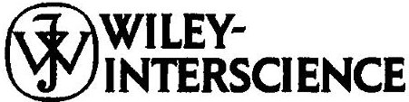

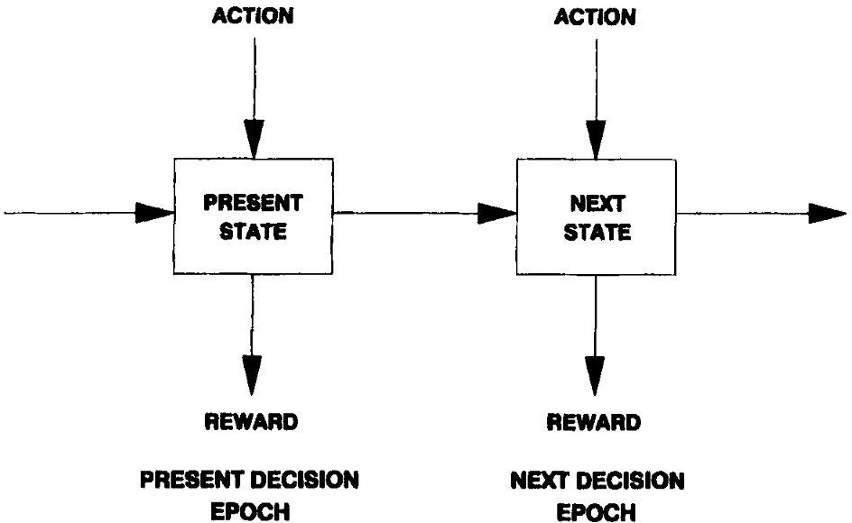

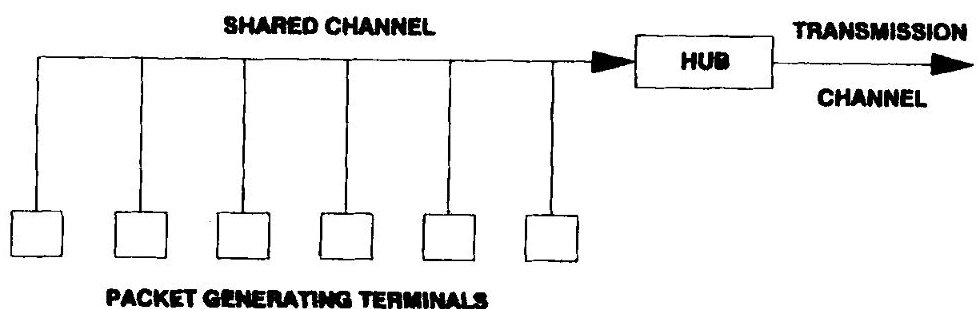

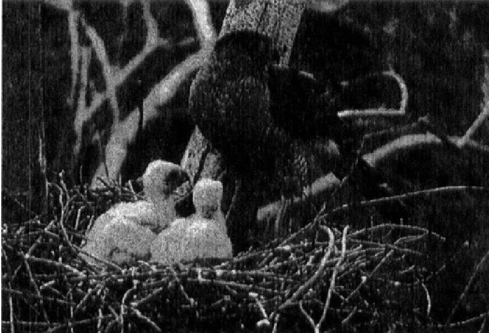

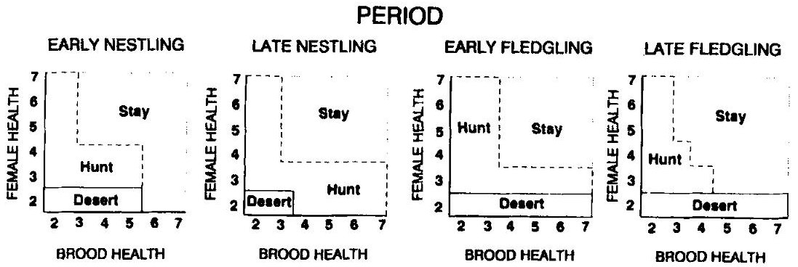

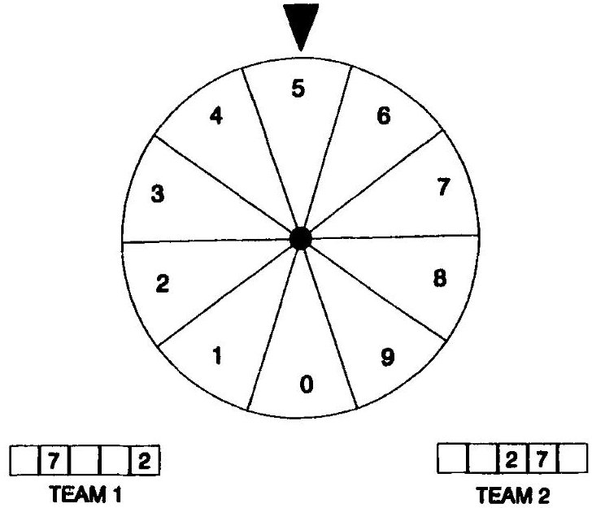

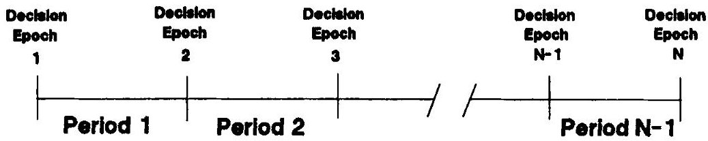

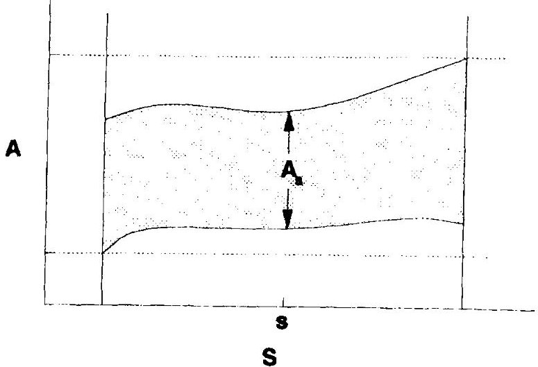

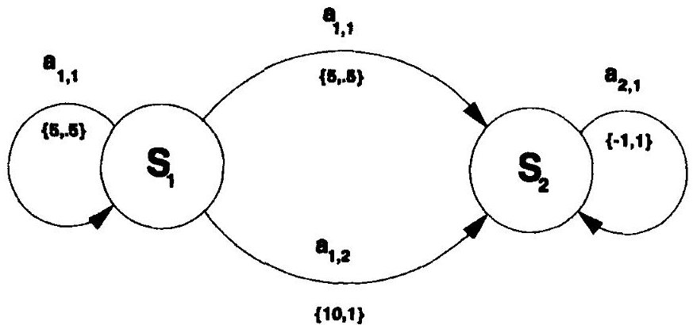

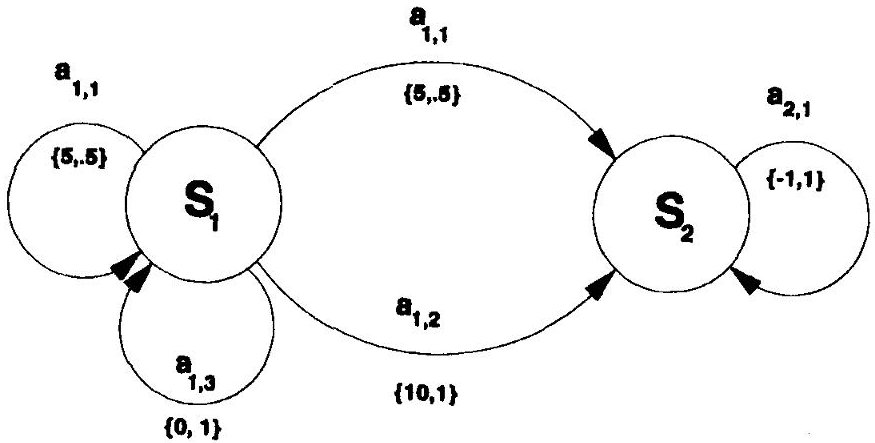

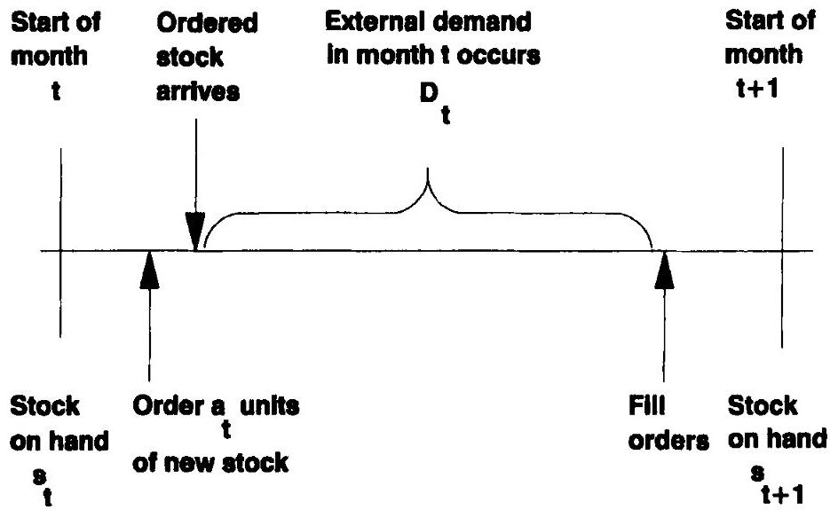

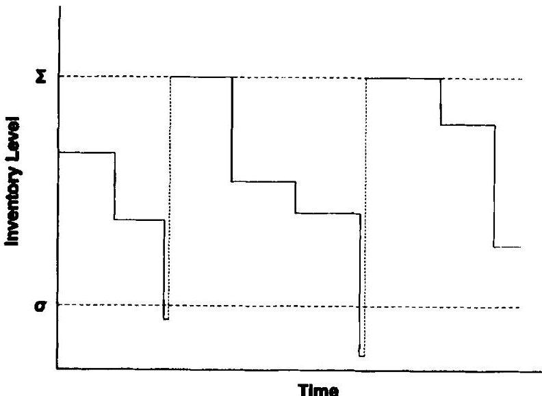

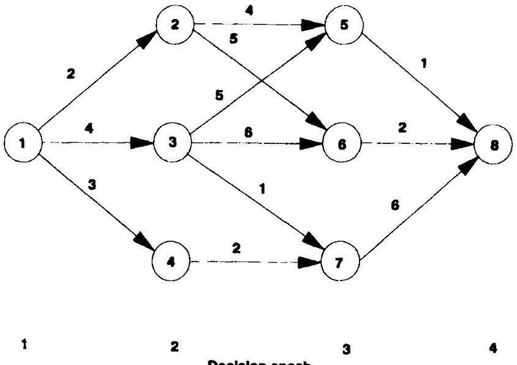

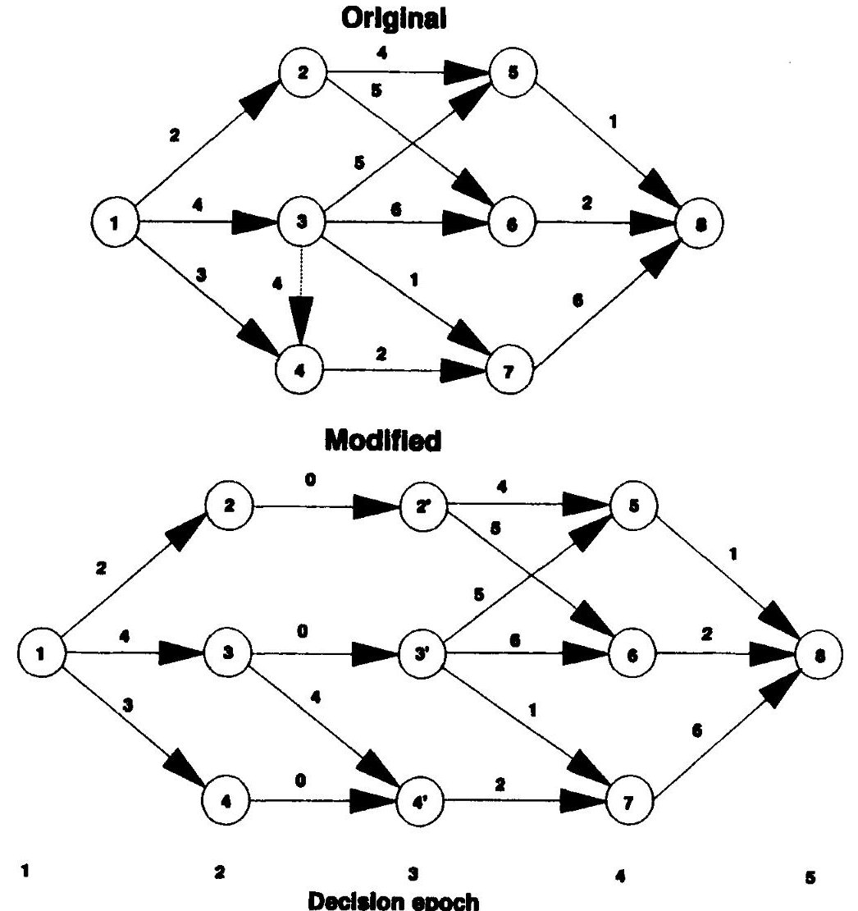

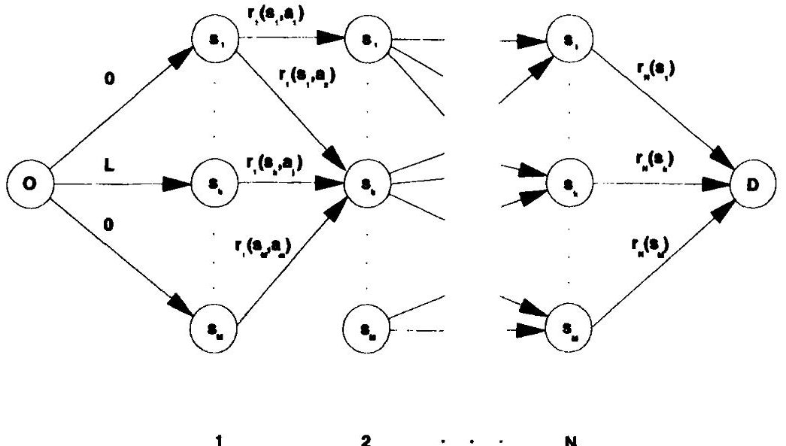

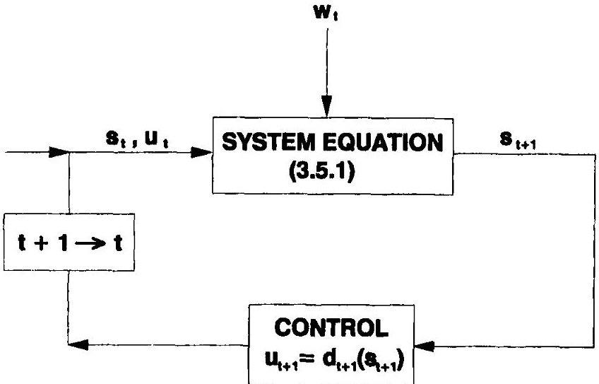

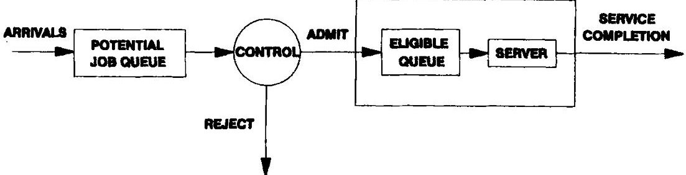

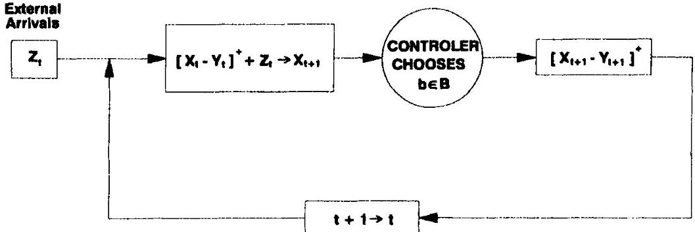
