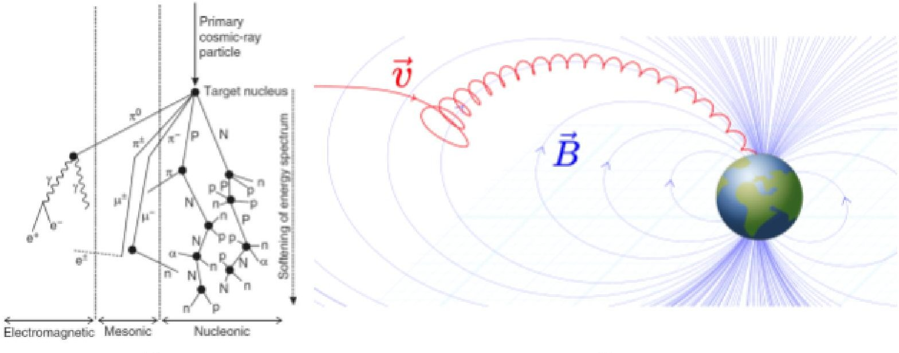
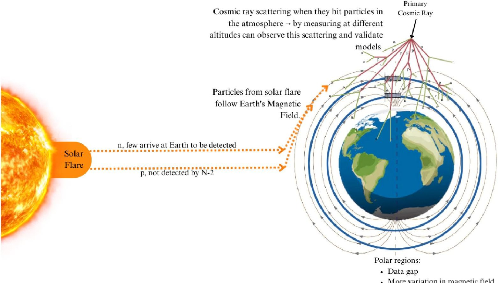
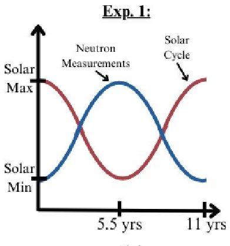
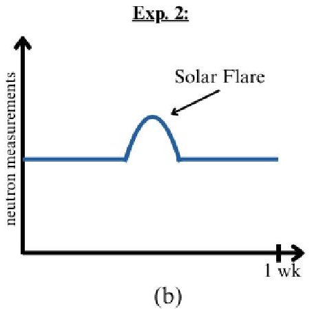
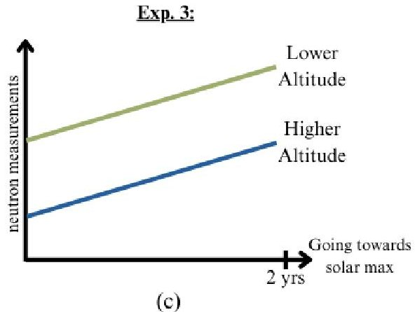
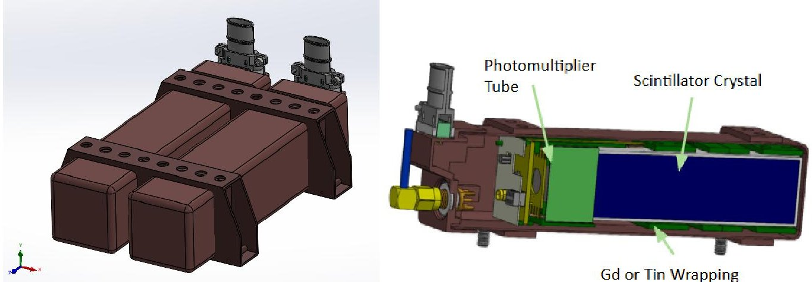
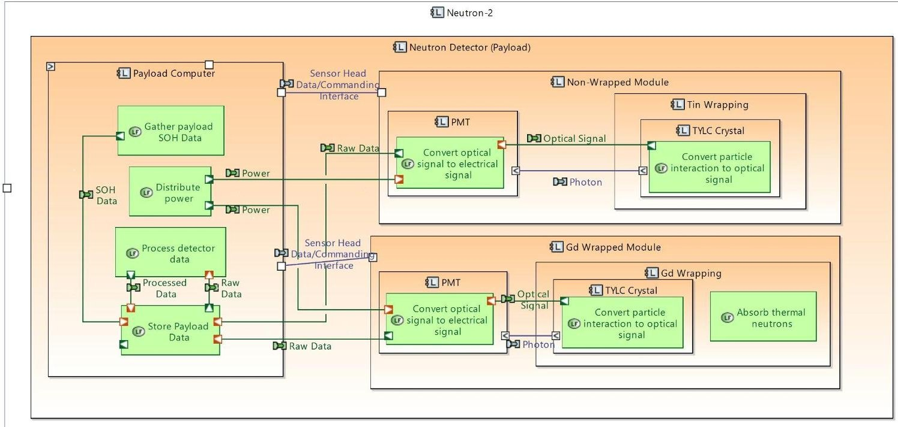
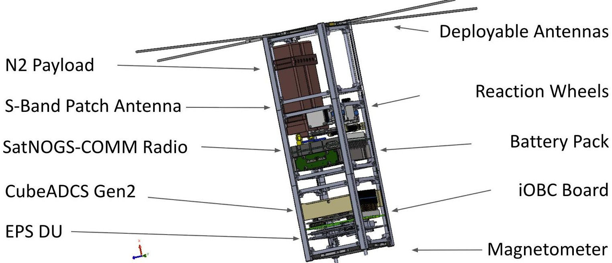
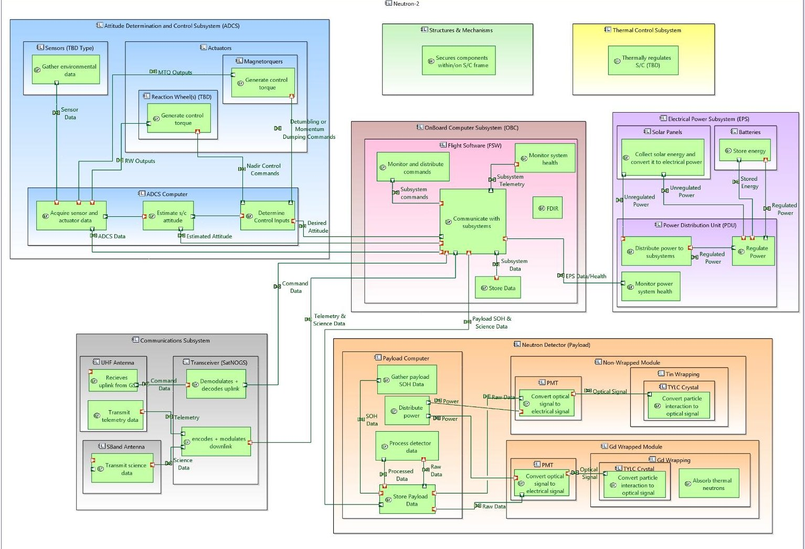

<!-- PDF_PAGE: 1 -->

# Neutron-2: Advancing Space Weather Monitoring and Anomaly Detection with a Dual CubeSat System

Miguel Nunes $ ^{1} $ , Piper Kline $ ^{1} $ , Gianna Longo $ ^{1} $ , Peter Englert $ ^{2} $ , Craig Hardgrove $ ^{3} $ , William Edmonson $ ^{2} $ , Scott Ginoza $ ^{1} $

$ ^{1} $ Hawai'i Space Flight Laboratory, Honolulu, HI 96822, USA $ ^{2} $ University of Hawai'i at Manoa, Honolulu, HI 96822, USA $ ^{3} $ Arizona State University, Tempe, AZ 85287, USA

## ABSTRACT

The Neutron-2 CubeSat mission aims to measure the neutron and gamma ray environment in Low Earth Orbit using a dual-satellite constellation equipped with next-generation neutron detectors developed at Arizona State University (ASU) and Radiation Monitoring Devices (RMD). It will specifically observe how time, orbital position, altitude, and solar activity affect neutron and gamma-ray flux, thereby filling scientific gaps and improving space asset safety. The project will leverage lessons learned from the Neutron-1 CubeSat, launched from the ISS in 2020, by utilizing a new payload and a redesigned spacecraft to achieve an increased orbital lifetime. This project also leverages the strong relationship between the University of Hawai'i at Mānoa (UHM) and ASU. The Neutron-2 project is currently funded as a University Nanosat Program (UNP) sponsored by the Air Force for its design phase, being led by students of UHM with mentorship by faculty and experts in the community. Currently, the project is in UNP Phase A, the design phase, and the team is preparing for the Preliminary Design Review in Fall 2025. Extensive work has been completed on understanding the science background of the mission and developing requirements. Moving forward, the team will focus on achieving and verifying the design while developing a FlatSat. This paper explores those scientific phenomena that Neutron-2 aims to understand, as well as the planned experiments, neutron detector, and resulting satellite bus requirements that are actively being designed.

## 1. INTRODUCTION & BACKGROUND

Neutron interactions in the Low Earth Orbit (LEO) environment remain under-characterized [1], and with this knowledge gap, the risk of damage to spacecraft and humans from space weather is high. The particles that generate neutrons have three different sources: 1) particles confined within Earth's magnetic field, 2) energetic solar charged particles that reach the Earth, and 3) high-energy protons and heavy ions, so-called galactic cosmic rays [2]. All three of these neutron generation sources are classified as ionizing radiation, which poses a severe risk to spacecraft and humans as the particles can interact with matter and cause significant damage [2]. Without a full understanding of this environment, it is unclear how to protect the assets invested in space and prevent this damage. The Neutron-2 mission aims to fill these gaps by studying neutron and gamma-ray flux as a function of time, orbital position, altitude, and solar activity to gain insights into cosmic ray interactions, solar particle events, and space weather in LEO to make space exploration safer. By sharing the results from this mission, radiation models can be improved, enabling the prediction and understanding of these events to better protect space assets. Additionally, this knowledge can help in developing technology to protect space assets from radiation and mitigate the consequences.

Most neutrons and gamma-rays that will be observed in LEO will be secondary particles that are produced by interactions between galactic cosmic rays (GCR) and the atmosphere, and may also result from interactions between solar energetic protons and atmospheric molecules. GCRs originate from outside the solar system and are thought to be remnants of a supernovae. They are made up of 87% protons, 12% alpha particles, and 1% heavy nuclei [3]. Their average energy is above 1 Gev/nucleon. Upon entering the atmosphere, the particles will interact with the atomic nuclei of atmospheric nitrogen and/or oxygen. The flux of GCR particles at 1 AU is about 2 particles/cm $ ^{2} $ s. This flux is modulated by variations of the solar magnetic field.

Solar flares are intense, bright ejections of particles, mostly protons, from the sun that occur when the magnetic field lines of the sun are twisted enough to break free and release energy. More flares occur closer to solar maximum, when the Sun's magnetic field is strongest. When the sun is closer to its solar minimum, there is less solar activity, resulting in less magnetic shielding and fewer solar flares. At solar minimum, more GCR passes through the solar system into Earth's atmosphere. "Flux and energy distribution of GCRs are controlling factors in the production rate,

<!-- PDF_PAGE: 2 -->

energy distribution, and depth of production of neutrons and gamma rays," [3]. The timed averaged solar flare particle flux is 200 particles/cm $ ^{2} $ s with an average energy of 600 MeV.

Almost all neutrons in the atmosphere are secondary particles produced by GCR and high energy solar flare particles. Neutrons are unique because they are uncharged, meaning they can pass through matter without interacting with the electrons.

Primary galactic cosmic rays and secondary neutrons create a nuclear particle cascade in the atmosphere until their energy is entirely consumed by nuclear interactions. This leads to the build-up of an inter-nuclear cascade as shown in Fig. 1(a) leading to increased neutron fluxes [4,5]. The development of the particle cascade indicates that atmospheric depth will have an influence on the number of neutrons occurring in each measured region. As measurements are taken throughout the atmosphere, there is an increase in secondary neutrons as the cascade approaches Earth.

Earth's magnetic field has a strong influence on charged particles that enter the atmosphere. The magnetic field around Earth is affected by the Lorentz force, which accounts for the radial acceleration of charged particles. They curve perpendicular to their initial movement vectors, $ \nu $ , and magnetic field, B. See Fig. 1(b). A larger angle between $ \nu $ and B results in a stronger deflecting force. A particle's speed also affects its deflection. The slower the particle, the lower its kinetic energy, and the greater its deflection from its initial path. Near the equator, particles travel perpendicular to the magnetic field, and near the poles, particles travel parallel to the magnetic field [4]. This path of deflection is a way to visualize the shielding effects that the magnetic field has on Earth. The Lorentz force makes the charged particle move in a circular motion around the path of the magnetic field (Fig. 1(b)). The majority of Earth's atmosphere is sufficiently shielded by the magnetic field, but there is a quantitative way to measure the shielding called the geomagnetic cutoff rigidity. There is currently no universally accepted number; instead, there are three quantities to describe it, RU for the upper cutoff, RL for the lower cutoff, and RC for the effective cutoff. Cutoff rigidities can be determined by tracing the particle trajectories and are generally reduced at higher latitudes near the poles [6].

(a)

(b)

Fig. 1: (a) Secondary cosmic ray cascade in the atmosphere. Abbr: n, neutron, p, proton (capital for particles carrying nuclear cascade), $ \alpha $ , alpha particle, e, electron or positron, $ \gamma $ , gamma ray, $ \pi $ , pion, $ \mu $ , muon. [4] (b) Curved magnetic field lines around Earth with a charged particle trapped in a spiral orbit following the path of the field line [7].

The Neutron-2 mission aims to study neutrons and gamma-ray flux based on location and events. The locations of interest are the polar regions, South Atlantic Anomaly (SAA) and at different altitudes separated by at least 50 km. The polar regions and SAA are of interest because these areas have a dramatic variation in Earth's magnetic field, so it will give insight as to how this affects neutron and gamma ray counts. Studying at different altitudes will provide insight into how the atmospheric depth affects neutron and gamma ray counts. The event-related collections aim to study how solar events influence the flux of neutrons and gamma rays. Fig. 2 illustrates these scientific phenomena

<!-- PDF_PAGE: 3 -->

that Neutron-2 aims to better understand throughout its mission and from the data collections. Understanding the neutron environment in LEO is essential for designing radiation-tolerant and hardened spacecraft. Accurate mapping of the neutron environment is also a vital aspect for protecting space assets. Real-time neutron flux data collected from CubeSats can inform stakeholders about optimal satellite design and shielding strategies and provide operational warnings for satellites and astronauts at risk of high radiation exposure.

Fig. 2: Science phenomenon to be observed by the Neutron-2 detector. The development of the secondary particle cascade to be measured by the N-2 spacecraft is shown over the North Pole of Earth. N-2 can also detect neutrons produced by the Sun during solar flares. This source is very rare. N-2 does not detect GCR and solar flare charged particles.

The Neutron-2 mission was selected in 2024 to participate in the University Nanosatellite Program, Cycle-12 (NS-12) [8]. This program, managed by the Air Force, provides funding and support for several university CubeSat projects in Phase A of their program. UNP Phase A focuses on the design of the CubeSat and, over a two-year period, advances through Pre-Phase A, Phase A, Phase B, and Phase C of the NASA Space Flight Life Cycle, culminating in the Critical Design Review. At the end of UNP's Phase A, a downselection occurs, where a limited number of university projects are funded for the subsequent phases, which include the integration and testing of the flight model, launch, and operations. Currently, Neutron-2 is preparing for the Preliminary Design Review, scheduled to take place in the Fall of 2025. The Critical Design Review will then be held the following year, in the Fall of 2026.

## 2. EXPERIMENT PLAN

There are three major experiments that the Neutron-2 mission aims to complete. Experiment 1 will study how neutron flux varies as a function of time and latitude, Experiment 2 will study how neutron flux varies as a function of solar activity, and Experiment 3 will study how neutron flux varies as a function of altitude.

Experiment 1: The goal of this experiment is to measure neutron and gamma-ray flux as a function of time and geomagnetic latitude. To achieve this, Neutron-2 will operate in a polar orbit, taking measurements over the poles and the South Atlantic Anomaly. These are areas of interest because the magnetic field is at its weakest and has the

<!-- PDF_PAGE: 4 -->

most variation in these regions. Additionally, there is a significant gap in scientific data within these areas. Monitoring of these regions of interest will create a map of neutron radiation in Low Earth Orbit, study nominal conditions, and aid in understanding the effect of Earth's magnetic field on the behavior of atmospheric neutrons. By running this experiment for a period of 6 months to 1 year, the effect of the changing solar cycle on neutrons produced by galactic cosmic rays can be observed. One CubeSat in a nearly circular, polar orbit will be sufficient for this experiment. Fig. 3 illustrates what the expected results for the experiment would be.

Experiment 2: This experiment aims to measure neutron and gamma-ray flux before, during, and after a solar event such as a solar flare or coronal mass ejection. This experiment will monitor the dynamic events created by the sun over days, rather than the 11-year solar cycle. It will focus on measuring neutrons generated or secondarily produced from solar events, specifically, not by galactic cosmic rays. Data can be collected using a single CubeSat within a few days before, during, and within a few days after a solar event that is large enough to produce neutrons, or send charged particles that will produce secondary neutrons after interacting with Earth's atmosphere. Since solar flares and coronal mass ejections cannot be predicted, the operations team will have to monitor real-time solar databases such as SpaceWeatherLive.com [9], which pulls data from NASA's Solar Dynamic Observatory [10]. When a flare occurs, the team will have one to two days to schedule a data collection during the event. That data can then be compared to neutron flux data taken before and after the event. It is expected that there will not be a significantly large number of events, considering that Neutron-2 is intended to be launched around 2029, which will be heading towards the minimum portion of the solar cycle. However, it is still expected to see lower-class flares every few days to weeks during the time of Neutron-2's operations. Fig. 3 illustrates what the expected results for this experiment would be.

Experiment 3: This experiment focuses on measuring neutron and gamma-ray flux as a function of altitude to help understand how galactic cosmic rays interact with Earth's atmosphere and observe the atmospheric particle shower. Unlike Experiment 1, which only informs of the effects of the magnetic field, Experiment 3 will give insight into the impact of the atmospheric depth on the neutron spectra and flux. This experiment will take measurements of neutrons at two different altitudes, at least 50 km apart, during the same period in the solar cycle. 50 km is relevant because of the established particle flux gradient. With an altitude difference below 50 km, secondary particles change rapidly. With an altitude difference of about 50 km, the particle flux is subtle and gradual [11]. This means that 50 km increments of data collections is optimal to understand altitudes based trends [12].

If data is taken at different altitudes but with years between them, the differences in environment due to the solar cycle will not make the data comparable with respect to altitude effects. Due to this, the different altitude data needs to be taken within the same 40 days, or a 1% change in the solar cycle. From conducting several trade studies, it was concluded that the best option for conducting this experiment would be to fly two CubeSats that are separated by 50 km. With two CubeSats, this experiment would run in tandem with Experiment 1, having two satellites collecting data as a function of time and position, but each at different altitudes. Note that this would not require the satellites to fly over the region of interest at the same exact times, but rather within 40 days of each other. To reduce mission complexity, however, the team will design a single spacecraft of which two copies can be built and launched into different altitude orbits. Both spacecraft will follow a shared integration, testing, and operations plan, but execution will occur independently. This method reduces the complexity of the design while allowing for a descope of the mission to only one satellite if the resources are not available for two. With only one satellite, experiments 1 and 2 can still be fully successful. Fig. 3 illustrates what the expected results for this experiment would be.

## 3. CONCEPT OF OPERATIONS

The operations of this mission are split into three distinct phases. Phase 1, Launch and Early Orbit Operations (LEOP), will begin upon insertion into orbit and will aim to establish communications. After communications is established, Phase 2, Engineering Evaluation and Checkout (EE&CO), will begin. This will involve the commissioning of both the satellite bus and the payload to ensure they both survived launch. After checkouts have concluded, Phase 3, Nominal Operations, will begin. This last phase involves completing the experiments. To further break down the operations, Modes and Submodes have been used to identify specific goals and satellite configurations needed to complete those goals. Fig. 4 breaks down these different phases, modes and submodes.

<!-- PDF_PAGE: 5 -->

Fig. 3: Expected experiment results. (a) Maps secondary neutron production and the effect of Earth's magnetic field on this production. Focus on areas of interest (Earth's poles, South Atlantic Anomaly) over the solar cycle. Neutron Measurements are greater during solar min due to the magnetic field being weaker and shielding less GCR. (b) Measures the flux of secondary neutron production during solar events. (c) Measures the effect of the depth of atmosphere on secondary neutron production (observe the scattering of particles).

<table border="1"><tr><td rowspan="2" colspan="4"></td><td colspan="4">SUB MODES</td></tr><tr><td>a</td><td>b</td><td>c</td><td>d</td></tr><tr><td rowspan="4">PHASES</td><td>1: Launch and Early Orbit Operations (LEOP)</td><td rowspan="5">MODES</td><td>Mode 0: Initiate</td><td>0a: Deploy:- Wait for the deployment timer to reach 0- Automatically transition to mode 0b when the timer reaches 0</td><td>0b: Post-Deployment:- Deploy antennas and initiate COMMs- Wait for Ground Contact- Manual transition to 1a</td><td></td><td></td></tr><tr><td rowspan="3">2: Engineering Evaluation and Checkout (EE&amp;CO)</td><td>Mode 1: Bus Commissioning</td><td>1a: Base Bus Commissioning:- Reserved for charging, no active commissioning- Manually transition to 1b or 2a</td><td>1b: Bus Commissioning:- Commission the subsystems (EPS, COMMs, ADCS, OBC, process TBD)- Manually transition to 1a</td><td></td><td></td></tr><tr><td>Mode 2: Payload Commissioning</td><td>2a: Base Payload Commissioning:- Reserved for charging- Manually transition to 2b, 2c, or 3a</td><td>2b: Payload Commissioning:- Initial health check to verify functionality of payload (process TBD)- Manual transition to 2a or 2c</td><td>2c: Initial Operational Capability (IOC):- Calibrate and baseline data- Manually transition to 2a or 2b</td><td></td></tr><tr><td>Mode 3: Nominal Operations</td><td>3a: Nominal Base:- Reserved for charging- Manually/Queued transition to mode 3 submode</td><td>3b: Science Collection Mode:- Adjust to LVLH- Payload in data acquisition state and collects data for TBD time- Queued transition to 3c</td><td>3c: Science Processing Mode:- Payload in standby state to process the data- Automatic transition to 3a (TBC)</td><td>3d: Science Downlink Mode:- ADCS to target tracking state- Downlink science data via SBand- Transition to mode 3 submode</td></tr><tr><td></td><td>Any Phase</td><td>Mode 4: Contingency Operations</td><td>4a: Lifeboat/Safe:- Reserved for anomaly resolution</td><td>4b: Low/Critical Battery Recovery:- Reserved for chagrin, minimal functionality</td><td>4c: Power Cycle:- Cycle power, return to TBD mode</td><td></td></tr></table>

Fig. 4: Operational Phases, Modes, and Submodes for the Neutron-2 mission.

To complete Experiment 1, the satellite begins in a base mode with an attitude optimized for power. When ground contact is made, the satellite telemetry can be downlinked, science collections or downlinks can be scheduled using geolocation commands. To do this, the mission operations planning team will need to use orbit analysis tools to predict desirable data acquisition periods or future ground contacts. Once the ground contact is complete, the spacecraft will continue in the base mode until the geolocation command for data acquisition gets triggered. When it

<!-- PDF_PAGE: 6 -->

is triggered, the satellite will enter Science Collection Mode, in which the satellite will transition to a LVLH attitude and turn on the payload into the standby state, and then quickly switch to the data acquisition state. It will stay in collection mode while the payload is actively collecting data for the predetermined time, approximately 15 minutes over polar regions. After this time expires, the satellite will transition to the Science Processing Mode, where the payload, in its Standby State, will process the data and transfer it over to the OBC to be downlinked in a future ground station pass. After completing the processing and transfer of the payload data, it will return to Base Mode. This process will be repeated for subsequent science collections. The frequency of these collections in the polar regions is currently unknown, but will be explored based on the power and data budgets, along with other factors that may affect it. However, considering these factors, Neutron-2 will aim to collect data as frequently as possible.

For Experiment 3, the process for Experiment 1 needs to be completed at two different altitudes, within 40 days of each other. Therefore, two satellites will be in various orbits, both individually conducting experiment 1. To simplify the mission design, the two spacecraft will have identical ops plans. They will not need to coordinate their actions or collect science data simultaneously. The comparison of data will be done on the ground after the science data is delivered to the science customers. To downlink the science data, an additional mode was defined: Science Downlink Mode. This alternative communications mode focuses on downlinking the science data using an SBand radio in order to get the science data down faster. Based on an initial data budget, using UHF alone to downlink science data will take significantly more passes to downlink only 15 minutes of science data. While UHF will be designed as a backup option, S-Band downlink for science data will be preferred. However, UHF downlink will be preferred for nominal satellite state of health information because it uses less power and has limited attitude needs. Over nominal ground station passes, satellite data, not including science data, will be downlinked in the Base Mode and to downlink science data, which will also include spacecraft SOH, the Science Downlinking Mode will be scheduled.

To complete Experiment 2, the same process described for Experiments 1 and 3 will be used. Nominally, the satellite will remain in the Base Mode until a queued command triggers a data collection. Once triggered, it will transition to modes to collect data for a TBD duration. After this period, it will enter Data Processing Mode to process and transfer the data to the OBC. Upon completion, it will return to Base Mode until either the next science data collection or a scheduled science data downlink. If the latter is triggered, the spacecraft will enter Science Downlinking Mode, and activate the S-Band transmitter to downlink the science data. The only difference for this experiment is the timing and location of data collections. Ground operators will continuously monitor solar databases, such as SpaceWeatherLive.com [9], for solar events. When an event is flagged, operators can use the associated time and location information to schedule data collections. These collections will likely occur near both poles as well as at intermediate latitudes. Once an event is identified, the team will have one to two days to schedule data collection in order to capture data during the event. A follow-up collection will then be required after the event, over the same region, to obtain comparison data. For pre-event comparison, either prior Experiment 2 collections may be used, or data from routine global coverage can serve as the baseline.

## 4. PAYLOAD DESCRIPTION

A neutron and gamma ray detector developed at Radiation Monitoring Devices (RMD) with Arizona State University (ASU) will be used to conduct the planned experiments. The detector utilizes two sensor heads, each made of a novel scintillator single material called TLYC $ \mathrm{T l_{2} L i Y C l_{6}} $ , which enables the simultaneous acquisition of gamma ray and neutron spectroscopy. Gadolinium (Gd) can absorb thermal neutrons below 0.3 eV but not as strongly absorb neutrons above 0.3 eV (epithermal). By having two sensor heads, one wrapped in Gd, one not, the payload can then differentiate between epithermal and thermal neutrons. The two sensor heads will each have their own photomultiplier tube (PMT) but share a payload computer for processing and storage of the data. The detector is modular in design to minimize development risk, as seen in Fig. 5. The current estimate for the entire payload mass is 2 kg, which includes a 15% margin, and the power draw will be less than 6 W during data acquisition.

Previous versions of this detector have flown on the Neutron-1 [13] and LunaH-Map [14,15,16] missions, and although the electronics, housing, and scintillator material have been updated, the principles remain the same. The scintillator material used for these past missions was CLYC $ \mathrm{(C s_{2} L i Y C l_{6}}). $ However, ASU has decided to update the design to use TLYC. This new material has flight heritage [17] and is proven to be more radiation-tolerant than CLYC. The scintillator light pulse differs between the two materials; however, the electronics used for Neutron-1 and LunaH-Map are scintillator-agnostic and allow for new configuration settings to be programmed into the signal processing digital logic for gamma-ray and neutron separation and energy spectroscopy. The material's density is

<!-- PDF_PAGE: 7 -->

also higher than that of the previous material, which yields a higher detection efficiency. Even though the detector is similar to the ones that have flown, extensive data collection in LEO has not been conducted with it. Neutron-1 did not fully commission the payload, and although LunaH-Map did collect data in transit to the Moon, LEO was not the environment it was designed for, focusing on data collection.

Fig. 5: Payload CAD model. The left shows the two modules, one wrapped in Gd and one wrapped in Tin. The right shows the interior of one module.

Fig. 6: N-2 payload functional block diagram using the ARCADIA/Capella Process. On the right side the modules are sensitive to the the incoming radiation and the PMTs convert the analog to digital signal. The PSD function is executed on the Payload Computer FPGA code.

## 5. SATELLITE DESIGN

The current satellite design consists of a 3U CubeSat, as shown in Fig. 7. The team is currently preparing for the Preliminary Design Review (PDR), so the design remains in flux. While the CAD model depicted in Fig. 6 includes all existing components, it does not account for electrical interfaces or harnessing, nor does it leave sufficient volume for any additional components that may be required. Consequently, a trade study is underway to evaluate whether transitioning to a 6U form factor would be necessary. This study also considers other factors, such as the power budget and deorbit timeline.

<!-- PDF_PAGE: 8 -->

Fig. 7: Current satellite CAD model.

Fig 8. System Functional Block Diagram for the N-2 satellite bus and the neutron detector using the ARCADIA/Capella Process. From top left: attitude determination and control subsystem (ADCS), structures and mechanisms, thermal control subsystem, on board computer (OBC), electrical power system (EPS), communications subsystems (COMMS), neutron payload.

The current electrical power subsystem (EPS) design utilizes an ISISpace EPS and solar panels that are developed in-house at the Hawaii Space Flight Laboratory (HSFL). The size of the EPS will depend on whether Neutron-2

<!-- PDF_PAGE: 9 -->

remains a 3U platform or expands to 6U. An initial power budget was completed to assess the possible frequency of data collections over the areas of interest (approximately 15 minutes per region). Based on this initial system design and the analysis, up to eight 15-minute data collections per day are possible. To meet the success criteria, 10,000 neutron counts must be collected in each region of interest, reducing the statistical error to 1%. At the rate of eight data collections per day, this goal would be achieved in about 12 days for a single region and 36 days to cover all three regions of interest. While this timeline is acceptable, the team aims to improve the power budget to enable more frequent and extended data collections. This will be considered when sizing the EPS and in the trade between a 3U and 6U, as more surface area may be needed for solar panels.

To determine the necessary frequency bands for the communications subsystem, a preliminary data budget was completed. It revealed that downlinking just 15 minutes of science data during a single ground pass would require S-band. Using only UHF, more than 20 ground station passes would be necessary to downlink that amount of data. This estimate does not include additional telemetry and science-related data (e.g., magnetometer and GPS data). As a result, the current bus design incorporates S-band for science data downlink and UHF for nominal downlink of satellite health data. To support this design, the SATNOGS radio board will be used. This board supports both UHF and S-band frequencies and will operate in conjunction with ISISpace UHF and S-band antennas.

The mission's payload has relatively relaxed pointing requirements, needing the largest cross-sectional area to face nadir within $ 3 6^{\circ} $ during data collections. However, the S-band patch antenna introduces more stringent constraints, requiring tracking of the ground station within $ 2^{\circ} $ during communication passes. To meet these requirements, the team has selected CubeSpace's Gen2 ADCS. This choice was driven by the history HSFL has with both the company and the product, its low cost relative to other commercial off-the-shelf (COTS) ADCS options, and the system's ability to meet the mission's pointing needs. Both the ISISpace and Resilient Computing onboard computers are currently under consideration for this mission. Additionally, F-Prime has been selected as the flight software framework.

While traditional, document-centric systems engineering is being used for the missions design phase by the majority of the team, Neutron-2 is also being used to develop a Model-Based Systems Engineering (MBSE) Methodology. This Methodology aims to develop processes and methods to use MBSE for academic CubeSat missions to improve the design and verification process. Fig. 6 and Fig. 8 shows an example of an MBSE model, developed in Capella, that shows the functional architecture of the payload and satellite.

## 6. CONCLUSION

With knowledge gaps related to neutron interactions in LEO and space weather, the risk of damage to spacecraft and astronauts from these phenomena is high. The Neutron-2 mission aims to characterize how location and events affect neutrons and gamma rays in order to create an environmental map, improve radiation models, and inform spacecraft design for better protection against radiation exposure. To achieve this, three experiments are planned. The first will study the impact of Earth's magnetic field on neutron and gamma ray flux. The second will examine how solar events influence these fluxes. The third will assess the effects of altitude on neutron and gamma ray flux.

To conduct these experiments, two spacecraft, in polar orbits with an altitude difference of at least 50 km, will fly with a neutron detector that is developed by ASU and RDM. The spacecraft will be the same in design, sharing an integration, testing, and operations plan to reduce the complexity of the design process. The two spacecraft will be launched into their different orbits and studies are currently underway on the different launch opportunities for this and the timeframe allowed between launches. As part of UNP NS-12, the mission is currently preparing for the PDR with an expected launch to occur no earlier than 2029.

The Neutron-2 mission will utilize its findings to share with the scientific community so radiation models can be improved to better predict and understand what space assets could be exposed to. This knowledge would help benefit the future of human space flight for all.

<!-- PDF_PAGE: 10 -->

## 7. REFERENCES

[1] R.C Singleterry, F.F Badavi, J.L Shinn, F.A Cucinotta, G.D Badhwar, M.S Clowdsley, J.H Heinbockel, J.WWilson, W Atwell, R Beaujean, J Kopp, G Reitz. Estimation of neutron and other radiation exposure components in low earth orbit, Radiation Measurements, Volume 33, Issue 3, 2001, Pages 355-360, ISSN 1350-4487

[2] Deiss, H. (Ed.). (2017, April 13). Why space radiation matters. NASA. https://www.nasa.gov/missions/analog-field-testing/why-space-radiation-matters

[3] Prettyman, Thomas. (2007). Remote Chemical Sensing Using Nuclear Spectroscopy. AAS/Division for Extreme Solar Systems Abstracts. 10.1016/B978-012088589-3/50045-1.

[4] Dunai, Tibor. Cosmogenic Nuclides: Principles, Concepts and Applications in the Earth Surface Sciences. Cambridge University Press, 2010. Accessed 7 May 2025.

[5] NASA. "Space Radiation Analysis group, Johnson Space Center." National Aeronautics and Space Administration, 2024, https://srag.jsc.nasa.gov/spaceradiation.

[6] Smart, D.F., and M.A. Shea. "A review of geomagnetic cutoff rigidities for earth-orbiting spacecraft." Advances in Space Research, vol. 36, no. 10, 2005, pp. 2012-2020. Science Direct, https://www.sciencedirect.com/science/article/pii/S0273117705001997.

[7] Vonk, Coert. "Aurora Borealis." Coert Vonk, 2002. https://coertvonk.com/physics/electromagnetism/magnetism/aurora-borealis-30349.

[8] University Nanosatellite Program, "UNP Nanosatellite 12 User Guide," Rev. A, 2025.

https://universitynanosat.org/downloads/resources/user-guides-and-technical-documents/unp-nanosatellite-user-guide.pdf

[9] Space Weather Live. "Real-Time Solar Activity Report." https://www.spaceweatherlive.com/en/solar-activity.html

[10] NASA. "Solar Dynamics Observatory (SDO)." NASA. https://sdo.gsfc.nasa.gov/

[11] Agrimson et al. (2022). "Neutron Flux measurements correlated to the Regener-Pfotzer Maximum." Academic High Altitude Conference.

[12] Zábori et al. (2016). "Characterization of cosmic rays in the Polar Region up to 88 km altitude." Journal of Space Weather and Space Climate, 6, A12.

[13] Nunes, Miguel A., Lloyd French, Peter A. J. Englert, Eric J. Pilger, Lance Yoneshige, Isaac Rodrigues, Yosef ben Gershom, Amber Imai-Hong, Kasey Hagi, Craig Opie, Luke P. Flynn, Craig Hardgrove, and Bob Roebuck. 2019. "Neutron-1 Mission: Low Earth Orbit Neutron Flux Detection and COSMOS Mission Operations Technology Demonstration." in Proceedings of the 33rd Annual AIAA/USU Conference on Small Satellites, August 3-8, 2019. Logan, Utah. August 2019.

[14] Hardgrove C., West S.T., Heffern L.E., et al. "Development of the Miniature Neutron Spectrometer for the Lunar Polar Hydrogen Mapper mission." 2018, 49th Lunar Planet. Sci Conf. Abstract #2341

[15] Hardgrove, Craig et al. "LunaH Map CubeSat." Improving Space Operations Workshop. Proc. of The American Institute of Aeronautics and Astronautics, California, Pasadena.

[16] Hardgrove, Craig et al. "The lunar polar hydrogen mapper (lunah-map) mission: mapping hydrogen distributions in permanently shadowed regions of the moon's south pole." Lunar Exploration Analysis Group (2015): n. pag. USRA-Houston. Universities Space Research Association. Web. 18 Feb. 2016.

[17] Anthony L. Hutcheson, Bernard F. Phlips, W. Neil Johnson, Lee J. Mitchell, Joshua M. Wolf, Mary V.Johnson-Rambert, Joseph M. Davis, Theodore T. Finne, Richard S. Woolf, Rose S. Perea, "Neutron radiation detection instrument-1A (NeRDI-1A)," Proc. SPIE 12696, Hard X-Ray, Gamma-Ray, and Neutron Detector Physics XXV, 1269603 (3 October 2023); https://doi.org/10.1117/12.2682621