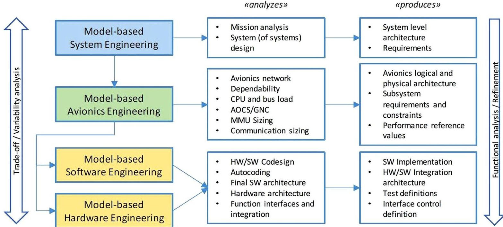
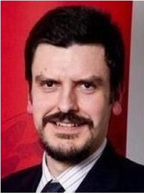
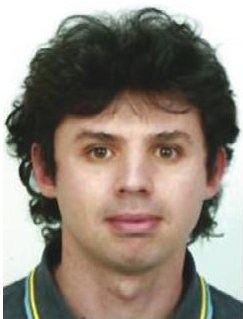

<!-- PDF_PAGE: 1 -->

## Citation (Version of Record):

Gregory, J., Berthoud, L., Tryfonas, T., Rossignol, A., & Faure, L. (2020). The long and winding road: MBSE adoption for functional avionics of spacecraft. Journal of Systems and Software, 160, Article 110453. https://doi.org/10.1016/j.jss.2019.110453

## Version:

Publisher's PDF, also known as Version of record

License (if available) CC BY

Link to published version (if available): 10.1016/j.jss.2019.110453

Link to publication record on the Bristol Research Portal: Access record including PDF (if available)

## University of Bristol-Bristol Research Portal

This is the final published version of the article (version of record). It first appeared online via Elsevier at https://www.sciencedirect.com/science/article/pii/S0164121219302274?via%3Dihub. Please refer to any applicable terms of use of the publisher.

## Citing this paper

Guidance on citing material from the Bristol Research Portal is available under 'Manuscripts and Citations' in the Terms of Use (linked below)

## Terms of Use

Full Terms of Use for the Bristol Research Portal are available online: https://www.bristol.ac.uk/research-enterprise-innovation/research-policy/pure/brp-terms/

## Has this research benefited you?

Let us know how reading this research here has been meaningful to you by sharing your story at https://forms.office.com/e/ffL5CZ0fGT

<!-- PDF_PAGE: 2 -->

# The long and winding road: MBSE adoption for functional avionics of spacecraft

Joe Gregory $ ^{a,*} $ , Lucy Berthoud $ ^{a} $ , Theo Tryfonas $ ^{b} $ , Alain Rossignol $ ^{c} $ , Ludovic Faure $ ^{d} $

$ ^{a} $ Department of Aerospace Engineering Queens Building University Walk University of Bristol, UK BS81TR

$ ^{b} $ Department of Civil Engineering Queens Building University Walk University of Bristol, UK BS81TR

$ ^{c} $ Airbus Defence and Space Rue des Cosmonautes Toulouse, France 31400

$ ^{d} $ Airbus Defence and Space Gunnels Wood Road Stevenage, UK SG12AS

## ARTICLE INFO

Article history:

Received 25 June 2019

Revised 18 September 2019

Accepted 24 October 2019

Available online 26 October 2019

Keywords:

MBSE

Modelling

Functional avionics

Systems engineering

Thematic analysis

## ABSTRACT

Model-Based Systems Engineering (MBSE) represents a move away from the traditional approach of Document-Based Systems Engineering (DBSE). It is claimed that MBSE promotes consistency, communication, clarity and maintainability within systems engineering projects and addresses issues associated with cost, complexity and safety. While these potential benefits of MBSE are generally agreed upon by would-be practitioners, its implementation is challenging and many organisations struggle to overcome the cultural and technical hurdles along the long and winding road to MBSE adoption. In this paper, we aim to ease the process of implementation by investigating where the current issues with the existing systems engineering processes lie, and where a model-based approach may be able to help, from the perspective of engineers working on spacecraft functional avionics in Airbus. A repeatable process has been developed to elicit this information. Semi-structured interviews have been conducted with 25 Airbus engineers working in Operations, Software and Failure, Detection, Isolation and Recovery. The acquired data has been thematically analysed to extract common themes from the responses. The results presented in this paper have yielded four recommended application areas to consider when applying MBSE to Functional Avionics: organisation modelling; early functional validation; communication and consistency; template model framework development.

© 2019 The Authors. Published by Elsevier Inc.

This is an open access article under the CC BY license. (http://creativecommons.org/licenses/by/4.0/)

## 1. Introduction

Interest in Model-Based Systems Engineering (MBSE) over the traditional approach to systems engineering, Document-Based Systems Engineering (DBSE), is growing (Wibben and Furfaro, 2015 Gough and Phojanamongkolkij, 2018). With DBSE, project and design information is stored in documents and must be manually maintained and transferred between domains (Kalawsky et al., 2013, London and Miotto, 2014). The traditional DBSE approach is labour-intensive and consists mostly of manual analysis, review and inspection (Bozzano et al., 2014).

MBSE is the formalised application of modelling to support system requirements, design, analysis, optimisation, verification and validation (Anderson et al., 2014). By using interconnected models to store, represent and relate this information and data, projects can expect improvements in consistency, communication, clarity,

visibility, maintainability, etc. - thus addressing issues associated with cost, complexity and safety (Chhaniyara et al., 2011).

Spacecraft represent an ideal candidate for the application of MBSE as they are complex systems with potential applications that are often limited by the high development costs they can incur (Jarraya et al., 2007, Kaslow et al., 2014).

This paper investigates issues with the current systems engineering processes adopted by Airbus to support the design and development of spacecraft. Specifically, we examine the Functional Avionics domain across three European Airbus sites to identify the areas of non-quality - that is, areas with significant negative effects resulting from the processes not being perfect (Harrington, 1999). Following identification of the issues, we determine which (if any) of these could be addressed by MBSE. The methodology followed in this paper is used to get feedback from the engineers themselves, identify areas where MBSE could be applied most effectively, and derive relevant application areas where MBSE techniques are most likely to yield benefits.

<!-- PDF_PAGE: 3 -->

Essentially, this work is necessary because the implementation of MBSE is difficult, and there are a number of adoptionrelated issues that need to be addressed (Holt et al., 2015, Chami and Bruel, 2018, Huldt and Stenius, 2019). A previous study by Bone and Cloutier suggests that 'culture and general resistance to change' are the main inhibitors of MBSE adoption (Bone and Cloutier, 2009). A similar study by Motamedian found that 'lack of related skills and knowledge' and the 'lack of perceived value of MBSE' are the two main factors (Motamedian, 2013). Findings from these cover industries such as aircraft, automotive, defence, IT, medical and space systems. We are interested in the perspective of the space systems industry.

Successful applications of MBSE are often reported alongside the challenges faced by industries looking to adopt MBSE (Kaslow et al., 2015, Estable et al., 2017, Stevenson et al., 2018, Karban et al., 2012). Reports like these are an important part of the progressive adoption of MBSE within industry (Motamedian, 2013, Madni and Sievers, 2018). In order to develop a useful case study and deliver a successful MBSE application, it is crucial to demonstrate that the application is necessary.

A related investigation has been conducted by Vogelsang et al. (2017) in which the main inhibitors of MBSE adoption in the embedded systems industry are assessed through means of semistructured interviews. Their overall conclusion is that the main inhibitor on a personal level is frustration with the MBSE adoption process arising from false perceptions or unrealistically high expectations. Similarly, an empirical study by Mohagheghi et al. (2013) concludes that the benefits of using Model-Driven Engineering (MDE) in software engineering are clear to would-be practitioners, but that an appropriate mature toolset is lacking. In Aranda et al. (2012), the authors conduct interviews with practitioners and conclude that more work is required to identify the perceived efforts and rewards associated with making this transition. Papers by Hutchinson et al. (2011) and Kuhn et al. (2012) support these conclusions in that they state the need for further studies into the expectations and inhibitors of making the transition to model-based approaches, and that these expectations need to be managed. Gilbert et al. (2014) have designed a data collection exercise using semi-structured interviews to elicit feedback from Thales UK systems engineers regarding the effectiveness of technical metrics employed by the organisation.

Many of these related works (Vogelsang et al., 2017, Mohagheghi et al., 2013, Aranda et al., 2012, Hutchinson et al., 2011, Kuhn et al., 2012) declare the need for some kind of feedback loop between those implementing the transition and the actual model users. In our case, this paper represents the first step of that process.

The work presented in this paper therefore is founded on two research questions:

1 Where are the current issues within the systems engineering process adopted by teams within the Functional Avionics domain?

2 Where might MBSE be adopted in the future to address these issues?

These research questions are borne out of the necessity to understand where MBSE would be most beneficial within Functional Avionics, so that future MBSE projects can be tailored to address real concerns held by practicing engineers. The responses that these questions generate are analysed using the method of thematic analysis defined by Braun and Clarke (2006), and the outcomes will be used to directly influence the direction of MBSE adoption within Airbus in the hope that these future projects will be successful in producing outputs that effectively demonstrate the benefits of MBSE, thus improving the perception of MBSE and contributing to its continued adoption, as proposed in Bone and

Cloutier (2009), Motamedian (2013) and Madni and Sievers (2018). The objective of the work presented in this paper is to provide relevant recommendations to all those looking to adopt MBSE practices within the frame of spacecraft Functional Avionics, and to develop a methodology to elicit this information that can be adapted and used by others. The implementation of MBSE can yield numerous benefits - but it is difficult. The work presented in this paper aims to ease some of those difficulties. By identifying systems engineering challenges from the perspective of the engineers working in Functional Avionics and proposing suitable MBSE topics, it is hoped that this work can contribute to the progressive adoption of MBSE in the space industry.

Section 2 provides background information on MBSE. Section 3 defines the context of the investigation in terms of Airbus and the wider project more clearly. Section 4 details the methodology adopted before the results are presented in Section 5. Recommendations are derived and presented in Section 6. The findings and methodology are discussed in Section 7. The investigation is concluded in Section 8.

## 2. Model-based systems engineering

A system is defined by NASA as (Kapurch, 2007): a construct or collection of different elements that together produce results not obtainable by the elements alone.

Systems are characterised by complexity (INCOSE 2007), and cannot be understood by reducing the system to the sum of its parts; the system is necessarily defined by the interactions between its components and the emergent behaviour produced as a result (Hitchins, 2007). This level of complexity requires a suitable approach to view the system as a whole in order to understand this resulting behaviour.

Systems engineering has therefore been defined by the International Council on Systems Engineering (INCOSE) as (Smith and Brown, 2014): an interdisciplinary approach and means to enable the realisation of successful systems.

It is an approach to help cope with the complexity inherent in systems, to help avoid omissions and invalid assumptions, manage real-world changing issues and produce the most efficient, economic and robust solution (Smith and Brown, 2014).

MBSE is an approach to systems engineering that looks to achieve the goals of systems engineering through the formal application of models. It has been summarised as follows (INCOSE 2007):

MBSE is the formalized application of modelling to support system requirements, design, analysis, verification and validation activities beginning in the conceptual design phase and continuing through development and later life cycle phases.

Within systems engineering, a model can be defined as (Dori, 2008): an abstraction of a system, aimed at understanding, communicating, explaining, or designing aspects of interest of that system.

While there have been efforts to develop the MBSE approach to the simulation and analysis to spacecraft (Kaslow et al., 2014, Spangelo et al., 2013, Estable, 2018), the focus remains on the description of system designs, and overlooks the importance of using this information, present in the model, to automatically analyse and validate the system itself (Lindblad, 2018, Jenkins, 2018). MBSE makes this possible in early phases (Madni and Sievers, 2018).

MBSE provides the opportunity to link various domain-specific tools together to produce a model-based framework for a systems engineering project. It is often discussed in terms of the three MBSE pillars: language, tool and methodology (Delligatti, 2014). The tool is the software used to produce the model, which consists of model elements, tables, diagrams, etc. representing the appropriate modelling language. Of the multiple languages available

<!-- PDF_PAGE: 4 -->

Fig. 1. Context of model-based avionics engineering (MBAE) [Wibben and Furfaro, 2015] .

(INCOSE 2015), the Object Management Group's (OMG) Systems Modeling Language (SysML) has become the de facto modelling language for systems engineering (Ramos et al., 2012), and is well suited to the description of the MBSE activities (Group, 2017). The methodology is the process used to build the model.

## 3. Investigation context

The work presented in this paper is part of a wider effort to develop MBSE techniques that can be implemented in the current systems engineering framework adopted by Airbus to support the design, development and testing of spacecraft. In particular, the MBSE techniques developed will be applied to the domain of Functional Avionics. The satellite product lifecycle follows the phase system as defined below (Kapurch, 2007):

- Formulation

Pre-Phase A: Concept studies

Phase A: Concept and technology development

Phase B: Preliminary design and technology completion

- Implementation

Phase D: System assembly, test and launch

Phase E: Operations and sustainment

Phase C: Final design and fabrication

Phase F: Closeout

Functional Avionics is concerned only with the functionality of the spacecraft under design, not the hardware used to implement the functionality. Within Functional Avionics, the functionality of the spacecraft is defined, generating requirements that must be met by the hardware. While particularly active during the early, 'formulation' phases of the product lifecycle, it remains active through all phases of the lifecycle, as the spacecraft operators rely on information generated by the Operations domain within Functional Avionics.

In this sense, it could be argued that we are looking to apply Model-Based Avionics Engineering (MBAE), rather than MBSE, as we are restricted to the functional avionics of the spacecraft. This level of abstraction is presented in Fig.1 as defined by the European Space Agency (ESA) (Feo-Arenis, 2018). MBAE looks to apply the same MBSE techniques to this restricted view of the system but does so with avionics-focussed case studies. Functional Avionics comprises the following domains:

- Operations

- Failure, Detection, Isolation and Recovery (FDIR)

- Software

- Attitude, Orbit Control System (AOCS)

- Database

- Functional Verification

Of these, we are particularly interested in Operations, FDIR and Software. The AOCS and Database domains have already received considerable attention within Airbus in terms of MBSE development, and the Functional Verification domain concerns the development of test beds and test procedures for Phase D. This would be an interesting area to explore, but the scope of this work is focused on the earlier, 'formulation' phases.

The development of a spacecraft often takes place across multiple sites. To give an Airbus example, the platform may be developed in the UK while the payload is developed in France. As such, it is crucial to remember that such organisations are often multinational and undertake multinational projects. There are multiple Airbus sites situated within Europe, including Germany, France Spain, the UK, the Netherlands and Italy.

Spacecraft systems engineering is a challenging undertaking. While the implementation of MBSE within an organisation can also be a complex and daunting task, the potential benefits that MBSE can yield make it worth investigating. Airbus, for example, have led multiple projects looking to develop these MBSE techniques and apply them to real-world design projects. The most significant of these is the development of the SysML-based model of the e.Deorbit mission by Estable (2018). Other examples include the Jupiter Icy Moon Explorer (JUICE) and ExoMars use cases (Rossignol et al., 2016). These projects fall under the umbrella of the multinational Functional Avionic Model Oriented Usage (FA-MOUS) initiative - an effort by Airbus to pull together the multiple MBSE efforts across the different Airbus sites and provide a general direction in terms of the development of MBSE for Functional Avionics.

The work presented herein falls within the bounds of the FAMOUS initiative, and as such will be used to define the subject of the next MBSE application. Thus, this paper contributes to the overall Airbus effort by gathering the current views of the engineers that would actually implement any MBSE processes that are

<!-- PDF_PAGE: 5 -->

introduced and using this data to influence the direction of the FA-MOUS initiative.

## 4. Methodology

## 4.1. Research design

The research was exploratory in nature, and was undertaken using the 'pyramid' format of semi-structured interviews, whereby interviews begin with specific questions and are subsequently opened up to encourage discussion, as defined in (Runeson and Höst, 2009). This method was chosen as it provides insights into the examined topic and gives essential information to understand the phenomenon in its real context (Vogelsang et al., 2017, Runeson and Höst, 2009).

For the purposes of the interviews, the research questions presented previously were each refined into two questions, yielding four total questions. These questions were:

- Q1a: In your experience, what are the main challenges faced in trying to complete activities related to your domain?

- Q1b: In your experience, what are the areas of non-quality in the activities related to your domain?

- Q2a: Imagine a future with 'models' replacing 'documents'. What would these models look like for your domain?

- Q2b: In this future, what benefits would you get from these models, compared to the current way of working?

These questions were specifically designed to avoid the use of the phrase 'MBSE', as people have very different understandings of the term, and different connotations associated with it (Jenkins, 2018, Cloutier et al., 2015). In order to get an idea of issues that both can and cannot be addressed by models, Q1 was asked first without any mention of the use of models. Q2 was only asked after Q1 had been completed so as to not constrain the interviewees into thinking only about that issues that can be resolved by models.

Each interview was hosted by one interviewer (asking the questions) and supported by one scribe (recording the discussion). For each question, interviewees were asked by the interviewer to write their responses on Post-It notes. This helped with data collection and provided a basis for a subsequent discussion. The discussion of these written responses was guided by the interviewer and recorded by the scribe. Interviewees were encouraged to provide multiple responses if possible. All interviews took place in September 2016.

After each question, the following clarifications were provided:

- 'challenges': might include things that make the activities complex, tedious, or time-consuming.

- 'your domain': the domain within Functional Avionics for which you work and on whose behalf you have been asked to speak.

- 'non-quality': negative effects resulting from the processes not being perfect - e.g., work that must be redone, running over schedule, etc.

- 'benefits': e.g., consider in relation to the challenges and areas of non-quality that you have identified.

Each interview session lasted approximately one hour. A summary of the structure of each session is provided in Table 1.

## 4.2. Interviews

The number of interviewees per interview was restricted by the nature of the interview. As there was to be only one interviewer

Table 1 Interview structure.

<table border="1"><tr><td>No.</td><td>Action</td><td>Time(mins)</td><td>Output</td></tr><tr><td>1</td><td>Introduction</td><td>5</td><td>/</td></tr><tr><td>2</td><td>Q1(with clarifications)</td><td>10</td><td>Post-It notes</td></tr><tr><td>3</td><td>Q1 Discussion</td><td>15</td><td>Scribed discussion notes</td></tr><tr><td>4</td><td>Q2(with clarifications)</td><td>10</td><td>Post-It notes</td></tr><tr><td>5</td><td>Q2 Discussion</td><td>15</td><td>Scribed discussion notes</td></tr><tr><td>6</td><td>Closing Remarks</td><td>5</td><td>/</td></tr></table>

Table 2 Definition of the nine interviews.

<table border="1"><tr><td>Interview No.</td><td>Site</td><td>Interviewees</td></tr><tr><td>1</td><td>Stevenage, UK</td><td>4×Operations Engineers</td></tr><tr><td>2</td><td>Stevenage, UK</td><td>4×Operations Engineers</td></tr><tr><td>3</td><td>Stevenage, UK</td><td>5×Software Engineers</td></tr><tr><td>4</td><td>Toulouse, France</td><td>3×Operations Engineers</td></tr><tr><td>5</td><td>Toulouse, France</td><td>2×Software Engineers</td></tr><tr><td>6</td><td>Toulouse, France</td><td>2×FDIR Engineers</td></tr><tr><td>7</td><td>Friedrichshafen, Germany</td><td>2×Operations Engineers</td></tr><tr><td>8</td><td>Friedrichshafen, Germany</td><td>1×Software Engineer</td></tr><tr><td>9</td><td>Friedrichshafen, Germany</td><td>2×FDIR Engineers</td></tr></table>

and one scribe per interview, the number of attendees per interview was practically limited. A maximum of five attendees per interview was decided upon - this maximised the amount of feedback per interview while restricting the time commitment required per interviewee (Gilbert, 2017) and ensuring that the discussion could be appropriately guided and scribed.

Three Airbus sites were chosen on which to conduct the interviews: Stevenage in the UK, Toulouse in France, and Friedrichshafen in Germany. Spacecraft development projects can often span multiple nations and so multinational feedback was required. These sites were purposely chosen to span multiple countries in order to maximise the breadth of the feedback.

Engineers from three different domains within Functional Avionics were chosen to be interviewed: Operations, FDIR and Software. An interview for each of these domains at each of the three sites resulted in a total of nine interviews to be conducted, as presented in Table 2. A maximum of five engineers were invited to each interview, with some declining to attend. Note that in Stevenage, no FDIR engineers were available to be interviewed, and so an interview of four additional Operations engineers was arranged instead (Interview 2). 25 engineers were interviewed in total, with the number of interviewees per interview ranging from one to five.

## 4.3. Analysis

The results gathered have been analysed using thematic analysis, following the method detailed by Maguire and Delahunt (2017), which itself builds on the widely used process defined in 2006 by Braun and Clarke (2006). Bree and Gallagher have also applied the thematic analysis process, in this case specifically to the manipulation of data in Microsoft Excel (Bree and Gallagher, 2016), and so elements of this method have also been used where necessary. Thematic analysis is the process of identifying patterns or themes within qualitative data (Maguire and Delahunt, 2017). This six-step process involves generating codes (repeated concepts that are related to the research questions) and grouping into themes (patterns that capture something interesting about the data), and is described as follows:

1. Become familiar with the data,

2. Generate initial codes,

3. Search for themes,

4. Review themes,

5. Define themes,

<!-- PDF_PAGE: 6 -->

6. Write-up.

The thematic analysis was designed to be a combination of theoretical and inductive. Three themes, within which the data were to be organised, were predetermined. This enabled the data to be coded towards the specific research questions, rather than allowing the research questions to evolve (Braun and Clarke, 2006). As the research questions are asking 'where' the current issues and potential MBSE applications lie, the three themes were chosen to reflect these possible levels and were defined as follows:

- Process

- Concerning the systems engineering approach adopted by the engineers working within Functional Avionics (e.g., end-of-phase review).

- Organisation

- Concerning the organisation of people at any level (e.g., small engineering team, Functional Avionics, enterprise level).

- Tools

- Concerning the tools that are used to implement the systems engineering approach (e.g., IBM DOORS for requirements management)

The three themes of process, organisation and tools were chosen to reflect the people, process and technology (PPT) triangle widely recognised as describing the three elements which are key for process improvement (Prodan et al., 2015). In our case, 'technology' has been referred to as 'tools' as we are specifically interested in the technology required for the implementation of models. 'Organisation' has been used instead of 'people' because we are limiting the investigation scope to the structure of, and interactions between, people and teams while excluding individual aptitudes. The categorisation of the interviewees' responses into these three themes has been done by one author. In the majority of cases, the categorisation of a response into one of the three themes was a clear decision. In the few cases where this was not completely clear, a decision was made by the one author responsible for categorisation as to the most appropriate category. The categorisation of the responses was then reviewed by the other authors.

Within each of these themes an inductive approach was adopted. This means that while the three major themes were predetermined and fixed, subthemes within each of these could be derived to further categorise the responses within each of the three predetermined themes. Essentially, the fixed themes ensure that the results of the analysis are relevant to the research questions, while the lower-level inductive approach allows the data to accurately present itself (Bree and Gallagher, 2016). To support this method, an 'open coding' technique has been used - this allowed the specific codes within each theme to be revisited and refined throughout the coding process (Maguire and Delahunt, 2017). The next step involved regrouping these subthemes into potential application areas, where each application area can address subthemes regarding process, organisation and tools. For the purposes of this work, only 'semantic' themes were considered. Essentially, this means that only 'explicit or surface meanings of the data are considered, the analyst does not look for anything beyond what a participant has said or what has been written' (Braun and Clarke, 2006). A latent thematic analysis was not required.

Following the elicitation of this information and subsequent analysis of the data, the outcomes have been used to derive recommendations for the future of the FAMOUS initiative. This has involved a review of the outcomes in the context of the FAMOUS ini

Table 3

Summary of interview responses: theme vs domain.

<table border="1"><tr><td rowspan="2">Theme</td><td colspan="3">Domain</td><td rowspan="2">Total</td></tr><tr><td>Operations</td><td>Software</td><td>FDIR</td></tr><tr><td rowspan="2">Process</td><td>47</td><td>36</td><td>17</td><td>100</td></tr><tr><td>22.9%</td><td>17.6%</td><td>8.3%</td><td>48.8%</td></tr><tr><td rowspan="2">Organisation</td><td>25</td><td>23</td><td>5</td><td>53</td></tr><tr><td>12.2%</td><td>11.2%</td><td>2.4%</td><td>25.9%</td></tr><tr><td rowspan="2">Tools</td><td>27</td><td>16</td><td>9</td><td>52</td></tr><tr><td>13.2%</td><td>7.8%</td><td>4.4%</td><td>25.4%</td></tr><tr><td rowspan="2">Total</td><td>99</td><td>75</td><td>31</td><td>205</td></tr><tr><td>48.3%</td><td>36.5%</td><td>15.1%</td><td>100%</td></tr></table>

Summary of interview responses: theme vs question.

<table border="1"><tr><td>Theme</td><td>Question 1</td><td>Question 2</td><td>Total</td></tr><tr><td rowspan="2">Process</td><td>56</td><td>44</td><td>100</td></tr><tr><td>48.3%</td><td>49.4%</td><td>48.8%</td></tr><tr><td rowspan="2">Organisation</td><td>41</td><td>12</td><td>53</td></tr><tr><td>35.3%</td><td>13.5%</td><td>25.9%</td></tr><tr><td rowspan="2">Tools</td><td>19</td><td>33</td><td>52</td></tr><tr><td>16.4%</td><td>37.1%</td><td>25.4%</td></tr><tr><td rowspan="2">Total</td><td>116</td><td>89</td><td>205</td></tr><tr><td>100%</td><td>100%</td><td>100%</td></tr></table>

tiative as defined in Section 3, which can be summarised as MBAE applied to the early 'formulation' phases of the product lifecycle.

## 5. Results

A total of 205 responses were collected from the 25 interviewees over the course of the nine interviews. These were categorised in terms of the relevant theme as discussed. A summary of the number of responses received from the three domains relating to each of the three themes is presented in Table 3, alongside the equivalent percentages of the total number of responses.

Note from Table 2 that 13 Operations engineers were interviewed over the course of this investigation, while only eight Software engineers and four FDIR engineers were interviewed. Thus, the number of responses received in terms of the domain was expected to be weighted mostly towards Operations, and least towards FDIR. From Table 3 we can see that this is roughly the case 99 responses were provided by Operations engineers, 75 by Software engineers and 31 from FDIR engineers; 205 responses in total.

Table 4 breaks down the 205 responses into Question 1 and Question 2 and the three major themes. Over both questions, the process was the theme of discussion for almost half (48.8%) of the responses, approximately double both organisation and tools. While organisation accounted for 35.3% of the responses for Question 1 ('where are the issues?'), it only accounted for 13.5% of the responses for Question 2 ('where could models help?'). This suggests that while issues exist regarding the organisation of Functional Avionics, the interviewees generally do not believe that these can be resolved using models. This contrasts with tools, which received the attention of only 16.4% of the responses to Question 1 but 37.1% of the responses to Question 2, suggesting that the use of the correct model-based tools is relatively important to the interviewees.

The following subsections discuss each of the three major themes in detail and the responses received over both questions. The first subsection details the responses relevant to the process, which received the most attention from the interviewees. The following subsection details the responses concerning the nextmost popular topic, organisation, and the final subsection discusses tools. For each of the three themes, six subthemes have been educed from the data. The purpose of this is to categorise the data

<!-- PDF_PAGE: 7 -->

Table 5 Process subthemes.

<table border="1"><tr><td>Process-Subthemes</td><td>Count</td><td>% of Theme</td><td>% of Total</td></tr><tr><td>Early Simulation and Analysis</td><td>27</td><td>27.0</td><td>13.2</td></tr><tr><td>Visibility</td><td>24</td><td>24.0</td><td>11.7</td></tr><tr><td>Schedule and Cost</td><td>17</td><td>17.0</td><td>8.3</td></tr><tr><td>Inputs</td><td>17</td><td>17.0</td><td>8.3</td></tr><tr><td>Requirements</td><td>8</td><td>8.0</td><td>3.9</td></tr><tr><td>Standardisation</td><td>7</td><td>7.0</td><td>3.4</td></tr><tr><td>Total</td><td>100</td><td></td><td></td></tr></table>

more specifically, so as to focus in on the issues that the interviewees would particularly like to see addressed by models. The subthemes will be introduced and discussed further throughout this section. These are supported where appropriate by responses from the interviewees, transcribed from the interviewees' responses.

## 5.1. Process

Issues and potential areas of improvement to do with the overall theme of process accounted for 48.8% of the responses across all disciplines. The six process subthemes are presented in Table 5 alongside their respective contributions to the total responses.

Early simulation and analysis was the most common subtheme of the responses to do with process. 16 of the 27 responses to do with early simulation and analysis were also applicable to Operations - the early validation of the Concept of Operations (ConOps) was repeatedly identified as an area of interest that is currently lacking satisfactory attention. Examples of responses are provided in Table 6.

The response presented in Table 6 from Interview 7 goes a step further by identifying possible use cases contained within the idea of modelling and validating the ConOps. Within this subtheme, a number of other issues that could be addressed by models were identified including: ensuring completeness of design information, analysing the effects of design changes, modelling redundancy and contingency for FDIR.

The second most common subtheme, with 24 responses (almost as many responses as early simulation and analysis), was visibility. Visibility concerns the introduction of new system definition processes to aid the visualisation and communication of complex design features and design decisions made throughout the design process. Examples of responses are provided in Table 7.

The overall message of this subtheme is that the process itself needs to be visible, with a clearly defined purpose and observable benefits of using supporting models - using models or diagrams to communicate complex use cases and system functionality is likely to be beneficial and improve communication of design information, but the process by which this is done must also be clear.

Within the theme of process, schedule and cost was also a recurring subtheme. This is closely linked to the next-most popular subtheme identified, regarding the inputs. The majority of the responses regarding the schedule stated that the schedule is often too ambitious, and that it is common for projects to overrun. Not only does this impact the cost of the project, but it makes the cost very difficult to predict, as there are no accurate estimates of project duration for the project teams to make use of. Multiple responses linked this overrun in schedule to the lack of mature inputs being provided from one domain to another, as identified in the subtheme regarding the inputs. It seems that each domain within Functional Avionics is often under significant time pressure to complete their tasks and provide the inputs necessary to the next domains in the process. This results in incomplete or immature inputs to the next stage of design, which in turn has a negative impact on the overall schedule of the project, increasing the

time pressure. As one interviewee put it: "the schedule is too political - (this] may produce a design that is not at the correct level of maturity" (Interview 2). This results in the "frequently late start of FDIR activities" (Interview 6).

The clarity and traceability of the requirements has also been identified, by 3.9% of the interviewees, as an issue that could possibly be addressed by models. This subtheme consists of two distinct concerns - requirements traceability and requirements ambiguity. Using models to introduce traceability through the systems engineering process from requirements to design is a common and well-studied area of MBSE (Holt et al., 2015, Jackson and Wilkerson, 2016, Voelter et al., 2013). Work is already being undertaken on this topic within Airbus (Estable, 2016). Using models to automatically assess requirements and detect ambiguity, inconsistency, incompleteness and incorrectness is not yet widely adopted, but there has been significant work on this subject also (Favaro et al., 2012, Jeannet and Gaucher, 2016). Thus, while a valid concern within the systems engineering process, the improvement of the requirements engineering process is relatively unpopular, perhaps because it is already receiving significant attention on other projects.

While receiving the least attention within the theme of process, the subtheme of standardisation is an important one. The process must be "portable / reusable" (Interview 3) in order to extract the maximum benefit from the process, however it is defined. As one interviewee puts it, "modelisation equals the standardisation of how to capture [the] design" (Interview 2).

## 5.2. Organisation

Receiving approximately half as much attention as the theme of process, the theme of organisation accounted for 25.9% of the responses. Three of the six subthemes identified concern interfaces. Note that in this case 'interface' means the permeable boundary between people and teams, not between the subsystems of the product. There are similarities between these three interface subthemes and the subtheme of inputs identified under process. The difference is that the inputs subtheme under process concerns when the inputs are provided. Under the three interface subthemes identified here we are concerned with how the interfaces themselves are managed. The definition of the actual information to be transferred between teams is contained within the subtheme of responsibilities. Table 8 provides the breakdown of these subthemes.

The overall view within Functional Avionics is that the interfaces between the domains are not as well-defined as they could be. This was captured by one interviewee who wrote that there was a culture of "stand-alone' behaviour - lack of communication inside Functional Avionics" (Interview 5). Multiple interviewees from Operations and Software suggested that there were issues with the interface of their domain to at least one other domain, as presented in Table 9.

These responses demonstrate that the interfaces between the domains within Functional Avionics are not defined to a satisfactory level from the perspective of the Functional Avionics engineers interviewed. An example of an issue is the provision of requirements from Operations to Software in a text-based format, which "makes it difficult to go back to the raw requirement [and is the] number one challenge on [mission name removed]" (Interview 3). It was also suggested that the domains "need to be in closer cooperation to ensure that the same understanding of the end product is seen [perhaps aided by] a global database understood by all domains" (Interview 5), rather than the current state where there is "not much of an interface until something goes wrong" (Interview 3). This is closely linked to the subtheme of responsibilities, which defines 'what' information needs to be passed between domains. One Operations engineer claimed that there is an "unclear scope of respon-

<!-- PDF_PAGE: 8 -->

Table 6

Example of responses: early simulation and analysis.

<table border="1"><tr><td>Interview</td><td>Question</td><td>Response</td></tr><tr><td>1(Operations)</td><td>2a</td><td>Modelling of the Operations concept and possibility to inject failures</td></tr><tr><td>1(Operations)</td><td>2b</td><td>Early validation of Operations concept/FDIR</td></tr><tr><td>4(Operations)</td><td>2a</td><td>Help to get a new ConOps validated in early design</td></tr><tr><td>7(Operations)</td><td>2b</td><td>Functional verification of interfaces(high-level)
- System Initialisation
- Reconfiguration
- Recovery procedure</td></tr><tr><td>8(Software)</td><td>2b</td><td>Would expect benefits from models much more easily in the design phase</td></tr></table>

Table 7

Example of responses: visibility.

<table border="1"><tr><td>Interview</td><td>Question</td><td>Response</td></tr><tr><td>3(Software)</td><td>2a</td><td>Good visual representation of function and interfaces. Backup with good description</td></tr><tr><td>5(Software)</td><td>2b</td><td>Explanation of the desired functions for the software:“What for?”</td></tr><tr><td>8(Software)</td><td>2b</td><td>Expect a benefit[would be that]the purpose for modelling is clearly defined</td></tr></table>

Table 8 Organisation subthemes.

<table border="1"><tr><td>Organisation-Subthemes</td><td>Count</td><td>% of Theme</td><td>% of Total</td></tr><tr><td>Interfaces-Domains</td><td>16</td><td>30.2</td><td>7.8</td></tr><tr><td>Best Practices</td><td>11</td><td>20.8</td><td>5.4</td></tr><tr><td>Interfaces-System</td><td>9</td><td>17.0</td><td>4.4</td></tr><tr><td>Communication</td><td>7</td><td>13.2</td><td>3.4</td></tr><tr><td>Interfaces-Customer</td><td>5</td><td>9.4</td><td>2.4</td></tr><tr><td>Responsibilities</td><td>5</td><td>9.4</td><td>2.4</td></tr><tr><td>Total</td><td>53</td><td></td><td></td></tr></table>

Table 9 Example of responses: interfaces - domains.

<table border="1"><tr><td>Interview</td><td>Question</td><td>Response</td></tr><tr><td>2(Operations)</td><td>1a</td><td>Interface with Software</td></tr><tr><td>2(Operations)</td><td>1a</td><td>Interface with Database</td></tr><tr><td>3(Software)</td><td>1a</td><td>Operations/Software requirement interface</td></tr><tr><td>4(Operations)</td><td>1a</td><td>Operations activities interface with many domains</td></tr><tr><td>5(Software)</td><td>1b</td><td>Relationship with other domains
(Database/FDIR/Functional Verification)</td></tr><tr><td>5(Software)</td><td>2b</td><td>Refine interfaces between domains</td></tr></table>

sibilities" within Operations (Interview 2), which was supported by the claim that there is a "variable perimeter [of responsibility] according to the project" (Interview 4). Defining 'what' is required by each domain, as well as 'when' and 'how' they should receive it, is a task that could be well suited to MBSE. This would, however, require a change of scope from the development of a model-based systems engineering process to the development of a model-based systems engineering enterprise (i.e. a model of the organisation itself).

Another key subtheme is the organisation of information regarding systems engineering best practices, and how this information can be shared among the engineers. This incorporates the collation, storage and reuse of information concerning lessons learned on previous projects, identification of issues with or simplifications to the systems engineering process, and technical procedures such as software algorithms. This information could then be used to "teach and train newcomers to a project, to see how the spacecraft behaves" (Interview 7), for example, or to "maintain a high-level team that needs to know mission, equipment, architecture, software, satellite, process, etc." (Interview 4). At the moment, "trying to get hold of other project information for reuse is particularly difficult" (Interview 3).

While modelling may not be able to address the issues associated with security clearance and the retrieval of historic technical data directly, it may be able to provide the framework within which the information is stored, thus supporting reuse between projects. This subtheme is similar to the subtheme of standardisation of the process, in that a standardised process with a standardised information structure (model) would provide the organisation required to encourage reuse on future projects.

Two other subthemes concern interfaces between teams. The interfaces between the domains at Functional Avionics level and those at system level are the subject of 17.0% of the responses to do with organisation. These responses largely focus specifically on the interface between Functional Avionics and the domain of Assembly, Integration and Test (AIT), whereby the physical product is tested to ensure it meets the required functionality as defined by Functional Avionics. Other interfaces at system level are the interfaces between Functional Avionics and the thermal and mechanical domains. Although interesting, this interface takes us beyond the scope of Functional Avionics. Similarly, the interface between Functional Avionics and the customer is beyond the scope of this work.

In terms of communication, the prospect of employing "language standardisation" (Interview 5) across all domains was raised. This would not necessarily be tool-specific but would introduce a high-level language that could be understood by engineers within all domains. One engineer suggested that the "model itself is the new language" (Interview 5). The deployment of MBSE processes to aid in communication is not a new idea; indeed this is one of the main objectives of SysML (Delligatti, 2014). Whatever novel objective is chosen of the deployment of MBSE with Functional Avionics, therefore, it must also continue to be used to aid communication between teams by providing a substitute for textual, documentbased information.

## 5.3. Tools

Approximately one quarter of the responses (25.4%) fell under the theme of tools. Almost half of these (44.2%) specifically referred to the need for simulation tools to analyse the design against the requirements and mission needs. This subsection looks in detail at all responses that concern the use of tools to aid the systems engineering activities with Functional Avionics. The six subthemes identified are presented in Table 10.

Various aspects of the mission under development were proposed as potential candidates for simulation using a dedicated

<!-- PDF_PAGE: 9 -->

Table 10 Tools subthemes.

<table border="1"><tr><td>Tools-Subthemes</td><td>Count</td><td>% of Theme</td><td>% of Total</td></tr><tr><td>Simulation Tool</td><td>23</td><td>44.2</td><td>11.2</td></tr><tr><td>Compatibility</td><td>10</td><td>19.2</td><td>4.9</td></tr><tr><td>Communication Aid</td><td>9</td><td>17.3</td><td>4.4</td></tr><tr><td>Automatic Checking</td><td>6</td><td>11.5</td><td>2.9</td></tr><tr><td>Document/Model Generation</td><td>3</td><td>5.8</td><td>1.5</td></tr><tr><td>Collaboration</td><td>1</td><td>1.9</td><td>0.5</td></tr><tr><td>Total</td><td>52</td><td></td><td></td></tr></table>

simulation tool. The majority of these fell under the umbrella of ConOps, with two main candidates highlighted. One was the modelling and simulation of the data flow through the system, including payload data and Telemetry and Telecommand (TMTC) data, in accordance with the available ground station passes throughout the various mission phases. This was the focus of six responses. It was claimed that " [the central database] now offers some functionality but it doesn't model communications passes and availability of ground stations" (Interview 1) and that a "model to include all the packets, link constraints, downlink rates and mission phases would be able to check for buffer overflow and optimise the data budget before implementation and change if needed, as well as being good to show ESA" (Interview 1).

The other focus in terms of the ConOps was the modelling and simulation of mission-critical sequences, particularly those taking place shortly after separation from the launcher (e.g., initialisation, equipment deployment). This was the focus of four responses. One FDIR engineer claimed that "system initialisation must be understood earlier" (Interview 9). Expanding on this, a "dynamic behaviour simulation of system initialisation configuration driven by different reconfiguration scenarios" (Interview 9) was proposed.

The remaining responses noted the importance of simulation tools in general, with some focusing on the idea of using a "specific model for early validation of new operations concepts" (Interview 4). Seven responses highlighted the simulation of failure, redundancy and contingency as a possibility, particularly the ability to inject failures into a functional ConOps model - the first step however would be to develop the initial functional ConOps model. The idea of introducing an operations-based functional simulator to analyse the mission design earlier in the systems engineering process is well suited to MBSE and will be considered within the scope of this MBSE initiative.

The compatibility subtheme raises questions around the overall toolset and the compatibility between various tools. The issue is that domains are currently "lacking the appropriate tools" (Interview 3) and that "traceability between different architect and development tools all in one tool would be much better but needs to be done manually, whereas it is a tedious manual process now" (Interview 3). While the choice of toolset is ultimately a decision to be made at organisational level, MBSE provides the opportunity to link various domain-specific tools together to produce a modelbased framework for a systems engineering project, and so the choice of toolset must be informed by the overall MBSE approach.

A further subtheme was that the tool must be used as a communication aid, as well as for storing and executing design information. This subtheme is similar to the subtheme regarding the visibility of the process, in that it concerns the visualisation and communication of complex design features and decisions. In this case, however, we go a step further and define how the tools that achieve this might look. One suggestion was to employ a "hierarchical, navigable architecture that actually reflects the architecture of the system" (Interview 2). Essentially though, "the central element would be the model database" (Interview 7).

Table 11 Summary of subthemes and proposed application areas.

<table border="1"><tr><td>Subtheme</td><td>Application area</td><td>% of Total</td></tr><tr><td>Schedule and Cost Inputs Interfaces-Domains Interfaces-System Interfaces-Customer Responsibilities Early Simulation and Analysis Simulation Tool Automatic Checking Visibility Communication Aid Requirements Communication Collaboration Best Practices Compatibility Standardisation Document/Model Generation</td><td>Organisation Modelling</td><td>33.6</td></tr><tr><td></td><td>Early Functional Validation</td><td>27.3</td></tr><tr><td></td><td>Communication, Consistency</td><td>23.9</td></tr><tr><td></td><td>Template Model Framework</td><td>15.2</td></tr></table>

Other potential features of such a model would be automatic checking of the model itself, for issues such as incompleteness or inconsistency, and document / model generation. While valid, these subthemes received relatively little attention from the interviewees, and are both the subject of significant research activity both internal and external to Airbus already - two examples are provided in Ramos et al. (2012) and Pasquinelli et al. (2014).

While the need for collaboration on tools received only one response, it has been included as its own subtheme as this one response was very specific in defining the need for it, and the authors agree that this is an important aspect of the deployment of a toolset. The engineer noted that collaboration with current tools leads to "share-point failures and slowing down of the user's PC" (Interview 3). The ability of a team of engineers to collaborate on and share the models under development is a crucial aspect of systems engineering, and one that can currently introduce limitations within Functional Avionics.

## 6. Recommendations

The results presented in the previous section have highlighted some of the common issues associated with current systems engineering activities within Functional Avionics, the areas where MBSE techniques might be able to offer improvement, and the relative importance of these issues and areas all from the perspective of those working within Functional Avionics. This section translates those results into a series of recommendations relevant to the general application of MBSE to Functional Avionics (considered MBAE, see Fig.1) to be applied during the early 'formulation' phases of the product lifecycle.

Four distinct application areas have been derived from the subthemes. A summary of the subthemes, alongside the relevant proposed application area and the percentage of the responses that discussed them, is presented in Table 11. It is recommended that these application areas are considered when investigating possible topics for future work.

The topic receiving the most attention was Organisation Modelling, which can be done at enterprise level or more locally and incorporates the definition of the interfaces between teams in Functional Avionics, teams at system-level and external customers. This would require the modelling of an enterprise architecture extending beyond Functional Avionics and would require the incorporation of a multitude of social, political and cultural factors in order to address the issues raised.

<!-- PDF_PAGE: 10 -->

The second most popular topic is that of Early Functional Validation, particularly of the concept of operations. It would require the development of a system model with the appropriate structure to communicate data between multiple domain-specific tools in order to execute and analyse the validity of the proposed system. SysML, when deployed using the appropriate tool, is executable. As an extension of the Unified Modeling Language (UML), executable SysML models can be constructed by following defined execution semantics such as fUML (Object Management Group (OMG) 2018). Making the model template executable would address the subthemes covered by this application area, shown in Table 11. In this case, the model would be developed beyond a static engineering artefact - it becomes an active tool capable of analysing the design and the quality of the model itself. Specific aspects of the functionality of a spacecraft that would benefit from MBSE techniques have been suggested and resemble the examples provided at MBAE-level in Fig. 1:

1. Payload data and TMTC handling

2. Mission-critical sequences (e.g., spacecraft initialisation)

3. Investigating the flexibility of a template to design changes

The third application area identified and presented in Table 11 concerns the use of MBSE primarily as a way of improving the Communication and Consistency of project information. The subthemes of visibility, communication and collaboration are contained within this topic. These subthemes are all to do with the effective, efficient communication of complex information, which can be aided by careful selection of a dedicated tool-suite to allow effective collaboration. The nature of MBSE encourages compatibility between tools, as a central MBSE tool looks to tie multiple domain-specific tools together. IBM, for instance, have developed a complete tool-suite for use within MBSE (Hoffmann, 2012).

The final topic, receiving the least attention overall from the interviewees, concerns the development of a Template Model Framework in order to encourage reusability and reduce rework. By providing a graphical, navigable model template with standard notation for architectures and behaviour, development time can be reduced and the benefits of more complex modelling features can be extracted over the course of multiple projects. Best practices can be built into the model template structure.

While these recommendations may cover concepts familiar to many systems engineers, they have been derived directly from the engineers that will be responsible for their implementation. In this way, the authors hope to be able to generate case studies that the engineers in the Functional Avionics domain view as worthwhile. Indeed, work based on the recommendation of 'Early Functional Validation' has already been undertaken and developed into a successful case study (Gregory et al., 2019). Work combining the recommendations of 'Early Functional Validation' and 'Template Model Framework' is also under way.

Furthermore, the methodology itself, presented in detail in this paper, has been shown to be a valid, useful process in determining where current issues lie and where MBSE techniques could be most effectively deployed within an organisation. As studies by Motamedian, Bone and Cloutier have demonstrated, two of the main inhibitors of MBSE adoption are the 'general resistance to change' and 'lack of perceived value of MBSE' (Bone and Cloutier, 2009, Motamedian, 2013). The methodology presented in this paper addresses these inhibitors in two main ways. First, as specified in work by Mindock et al. (2017): where culture is identified as an issue, key stakeholders need to be engaged in order to understand their needs. The act of interviewing the engineers working in Functional Avionics in order to understand where the issues lie and where changes in process, organisation or tools would be welcome contributes to this. Second, highlighting application areas where the payback for MBSE is likely to be relatively

high can contribute to increasing the perceived value of MBSE. Application areas relevant to the results presented in this paper have been discussed. It is recommended that MBSE practitioners carry out their own, similar investigations in order to identify and clearly define the purpose for their own modelling efforts. As one engineer responded, "the purpose for modelling [must be] clearly defined - using models for the sake of it will not help much" (Interview 8).

## 7. Discussion

In this section, the limitations of the investigation methodology presented in this paper are discussed in more detail. The aim of the work presented in this paper was to elicit the current issues within the processes adopted by Functional Avionics, and where MBSE might be adopted in the future to address these issues.

One limiting factor was the number of interview attendees. A relatively small sample of 25 engineers were questioned over the course of nine interviews. While this was large enough to get a significant quantity and variety of responses, it cannot be said that these views are necessarily reflective of all Functional Avionics engineers. Furthermore, Functional Avionics consists of six domains. Throughout this process we have interviewed engineers from three of these (Operations, Software, FDIR). As seen in Table 2, the majority of these (13) were from Operations, with only eight from Software and four from FDIR. The responses focus heavily on the Operations domain and it must be recognised that the selection of interviewees has contributed to this.

Taking these limitations a step further again, the engineers interviewed were from three sites (Stevenage in the UK, Toulouse in France and Friedrichshafen in Germany). While this enabled some degree of multinational feedback, Airbus has more than 30 sites situated in six countries in Europe alone, and Airbus itself is just one organisation working within this industry. The limited scope of these results, therefore, while not necessarily an issue, must be appreciated - they are remarkably illuminating in terms of the views of operations and software engineers at a local enterprise level, but their limitations must be recognised when extrapolated beyond that.

As discussed in Section 4, the questions put to the interviewees were designed to avoid the mention of the phrase 'MBSE', and Question 1 was asked first without any mention of models in order to encourage the interviewees to consider all possible issues with the current processes. This was done in an attempt to estimate how many of the complete set of concerns within Functional Avionics could be addressed using models and MBSE techniques. As the authors are known to have an active interest in MBSE, however, this approach may not have been adequate to completely negate any prejudices that the interviewees may harbour towards MBSE. Practically, it was necessary to have an interviewer familiar with the topic so that the discussion could be kept on track.

During the interviews, the interviewees were asked to write down their responses on Post-It notes (see Table 1). This was done to encourage the interviewees to deliver multiple, concise answers to the questions. However, this - as well as the limited time available to think up and write down their responses - may have limited the quality and amount of data produced by the interviewees. This was mitigated to some degree by immediately encouraging and recording a discussion that built on these responses. For future experiments of this kind it may be worth providing the interviewees with more time and more space to record their responses, perhaps even submitting the questions in advance.

The semi-structured nature of the interviews could be refined for future studies. Groups of 1-5 interviewees were asked four fixed questions, the responses to which formed the basis of the subsequent discussion. While the discussion was useful, it did practically limit the maximum number of interviewees per inter-

<!-- PDF_PAGE: 11 -->

view. For any future studies, perhaps it would be more efficient to host a much more structured interview. This would be more appropriate for larger groups and therefore would be conducive to a larger sample of interviewees and a greater number of responses in a shorter timeframe.

The categorisation of the interviewees' responses into the three themes was done by one author alone in most cases. This was deemed suitable for this work as this process was relatively straightforward and no major conflicts were identified. In future studies it may be necessary to define a more rigorous categorisation process to ensure consistency throughout.

The results presented in this paper have been educated from the data using the method of 'thematic analysis' detailed in Braun and Clarke (2006) and Maguire and Delahunt (2017). This process has worked well, and the combination of the theoretical and inductive approach has allowed the identification of subthemes within each of the three predetermined themes. Thus, the data has been accurately reflected in the codes but remains relevant to the research questions. Promising application areas have also been derived using this method. Other methods are available, however. Content analysis is similar in that it can be used to identify common themes across qualitative data. This analysis focusses at a more micro level (Braun and Clarke, 2006), but may allow for a greater degree of quantitative analysis of the qualitative data (Ryan and Bernard, 2000). This method must also be considered for future analyses.

## 8. Conclusion

The journey from Document-Based Systems Engineering (DBSE) to Model-Based Systems Engineering (MBSE) within an organisation can be a long and winding road that requires considerable effort and expense. As such it is crucial that the potential benefits of the transition are both well understood and necessary. This research has investigated where issues with the current processes lie in the context of spacecraft Functional Avionics within Airbus from the perspective of its engineers. The research has also identified areas within Functional Avionics that are candidates for the future application of MBSE. It has done this by means of semi-structured interviews and a thematic analysis of the acquired data. The objective was to guide Airbus' Functional Avionic Model Oriented Usage (FAMOUS) initiative, and to provide recommendations to others working in Functional Avionics by identifying and proposing suitable areas for further research and by developing and documenting the methodology used to elicit this information.

A valid, useful methodology has been developed and the results have highlighted four possible application areas within Functional Avionics, all of which have the potential to be addressed by MBSE techniques. The first of these concerns the modelling of the organisation itself, including a definition of the responsibilities of each domain and the interfaces between them. The second addresses the lack of early definition and simulation capabilities, particularly in terms of the Concept of Operations (ConOps). This incorporates the need for greater visibility of complex design information, such as system functionality and architecture, and the need for analysis tools and processes earlier in the system lifecycle. The third advocates the use of MBSE primarily as a communication method, ensuring the clear communication of complex design information. The fourth proposes the development of a template model framework to improve reuse, reduce rework and incorporate standards and best practices.

The next phase of work in the context of Airbus' FAMOUS initiative will be to develop a case study based on one of the proposed application areas defined in Section 6. In line with what has been said in the work discussed in Section 1 by Bone and Cloutier (2009), Motamedian (2013), and Madni and Sievers (2018), the aim

will be to develop this use case and demonstrate the potential benefits of MBSE, thus increasing its perceived value. Alongside this work will be the continuous assessment of its relevance against the needs of Functional Avionics engineers within both Airbus and the wider systems engineering community.

## Acknowledgments

The views expressed in this paper do not necessarily represent those of Airbus. The work performed here was funded under EPSRC iCASE grant number 16000151 co-sponsored by Airbus. The authors would like thank all of the interviewees for their support and valuable comments. The authors would also like to acknowledge support from Airbus employees Alexandre Cortier, Stephane Estable Thomas Fenal, Antonio Prezzavento, Joanna O'Rourke.

## References

Anderson, L., et al., 2014. Enterprise modeling for cubesats. IEEE Aerospace Conference.

Aranda, J., Damian, D., Borici, A., 2012. Transition to Model-Driven Engineering: What is Revolutionary, What Remains the Same?. In: Lecture Notes in Computer Science (including subseries Lecture Notes in Artificial Intelligence and Lecture Notes in Bioinformatics), 7590, pp. 692-708 LNCS.

Bone, M., Cloutier, R., 2009. The current state of model based systems engineering: results from the OMG $ ^{\mathrm{TM}} $ SYSML request for information. In: Annual Conference on Systems Engineering Research. CSER2010, Hoboken, NJ 2010.

Bozzano, M., et al., 2014. Spacecraft early design validation using formal methods. Reliab. Eng. Syst. Saf. 132, 20-35.

Braun, V., Clarke, V., 2006. Using thematic analysis in psychology. J. Chem. Inf. Model. 53 (9), 1689-1699.

Bree, R., Gallagher, G., 2016. Using microsoft excel to code and thematically analyse qualitative data: a simple, cost-effective approach. Irel. J. Teach. Learn. Higher Educ. 8 (2), 2811-2824.

Chami, M., Bruel, J.-M., 2018. A survey on MBSE adoption challenges. In: INCOSE Systems Engineering Conference of the Europe, Middle-East and Africa Sector. EMEASEC, Berlin, Germany.

Chhaniyara, S., Saaj, C., Althoff-Kptzias, M., Ahrns, I., Maediger, B., 2011. Model based system engineering for space robotics systems. ESA Symposium on Advanced Space Technologies in Robotics and Automation. Noordwijk, Netherlands.

Cloutier, R., Sauser, B., Bone, M., Taylor, A., 2015. Transitioning systems thinking to model-based systems engineering: systemigrams to SYSML models. IEEE Trans. Syst. Man Cybern. 45 (4), 662-674.

Delligatti, L., 2014. SysML Distilled: A Brief Guide to the Systems Modeling Language. Addison-Wesley, London.

Dori, D., 2008. Object-process methodology. In: Knowledge Management: Concepts, Methodologies, Tools, and Applications. Heidelberg: IGI Global, Berlin, pp. 421-434.

Estable, S., 2016. Generation of chaser requirements and budgets for the e.Deorbit mission applying a MBSE process Assess and manage system complexity for a safety relevant mission architectural dependencies. In: ESA Systems and Concurrent Engineering For Space Applications Conference Madrid, Spain.

Estable, S., et al., 2017. Definition of an automated vehicle with autonomous fail-safe reaction behavior to capture and deorbit envisat. In: ESA European Conference On Space Debris. Darmstadt, Germany.

Estable, S., 2018. Application of the 'federated and executable models' MBSE process to airbus orbital servicing missions. In: Phoenix Integration International Users' Conference. Annapolis, MD.

Favaro, J., Schreiner, R., Olive, X., 2012. Next generation requirements engineering. INCOSE International Symposium Rome, Italy.

Feo-Arenis, S., 2018. SAVOIR-TN-003: Model-Based Avionics Roadmap Iss 1, Rev 0. ESTEC, ESA. Noordwijk, The Netherlands.

Gilbert, D., 2017. Managing Complexity in Systems Engineering Development. Faculty of Engineering, University of Bristol, UK PhD Thesis.

Gilbert, D., Yearworth, M., Oliver, L., 2014. Systems approach to the development and application of technical metrics to systems engineering projects. Procedia Comput. Sci. 28, 71-80 CSER.

Gough, K.M., Phojanamongkolkij, N., 2018. Employing model-based systems engineering (MBSE) on a NASA aeronautics research project: a case study. In: AIAA Aviation Technology, Integration, and Operations Conference Atlanta, GA.

Gregory, J., Berthoud, L., Tryfonas, T., Prezzavento, A., 2019. Early validation of the data handling unit of a spacecraft using MBSE. In: IEEE Aerospace Conference. Big Sky, MT.

Object Management Group, 2017. An OMG Systems Modeling Language TM Publication OMG Systems Modeling Language V1.5 Needham, MA, 2017-05-01.

Harrington, H., 1999. Cost of poor quality. Int. J. Strateg. Cost Manag. 17, 17-27.

Hitchins, D., 2007. Systems Engineering: A 21st Century Systems Methodology. Wiley, Chichester.

Hoffmann, H.P., 2012. Deploying model-based systems engineering with IBM $ ^{\circ} $ rational $ ^{\circ} $ solutions for systems and software engineering. In: AIAA/IEEE Digital Avionics Systems Conference Williamsburg, VA.

<!-- PDF_PAGE: 12 -->

Holt, J., Perry, S., Payne, R., Bryans, J., Hallerstede, S., Hansen, F.O., 2015. A model-based approach for requirements engineering for systems of systems. IEEE Syst. J. 9 (1), 252-262.

Huldt, T., Stenius, I., 2019. State-of-practice survey of model-based systems engineering. Syst. Eng. 22 (2), 134-145.

Hutchinson, J., Rouncefield, M., Whittle, J., 2011. Model-driven engineering practices in industry. In: International Conference on Software Engineering. ICSE 11, Honolulu, HI.

INCOSE, 2007. Systems Engineering Vision 2020 San Diego, CA, INCOSE-TP-2004-004-02, ver 2.03.

INCOSE, 2015. What is model based systems engineering? INCOSE UK zGuide [Online]. Available [Accessed: 12-Sep-2019] https://incoseonline.org.uk/Documents/zGuides/Z9_model_based_WEB.pdf .

Jackson, M., Wilkerson, M., 2016. MBSE-driven visualization of requirements allocation and traceability. In: IEEE Aerospace Conference. Big Sky, MT.

Jarraya, Y., Soeanu, A., Debbabi, M., Hassaine, F., 2007. Automatic verification and performance analysis of time-constrained SYSML activity diagrams. IEEE International Symposium and Workshop on Engineering of Computer Based Systems Tucson, AZ.

Jeannet, B., Gaucher, F., 2016. Debugging embedded systems requirements with STIMULUS: an automotive case-study. European Congress on Embedded Real Time Software and Systems. ERTS 2016, Toulouse, France hal-01292286.

Jenkins, S., 2018. Is systems engineering really engineering. ESA International Systems & Concurrent Engineering For Space Applications Workshop. Glasgow, UK.

Kalawsky, R.S., et al., 2013. Bridging the gaps in a model-based system engineering workflow by encompassing hardware-in-the-loop simulation. IEEE Syst. J. 7 (4), 593-605.

Kapurch, S.J., 2007. NASA Systems Engineering Handbook. NASA Headquarters, Washington, D.C. NASA/SP-2007-6105.

Karban, R., Zamparelli, M., Bauvir, B., Chiozzi, G., 2012. Three years of MBSE for a large scientific programme: report from the trenches of telescope modeling. INCOSE Annual International Symposium of the International Council on Systems Engineering Orlando, FL.

Kaslow, D., Anderson, L., Iwata, C., Asundi, S., Ayres, B., Thompson, R., 2015. Developing and distributing a cubesat model-based systems engineering (MBSE) reference model. Space Foundation 31st Space Symposium. Colorado Springs, CO.

Kaslow, D., Soremekun, G., Kim, H., Spangelo, S., 2014. Integrated model-based systems engineering (MBSE) applied to the simulation of a cubesat mission. In: IEEE Aerospace Conference. Big Sky, MT.

Kuhn, A., Murphy, G.C., Thompson, C.A., 2012. An Exploratory Study of Forces and Frictions Affecting Large-Scale Model-Driven Development. In: Lecture Notes in Computer Science (including subseries Lecture Notes in Artificial Intelligence and Lecture Notes in Bioinformatics), vol. 7590, pp. 352-367 LNCS, no. Models.

Lindblad, L., 2018. Data-driven systems engineering. turning mbse into industrial reality. ESA International Systems & Concurrent Engineering For Space Applications Workshop. Glasgow, UK.

B. London and P. Miotto, "Model-Based requirement generation," in IEEE Aerospace Conference, Big Sky, MT, 2014.

Madni, A.M., Sievers, M., 2018. Model-based systems engineering: motivation, current status, and research opportunities. Syst. Eng. 21, 172-190.

Maguire, M., Delahunt, B., 2017. Doing a thematic analysis: a practical, step-by-step guide for learning and teaching scholars. AISHE-J. 9 (3), 3351-3364.

Mindock, J., et al., 2017. Systems Engineering for Space Exploration Medical Capabilities. AIAA Space Forum, Orlando, FL.

Mohagheghi, P., Gilani, W., Stefanescu, A., Fernandez, M.A., 2013. An empirical study of the state of the practice and acceptance of model-driven engineering in four industrial cases. Empir. Softw. Eng. 18 (1), 89-116.

Motamedian, B., 2013. MBSE applicability analysis. Int. J. Scie. Eng. Res. 4 (2), 1-7.

Motamedhian, B., 2013. MBSE applicability analysis. Int. J. Sect. Eng. Res. 4 (2), 1-7. Object Management Group (OMG), 2018. Semantics of a Foundational Subset for Executable UML Models (fUML $ ^{\mathrm{TM}} $ ), v1.4 Needham, MA, 2018-12-01.

Pasquinelli, M., et al., 2014. Model-based approach for the verification enhancement across the lifecycle of a space system. In: INCOSE Italian Chapter Conference on Systems Engineering Rome, Italy.

Prodan, M., Prodan, A., Purcarea, A.A., 2015. Three new dimensions to people, process, technology improvement model. Adv. Intell. Syst. Comput. 353, 481-490.

Ramos, A.L., Ferreira, J.V., Barceló, J., 2012. Model-based systems engineering: an emerging approach for modern systems. IEEE Trans. Syst. Man Cybern. Part C 42 (1), 101-111.

Rossignol, A., Estable, S., Cortier, A., Thomas, D., 2016. Model-based avionics roadmap and case studies. ESA Workshop on Avionics, Data, Control and Software Systems. Noordwijk, Netherlands.

Runeson, P., Höst, M., 2009. Guidelines for conducting and reporting case study research in software engineering. Empir. Softw. Eng. 14 (2), 131-164.

Ryan, G.W., Bernard, H.R., 2000. Data management and analysis methods. In: Handbook of Qualitative Research. Sage Publications, Thousand Oaks, CA, pp. 769-802.

Smith, S., Brown, D., 2014. SE101: why do systems engineering? INCOSE [Online]. Available: [Accessed: 12-Sep-2019], https://www.incose.org/docs/default-source/default-document-library/twg-se101-v11-2014-01-20.pdf?sfvrsn=e6c882c6_4.

Spangelo, S.C., et al., 2013. Model based systems engineering (MBSE) applied to radio aurora explorer (RAX) cubesat mission operational scenarios. IEEE Aerospace Conference.

Stevenson, D., Vine, K., Towers, J., 2018. Verification and validation of a new type of railway signal using MBSE and simulation. In: INCOSE Annual Systems Engineering Conference. Cranfield, UK.

Voelter, M., Ratiu, D., Tomassetti, F., 2013. Requirements as first-class citizens: integrating requirements directly with implementation artifacts. In: Proceedings of ACES-MB Workshop Miami, FL.

Vogelsang, A., Amorim, T., Pudlitz, F., Gersing, P., Philipps, J., 2017. Should I stay or should I go?: on forces that drive and prevent MBSE adoption in the embedded systems industry. In: International Conference on Product-Focused Software Process Improvement Innsbruck, Austria.

Wibben, D.R., Furfaro, R., 2015. Model-Based systems engineering approach for the development of the science processing and operations center of the NASA OSIRIS-REx asteroid sample return mission. Acta Astronaut. 115, 147-159.

Joe Gregory (corresponding author) is a PhD student at the University of Bristol where he is investigating the application of Model-Based Systems Engineering (MBSE) to spacecraft functional avionics in collaboration with Airbus Defence and Space. He received his MEng degree in Aeronautical Engineering from the University of Bristol in 2014. The focus of his current work is early functional validation and he is using MBSE to investigate possible methods of implementation within the context of Airbus Defence and Space.

Professor Lucy Berthoud started out with a 4 year master's in Mechanical Engineering from the University of Bristol and a PhD in Space Physics from Sup'Aero in France. She then did Post-doctoral fellowships at the European Space Agency and NASA Johnson Space Centre, before going to work for British Aerospace Space Systems. In 2009 she started working for the University of Bristol where she specialises in systems engineering for spacecraft.

Dr Theo Tryfonas MBCE CITP, FRSA is a reader in Smart Cities with the Department of Civil Engineering of the University of Bristol, with a background in systems engineering, software development and cyber security. His research expertise includes secure and resilient operation of Internet of Things (IoT) applications, privacy in mobile computing, energy efficient deployments of wireless sensor networks and open data architectures for smart buildings/infrastructure.

Alain Rossignol is a Data Processing and On-Board Software senior expert based at Airbus Defence and Space, Toulouse. Originally graduating from ENSEEIHT in 1980, Alain now has almost 40 years of systems engineering experience with Airbus, focussing on functional avionics systems architecture. Alain is also co-ordinator for R&D activities in Toulouse, with a specific interest in the implementation of MBSE techniques to support the development of spacecraft functional avionics.

Ludovic Faure is a space professional who has worked for CNES, ESA and now Airbus Defence and Space. Starting as a software engineer, he has specialised in Model Driven Architecture (MDA) using Eclipse EMF, and collaborated with the project Topcased (UML/SysML editor) for the CNES. Passionate about the Space domain, he became Simulation Officer for the Galileo Project, and was in charge of training the ESOC Mission Control Team for 7 Galileo launches. Ludovic joined Airbus in 2017 and is now working as Operations/FDIR Architect for the mission Exomars. He also acts as the coordinator for R&D Activities for the Functional Avionics domain in Stevenage, UK.