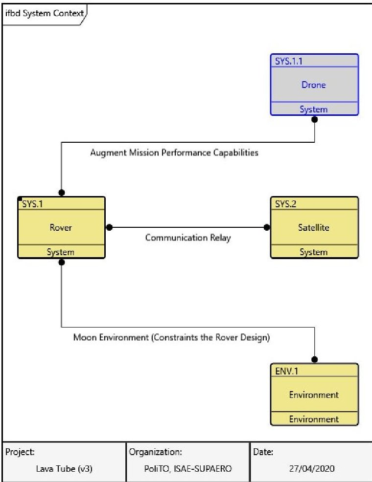
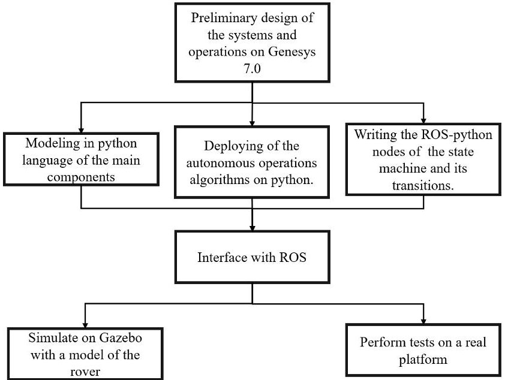
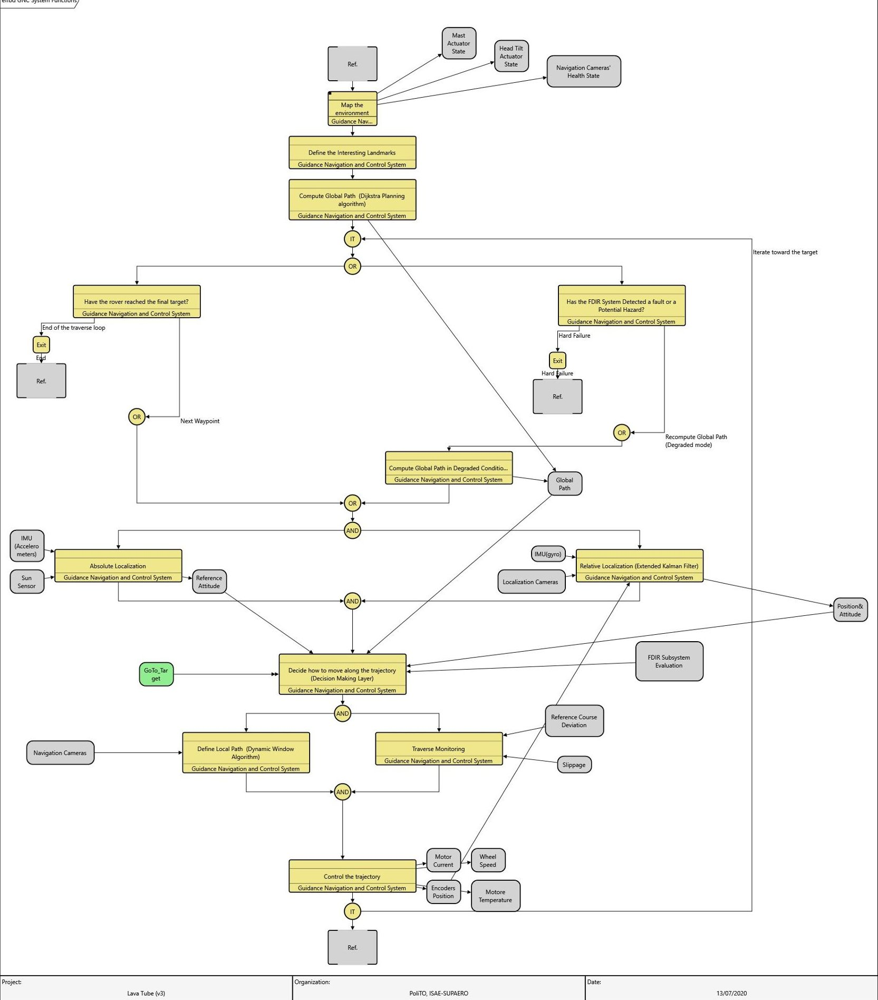

<!-- PDF_PAGE: 1 -->

## OATAO

Open Archive Toulouse Archive Ouverte

# Open Archive Toulouse Archive Ouverte (OATAO)

OATAO is an open access repository that collects the work of some Toulouse researchers and makes it freely available over the web where possible.

This is an author's version published in: https://oatao.univ-toulouse.fr/26743

Official URL:

To cite this version:

Rimani, Jasmine and Lizy-Destrez, Stéphanie and Chaudemar, Jean-Charles and Viola, Nicole MBSE approach applied to lunar surface exploration elements. (2020) In: Model Based Space Systems and Software Engineering (MBSE2020), 28 September 2020 - 29 September 2020 (Noordwijk, Netherlands).

Any correspondence concerning this service should be sent to the repository administrator: tech-oatao@listes-diff.inp-toulouse.fr

<!-- PDF_PAGE: 2 -->

# MBSE APPROACH APPLIED TO LUNAR SURFACE EXPLORATION ELEMENTS

Jasmine Rimani $ ^{a} $ , Stéphanie Lizy-Destrez $ ^{b} $ , Jean-Charles Chaudemar $ ^{c} $ , Nicole Viola $ ^{a} $

$ ^{a} $Department of Mechanical and Aerospace Engineering, Politecnico di Torino, Torino, Italy, Email: name.surname@polito.it $ ^{b} $Department of Aerospace Vehicles Designs and Control, ISAE-SUPAERO, Toulouse, France, Email: name.surname@isae-supaero.fr $ ^{c} $Department of Complex Systems Engineering Department, ISAE-SUPAERO, Toulouse, France, Email: name.surname@isae-supaero.fr

Abstract—The last two decades have shown that among the new drivers of the design of space systems the level of autonomy is a key element to ensure the success of a mission. The final aim is to monitor and direct the operations or counteract unforeseen events as efficiently as possible, even without the man in the loop. To effectively accomplish these new tasks, the decision making layer of the spacecraft should be able to evaluate the available resources and the overall state of health of the system. The Model-Based System Engineering (MBSE) framework can help to understand the general behavior of a complex system as it is an autonomous space platform. The MBSE scheme exhibits the links and the interdependency between the different phases of mission analysis and between the components. The study proposed in this paper follows the MBSE methodology to design an autonomous guidance, navigation, and control (GNC) subsystem of a planetary exploration rover and its collaborative drone. The study starts from the high-level requirements of a lunar exploration mission and ends with the preliminary design of a state-machine, that describes the behavior of an autonomous GNC. To ensure a high level of autonomy, the decision-making layer of the GNC takes into account the outputs of the failure detection, identification, and recovery (FDIR) subsystem and the overall health state of the rover. The FDIR subsystem embodies the idea of a multidisciplinary design where different inputs should be managed to ensure the safety of the overall system under study. The novelty of this analysis lays in using the MBSE to define the design box of the autonomous GNC. The logic behind the MBSE enables the designer to keep track of the effects of the high-level mission-related decisions and of the FDIR on the overall behavior of an autonomous GNC subsystem.

In the application presented in this paper, the preferred mean to study the mission and behavioral analysis is MBSE software Genesys 7.0 of Vitech Corporation [1]. While the state machine and the related artificial intelligence algorithms are designed in Robot Operating System (ROS). The described approach is applied to the case study of a collaborative rover and drone on the lunar surface. The mission is designed as a "precursor mission" to assess the safety of the lunar lava tubes as possible future human settlement.

## I. INTRODUCTION

In the specific case study presented in this paper, the reference mission aims to explore the lunar lava tubes. More in detail, the preferred target is the lava tubes' skylight locate in Marius Hills, in the equatorial zone of the Moon. The pit gives access to a lava tube at fifty meters below the surface of the Moon, which can be used as future human settlement [2]. The logic flow starts with the definition of the high-level requirements for the lava tubes exploration mission as (i) assure the safety inside the lava tubes, (ii) map the environment outside and inside the lava tubes, (iii) communicate with Earth. The rover should accomplish to requirement (iii) with the help of a relay satellite, while the piggy-back hopping/flying drone aid to fully accomplish the first and second tasks. The

system context is presented in fig.1. It defines the design box of the rover. In the "Moon Environment" box of fig.1 the qualitative and quantitative impact of radiation, temperature, and illumination are defined. In the "Satellite" box the planning of the available communication windows is inserted and it defines how long the system is required to be completely autonomous before contacting Earth. The "drone" box contains the components and the functions that permits to augment the rover exploration capabilities. The "rover" box is refined by the definition of its subsystems and their functions. Hence, the study progresses with the functional analysis and the identification of the main components for each subsystem of the rover and the constraints placed by the environment for each of them. The main subsystems considered for the rover are: (i) the mobility and GNC system; the structure and mechanism; (ii) the passive thermal control system; (iii) the power system; (iv) the communication system; (v) the command and data handling system; (vi) the payload that comprehends the drone and the scientific instrumentation to map the lava tubes from outside. This logical set-up phase is performed using the MBSE software Genesys 7.0 of Vitech Corporation, [1]. The Genesys 7.0 helps to describe the mission and the layers dependency. Actually, each component in the architecture is associated with a function and at least on state. Moreover it can be included in an operational mode, or it can cause a risk. The "linguistics" links used in the software ease the comprehension of the system dependencies. At the end of the study, a preliminary functional architecture of the autonomous navigation task can be obtained. This functional scheme can be exported as a Simulink model and it constitutes the skeleton of a preliminary state machine in Python to study the impact of the failure propagation of other hazards on the GNC system, [3], [4]. The state machine is then refined with a python code exploiting ROS (Robot Operating System), as middleware, and Gazebo, as the main simulation environment. The use of ROS enables an easier transition from the simulation to the real platform testing of the failure, detection, identification, and recovery algorithms. The methodology supported by Vitech Genesys 7.0 is called STRATA, an abbreviation of strategic layers [5]. As suggested by the name, the process is based on layers that gradually becomes more detailed at each design iteration [6]. The approach defines a first sizing box starting from the high-level requirements, constraints and boundaries. Usually, this first structure is called "system context", fig.1. After delimiting the design environment, the process focuses on the definition of the expected behaviours: what the system in the analysis should do and how well. This logical flow leads to the definition of the subsystems, or components, that can comply with the expected behavior. At the end of the

<!-- PDF_PAGE: 3 -->

loop, the overall architecture is verified against the expected performances and validated against the requirements. The process is then replicate with an increasing granularity up until the design team is satisfied with the results. Each new "layer" starts from the outcomes of the previous one [5]. In our case, the STRATA methodology is particularly appealing for its intrinsic characterization of constraints in an early stage of the design [5]. A good and clear picture of design boundaries helps understanding which can be the behaviours to avoid and which are the related risks. Therefore, the STRATA framework helps to develop the right mindset to analyse the behaviour of systems in contingency situations. Any change in the boundaries and constraints affects the complexity of the system under study and how it interfaces and interacts with the "system context". [6]. Similar study on a fault-tolerant or reconfigurable GNC have been presented in [4] and [7]. However, the main novelty of this project is the development of GNC algorithms and design boxes, keeping in the loop the mission requirements, functions, and operations. The point of view is that of the integrated health system management, where a decision at functional level may have a great impact on the component level.

Fig. 1. Lunar exploration rover interfaces between the environment and other subsystems in Genesys 7.0 [1] analysis framework.

## II. PROJECT OVERVIEW

In the previous section, it was briefly explained how the rover interacts with the other systems in the mission design and which tasks it is expected to perform. This section presents

Fig. 2. Interaction between Genesys 7.0, ROS and python language modelling.

the autonomous navigation functions and how they are linked together. The main two assumptions of the analysis presented can be summarized as: (i) in between the communication windows the rover should be completely autonomous; (ii) the modes of operations consider only the Moon surface operation and not the launch, traverse, landing and disposal operations. The surface mission operational modes are derived with the help of [8] and [9]. In our specific case, the second requirement of mapping the surroundings of the lava tubes generates the need for a "traverse mode". During this mode most of the power is dedicated to generating a map, to compute the rover trajectory and effectively move the rover. Therefore, it was identified as the most demanding scenario for the GNC. Inside the "operations" block, it is possible to define which faults can affect the system during its traverse on the lunar soil. These faults can then be associated with a "risk" or a "constraint" that affects the functional level of the analysis of the autonomous navigation architecture. The traverse related faults have been identified as goal errors (off-track) and system-related errors (one of the system parameters is off track) [10] [11]. From the most common "faults", it is possible to understand which are the important sizing parameters for the GNC: (i) the power available for the mobility system (that is limited by the battery's voltage, current, temperature and charge level); (ii) the terrain characteristics that impact the wheel slipping and the wheel sinkage; (iii) the overall weight of the rover; (iv) the wheels motor available torque; (v) the maximum traversable obstacle height; (vi) the steering characteristics; (vii) the goal velocities, (viii) the typical drifting from the global planned trajectory during "dead reckoning" navigation. These characteristics are coupled with the functional analysis of the autonomous navigation task following the guidelines of [12] and [13]. The first level functions are affected by the concerns raised by the goal and the system-related errors. The identified high level functions are: (i) map generation; (ii) global path planning; (iii) rover localization; (iv) local path planning computation; (v) obstacle avoidance; (vi) trajectory control; (vii) path execution; (viii) resources estimation. In

<!-- PDF_PAGE: 4 -->

the "resource estimation" block, the health of the overall rover, and its effects on the GNC are defined, eg. power level. The preliminary scheme of high-level functions and their connections for the traverse mode is presented in fig.3. The Genesys 7.0 output is used as input for designing the hierarchical state machine in ROS to study the impact of FDIR on the GNC. Each first-level function is defined by a series of tasks. Therefore each block is a state machine per se in which the output influences the overall autonomous navigation behavior. The layered approach of STRATA [5] helped to define the functional interfaces and the physical links needed to understand the impact of failures and degradation on the rover during traverse operations. The different levels of detail aided with the understanding of the overall behaviour without detailing each component of the GNC subsystem. Actually, following the flow of requirement-behaviour-component, it was easier to identify which component needed to be modelled to simulate nominal and contingency scenarios while studying operations. The overall simulation framework is based on python's language. The components with their state equations have been defined as classes following the inputs-output flow defined in Genesys 7.0 through interfaces and links. The definition in python classes is useful to immediately cross-check the logical flow with the one defined in Genesys 7.0 and to easily set up the python nodes that communicate through ROS toward the real or the simulated rover, fig.2. In the end, the Genesys 7.0 model output the inputs for the component design, the algorithms to estimate the best path based on the resources of the system and the state machine modes and functions. All those python-based classes are then build up to constitute a ROS node and interfaced directly to simulation and test, future work. The python code is then interfaced with ROS to send command, to simulate the failure or degradation of various subsystems and see the overall impact on the operations. These simulations are then used as feedback in the design to see if the architecture matches the expected behaviour during contingency situations.

## III. CONCLUSIONS

The study presented in this extended abstract follow the logic of MBSE to design an autonomous GNC system starting from the mission requirements. Exploiting The Genesys 7.0 software has an internal diagnostic tool to verify that all the objects, instance in the database are justified, rightly connected and make sense. as an analysis platform, it is possible to ensure the traceability and the impact of high-level decisions on the component and functional levels. The first step is to give a system context to the rover. Then the operational modes and the functional analysis at system and subsystem level are conducted in order to define the expected outputs and the concerns associated with the autonomous navigation task. The case study of a mission for the exploration of the lunar lava tubes is used to explain the logical process. In this analysis, the "traverse" operational mode is investigated as well as the tasks related to the autonomous GNC and the related faults. Eventually, the output of this analysis is a preliminary layout of the hierarchical state machine that can be implemented in

ROS and simulated with Gazebo or tested in the robotic laboratory. The MBSE scheme adopted in the project has helped the understanding of high-level boundaries and constraints at the very begging of the mission definition. Therefore, it was useful and crucial to understanding which contingency situations were interesting to study from an operational point of view. Moreover, it helped the definition of the inputs and outputs of each GNC function in the traverse mode and the related components. It eased the definition of the software architecture used during the simulations and the analysis of the operational layer of the rover. The most significant difficulty lies in the change of point of view: it was difficult to adopt and understand the logic of STRATA methodology at first. However, this approach helped understand which components where vital and which can be doubled in their use to keep on with the mission even during contingency situations. Overall, the management of the multidisciplinarity typical of MBSE has been of great asset in the study. The future work will focus on the three main branches for both the rover and the drone: the mission analysis, the study of failures and faults, and the study of the autonomous GNC. These three ingredients are highly intertwined together to assess fully autonomous operations. The aim is the creation of a comprehensive design framework to study the autonomy of surface robotics systems. More in detail, the simulation outcomes will be fed back to the MBSE model to verification that the real performances match the expected ones. The direction is to continuously iterate between the early design layer and the output on the behaviour of the system to derive sizing rules or good practices to define the autonomy level and better the performances of the system during contingency operations.

## REFERENCES

[1] Vitech Corporation. Genesys: Enhancing systems engineering effectiveness, 2020.

[2] T. Kaku et al. Detection of intact lava tubes at marius hills on the moon by selene (kaguya) lunar radar sounder. Geophysical Research Letter, 2017.

[3] Darwish A. Abdelghafar S Hassanien, A.E. Machine learning in telemetry data mining of space mission: basics, challenging and future directions. Artificial Intelligence Review, 2019.

[4] Peter Zane Schulte. A state machine architecture for aerospace vehicle fault protection. PhD Dissertation, Georgia Institute of Technology, 2018.

[5] Zane Scott David Long. A Primer for Model-Based System Engineering. Vitech Corporation, 2011.

[6] Brian London. A model-based systems engineering framework for concept development. Master of Science Dissertation, Massachusetts Institute of Technology, 2012.

[7] Edward Balaban et al. A mobile robot testbed for prognostics-enabled autonomous decision making. Annual Conference of the Prognostics and Health Management Society 2011, 2011.

[8] Lancaster R. Clemmet J. Silva, N. Exomars rover vehicle mobility functional architecture and key design drivers, 2013.

[9] Hélène PASQUIER (Editor). Space Operations: Inspiring Humankind's Future. Springer International Publishing, 2010.

[10] Mark Maimone. Challenges for planetary rover navigation.

[11] Stephen B Johnson (Editor). System Health Management: with Aerospace Applications. Wiley, 2011.

[12] Yang Gao (Editor). Contemporary Planetary Robotics: An Approach Toward Autonomous Systems. Wiley, 2016.

[13] Alex Ellery. Planetary Rovers. Springer-Verlag Berlin Heidelberg, 2016.

<!-- PDF_PAGE: 5 -->

Fig. 3. Autonomous GNC high-level functions during the "traverse" operational mode using Genesys 7.0 [1]. The grey and green boxes are the inputs or outputs to each behavior, while the yellow boxes comprehends the high-level function. The "Ref." at the start and at the end of the logical flow indicates the starting and the ending of the traverse mode functions.

