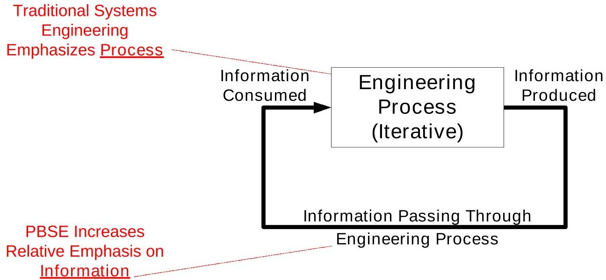
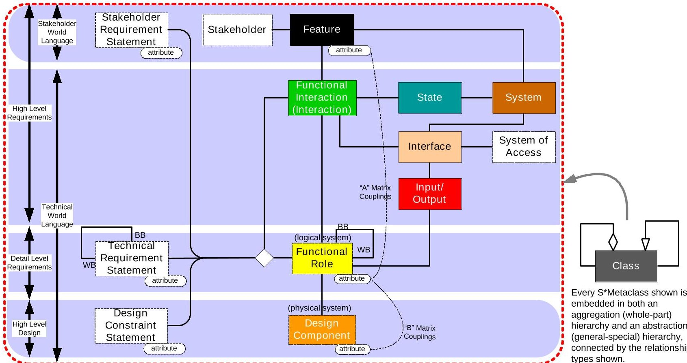
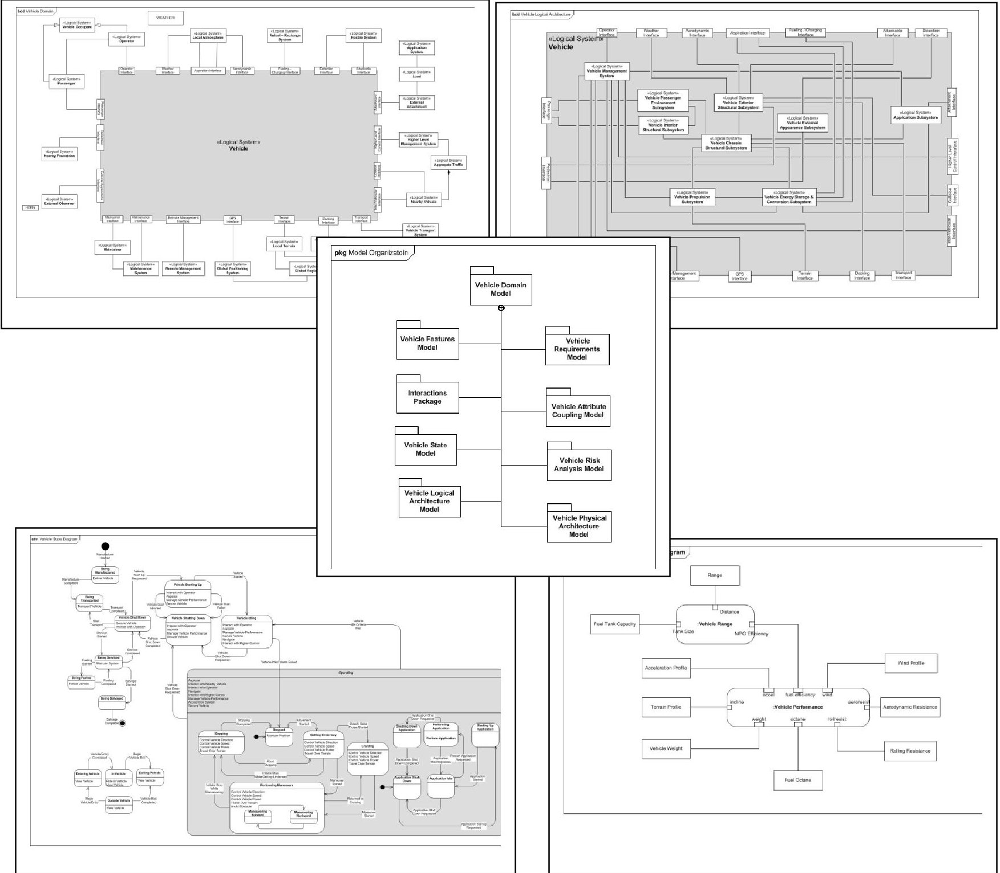
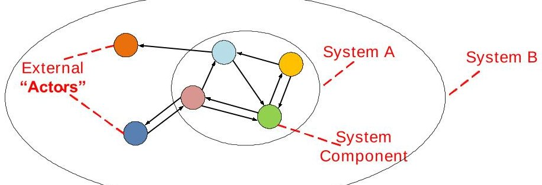
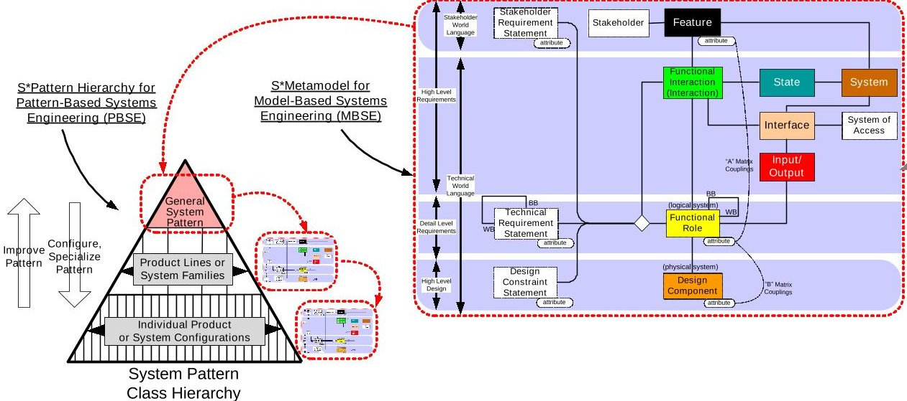
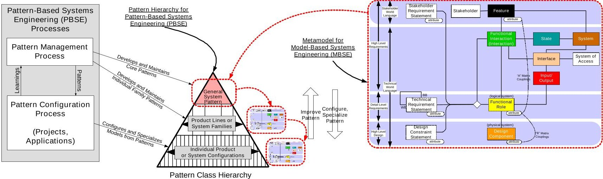
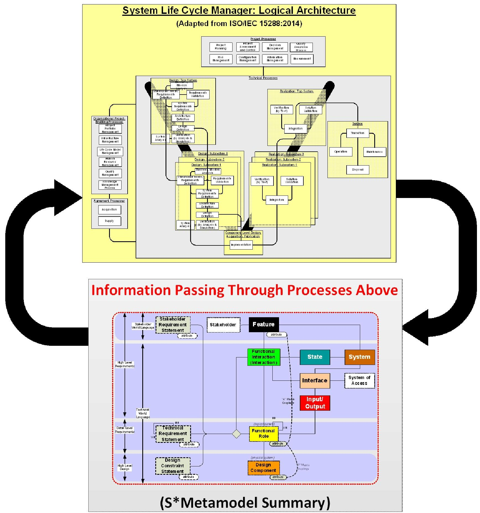

<!-- PDF_PAGE: 1 -->

# MBSE Methodology Summary:

# Pattern-Based Systems Engineering (PBSE), Based On S*MBSE Models

## Document Purpose:

This document is a methodology summary for Pattern-Based Systems Engineering using S*MBSE models. The material below, resulting from Patterns Challenge Team review, feedback, and related updates, is for contribution to the INCOSE-maintained on-line directory "MBSE Methodology: List of Methodologies and Methods".

The current content of that on-line directory may be found at http://www.omgwiki.org/MBSE/doku.php?id=mbse:methodology#mbse_benchmarking_survey

The sectional structure of the following sections conforms to the standard summary outline template used by the referenced methodology directory. The typical methodology descriptions in that directory are currently summaries, not detailed "how to" manuals, for each methodology.

<!-- PDF_PAGE: 2 -->

1 Title: Pattern-Based Systems Engineering (PBSE), Based On S*MBSE Models

## 2 Overview:

## 2.1 Executive Summary

This document summarizes Pattern-Based Systems Engineering (PBSE) Methodology, a form of MBSE based on use of the S*Metamodel. In this approach, re-usable, configurable S*Models (which are MBSE models conforming to the S*Metamodel) are created, then used and re-used across a range of different system configurations or family members, and improved over time as the point of distillation of learning. These re-usable, configurable S*Models are called S*Patterns to emphasize their recurring use, and are model-based substantial extensions of earlier, pre-MBSE engineering patterns.

As shown in Figure 1, methodologies for systems engineering are concerned with both (1) the engineering process and (2) the information that is consumed and produced by that process. In comparison to a strong historical systems engineering emphasis on process, this methodology increases the relative emphasis on the information passing through that process, with favorable impacts on process outcomes. That information is in the form of explicit MBSE system models of stakeholder value, requirements, design, risk, and other aspects, comparable in many aspects to other MBSE methodologies (Estefan 2008), but also strengthened (by the S*Metamodel) in certain areas, and compatible with contemporary modeling languages and tools. The emphasis on that information is on description of the engineered system, not the system of engineering:

Figure 1: The Engineering Process Consumes and Produces Information, Iteratively

PBSE builds on historical work in patterns, through introduction of MBSE models (many historical engineering patterns were not explicit MBSE models), expansion of pattern scope to whole system families, platforms, and domains (as opposed to smaller-scale localized patterns), and foundation on a stronger MBSE metamodel to express systemic phenomena critical to engineering applications with clearer connection to scientific understanding of systems phenomena.

<!-- PDF_PAGE: 3 -->

Benefits of the PBSE approach summarized in later sections of this document include:

1. Reduced recurring cost of modeling, along with shift of emphasis, from "learn how to model" (an abstract skill) to "learn the model (pattern)" in use by an enterprise, a more concrete knowledge of the enterprise's products, simplifying the introduction of MBSE methods.

2. Very rapid generation of first draft configured system requirements, design FMEAs, and other historical systems engineering artifacts, of higher quality and completeness.

3. A detailed MBSE approach to Platform Management for system families and product lines.

4. Direct support of contemporary interests in product line engineering, reference architectures, architectural frameworks, ontologies.

5. A structured means of representing and accessing learning across organizations.

6. Strengthened semantic integration of system requirements with the rest of the model.

7. Rapid generation of D-FMEA, A-FMEA, P-FMEA, and FTA analyses of risks on a more systematic and complete basis, more deeply integrated with the rest of the system model.

8. Compatibility with contemporary modeling language standards.

9. Direct mapping into contemporary modeling tools, PLM information systems, and other COTS and enterprise systems, increasing the value of existing information technologies.

10. Deeper support for federated data across differing information systems, for integration with emerging open systems life cycle standard technologies.

11. Strong expression of fitness landscapes as the basis for selection, trades, improvements, decisions, innovations, configuration, and understanding of risk and failure.

12. Strong expression of life cycle and operational states of systems

13. Explication of the System Phenomenon as a real world-based science and math foundation for systems engineering, amenable to systems science, connected to historical math/science models of other engineering disciplines, and encouraging discovery and expression of systemic phenomena of higher-level systems.

14. Explication of key patterns in both Engineering Systems and Systems of Engineering, including the Embedded Intelligence (Management) Pattern, the Systems of Innovation Pattern generalization of ISO 15288, and its Agile Systems Life Cycle Pattern form.

## 2.2 Introduction to the S*Metamodel

Engineering disciplines such as ME, EE, ChE, CE, etc., are based upon underlying models of phenomena (mechanical, electrical, chemical, etc.) that are the fruits of physical sciences, mathematics, and philosophy. Newton's laws of motion, Maxwell's equations, and other underlying models describe aspects of the nature of subject systems, not engineering procedures for those systems, while opening up many procedural avenues that operate within the constraints of those underlying models of Nature. In a similar fashion, the S*Metamodel describes the underlying "systemic" aspects of systems of interest, based upon the fruits of science and mathematics. In the tradition of those same physical sciences (Gingerich 2004), these underlying models (whether specific to one technical discipline or systems in general) seek the "smallest model" capable of (verifiably) describing or explaining the phenomena of interest (Schindel 2011).

<!-- PDF_PAGE: 4 -->

The rise of a number of MBSE methodologies (Estafan 2008) and system representation standards ISO10303-233 2012) has provided many of the needed elements of that underlying "smallest model" framework, and the S*Metamodel builds on those, while adding some important missing and compressing other redundant aspects. Throughout, this is in the spirit of seeking out the smallest (simplest) verifiable model necessary to describe systems for purposes of engineering and science.

Figure 2is a simplified summary of some of the key portions of the S*Metamodel. This diagram is not the sort that is produced in a related engineering project (illustrated in Figure 3), but instead is a representation of the underlying classes and relationships upon which those project-specific models are based. Those project-specific models may be in any modeling language (including but not limited to SysML, IDEF, or otherwise) and supported by any engineering tool or information system, as in Figure 3.

Whereas the formal S $ ^{*} $ Metamodel is represented in a UML derivative, the conceptual awareness extract of Figure 2is a simplified representation of selected S $ ^{*} $ Metaclasses and key relationships that connect them. It summarizes some of the most important S $ ^{*} $ Metamodel concepts (discussed in the sections below) leading to some of the above benefits. Additional references are listed later below.

Figure 2: Summary of Some of the Key Portions of S*Metamodel

## In reading Figure 2:

- The color coding of Figure 2 provides an informal reminder of stereotypes mapping in formal modeling languages (e.g., SysML), and related views--especially for non-technical views and viewers.

- A Stakeholder is an entity having a value stake in the behavior or performance of a system.

<!-- PDF_PAGE: 5 -->

- A Feature is an aspect of the behavior or performance of a system that has stakeholder value, described in the concepts and terminology of that stakeholder, and serving as the basis of selection of systems or system capabilities by or on behalf of the Stakeholder. Features are parameterized by Feature Attributes, which have subjective stakeholder valuations.

- (Functional) Interaction means the exchange of energy, force, mass, or information between system components, each of which plays a (Functional) Role in that Interaction.

- Functional Roles are described solely by their behavior, and parameterized by Role Attributes which have objective technical valuations.

- The State of a system determines what behavior it will exhibit in future Interactions. The State of a system may be changed by those Interactions.

- Input-Outputs are exchanges of energy, force, mass, or information between system components, during an Interaction.

- An Interface is an association of a System (which has the Interface) with one or more Input-Outputs (which flow through the Interface), Interactions (which describe behavior at the Interface), and Systems of Access (which provide the medium of transport between Interfaces).

- A Design Component is described solely by its identity or existence, not its behavior; that behavior is described by the Functional Role(s) allocated to that Design Component. Design Components are parameterized by Design Component Attributes that have only identity or existential valuations, but no behavioral aspects.

- Requirements Statements are prose or other descriptions of the behavior of Functional Roles during Interactions. They are the prose descriptive equivalent to the Roles they describe, and are parameterized by Requirements Attributes which are identical to the related Role Attributes.

- Matrix A Couplings describe the quantitative value dependencies (parametric couplings) between Stakeholder Feature Attributes and Functional Role Attributes, quantifying fitness space or trade space.

- Matrix B Couplings describe the quantitative value dependencies (parametric couplings) between Functional Role Attributes and Physical Design Component Attributes.

- "BB" and "WB" mean "Black Box" and "White Box".

It is important to remember that the above are underlying metamodel concepts. Practical S*Models are represented using whatever modeling languages and tools may be of value. Figure 3 illustrates selected SysML views of a vehicle S*Model:

<!-- PDF_PAGE: 6 -->

Figure 3: Example S*Model Extracts

## 2.2.1 Interactions, Requirements, and States

Three examples of the type of strengthening discussed above are (1) the S $ ^{*} $ Metamodel use of Interactions, (2) the related way that Requirements formally enter into the model, and (3) the States of the system. The following conceptual framework leads to the insight that all System Technical Requirements are manifest as behavior occurring during physical interaction of a subject system with its external environment:

<!-- PDF_PAGE: 7 -->

A. A system is a collection of interacting components. (A component can itself be a system.)

Figure 4: The System Perspective

B. By interact, we mean that one component exchanges energy, forces, mass flow, or information with another component, resulting in component changes of state.

C. By state of a component, we mean the condition of the component that determines its input- output behavior.

D. The behavior of an interacting component during an interaction, visible only externally to the other component(s) with which it is interacting, is referred to as the functional role of the component in the (functional) interaction. This is the case whether the behaviors of that component and the other components are known or not.

E. The only behavior that a functional role can exhibit is its input-output behavior, exhibited during interactions that occur in different modes or states.

F. For linear systems, external behavior can be entirely characterized by mathematical transfer functions, relating inputs to outputs in a particular mathematical form. Systems in general are not linear, so that mathematical form is in general not available. However, for all systems we can still retain the idea that requirements can only describe relationships between inputs and outputs (quantitative, temporal, probabilistic, or other behavior, and often expressed as prose Requirements Statements, which can now be recognized as describing nothing more or less than that input-output relationship.) (Schindel, 2005b)

G. The totality of the externally visible behavior of a system, added up over all its interactions with its environment, is the set of Requirements that describe the input-output relationships of that system during interactions with its external environment.

H. The problem of finding all the requirements for a system can thus be shifted to finding all the interactions of the system. (Schindel, 2013b) (It is understood that "all the requirements" is subject to pragmatic limitations on how much fidelity is needed for engineering purposes. However, business stories continue to arise of negative impact of important missed requirements in time-constrained projects. The approach describes here provides a demonstrated means of more quickly arriving at "enough" of the interactions and requirements to significantly improve on earlier real world experiences, in both completeness and speed.)

Interactions provide a powerful way to analyze systems using MBSE models. This includes both "hard" manufacturing production process, equipment, and material transformations (Schindel, 2012), and "soft" psychological and emotion-laden human interactions (Schindel, 2006) important in human-system interaction analysis and integration.

<!-- PDF_PAGE: 8 -->

## 2.2.2 Selectable System Features and Stakeholder Value

The S $ ^{*} $ Feature model subset of the overall S $ ^{*} $ Metamodel illustrates the integrative and compressive impacts of the S $ ^{*} $ Metamodel, through the different parts played by Features in these models, as follows.

For human-engineered systems, and for systems in nature for which selection processes occur, selectable system Features are described by the S $ ^{*} $ Metamodel. These describe the value landscape of stakeholders for the subject system. (In the case of natural systems, not in the setting of human-engineered and used systems, it is frequently found that there are nevertheless selection processes at work in Nature, so that the framework is still applied based on the selectable Features that are "valued" by such selection processes (Schindel, 2013a).)

S*Models are intended to identify all the classes of Stakeholder for systems of interest, not just direct users or customers, and to establish modeled Feature sets for all those Stakeholders. This (Features) portion of an S*Pattern is then used to configure the pattern for individual applications, product configurations, or other instances. It turns out that the variation of configuration across a product line is always for reasons of one stakeholder value or another, so Feature selection becomes a proxy for configuring the rest of an S*Pattern into a specifically configured instance model.

Because S*Features and their Feature Attributes (parameters) characterize the value space of system stakeholders, the resulting S*Feature Configuration Space becomes the formal expression of the trade space for the system. It is therefore used as the basis of analysis and defense of all decision-making, including optimizations and trade-offs. The S*Feature Space also becomes the basis of top-level dashboard model views that can be used to track the technical status of a project or product. All "gaps" and "overshoots" in detailed technical requirements or technologies are projected into the S*Feature Space to understand their relative impact.

Because the S*Stakeholder and Feature model subset is intentionally comprehensive across stakeholder issues, Features play a direct role in modeling failure mode Effects, as discussed in the next section.

## 2.2.3 Failure Modes and Effects

Models based on the S*Metamodel leverage Failure Impacts (negating aspects of Features), Counter- Requirements (negating aspects of Requirements behavior), Failure Modes (off-nominal behavior states), and modeled relationships between them to generate high-quality FMECA table drafts or other risk management views with reduced effort and increased coverage. This approach deeply integrates the information and processes of other parts of the engineering cycle with the risk analysis process, as illustrated in (Schindel, 2010).

## 2.2.4 Attributes and Attribute Couplings

Several classes of the S $ ^{*} $ Metamodel include modeled attributes, which are variables (parameters, characteristics) that further parameterize S $ ^{*} $ Models—these may be numerically valued, or discrete valued, or enumerated list valued, or of other type. In principle any S $ ^{*} $ Metaclass can have attributes, but three are particularly emphasized: attributes of Features, Roles, and Physical Components.

<!-- PDF_PAGE: 9 -->

Feature Attributes parameterize the value space of stakeholders, in the language and conceptual framework of those stakeholders; as such, they often describe subjective stakeholder variables, such as Comfort, Risk, or Responsiveness. They include all stakeholder Measures of Effectiveness (MOEs). Role Attributes parameterize the space of technical behavior specification, and exactly these same attributes are associated with the Requirements Statements. They parameterize objective, testable technical descriptions of behavior, such as Thermal Loss, Reliability, or Maximum Speed, and include all technical measures of performance. Physical Component Attributes describe nothing about behavior (which is focused on the two previous attribute types), but instead describe identity and existence, such as Product Model, Part Number, Serial Number, Material of Composition, Department, or Employee ID.

Attribute Couplings are part of S*Models, describing how the values of these different attribute types vary with respect to each other. For example, Figure 2 shows that A-Couplings describe how the stakeholder values of Feature Attributes vary with respect to change in the values of technical Role Attributes. B-Couplings describe how technical behavior-parameterizing Role Attributes values vary as the values of Physical Component Attributes vary. In S*Models and S*Patterns, these modeled Attribute Couplings distill and integrate into the model what has been learned quantitatively by physical sciences, experiment, stakeholder observation, experience, and first principles. They include formulae, graphical curves, data tables, or other representations of parametric interdependencies. They also provide a means of transforming degrees of freedom, as in Dimensional Analysis, to seek out fundamental representations (Buckingham 1914) (e.g., Reynolds number in fluid flow, etc.).

## 2.3 S*Models and S*Patterns

S*Models are MBSE models conforming to the S*Metamodel (Figure 2). (That is, they contain Features, Interactions, Roles, States, Design Components, Interfaces, Requirements, Attributes thereof, couplings between them, etc.). S*Patterns are S*Models (with all their parts) that have been constructed to cover a system configuration space bigger than single system instances, and are sufficiently parameterized and abstracted to be configurable to more specific S*Models, and thereby reusable, as in Figure 5 (Schindel and Smith, 2002), (Schindel, 2005a), (Bradley, et al, 2010), (Schindel, Peterson, 2013):

Figure 5: S*Patterns are S*Models of System Families Configurable/Reusable as Models of Individual System Types

<!-- PDF_PAGE: 10 -->

Like S*Models, S*Patterns may be expressed in any system modeling language (e.g., SysML, IDEF, etc.) and managed in any COTS system modeling tool or repository, by an S*Metamodel mapping or profile.

## 2.3.1 Heritage of Patterns in Engineering

"Patterns" in a general sense have a lengthy history in engineering. Although what is described here are S*Patterns, traceable to that history, there are some significant differences, so that awareness of the heritage of earlier types of engineering patterns is of value. This would include:

- Patterns in Civil Architecture: Christopher Alexander pioneered a body of thought concerning recurring patterns in buildings, towns, and other civil architecture. (Alexander, 1977) Alexandrian patterns are not model-based in the MBSE sense, but are prose descriptions in a basic template developed by Alexander. These patterns frequently describe recurring individual problems and solutions, usually of scope smaller than an entire system—hence thought of as describing reusable components of various scales. Alexander's patterns served as an inspiration to those in other domains, including the following.

- Software Design Patterns: The software community advanced the use of "design patterns" for software, based on the Alexandrian pattern prose template approach (Gamma et al, 1995). Like its civil predecessors, these prose patterns were not model-based in the sense of MBSE, and typically described re-usable component design ideas of scope smaller than a whole system.

- Systems Engineering Patterns other than S*Patterns: The SE community has contributed to patterns at the Systems level of representation. This includes the work of Robert Cloutier (Cloutier, 2008), Cecilia Haskins (Haskins, 2008), and others. Some of these have been strongly aligned with the Alexandrian prose descriptive framework, not in MBSE form. Frequently they have described reusable solutions to recurring problems in particular contexts, accumulated as re-usable libraries.

- Dimensional Laws as Patterns: As early as Lord Rayleigh's work in 1877 (Rayleigh 1915), scientific and engineering efforts have sought to describe patterns of similarity of behavior across system scales, as seen in the "method of dimensions", later solidified by (Buckingham, 1914).

While recognizing and building on these ancestors, S $ ^{*} $ Patterns are distinguished by the following:

- S*Patterns are expressed as formal MBSE models.

- S*Patterns conform to the S*Metamodel, describing the "smallest model necessary for the purposes of engineering and science"—therefore larger in scope (Features, Interactions, etc.).

- S*Patterns are typically models of "whole systems", and are aimed at expressing recurring patterns at this higher level, not just patterns of system components. (There is nothing to prevent the development of smaller-scale S*Patterns, and indeed the larger S*Patterns frequently invoke subsystem S*Patterns.) See also Section 2.2.4.

- S*Pattern are formally configurable, through configuration rules driven from selectable, configurable Features, so not intended as only suggestive of general form.

- Configured S*Patterns are S*Models (formal MBSE models) of particular system types.

<!-- PDF_PAGE: 11 -->

## 2.3.2 Heritage of Patterns in Physical Sciences; System Science Goal

Patterns have a longer history (especially the most recent 300 years) in the physical sciences, even if not always called "patterns" in that context. Since the time of at least Galileo and Newton (and arguably longer), the focus of physical sciences have been to create "smallest possible" descriptive, explanatory, verifiable models of repeating regularities observed in nature, compressing behavior into predictive models. Since Newton, these have most often been expressed as formal mathematical (e.g., Newton's laws) and structural (e.g., Chemical Periodic Table) models that are closer to the model-based approach of S $ ^{*} $ Patterns than earlier prose template based Alexandrian patterns.

One goal of S*Patterns is to more strongly ground Systems Engineering in the scientific/mathematical "phenomena" of systems, just as Electrical Engineering is grounded in electromagnetic phenomena. Although it is not immediately obvious what "system phenomena" might mean here, this turns out to be answerable. It is the reason for the definition of Section 2.1.1: "A System is a set of interacting components."

When the behaviors of isolated individual components are integrated (and constrained) by an overall Interaction, the emergent behavior of the resulting System may be quite different than simply listing all the behaviors of the individual components in isolation. This well-known fact is the "phenomenon" of systems, and is the basis of both (1) the power and value of engineered systems, but also (2) many of the challenges of engineered systems. It is described by the Principle of Least Action, expressed in models through the Calculus of Variations by the minimization of the Action Integral, the Euler-Lagrange Equations, and Hamiltonian and Lagrangian mathematical models (Levi, 2011). It is one of the traditional paths for textbook derivation of the equations of motion or other forms of physical laws of the more specific "fundamental" physical phenomena of mechanics and the rest of physics, electromagnetics, and other discipline-specific phenomena. It is one traditional means by which Newtonian models of individual component attributes and behaviors is replaced by Lagrangian descriptions of system level attributes and system state space trajectory behaviors. (Sussman and Widsom 2001)

Specialists in the individual engineering disciplines sometimes argue that their fields have "real" physical phenomena, physical laws, and first principles, claiming that generalized systems do not. However, the above reasoning can be used to demonstrate that the opposite is true. For each of the specialized disciplines, the emergent models and laws of their physical phenomena have been found to be derivable through the above approach, applied to Interactions of System Components from one phenomenological level lower. Thus, the laws and phenomena of Chemistry can be seen to emerge from those of underlying Physics, beginning at and just below the interaction of element atoms and molecules, behavior of bonds, etc. No one would argue that chemical laws are not relatively fundamental, valuable, and powerful, but it is also understood that they emerge from lower level phenomena component interactions of physics that are even more fundamental.

Thus it can be seen that the System Phenomenon is the basis for the "fundamental" laws of each of the specialized disciplines, and that in a sense those phenomena are less fundamental than the (recurring at each emergent system level) System Phenomenon. The importance of this perspective is not just

<!-- PDF_PAGE: 12 -->

philosophical or a rivalry between disciplines. Rather, it reminds us that there are ever-higher levels of systems that have their own emergent "phenomena", "first principles", and "physical laws". At one time, those of interest were whole vehicles, aircraft, or marine vessels, now better understood. Among those of critical future interest to systems engineers and system scientists are biological systems (whose behavior emerges from underlying chemistry and physics) as well as market systems and economies, health care delivery or other societal service systems, military conflict systems, Internet-mediated systems, and other social systems.

Systems Engineering requires a strong enough underlying Metamodel and Systems Science to equip it for the challenges and opportunities of these higher level systems. The S*Interaction model is at the center of that framework.

## 2.3.3 Architectural Frameworks, Ontologies, Reference Models, Platforms, Families, Product Lines

S*Patterns are concerned with "whole systems", as described above. As such, they are fundamental to supporting the life cycles of Platform Products, Product Families, and Product Lines. They may also be compared to whole-system level descriptions provided by Architectural Frameworks, Ontologies, and Reference Models, as follows.

A Platform is a system family abstraction that can be configured to serve the needs of different applications, market segments, customers, regulations, or other specialized requirements that apply in some cases but not others (Meyer and Lehnerd, 2011). Platforms leverage the economic value of systems. S*Patterns specify, at both high and detail levels, the requirements, designs, failure modes and risks, verifications, applicabilities, configuration rules, and other aspects of platforms. So, S*Patterns can be used to implement Platform Life Cycle Management (Schindel, 2014). Because they are S*Metamodel compliant, they include the minimum set of model elements necessary for product life cycle management.

Product Lines and Families are terms variably used to describe either the different system configurations of the above Platform families, or else the component subsystems that are variously configured and combined to make up those larger systems. All of these may be described by S $ ^{*} $ Patterns.

Product Line Engineering (PLE) refers to the engineering processes and support approach used to engineer product line families and the component systems from which they are formed. Emerging approaches such as Product Line Engineering (ISO 26550, 2013) describe approaches to certain aspects of PLE. S*Patterns support the implementation of PLE approaches and practices.

Architectural Frameworks are model-based descriptions of repeat-use information frameworks for descriptions of certain aspects of systems, for a given enterprise, domain, or other setting. (ISO 42010, 2011) As such, an Architectural Framework may target less than all the classes of information necessary to describe a system over its life cycle, but could (and in some cases may be intended to) cover all those information classes. S*Patterns cover all the classes for the whole life cycle. Therefore, one could say that an S*Pattern is an Architectural Framework that has been built out sufficiently to cover the S*Metamodel scope, and for which no additional (redundant) information is included.

<!-- PDF_PAGE: 13 -->

An Ontology, in information science, is a formal model naming and defining the types, properties, and inter-relationships of the entities that are fundamental for a particular domain. (Genesereth and Nilsson, 1987). How are Ontologies related to S*Patterns? A specific ontology could in principle include all the classes and relationships of a specific S*Pattern (e.g., a Vehicle Manufacturing System Pattern), but most ontologies do not try to cover that much detail. Such an Ontology might roughly be said to describe the name space of an S*Pattern, but the relationships that practitioners typically include in Ontologies are less parsimonious than those of the S*Metamodel, so that Ontologies can become relationally more complex—looking, even if not as informative in detail. The S*Metamodel itself is certainly an Ontology, for S*Models. One approach to improving the utility of Ontologies for systems can be to start with an S*Pattern and identify certain subset views of it as Ontological Views. In that approach, the Ontology is a byproduct of the S*Pattern, automatically synchronized with it because it is a viewable subset of the S*Pattern.

## 2.3.4 Patterns, Configurations, Compression, Specialization

As illustrated by the "down stroke" in Figure 5, a generic S*Pattern of a family of systems is specialized or "configured" to produce an S*Model of a more specific system, or at least a narrower family of systems. Since the S*Pattern is itself already built out of S*Metamodel components, for a mature pattern the process of producing a "configured model" is limited to two transformation operations:

1. Populate: Individual classes, relationships, and attributes found in the S $ ^{*} $ Pattern are populated (instantiated) in the configured S $ ^{*} $ Model. This can include instances of Features, Interactions, Requirements, Design Components, or any other elements of the S $ ^{*} $ Pattern. These elements are selectively populated, as not all necessarily apply. In many cases, more than one instance of a given element may be populated (e.g., four different seats in a vehicle, five different types of safety hazard, etc.). Population of the S $ ^{*} $ Model is driven by what is found in the S $ ^{*} $ Pattern, and what Features are selected from the S $ ^{*} $ Pattern, based on Stakeholder needs and configuration rules of the pattern, built into that pattern.

2. Adjust Values of Attributes: The values of populated Attributes of Features, Functional Roles/Technical Requirements, and Physical Components are established or adjusted.

This brings into sharp focus what are the fixed and variable aspects of S*Patterns (sometimes also referred to as "hard points and soft points" of platforms). The variable data is called "configuration data". It is typically small in comparison to the fixed S*Pattern data. Since users of a given S*Pattern become more familiar over time with its fixed ("hard points") content (e.g., definitions, prose requirements, etc.), this larger part is typically consulted less and less by veterans, who tend to do most of their work in the configuration data (soft points). That data is usually dominated by tables of attribute values, containing the key variables of a configuration. Since this is smaller than the fixed part of the pattern, in effect the users of the pattern experience a "data compression" benefit that can be very significant, allowing them to concentrate on what is or may be changing. (Schindel, 2011).

<!-- PDF_PAGE: 14 -->

## 2.3.5 Distillation and Representation of Learning; Accessibility to Learning

As also illustrated by the "up stroke" in Figure 5, discoveries are encountered during projects involving configured S*Models, and some of these cause improvements to be fed back to the S*Pattern, which thereby becomes a point of accumulation of all learning about what is known about the family of systems that pattern represents. This reduces the amount of "searching" required of future project users to take advantage of what is already known, and in particular reduces the likelihood of re-learning the same lessons by mistake and re-work. Notice that this "distillation and abstraction" process is quite different than simply accumulating a lot of separate "lessons learned" in a large searchable space—it is instead translating them into their foundational implications at the pattern level, for future users of the pattern, as a single point of learning well-known and accessible to distributed users. It is the S*Pattern equivalent of representation of scientific learning, and is also a model-based analogy to governance of prose engineering standards.

## 2.3.6 Specific Emergent Patterns; The Embedded Intelligence Pattern

Over time, the "upstroke" learning process shown in Figure 5 leads to the emergence of various abstract S*Pattern content, some of which can be distilled and used in connection with other S*Patterns. For example, the Embedded Intelligence Pattern (also known as the Management Pattern) predicts the underlying framework of any system of embedded controls, whether in the form of humans, embedded automated controllers, or enterprise information systems. This becomes a power general pattern that can be used in any system requiring embedded control, intelligence, or human operators/managers/pilots. These patterns extend the content of S*Methodology with powerful pattern level content for specifying automated and human controls (Peterson and Schindel, 2014).

## 2.4 Impact on System Life Cycle Processes

Sections 2.2 through 2.2.6 are entirely about the information flowing through the processes of Figure 1, and not about what those processes are. However, the nature of the information flowing through, described by the S $ ^{*} $ Metamodel, significantly improves the details of how those processes work specifically, their efficiency, productivity, and effectiveness.

The highest level summary of the impact on the processes is summarized by the left side of Figure 6, which shows the separation of business processes into a Pattern Management Process, typically performed by very few people, managing the S*Pattern, and the Pattern Configuration Process, typically performed by a larger number of people spread across multiple system delivery projects or life cycle activities. This larger group's work is made more efficient, productive, or effective, while the smaller group's work is made more impactful. These impacts are basic to the nature of PBSE, and are caused by:

1. Expertise and work of a few expert Pattern Owners is leveraged across numerous Pattern Configuration users, making both more effective.

<!-- PDF_PAGE: 15 -->

2. The more numerous pattern users in the Pattern Configuration Process "learn the model, not modeling". For example, it is much more feasible for many automotive engineers to learn and effectively utilize their company's Vehicle Pattern in individual projects than to expect them to learn how to model "from scratch" and perform modeling across numerous projects.

3. Pattern content is typically more complete than what would occur at first to an engineer or team on one project. For example, many S $ ^{*} $ Pattern requirements statements and failure modes and effects will not have occurred to project engineers, who will find them of immediate value.

4. A configured pattern is only a "first draft" of specifications on a project—as if an expert assistant was available to write a first draft. Nothing prevents the project from improving that draft, like any other draft. PBSE is not intended to turn over human thinking to a pattern or computer.

Both of the two general processes on the left side of Figure 6 have their own PBSE forms of the ISO/IEC/IEEE 15288 standard Life Cycle Processes (ISO 15288, 2014), enhanced in each case by the PBSE nature of the approach. This is summarized by Figure 7, which further details what Figure 1 only summarized. (For additional detail, each of the Process Areas shown has in turn been detail modeled using MBSE models of the processes as a system in its own right, called the System of Innovation S*Pattern.)

Figure 6: Separation of Pattern Management Process from Pattern Configuration (Project) Process

<!-- PDF_PAGE: 16 -->

Figure 7: The ISO 15288 Processes Apply, Enhanced by PBSE (Compare to Figure 1)

<!-- PDF_PAGE: 17 -->

## 2.5 Applications to Date

PBSE has been applied for about two decades, across a variety of domains in commercial, defense, and institutional environments. Figure 8 lists some of these, and the references provide example content.

<table border="1"><tr><td>Medical Devices Patterns</td><td>Construction Equipment Patterns</td><td>Commercial Vehicle Patterns</td><td>Space Tourism Pattern</td></tr><tr><td>Manufacturing Process Patterns</td><td>Vision System Patterns</td><td>Packaging Systems Patterns</td><td>Lawnmower Product Line Pattern</td></tr><tr><td>Embedded Intelligence Patterns</td><td>Systems of Innovation (SOI) Pattern</td><td>Consumer Packaged Goods Patterns (Multiple)</td><td>Orbital Satellite Pattern</td></tr><tr><td>Product Service System Patterns</td><td>Product Distribution System Patterns</td><td>Plant Operations &amp; Maintenance System Patterns</td><td>Oil Filter Pattern</td></tr><tr><td>Life Cycle Management System Patterns</td><td>Production Material Handling Patterns</td><td>Engine Controls Patterns</td><td>Military Radio Systems Pattern</td></tr><tr><td>Agile Systems Engineering Life Cycle Pattern</td><td>Transmission Systems Pattern</td><td>Precision Parts Production, Sales, and Engineering Pattern</td><td>Higher Education Experiential Pattern</td></tr></table>

Figure 8: Examples of PBSE Applications to Date

## 3 Tool Support:

PBSE and its supporting S*Metamodel are tool-independent by intention. Substantially any COTS modeling, engineering, or PLM tool can be made to support PBSE, by the use of an S*Metamodel Map for the specific COTS tool. Such mappings have already been created for a number of tools, including IBM/Rational DOORS $ ^{\mathrm{TM}} $ , Siemens Team Center $ ^{\mathrm{TM}} $ Systems Engineering, Dassault Systemes ENOVIA $ ^{\mathrm{TM}} $ Sparx Enterprise Architect $ ^{\mathrm{TM}} $ for SysML $ ^{\mathrm{®}} $ , IBM Rhapsody for SysML $ ^{\mathrm{®}} $ , generic standard SysML, and others. Each such mapping is a detail specification of the formal mapping of S*Metamodel classes, relationships, and attributes into a specific schema native to the target tool or information system, along with supporting configuration information.

## 4 Offering / Availability:

The general PBSE approach to enhanced MBSE is being shared through and explored by the members of the Patterns Challenge Team of the INCOSE MBSE Initiative. This cross-industries team has been and continues pursuing a number of PBSE applications and projects (including joint projects with other INCOSE working groups) which are shared through the INCOSE Patterns Challenge Team's MBSE wiki / web site posted resources, reference, and information assets. Refer to the Resources and References below.

Where commercial support may be requested, ICTT System Sciences and its partners provide related services, and the third party COTS tools above are supported by their commercial suppliers.

<!-- PDF_PAGE: 18 -->

## 5 Resources and References:

The contextual significance of the following resources and references is best understood from their citation appearances in the material above. Some of the following may be downloaded from the (INCOSE PBSE Challenge Team, 2014) reference link provided below.

1. (Alexander et al, 1977) Alexander, C., Ishikawa, S., Silverstein, M., Jacobson, M., Fiksdahl-King, I., and Angel, S. A Pattern Language. Oxford University Press, New York, 1977.

2. (Bradley et al, 2010) J. Bradley, M. Hughes, and W. Schindel, "Optimizing Delivery of Global Pharmaceutical Packaging Solutions, Using Systems Engineering Patterns" Proceedings of the INCOSE 2010 International Symposium, 2010.

3. (Buckingham 1914) Buckingham, E., On Physically Similar Systems: Illustrations of the Use of Dimensional Analysis", Phys. Rev. 4(4): 345, Bibcode: 1914.

4. (Cloutier, 2008) Cloutier, R., Applicability of Patterns to Architecting Complex Systems: Making Implicit Knowledge Explicit. VDM Verlag Dr. Müller. 2008.

5. (Cook, Schindel, 2015) Cook, D., and Schindel, W., "Utilizing MBSE Patterns to Accelerate System Verification", to appear in Proc. of the INCOSE 2015 International Symposium, Seattle, WA, July, 2015.

6. (Estefan, 2008) Estefan, J. 2008. "Survey of Candidate Model-Based Systems Engineering (MBSE) Methodologies", rev. B. Seattle, WA, USA: International Council on Systems Engineering (INCOSE). INCOSE-TD-2007-003-02. Accessed April 13, 2015 at http://www.omgsysml.org/MBSE_Methodology_Survey_RevB.pdf

7. (Gamma et al, 1995) Gamma, E., Helm, R., Johnson, R., Vlissides, J. Design Patterns: Elements of Reusable Object-Oriented Software. Addison-Wesley Publishing Company, Reading, MA, 1995.

8. (Genesereth and Nilsson, 1987) Genesereth, M. R., & Nilsson, N., Logical Foundations of Artificial Intelligence, San Mateo, CA: Morgan Kaufmann Publishers, 1987.

9. (Gingerich 2004) Gingerich, O., The Book Nobody Read: Chasing the Revolutions of Nicolaus Copernicus, New York: Walker & Co. Publishing, 2004.

10. (Haskins, 2008) Haskins, C., "Using patterns to transition systems engineering from a technological to social context", Systems Engineering, Volume 11, Issue 2, pages 147-155, Summer 2008.

11. (INCOSE PBSE Challenge Team, 2014) MBSE wiki / web site of Patterns Challenge Team: http://www.omgwiki.org/MBSE/doku.php?id=mbse:patterns:patterns

12. (ISO10303-233 2012) ISO 10303-233:2012 "Industrial automation systems and integration -- Product data representation and exchange -- Part 233: Application protocol: Systems engineering", 2012.

13. (ISO 42010, 2011) ISO/IEC/IEEE 42010:2011 - "Systems and software engineering - Architecture description" 2011.

14. (ISO 26550, 2013) ISO/IEC 26550:2013, "Software and systems engineering -- Reference model for product line engineering and management", 2013.

15. (ISO 15288, 2014) ISO/IEC 15288: "Systems Engineering—System Life Cycle Processes". International Standards Organization (2014).

<!-- PDF_PAGE: 19 -->

16. (Levi, 2011) Levi, M., Classical Mechanics with Calculus of Variations and Optimal Control, American Mathematical Society, Providence, Rhode Island, 2014.

17. (Meyer and Lehnerd, 2011), Meyer, M., Lehnerd, A., The Power of Product Platforms, Free Press, 2011.

18. (Peterson and Schindel, 2014) Peterson, T., and Schindel, W., "Pattern-Based Systems Engineering: Leveraging Model-Based Systems Engineering for Cyber-Physical Systems", Proc. of NDIA GVSETS Conference, 2014.

19. (Rayleigh 1915) Lord Rayleigh, "The Principle of Similitude", Nature, 95(2368): 66-8, Bibcode: 1915Natur..95...66R.

20. (Schindel and Smith, 2002) Schindel, W., and Smith, V., "Results of applying a families-of systems approach to systems engineering of product line families", SAE International, Technical Report 2002-01-3086, 2002.

21. (Schindel, 2005a) W. Schindel, "Pattern-Based Systems Engineering: An Extension of Model-Based SE", INCOSE IS2005 Tutorial TIES 4, 2005.

22. (Schindel, 2005b) W. Schindel, "Requirements statements are transfer functions: An insight from model-based systems engineering", Proceedings of INCOSE 2005 International Symposium, 2005.

23. (Schindel, 2006), "Feelings and Physics: Emotional, Psychological, and Other Soft Human Requirements, by Model-Based Systems Engineering", Proc. of INCOSE International Symposium, 2006.

24. (Schindel, 2010), Schindel, W., "Failure Analysis: Insights from Model-Based Systems Engineering", Proc. of INCOSE International Symposium, 2010.

25. (Schindel, 2011), Schindel, W., "What Is the Smallest Model of a System?", Proc. of the INCOSE 2011 International Symposium, International Council on Systems Engineering (2011).

26. (Schindel, 2012) Schindel, W., "Integrating Materials, Process & Product Portfolios: Lessons from Pattern-Based Systems Engineering", Proc. of Society for the Advancement of Material and Process Engineering, 2012.

27. (Schindel, Peterson, 2013) Bill Schindel, Troy Peterson, "Introduction to Pattern-Based Systems Engineering (PBSE): Leveraging MBSE Techniques", in Proc. of INCOSE 2013 International Symposium, Tutorial, June, 2013.

28. (Schindel, 2013a), W. Schindel, "Systems of Innovation II: The Emergence of Purpose", Proceedings of INCOSE 2013 International Symposium, 2013.

29. (Schindel, 2013b) "System Interactions: Making The Heart of Systems More Visible", Proc. of INCOSE Great Lakes Regional Conference, 2013.

30. (Schindel, 2014) Schindel, W. "The Difference Between Whole-System Patterns and Component Patterns: Managing Platforms and Domain Systems Using PBSE", INCOSE Great Lakes Regional Conference on Systems Engineering, Schaumburg, IL, October, 2014

31. (Schindel, Lewis, Sherey, Sanyal, 2015) Schindel, W., Lewis, S., Sherey, J., Sanyal, S., "Accelerating MBSE Impacts Across the Enterprise: Model-Based S*Patterns", to appear in Proc. of INCOSE 2015 International Symposium, July, 2015.

32. (Sussman and Wisdom 2001) Sussman, G, and Wisdom, J., Structure and Interpretation of Classical Mechanics, Cambridge, MA: MIT Press, 2001.

<!-- PDF_PAGE: 20 -->

## 6 Acknowledgements

Valued review and feedback from multiple members of the INCOSE MBSE Initiative PBSE Challenge Team is acknowledged with thanks. This includes contributions from Troy Peterson, Geoff Shuebrook, Lonnie VanZandt, and Dick Welling, as well as feedback from other members of the Patterns Challenge Team.

## 7 Document Change History

<table border="1"><tr><td>Version</td><td>Date</td><td>By</td><td>Changes</td></tr><tr><td></td><td></td><td></td><td></td></tr><tr><td>1.3.2</td><td>01.26.2015</td><td>B. Schindel</td><td>Review draft for Patterns Challenge Team, originated from cited PBSE resource materials.</td></tr><tr><td>1.4.1-1.5.5</td><td>05.19.2015</td><td>B. Schindel</td><td>Updates throughout, based on Patterns Challenge Team feedback. Inclusion of Executive Summary, examples, numerous other updates suggested by Patterns Challenge Team members.</td></tr></table>