<!-- PDF_PAGE: 1 -->

# MBSE with the ARCADIA Method and the Capella Tool Pascal Roques

To cite this version:

Pascal Roques. MBSE with the ARCADIA Method and the Capella Tool. 8th European Congress on Embedded Real Time Software and Systems (ERTS 2016), Jan 2016, Toulouse, France. hal-01258014

HAL Id: hal-01258014

https://hal.science/hal-01258014v1

Submitted on 18 Jan 2016

HAL is a multi-disciplinary open access archive for the deposit and dissemination of scientific research documents, whether they are published or not. The documents may come from teaching and research institutions in France or abroad, or from public or private research centers.

L'archive ouverte pluridisciplinaire HAL, est destinée au dépôt et à la diffusion de documents scientifiques de niveau recherche, publiés ou non, émanant des établissements d'enseignement et de recherche français ou étrangers, des laboratoires publics ou privés.

<!-- PDF_PAGE: 2 -->

# MBSE with the ARCADIA Method and the Capella Tool

Pascal ROQUES, PRFC

24 rue de la Digue

31170 Tournefeuille

pascal.roques@prfc.fr

Keywords:

## Abstract:

Modeling, Model, MBSE, System Engineering, DSML, Modeling Tool, ARCADIA, Capella

Much more than just yet another modelling tool, Capella [1] is a model-based engineering solution that has been successfully deployed in a wide variety of industrial contexts. Based on a graphical modelling workbench, it provides systems, software and hardware architects with rich methodological guidance relying on ARCADIA, a comprehensive model-based engineering method.

The ARCADIA/Capella DSML is inspired by UML/SysML and NAF standards, and shares many concepts with these languages. It is the result of an iterative definition process driven by systems and software architects working in a broad spectrum of business domains (transportation, avionics, space, radar, etc.). It enforces an approach structured on successive engineering phases which establishes clear separation between needs (operational need analysis and system need analysis) and solutions (logical and physical architectures), in accordance with the IEEE 1220 standard.

In this paper, we will explain why a lot of industrial companies, such as Airbus, Airbus DS and Areva, are currently interested in using Capella and running modeling pilot projects with it.

## Introduction

Much more than just yet another modelling tool, Capella is a model-based engineering solution that has been successfully deployed in a wide variety of industrial contexts. Based on a graphical modelling workbench, it provides systems, software and hardware architects with rich methodological guidance relying on ARCADIA, a comprehensive model-based engineering method:

- Ensure engineering-wide collaboration by sharing the same reference architecture

- Master the complexity of systems and architectures

- Define the best optimal architectures through trade-off analysis

- Master different engineering levels and traceability with automated transition and information refinement

Referring to the well-known three pillars of MBSE, we could say that ARCADIA provides both a modeling language and a modeling approach, and that Capella knows perfectly the language and the method.

<!-- PDF_PAGE: 3 -->

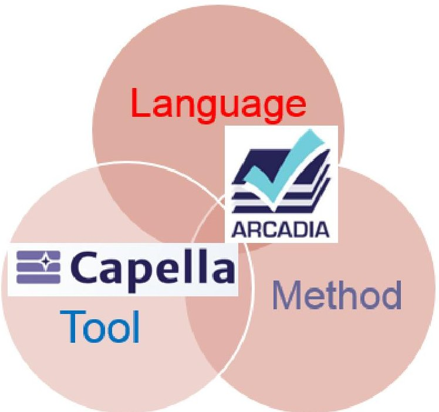

Figure 1: The three pillars of MBSE with ARCADIA/Capella

## The ARCADIA Modeling Approach

ARCADIA (ARCHitecture Analysis and Design Integrated Approach) is a Model-Based engineering method for systems, hardware and software architectural design. It has been developed by Thales between 2005 and 2010 [2] through an iterative process involving operational architects from all the Thales business domains (transportation, avionics, space, radar, etc.).

It enforces an approach structured on successive engineering phases which establishes clear separation between needs (operational need analysis and system need analysis) and solutions (logical and physical architectures), in accordance with the IEEE 1220 standard.

ARCADIA recommends three mandatory interrelated activities, at the same level of importance:

- Need Analysis and Modeling

- Architecture Building and Validation

- Requirements Engineering

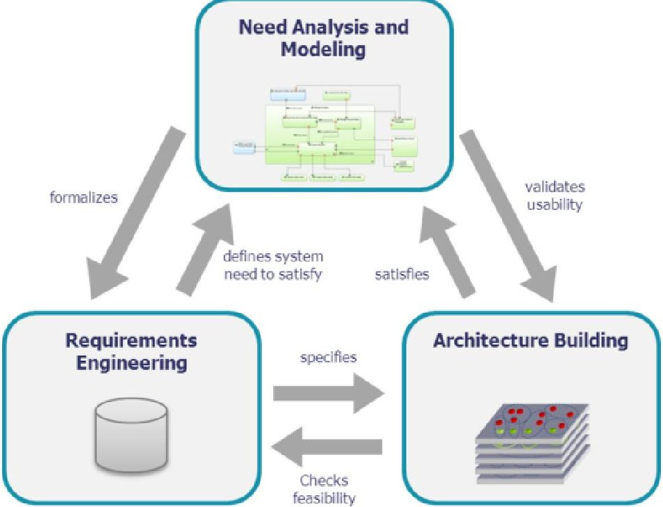

Figure 2: ARCADIA three mandatory interrelated activities

<!-- PDF_PAGE: 4 -->

Steps and activities of the method have been defined precisely and tested on real projects inside Thales for several years. To summarize briefly, the main messages are the following ones:

- Besides requirement engineering, drive an operational need analysis, describing final user expectations, usage conditions, and realistic IVVQ conditions, and a system need analysis, describing both the requested behavior of the system under study and its external interfaces

- Structure the system and build a logical architecture, by searching for the best compromise between design drivers and non-functional constraints. Each viewpoint deals with a specific concern such as functional consistency, interfaces, performances, real time, safety, security, integration, reuse, cost, risk, schedule, and the ease of adaptation

- Secure development and IVVQ through a physical architecture which deals with technical and development issues, favoring separation of concerns, efficient and safe component interaction

What the users of the system need to accomplish

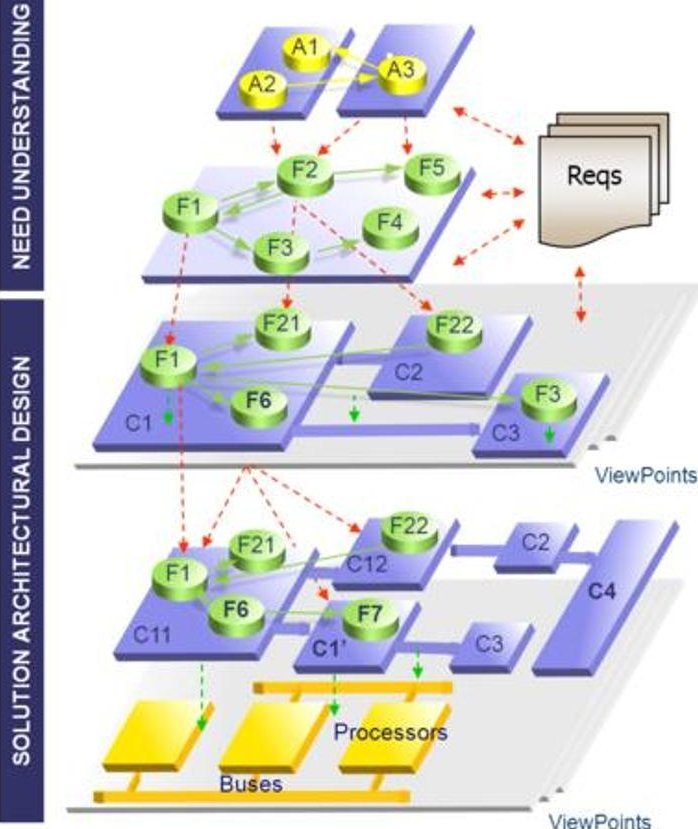

What the system has to accomplish for the users

How the system will work to fulfill expectations

How the system will be developed and built

Figure 3: ARCADIA engineering levels

Of course, these messages are very similar to the recommendations of the INCOSE SE Handbook [3].

## The ARCADIA Domain Specific Modeling Language (DSML)

The ARCADIA DSML is inspired by UML/SysML and NAF standards, and shares many concepts with these languages. But a Domain-Specific Modeling Language was preferred in order to ease appropriation by all stakeholders. ARCADIA is mostly based on functional analysis, and then allocation of the functions to components [4].

The richness of the ARCADIA DSML is comparable to SysML [5] with about ten different diagram types including data flow diagrams, scenario diagrams, states and modes diagrams, component breakdown diagrams, functional breakdown diagrams, etc. Let us give a few examples of concepts and diagrams proposed by ARCADIA at different levels on a simple case study in the meteorological domain:

## Operational Analysis

A very important diagram at this level is called the Operational Architecture Blank diagram (OAB). It captures the allocation of Operational Activities to Operational Entities.

<!-- PDF_PAGE: 5 -->

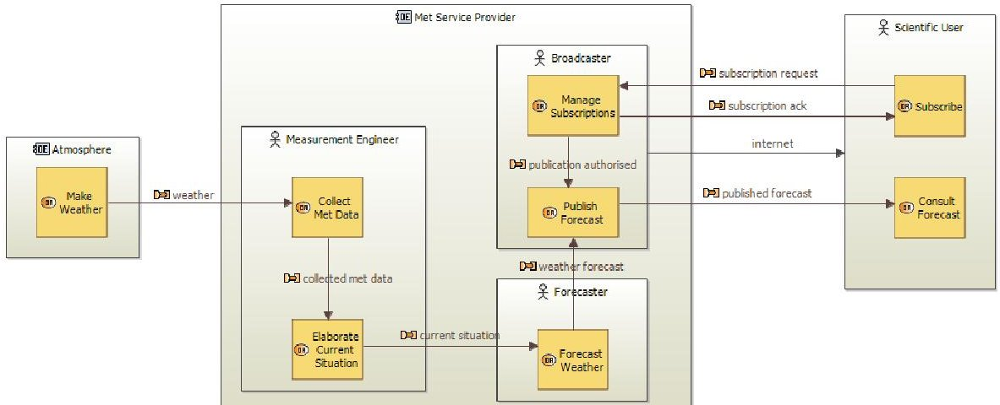

Figure 4: Operational Architecture Blank diagram (OAB) example

## System Analysis

Dataflow diagrams are available in all Arcadia engineering levels. They represent information dependency between functions. These diagrams provide rich mechanisms to manage complexity: Computed simplified links between high-level Functions, categorization of Exchanges, etc. Functional Chains can be displayed as highlighted paths.

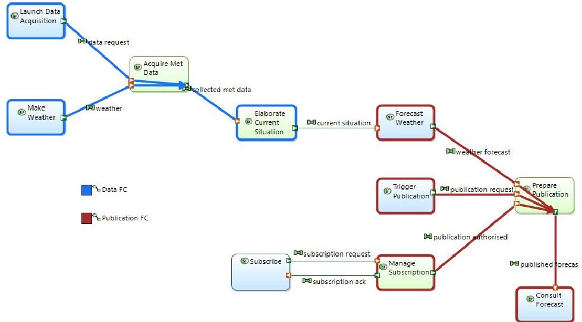

Figure 5: System Data Flow Blank diagram (SDFB) example

Architecture diagrams are used in all Arcadia engineering phases. Their main goal is to show the allocation of Functions onto Components. Functional Chains can be displayed as highlighted paths. In System Need Analysis, these diagrams contain one box representing the System under study plus the Actors.

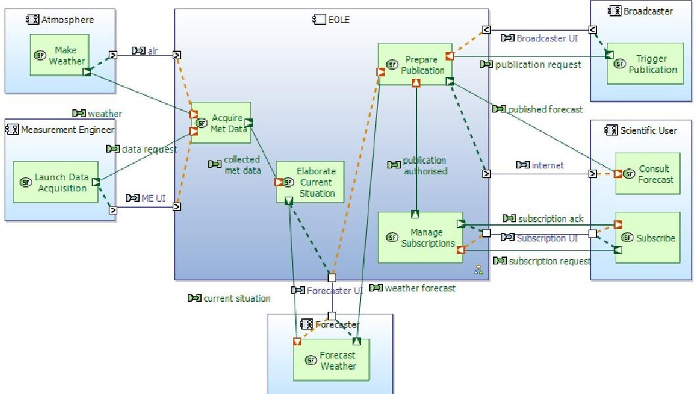

Figure 6: System Architecture Blank diagram (SAB) example

<!-- PDF_PAGE: 6 -->

## Logical Architecture

To give an example of a different diagram type, let us switch to a Scenario Diagram.

ARCADIA defines several kinds of scenario diagrams: Functional Scenarios (lifelines are Functions), Exchange Scenarios (lifelines are Components/Actors while sequence messages are Functional or Component Exchanges), Interface Scenarios (lifelines are Components/Actors while sequence messages are Exchange Items). Modes, States and Functions can also be displayed on these diagrams, which are also available at all engineering levels.

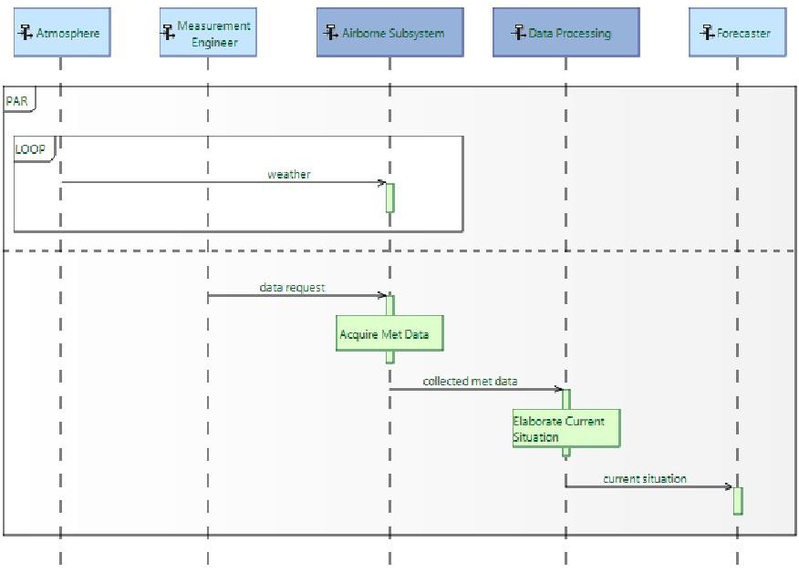

Figure 7: Logical Exchange Scenario diagram (LES) example

## Physical Architecture

At this level, we also use the preceding types of diagrams, but we will show different types once again. Tree diagrams represent breakdowns of either Functions or Components.

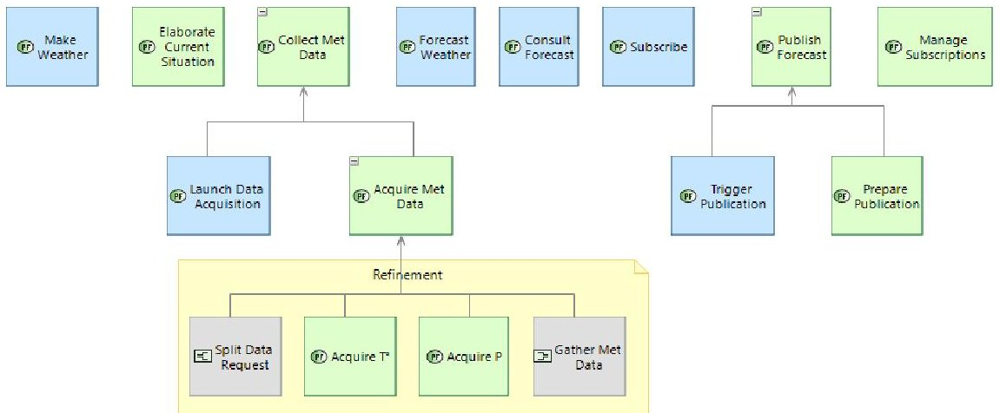

Figure 8: Physical Functional Breakdown diagram (PFBD) example

Matrix views are also available to display the different kinds of relationship between model elements. At each level, for example, two matrices are available showing the realization relationship to the upper level elements.

<table border="1"><tr><td></td><td>Make Weather</td><td>Collect Met Data</td><td>Elaborate Current Situation</td><td>Forecast Weather</td><td>Publish Forecast</td><td>Consult Forecast</td><td>Subscribe</td><td>Manage Subscriptions</td></tr><tr><td>Make Weather</td><td>X</td><td></td><td></td><td></td><td></td><td></td><td></td><td></td></tr><tr><td>Collect Met Data</td><td></td><td>X</td><td></td><td></td><td></td><td></td><td></td><td></td></tr><tr><td>Launch Data Acquisition</td><td></td><td></td><td></td><td></td><td></td><td></td><td></td><td></td></tr><tr><td>Acquire Met Data</td><td></td><td></td><td></td><td></td><td></td><td></td><td></td><td></td></tr><tr><td>Elaborate Current Situation</td><td></td><td></td><td>X</td><td></td><td></td><td></td><td></td><td></td></tr><tr><td>Forecast Weather</td><td></td><td></td><td></td><td>X</td><td></td><td></td><td></td><td></td></tr><tr><td>Publish Forecast</td><td></td><td></td><td></td><td></td><td>X</td><td></td><td></td><td></td></tr><tr><td>Trigger Publication</td><td></td><td></td><td></td><td></td><td></td><td></td><td></td><td></td></tr><tr><td>Prepare Publication</td><td></td><td></td><td></td><td></td><td></td><td></td><td></td><td></td></tr><tr><td>Consult Forecast</td><td></td><td></td><td></td><td></td><td></td><td>X</td><td></td><td></td></tr><tr><td>Subscribe</td><td></td><td></td><td></td><td></td><td></td><td></td><td>X</td><td></td></tr><tr><td>Manage Subscriptions</td><td></td><td></td><td></td><td></td><td></td><td></td><td></td><td>X</td></tr></table>

Figure 9: System Functions / Operational Activities Matrix example

<!-- PDF_PAGE: 7 -->

To summarize, the ARCADIA DSML covers all aspects of standard architecture modelling in each engineering phase including:

- Capability-driven model organization with scenarios and functional chains

- Functional analysis and allocation to components and resources

- Interfaces, bit-precise data models, behaviors, etc.

An overview of the ARCADIA main concepts through the engineering levels is given by the next figure. Additional important concepts such as scenarios, states and modes, classes, capabilities, etc. are not shown but also available to the modeler.

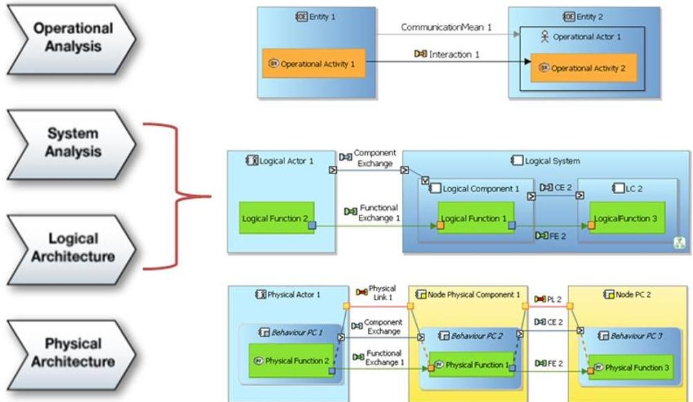

Figure 10: Summary of ARCADIA main concepts

## The Capella Modeling Tool

The Capella workbench is an Eclipse application implementing the ARCADIA method providing both a Domain Specific Modeling Language (DSML) and a dedicated toolset.

A very interesting feature of Capella consists in an embedded methodology browser, reminding ARCADIA principles to the user and providing efficient methodological guidance. This activity browser provides a methodological access to all key activities of Capella, and thus to the creation of all main diagrams, level by level. It is the main entry point to a model and is both meant for beginners and power users.

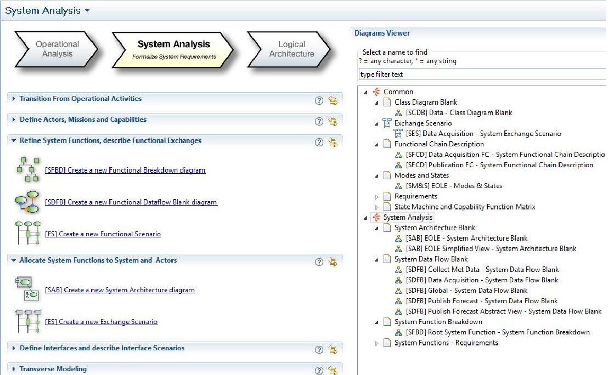

Figure 11: Capella Methodological Activity Browser

<!-- PDF_PAGE: 8 -->

As graphical representations of elements play a key role in communication, Capella relies on a consistent color scheme. In particular, all function-related elements are green, and all componentrelated elements are blue. This favors enhanced model readability for all stakeholders (architects, V&V practitioners, specialty engineers, managers, etc.).

Another very useful feature of Capella is the capability to navigate inside the model elements (independently of the diagrams) through a contextual semantic browser. More practical than the standard hierarchical view of the model, the semantic browser instantaneously provides the context of model elements trough meaningful queries. It is the preferred way to navigate in models and diagrams and to quickly analyze the relationships between model elements.

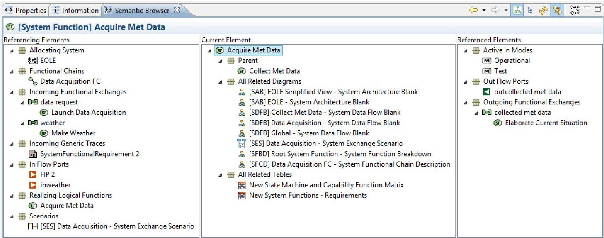

Figure 12: Capella Contextual Semantic Browser

Capella can go further than traditional modeling tools thanks to its knowledge of ARCADIA. For instance, the tool will check that each model element at a given engineering level is realized by a similar element at the next engineering level.

Capella organizes model checking rules in several categories: integrity, design, completeness, traceability, etc. Architects can define validation profiles focusing on different aspects. Whenever possible, quick fixes provide fact and automated solutions.

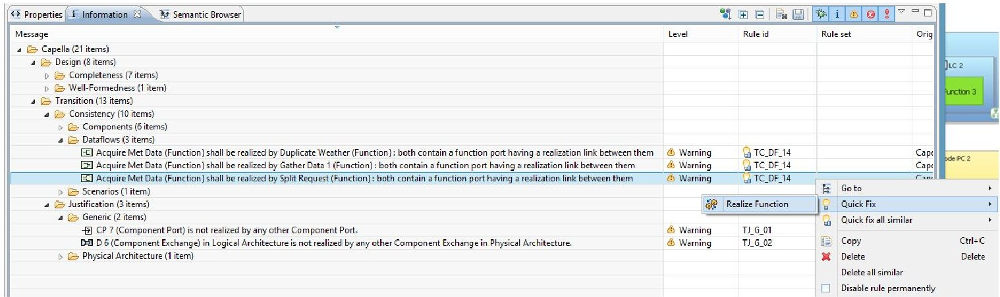

Figure 13: Capella Model Checking results example

As Capella was progressively specified and enhanced by using earlier versions of the tool on Thales internal projects, it contains a lot of very efficient features such as:

- Automatic computation of graphical simplifications (for instance information exchanges between lower-level functions can be automatically displayed on higher-level functions)

- Automated contextual diagrams: content is automatically updated according to preselected model elements and predefined semantic rules

- Filters: enable the user to show simplified views of a given diagram by selecting display options and automatically hiding / showing specific model elements

<!-- PDF_PAGE: 9 -->

Another advanced feature of Capella is the ability to create reusable model elements, either simple ones like types and classes, or complex ones, such as complete physical components with ports, functions, etc. A Replicable Elements Collection (REC, for Record) is a definition of an element which can be reused in multiple contexts / models. A Replica (RPL, for Replay) is an instantiation of a REC. RECs can be packaged in external libraries, which can be shared between several projects.

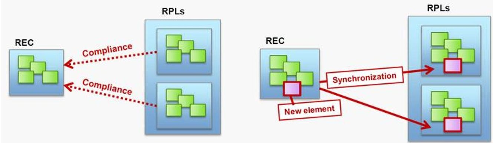

Figure 14: Capella Replicable Elements Mechanism

To widen the perspective, Capella does not work in isolation, but on the contrary fits into a wider engineering landscape, as many bridges can be developed to:

- Initialize Capella models from upstream engineering outputs (typically coming from Architecture Frameworks such as NAF)

- Confront architecture models to specialty engineering tools (performance, safety, etc.)

- Iteratively populate downstream engineering (subsystems, code generation, etc.)

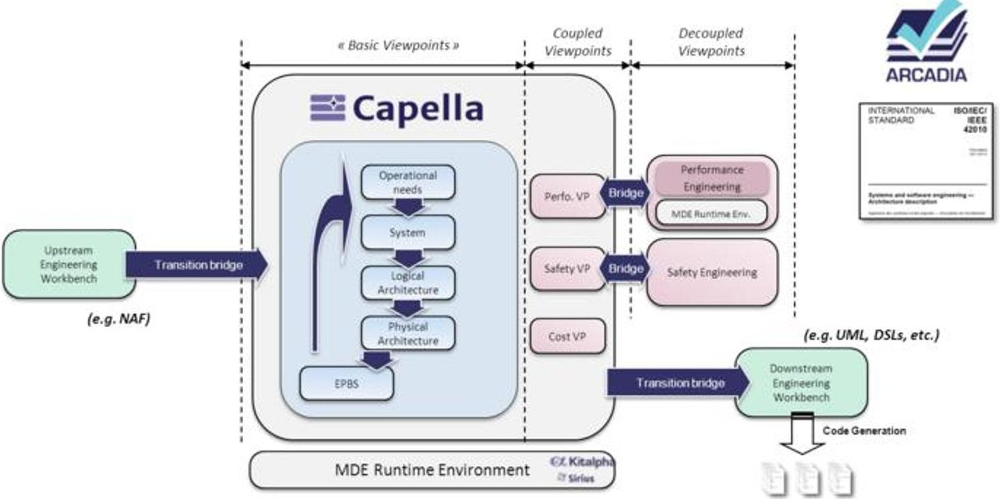

Figure 15: Capella "Big Picture"

## SysML with a tool vs ARCADIA / Capella: elements of comparison

As we explained earlier, the ARCADIA DSML is inspired by UML/SysML and NAF standards, and shares many concepts with these languages. But a Domain-Specific Modeling Language was preferred in order to ease appropriation by all stakeholders, usually not familiar with general-purpose, generic languages such as UML or SysML. Previous experiments inside Thales proved that system engineers not coming from software were not at ease with the object-oriented concepts proposed by UML (and subsequently

<!-- PDF_PAGE: 10 -->

by SysML). So ARCADIA is mostly based on functional analysis, and then allocation of the functions to components. The vocabulary of the DSML has proven to be easily understood by system engineers.

So, basically, ARCADIA was defined first in Thales, from the engineering problems encountered in real projects. Then came the need for a software tool enabling to create and manage ARCADIA models. The first experiments were done using existing UML tools such as Rational Software Modeler, Objecteering and Rhapsody, and defining UML profiles on top of them [2]. At the time of these first tries, the commercial tools were not easy at all to customize, and in particular it was difficult to remove unused commands or menus. So Thales people decided to create their own tool, dedicated to ARCADIA, encouraged by the emergence of enabling technologies based on the Eclipse platform. ARCADIA definition can really be seen as the specification of the Capella modeling tool.

If we try to compare with another possible solution, namely use a standard modeling language, such as SysML, and an existing commercial tool, such as Rhapsody, we can spot several important differences. SysML and Rhapsody (as the other commercial SysML tools) are based on UML, which is a disadvantage for system engineers who have not been exposed to object-oriented concepts (notions of operation, generalization / specialization in block diagrams, and even of object flows and object nodes in the activity diagram). These object-oriented origins are clearly an obstacle to adoption by system engineers who are not familiar with the world of software development [6].

Another big problem is that SysML is only a language, and each company needs to elaborate an adapted modeling strategy. But then, how to teach the method to the modeling tool? Each commercial tool claims it offers an API to build specific add-ons, but this represents clearly a big amount of work. A prototype is provided by IBM with the Harmony for SE toolkit [7], but experiments in Thales proved that this toolkit is not more than a proof of concept and very difficult to use on real projects. For instance, the automated transitions between modeling phases were not iterative and incremental, as is the case with Capella, but merely one-shot.

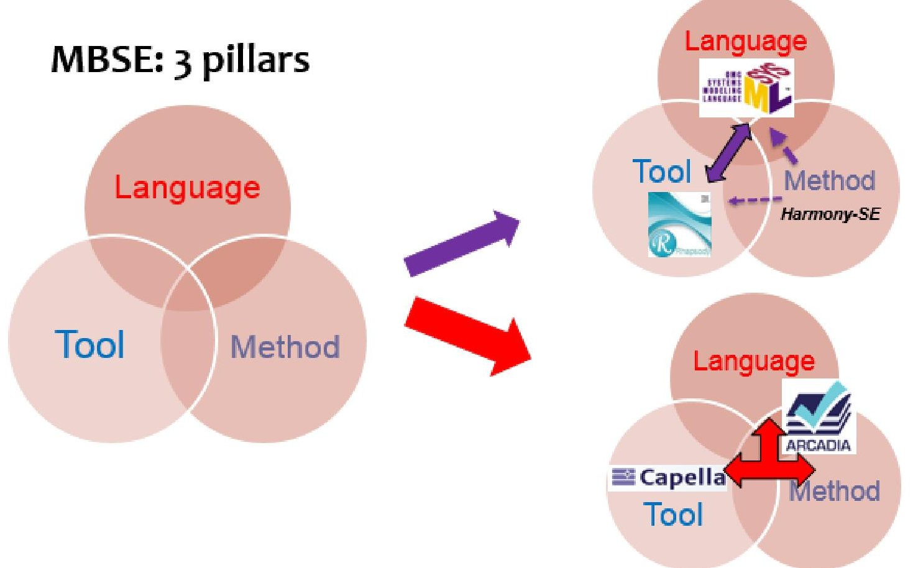

Figure 16: MBSE 3 pillars implementation: a comparison

<!-- PDF_PAGE: 11 -->

## Conclusion

The development of Capella (called Melody then) started in Thales in 2008 after a few years of experience with development of profile-based UML/SysML solutions. It is now widely deployed on operational projects in all Thales domains worldwide (defense, aerospace, space, transportation, identity and security, etc.).

Growing a community of interest and of users is a major objective of the Capella open sourcing initiative [1]. The goal is to favor the emergence of an ecosystem of organizations, including industries that would drive the Capella roadmap according to operational needs, service and technology suppliers that would develop their business around the solution, and academics that would pave the future of the engineering ecosystem.

The 3-years Clarity consortium [8] is dedicated to building this ecosystem. Since the start of the Clarity project, one year ago, such big industrial companies as Airbus, Airbus DS and Areva have already begun to experiment Capella internally. In the meantime, technology providers such as Artal, All4Tec, Scilab, have also begun to work in order to bridge Capella with simulation tools, safety engineering tools, etc. The rationale behind Clarity is that a strong adoption of this industrial solution will bring a major competitive advantage for industrial actors but also for technology and service providers.

## References

[1] https://www.polarsys.org/capella/index.html

[2] V. Normand, D. Exertier, "Model-driven systems engineering: SysML & the MDSysE approach at Thales", in "Model Driven Engineering for distributed real-time embedded systems", John Wiley & Sons, Sept. 2005, ISBN 9781905209323

[3] INCOSE Systems Engineering Handbook: A Guide for System Life Cycle Processes and Activities, 4th Edition, Wiley, 2015

[4] J.-L. Voirin, "Modelling languages for Functional Analysis put to the test of real life", CSDM, Paris, 2012

[5] OMG, Systems Modeling Language (SysML), Version 1.4, September 2015 (http://www.omg.org/spec/SysML/1.4/)

[6] J. Aracic, P. Roques, "Select and deploy a conceptual modelling language. Some Keys." http://blogs.crescendo-technologies.com

[7] https://www.youtube.com/watch?v=axX6wwY3puQ

[8] http://www.clarity-se.org/overview