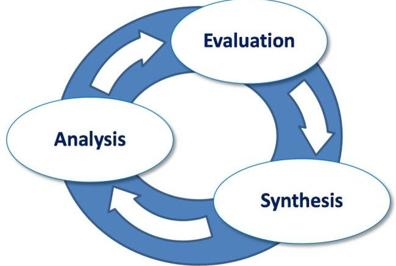
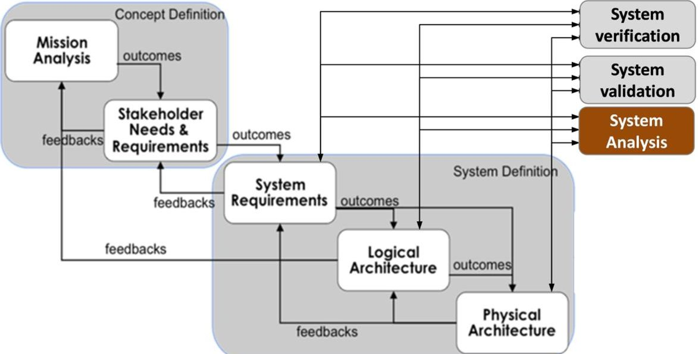
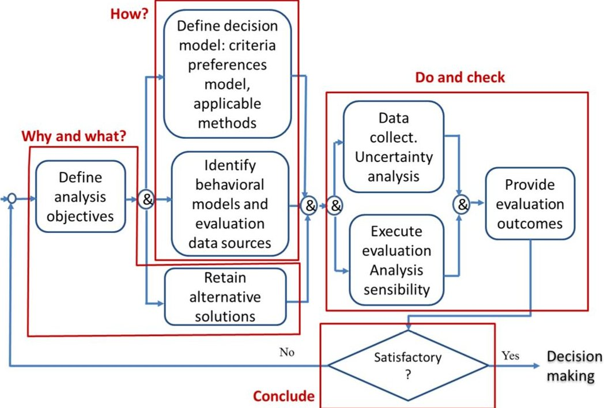
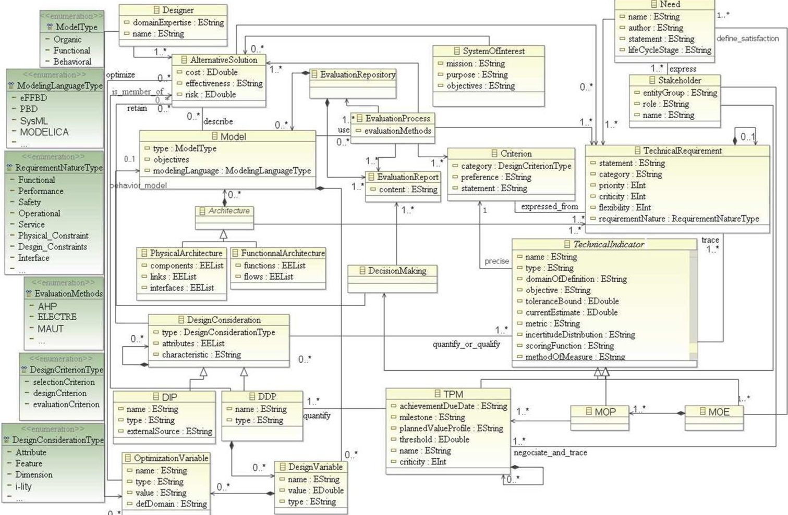
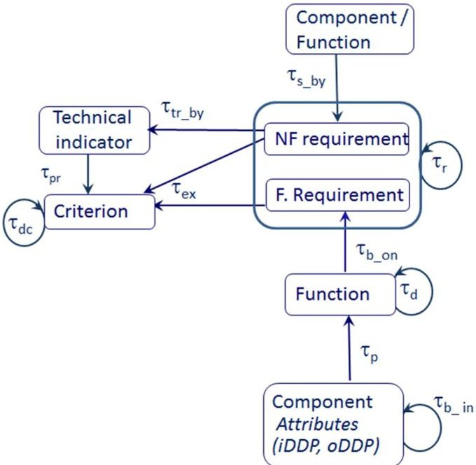

# Tracking the consequences of design decisions in mechatronic systems engineering

Authors: P. Couturier, M. Lo, A. Imoussaten, V. Chapurlat, J. Montmain

<!-- PDF_PAGE: 1 -->

Tracking the consequences of design decisions in
                  mechatronic systems engineering
     Pierre Couturier, Mambaye Lo, Abdelhak Imoussaten, Vincent Chapurlat,
                                            Jacky Montmain

      To cite this version:
    Pierre Couturier, Mambaye Lo, Abdelhak Imoussaten, Vincent Chapurlat, Jacky Montmain. Tracking
    the consequences of design decisions in mechatronic systems engineering. Mechatronics, Elsevier, 2014,
    24 (7), pp.763 - 774. �10.1016/j.mechatronics.2014.03.004�. �hal-00840436�

                                   HAL Id: hal-00840436
                 https://hal.archives-ouvertes.fr/hal-00840436
                                      Submitted on 30 Nov 2018

    HAL is a multi-disciplinary open access               L’archive ouverte pluridisciplinaire HAL, est
archive for the deposit and dissemination of sci-     destinée au dépôt et à la diffusion de documents
entific research documents, whether they are pub-     scientifiques de niveau recherche, publiés ou non,
lished or not. The documents may come from            émanant des établissements d’enseignement et de
teaching and research institutions in France or       recherche français ou étrangers, des laboratoires
abroad, or from public or private research centers.   publics ou privés.

<!-- PDF_PAGE: 2 -->

Tracking the consequences of design decisions in mechatronic systems engineering

     Pierre Couturier, Mambaye Lô, Abdelhak Imoussaten, Vincent Chapurlat, Jacky Montmain

               Laboratoire de Génie Informatique et d'Ingénierie de Production (LGI2P)

                                    Site de l’Ecole des Mines d’Alès

                    Parc scientifique Georges Besse, 30035 Nîmes cedex 5, France

            Corresponding author: Pierre.Couturier@mines-ales.fr, tel: (+33) 4 66 38 40 46

                           Authors’ email: first name.name@mines-ales.fr

Abstract:

The design of mechatronic systems involves several technical and scientific disciplines. It is often
difficult to anticipate, at the outset, the consequences of design decisions on the ultimate
effectiveness of such complex systems, in which case the evaluation process is required to support
the designers each time engineering choices must be made or justified. Since designers may belong
to different technical and scientific cultures however, their understanding of both the design stakes
and the evaluation process is too often biased. Moreover, design choices take place in an uncertain
context and according to multiple criteria, some of which may be contradictory. In order to track the
consequences of design decisions, we are proposing a conceptual data model to perform evaluations
within the MBSE framework of Systems Engineering. We then proceed by relying on the relationships
demonstrated by such a model to identify the potential impacts of design choices on future product
performance. Since data available during the conceptual phase of the design are typically uncertain
or imprecise, an original research protocol is extended to a qualitative impact analysis for the
purpose of highlighting the most promising alternative system design solutions (ASDS). An example in
the mechatronics field serves to illustrate our proposals.

Keywords: Systems engineering, Mechatronics, Evaluation, Traceability.

1. Introduction

Mechatronic design is an interdisciplinary activity that continually strives to integrate widespread
functionality into geometrically constrained products. In the competitive marketplace, both time and
finances are often lacking when it comes to studying and finalizing several mechatronic concepts and
then retaining only the most satisfactory one. Engineers therefore require support in reviewing
alternative system design solutions (ASDS) and in making and defending the best design choices as of
the earliest product design stages [1]. In a Systems Engineering (SE) context [2], such is the role of
evaluation activities in assessing ASDS and in ensuring that design-related decisions take into account
relevant multidisciplinary knowledge and can hence be duly justified. With this aim, various analytical
approaches and methods can be applied to conduct effectiveness, cost and risk studies as well as to
compare different ASDS.

The design evaluation process however faces a number of challenges, including:

1) Though the initial choices are definitely critical to ensuring a successful design project, rating the
merit factors of each candidate solution during the conceptual design stage is generally subject to
uncertainty and inaccuracy;

                                                   1

<!-- PDF_PAGE: 3 -->

2) Designing complex mechatronic products requires multidisciplinary knowledge. Since designers
tend to have narrow technical and scientific backgrounds, their understanding of system design
objectives and their vision of the evaluation process are often only partial and incomplete;

3) Assessing the consequences when choosing from among several ASDS is a critical step to the
process and to this day has still not been resolved effectively [3];

4) System requirements may at times be interpreted as contradictory when considering a given
ASDS. The challenge then is to identify satisfactory ASDS that achieve an acceptable balance between
these requirements, as opposed to finding the optimal ASDS.

Although the core of design problematic is how to produce solutions, design solutions synthesis is
not the scope of the presented research work. This paper aims to provide some basic elements to
address the issues raised in 1 through 4 above by considering just the effectiveness evaluation; due
to constraints placed on the paper's length, risk and cost aspects will not be included.

After defining the role of evaluation within the design process, Section 2 will tackle the 2nd issue
raised above in proposing a conceptual data model considered herein as the abstract syntax of a
possible language dedicated to evaluation within the Systems Engineering (SE) framework. The
intention is for members of a multidisciplinary design team to be capable of sharing a common vision
of data as a prerequisite to evaluating ASDS, regardless of their profession, objectives or
specialization. Based on this proposed common view, Section 3 will contribute to resolving issue 3 by
means of facilitating the identification of potential impact relations between design choices and
effectiveness criteria. Once potential impacts have been identified, the consequences of such
impacts on the degree of ASDS satisfaction in a multi-criteria context must be analyzed. To this end,
Section 4 will formalize the interactions proposed in this research work between a behavior model of
the system being designed and a model of stakeholders' expectations. Our proposal seeks to address
issue 4 above by adapting a formal approach to determine the level of criterion satisfaction, which
entails applying qualitative or quantitative reasoning depending on the uncertainty inherent in the
design specification. Section 5 will illustrate our proposals through an example of developing the
electrical assistance function for a wheelchair. Section 6 will draw a conclusion regarding future
perspectives.

2. Evaluation in design

Let's consider, without the ambition of achieving completeness, a number of current design theories
and methodologies that deal with evaluation issues [4,5,6,7]. According to [8], designers are making
progress towards defining the systems under design in more concrete terms by iteratively
performing the steps indicated in Fig. 1:
    •   Synthesis: The creative activity by which known elements are placed together in new and
        more useful combinations in order to produce ASDS;
    •   Analysis: Deriving an estimation and prediction of design parameter values;
    •   Evaluation: Comparison of each ASDS with other ASDS and verification of compliance with
        customer requirements.

Mechatronic engineering combines mechanical engineering, electrical engineering and computer
science within an interactive way. The VDI2206 guideline recommends conducting the design of
mechatronics systems according to the so-called "V-model" pattern [9]. The design process
distinguishes between the problem solving process of the individual designer (micro-level) and the
generic process related to design phases (macro-level). At the macro-level the system is specified
functionally, working principle variants are evaluated and selected. Then sub-parts allocated to each

                                                 2

<!-- PDF_PAGE: 4 -->

involved discipline such as mechanics, electronics, and computer science are specified, realized and
integrated to form a system.

                          FIGURE 1: Evaluation vs. analysis and synthesis [9]

Several passes through the v-shaped model are necessary to obtain a mature product. Micro-level
problem-solving activities are being performed during the design process to generate and then to
assess candidate solutions. The present work will distinguish between the evaluation of ASDS (at the
macro level) and the evaluation of the design ideas generated at the micro level (during the synthesis
step of Fig. 1) in order to produce acceptable solutions (ASDS).

The Function-Behavior-Structure approach supports systematic modeling and reasoning in the
systems designing [10] and attempts to explain the act of generating design solutions (thus at the
synthesis step of Fig. 1). The Function-Behavior-Structure activities include: a formulation which
transforms functions into a set of expected behaviors; a synthesis of a structure which exhibits the
expected behavior; an analysis of the behavior produced by the structure; an evaluation between the
expected and the produced behavior.

The Function-Behaviour-State modeler provides an approach for systematic modeling and reasoning
in conceptual design [11]. In [12] it has been extended to incorporate a visualization of geometric
information and has introduced interval-temporal logics. It then becomes possible for the system
architect to evaluate the consistency between spatial relations in a Function-Behaviour-State model
and the corresponding geometric model.

Another design approach is represented by the Axiomatic Design, which is a general method for
facilitating the synthesis of suitable design requirements, design solutions and design processes. Two
principles must be verified according to Suh [13]: the independence axiom indicates to ‘Maintain the
independence of functional requirements’, while the information axiom recommends to ‘Minimize
the information content of the design’. The independence axiom provides the designer with a
measure for rating the correctness of the design, in insisting that an independent relationship, as
represented by an uncoupled or decoupled design matrix, is essential for a successful design [14].
Evaluating design solutions according to these two axioms aims at verifying that the system is well
designed but does not guarantee that the solutions are the most satisfying to fulfill the stakeholder’s
needs.

In order to qualify a mechatronic system, a mechatronic index is presented in [15] in terms of
flexibility, intelligence and complexity, as these three characteristics account for much of
mechatronic products. The intelligence level of a mechatronic system is determined by both its
control functionality (which includes programmability, self-diagnosis, self-repair, negotiation,
learning and self-organization) and its information computing ability (e.g. knowledge discovery and
analysis, inference mechanism and communication) from the low-level control to the general
management level. The flexibility property of a mechatronic system translates its capacity to easily

                                                  3

<!-- PDF_PAGE: 5 -->

change in order to fit new requirements or situations. Complexity is a consequence of the tradeoff
involved when increasing the intelligence and flexibility and moreover may be observed through
seven indices (including quantity of components, number of interconnections, number of design
solution alternatives and number of feedback loops). The benefit of monitoring such indexes is to
help mechatronic engineers in better designing their systems (i.e. a verification point of view) by
taking into account the typical characteristics of mechatronic products: flexibility, intelligence,
complexity, and strongly-coupled physical phenomena.

The approach of evaluation exposed in this paper is complementary to the above research works as it
focuses on how to rank ASDS outputted from the synthesis activities and how to select the most
satisfying for the stakeholders (i.e. more of a validation point of view than of a verification point of
view). For this purpose, we adopt the Systems Engineering framework which guides the engineers
throughout the macro-level design phases without imposing any specific method to synthesize
solutions. The specificity of evaluating mechatronic design lies in taking into account, at the earliest
possible stage in the design development cycle, the many relevant discipline requirements, in
addition to the system architect requirement, in order to design a product.

The evaluation process within the SE framework

Systems Engineering (SE) is an interdisciplinary and collaborative approach based on the standards
ISO/IEC 15288 [16], ANSI/EIA 632 and IEEE 1220, as well as on conceptual guidelines, e.g. SEBoK [17]
and best practice guidelines, e.g. INCOSE handbook [18] or Nasa handbook [2]. SE promotes
vocabulary, concepts and a comprehensive approach that facilitates communication within a design
team, regardless of the underlying technological field, and moreover relies on a set of standardized
processes and activities that have become widely and successfully applied across various industrial
fields [19,20,21].

Among the aforementioned components, five technical processes run in an iterative manner when
engineering a system. These processes, identified in Fig. 2, are [17]: Mission analysis, Stakeholders'
needs and requirements, System requirements, Logical architecture, and Physical architecture. They
are supported by three services, namely: System verification, System validation, and System analysis.

                           FIGURE 2: Technical and support processes in SE

Evaluation, is indeed an important activity of System Analysis in SE since according to standards (EIA
632, l’IEEE 1220, SEBok 2013) technical performance assessment and tradeoff studies are necessary
activities of SE.

                                                   4

<!-- PDF_PAGE: 6 -->

Thus this paper addresses the set of System Analysis issues and focuses in particular on evaluating
the product under design. The next section will present the generic activities associated with the
evaluation process.

2.1 Activities composing the evaluation process

An evaluation is requested each time engineering choices must be made or justified, e.g. choice of
major operations and solution concepts, research and resolution of inconsistencies between
requirements, choice of logical vs. physical architecture. The criteria required to evaluate design
progress actually evolve in the same manner as design model criteria [22].

This evaluation process includes generic activities, as summarized in Fig. 3. The main activities
composing the evaluation process consist of: defining the evaluation objectives ("why" and "what"),
preparing the job ("how"), producing and analyzing results ("do" and "check"), and finally delivering
outcomes ("conclude"). Briefly summarized below are the individual tasks relevant to these
successive stages.

                     FIGURE 3: Flowchart of activities in the Evaluation Process

‘Why and what’ activities: After specifying the scope, objectives and means available to perform the
requested evaluation, only the ASDS that satisfy the non-negotiable technical and economic criteria
are to be selected for more in-depth analysis. It is generally recommended that the number of
alternatives be limited (in the range of 3 to 7) and moreover that all candidate solution
characteristics be sufficiently distinct.

‘How’ activities: Since the evaluation process constitutes the backbone of the decision-making
process, the decision-making model must be specified. Such a model takes into account core
elements, e.g. evaluation criteria, stakeholders' preferences, the scoring function used to assign
desirability levels to system attributes, and the aggregation methods chosen to provide ASDS with
the overall desirability levels used to classify or rank design solutions [15].

Regarding the evaluation of product effectiveness, three main families of multi-criteria decision-
making methods can be distinguished [23]: total aggregation methods [24], paired comparison
methods [25], and outranking approaches [26]. The aggregation methods most frequently used in
design are based on Multi-Attribute Utility Theory according to which local 'utility functions' are
defined so as to quantify on a standardized scale (e.g. [0 1]) stakeholders' preferences about the

                                                  5

<!-- PDF_PAGE: 7 -->

'attributes' of the designed artifact. These local utility values are then aggregated into an overall
utility through application of a mathematical formalism (usually additive or multiplicative). The
paired comparison methods (such as Analytical Hierarchical Process) are employed to both model
stakeholders' preferences and rank alternatives. The primary outranking methods assume datasets
similar to those assumed by the Multi-Attribute Utility Theory, yet allow defining just a partial
ranking on the set of alternatives, which contains the most promising alternatives of the decision-
making problem. In ‘Electre III’, an outranking degree is computed that reflects outranking credibility
among several alternatives [23].

Since the characteristic values of ASDS are not directly measurable from the product, they need to be
predicted from models (referred hereafter as behavior model). At the conceptual design stage,
behavior models tend to be coarse whereas at the detailed design stage, more specialized and
precise models must be taken into consideration in order to derive product feature data. Some
activity within the evaluation process thus consists of identifying which level of modeling granularity
is required and then ordering additional modeling and analysis work. More generally speaking,
evaluation relies on relevant knowledge based on engineering rules, standards, expert reports,
simulations and analysis reports from previous completed projects or from measurements carried
out on prototypes. In any event, it is necessary to estimate the degree of uncertainty associated with
collected data and perform the evaluation accordingly [27].

‘Do and check’ activities: ASDS are assessed or ranked according to the selected multi-criteria
analysis method. Sensitivity analyses are also conducted to determine whether the resulting
classification or ranking is sufficiently robust, e.g. if the classification/ranking remains unchanged in
the event of small input data variations. If the evaluation objectives are not met or if results lack
adequate differentiation or show excessive dependence on the evaluation methods, then the
evaluation process should return to one of its previous steps.

‘Conclude’ activity: When the objectives are met, a report is produced and delivered to decision-
makers; this report includes: information on assessment objectives, the selected ASDS, the data
sources along with their degrees of uncertainty, the decision-making model, evaluation results with
their sensitivity analyses, and justifications of every choice made during the evaluation process.

The conceptual data model shown in Fig. 4 allows characterizing and describing the relevant
concepts and relationships from the SE context that must be taken into consideration throughout the
evaluation activities, from the conceptual design phase to the detailed design phase. As displayed in
a UML class diagram, each class describes a requested concept from the domain and is characterized
by a set of typical attributes and relations. Each relation in turn describes and formalizes a link (i.e.
dependence relationship) between two concepts. As such, this conceptual data model corresponds
to the abstract syntax, i.e. the vocabulary and basic grammar of the meta-model of the so-called
‘evaluation language’ proposed herein. Moreover, this language is indeed an extension or
enrichment of Systems Engineering (SE) vocabulary and thus of the engineering language currently
proposed in an MBSE context [28]. The section (2.2) presents the main classes of concepts and
relations being considered among the three domains involved in the evaluation process: technical
requirements, candidate solutions, and evaluations.

2.2 A conceptual data model for evaluation data characterization within the SE framework

According to Blanchard and Fabricky [8], the 'Design Consideration' concept designates any element
of the complete set of attributes and characteristics potentially exhibited by: a system being
engineered, a product, or a service. ‘Design Considerations’ are involved during the customer
requirement analysis to facilitate the stakeholders' needs expression. They are also proved to be
useful in analysis activities for the purpose of fully characterizing the product being designed and
hence revealing the expected, as well as unexpected, behavior or properties. Among the set of

                                                   6

<!-- PDF_PAGE: 8 -->

‘Design Considerations’, let's distinguish the 'Design Dependent Parameters', which are controlled by
the designers (e.g. geometric dimensions, weight, reliability, maintainability or other-ilities [29]).
Each instance of 'Design Dependent Parameters' generates a design candidate solution. ‘Input Design
Dependent Parameters' (iDDPs) are ‘Design Dependent Parameters’ the values of which are chosen
by the designers and determine other 'Design Dependent Parameters' values. The iDDPs which can
be coded numerically referred to as design variables. Design variables include optimization variables
used to improve a satisfactory solution even further. ‘Output Design Dependent Parameters' (oDDPs)
are ‘Design Dependent Parameters’ the values of which are generally computed from behavior
models and iDDPs values. 'Output Design Dependent Parameters' are parameters of interest for the
stakeholders and are used to evaluate an ASDS.

Energy autonomy is an example of ‘Design consideration’ for an electrical wheelchair. Then an oDDP
can be the ‘number of km travelled without reloading in energy’ and an iDDP can be the ‘battery
capacity’.

The 'Design Independent Parameters' are known as "incurring" factors (for example: labor costs,
variation of raw material characteristics, the market entry of a new competing product, energy cost,
a new regulation etc.). 'Design Independent Parameters' are not controlled by the designers but they
must be taken into account by decision-makers when selecting the most promising design solutions.

       FIGURE 4: A Conceptual Data Model for characterizing evaluation data in an SE context

Considering multi-criteria decision-making methods (such as the ones cited in section 2.1 or the
proposed one in section 4) the evaluation process establishes the level of adequacy between a
consistent set of technical requirements (e.g. translations of stakeholders' needs by designers in
considering the entire product life cycle) and ASDS . The evaluation criteria determine the principles
or rules introduced to judge the level of adequacy. The evaluation criteria are specified by technical
indicators (TIs), whose attributes comprise: the rating scales, objectives, target levels, and current
level. A TI objective is specified by a single performance requirement or a single constraint.

                                                  7

<!-- PDF_PAGE: 9 -->

While defining needs, attention turns to identifying MOEs (Measures Of Effectiveness), which are
mandatory TIs to ensure system success. Inability to reach an MOE objective is considered a cause of
failure [2].

Not directly estimable during the design, MOEs can be decomposed into MOPs (Measures of
Performance), which are TIs associated with the product's physical or functional properties. MOPs
may in turn be broken down into 'Technical Performance Measures' (TPMs) or characteristics, which
are measured from attributes inherent to the designed product [8]. Current TPM values are in fact
derived from oDDP values. For instance let us define some MOE, MOP and TPM when designing an
electrical assistance for a wheelchair. According to the stakeholders, the ‘type of job that such
assistance allows to practice in outside conditions’ is a MOE (the MOE objective is to be able to work
as a roundsman in a company). Such a MOE can be decomposed in several MOPs, the ‘capacity to
drive outside’ is one of them (the MOP objective is to be able to drive on unsurfaced roads). The
MOP can be decomposed in several TPMs, the ‘capacity to climb sloping road’ is one of them (the
TPM objective is to be able to climb 10% slopes with a 120 kg total charge).

ASDS are described by their functional and physical architectures models (generated by SE activities)
and also by behavior models built up to lead analysis studies and to calculate oDDP values. The
knowledge elements needed to perform such analysis and the results of evaluation reports are
collected in the ‘Evaluation repository’.

In order to be able to analyze the impacts of design choices on criteria TI current values, it is first
necessary to identify which TI current value (i.e. oDDP values) can be (adversely or positively)
affected by iDDPs and then to determine the magnitude of such impacts. The next two sections are
intended to propose some resolution to these issues conforming to the conceptual data model
shown in Fig. 4.

3. Identification of potential impacts

In complex system design, it is not altogether obvious whether or not an iDDP exerts potential
impact on an oDDP. The following section will analyze how traceability relations stemming from both
SE models and the conceptual data model (Fig. 4) can actually help detect potential influence
relations between DDPs.

Without imposing restrictive constraints on system architects, we are able to postulate that (Fig. 4):

    •   Any evaluation criterion is expressed using at least one technical requirement;
    •   Any criterion is specified by at least one technical indicator(TI);
    •   Any TI is associated with one and only one non-functional requirement (more precisely with
        one performance requirement or with one constraint).

Based on these assumptions and by utilizing the traceability relationships between SE elements in
system models, the influence relations between TIs and iDDPs can be underscored so as to identify
what might generate some impact. The formalization of such a notion will be provided hereafter.

3.1 Traceability relations

Traceability is defined as the ability to describe and track the life of a requirement from its origin (in
the design phase) to deployment (in the operations phase) [30, 31]. The main needs behind
introducing traceability in SE are summarized in Table 1.

                                                    8

<!-- PDF_PAGE: 10 -->

Need                      Description
                            Coverage   Are all requests for features in the
                            analysis   delivered product?
                                       Do test cases exist for all functional and
                                       non-functional requirements?
                            Impact     Tracing from the impacted features to
                            analysis   the actual system design to determine
                                       the extent of eventual modifications
                            Derivation Help discover the origin and rationale of a
                            analysis   function; alternatively, a component
                                       requirement is traced back to the original
                                       rationale for its creation

                                 TABLE 1: Traceability needs in an SE process

A more formal definition can be provided for:

    •   A ‘traceability relation’, denoted ℑ on ΕxΕ, with Ε a set of artefacts, is a partial relation on
        ΕxΕ that is non-reflexive, non-symmetric and non-transitive. For example, the SE relation
        ‘refines’ (requirement b refines requirement a) defines a ‘traceability relation’ on RxR where
        R is the set of the artefacts ‘system requirements’. SE relations have distinct semantics
        (refines, built from, specifies…); traceability relations have not.
    •   A ‘traceability link’, denoted τ, is an oriented link between two artefacts; it is associated with
        a traceability relation between one source artefact ‘a’ and one target artefact ‘b’, such that b
        = τ(a). So, if ℑ (a,b) is true then it exists τ such as b = τ(a). The set of artefacts connected by
        traceablity links forms a digraph.
    •   If ℑ 1 and ℑ 2 are two traceability relations defined on ΕxΕ, then ℑ 1o ℑ 2 is a traceability
        relation on ΕxΕ.

Any artifact a, with a Є Ε, can display an impact δba on other artefacts b of Ε if and only if a is the
source of at least one traceability link τ with b = τ(a). The set of artefacts that are in relations by k
successive compositions of a traceability relation ℑ is thus expressed as:

         {              }
                                                                                                   k
I k ( a ) = b b = τ k ( a ) , where τk(a) is τ (τk-1(a)); the coverage of element a is: I C (a ) = U I q (a)
                                                                                                  q =1

Such formalization is used to compute the set of artefacts that can potentially impact or be impacted
by others as proposed in next section.

3.2 Using traceability relations to identify potential impacts

Table 2 presents examples of relationships between entities according to an example of an SE meta-
model (i.e. a model proposed by one of the MBSE solution providers; other meta-models derived
from other providers may also be used)[32]. To these SE relationships, are associated ‘traceability
links’ as defined above.

According to the conceptual data model shown in Fig. 4, we propose adding the relationships
between criteria, requirements and Technical Indicators (TIs) to the basic relationships listed in Table
2, with the outcome shown in Table 3.

                                                        9

<!-- PDF_PAGE: 11 -->

Source / Target       Target /                  SE relations and their associated
                                   Source                           (traceability links)
      Functional requirement   Function                Basis of ( _ ) / Based on ( _ )
      Performance requirement Function                 Specifies ( / Is specified by ( _
      Performance requirement, Component               Specifies (    / Is specified by ( _
      Constraint
      Function                 Component               Is allocated to ( _ ) / Performs (
      Function                 Function                Decomposes ( )/ Decomposed by ( _ )
      Component                Component               Built from ( _     ) / Built in ( _ )
      Requirement              Requirement             Refines ( ) / Is refined by ( _ )
      Requirement              Interface               Specifies ( / Is specified by ( _
      Interface                Component               Joins ( / Joined to ( _ )
      Interface                Link                    Comprised of (        / Comprises ( _
      Link                     Item                    Transfers ( )/ Is transferred by ( _
                       TABLE 2: Traceability relations between SE entities [23]

One criterion and one TI may be correlated with the same requirement if and only if this requirement
specifies the TI objective in its formulation. The inability to link any of the TIs with a single
performance requirement or with a single constraints attests to a certain level of incompleteness in
the set of requirements.

            Source /Target             Target /          SE relations and their associated
                                        Source                    traceability links
      Criterion                     Criterion       Decomposes         /Decomposed by      _
      TI                            Criterion       Precises (    / Is precised by ( _
      Requirement                   Criterion       Expresses (     / Expressed from ( _
      TI                            non-funct.      Traces ( / Is traced by ( _
                                    requirement

                    TABLE 3: Extension of traceability relation between SE entities

                    FIGURE 5: Identifying potential impact from traceability links

Using compositions of the traceability links presented in Tables 2 and 3 can serve to highlight
potential impacts between any function parameter (an instance of an iDDP) or any component

                                                  10

<!-- PDF_PAGE: 12 -->

attribute (another instance of an iDDP) and the evaluation criteria and their associated TIs (the
current value of an TI is an instance of an oDDP).

Thus, if the value of some iDDP (attribute of a component) is changed, traceability links
  _ , , , _ , , !" spread the possibility of impact to the evaluation criteria (Fig. 5). Similarly,
from traceability links,  _#$
                              , % _#$ , &_#$ , _#$ , '_() it is possible to identify the functions and
components potentially impacted by a change in some TI objective value of one criterion.

The TI value reached by an ASDS is derived from an oDDP value. According to available knowledge,
the transformation between iDDPs and oDDPs may be either a quantitative model with a low level of
uncertainty or a qualitative one with higher uncertainty.

The latter case is critical during product design since it occurs at the very earliest stage of the design
development cycle, when both the future success and cost issues of the design project are being
determined in full. For this reason, Section 4 will focus on this SE analysis, which often remains
inadequate in its methodology.

4. Decision-making aid in designing complex products in an SE context

4.1 Linking a predictive system model with a decision-making model

A number of notations will be introduced in this subsection.

Let's start by considering a situation with m iDDPs. Each iDDP is assigned a value from the set
denoted X j , with j = 1,..., m , where X = X 1 × X 2 × ... × X m denotes the set of all m_tuple
x = ( x1 , x 2 ,..., x m ) and where x j ∈ X j is the value of the jth iDDP. *+ may be a set of nominal,
discrete or continuous values. Each element of X represents an ASDS.

                         Global       ux =U([u1(y1) u2(y2) un(yn)])
                         satisfaction
                                            Global utility
                                            computation
                          Local                                   Decision
                          satisfaction [u1(y1) u2(y2) un(yn))       model

                                               u1, u2,…, un

                          Output DDPs       y= (y1, y2 , yn) Є Y
                                                                    Predictive
                                                    T                 model

                          Input DDPs
                                              x= (x1, x2 , ,xm) Є X

             FIGURE 6: Merging a system predictive model with a decision-making model

For instance let’s consider the design of a motor-wheel for a wheelchair: the diameter of the wheel
in inches, the nominal torque provided by the electrical engine in N.m, the reduction ratio of the

                                                   11

<!-- PDF_PAGE: 13 -->

gearbox are examples of iDDPs. The iDDP j ‘nominal torque of the electrical engine’ may take its
values + in the interval *+ = -100, 6001 mNm.

Let's also consider that the system may be described by n oDDPs relative to the decision-making
criteria. Each oDDP is assigned values from the set denoted Yi , with i = 1,..., n and with
Y = Y1 × Y2 × ... × Yn denoting the set of all n_tuple y = ( y1 , y 2 ,..., y n ) , where yi ∈ Yi is the value
assigned to the ith oDDP. 2 may be a set of nominal, discrete or continuous values. For instance the
oDDP i ‘Current consumption’ may take its values , in the interval 2 = -1, 514.

Each input configuration in X corresponds to an output in Y representing the system
characteristics of interest. Let's indicate this correspondence by the transformation: T = (T1 ,..., Tn ) ,
where: Ti : X → Yi , i = 1,..., n (Fig.6).

T may be a formal transformation deduced either from physical laws or from validated knowledge in
the field. For example, a dynamical model of the wheelchair can compute the ‘Current consumption’
from the values of iDDPs such as ‘nominal torque of the engine’, ‘diameter of the wheel’, ‘reduction
ratio of the gearbox’ and others impacting iDDPs. In general however, T is not explicitly known and,
in the most favorable case, it can be approximated by a predictive model [33].

The oDDPs must then be interpreted in terms of satisfaction with respect to the stakeholders' goals.
The Multi-Attribute Utility Theory allows expressing the degree of satisfaction of an oDDP by a real-
valued utility function in [0,1] [34, 35, 36]. Let’s denote therefore for i ∈{1,..., n} , ui (
ui : Yi → [0,1] ) the real-valued utility function for oDDP i . For yi ∈ Yi , ui ( yi ) reflects the extent to
which the goal associated with the TPM i is satisfied by the value yi .

Then the satisfaction level of a higher-level TI, in the hierarchy of criteria, e.g. a MOP or a MOE, in the
decomposition tree containing TPM, should be computed using some aggregation operator U (Fig. 6).
According to the Multi-Attribute Utility Theory, the weighted arithmetic mean can be the operator
used to compute the global utility from the local utilities ui ( yi ) .

As noted above, transformation T is typically unknown or marred by uncertainty, and this mainly
arises during the preliminary (or conceptual) design phase. The scenario is then often played out
where experts or senior engineers are asked to advise on ASDS and judge the qualitative effect of
design choices on stakeholder satisfaction. To properly treat this kind of model, we have relied on
the research work presented in [37] regarding qualitative analyses.

4.2 Qualitative analyses

The notion behind the qualitative model in [37] is that an expert can express the impact of an iDDP
instance directly as a degree of satisfaction of an oDDP. Our attention here is thus focused on the
transformation u o8 , i = 1,...n , which is approximated by a qualitative model (Fig. 7). Figure 7 has to
be generated by the designer team in agreement with the stakeholders. Two scales are used in this
context: a positive ordinal scale PS and a negative ordinal scale NS . If the impact of a given instance
 x j of iDDP X j on the ith oDDP is positive, its values are taken from PS (ex: strong, medium, low,
etc.) and the notation δ ij+ is introduced. On the other hand, if the impact is negative, its values are
derived from NS (ex: strong, medium, low, etc.) with use of the notation δ ij− . Should the expert not
be able to decide, the unknown impact is denoted δ iju . This paper has assumed that PS = NS and

                                                     12

<!-- PDF_PAGE: 14 -->

an absence of impact is represented by the value 0 (which corresponds to the lower value on the
PS scale).

                 FIGURE 7: Influence digraph (δ+: improvement, δ-: degradation, δu: unknown)

                                                                                                                  
Let's now introduce two sets: S i+, x =  j ∈ {1,..., m}: x j impacts i positively  (i.e. for each
                                                                                                                  
m_tuple        x      the set of iDDP j that exerts a positive impact on oDDP i), and
                                                    
S i−, x =  j ∈ {1,..., m}: x j impacts i negatively  (for each m_tuple x the the set of iDDP j that
                                                    
negatively affects oDDP i).

To assign the degree of impact of an ASDS x = ( x1 ,..., xm ) ∈ X on an oDDPi, [36] introduced two
aggregation operators along with two propagation constraints. Each combination of an aggregation
operator with a propagation constraint yields a decision-maker's attitude. The following pessimistic
or optimistic attitude of the decision-maker can serve as a guide. Indeed, the estimation of the ASDS
 ( x1 ,..., xm ) merged impact on oDDPi naturally depends on system behavior, as well as on the
decision maker’s decisional behavior: a pessimistic attitude (whereby a risk aversion position will
lead to concluding the most highly negative merged impacts) vs. an optimistic attitude (whereby risk
acceptance will conclude the most highly positive merged impacts).

Let's denote δ i, x the impact of ASDS x on oDDP i. We also consider that δ i , x ∈ PS × NS and can be
represented by the pair ( δ i+, x, at , δ i−, x, at ), as proposed [38], where δ i+, x, at (resp. δ i−, x, at ) corresponds to an
aggregation of positive impacts (resp. negative impacts) and at ∈ {1, 2} corresponds to the decision-
maker's attitude ("1" encodes the pessimistic attitude and “2” the optimistic attitude). In the
following, ( δ i+, x, at , δ i−, x, at ) will be explained for both these attitudes.

The pessimistic attitude (at=1 in δ i+, x, at and δ i−, x, at ) is modeled by assigning the least positive impact as
the aggregation of positive impacts (less favorable case) and the worst negative impact as the
aggregation of negative impacts (less favorable case again), in which case the propagation constraint
consists of comparing the least positive impact value with the worst negative impact value on oDDP i,
resulting in:

              min     δ ij+ if min+ δ ij+ > max      δ ij−             0 if min          δ ij+ > max     δ ij−
                 ∈  +
                                  ∈              −
                                             j∈Si , x                              ∈  +
                                                                                                    ∈  −

  δ i+, x,1 =  i , x                                       δ i−, x,1 = 
                 j S             j S i,x                                           j S i,x         j S i,x
                                                                                                                           (1)
                          0  otherwise                                  max     δ
                                                                         j∈Si−, x ij
                                                                                     −
                                                                                           otherwise
                                                                        

                                                                        13

<!-- PDF_PAGE: 15 -->

In this case, an unknown impact corresponds to a negative impact and is equal to the top of the NS
scale.

The optimistic attitude (at=2 in δ i+, x, at and δ i−, x, at ) is modeled by assigning the highest positive impact as
the aggregation of positive impacts and the worst negative impact as the aggregation of negative
impacts. In this case, the propagation constraint consists of comparing the highest positive impact
value with the worst negative impact value on oDDP i, hence:

               max    δ ij+ if max      δ ij+ > max      δ ij−              0 if max            δ ij+ > max      δ ij−
                j∈S +              +
                                j∈Si , x             −
                                                 j∈Si , x                                   +
                                                                                         j∈Si , x             −
                                                                                                          j∈Si , x
  δ i+, x, 2 =  i , x                                          δ i−, x, 2 =                                                (2)
                          0 otherwise                                       max −
                                                                                        δ ij otherwise
                                                                                           −

                                                                              j∈Si , x

For this latter case, an unknown impact corresponds to an absence of impact and is equal to the
bottom of the PS scale.

Let's denote δ xat = (δ x+ ,at , δ x− ,at ) as the impact of the m_tuple x of iDDP on the n oDDPs. Then, in
order to avoid risky choices, it can be reasonably stated:

           δ xat = (δ x+ ,at , δ x−,at ) = (min(δ i+, x,at ), max(δ i−, x,at ))                                            (3)
                                                  i                  i

Note that veto and dictator effects of some criteria through min and max operators can be smoothed
when a weights distribution is assigned to the oDDPs as suggested in [39].

According to expressions (1) and (2), one of the values δ x+ , at or δ x− , at is equal to zero.

The most promising ASDS would then be the one with the highest positive impact or otherwise the
lowest negative impact on the n oDDP:

                         arg max δ x+ ,at if ∃i : δ i+, x,at ≠ 0
                         
The most promising ASDS:  x∈ASDS                                                                                          (4)
                            arg min δ x−,at otherwise
                                x∈ASDS

Section 5 will illustrate this type of qualitative analysis through designing an electrically-assisted
device for a wheelchair.

5. Illustrations

This section will illustrate the proposed approach in the context of designing of a power-assisted
wheelchair. Such an assisted wheelchair has been developed by a pluridisciplinary team on the
mechatronics platform of Ecole des Mines d’Ales. The purpose of this electrical assistance is to
promote employment opportunities for the mobility impaired. The system is being made available
firstly to allow a person with reduced mobility to perform an outdoor job without undue fatigue and
secondly to enable driving the wheelchair as if it were a manual device. The objectives adopted refer
to the capability of moving on uneven ground and under exterior conditions. Constraints regarding
maximum allowable speed, maximum dimensions and safety have been defined in the relevant set of
regulations [40].

Once stakeholders’ needs have been translated into a set of technical requirements (which should
subsequently be enhanced as the design process progresses), the main principles of electrical
assistance are to be analyzed and a concept of electrical assistance selected [41]. The selected
product concept chosen in [41] is the concept of motor-wheel consisting in measuring the pushing

                                                                            14

<!-- PDF_PAGE: 16 -->

force of the mobility-impaired individual on the handrail and then delivering additional torque on
each wheel in proportion to the measured force.

During the preliminary design stage, a set of evaluation criteria and associated TIs are defined in
accordance with the technical requirements; these elements are partially displayed in Fig. 8. The
mission of the assistance system is to help reduced mobility persons to be maintained in their job or
to access to a new one. It is the real motivation of the customers (big firms which have obligation to
employ reduced mobility persons). So the assistance system has to improve such persons mobility
(needed, for instance, to practice a roundsman profession) but it must be quite easy and intuitive to
use (as a manual wheel chair) in order the person to be able to do the job efficiently. So
‘Employability’ criterion must be satisfied to ensure success of this assistance system. As per the
agreement with clients, this criterion is associated with the MOE ‘Ability to perform a roundsman's
job’. Such an ‘Employability’ criterion has been broken down into both a ‘Mobility criterion’ (with its
associated MOP: ‘Outside drive possibility’) and a ‘User Friendliness’ criterion (with its MOP: ‘Just an
assistance’).

                                                                                Cr: Employability
                                                                               MOE: Roundsman job
                                                 Cr: Mobility                                           Cr: User Friendliness
                                               MOP: Outside drive                                      MOP: Just an assistance
                                                  possibility

 Cr: Climbing  Passing          Speed                                                                                                Drive
                                          Tot width Tot weight      Autonomy     Robustness Modularity Easy ass.      Manual
                                                                                                                                  easiness
  TPM: 10%     obstacle        6km/h on                                         MTBF>6months Plug&play disassembly    usage
                                           <65cm Overcharge         Nb km 5%                                                     As if manual
 slope120kg 10cm step          2% slope               <25kg           slope                              Time <5’     Manual
              on flat floor

              FIGURE 8: Decomposition of Criterion (Cr) and associated TIs (MOE,MOPs,TPMs)

Another lower level of the criterion hierarchy with associated TPM indicators is correlated with a set
of more elementary oDDPs (such as the ability to: climb, overcome an obstacle, maintain average
speed etc. as shown in Table 4). Let us remark that such a criteria hierarchy is not unique and may be
different depending on the design team, but each criterion is expressed from technical requirements
(according to the conceptual data model in Fig.4).

                                                      MOP Mobility
                              oDDP1       oDDP2 oDDP3 oDDP4 oDDP5 oDDP6             oDD7
                                               Average
                                                 Speed                            Robustne
                                      Passing             Total     Tot
                          Climbing               under                    Autonomy ss &
                                     Obstacle             width    weight
                                                 user's                            Fiability
                                                control
                                   MOP User friendliness
                           oDDP8      oDDP9 oDDP10 oDDP11
                                     Assembly             Drive
                                                                           oDDPs
                           Modu- disassem. Manual confort
                            larity  complexity usage       and
                                      on chair           easiness

TABLE 4: output DDPs i, iЄ{1,..,7} relative to ‘Mobility’ and output DDPs i, iЄ{8,..,11} relative to ‘User
                                                 friendliness’

As the design progresses, these chief concerns must be handled, namely choices of: mechanical
transmission and reduction (gears vs. rack and pinion), number of electric motors (one or more per
wheel), location of the battery and electronics board (on the wheel vs. the chair), control type (reflex

                                                                     15

<!-- PDF_PAGE: 17 -->

vs. smart), tuning facilities (with or without), and system status feedback to the user (rich or poor) as
seen in Table 5. The iDDPs of table 5 have been identified by the designers within the development
team. They result from the SE activities performed by the team and depend also upon the designers’
experience. The example has been adapted for the sake of explanation but we have done the effort
to stick the reality as well as possible. We do not focus in the paper on how ASDS are generated by
the designers but on how choices can be made rationally between them within a multidisciplinary
context. According to the identified iDDPs, the whole proposed method is all about to selecting some
solutions from all possible combinations. As there is no incompatibility between iDDPs, the number
of possible ASDS is 32x26 = 576. The question is which ASDS are the most promising relatively to the
main criteria: mobility, user friendliness and employability?
                                                                                                          iDDP4
                    iDDP1                                iDDP2                       iDDP3
                                                                                                     Wheel structure
                Reduction type                           Motors                 Battery location
                                                                                                          rigidity
         gear on rack and                                      >3               battery package                  some
                                 mixed       1 motor 3 motors                                        high
          motor       pinion                                  motors           location on chair               flexibiity
                                  (3)           (1)     (2)                                           (1)
           (1)          (2)                                    (3)                (1)      (2)                     (2)
                iDDP5
                                     iDDP6                   iDDP7                  iDDP8
          Electronics board
                                   Control type              Setting           Feedback to user
               location
                                                                                                            iDDPs
                                  smart       reflex no tuning tuning         no    feedback
     on board       on wheel
                                 control     control possibilty posibility feedback to user
        (1)            (2)
                                   (1)          (2)     (1)        (2)        (1)      (2)

                                             TABLE 5: input DDPs j, jЄ{1,…8)

                                                MOP Mobility                                       MOP User friendliness
                     oDDP1     oDDP2       oDDP3 oDDP4 oDDP5           oDDP6     oDDP7    oDDP8     oDDP9 oDDP10 oDDP11
             (1)      +M         +M         +M      -L        -L        -M         -L                          -H            -H
 iDDP1       (2)      +L          +L        +M      +L        +L         -L       -H                            -L           -L
             (3)      +M         +M         +M      N         N          -L       -M                           -M           -M
             (1)                                    -L        N          N        +M        N                   -H          U1
 iDDP2       (2)                                    N         +L         -L       +H        -L                  -L          U2
             (3)                                    N         +L        -M         -L      -M                  -M           U3
             (1)                                    +L                            +L        +L        -M       -M           +L
 iDDP3
             (2)                                    N                   +L        +H       +H          -L       -L          +M
             (1)                  +L                N         -L        +M        +H        -L        -L       -H           -H
 iDDP4
             (2)                 +M                 +L        +L        +L        +L        N         N        -L           -L
              (1)                +M                 +L                  +M        +M       +L         -H       -M           +M
 iDDP5
             (2)                  +L                N                   +L        +L       +M         -L        -L          +L
             (1)                 +M          +L                         +H                                                  +H
 iDDP6
             (2)                  +L         -L                         +L                                                   -L
             (1)                             -L                          N         N        +L        N         N            N
 iDDP7
             (2)      +M         +M          +L                         +M        +L        N         +L        -L          +L
             (1)                            -M                           N         N        +L        N         N            N
 iDDP8
             (2)                             +L                         +M        +M        N         +L        -L          +L

                TABLE 6: Example of impacts of instances of input DDPs xj on output oDDP i
                            (H: High, M: Medium, L: Low, N: null (0), Uk: unknown)

No behavior model being available at this stage of the design process to compute how iDDPs values
impact the oDDps the analysis relies on the expertise of a senior designer who provided advices
relative to the impacts of such choices on the degree of utility of elementary oDDPs, as summarized
in Table 6. The ordinal scale on which the impacts are assigned their values is PS=NS={H,M,L,N,U},

                                                              16

<!-- PDF_PAGE: 18 -->

where N denotes a zero impact (0), L denotes low impact, M denotes medium impact, H denotes
high impact and U an unknown impact (i.e. an impact is present, yet its strength raises doubts).

For instance, equipping the motor wheel with one CC motor, the impact on the ‘total wheelchair
width’ (oDDP4) satisfaction level is (-L) due to the motor large diameter while it is (+L) if equipped
with smaller diameter motors. ‘Tuning facility’ increases satisfaction level for ‘climbing capacity’ (+M)
or ‘overcoming obstacles capacity’ (+M) because of the possible adaptation of the assistance to the
context but decreases ‘manual usage’ (-L) since the user has to adjust assistance parameters.

To be able to fulfill Table 6 automatically using more fundamental or partial knowledge is quite a
challenging issue. A way to overcome this difficulty is to trust experts. Even if Table 6 was the most
pertinent, it is not so clear how to aggregate such data and so how to select the most satisfying
solutions. It is the purpose of this study case to illustrate hereafter how the method developed in
section 4 can help designers make their choice rationally from Table 6.

Thanks to the qualitative analysis developed in Section 4, we can now compute the impacts of the
various ASDS on the satisfaction level on criteria.

For    instance,      let's    consider the          particular   ASDS     defined by        the     8_tuple
x={x1:3,x2:2,x3:2,x4:1,x5:1,x6:2,x7:2,x8:2} (i.e. the gray case in Table 6), oDDPs i , iЄ{1,..,7} the oDDPs
linked with the ‘Mobility’ criterion and oDDPs i, iЄ{8,..,11} the oDDPs linked with the ‘User
Friendliness’ criterion.

    •   Applying expression (1) in assuming a pessimistic attitude, the impact of ASDS x on oDDP6
        (autonomy) is (0,L) and (0,H) on oDDP10 (manual usage) since :
                          >                                   D
                     min <=+ = min ?, @, @, ?, @, @ = ?; max <=+ = max ?, ? = ?
                                                                             +
                          +
                                                     >E           DE         D
                                            so      <=," = 0 and <=," = max <=+ = L;
                                                                         +

                                   >            D
                              min <EG+ = 0; max<EG+ = max @, ?, ?, H, @, ? = H
                                                       +
                                   +
                                                    >E            DE         D
                                         so        <EG," = 0 and <EG," = max<EG,+ = H;
                                                                          +

    •   Applying expression (2) in assuming an optimistic attitude, the impact of ASDS x on oDDP6
        (autonomy) is (M,0) and (0,H) on oDDP10 (manual usage) since :
                      >                                   D
                 max <=+ = max ?, @, @, ?, @, @ = @ > max<=+ = max ?, ? = ?
                      +                                                      +
                                                            >K           DK
                                                      so   <=," = M and <=," = 0
                                   >             D
                              max <EG+ = 0 < max<EG+ = max @, ?, ?, H, @, ? = H
                                  +                        +
                                                            >K           DK
                                                       so <EG," = 0 and <EG," =H

According to (3) and with the optimistic attitude assumption:

    •   the impact of ASDS x on all oDDPs relative to ‘Mobility’ is:
        δ Mx
          2
             = (δ Mx
                  +,2
                      , δ Mx
                          −, 2
                               ) = ( min (δ i+, x, 2 ), max (δ i−, x, 2 )) = (0, L)
                                       i∈{1,..7}           i∈{1,..7}

    •   the impact of ASDS x on all oDDPs relative to ‘User Friendliness’ with U1 = -H, U2 = -L, U3 = -H
        (Table 6) is:
        δ UFx
          2
              = (δ UFx
                   +,2
                       , δ UFx
                           −, 2
                                ) = ( min (δ i+, x, 2 ), max (δ i−, x, 2 )) = (0, H )
                                        i∈{8,..,11}           i∈{8,..,11}

                                                                       17

<!-- PDF_PAGE: 19 -->

Under the optimistic attitude assumption , the most promising ASDS relative to ‘Mobility’ on one side
and ‘User friendliness’ on the other side can be determined by applying expression (4). Out of the
total 576 ASDS, 20 are the most promising as regards ‘Mobility’ (the colored iDDPs choices on line
‘Mobility’ in Table 7) and 8 are the most promising as regards ‘User friendliness’ (the colored iDDPs
choices on line ‘User friendliness’ in Table 7).

                          iDDP5                iDDP6               iDDP7               iDDP8
   Input DDP            Electronics
                                            Control type           Setting        Feedback to user
                       board location

                                           smart     reflex no tuning tuning         no    feedback
                    on chair   on wheel
    Choices                               control   control possibilty posibility feedback to user
                      (1)         (2)
                                            (1)       (2)      (1)        (2)        (1)      (2)

    Mobility

User Friendliness
 Employability
                               iDDP1                          iDDP2                    iDDP3        iDDP4
   Input DDP                                                 Motors                            Wheel structure
                            Reduction type                                    Battery location
                                                             number                                 rigidity
                                                                      >3    package package                some
                     gear on rack and               1 motor 3 motors
    Choices                               mixed (3)                  motors on wheel on chair high (1) flexibiity
                    motor (1) pinion (2)              (1)      (2)
                                                                      (3)      (1)        (2)                (2)

    Mobility

User Friendliness
 Employability

 TABLE 7: Most promising choices (coloured areas) for Mobility, UserFriendliness, and Employability
           (darkest area on line Employability ensure best satisfaction on the three criteria)

Ultimately, under the optimistic attitude assumption, most promising ASDS for ‘Employability’ are
those that maximize the minimum positive impacts of ASDS on both oDDPs relative to ‘Mobility’ and
to ‘User friendliness’ provided such a minimum is nonzero or, otherwise, that minimize the maximum
negative impacts of ASDS on oDDPs relative to (Mobility’ and ‘User Friendliness’).

Therefore, by computing the following:

                            arg max(min (δ Mx
                                            +,2
                                                , δ UFx
                                                    +,2
                                                        )) if ∃x : min(δ Mx     +,2
                                                                                    , δ UFx
                                                                                        +,2
                                                                                            )≠0
                             x        x                                    x
                            
                                   arg min(max(δ Mx    −, 2
                                                              , δ UFx
                                                                  −,2
                                                                      )) : otherwise
                                         x        x

The so found 16/576 most promising ASDS are shown in Table 7 (colored iDDPs choices on line
‘Employability’). In this particular case, the number 16 is obtained because whatever the choices of
iDDP6, iDDP7, iDDP8 (2x2x2 possibilities) these solutions are the most satisfying. It can be noted that
the set of ASDS with a higher degree of utility for the ‘Employability’ criterion is larger than the
intersection of the set of ASDS with a higher degree of utility for the ‘Mobility’ criterion and the set
of ASDS with a higher degree of utility for the ‘User Friendliness’ criterion.

From the sixteen most promising ASDS for the ‘Employability’ criterion, four are also the most
promising for the ‘Mobility’ and ‘User-friendliness’ criteria. They are those corresponding to (the
darkest iDDPs choices): mixed reduction type (gearbox and rack and pinion), 3 motors on each wheel,
battery and electronics boards on wheel, not too a rigid structure, feedback provided to the user. As
regards control type and tuning facilities choices remain opened.

                                                            18

<!-- PDF_PAGE: 20 -->

The results of table 7 do not show any incoherence, and illustrate how the qualitative method
proposed in Section 4 can be applied on a mechatronic study case. Even if Table 6 could have been
fulfilled by experts in different disciplines, the proposed qualitative evaluation method allows to
synthetize their advices in a rational, reproducible and traceable way.

Remarks:

•   It must be clarified that these results depend on any translation of the impact value on the PS or
    the NS scale. As a matter of fact, translating these values means that the current state y of the
    oDDP has changed. For instance, any component added to the product adversely affects the total
    wheelchair weight (so no choice could feature a positive impact!). In assuming a nonzero total
    weight however, choosing between the two solutions may modify this weight either positively or
    negatively.
•   As seen in Section 2, a sensitivity analysis must be performed. In pursuing this goal, we have not
    yet investigated any approaches other than that consisting of testing an array of impact values.
    As an example, changing U2 values from U2 = -L to U2 = -M does not change the most promising
    ASDS for ‘Employability’, although changing U2 = -M to U2 = -H actually eliminates all ASDS. It is
    obvious that the experts need to be truly trusted professionals.
•   For a more flexible attitude, we could assign a weighting distribution to the oDDPs related to the
    customer preference [39].

6. Conclusion and outlook

Mechatronic design is an interdisciplinary activity that always tends to integrate more functionality
into geometrically-constrained products. What makes mechatronic design quite specific is the need
for an interdisciplinary problem solving approach at the earliest of the preliminary design stages. The
role of the evaluation process therefore is to support designers each time engineering choices need
to be made or justified. However it is often difficult to anticipate, during these earlier stages, the
consequences of design decisions on the effectiveness of such complex products. Thus the designers
should be able to evaluate the system properties that result from design changes in the functional
and physical architectures of the system even when models of the system are still coarse. The
proposed evaluation method aims at achieving this objective.

By adopting the MBSE framework in Systems Engineering, we have proposed a meta-model of
evaluation so that designers from different technical backgrounds can share a common vision of the
evaluation process. Based on the relationships exhibited by such a meta-model, we have also
proposed a protocol for identifying the potential impact relations of design choices on future product
performance. Depending on the accuracy and precision of the models introduced to advance the
design, a quantitative or qualitative analysis of such impacts must be performed. During the
conceptual design phase, given that the data are quite uncertain or imprecise, we have extended an
original qualitative impact analysis in order to detect the most promising alternative system design
solutions. Our proposals have been illustrated through the design of a mechatronic system.

The proposals we've presented are complementary to current design approaches, which focus on
ensuring that mechatronic products are well-designed, since our scope is more oriented around
design validation (to satisfy stakeholder requirements) than design verification (to follow the best
design practices in ensuring highest product quality). Both of these focuses are indeed necessary.

Although the design of an electrical assistance for a wheelchair is a typical example of mechatronic
interdisciplinary design on which we successively applied our proposals, the method is not
necessarily unique to mechatronics product development but may be applied in other
interdisciplinary field of engineering.

                                                  19

<!-- PDF_PAGE: 21 -->

In addition to incorporating most of the recent research on decision theory (in the aim of increasing
the level of trust designers can show in the evaluation process), our research has been intended to
improve the consistency between successive and more refined evaluation results through conducting
the SE process in successive layers, thus yielding detailed insight into the design and taking
advantage of both inter and intra SE-level traceability relations.

8. References
[1] F. Hehenberger et al., Hierarchical design models in the mechatronic product development process of
synchronous machines, Mechatonics, Vol 20, issue 8, 2010, pp. 864-875.

[2] Nasa System Engineering Handbook, 2007, Nasa SP-2007-6105, Rev 01.

[3] J.M.Torry-Smith et al., , Mechatronic design – still a considerable challenge, ASME IDECT/CIE,
Washington, August 28-31, 2011, 12p.

[4] T. Tomyama, P. Gu, Y. Jin, Lutters D., Kind Ch. and Kimura F., Design methodologies: Industrial and
educational applications, CIRP Annals-Manufacturing Technology, 2009, 543-565.

[5] D. Sharman, A. Yassine, Characterizing Complex Products Architectures, Systems Engineering, 7(1), pp.35-
60, 2004.

[6] M.E. Sosa, S.D. Eppinger and C.M. Rowles, A network approach to define modularity of components in
complex products, Trans. AMSE 129, 2007, 1118–1129.

[7] A. Yassine, An Introduction to Modeling and Analyzing Complex Product Development Processes Using the
Design Structure Matrix (DSM) Method (http://users.ipfw.edu/reddpv01/DSMTutorial.pdf [last visited 2011-07-
12]).

[8] B.S. Blanchard, W. J. Fabricky, Systems Engineering and Analysis, Fifth Edition, Prentice Hall Series,
Industrial And Systems Engineering, 2011, 800 p

[9] J. Gausemeier , S.,Moehringer, VDI 2206 - a new guideline for the design of mechatronic system,
Mechatronic Systems 2002: A Proceedings Volume from the 2nd Ifac Conference Berkeley, California, Usa, 9-
11, 2002, p. 785 - 790.

 [10] J.S. Gero, U. Kannengiesser, Towards a situated Function-Behaviour-Structure framework as the basis of a
theory of designing, 2000, Vol. 1. No 5.

[11] Umeda Y, Ishii M, Yoshioka M, Tomiyama T (1996) Supporting Conceptual Design Based on the
Function-Behavior-State Modeler. Artificial Intelligence for Engineering Design Analysis and Manufacturing,
1996, p275–288.

[12] H. Komoto, T. Tomiyama, A system architecting tool for mechatronic systems design, Cirp Annals,
Manufacturing Technology, 2010, p. 171-174.

[13] N.P. Suh, The principles of design. New York: Oxford University Press, 1990.

[14] J. Beom-Seon et al., Axiomatic design approach for marine design problems, Marine Structures, 15, 2002,
p. 35-56.

[15] V.C. Moulianitis, N.A. Aspragathos and A.J. Dentsoras, A model for concept evaluation in design- an
application to mechatronics designof robot grippers, Mechatronics, 14, 2004, p. 599-622.

[16] ISO/IEC, IEEE Standards 15288.2008, Systems engineering – System life cycle processes (2nd edition),
2008.

[17] BKCASE Project,         System   Engineering    Book    of   Knowledge,    SEBoK     v1.0,   2012,   voir
http://www.sebokwiki.org/

                                                     20

<!-- PDF_PAGE: 22 -->

[18] INCOSE, System Engineering (SE) Handbook Working Group, System Engineering Handbook, A Guide
For System Life Cycle Processes And Activities, Version 3.2.1, 2011,INCOSE TP 2003 002 03.2.

[19] R. Kopach-Konrad et al., Applying Systems Engineering Principles in Improving Health Care Delivery,
Journal of General Internal Medicine, Volume 22, Supplement 3, 2007, pp. 431-437.

[20] System Engineering guide book for transportation systems, California Department of Transportation,
Division of research and transportation, 2007.

[21] RG AERO 000 77 : Programme management - Guide for the management of Systems Engineering, BNAE -
Bureau de Normalisation de l'Aéronautique et de l'Espace, 2005.

[22] M. W. Maier, E. Rechtin, The Art of System Architecting, Third Edition, CRC Press, 2009, 472 p.

[23] J. Fülöp, Introduction to Decision Making Methods, Laboratory of Operations Research and Decision
Systems, Computer and Automation Institute, Hungarian Academy of Sciences, 2005, 15p.

[24] R. L. Keeney, G. L. Lilien, New Industrial Product Design and Evaluation Using Multiattribute Value
Analysis, J. Prod InnovManag, 1987, pp. 185-198.

[25] T.L. Saaty, L.T. Tranb, On the invalidity of fuzzifying numerical judgments in the Analytic Hierarchy
Process, Mathematical and Computer Modelling,46 , 2007, pp. 962–975.

[26] B. Roy, The outranking approach and the foundations of electre methods, Theory and Decision, Volume 31,
1991, pp. 49-73.

[27] K. L. Wood, E. K Antonsson, Computations with imprecise parameters in engineering design: background
and theory, ASME Journal of Mechanisms, Transmissions, and Automation in Design, Volume 111, Number 4,
1989, pp. 616-625.

[28] INCOSE, Survey of Model-Based Systems Engineering (MBSE) Methodologies, INCOSE-TD-2007-003-
01, Version/Revision: B, 10 June 2008.

[29] O. L. de Weck, A. M.Ross and D. H. Rhodes, Investigating Relationships and Semantic Sets amongst
System Lifecycle Properties (Ilities), third International Engineering Systems Symposium CESUN 2012, Delft
University of Technology, 18-20 June, 2012.

[30] Berenbach B., An Introduction to Project and Product Traceability, Incoce Insight, December, Volume 14
Issue 4, 2011.

[31] S.F. Königs, G. Beier, A. and Figge, R. Stark, Traceability in Systems Engineering – Review of industrial
practices, State-of-the-art technologies and new research solutions, Advanced Engineering Informatics, 2012, pp.
924-940.

[32] Vitech Corporation, A primer for Model Based Systems Engineering, 2011.

[33] T.Quirante. Y. Ledoux and P. Sebastian, Multiobjective optimization including design robustness objectives
for the embodiment design of a two-stage flash evaporator, IJIDEM 6 (1), 2012, 29–39.

[34] P.C. Fishburn, Utility Theory for Decision-Making. John Wiley & Sons, New York, 1970.

[35] P.C. Fishburn, The foundations of expected utility. Dordrecht: Reidel, 1982.

[36] R.L. Keeney, H. Raiffa, Decisions with Multiple Objectives Preferences and Value Tradeoffs. Cambridge
University Press, 1976

[37] Imoussaten, A., J. Montmain, F. Trousset, and Ch. Labreuche, Multi-criteria improvement of options. In
Proceedings of the 7th conference of the European Society for Fuzzy Logic and Technology (EUSFLAT-2011)

                                                       21

<!-- PDF_PAGE: 23 -->

and LFA-2011, Advances in Intelligent Systems Research, pages 1030 – 1037, Aix-les-Bains, France, 2011,
Atlantis Press.

[38] P. Giorgini, J. Mylopoulos J., E. Nicchiarelli and R. Sebastiani, Reasoningwith Goal Models, 21st
International Conference on Conceptual Modeling (ER02), Tampere (Finland), 2002,167-181.

[39] J. Montmain, V. Clivillé, L. Berrah, and G. Mauris, Preference and causal fuzzymodels for manager’s
decision aiding in industrial performance improvement, FUZZY-IEEE, 2010.

[40] CERAH, Spécifications Techniques Vehicules pour Handicaps Physiques, Titre IV de la LPPR, 2010.

[41] M. Lô., P. Couturier, Needs for tracing the consequences of decisions in mechatronics design, Proceedings
of the ASME2012 11th Biennial Conf. On Engineering Systems Design and Analysis, Nantes, 2012, July 2-4.

                                                     22

## Figures

