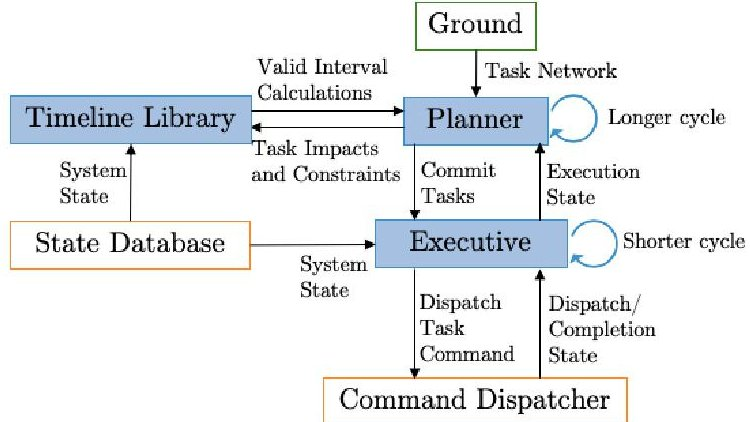
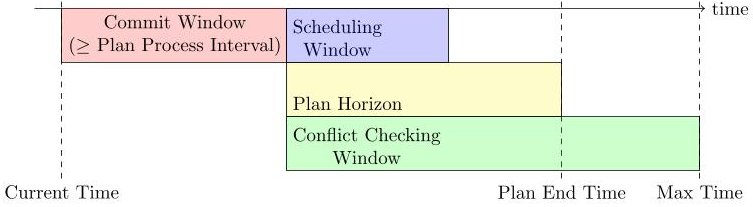
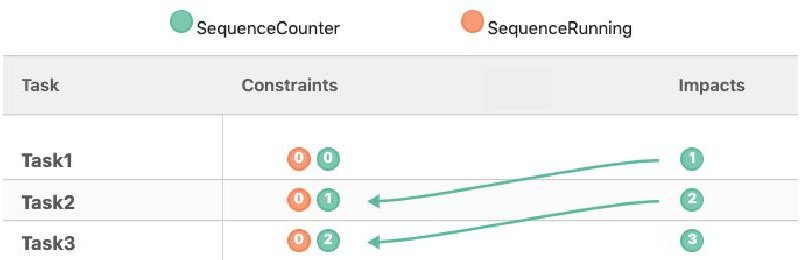
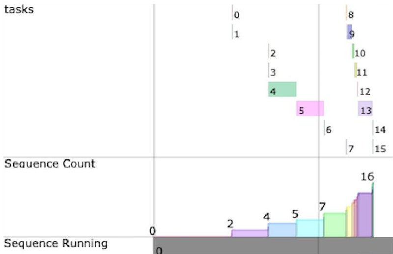
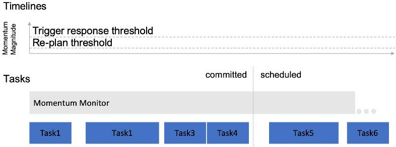

# MEXEC: An Onboard Integrated Planning and Execution Approach for Spacecraft Commanding

Authors: Troesch, M., Mirza, F., Hughes, K., Rothstein-Dowden, A., Bocchino, R., Donner, A., Feather, M., Smith, B., Fesq, L., Barker, B, Campuzano, B

<!-- PDF_PAGE: 1 -->

MEXEC: An Onboard Integrated Planning and Execution Approach for
                          Spacecraft Commanding
                                 Martina Troesch, Faiz Mirza,
    Kyle Hughes, Ansel Rothstein-Dowden, Robert Bocchino, Amanda Donner, Martin Feather,
               Benjamin Smith, Lorraine Fesq, Brian Barker, Brian Campuzano
                                                          Jet Propulsion Laboratory
                                                      California Institute of Technology
                                                            4800 Oak Grove Drive
                                                             Pasadena, CA 91109

                             Abstract                                     model spacecraft behavior and constraints, where the behav-
                                                                          ior is the expected change of state by executing the task and
  The traditional form of spacecraft commanding is with se-               the constraints are the states that are required to successfully
  quences that specify when commands should execute based
  on a schedule generated on the ground. Some sequences have
                                                                          carry out the task. A set of tasks makes up a task network.
  control logic and event driven responses to increase flexi-             The tasks are activities to be accomplished and the modeled
  bility, but it is limited. An approach to increase autonomy             behavior and constraints on each task enforce establishment
  is to use goal-based planning and commanding. Using this                and protection of required states. An onboard planner can
  paradigm, intention and behavior is modeled on board the                use a task network with the most up-to-date state informa-
  spacecraft. In this paper we describe MEXEC (Multi-mission              tion to generate conflict-free schedules and effectively use
  EXECutive), a multi-mission, task-based, onboard planning               time and resources, while an executive can perform real-time
  and execution software designed specifically to be used as              constraint checking on executing tasks. In case any unex-
  flight software. As a path to infusion for future flight projects,      pected events occur, the planner can re-plan a new schedule,
  we describe two experiments performed on the ASTERIA                    and the executive can continue to execute any tasks that are
  CubeSat and testbed that demonstrate that MEXEC can be
  integrated and used for spacecraft operations and increase
                                                                          safe to do so, based on constraints defined in the network.
  robustness and science return compared to the standard se-                 We follow this approach in MEXEC (Multi-mission EX-
  quences that were being used.                                           ECutive), a multi-mission, goal-based, onboard, integrated
                                                                          planning and execution software that uses task networks
                                                                          (Verma et al. 2017; Troesch et al. 2019). With MEXEC,
                         Introduction                                     since an operator specifies a goal where the intent is main-
The prevalent form of spacecraft commanding is through the                tained through a network of tasks, it is possible to in-
use of sequences. As the name implies, sequences generally                crease science return and improve robustness compared to
define a sequence of commands to execute at absolute or                   sequences, as well as respond to anomalies without safing
relative times, but no information is maintained about why a              the spacecraft.
specific command is needed or why a command is sched-                        Although increased autonomy is an enabler for future
uled in a particular way to achieve a desired effect (Gat                 missions where human-in-the-loop commanding is not pos-
and Pell 1998). Although some sequences allow for control                 sible, it is important to methodically prove out autonomous
logic, such as if statements or loops, and some even allow                capabilities and allow users to gain confidence in new soft-
for event driven responses (Grasso and Lock 2008), there is               ware. To that end, we have developed MEXEC in a system-
limited flexibility in how sequences are executed, which lim-             atic way to be flight-ready, including performing incremen-
its the autonomous behavior that can be achieved. Further-                tal flight and testbed experiments on the Arcsecond Space
more, when unexpected states or events happen, the space-                 Telescope Enabling Research in Astrophysics (ASTERIA)
craft response is often to go into safe mode, which may pre-              CubeSat.
vent the spacecraft from performing future tasks that could
have been safe to execute (Gat and Pell 1998). Because the                   ASTERIA was a 6U CubeSat developed as a collabora-
spacecraft is not able to autonomously recover from the un-               tion between the Jet Propulsion Laboratory (JPL) and the
expected state, scheduled science gains are potentially lost.             Massachusetts Institute of Technology (MIT). The flight
   An alternative approach is to use task- or goal-based plan-            software was built in F’ (Bocchino et al. 2018) and nomi-
ning and commanding on board to increase autonomous be-                   nal operations were performed with sequences. It was de-
havior by maintaining intentions and effects on board the                 ployed from the International Space Station on November
spacecraft. A goal can be described through tasks, which                  20, 2017 for a 90-day prime mission to demonstrate preci-
                                                                          sion photometry technology. It successfully achieved all of
Copyright c 2020, California Institute of Technology. Govern-             its primary mission goals of pointing stability, thermal sta-
ment sponsorship acknowledged.                                            bility, and photometric capability (Smith et al. 2018). Af-

<!-- PDF_PAGE: 2 -->

ter that, ASTERIA had three extended missions, the third         behavior modeling at planning and execution time and has a
of which focused on using ASTERIA as a “testbed in the           tighter coupling between the planner and executive.
sky” for technology demonstrations (Fesq et al. 2019). As           Looking ahead to future missions, the M2020 Onboard
part of those demonstrations, MEXEC was flown to demon-          Planner (Rabideau and Benowitz 2017) and MEXEC have
strate nominal science operations using task networks. A         many similarities. In fact, they use the same timeline library
second in-flight experiment was planned, but was converted       to search for valid intervals to place tasks during planning.
to a testbed-only demonstration when the spacecraft stopped      Both use a planner to schedule tasks and an executive to
communicating three months shy of the expected end of mis-       perform real-time constraint checking. However, MEXEC is
sion (Jet Propulsion Laboratory, California Institute of Tech-   multi-mission, whereas the Onboard Planner has a special-
nology 2020).                                                    ized planning algorithm with limited choice points or op-
   In the rest of this paper, we will begin by reviewing some    tions during scheduling including what states can be repre-
related work, then describe MEXEC and two experiments            sented in the timeline library.
that were performed - one on the ASTERIA spacecraft and
one on the testbed. We will finish with a look ahead to future                             MEXEC
work and present conclusions.                                    MEXEC is a multi-mission, onboard planning and execu-
                                                                 tion software that uses task networks to generate and exe-
                     Related Works                               cute conflict-free schedules to achieve goals. It consists of
Sequencing languages such as the Virtual Machine Lan-            three modules: a planner, an executive, and a timeline li-
guage (VML) can provide higher-level programming capa-           brary which is used by the planner to search for valid inter-
bilities compared to traditional sequences. This was demon-      vals to place tasks. MEXEC was designed specifically to be
strated successfully on Spitzer (Peer and Grasso 2005),          used for flight software and to have a consistent, cooperative
where less conservative schedules could be generated by          design between the planner and executive. It also allows op-
taking advantage of relative timing instead of conservative      erators to control the level of autonomy as is appropriate for
estimates, which allowed pre-identified observations to be       their needs.
added from a list whenever possible. However, the resulting         Figure 1 shows a diagram of the MEXEC modules and
execution is still based on a sequence and no projection or      their interactions with the ground and other flight compo-
re-planning is performed.                                        nents. MEXEC assumes that there is a state database that re-
   A move toward more intelligent, autonomous systems            ports system state and a command dispatcher that dispatches
through goal-based commanding instead of sequence-based          commands. The ground sends a task network to the space-
commanding was seen on Remote Agent, which was demon-            craft, which is read by the planner. The planner schedules
strated on Deep Space One (DS1) (Muscettola et al. 1998).        the tasks with the help of the timeline library and the system
Remote Agent flew on DS1 for 48 hours and used model-            state from the state database. Once sufficiently close to the
based programming and onboard search with goal-based,            start time of a task, the planner passes it on to the executive,
closed-loop commanding to achieve more autonomous be-            which performs real-time constraint checking to ensure safe
havior.                                                          execution of the task. Task execution updates are sent from
   The Autonomous Sciencecraft Experiment (ASE) on               the executive to the planner to keep the planner informed in
Earth Observing One (EO-1) (Chien et al. 2005) also              case re-planning is necessary.
demonstrated higher-level commanding based on goals with
robust execution by responding to events and anomalies at
execution time. ASE used the Continuous Activity Schedul-
ing Planning Execution and Replanning (CASPER) (Chien
et al. 2000) software to perform onboard planning and com-
municate with an execution system. ASE flew for over
12 years (Ellis 2017), aiming to maximize science return
by taking data, processing it to create new goals, and re-
planning on board.
   The idea of a spacecraft executive has been used in
other software on many other missions, such as the Space-
craft Commanding Language (SCL) on ASE and TACSAT-3
(Chien et al. 2005; Mackey et al. 2010), Remote Agent Ex-
ecutive on DS1 (Pell et al. 1997), and VML on Spitzer and
Dawn (Grasso and Lock 2008). MEXEC shares many char-             Figure 1: Diagram of the interactions between components
acteristics with the planner and executive on Remote Agent       in MEXEC. MEXEC components are shown in blue.
as well as CASPER on ASE, such as having a separate plan-
ner and executive and performing constraint-based, periodic
planning in a limited scheduling window. MEXEC also in-          Tasks and Templates
herits the use of a commit window from CASPER (described         Tasks represent a desired change to the system. Besides
later in this paper). However, one of the major differences is   a unique ID and a name to identify them and a ground-
that MEXEC provides a more consistent representation of          specified priority to inform scheduling, tasks include a com-

<!-- PDF_PAGE: 3 -->

mand to execute (which may be no operation or even be a            Planner
sequence) as well as expected effects of executing the task         The planner, with the valid interval calculations provided
based on spacecraft behavior (impacts) and the conditions           by the timeline library, generates and maintains conflict-free
required for execution (constraints). Impacts and constraints       schedules given an input task network. Every planning cy-
can be defined at the beginning (pre), during (maintenance),        cle, the planner takes the following actions in order:
or at the end (post) of a task. Conditions to set limits on task
deviation at execution time, such as timeouts for waiting on       1. Commit tasks to the executive
constraints to be met or when to skip tasks, can be defined        2. Consolidate impacts
as control conditions. In the case of execution failure, tasks     3. Schedule tasks (configurable)
can also specify contingencies, which are actions to take on
the task network by the planner, such as adding new tasks          4. Repair conflicts (optional)
from templates. Templates are tasks that are available to the      5. Optimize the schedule (optional)
planner, but that are not explicitly requested to be included           The planner makes use of various timing windows to in-
in the schedule. An immediate response by the executive in          form decisions. The first is the plan process interval, which
the case of task failure can also be defined in the form of a       defines the frequency at which the planner cycle is run. This
command to execute.                                                 interval must be longer than the worst case duration of the
                                                                    planner cycle. The plan process interval also influences the
Timelines                                                           duration of the commit window, which is used to determine
                                                                    which tasks should be passed on, or committed, to the ex-
The timeline library supports planning by calculating valid         ecutive, first defined in (Chien et al. 2000). Any scheduled
intervals for tasks. Many of the concepts outlined in (Chien        task with a start time before the end of the commit window
et al. 2012) for common capabilities for different timeline         should be committed. Since tasks are only committed at the
representations are supported by this timeline library, in-         beginning of the planning cycle and tasks should be com-
cluding support for analyzing schedules and constraints for         mitted before their start time, the commit window must at a
state and resource timelines, which we separate into atomic,        minimum be as long as the plan process interval.
state, claimable, cumulative and cumulative rate timelines.             Another important window is the scheduling window. Un-
Each resource or state that is referred to in a constraint or       scheduled tasks with a preferred start time before the end
impact is represented as its own timeline and can either por-       of the scheduling window are considered for scheduling by
tray values reported by the spacecraft system or values man-        the planner during the planning cycle, allowing the planner
aged internally by MEXEC, also known as internal states.            to work on a subset of the problem at a time. The plan-
Impacts from tasks are placed on the timelines to change the        ner then schedules the tasks within the plan horizon, which
timeline value and are projected into the future to predict fu-     starts after the commit window, to prevent tasks from be-
ture state to compare to constraints and determine conflicts.       ing scheduled before they can be committed, and extends
Impacts can assign a value, a change in value, or a change          to the plan end time, which defines the time before which
in rate to a timeline. The aggregation of impacts and their         all tasks in the task network should be scheduled. During
projections provide a timeline result, or expected value, at        scheduling, the planner checks for conflicts during the con-
any given time. A constraint is in conflict if the result dur-      flict checking window, which starts after the commit window
ing the constraint is not within the prescribed values. System      and goes until the maximum time allowed on timelines. The
state updates from the state database are also applied to the       conflict checking window starts after the commit window
timelines to keep the latest spacecraft values synchronized.        since any tasks already committed to the executive should
This allows the planner to perform its perioidic constraint         not be changed by the planner since they may have started
checking on all states with up-to-date values.                      executing already, and any conflicts that occur at execution
   During scheduling, the planner uses the timeline library         time will be handled by the executive. A summary of the
to look for valid intervals in which to place a task. A valid       timing windows and intervals is shown in Figure 2.
interval is one in which a task can be placed without creating
conflicts. Any previously scheduled tasks have their impacts                   Commit Window         Scheduling
                                                                                                                                             time

and constraints placed and projected on the relevant time-                 (≥ Plan Process Interval) Window

lines. To find valid intervals for a task, the timeline library
                                                                                                    Plan Horizon
systematically places the task on the timelines around result                                       Conflict Checking
times and checks for conflicts.                                                                         Window
                                                                     Current Time                                       Plan End Time   Max Time
   Timeline results are also adjusted when feedback from
the executive notifies the planner that task execution has de-
viated from its originally scheduled time. In this case, the       Figure 2: Diagram of the timing windows and intervals used
task’s impacts and constraints are moved to reflect the ac-        by the planner.
tual execution of the task.
   Additional information about the timeline library can be          After committing tasks, the planner consolidates impacts
found in (Rabideau and Benowitz 2017) as described for the         on the timelines. This step reduces the memory necessary to
prototype for the Mars 2020 Rover.                                 represent a timeline by combining past impact results into a

<!-- PDF_PAGE: 4 -->

single result. The memory footprint of MEXEC in general is                                Experiment 1
adjustable based on various configuration values.                   The goal of the first experiment was to demonstrate that
    Next, the planner schedules any tasks in the scheduling         MEXEC could be integrated with the existing ASTERIA
window. One feature of MEXEC is that it is easy to plug             flight software and that it is sufficiently mature to fly and
in different scheduling algorithms that are most appropriate        be used for operations. To show this, MEXEC was used to
for the application in which it is being used. In fact, we used     replicate the behavior of ASTERIA’s standard sequences. A
different scheduling algorithms for our two experiments.            standard sequence is a binary file that can be run onboard
    If enabled by the configuration, two additional capabili-       by the ASTERIA sequencer. It is generated from an input se-
ties can be used after scheduling. The first is to find conflicts   quence, which is simply a textual specification of a sequence
and attempt to repair them using iterative repair techniques,       of spacecraft commands to be executed. This input sequence
and the second is to optimize the schedule by shifting tasks        is also used to generate binary task networks that are run by
closer to their preferred times, if possible. Neither of these      MEXEC and behave like the standard sequences generated
capabilities was used for our experiments, but are supported        by the same input. Although using MEXEC to replicate stan-
by MEXEC.                                                           dard sequences does not exercise the majority of MEXEC’s
    The planner also handles incoming information when it is        capabilities, it is an important, incremental step in proving
not executing its repeated cycle. This includes reading task        out the MEXEC software.
network files, handling state updates from the state database
to be placed on timelines (as mentioned in the Timelines sec-       Scenario
tion), and interpreting task execution updates from the exec-       The ASTERIA sequencer supports absolute and relative
utive. Task networks are uploaded to the spacecraft from the        timed commands. An absolute timed command will start no
ground in the form of a binary file. The planner reads the          earlier than the given absolute time and a relative timed com-
file and performs input validation before storing the infor-        mand will start no earlier than a specified relative offset from
mation to ensure that the incoming timelines and tasks will         the previous command. Both command types may start late
fit within the available memory and satisfy any assumptions         if previous commands run long.
made by the tasks. Both state database updates and task up-            For the first experiment, we simply performed nominal
dates are used by the planner to update timelines, which pro-       operations sequences of setting up passes and taking science
vide information to the planner in the case that re-planning        observations, with the expectation that everything would ex-
is required. Task updates also notify the planner of task com-      ecute nominally. The major parts of our development in-
pletion status, including if and why a task failed. This infor-     cluded flight software integration, MEXEC flight prepara-
mation is used to determine if any contingency actions need         tion, and task network design.
to be taken.
                                                                    Design and Implementation
Executive                                                           Several steps were required to perform an MEXEC onboard
                                                                    experiment, the first of which was to integrate MEXEC
The executive takes care of task execution and handles              with F’, the flight software used on ASTERIA (Bocchino
adjustments needed for execution deviation. The MEXEC               et al. 2018). This involved designing and implementing sev-
executive converts constraints and control conditions into          eral new components to control and interact with MEXEC.
boolean expression trees to be evaluated at each stage of           Wrapper components were created to send/receive messages
task execution on a per task basis. The evaluation is based         for the MEXEC libraries and hook them into ASTERIA’s
on system state reported from the state database or from in-        commanding, telemetry, and fault protection. Although this
ternal state propagation. Each transition to a new stage and        integration required careful design, it showed how MEXEC
any faults are reported to the planner.                             is readily adapted to fit within software rather than being
   In the executive, all constraints are monitored separately       custom designed. It was decided that as a first step, a con-
for each task. Pre constraints, including the start time of         servative approach to off-nominal behavior and fault protec-
the task, must be achieved before the task will start. If the       tion would be implemented. In the case that fault protection
constraints are not achieved within a defined timeout inter-        is triggered, MEXEC would clear out any outstanding tasks
val, the task is considered failed. Once the constraints are        and stop running. For this first experiment, it was expected
achieved, the executive dispatches the command associated           that all tasks would schedule sequentially; therefore, as a fur-
with the task and starts monitoring any maintenance con-            ther precaution, if any tasks could not be scheduled or any
straints in the task. The executive expects a command re-           parts of planning or execution were not nominal, this would
sponse to indicate that the command was dispatched and              trigger a fault response to clear out and stop MEXEC. A state
completed successfully. If the command response comes               database was also needed to store spacecraft state values to
back with an error, or the command response does not come           be tracked by the planner and executive, and the Sequencer
back within a defined timeout interval, the task fails. Addi-       needed to be modified to send the current task network se-
tionally, if any of the maintenance constraints do not hold         quence count to the state database. Finally, a manager com-
true before the end of the task, the task fails. If the com-        ponent was needed to control timing and the interaction of
mand response returns with success, and the maintenance             MEXEC with fault protection.
constraints hold, the task completes with success after the            Careful planning and timing considerations were taken
duration of the task has been reached.                              into account when designing the manager component. The

<!-- PDF_PAGE: 5 -->

command for loading a task network into MEXEC is rela-
tively straightforward: load the task network file, and when
it succeeds, start running the planner and executive at their
respective rate groups. To clear and stop MEXEC, a new
command was implemented, which can be called either by
the ground or by fault protection; however, it is quite com-
plex due to potential timing risks. For instance, if fault pro-
tection were to first shut down the planner, a command from
the executive could theoretically load another task network       Figure 3: An example of the impacts and constraints used
and restart the planner. Another risk is if the planner were      for the onboard experiment showing how they enforce a se-
busy planning, but took an extended period of time to fin-        quential order. This figure was created using a prototype of a
ish and respond to the shutdown command. Cases like this          tool developed to visualize the relationship between impacts
required some verification and validation work, as well as        and constraints in a task network.
careful design to handle.
   Memory limitations were also considered. Obviously,
ASTERIA was not designed with MEXEC in mind, and                  was not seriously exercised. Beyond that, significant test-
therefore did not have any spare memory for MEXEC, so             ing, input validation, static analysis, memory optimizations,
buffers needed to be shrunk to make room. It was agreed           speed optimizations, and other changes were made to pre-
that MEXEC would fit within 2 MB of memory, which lim-            pare MEXEC for its first flight experiment. A description
ited task networks to 100 tasks or fewer. Since ASTERIA           of the assurance techniques that were used can be found in
sequences can have thousands of commands, clearly a one-          (Smith et al. 2020).
to-one mapping of tasks to commands would not work, so
we allowed the task network to issue commands that start          Results
standard sequences.                                               MEXEC was demonstrated on board the ASTERIA Cube-
   Writing the task networks for this experiment entailed         Sat from September 4 - 20, 2019, and was used to perform
translating input sequences written by the operations team to     observations of HD219134, New York City, the Moon, and
task networks. Some of the commands were grouped into se-         the Vesta asteroid. All uploaded task networks were sched-
quence files which were referenced by tasks in the task net-      uled and executed as expected, with some caveats. Figure 4
work to execute. This required creating new tools to trans-       shows an excerpt of the plan for one of the uploaded task
late and write task networks. For the first experiment, task      networks and the associated effects on the timelines from
network writing was a relatively straightforward translation      the planned schedule.
from sequences. One complication was that the ASTERIA
commands did not have a defined or documented duration,
so the duration of each task was interpreted as the relative
delay between the previous task and the current task.
   As this first experiment was to replicate ASTERIA’s stan-
dard sequence behavior, the constraints and impacts mod-
eled in the task networks were simple. Two states, repre-
sented as timelines, were used: one to monitor the task se-
quence counter, the other to monitor whether a standard se-
quence was currently running. Each task had a pre constraint
that the sequence counter be one higher than the previous
task, as well as a post impact that increases the sequence
counter by one. This enforced a strict ordering of the tasks:
they needed to be scheduled and executed in sequential or-
der. In addition, each task had a pre constraint that there was
not a standard sequence running. This prevented commands
issued by a task network from running concurrently with           Figure 4: Plan excerpt of an uploaded task network showing
standard sequences. Figure 3 illustrates how the impacts and      effects on timelines.
constraints relate to each other to enforce the sequential or-
dering of the tasks. It is clear that the sequence count impact      ASTERIA had some idiosyncrasies that guided both our
from each task satisfies the constraint for the next task, en-    design choices and the results we encountered. As discussed,
forcing the ordering.                                             each task had a pre constraint that there be no standard se-
   One of the properties of the MEXEC planner is that it is       quences running, which might not seem necessary, since all
built to be multi-mission and therefore made to be easy to        tasks schedule sequentially. However, running a standard se-
plug in different scheduling algorithms based on the needs        quence in ASTERIA reported completion when the com-
of the mission. For this experiment, part of our effort was       mand to run the sequence had been dispatched, not when all
designing and implementing a naive algorithm that sched-          commands in the sequence were complete. When the com-
uled the tasks sequentially. MEXEC’s planning capability          mand dispatching the standard sequence completed, the task

<!-- PDF_PAGE: 6 -->

network sequence count was incremented, even though the           ing observations to be lost, but also required reset recov-
standard sequence had not completed yet. ASTERIA com-             ery procedures during the following passes, which meant
mand durations were implied by relative sequence command          that the passes could not be used for useful downlink of
times. In most cases, this calculation was correct, but not al-   data. When scheduling observations, operators used ground
ways. If a task had an incorrect duration and a sequence ran      tools to predict momentum buildup and reaction wheel zero
longer than expected, nothing prevented the next task from        crossings, which led to lower quality science data. If the
dispatching while the first was still running. This behavior      momentum magnitudes were too high, or the zero cross-
appeared in our testbed runs before the actual experiment,        ings were at unfavorable locations, the observations were
and was caused by the combination of premature command            rescheduled (Pong, Sternberg, and Chen 2019). Observa-
response and lack of concrete duration information about          tions were scheduled conservatively to avoid tripping a fault
tasks. We prevented this from being an issue with the pre         and resetting the spacecraft.
constraint on running sequences so that no task could start          MEXEC can be used to autonomously dump momentum
executing if a standard sequence was already running.             and resume safe observations before resetting the spacecraft
   Another issue encountered during both testing and the in-      and losing all upcoming observations and pass downlinks.
flight experiment was an imperfect system timer. The ASTE-        Since the risk of resetting the spacecraft is reduced, obser-
RIA flight software clock, like all clocks, has a limit to its    vations can be scheduled less conservatively, which could
precision. The planner and executive use the current system       allow more observations to be scheduled and increase ob-
time, truncated to the nearest second, to evaluate whether        servation quality. MEXEC can monitor the momentum mag-
it is time to commit, dispatch, or otherwise process a task.      nitude on board and react by sending commands to dump
Once in a while, assumptions made by the planner and ex-          momentum and skip upcoming observations before the reset
ecutive about the precision of the timer caused a task to dis-    threshold is reached. Once an acceptable momentum magni-
patch late or commit late by a second. These timing issues        tude has been reached, MEXEC can resume observations.
and other experiences during the first experiment informed
many of the changes and designs for the second experiment         Design and Implementation
and beyond. Taking into account the imprecise timer, all task     In order to monitor the momentum during the scenario, the
networks in the first experiment succeeded in testing and the     momentum magnitude, calculated from telemetry values,
onboard experiment by scheduling and executing in order           was added to the state database.
and starting at or after the scheduled time, like a standard         The task network was generated based on the schedul-
sequence would.                                                   ing of three observations of 55 Cancri using the traditional
                                                                  sequence operations ground tools. All tasks had constraints
                      Experiment 2                                and impacts based on their behavior instead of simply a se-
                                                                  quence ordering count, as was seen in the first experiment.
The goal of the second experiment was to demonstrate
                                                                  Each task started either a single command or a standard se-
MEXEC’s ability to react to events both in the planner and
                                                                  quence of commands. Any tasks that started a standard se-
in the executive. This required more complex impacts and
                                                                  quence had a constraint that they not execute while another
constraints in the task network as well as using contingen-
                                                                  task that started a standard sequence was running. A dis-
cies, control conditions, and responses by the executive. Fur-
                                                                  tinction was made between tasks that supported science ob-
thermore, we wanted to highlight a scenario where MEXEC
                                                                  servations and those that were required for setting up and
could be useful and improve operations for ASTERIA. The
                                                                  taking a pass. Science observations had the restriction that
second experiment had to be performed on the ASTERIA
                                                                  they respect momentum management, whereas pass tasks
testbed due to loss of contact with the spacecraft.
                                                                  should execute regardless of momentum magnitude (unless
                                                                  fault protection had been triggered).
Scenario                                                             To manage momentum and enforce the restriction on ob-
The motivating scenario for the second experiment was mo-         servation tasks, we used a long-running momentum moni-
mentum management. ASTERIA used the fleXible Attitude             tor task. This task had a maintenance constraint on momen-
Control Technology (XACT) from Blue Canyon Technolo-              tum magnitude. If the momentum magnitude went above the
gies (BCT) (Blue Canyon Technologies) as its attitude con-        trigger threshold (which is lower than the fault protection
trol system, which has 3-axis attitude control with three re-     threshold), the momentum monitor task would fail, trigger-
action wheels and three torque rods as described in (Ma-          ing an immediate response in the executive to start a standard
son et al. 2017) from its first flight on the MinXSS-1 Cube-      sequence to dump momentum and return to a known state, as
Sat and in (Pong 2018; Pong, Sternberg, and Chen 2019;            well as triggering a contingency response in the planner. The
Smith et al. 2018) on ASTERIA. External torques caused            contingency response was to re-schedule a momentum mon-
momentum buildup, especially since ASTERIA had a large            itor and an observation setup task when the momentum mag-
residual magnetic dipole moment. Too much buildup causes          nitude had dropped to a safe level. All science observation
attitude control loss (Pong, Sternberg, and Chen 2019). To        tasks had a constraint that they should execute only if the
protect the spacecraft, ASTERIA fault protection had a mo-        momentum monitor was running. Therefore, these tasks fail
mentum magnitude threshold that, if surpassed for some per-       when the momentum monitor fails. Additionally, the science
sistence, triggered the spacecraft to go into safe mode and       observation tasks had a control condition to skip the task if
reset. Resetting the spacecraft not only caused any upcom-        the momentum monitor was not running. This sequence of

<!-- PDF_PAGE: 7 -->

events is shown in Figure 5 with science observation tasks.
Figure 6 shows a simplified version of what a subset of the

(a) Tasks have been scheduled and some have been committed. The
higher momentum magnitude trigger response threshold is shown
in relation to the lower threshold required for re-planning.

                                                                        Figure 6: Simplified excerpt of what the constraints and im-
                                                                        pacts for some of the tasks in the second experiment could
                                                                        look like. This figure was created using a prototype of a tool
                                                                        developed to visualize the relationship between impacts and
                                                                        constraints in a task network.

                                                                        tasks, constraints, and impacts look like with the relation-
(b) The momentum magnitude has increased and is above the trig-         ships between them.
ger threshold for some persistence. This violates the momentum             This also highlights some differences from the first exper-
monitor task’s maintenance constraint, causing it to fail, which then
dispatches a command to dump momentum and return to a known
                                                                        iment. In this experiment, we expected that there would be
state. It is expected that the upcoming tasks will be skipped.          times when tasks do not schedule or fail during execution,
                                                                        so the fault protection responses had to be updated to reflect
                                                                        this change. The more complex constraints and re-planning
                                                                        needs for this scenario also required a different scheduling
                                                                        algorithm.
                                                                           Since we could not fly this experiment on the ASTERIA
                                                                        spacecraft, and were instead using the ASTERIA testbed,
                                                                        we used the Real-time Dynamics Processor (RDP), designed
                                                                        and built by BCT, to simulate sensor input to the XACT
                                                                        (Pong, Sternberg, and Chen 2019). We selected thresholds
 (c) The planner also removes scheduled tasks from the schedule.        that reflected the behavior simulated by the RDP.

                                                                        Results
                                                                        The task network that we ran on the testbed surpassed the
                                                                        momentum threshold four times and recovered successfully
                                                                        each time to resume observations. Figure 7 shows when and
                                                                        how the momentum changed. The times with the grey back-
                                                                        ground show when science observations were scheduled.
                                                                        The momentum threshold was exceeded in between tasks
                                                                        and such that the momentum dumping response returned the
(d) When the momentum magnitude has decreased to the re-                momentum magnitude to an acceptable level for all tasks to
planning threshold, the planner schedules another momentum mon-         execute.
itoring task, as was added by the contingency, and any other tasks         The results of this scenario show that the MEXEC soft-
that can be scheduled.                                                  ware successfully responds to onboard state information
                                                                        and takes action both in the executive and the planner. The
Figure 5: This figure shows the sequence of events that hap-            executive successfully enforced the momentum monitoring
pen after scheduling and committing tasks and responding                task’s maintenance constraint, failed the task when the con-
after the momentum magnitude goes too high. The momen-                  straint was violated, and dispatched the specified momen-
tum monitor task is shown in grey and all other tasks are               tum dumping response. The momentum magnitude success-
science observation tasks shown in blue. The Momentum                   fully decreased after the momentum dumping response. The
Magnitude timeline is also shown.                                       fact that the task failed was communicated by the executive

<!-- PDF_PAGE: 8 -->

into existing flight software and be used for operations, as
                                                                well as enable robustness and fail-operational command-
                                                                ing. The onboard experiment demonstrated successful inte-
                                                                gration of the MEXEC software into the ASTERIA flight
                                                                software and replication of the behavior of the standard
                                                                ASTERIA sequences for operations. The second experi-
                                                                ment, performed on the ASTERIA testbed, demonstrated
                                                                how MEXEC could benefit the ASTERIA mission’s mo-
                                                                mentum management by monitoring momentum, dumping
                                                                momentum when necessary, and recovering without reach-
                                                                ing fault protection limits. This would prevent the spacecraft
                                                                from going into safe mode, therefore allowing it to recover
                                                                and possibly continue science observations as well as take
Figure 7: The evolution of the momentum during the exper-
                                                                passes without reset recovery procedures. This would also
iment. The times of the science observations are shown with
                                                                potentially allow operators to generate less conservative ob-
the grey background.
                                                                servation schedules to increase the number of observations
                                                                or increase observation quality. Additionally, had contact not
                                                                been lost with ASTERIA, operations would have continued
to the planner. With this information, the planner added the
                                                                as the spacecraft lost altitude and therefore also attitude con-
contingency tasks to the task network. The planner also re-
                                                                trol. The ground tools would have been less reliable in pre-
planned, removing any tasks that required momentum mon-
                                                                dicting momentum for observations and MEXEC could have
itoring from the schedule, only re-scheduling them when the
                                                                prevented unnecessary occurrences of entering safe mode.
momentum magnitude reported by the state database satis-
fied the constraints for the momentum monitor. The testbed
did not trip any faults and it did not go into safe mode.                         Acknowledgements
   If this had been a flight situation where the ground tools   We would like to thank everyone on the ASTERIA team.
had not correctly anticipated the momentum buildup, and the     We would not have been able to do these experiments with-
momentum would have exceeded the fault protection thresh-       out their expertise and help. In particular, we would like to
old, the use of this task network with MEXEC could have         acknowledge Dr. Matthew Smith, Dr. Christopher Pong, Dr.
prevented the spacecraft from going into safe mode and may      Terry Huntsberger, Aadil Rizvi, Michael Starch, and Car-
have saved some science observations. This also potentially     olyn Maynard. Additionally, we would like to thank Dr. Pa-
would allow operators to be less conservative with respect      tricia Beauchamp for her leadership and support during the
to the momentum prediction in the ground tools therefore        extended mission.
possibly increasing science quality.                               We would also like to thank Gregg Rabideau and Dr. Steve
                                                                Chien for their feedback and mentorship in the development
                    Looking Ahead                               of MEXEC. We also thank Ellen Van Wyk for her work on
                                                                visualization tools.
We will continue to develop MEXEC to align with the needs          The research was carried out at the Jet Propulsion Labo-
of potential future missions to help infusion and adoption      ratory, California Institute of Technology, under a contract
of MEXEC. Some additional experiments that are planned          with the National Aeronautics and Space Administration
on the ASTERIA testbed include experiments that inte-           (80NM0018D0004).
grate MEXEC with AutoNav (Riedel et al. 2000), which
had a standalone experiment on board ASTERIA (Fesq et
al. 2019), as well as with the Model-based Off-Nominal
                                                                                        References
State Detection and Identification (MONSID) system (Kol-        Blue Canyon Technologies. 2020. Blue Canyon Technolo-
cio 2016), which had planned an experiment on board AS-         gies. https://www.bluecanyontech.com. [Online; accessed
TERIA before communication was lost. MEXEC is also be-          February 25, 2020].
ing integrated with the Robotics Operating System (ROS) as      Bocchino, R.; Canham, T.; Watney, G.; Reder, L.; and
part of a prototype for the Europa Lander Autonomy con-         Levison, J. 2018. F Prime: an open-source frame-
cept (Dooley 2019; Wang et al. 2020). There are many ways       work for small-scale flight software systems.              In
in which we plan to expand the capabilities of MEXEC for        Proceedings of the AIAA/USU Conference on Small
these tasks, including improving the hierarchical task struc-   Satellites. Advanced Technologies II, SSC18-XII-328.
ture, adding more scheduling algorithms and optimization        https://digitalcommons.usu.edu/smallsat/2018/all2018/328/.
functions, changing priorities of tasks onboard based on        Chien, S.; Knight, R.; Stechert, A.; Sherwood, R.; and Ra-
events or mission phase, and working with more complex          bideau, G. 2000. Using Iterative Repair to Improve Respon-
task plans to make MEXEC more powerful.                         siveness of Planning and Scheduling. In International Con-
                                                                ference on Artificial Intelligence Planning Systems (AIPS
                      Conclusions                               2000).
The experiments that were performed on the ASTERIA              Chien, S.; Sherwood, R.; Tran, D.; Cichy, B.; Rabideau, G.;
CubeSat and testbed show that MEXEC can be integrated           Castano, R.; Davis, A.; Mandl, D.; Frye, S.; Trout, B.; et al.

<!-- PDF_PAGE: 9 -->

2005. Using autonomy flight software to improve science         Pong, C. M.; Sternberg, D. C.; and Chen, G. T. 2019. Adap-
return on Earth Observing One. Journal of Aerospace Com-        tations of guidance, navigation and control verification and
puting, Information, and Communication 2(4):196–216.            validation philosophies for small spacecraft. In Proceed-
Chien, S.; Johnston, M.; Frank, J.; Giuliano, M.; Kavelaars,    ings of the 42nd Annual AAS Rocky Mountain Section Guid-
A.; Lenzen, C.; and Policella, N. 2012. A generalized time-     ance and Control Conference held January 31 to February
line representation, services, and interface for automating     6, 2019, Breckenridge, Colorado. Pasadena, CA: Jet Propul-
space mission operations. In SpaceOps 2012.                     sion Laboratory, National Aeronautics and Space Adminis-
                                                                tration.
Dooley, J. 2019. Direct-to-Earth Mission Concept for a
Europa Lander. In 2019 IEEE Aerospace Conference.               Pong, C. 2018. On-Orbit Performance & Operation
                                                                of the Attitude & Pointing Control Subsystems on
Ellis, E. G. 2017. The Journey of NASA’s Smartest Satel-        ASTERIA. In Proceedings of the AIAA/USU Confer-
lite Finally Comes to an End. https://www.wired.com/2017/       ence on Small Satellites. Poster Session 1, SSC18-PI-34.
03/say-farewell-eo-1-nasas-smartest-satellite. [Online; ac-     https://digitalcommons.usu.edu/smallsat/2018/all2018/361/.
cessed February 25, 2020; posted March 24, 2017].
                                                                Rabideau, G., and Benowitz, E. 2017. Prototyping an on-
Fesq, L.; Beauchamp, P.; Donner, A.; Bocchino, R.;              board scheduler for the mars 2020 rover. In International
Kennedy, B.; Mirza, F.; Mohan, S.; Sternberg, D.; Smith,        Workshop on Planning and Scheduling for Space.
M. W.; and Troesch, M. 2019. Extended Mission Tech-
                                                                Riedel, J.; Bhaskaran, S.; Desai, S.; Han, D.; Kennedy, B.;
nology Demonstrations Using the ASTERIA Spacecraft. In
                                                                McElrath, T.; Null, G.; Ryne, M.; Synnott, S.; Wang, T.;
2019 IEEE Aerospace Conference, 1–11. IEEE.
                                                                et al. 2000. Using autonomous navigation for interplane-
Gat, E., and Pell, B. 1998. Smart executives for autonomous     tary missions: The validation of deep space 1 AutoNav.
spacecraft. IEEE Intelligent Systems and their Applications     Smith, M.; Donner, A.; Knapp, M.; Pong, C.;
13(5):56–61.                                                    Smith, C.; Luu, J.; Pasquale, P.; and Campuzano,
Grasso, C., and Lock, P. 2008. VML sequencing: Grow-            B.      2018.     On-Orbit Results and Lessons Learned
ing capabilities over multiple missions. In SpaceOps 2008       from the ASTERIA Space Telescope Mission.                 In
Conference, 3295.                                               Proceedings of the AIAA/USU Conference on Small
Jet Propulsion Laboratory, California Institute of Tech-        Satellites.       The Year in Review, SSC18-I-255.
nology. 2020. Tiny satellite for studying distant plan-         https://digitalcommons.usu.edu/smallsat/2018/all2018/255/.
ets goes quiet. https://www.jpl.nasa.gov/news/news.php?         Smith, B.; Feather, M.; Huntsberger, T.; and Bocchino, R.
feature=7568. [Online; accessed January 3, 2020; posted         2020. Software Assurance of Autonomous Spacecraft Con-
January 3, 2020].                                               trol. In 66th Annual Reliability & Maintainability Sympo-
Kolcio, K. O. 2016. Model-Based Fault Detection and Isola-      sium (RAMS).
tion System for Increased Autonomy. In AIAA SPACE 2016.         Troesch, M.; Mirza, F.; Rabideau, G.; and Chien, S. 2019.
5225.                                                           Onboard re-planning for robust mapping using pre-compiled
Mackey, R.; Brownston, L.; Castle, J. P.; and Sweet, A.         backup observations. In 11th International Workshop on
2010. Getting diagnostic reasoning off the ground: ma-          Planning and Scheduling for Space (IWPSS), 168–175.
turing technology with TacSat-3. IEEE intelligent systems       Berkeley, California, USA.
25(5):27–35.                                                    Verma, V.; Gaines, D.; Rabideau, G.; Schaffer, S.; and Joshi,
                                                                R. 2017. Autonomous Science Restart for the Planned Eu-
Mason, J.; Baumgart, M.; Woods, T.; Downs, C.; Hegel, D.;
                                                                ropa Mission with Lightweight Planning and Execution. In
Rogler, B.; Stafford, G.; Solomon, S.; Chamberlin, P.; Caspi,
                                                                Proceedings of the 10th International Workshop on Plan-
A.; Palo, S.; Jones, A.; Kohnert, R.; Li, X.; Moore, C.; and
                                                                ning and Scheduling for Space (IWPSS2017). Pittsburgh,
Rouleau, C. 2017. MinXSS-1 CubeSat On-Orbit Point-
                                                                PA.
ing and Power Performance: The First Flight of the Blue
Canyon Technologies XACT 3-axis Attitude Determination          Wang, D.; Russino, J. A.; Basich, C.; and Chien, S. 2020.
and Control System. Journal of Small Satellites 6(3):651–       Using Flexible Execution, Replanning, and Model Param-
662.                                                            eter Updates to Address Environmental Uncertainty for a
                                                                Planetary Lander. In Proceedings of the International Sym-
Muscettola, N.; Nayak, P. P.; Pell, B.; and Williams, B. C.
                                                                posium on Artificial Intelligence, Robotics and Automa-
1998. Remote agent: To boldly go where no AI system has
                                                                tion for Space, i-SAIRAS’2020. Noordwijk, NL: European
gone before. Artificial intelligence 103(1-2):5–47.
                                                                Space Agency.
Peer, S., and Grasso, C. A. 2005. Spitzer Space Tele-
scope Use of the Virtual Machine Language. In 2005 IEEE
Aerospace Conference, 1–10. IEEE.
Pell, B.; Gat, E.; Keesing, R.; Muscettola, N.; and Smith,
B. 1997. Robust periodic planning and execution for au-
tonomous spacecraft. In Proceedings of the Fifteenth Inter-
national Joint Conference on Artificial Intelligence (IJCAI),
1234–1239.

## Figures

