<!-- PDF_PAGE: 1 -->

# Flight Software Development for a CubeSat Application

Koffi V. C. K. de Souza $ ^{ID} $ , Yassine Bouslimani, and Mohsen Ghribi

Abstract-This article presents a development of a CubeSat mission software running on an STM32-based on-board computer (OBC). This was conducted under the Canadian CubeSat Project, initiated by the Canadian Space Agency in 2018 to support the development of 15 CubeSats across Canada. The proposed mission software has a multilayered architecture and is divided into five layers from a low layer dedicated to the peripherals to the top layer dedicated to the Mission Applications. The CubeSat protocol (CSP) is used at the communication layer for easing connectivity between subsystems and to communicate with the ground segment. The mission software running on the OBC is built to meet many requirements defined for this satellite, such as version control, classifications, margins, etc. The CubeSat will be able to accomplish two scientific missions related to the study of space weather once the satellite is put into orbit from the International Space Station. An overview of the software running on the OBC is presented, written in C Language, and includes the implementation of the CSP. FreeRTOS used as an operating system for the OBC is also presented. A Command Line Interface was designed for testing purposes to ensure software efficiency and some results are discussed in this article. The flight software consists of three main tasks and subtasks. Of the 1024 kB of flash memory, only 240 kB was used which represents less than 20% of the total memory. The CPU load is 34% for normal, manual, and maintenance modes and 16% for failure modes.

Index Terms—CAN bus communications, CubeSat, CubeSat protocol (CSP), FlatSat, flight software, nanosatellite.

## I. INTRODUCTION

TO REDUCE the cost, the complexity, and the development time of satellites, some universities (California Polytechnic State University and Stanford University) have introduced the CubeSat, a small low-cost satellite capable of operating in low-Earth orbit (LEO) in 2000 [1], [2]. Over the past decades, the number of

these nanosatellites has increased considerably from dozens of satellites per year in the mid-2010s to an estimated 8000 satellites in orbit in the 2024s [3]. The CubeSat is a nanosatellite measuring 10 cm $ \times $ 10 cm $ \times $ 10 cm that weighs about 1 kg [4] which can also be used to compose satellites of sizes ranging from 2U (2 units placed end to end) up to 12U [5]. The CubeSats are a low-cost satellite in a range of 1 million to 10 million dollars, compared to conventional satellites for which the cost exceeds several billion dollars [6], [8] and are very effective in accomplishing small space research missions [3] in a hostile environment [6]. In order to facilitate the rapid development on a limited budget, many CubeSats are benefitting from the available commercial components, known as commercial off-the-shelf (COTS) [9], [10] which offer many opportunities to develop satellites with more sophisticated systems, more manageable, and with greater processing capacity, allowing meeting their complex mission's requirements [4]. The capacities of small satellites are constantly increasing, and the main reason is based on the significant reduction in requirements, and its technological and commercial advantages [5], [7], [8].

Unfortunately, CubeSats do not have a great mission success record and as reported by a study [11] in 2017. Of 288 CubeSats only 17% completed their full mission, 26% a partial mission and the remaining 57% did not reach the minimum lifespan required for the mission or either missed the launch according to the same study. Failures occur because researchers and developers generally focus on subsystems and the hardware design while investing less effort on the software development and the cohesion of the whole system [7], [12]. To avoid such failures, mission software and data handling should focus more on the software architecture and fault tolerances through certain software features, such as functionality, integrity, usability (user-friendly), efficiency, flexibility, reliability, maintainability, and portability, to build robust systems capable of achieving mission objectives [13]. Several software constructs are organized in layers, such as application, communication, data handling, drivers, etc. [14]. NASA Goddard Space Flight Center (GSFC) developed the core flight system (cFS) platform, which is a three-layered flight software architecture [15]. F $ \left( \mathrm{F^{\prime}} \right) $ created at the Jet Propulsion Laboratory is a component-based architecture and has been successfully used in a number of space applications [16]. KubOS is a space software founded in 2014 and allows users to build their own project using the SDK and

<!-- PDF_PAGE: 2 -->

by providing a foundation for writing mission applications in Rust, C, or Python [17]. There is also a private flight software like the generic on-board software (GERICOS) framework and China Academy of Space Technology (CAST) [14].

The mission software which implements the vital functionalities runs on a dedicated hardware called on-board computer (OBC) [18]. The on-board software (OBSW) through the OBC allows subsystems to interact and exchange data according to mission objectives and requirements. The OBC is part of the satellite numerous subsystems, each of which must perform properly for the entire system to function smoothly.

This work presents a mission software architecture and tests on real developed CubeSat satellite subsystems, such as the OBC, the payload, the communication board, and the backplane to form the FlatSat. This research has been conducted under the Canadian CubeSat Project funded by the Canadian Space Agency (CSA) to develop the first Satellite designed in New Brunswick, Canada.

## II. CUBESATS DEVELOPMENT

Extreme conditions in the space environment, such as severe temperature (very cold and very hot in a short period of time) and high exposure to radiation [19], require careful consideration of the hardware and software design. Space equipment requires very robust electronic components and a higher level of redundancy to survive in such a harsh environment. This can be achieved because of advances in microand nano-technologies, which have enabled the fabrication of extremely small electrical and mechanical components [20], such as solar cells, CPUs, GPS receivers, sensors, actuators, and batteries [21]. The objectives of the design of an embedded system for space projects are to optimize the capacity, availability, flexibility, and reliability of the system while minimizing the cost [22]. Many CubeSat missions have adopted similar approaches. UPSat, the first satellite made in Greece by the University of Patras and the Libre Space Foundation, has two missions which consist of measuring the density of electrons in plasma and acquiring images of the Earth [23]. UPSat Team and for the needs of their mission have designed an OBC from scratch and proposed an STM32F4-based design hosting Linux Board and a camera. FreeRTOS was used to facilitate scheduling and services. ECSS-CCSDS telemetry and telecommand packet standard were used for on-board and satellite-to-ground communications. HAVELSAT is a CubeSat 2U satellite developed by HAVELSAN and the Istanbul Technical University. They designed their OBC using an STM32F4xx with FreeRTOS as an operating system, which relates to the other subsystems over PC104. A modem handles the data flow between the satellite and the ground station, an SDR is used as a technological payload. Its main mission is to collect electron density information on its orbit [24]. Masat-1 is a 1U CubeSat satellite developed in Morocco by three universities and which has a camera payload. They utilized a commercially available OBC that is driven by an Atmel AT32UC3C0512C microprocessor. The effective development and testing are ensured by ECSS standard tailoring. GNU/Linux and FreeRTOS were

utilized as operating systems; and GNU/Linux was used for software development and simulation. To allow on-board realtime management while maintaining a compact footprint, the program was converted to FreeRTOS [25]. SANDROID is a CubeSat designed to integrate four Android mobile phones with a power of 2 W and a weight of 5 kg. The CubeSat simply uses the cluster of Android mobile phones as the satellite's basic processing unit and has a powerful computing capacity. Camera arrays are systems generated using numerous image sensors [26].

A satellite is made up of several subsystems that must all function together as a cohesive unit. A subsystem must be robust and needs to have a low level of failures to last in LEO and reach their mission objectives. The product development is a critical and important process. The use of a product development process (PDP) can help on reducing these costs and quality faults significantly [27]. Some missions described in the previous paragraph use COTS components which are used a lot in CubeSats because they are cheaper and offer a lot of benefits. COTS components are LEO tested and come with their software ready to use or require little software configuration [28]. For example, Masat-1 [22] uses an OBC which is a COTS subsystem.

## III. ON-BOARD SOFTWARE

The primary responsibility of the OBC is to monitor the health of the system and make decisions to keep the satellite functional. It monitors the integrity of the satellite through the command and data handling system (C&DH). It also monitors the satellite battery power level and properly adjusts the satellite mode of operation. It maintains real-time clock (RTC) time, for the operation of payloads. In addition to this, the OBC also serves as a gateway between the satellite bus and the radio link to the ground station [29]. The OBC can perform all that tasks through the OBSW which is unique per satellite because every satellite has its own mission and a specific hardware. And therefore, an important tool for the satellite itself. Other satellite subsystems functions are also achieved by the software, such as electric power system (EPS), attitude determination and control system (ADCS), and payloads [7], [19], [30], [31]. In the example shown in Fig. 1, the OBSW will control the CubeSat mode of operation, and all the equipments connected to the CubeSat. It will switch the equipment of the CubeSat to the appropriate mode depending on the live data receive from other subsystems. TC/TM services will receive and encrypt command, handle TC queues and events associated with the command, and finally generate TM. Data Handling will control bus TCs and read TM, it also calibrates or recalibrates TC/TM. Commands will flow through the system via the communication system. ADCS, EPS, COMM (communication board), and the payload will read TC commands generated by the OBSW, they will generate their TM and send it to the OBC. An OBSW of the OBC must include several functions, including detection, isolation, and recovery of failures: telecommand processing for ground-based commands. Telemetry generation for groundbased status monitoring, such as attitude and orbit control,

<!-- PDF_PAGE: 3 -->

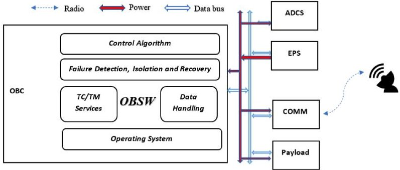

Fig. 1. OBSW interaction and functions within a CubeSat.

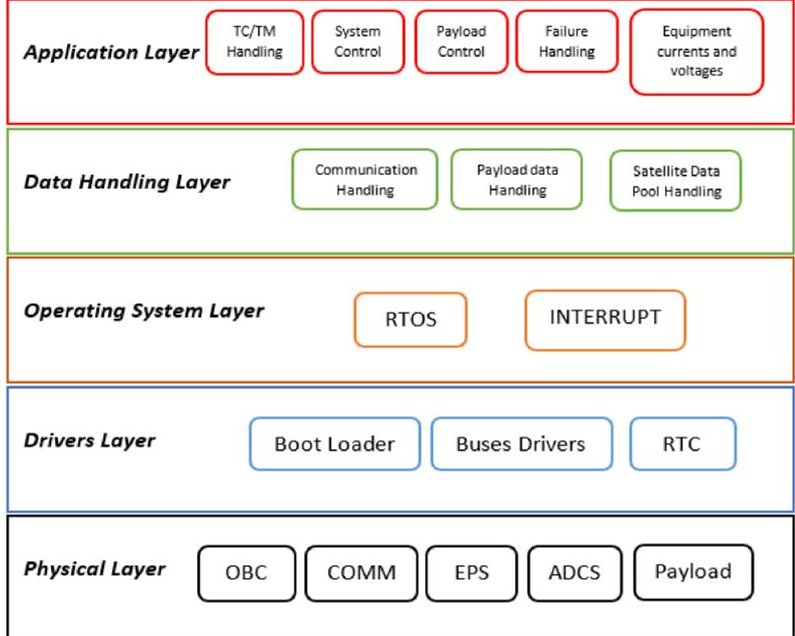

Fig. 2. Onboard software layered architecture.

power control, thermal control, payload instrument functioning, and system status monitoring, is all part of the CubeSat control.

## A. On-Board Software Architecture

The OBSW is usually built on a layered paradigm with numerous hierarchical levels; in addition to the conventional software layers, several critical layers crucial are often used to ensuring software portability, reuse, and hardware independence. The main goal is to ensure that the majority of the software developed can be ported to different satellites with minimal changes, simply by configuring parameters according to mission requirements; this is especially important for the upper levels, which must remain unaffected even if some lower-level modules change. It also provides a framework that attempts to make the integration of new technologies easier and to allow comparisons of different elements. Fig. 2 shows the primary components of the OBSW architecture (physical, drivers, operating systems, data handling, and applications).

1) Physical Layer: It is the lowest layer where devices are electronically connected using the appropriate ports and buses, such as the OBC, the payload, EPS, ADCS, COMM, etc.

2) Drivers Layer: Physically, the OBC boot loader is stored in PROM or EEPROM at physical address 0x0. The boot loader provides all of the instructions required to initialize the CPU so that the real-time operating system (RTOS) and the

OBSW layers built on top can boot. In most situations, this entails copying the OBSW from PROM to RAM, verifying the memory image checksum, and starting the OBSW execution at a certain RAM address (usually 0x0). The RTOS binary is loaded first, followed by the nonoperating system portion of the OBSW, which is loaded on top of the RTOS. I/O channel drivers from OBSW to hardware interface lines in/out of the computer are similar to drivers on traditional PCs (like UART, USB, etc.). Depending on the intelligence of the OBC chip, such drivers can either rely solely on software to operate or are partially represented in "System-on-Chip" hardware. The degree to which software is implemented is also determined. Depending on the type of electric interface that will be driven and based on the data protocol complexity of the interface. In System-on-Chip implementations, interface electronics and lower driver layers such as for Spacewire are achieved directly by hardware.

3) Operating System Layer: The CubeSat operating system is the intelligence of the OBC system, and it dictates a functioning. It is designed and optimized to increase the satellite's efficiency in managing hardware resources, handling all commands, and reducing response time for activities it does. Instead of controlling each part of the system individually, an OS manages all programmable as well as fixed hardware operations. The OS that runs on a most CubeSat is an RTOS which is common for most embedded systems and the difference between the two is the response time to external events. With multitasking, threads, priority-driven preemptive scheduling, and quick context-switching—all necessary aspects of an embedded real-time system—an RTOS delivers the stringent resource management and scheduling required to fulfill the demands of applications. An RTOS usually has a compact footprint and is optimized for speed, but each one must be configured with the capabilities required for the hardware and system it supports. From a simple kernel configuration that manages a few jobs to a full-featured RTOS that manages hundreds of tasks and subsystems, such as graphics, networking, file systems, audio, and more. An RTOS should be able to scale up or down depending on the system's needs and resources.

4) Data Handling Layer: The data handling layer is located above the RTOS and drivers' interface. They write commands from the OBSW to the CubeSat equipment using drivers, such as ADCS, payloads, EPS, etc. It also undertakes cyclic or on-demand onboard equipment telemetry acquisition, which should not be confused with space-to-ground telemetry.

In order to control the ADCS, such as the magnetorquer, temperature sensors, and sun sensors, a handler could be used per equipment in a C programming language that could be a struct for magnetorquer, one for sensors, and so on. In this circumstance, the handler is responsible for all instances of equipment.

On the lower end, equipment handlers are connected to signal line drivers, to whom they must send equipment command data in a driver-compatible format which is not always the same as the format used on the outgoing physical signal line, data connection, or data bus. The handlers select the "to be commanded" parameter values from the OBSW's "OBSW Data Pool," which is a central data pool (OBSW-DP).

<!-- PDF_PAGE: 4 -->

When obtaining on-board telemetry from connected equipment, the equipment handler must choose the data from the RTOS driver's appropriate software interface and place it in the OBSW-associated DP's variables slots. The OBSW data pool can contain all operational variables, such as the system time, sensor data, equipment data, eps data (currents and voltages), position and velocity, attitude and rotation measures, and payloads instrument statuses.

5) Application Layer: The application layer manages the CubeSat's payload instruments, ADCS, EPS, thermal control, etc., and lies on top of the Data Handling layer. The programs read data from the OBSW-DP and write computed output to the OBSW-other DP's variables. The controller numeric for ADCS, power, and thermal control is among the applications. In theory, any OBSW-DP variable is accessible to any application. All apps have some variables in common, such as the RTC. The update cycle time for each application can be different. Each application also isolates the handling of the relevant subsystem states on its own.

The mode transitions generated by a subsystem control are handled by the control application for that subsystem. If a solar panel voltage fails, the EPS subsystem mode may be changed to the EPS Safe Mode. In the Safe Mode, the EPS, for example, only uses batteries to power all the CubeSat and may turn off all payloads. The function of the EPS is still performed in the Safe Mode (as opposed to the normal mode), but the control is based on a completely new set of measurements and parameters in the OBSW-DP.

The extent to which such failure-induced subsystem mode transitions automatically induce top-level CubeSat system mode transitions, or vice versa, is an issue that will be examined later.

Satellite-to-ground communication is based on an international command packet transmission protocol that is utilized in both science and Earth observation satellites as well as telecommunication satellites. The Consultative Committee for Space Data Systems established the specifications for this communication protocol (CCSDS). The CCSDS standard defines packets for encapsulating CubeSat telecommands uplinked from ground and telemetry data transferred from satellite to ground.

## B. On-Board Software Development

OBSW development is an extremely challenging process that necessitates not only a lot of spacecraft systems engineering effort but also a lot of code implementation issues. The following steps make up the complete OBSW development process: software functional analysis, software requirements formulation, software design, software implementation and coding, and software verification and testing.

1) Functional Analysis of On-Board Software: During the CubeSat development, a complete definition of all on-board functions must be worked up, with specifics on which functions will be implemented in software and which in hardware. For the OBSW, a so-called Function Tree must be built.

OBSW Functional Analysis must therefore assess which CubeSat OBSW functions are required, as well as an allocation of these software functions to the various CubeSat operational modes.

When the detailed on-board equipment types and supplier selection are completed, and the suppliers deliver the functional and interface documentation for all of this equipment. The breadth of this OBSW Function Tree must be refined to include all of the specifics on equipment control protocols, necessary equipment modes switching, and equipment failure detection isolation and recovery (FDIR) functions that must be integrated into the core OBC's OBSW. The Function Tree contains all command functions of the OBSW kernel, functions for processing TCs, functions for generating TM, controller application functions (ADCS, power, thermal, and payload), equipment interface handler functions, surveillance/control relevant functions, and error/failure diagnostic/failure handling/recovery at the start of the OBSW design activities (FDIR). Furthermore, at the CubeSat subsystem level, it must be remembered that within each CubeSat operating mode, subsystems (e.g., payload) might operate in a variety of subsystem modes, requiring distinct active functions for control.

In addition, the Function Tree must reflect all control and data handling interaction functionality between subsystem functions and the CubeSat command and control, such as the management of intelligent payload boot sequences, time, position, and velocity synchronization functions of ADCS algorithms.

2) Software Requirements Formulation: The elaboration of precise OBSW requirements follows the definition of the OBSW function tree. Aside from simply identifying the need for a software functionality, this stage also involves a full specification of all OBSW features in terms of OBSW structure requirements; functional requirements, such as function hierarchies and CubeSat mode-, subsystem mode-, and equipment mode-dependent characteristics; Overall and algorithm-dependent performance requirements for OBSW; data processing and operability requirements for the OBSW; requirements for OBSW scheduling and timing precision, FDIR performance, and handling requirements; requirements for the OBSW development process, such as compliance with OBSW design standards, quality assurance, and so on; and requirements for OBSW verification and validation.

At least the strictly technical functional needs to have a structure that is nearly identical to the elaborated OBSW Function Tree. An OBSW requirements document covers the OBSW's function of launcher separation detection, as well as a function low diagram and the requirements that go with it. R1: The detection subfunction should be able to be enabled/disabled through telecommand. Note: The "I am alive" reporting function must be turned on at all times. R2: The detecting subfunction is enabled by default. First-cycle every one second period. Second—in each cycle, read the six "separation strap" indications.

All OBSW criteria must be written in the same way. They do not predict or prescribe any OBSW implementation options, and they are not permitted to do so. Their written description

<!-- PDF_PAGE: 5 -->

must include all OBSW elements that will be explicitly confirmed later by requirements analysis, design reviews, code inspection, or OBSW testing.

The definition of such requirements is already implemented in database-linked editors in today's systems. Thus, in the same tool environment, a formal linkage of verification activities such as individual test case runs to dedicated requirements and requirement closeout can be recorded.

3) Software Design: The programming language used for software implementations influences the software design technique to some extent. High-level design methods, for example, are not suited for later implementation in assembly code via OBSW. Furthermore, solely procedure-oriented design methodologies are incompatible with OBSW coding in an object-oriented implementation language. In the historical assessment, some of the most important languages of the last few decades were already included alongside OBCs.

For the sake of code compactness, the earliest OBSW implementations employed assembler as the implementation mechanism. Assemblers are imperative languages that are particular to a processor. C is an imperative language that was created in the 1970s by Dennis Ritchie in the United States and is widely used and utilized in all areas of software engineering. C is a powerful procedural language that is also the most widely used for OBSW applications. For C, there are very efficient compilers for almost all microprocessors. This is also one of the reasons why operating systems are written in C. Both procedure-oriented and object-oriented strategies are used in OBSW design in C. Other programming languages like C++ and python are used for embedded systems.

4) Software Implementation and Coding: In any event, OBSW implementation and coding necessitate a significant amount of manual labor. The way code is implemented varies a lot depending on the OBSW development procedure or the Operating System. On the implementation language and language capabilities, on the appropriate OBSW design approaches (UML, etc.). As well as coding tools and their capabilities for generating code from design.

In all of these instances, coding standards must be followed or even imposed from agencies or contractors. Standards, for example, must be specified like do's and don'ts, excellent coding technique (e.g., regarding routine/method sizing), commenting habits, the use of code documentation software, and infrastructure for code management and code verification.

Even if design tools are used during OBSW implementation to generate auto code from the design, it should be remembered that such auto code will only represent classes and function frames, not numerical codes, as is the case with ADCS controllers. Furthermore, such auto code will not adhere to formal constraints of code complexity, class/method size, and other code implementation criteria, necessitating human cleaning.

5) Software Verification and Testing: The basic interrelations that may be used to construct CubeSat control algorithms, such as ADCS, EPS, thermal, and payload applications in the OBSW Overall. Compatibility testing of OBSW code on the target hardware, as well as OBSW testing completely embedded in CubeSat equipment.

The development process is a traditional V-model, with design and verification as the primary branches. To be able to validate the CubeSat precise requirements, a suitable target computer-based control program must be provided for system testing. This indicates that hardware and software integration must be accomplished before moving on to the next stage. A preverified OBSW must be provided to validate appropriate hardware and software integration. Finally, in order to preverify the OBSW, reference data for attitude control integrated control algorithms must be supplied.

A brief description of the test sequence will be provided. There is no predetermined order dictated by any software standard or equivalent. To some extent, testing is reliant on the total number of OBSW standard blocks used/reused in a project, such as bus drivers or packet service handlers. On the number of project-specific software tasks, such as payload control or even on novel software features, such as the first application of a new operating system or a new communication interface, such as the first Spacewire application.

The approaches typically follow the guidelines to test from bottom to top, i.e., from hardware interface layers to top-level FDIR, and from inside to outside, such as testing coded controller algorithms in a functional verification bench first, and then the controller embedded in the OBSW framework against a simulated satellite later.

The traditional OBSW functionalities are usually tested first like the initialization functions for the boot loader and the operating system, RTOS functions, such as embedded bus drivers in the operating system, data handling and I/O services, such as device handlers and OBSW, interface functions for DP, TM/TC services, and functions, Onboard Scheduler handler has time-tagged command execution features. Control functions and application functions (Platform and Payload). Error handling in OBC hardware, error management in the data bus controller, and handling equipment errors in equipment handlers and equipment reconfiguration. Functions for dealing with subsystem errors, such as ADCS FDIR and subsystem mode changes. Error management at the system level, including correct CubeSat mode reconfiguration.

## C. Developed On-Board Software

1) KubOS: This solely applies to KubOS software development and preparation; it does not cover hardware testing, power/thermal design and profiling, or any other components of mission development that are not software.

Although KubOS already supports a lot of hardware, your mission may have some gear that is not supported now or is unique to your mission (such as a payload). Any hardware that is not already supported requires the development of hardware services. Integration with Radio to finalize integrating radios into the system, one additional step is required. The radio hardware's commands and telemetry are exposed via the hardware service, but the uplink and downlink interfaces are not. They provide a communication service architecture to expose downlink and uplink capability to the rest of the system.

For integrating payloads into KubOS in the preferred approach, KubOS provides a payload service guide.

<!-- PDF_PAGE: 6 -->

To maintain system component interoperability easy and organized, they recommend that all payload services follow the guide. However, there is no hard-and-fast rule requiring payloads to meet the requirements. They want users to have complete control over the systems, and they recognize that following the architecture may not always be the best option. For example, a payload device may have a lower latency need than the communication flow allows. It would be preferable if the proper mission application could communicate directly.

Services are generally utilized in KubOS to expose the capabilities of the underlying hardware. Only a small degree of decision making should be expected of them (e.g., kicking a watchdog at a predefined interval). Instead, they rely on mission applications to make mission-related decisions. KubOS has various open-source mission applications in the repo, as well as others that they may supply to help with mission development. They have compiled a list of the most common applications that are required.

KubOS applications are often built to serve a particular purpose and operate quickly. When and how often, an application is run should not be a problem for it. This is when the scheduler enters the picture. The scheduler service is used to schedule application execution at predetermined times or intervals.

All missions should design a comprehensive safe mode to ship as the mission's default schedule and to use in failover circumstances. Inclusion in the default safe mode schedule should be considered for each application area in the mission needs document.

KubOS updates and recovers the operating system using comparable processes. They strongly advise you to become familiar with both techniques during development, well before launch. You have integrated all the hardware, installed all of the needed mission programs, thoroughly tested everything, etc.

You are all set to go. They have compiled a checklist of the most likely procedures to do in order to get the program ready for launch.

2) F Prime (F'): Flight Software Framework is designed for instrumentation, CubeSats, and other tiny platforms and is currently the baseline for the JPL Sphinx Leon3 Avionics SoC a component-based architecture, as well as a supporting software framework. F' makes use of the idea of software components that include framework, code generators, build tools, Command/Telemetry GUI, and unit test environment. Designed to allow developers to focus on mission-specific logic rather than common implementation patterns.

Components (behaviors) and ports (data linkages) make up the system. Components are independent of one another, allowing them to be reused. Even during runtime, components that meet various needs (simulation versus actual) can be substituted. Components can perform generic functions (commanding, telemetry, and storage) that are independent of specific applications.

F' is a C++ framework and code generator that encapsulates features like the management of threads and communication between processes.

The developer establishes a standard pattern in plain XML. A boilerplate code generator is used to generate a boilerplate code. The programmer focuses on the domain-specific code. The user code is automatically invoked by the framework.

A library of reusable components is being established over time communal facilities such as providing feedback on group management, sequencing and dispatching of commands, telemetry archiving, and interfaces with the ground.

For hardware systems that are specific like drivers for devices, televisions and radios, GNC gadgets, changes to the operating system, you can use a reusable ground system.

Data representations are consistent across the framework. Adaptable to current ground systems. It is powered by the JPL multimission ground system. A lightweight ground system based on Python is given with the code.

Because F' components are isolated from one another, unit testing is simplified. The F' code generator produces a test component that can act as a counterpart to be linked. The test component "understands" the telemetry, orders, and interfaces. The tester can use the resulting C++ code, components that are used to working out instructions, and interfaces Telemetry is decoded automatically. Saved for future testing components.

C&DH components were put through flight software processes between 2015 and 2016. The code coverage and LARS tool reviews for design, coding and testing, peer evaluation of design and code, and static analyzers have been used to clean up the code. The complete coverage, with the exception of a few claims (default switch, etc.) has been delivered with automated unit tests that are repeatable.

It contains a group to rate, managing commands, sequencers of commands, telemetry analysis, keeping track of parameters, organizing events, Uplink/Downlink of Files, Telemetry Information System, Monitor your health, File Organizer, and "Ground" interface for sockets.

## IV. PROPOSED SOFTWARE

To manage the complexity of the mission, we have defined four critical levels of the OBSW.

1) LEVEL A represents the catastrophic consequences (loss of mission). Software if not executed, or if not executed correctly, will exhibit abnormal behavior which may cause or contribute to system failure resulting in catastrophic consequences.

2) LEVEL B represents the critical consequences (endangering the mission). The software, if not executed or properly executed, will exhibit abnormal behavior which may cause or contribute to system failure resulting in critical consequences.

3) LEVEL C represents the major consequences. Software if not executed, or properly executed, will exhibit abnormal behavior which may cause or contribute to system failure with major consequences.

4) LEVEL D represents minor or negligible consequences. Software if not executed, or properly executed, will behave abnormally, which may cause or contribute to system failure with minor or negligible consequences.

<!-- PDF_PAGE: 7 -->

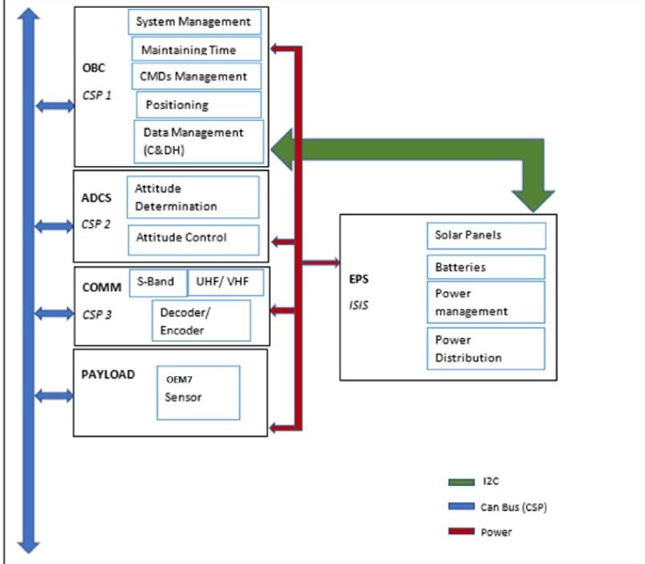

Fig. 3. Bus architecture of the proposed CubeSat.

A Watchdog Timer should be used to ensure that the software flow is continuous.

## A. Software Requirement

All data sent and received by the spacecraft, including science data and spacecraft or payload activities, is handled by the C&DH system. The system, which is linked to the radio frequency (RF) transmitter and receiver modules, provides a communication link between the spaceship and ground controllers. The system also manages and distributes the RTC among all subsystems of the CubeSat, able to detect faults and recover. The EPS verifies if the batteries are charged and ensure the satellite is pointing toward the Sun and get the power consumption of all subsystems. The ADCS determines the current attitude and changes the satellite to the desired attitude. It also determines the current orbit position or velocity. The communication system manages the Downlink, accepts the Uplink, and manages antenna pointing toward the ground station. The OBSW configures science instruments and capture science data [1], [13], [32].

Gitlab is used with the MIT license as a software directory and for version control.

## B. General Bus Architecture

Our CubeSat will be implemented using COTS components which already have a flight history. To simplify the mechanical and electrical interfaces of the satellite, these modules are designed using PC/104 connectors. The main subsystems are the OBC, the ADCS, the communication system (COMM), the mission subsystems (Cameras, Radars, Sensors, etc.), and the EPS [33].

Fig.3 shows the architecture of the CubeSat main bus with its subsystems. The EPS system which comes from ISIS (company specializing in the manufacture of CubeSat) [34] consists of batteries, solar panels, power management and distribution unit is connected to the OBC via I2C communication

bus and helps supply energy to the CubeSat other subsystems. The COMM system includes an S-band RF communications link to facilitate rapid downlink of scientific data from the satellite to Earth. The general architecture of the CubeSat S-band communication system consists of three main components: UHF/VHF communication and S-Band. The COMM system will implement CubeSat protocol (CSP) which uses the main CAN communication bus. The payload is composed of an OEM7 to gather satellite position for the study of the space weather. The role of the ADCS system is to monitor the attitude of the satellite in order to get excellent data from the instrument connected to the payload. The ADCS system will also implement CSP on the main CAN communication bus. The OBC consists of an STM32F405 ARM microcontroller with a frequency of 168 MHz with 1-MB Flash memory and 192-kB RAM used to boot the operating system.

The design of the CubeSat data processing and control system is based on the OBC. Using this centralized architecture allows the satellite to respond quickly to commands and efficiently handle unexpected problems. The main responsibilities of the OBC are maintaining the RTC, synchronization, data collection and storage, housekeeping, spacecraft health monitoring and fault management, power consumption monitoring, reporting events, and memory management. It is also responsible for satellite functions by activating or deactivating modes appropriately based on real-time data received from other systems. In addition, the OBC acts as a gateway between the satellite subsystems and the ground station; all the commands received from the ground stations are only executed after verification, and the internal management data is linked to the ground at the request of the operator [7], [24], [33], [35]. Hence, the OBC is a vital component for the success of the mission, the satellite relies heavily on its efficiency and reliability. Due to the hostile environment in which the satellite operates, the OBC has low energy consumption, high computing power, and high storage space.

## C. Software Architecture

The satellite's architecture is special because it includes developed, purchased boards and COTS components. The main goals of the software architecture are reliability, availability, reusability, and scalability. The software is organized in several parts and several layers in order to ensure the operation of the satellite, carry out the missions, manage the mission, accomplish the planned tasks, ensure the communication between the various subsystems and the communication with the ground station, and manage energy consumption, failure, etc. [13], [36]

The decomposition into layers and modules is considered as one of the main weapons against the complexity of the software. Each module represents a set of functionalities. The breakdown of the system is based on tasks and requirements. The decomposition can be done using the top-down approach where one starts with the general problem and then breaks it down into manageable chunks, one can get a suitable design. Fig. 4 shows the software architecture broken down into layers and modules [25].

<!-- PDF_PAGE: 8 -->

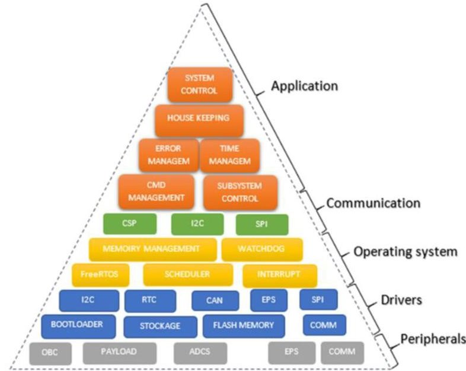

Fig. 4. Proposed software architecture.

1) Peripherals: This section groups together all the peripherals used in the satellite. Details of OBC and some subsystems have been developed in another section. Some purchased boards will be integrated into the systems.

2) Drivers: This layer encapsulates all hardware-dependent software developed by manufacturers or used in the design of certain boards to interact with hardware modules and peripherals. The set of functionalities supported at this level is the RTC, the data storage system, and the drivers for external elements such as sensors. As shown in the "Drivers" layer [33].

Bootloader: The bootloader is stored in the internal boot ROM (system memory) of STM32 devices and is programmed by ST during production. Its main task is to download the application program to internal flash memory through one of the available serial devices (such as USART, CAN, USB, I2C, and SPI). A communication protocol is defined for each serial interface, with a set of commands and a compatible sequence [37].

Fig. 5 describes the process of updating the system with another newer version of the software to correct or adjust the parameters of the CubeSat once it is orbiting the lower Earth layer.

3) Operating System: The operating system uses the functionality of the lower layers to provide high-level functionality for the upper layers, such as multitasking, message queues, timers, and synchronization structures; so that mission-dependent features are easily implemented or changed regardless of the platform. Unfortunately, none of the commercial solutions can be used, nor is there any free code that can operate on CubeSat NB. However, there is FreeRTOS which is an operating system for embedded systems but it is only used for task management, semaphores, scheduler, and modular programming. So, we will need this system to implement the OBC software. We then need to define the number of tasks and their respective priority levels when running the software. Since the number of subsystems depends on the satellite's mission; communication between them must therefore be facilitated. Managing CubeSat's two missions depends on good

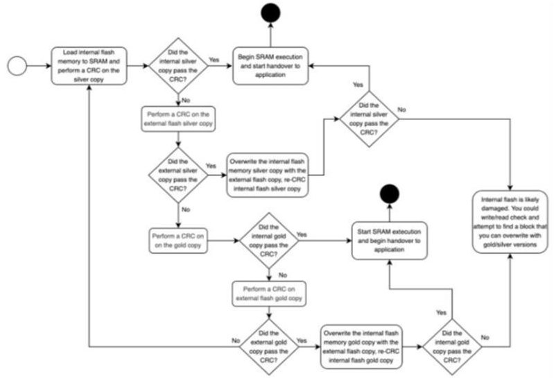

Fig. 5. Software update process.

time management; FreeRTOS can help plan one mission at a time.

4) Communication: It was decided to implement the CSP which is a network communication layer in the satellite software. It thus simplifies the communication link and facilitates further development for the other CubeSats projects of the institutions participating in the developments [38], [39]. The implementation does not include the full development of the software, but instead a part of the OBSW. The CSP does not have any knowledge of the microcontroller used, the lowlevel drivers must be included in the library for sending CSP messages, in this case CAN [40], [41], [42], [43], [44], [45].

CSP is a small, open-source network layer protocol written in GNU C. Its implementation is designed for desktop computers and embedded systems, such as AVR and ARM modules. This is currently ported to FreeRTOS, Po six OS, MacOS, and Windows. So, not only will it facilitate the exchange of data between platforms when using different modules but it will also allow the abstraction of the lower layers of the CubeSat application layer. Some subsystems are purchased with their basic software and therefore cannot use CSP, for example, EPS. We need to write the communication system between these devices separately.

Appearance of the Command: A command, as shown in Table I, is a word or set of words sent to a subsystem for execution and return a result after execution. A command in our case is associated with a function coded in C language. When the command is received, the function will therefore be executed. The FreeRTOS task is used to manage commands when they are entered on the keyboard through the command line interface (CLI) (Fig. 6).

5) Application: Each functional requirement is divided into well-defined modules and concurrent tasks with simple interfaces and uniform APIs to communicate messages in the form of commands and requests. This messaging system is based on a client-server model and is based on a CSP communication infrastructure. Maintenance data is collected from all subsystems using uniform CSP interfaces. In addition, maintenance data will be recorded in tables to provide ground stations with immediate and easy access to this data. The

<!-- PDF_PAGE: 9 -->

TABLE I

LIST OF COMMANDS FROM OBC TO OTHER SUBSYSTEMS

<table border="1"><tr><td>Source->
Destination</td><td>Category</td><td>Command
Name</td><td>Data
sent/received</td><td>Physical
Interface
Used</td></tr><tr><td>OBC->
Any</td><td>Data</td><td>Telem</td><td>Telemetry Data</td><td>CAN</td></tr><tr><td>OBC->
Any</td><td>ACK</td><td>Start task</td><td>Start command</td><td>CAN</td></tr><tr><td>OBC->
Any</td><td>ACK</td><td>Stop task</td><td>Stop command</td><td>CAN</td></tr><tr><td>OBC->
EPS</td><td>N/A</td><td>Turn on subsys</td><td>Turn on specific subsys</td><td>I2C</td></tr><tr><td>OBC->
EPS</td><td>N/A</td><td>Turn off subsys</td><td>Turn off specific subsys</td><td>I2C</td></tr><tr><td>OBC->
S-Band/Payload</td><td>ACK</td><td>Transfer Data</td><td></td><td>CAN</td></tr><tr><td>OBC->
Any</td><td>ACK</td><td>Heartbeat</td><td>Are you there</td><td>CAN</td></tr><tr><td>OBC->
Payload</td><td>ACK</td><td>Change mission parameters</td><td>New mission parameters</td><td>CAN</td></tr><tr><td>OBC->
Any</td><td>ACK</td><td>Shutdown</td><td>N/A</td><td>CAN</td></tr></table>

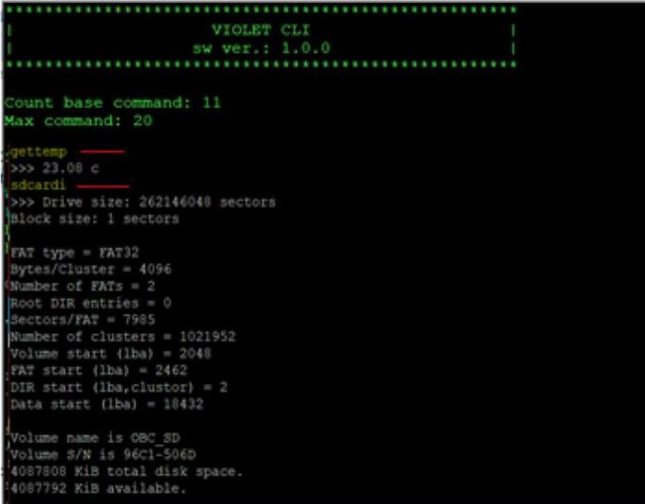

Fig. 6. Command Line Interface (CLI).

service-oriented architecture allows the encapsulation of the requirements/functionality in the services/orders, thus ensuring a modular design of the control system. These services are data structures that contain all the information needed to run target code, such as function handlers and data parameters; they are called using a uniform API through the CSP messaging system.

The control system allows an on-board system to be operated and tested in orderly ways at specific times. Our CubeSat mission will be a semi-autonomous system managed at times by a list of commands. The flight plan consists of a table with a list of commands as shown in Table II.

To execute the flight plan contained in the table, we need three tasks, and three queues as shown in Fig. 7. The task "Flight plan" reads the commands from a table and in according to the parameters of the command and the frequency of execution of the command. Once an order has been selected to be executed, it is placed in a queue as shown in arrow 1. The "Dispatcher" task retrieves the order and sends it to another queue with the maximum capacity of an order. As can be seen with arrows 2 and 3. Then, the "Executor" task

TABLE II

FLIGHT PLAN COMMAND LIST DESCRIPTIONS

<table border="1"><tr><td>Name</td><td>Description</td></tr><tr><td>TIME</td><td>The value of the time at which the command will be executed for the first time, this time is recorded in the table under UNIX TIME.</td></tr><tr><td>PERIODICAL</td><td>If the command should run periodically, this value is the UNIX period for it</td></tr><tr><td>EXECUTIONS</td><td>The number of consecutive executions of the command.</td></tr><tr><td>COMMAND</td><td>The name of the command to run.</td></tr></table>

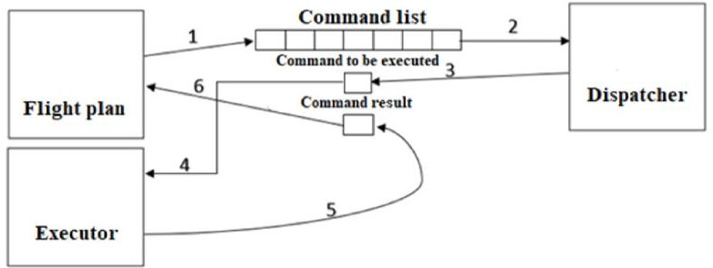

Fig. 7. OBSW command execution process.

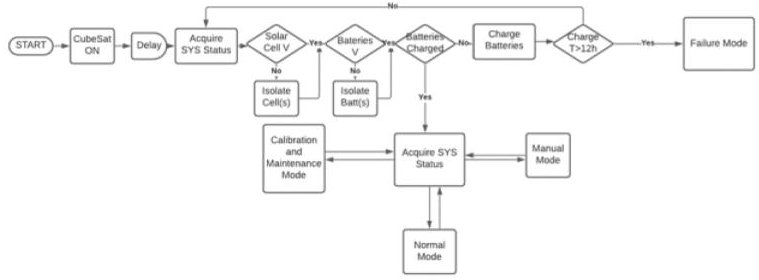

Fig. 8. OBC software flow diagram.

retrieves the command from the executor queue to be executed as indicated by arrow 4. After execution, the result of the execution is transit by the Executor task to another queue as indicated by arrow 5. The Flight plan task retrieves the result of the execution of the command and compared to the result, takes a decision of the next command to perform as shown in arrow 6.

Example: The "gettime" command from the order list will be transmitted to the Executor task via the Dispatcher. This command maintains the RTC time of all subsystems, once running the command retrieves the time from the OBC and sends it through the CSP to the other subsystems.

Operating the On-Board Computer: Once the CubeSat is on, the OBC requests the status of all the subsystems, once received we check the voltage of the solar panels if it is not in the desired ranges, we isolate some panels, if the value obtained is correct, we check the battery voltage if incorrect we isolate the defective batteries. Then, we check if the batteries are charged; otherwise, the batteries will be charged; if after 12 h the batteries are not charged, we go into the failure mode to solve the problem. Once the batteries are charged, the state of all the subsystems is still recovered, and depending on the state, it is decided in which mode the satellite should operate (Fig. 8). Currently, the processor load is 34% in normal modes, manual, calibration, and maintenance, and 16% in the failure mode. Of the 1024 kB of flash memory, only 240 kB was used which represents less than 20% of the total memory. The CPU

<!-- PDF_PAGE: 10 -->

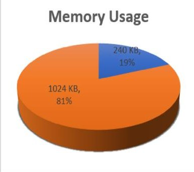

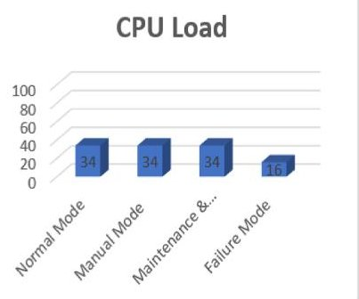

Fig. 9. Charges and margins.

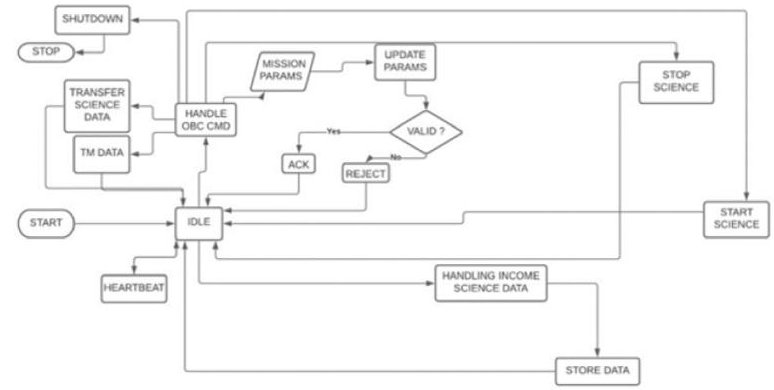

Fig. 10. Payload software flow diagram.

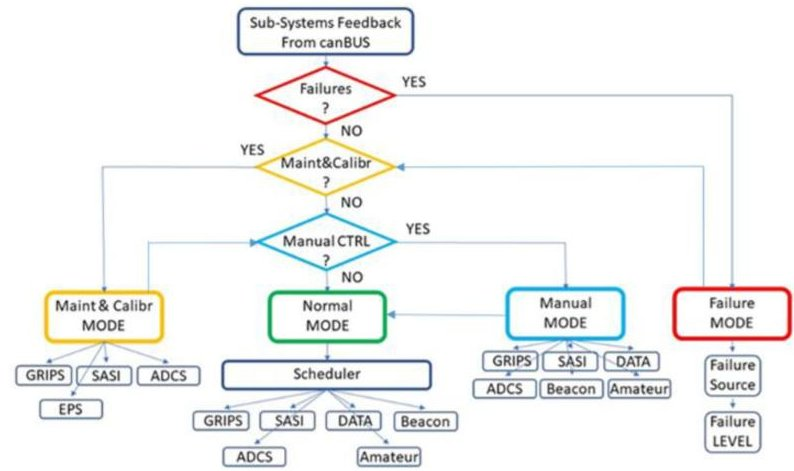

Fig. 11. CubeSat operating mode diagram.

runs at whatever speed it is configured to run. So technically speaking, the CPU load is 100%, we have the processor run an "idle loop" then we measure how often the processor run. A CPU load has also been done (see Fig. 9).

Mission's Operation: Fig. 10 shows the software flow diagram that will run on the payload. The subsystem that runs the algorithm goes into an inactive state but responds to commands from the OBC. The OBC starts by sending the mission parameters they are checked by the subsystem for their validity, a message is sent back to the OBC to acknowledge receipt or not. The OBC will send a command to start or stop the mission. The subsystem processes mission data and stores the data which will be sent to the OBC on request.

Flight Software and Operation Modes: The operation of the satellite is divided into several modes, Fig. 11 shows the CubeSat operating mode diagram. And Table III shows OBC modes power consumption.

TABLE III

SOFTWARE MODES, CPU CLOCKS AND POWER CONSUMPTION

<table border="1"><tr><td></td><td>CPU CLOCKS (MHz)</td><td>Enabled Peripherals</td><td>Power consumption(mW)</td></tr><tr><td>LAUNCH</td><td>0</td><td>None</td><td>0,924</td></tr><tr><td>NORMAL</td><td>168</td><td>CAN,GPIO,I2C,RTC,SDIO</td><td>141,4</td></tr><tr><td>MANUAL</td><td>168</td><td>CAN,GPIO,I2C,RTC,SDIO</td><td>141,4</td></tr><tr><td>MAINT/CALIB FAILURE</td><td>168</td><td>CAN,GPIO,I2C,RTC</td><td>131,2</td></tr><tr><td></td><td>168</td><td>CAN,GPIO,I2C,RTC,SDIO</td><td>141,4</td></tr></table>

Calibration and Maintenance Mode: This mode should provide the required calibration and maintenance for the mission subsystems. The satellite should enter this mode, based on the status of the subsystems. This may include battery charging, payload calibration, and ADCS. The following tasks have been defined:

TASK # 1—Battery maintenance (EPS);

TASK # 2—Payload calibration;

TASK # 3—ADCS calibration.

Normal Mode: This is the primary mode in which the satellite operates when healthy. This mode will implement an infinite loop of the succession of tasks that will meet mission objectives. A scheduler must assign the task to be accomplished, based on sensor data and defined operations.

The scheduler must be reprogrammable via the ground station.

The following tasks are defined during the proper functioning of the satellite:

TASK # 1—Beacon;

TASK # 2—Transfer of useful data;

TASK # 3—Communication between subsystems (protocols and interfaces);

TASK # 4—Payload;

TASK # 5—Amateur.

Failure Mode: This mode must be triggered when a fault is detected by the satellite fault identification system. The purpose of this mode should be to identify the source of the fault and assign a fault level.

The levels must be critical, serious, and minor.

1) The critical failure level should be assigned to a failure that can jeopardize the mission if not resolved. All unnecessary subsystems should be temporarily disabled in this level.

2) The level of serious failure is attributed to a failure that affects the normal operation of the mission but does not endanger it. Affected subsystems should be temporarily deactivated.

3) The level of minor failure should be assigned to a failure that affects a subsystem, but the satellite can still operate normally. The failure mode shall update a fault status

<!-- PDF_PAGE: 11 -->

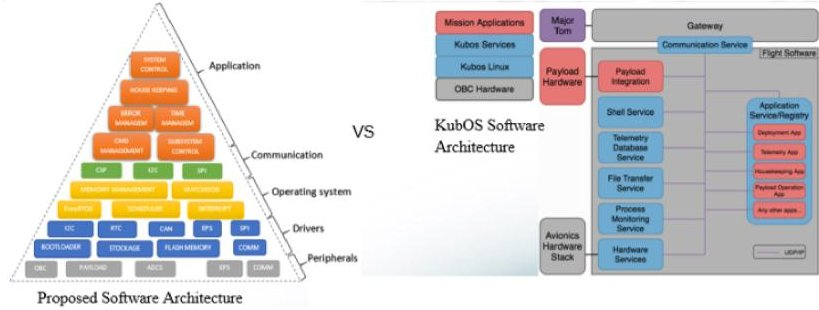

Fig. 12. Proposed software architecture compared to the KubOS software architecture.

register. The fault mode register must include the fault level, the fault source (subsystem), and a fault code (to be determined).

Manual Mode: This mode must be triggered by a command from the ground station. The manual mode should be used to control the satellite manually from the ground station via a set of predefined commands. It must be activated by a single secret command. This mode can only be activated when the satellite is visible and should automatically return to the normal mode to perform automatic operations after a specified time.

Proposed Software and KubOS: Fig. 12 shows our software compared to the KubOS architecture, KubOS is only compatible with Linux computers. We have five layers and KubOS has four layers in the architecture and they only have OBC hardware whereas we have different hardware with different configurations. Our software is designed to run with different hardware, a redefined version of the software will be installed on the other subsystem in order to react to the OBC command accordingly. There are three layers on top of the peripheral layers, namely, drivers, operating system, and communication KubOS, however, has two layers mainly because the operating system layer is managed by Linux. In our design, we must manage each task that is coming from the application through the communication layer and call the appropriate driver for the operation. The last layer of the application in both our design and the KubOS is responsible for controlling all the satellites via commands send to other subsystems.

## V. FLAT SAT AND EXPERIMENTAL SETUP

Implemented CSP consists of providing the CAN drivers of the microcontroller and integrated into the CSP so that the latter can use it in communication. An example implementation has been provided by CSP for Linux to serve as a guide for integrating CAN but using it as a reference to other systems remains particularly difficult especially on-board systems.

A CLI allows the user to interact with the computer (the subsystem) by typing commands to produce results. The CLI simplifies software testing because instructions can be given by the user during execution, and the results can be analyzed in real time. To control the CLI, X-CTU a serial terminal emulator was used. For the CLI we had, it connected to the USB serial adapter over UART. A baud rate of 115200 bits/s with a word length of 8 bits was used for the configuration.

The CLI and the CSP are used as a component of the mission software.

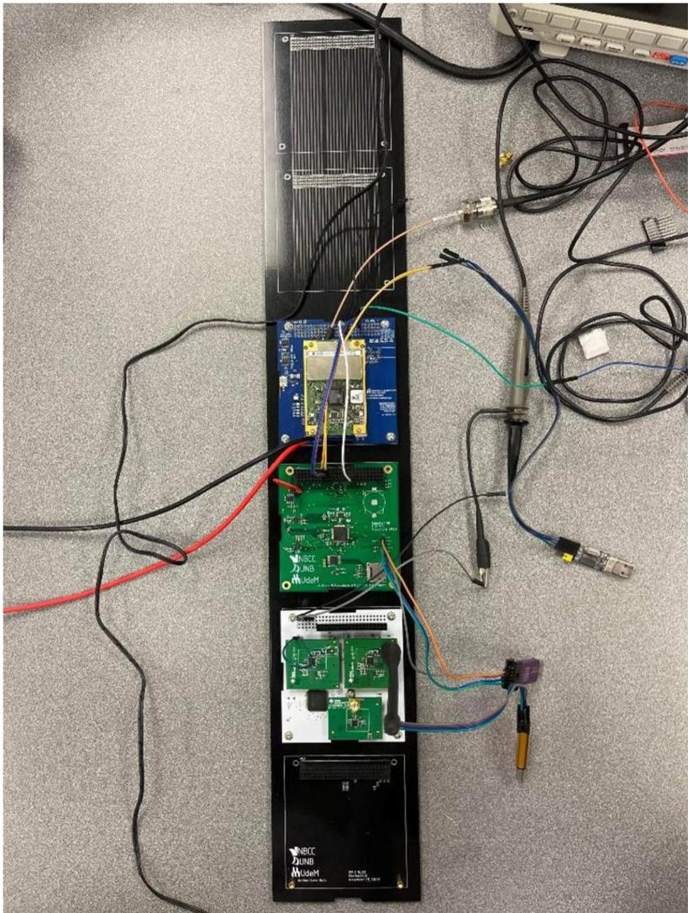

Fig. 13. Configuration tests between three modules.

To make sure that the CSP implementation is working properly, it should be tested. Although the best way to test the implementation is on the prototype of the satellite itself, a team of students had already developed what is called FlatSat (a test board with 6 PC104 slots) to connect the satellite modules together in this case the OBC, the communication board, and the OEM7 carrier board for the sending and receiving packets. This means that we can test the modules together and make sure it works before putting it in a real satellite to avoid damage.

The satellite will most likely consist of six modules which must be connected via a CAN link, the OBC, the communication board, the OEM7's carrier board, a camera board, the power supply system, and the control system. Therefore, the tests should prove that the connection will work with more than three modules, and it should be displayed that each module can control the network without reconfiguration.

The tests performed are simple tests that ensure that basic transmissions are transferred successfully over the CAN link and received by a socket listener on the other side of the connection. A beacon message was sent from the OBC to the communication board and successfully received by the ground station. The OBC can communicate with the OEM7 and gather position data from it. Additional testing should be performed when all modules implement CSP to ensure its reliability. Fig.13 shows a "FlatSat" with three modules, namely, the OBCs, the communication boards, and the OEM7 carrier board connected to it.

<!-- PDF_PAGE: 12 -->

## VI. CONCLUSION

The objective of this article was to focus on the development of the mission software. This process for a space project required careful consideration. A typical OBSW of a CubeSat has been presented and some OBSWs have also been discussed.

The essential parts of the mission software are presented. The objectives and requirements were defined, the components were also chosen accordingly, then the drivers for these components were written for the mission software. The OBC microcontroller that has been chosen for this project has a flight history which is very important for the mission success.

Software development is a task that is divided into several stages as presented in this document. CSP has been implemented and tested for its basic functionality, the microcontroller CAN driver was developed to communicate with other subsystems since the CSP has no information of the driver used. Positive results are obtained when testing the system, thereby strengthening the development process.

A control system has been implemented to test the OBSW by sending commands to the subsystems through the CSP. A solid configuration of the CSP has been developed with controls which thus provides easier use of the CSP for future software development. It is now possible for students to start integrating CSP with other subsystems with an Implemented Test Tool (CLI).

The application code that will be running on top of the FreeRTOS is also developed for the basic functions such as scheduling, communicating with another subsystem, and confirm messages received with or without packet loss. This application runs using low CPU loads and low memory.

## ACKNOWLEDGMENT

The authors would like to express their gratitude to Dr. Brent Petersen, Associate Professor at UNB and Troy Lavigne, Project Engineer at UNB for the opportunity to participate in the Violet CubeSat-NB Project and for the great collaboration.

## REFERENCES

[1] J. Puig-Suari, C. Turner, and W. Ahlgren, "Development of the standard CubeSat deployer and a CubeSat class PicoSatellite," in Proc. IEEE Aerosp. Conf., vol. 1, 2001, pp. 1-347.

[2] P. I. Theoharis, R. Raad, F. Tubbal, M. U. A. Khan, and S. Liu, "Software-defined radios for CubeSat applications: A brief review and methodology," IEEE J. Miniat. Air Space Syst., vol. 2, no. 1, pp. 10-16, Mar. 2021, doi: 10.1109/JMASS.2020.3032071.

[4] "What is a CubeSat." Canadian Space Agency. Apr. 12, 2017. Accessed: Feb. 17, 2022. [Online]. Available: https://www.asc-csa.gc.ca/eng/satellites/cubesat/what-is-a-cubesat.asp

[3] W. A. Shiroma et al., "CubeSats: A bright future for nanosatellites," Central Eur. J. Eng., vol. 1, no. 1, pp. 9-15, 2011.

[5] L. Niccolai, M. Bassetto, A. A. Quarta, and G. Mengali, "A review of smart dust architecture, dynamics, and mission applications," Progr. Aerosp. Sci., vol. 106, pp. 1-14, Apr. 2019.

[6] D. J. Barnhart, "Very small satellite design for space sensor networks," Ph.D. dissertation, Faculty Eng. Phys. Sci., Univ. Surrey, Guildford, U.K., 2008.

[7] A. Alanazi and J. Straub, "Statistical analysis of cubesat mission failure," in Proc. 32nd Annu. AIAA/USU Conf. Small Satell., 2018, pp. 1-8.

[8] G. Curzi, D. Modenini, and P. Tortora, "Large constellations of small satellites: A survey of near future challenges and missions," Aerospace, vol. 7, no. 9, p. 133, 2020.

[9] D. Ngo and M. Harris, "A reliable infrastructure based on COTS technology for affordable space application," in Proc. IEEE Aerosp. Conf., vol. 5, 2001, pp. 2435-2441.

[10] J. Puig-Suari, C. Turner, and R. Twiggs, "CubeSat: The development and launch support infrastructure for eighteen different satellite customers on one launch," in Proc. 15th Annu. AIAA/USU Conf. Small Satell., 2001, pp. 1-5.

[11] C. Venturini, B. Braun, D. Hinkley, and G. Berg, "Improving mission success of CubeSats," in in Proc. 32nd Annu. AIAA/USU Conf. Small Satell. 2018, pp. 1-11.

[12] R. A. Deepak and R. J. Twiggs, "Thinking out of the box: Space science beyond the CubeSat," J. Small Satell., vol. 1, no. 1, pp. 3-7, 2012.

[13] G. D. Manyak, "Fault tolerant and flexible CubeSat software architecture," M.S. thesis, Dept. Electr. Eng., California Polytech. State Univ., San Luis Obispo, CA, USA, 2011, doi: 10.15368/theses.2011.107.

[14] D. J. F. Miranda, M. Ferreira, F. Kucinskis, and D. McComas, "A comparative survey on flight software frameworks for 'new space' nanosatellite missions," J. Aerosp. Technol. Manage., vol. 11, Feb. 2019, Art. no. e4619.

[15] "Core flight system (CFS) background and overview." NASA. Accessed: Feb. 17, 2022. [Online]. Available: https://cfs.gsfc.nasa.gov/cFS-OviewBGSlideDeck-ExportControl-Final.pdf

[16] R. Bocchino, T. Canham, G. Watney, L. Reder, and J. Levison, "F Prime: An open-source framework for small-scale flight software systems," in Proc. 32nd Annu. AIAA/USU Conf. Small Satell., 2018, pp. 1-19.

[17] "Overview—Kubos 1.5.0 documentation." Accessed: Feb. 17, 2022. [Online]. Available: https://docs.kubos.com/1.5.0/index.html

[18] M. Fayyaz and T. Vladimirova, "Fault-tolerant distributed approach to satellite on-board computer design," in Proc. IEEE Aerosp. Conf., Big Sky, MT, USA, Mar. 2014, pp. 1-12, doi: 10.1109/AERO.2014.6836199.

[19] A. T. Johnson et al., "The FIREBIRD-II CubeSat mission: Focused investigations of relativistic electron burst intensity, range, and dynamics," Rev. Sci. Instrum., vol. 91, no. 3, 2020, Art. no. 34503.

[20] R. Osiander, M. A. G. Darrin, and J. L. Champion, MEMS and Microstructures in Aerospace Applications. Boca Raton, FL, USA: CRC Press, 2017, doi: 10.1201/9781420027747.

[21] R. J. Wood, S. Avadhanula, R. Sahai, E. Steltz, and R. S. Fearing, "Microrobot design using fiber reinforced composites," J. Mech. Design, vol. 130, no. 5, May 2008, Art. no. 52304.

[22] A. Shao, J. R. Wertz, and E. A. Koltz, "Quantifying the cost reduction potential for Earth observation satellites," in Proc. 12th Reinventing Space Conf., 2017, pp. 199-210.

[23] "UPSat." Accessed: Feb. 17, 2022. [Online]. Available: https://upsat.gr/

[24] I. Arslan, K. Arslankoz, A. Tellii, B. Karabulut, and A. R. Aslan, "Onboard software for HAVELSAT cubesat," in Proc. 8th Int. Conf. Recent Adv. Space Technol. (RAST), 2017, pp. 229-233.

[25] I. Latachi, T. Rachidi, M. Karim, and A. Hanafi, "Reusable and reliable flight-control software for a fail-safe and cost-efficient cubesat mission: Design and implementation," Aerospace, vol. 7, no. 10, p. 146, 2020.

[26] H. Wang, J. Zhao, and F. Wu, "Design of high-resolution space imaging system on sandroid CubeSat using camera array," in Proc. 51st Annu. Conf. Inf. Sci. Syst. (CISS), 2017, pp. 1-6.

[27] Y. Karatas and F. Ince, "Fuzzy expert tool for small satellite cost estimation," IEEE Aerosp. Electron. Syst. Mag., vol. 31, no. 5, pp. 28-35, May 2016.

[28] C. Nagarajan, R. G. D'Souza, S. Karumuri, and K. Kinger, "Design of a cubesat computer architecture using COTS hardware for terrestrial thermal imaging," in Proc. IEEE Int. Conf. Aerosp. Electron. Remote Sens. Technol., 2014, pp. 67-76.

[29] A. Mavridou, E. Stachtiari, S. Bliudze, A. Ivanov, P. Katsaros, and J. Sifakis, "Architecture-based design: A satellite on-board software case study," in Proc. Int. Workshop Formal Aspects Compon. Softw., 2016, pp. 260-279.

[30] E. Dotto et al., "LICIACube-the light Italian CubeSat for imaging of asteroids in support of the NASA DART mission towards asteroid (65803) Didymos," Planetary Space Sci., vol. 199, May 2021, Art. no. 105185.

[31] N. Jovanovic, B. Riwanto, P. Niemelä, M. R. Mughal, and J. Praks, "Design of magnetorquer-based attitude control subsystem for FORESAIL-1 satellite," IEEE J. Miniat. Air Space Syst., vol. 2, no. 4, pp. 220-235, Dec. 2021, doi: 10.1109/JMASS.2021.3093695.

[32] J. Straub et al., "OpenOrbiter: A low-cost, educational prototype CubeSat mission architecture," Machines, vol. 1, no. 1, p. 1, 2013.

<!-- PDF_PAGE: 13 -->

[33] R. Burt, "Distributed Electrical power systems in cubesat applications," M.S. theis, Dept. Electr. Eng., Utah State Univ., Logan, UT, USA, 2011.

[34] "iEPS electrical power system." ISISPACE. Accessed: Feb. 17, 2022. [Online]. Available: https://www.isispace.nl/product/ieps-electrical-power-system/

[35] P. J. Botma, "The design and development of an ADCS OBC for a CubeSat," M.S. thesis, Dept. Electr. Electron. Eng., Stellenbosch Univ., Stellenbosch, South Africa, 2011. Accessed: Feb. 17, 2022. [Online]. Available: http://scholar.sun.ac.za/handle/10019.1/18040

[36] S. Waydo, D. Henry, and M. Campbell, "CubeSat design for LEO-based Earth science missions," in Proc. IEEE Aerosp. Conf., vol. 1, 2002, p. 1.

[37] J. Farkas, CPX: Design of a Standard CubeSat Software Bus, California State Univ., Long Beach, CA, USA, 2005.

[38] O. N. Challa and J. McNair, "CubeSat torrent: Torrent like distributed communications for CubeSat satellite clusters," in Proc. IEEE Military Commun. Conf., 2012, pp. 1-6.

[39] "The CubeSat space protocol." Libcsp. Accessed: Feb. 17, 2022. [Online]. Available: https://github.com/libcsp/libcsp

[40] S. St. Michael. "Introduction to CAN (controller area network) Technical articles." Accessed: Feb. 17, 2022. [Online]. Available: https://www.allaboutcircuits.com/technical-articles/introduction-to-cancontroller-area-network/

[41] A. Van Herrewege, D. Singelee, and I. Verbauwhede, "CANAuth— A simple, backward compatible broadcast authentication protocol for CAN bus," in Proc. ECRYPT Workshop Lightweight Cryptogr., 2011, p. 20.

[42] M. Bozdal, M. Samie, S. Aslam, and I. Jennions, "Evaluation of CAN bus security challenges," Sensors, vol. 20, no. 8, p. 2364, 2020.

[43] R. Li, C. Liu, and F. Luo, "A design for automotive CAN bus monitoring system," in Proc. IEEE Veh. Power Propulsion Conf., 2008, pp. 1-5.

[44] P. Ran, B. Wang, and W. Wang, "The design of communication converter based on CAN bus," in Proc. IEEE Int. Conf. Ind. Technol., 2008, pp. 1-5.

[45] A. Taylor, N. Japkowicz, and S. Leblanc, "Frequency-based anomaly detection for the automotive CAN bus," in Proc. World Congr. Ind. Control Syst. Security (WCICSS), 2015, pp. 45-49.