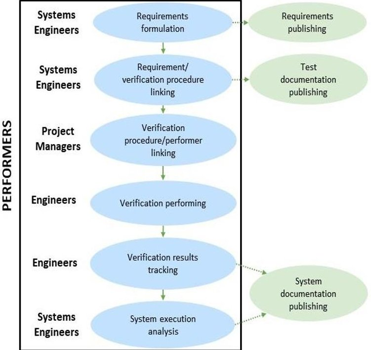
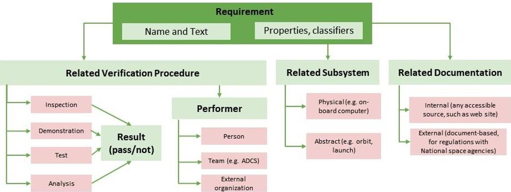
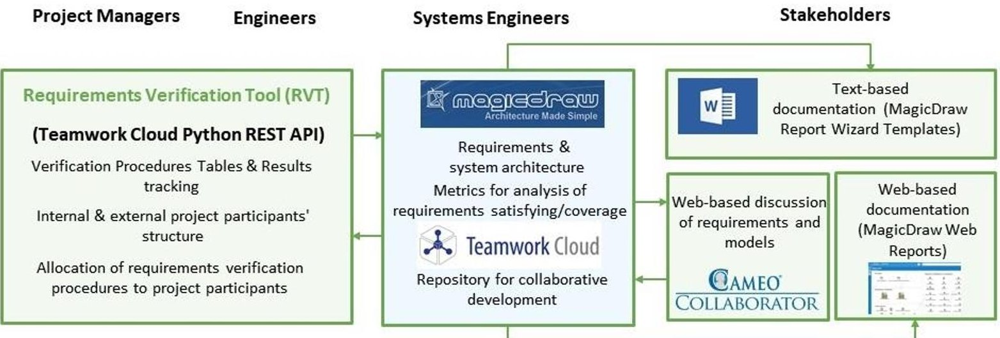
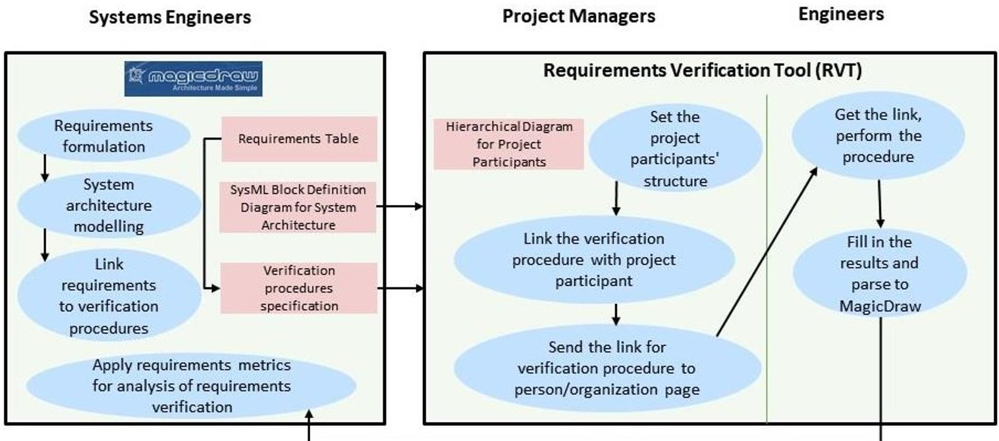
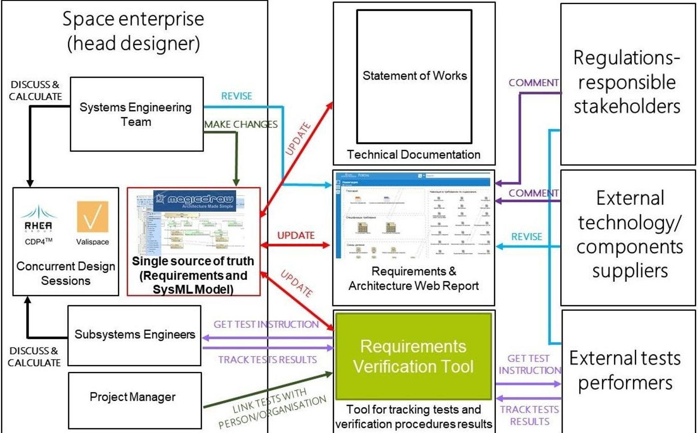

<!-- PDF_PAGE: 1 -->

IAC-20-D1,4B,4,x59404

# Model-Based Approach For Requirements Management Connection With Verification Procedures Applied To Space Systems

Karolina Latserus $ ^{a *} $ , Petr Mukhachev $ ^{a} $ , Anton B. Ivanov $ ^{a} $ , Angelina Prokopeva $ ^{a} $

$ ^{a} $ Skoltech Space Center, Skolkovo Institute of Science and Technology, Russian Federation, Moscow, Bolshoy Boulevard 30, bld.1

Karolina.Latserus@skoltech.ru

Petr.Mukhachev@skoltech.ru

A.Ivanov2@skoltech.ru

Angelina.Prokopeva@skoltech.ru

* Corresponding Author

## Abstract

Industrial companies and scientific organizations apply Model Based Systems Engineering approach to make high-level functional models of systems they develop and to effectively manage the requirements. Systems engineers use specific tools that support particular system modelling language (e.g. SysML) which give them an ability to connect the system requirements with corresponding procedures for their validation and verification, such as tests, demonstration, inspection or analysis. However, the problem is that most of the requirements verifying methods are held by engineers not familiar with specific MBSE software. That misalignment complicates test feedback and eventually hinders requirement traceability.

The aim of this research is to develop a methodology which allows to link the requirements with particular set of verification procedures, generate the descriptive documentation for engineers and get feedback about the verification results to indicate whether the requirement is satisfied or not. The focus group for research implementation are small space enterprises such as universities and startups making nanosatellites. The research also provides a strategy for proposed methodology integration to project data and processes structure of small space enterprises, as well as software toolchain for methodology implementation.

The requirements and architecture of Skoltech Gamma Swarm project in SysML (implemented in MagicDraw) is taken as a reference example. We will showcase the developed methodology and propose a tool which would be an interface between systems model, test facility engineer and project managers with no specific SysML knowledge. The methodology considers specifics and problems of MBSE implementation is small space enterprises and can be scaled to other aerospace projects.

Keywords: MBSE, SysML, MagicDraw, space enterprise, single source of truth, nanosatellites

Acronyms/Abbreviations

MBSE - Model-Based Systems Engineering

ALM - Application Lifecycle Management

COTS - Commercial Off-The-Shelf

PLM-Product Life

RVT - Requirements Verification Tool

<!-- PDF_PAGE: 2 -->

## 1. Introduction

## 1.1 Research focus: small space enterprises

The significant interest to small space systems development is noticed in the last decades [1]. One of the reasons for this is development of nanosatellites industry and variety of Commercial Off-The-Shelf (COTS) components for nanosatellites of CubeSat specification standard [2]. CubeSat launches statistics counts 1317 total nanosatellites launched, 1210 of them have been designed considering CubeSat specification [3]. There are 66 countries which have launched at least one nanosatellite, for some of the countries such satellites had become the first national satellite launched (e.g. Estonia). As for end-user purpose, all the nanosatellites can be divided by commercial (approximately 57% of total), university (29%) military (7%) and civil (7%) [4].

System design, manufacturing, assembly and testing of nanosatellite in most of the cases are performed by a relatively small group of people. Unlike medium-sized and large satellites, nanosatellites can be designed, manufactured, and assembled by efforts of university space chair, scientific organization, small commercial company, or startup. In context of this research, such organizations would be generalized and named small space enterprises.

Small space enterprises have specifics in information exchange and work processes organization. Usually project participants are working in one place and have possibility to communicate in person. This causes low communication regulation: information exchange is often in-person and not controlled. Also, such enterprises have limited financing, so money is rarely spent to advanced software for project management, communication, and data flow regulations. Thus, documentation version control and requirements verification management in such enterprises should be regulated without expensive software solutions.

Many small space enterprises are focused on only one subsystem development, such as on-board computer. That is why universities and startups often collaborate, form enterprises consortiums, and do joint project. Also, small enterprises may have not all the necessary testing equipment, and that is another reason to collaborate.

All these problems highlight the need to establish a single source of truth about system for requirement, tests, and system documentation management via available for small space enterprises methods, processes, and software. It should be not too expensive

and difficult in implementation, as well as adapted for enterprises collaboration.

## 1.2 Model-Based Systems Engineering in small space projects

The small space enterprise problems statement leads to the idea of Model Based Systems Engineering (MBSE) approach implementation as a world-known practice for complex systems development support.

MBSE is the formalized application of modelling to support system requirements, design, analysis verification, and validation activities beginning in the conceptual design phase and continuing throughout development and later life cycle phases [5]. Implementation of MBSE approach consists of three main issues:

- Methodology - set of related processes and methods which describes what should be done for product development step by step

- Modelling language (the artificial language that express the information about system being developed in a structure with a defined set of rules and graphical representation), e.g. SysML

- Modelling software (the software modelling tools which support the specific modelling language and in some cases the modelling methodology)

According to the literature, leading companies using MBSE reach their aims for quality, cost, time to market and sales in 84% of their development projects [6]. There is also some positive MBSE influence on ROI noticed [7], [8]. Nevertheless, MBSE successful implementation still needs both investment and proficiency.

There is plenty of examples of MBSE implementation to small satellites. Object Management Group Developing the general CubeSat System Reference Model (CSRM) using SysML modelling language [9]. This model provides the logical architecture to be fulfilled by the specific mission architecture. CSRM model is proposed as a tool to help students in satellite development processes.

Systems engineering basic methods implementation, mostly taken and adapted from NASA Systems Engineering Handbook [10], for CubeSat are described in series of articles. For instance, S.A. Asundi (Tuskegee University) and N. G.Fitz-Coy (University of Florida) implement systems engineering tools (such as N2 diagrams) for a subsystem level flow down, proposing the way of tracing the requirement with particular CubeSat subsystem [11].

Student-driven CubeSats methodologies and tools are the separate field of research interest. University of North Dakota implement MBSE tools to simplify and

<!-- PDF_PAGE: 3 -->

expedite requirements elicitation and specifications [12]. In California Polytechnic State University, students used the consortium requirements engineering (CoRE) method as well as software architecture modelling via Monterey Phoenix modelling language [13]. Jet Propulsion Laboratory (California Institute of Technology) have implemented MBSE to Radio Aurora Explorer CubeSat student-driven project and had a study on SysML (MagicDraw software tool) integration with Systems Tool Kit (STK) modelling tool [14].

Many of the available articles and publications of MBSE implementation to satellite missions and particular subsystems are related to SysML modelling language. For example, T.Mehling (TU Munich), A.Baeten (University of Applied Sciences, Augsburg) and C.Zuccaro (Munich University of Applied Sciences) provide a study on SysML model using MBSE Analyzer for connection of space system model created in STK and a set of analytical models developed in MATLAB to the SysML model created with MagicDraw [15]. Scientists from China Academy of Space Technology and Beihang University have modelled satellite communication system architecting for preliminary design stage via MBSE methodologies implemented on SysML [16].

Summarizing the topics overview, most of the available studies on MBSE implementation to small space projects are related to scientific and educational projects and have universities affiliation. The trend to use SysML as the artificial language supporting system development can be noticed. In most of the cases MBSE implementation refers to the specific domain problem (e.g. intersatellite link modelling, energy budget calculation, space avionics subsystem modelling, subsystem behaviour). There are also listed above examples of MBSE models integrations with other subsystems simulation and analysis models. It can be concluded that many of small space enterprises have already made attempts to use MBSE approach and even have their specific modelling "habits" and practices. There are no examples describing generic approach to MBSE implementation in small space projects both in system development domain and project management domain. Most of the researchers states that MBSE solutions helped in improving common system understanding and increasing total project productivity. Nevertheless, in most of the studies attention is not payed to the way of using the MBSE models by project stakeholders and engineers not familiar with system modelling languages.

## 1.3 Aim and goals of research

In the previous sections, the small space enterprises need in requirements, tests and documentation

management has been stated. These processes are considered as a part of MBSE implementation domain. Here comes the problem of MBSE adoption: how to make system models accessible and understandable to all project participants and stakeholders not familiar with MBSE. This research idea is to develop MBSE implementation methodology that would consider both requirements management, system modelling and typical business processes of small space enterprises. It should take into account small space enterprises specifics and provide tools and processes framework. The key focus is requirements verification automatization.

The research aim is development of the methodology for model-based requirements management and verification in application to small space projects. The proposed methodology should be implemented via available on market software tools and provide a framework of related to requirements management processes chain.

As a testcase from research implementation focus group, we will use Skoltech Gamma Swarm Project [17]. 4 autonomous CubeSats 3U to be launched from ISS for gamma-ray burst detection. The project is held by a Gamma Swarm Consortium which consists of 17 organizations, most of them are Russian universities. The main challenge for the being proposed methodology is to provide model-based requirements management both to Skoltech as head Consortium enterprise, and to the whole Gamma Swarm Consortium.

Research goals:

- Requirements management in small space enterprises problems and needs investigation,

- Overview of tools and methods for requirements management,

- Proposal of software toolchain for requirements management methodology,

- Proposal of business processes chain for methodology implementation,

- Methodology showcase on Skoltech Gamma Swarm project.

## 2. Requirements management in small space enterprises: problems and needs

The first research issue is investigation of requirements management process in small space enterprise specifics in project and data management domain.

Project and its participant structure, as well as participants responsibilities can be different and depends on a set of factors:

- Project mission statement: educational/commercial/scientific, expected results and scaling,

<!-- PDF_PAGE: 4 -->

- Involved organisation: one or multiple enterprises project, types of involved organisations

(educational/commercial/governmental),

- Communication environment: location of involved enterprises, their internal regulations on information exchange, tools for remote communication and collaborative modelling,

- System under development novelty: distribution of self-made system modules and COTS components,

- Level of competence: need to control design decisions (especially in universities and students-driven projects).

Generalizing the typical for small space projects participants roles, the involved people can be divided into 4 categories:

## Systems Engineers:

The roles of systems engineer depend on level of systems engineering knowledge in the enterprise. At least, systems engineers are responsible for system requirements and architecture modelling, interfaces control. According to the overview above, systems engineers in small space projects use specific tools (MagicDraw, Capella) and artificial languages (SysML, OPM) for system modelling and requirements management. Also, requirements verification control is key responsibility of systems engineers: after requirements formulation, the percentage of verified requirements becomes an important metrics for system readiness indication.

## Hardware and Software Engineers:

Groups of people responsible for system design, manufacturing, assembly, and tests. They use specific to their domain modelling and CAD/CAE software tools (STK, MATLAB, Altium Designer, SolidWorks, etc.), equipment (e.g. thermal vacuum chamber) and environment (clean room). Specifically to small space enterprises, some of the involved engineers can be external and provide a ready component, technology or environment just for testing or assembling. Also, they perform system tests and most of the requirements verification procedures.

## Project Managers:

This group of people who might not be involved in engineering, but control system development processes realization: find necessary equipment/components providers, set up partnership with external organisations for expertise and support, organise launch, communicate with regulations-responsible stakeholders. They have information about all the involved participants, distribute responsibilities and control design and development processes execution.

## Other stakeholders:

Groups of people also related to projects, such as components/payload suppliers, space agencies, launch

providers, mission control centers. Their involvement is system design and development processes vary from case to case, but they might need system documentation in a specific standard form for regulations.

In the Fig.1. the generic process chain of requirements management activities in small space enterprises is demonstrated, as well as activities performers. Even if requirements formulation requires involvement of all project stakeholders, the finalization and requirement database management is usually responsibility of systems engineers. After formulation, requirements are published in an accessible form for project participants observation. Every requirement should be verified, and systems engineers link requirements with related verification method - test, analysis, inspection, or demonstration. Requirements verification procedures take time and efforts of project participant (person, organization), so project manager consider them as a workload. Also, systems engineer might not be familiar with project management details and might not know the appropriate verification procedure performer. That is why linking requirement verification procedure with liable performer is more likely to be responsibility of project manager than systems engineer. In case of space systems, most of the requirements verification procedures are performed by hardware and software engineers. Such procedures may be rather simple (e.g. system mass measurement) or require advanced simulations or equipment. In some cases, tests may require rare and expensive equipment (mechanical shock testing, vibration testing), so such tests may be held by external tests providers.

Fig.1. Requirements management in small space enterprise generic processes chain

<!-- PDF_PAGE: 5 -->

The results of verification procedures are important for system execution analysis. In case of "inspection" verification procedure type, the only thing that should be tracked is whether the procedure is failed or passed co-called "verification procedure verdict". In case of "test", "analysis" and "demonstration", the results of procedures are also important for system execution analysis. Verification procedures failure reasons cause various system development scenarios and requires complex design decisions analysis. Concluding, systems execution analysis is performed by systems engineers who shall be notified about verification procedures results. Requirements verification and system execution analysis results can be shown in system documentation, its the form and content are dependent on system lifecycle phase and documentation assignment.

This processes chain relates to the basic activities of requirements management in small space enterprise and can be customized by a particular project. These steps and activities are unavoidable for complete cycle of requirements management. Nevertheless, there are 3 vulnerable points which require both accurate business processes organization and software interfaces establishing:

Systems Engineers-to-Project Managers interface

Systems engineers use special tools for requirements management and system modelling (e.g. MagicDraw, Innoslate, Papyrus). Such tools often support requirements traceability to system functional elements, behaviour diagrams and verification procedures. Thus, requirements and related verification procedures are managed in systems engineering software, often too specific for use by other project participants. There is a need to establish an interface between requirements, its verification procedures and project participants structure established by project managers. This will provide a possibility for project managers to link requirements verification procedure with a person or organisation responsible to its performing.

Engineers-to-Systems Engineers interface

As was stated above, systems engineers need to track and analyze requirements verification procedures results. Nevertheless, linking requirements database with verification procedure results is difficult: engineers performing tests can be external and may not have access to requirements management software. As small space enterprises often collaborate and form consortiums, providing every responsible for test engineer with a license of requirements management software could be not rational from projects costs viewpoint.

## Documentation for all stakeholders

Requirements themselves as well as their verification results are important for project engineers and other stakeholders. From the one hand, requirements should be always available for engineers' observation, and that is a premise to synchronize requirements database with web-based updatable source. From the other hand, some important regulations (e.g. launch) require text-based documentation. There is a need to have both ways of requirements observation: in an updatable web-based form and document-based.

To sum up, the needs in requirements management methodology features have been investigated. The next research issue is overview of existing software solutions to fulfil these needs.

3. Software for requirement management: overview and proposal

There are 3 categories of software for requirements management:

- As a part of MBSE software (Valispace, Innoslate, MagicDraw)

- As a part of Application Lifecycle Management (ALM) tool (Orcanos, Visure)

- As a part of Product Lifecycle Management software (PLM) tool (Siemens Teamcenter, Dassault 3DEXPERIENCE platform)

PLM systems have advanced functionality for product development in all lifecycle phases, supports traceability between system requirements and multidomain models (such as 3D models, behaviour simulation). Nevertheless, such systems are relatively expensive and designed for large engineering corporations. PLM systems have advanced possibility for collaborative work, but time, money and efforts for PLM systems implementation can decrease overall efficiency of small space enterprise.

If leading ALM and MBSE software solutions are compared from small space enterprise needs viewpoint (Table 1), it can be noticed that there is no possibility to access without a license in any tool. It can be a problem while tracking requirements verification procedures results: the procedure performer can be external and might have no access to requirements database. At the same time, this problem can be solved with ability to parse verification results to requirements database, without access to software itself. That is the reason to pay attention to software solutions with REST API as a possibility to customize its interface.

<!-- PDF_PAGE: 6 -->

Table 1. Requirements management tools analysis from small space enterprise needs viewpoint

<table border="1"><tr><td>Needed functionality</td><td>Valispace</td><td>Innoslate</td><td>MagicDraw</td><td>Orcanos ALM</td><td>Visure</td></tr><tr><td>Linking requirement to its verification procedure</td><td>+</td><td>+</td><td>+</td><td>+</td><td>+</td></tr><tr><td>Linking requirements to system functional element</td><td>+</td><td>+</td><td>+</td><td>+</td><td>+</td></tr><tr><td>Assignment of verification procedure to person/organisation</td><td>+</td><td>-</td><td>-</td><td>+</td><td>+</td></tr><tr><td>Ability of person without license to change status of verification procedure</td><td>-</td><td>-</td><td>-</td><td>-</td><td>-</td></tr><tr><td>Generation of text-based documentation</td><td>-</td><td>+</td><td>+</td><td>+</td><td>+</td></tr><tr><td>SysML diagrams</td><td>-</td><td>+</td><td>+</td><td>-</td><td>-</td></tr></table>

According to literature survey, most of the small space enterprises use SysML as a high-level system modelling language. These studies can be a starting point for enterprises who have never implemented MBSE. Also, our goal is to provide methodology which would be applicable without changing enterprise MBSE "habits" if they are already established. There are also studies highlighting SysML advanced possibilities [18]

Existing solutions analysis shows that if we want to use the advantage of SysML modelling of the space system, there are MagicDraw or Innoslate solutions. Both have REST API to perform the custom interface, it gives more opportunities for using these software products.

MagicDraw is one of the most popular MBSE softwarein the space industry for SysML modelling [19], thus we suggest considering MagicDraw as a basic tool for modelling the architecture of the system. Furthermore, it is possible to create a test plan in MagicDraw that is linked to the system requirements and the project structure.

MagicDraw is SysML tool mainly for system engineers, the rest of the team usually does not use MagicDraw in their work. Since it is important for system engineers to have the current status of the project, the question arises of how to manage the update of the requirements verification procedure status in MagicDraw: either the system engineer updates the status manually, or provide to the test engineer an interface through which the automatic update occurs.

Our initiative is a web-based interface application which will also solve the problem of access to the verification procedures for engineers if there is a need to conduct testing in a third party. This interface helps to keep the project up-to-date to reduce the risk of noncompliance. Also, our application provides an interface between project managers and requirements verification

procedures to allocate them to responsible persons or organisations.

For collaborative work, MagicDraw provides a cloud solution - Teamwork Cloud. Teamwork Cloud can be installed on the company's own server. REST API is a part of Teamwork Cloud, it provides the access to the SysML model and provides the opportunity for basic operations for the resources through HTTP requests to the Teamwork Cloud server [20]. For example, it is possible to get the model structure or the value from the logic block of the model

We are working on a proof of concept of the interface using MagicDraw REST API. We managed to get the project data with HTTP requests based on the example [21]. For example, the logic unit can be the "verification procedure", and the value of this unit is the test status.

We offer an interface concept as a cross-platform web application with basic functionality for engineersr conducting verification procedures and project managers which link verification procedure with its performer. This web application will update the test status and other necessary information in the MagicDraw project via REST API.

## 4. Methodology proposal

## 4.1 Requirements surrounding

Proposed methodology toolchain concept is based on requirements surrounding detailed analysis (Fig. 2). Requirements specification is represented via Requirements Tables in MagicDraw which have possibilities to customize its properties and set relationships with other model entities (e.g. system architecture elements, verification procedures). The full framework of requirements customized properties used in proposed methodology is demonstrated in Table 2.

<!-- PDF_PAGE: 7 -->

$ 71^{\mathrm{st}} $ International Astronautical Congress (IAC) - The CyberSpace Edition, 12-14 October 2020. Copyright $ \textcircled{2} $ 2020 by the International Astronautical Federation (IAF). All rights reserved.

Fig. 2. Requirements surrounding in the proposed methodology

Table 2. Requirements SysML properties usage and customization

<table border="1"><tr><td>Property</td><td>Description</td><td>SysML Element</td><td>Example</td></tr><tr><td>ID</td><td>Unique ID of requirement</td><td></td><td>1.1</td></tr><tr><td>Name</td><td>Short description of requirement content</td><td></td><td>Spacecraft mass</td></tr><tr><td>Text</td><td>Requirement text</td><td></td><td>Spacecraft mass shall not exceed 4kg</td></tr><tr><td>Allocated To</td><td>Related functional element or subsystem</td><td>Block+“Functional Subsystem”/”Functional Element”/”Software” stereotype</td><td>Spacecraft,ADCS,On-board computer software</td></tr><tr><td>Verified By</td><td>Related verification procedure element</td><td>Block+“Verification procedure” stereotype</td><td>Spacecraft mass measurement</td></tr><tr><td>Verification Method</td><td>Type of requirement verification procedure</td><td>Enumeration literal(Analysis,Test,Inspection,Demonstration)</td><td>Inspection</td></tr><tr><td>Verification Procedure description</td><td>The text-based property for systems engineers to make any comment/description on verification procedure</td><td></td><td>“Before system mass measurement,make sure that the assembly is complete and none of the components are missed”</td></tr><tr><td>Test Verdict</td><td>Result of requirement verification procedure</td><td>Value withTestVerdict type[Pass/Fail]</td><td>Fail</td></tr><tr><td>Clarification</td><td>Sign of requirement to be determined in the future system lifecycle stages</td><td>Enumeration literal</td><td>To be determined</td></tr><tr><td>Requirement Type</td><td>Requirement type according to ECSS standard</td><td>Enumeration literal</td><td>Interface Requirement</td></tr><tr><td>Related Documentation</td><td>Related to requirement technical documentation for additional information</td><td>“Technical document” stereotype</td><td>CubeSat Design Specification Rev.13</td></tr></table>

<!-- PDF_PAGE: 8 -->

In MagicDraw, requirements verification procedures are marked by its method (analysis, test, inspection demonstration). Every requirement relates to its verification procedure represented by SysML "Block" element with customized properties of "Verification Procedure" stereotype such as "Verification Procedure Description" and "Test Verdict". Systems engineers can make comments on verification procedures to be performed. The system breakdown structure is represented via Block Definition Diagram where all the Blocks have applied stereotype for identification ("Functional Element", "Functional Subsystem", "Software"). Every requirement is connected to its verification procedure via "Verified By" relationship and with part of system architecture via "Allocated To" relationship. Also, requirements have more customized properties for better analysis and classification: ID, Clarification, Requirement Type, Related Documentation (Table 2). Thus, requirements themselves with properties, related verification procedures and related subsystem are managed in MagicDraw.

The next issue is related documentation: requirements should be always accessible to project participants. For this aim, MagicDraw provides 2 features: SysML Web portal Reports generates report in HTML format which can be viewed in a web-browser and placed in a web domain. Another feature is Cameo Collaborator for Teamwork Cloud, which provide possibility not only to publish requirement and models, but also comment and edit them. This is an advanced feature to enable requirements and system architecture discussion. Both of these tools are useful for keeping project participants up to date. For official documentation generation, MagicDraw Report Wizard supports customized templated to generate documents in text-based format.

As it can be concluded, the missed in MagicDraw requirement surrounding are verification procedure performer and its result as external from requirements database entity. That is the initial idea for our Requirements Verification Tool (RVT) initiative.

## 4.2 Software toolchain

allocated to every system element. These metrics helps to conduct system execution and system development performance analysis. So far as there may be more than one systems engineer in enterprise, we use Teamwork Cloud repository to support collaborative work inside MagicDraw.

The software toolchain of the proposed methodology is described in Fig.3. Single source of truth database is managed by systems engineers in MagicDraw by requirement database and system architecture. Also, MagicDraw have tools for requirements coverage and verification analysis. Thus, systems engineers can observe how many requirements are covered by verification procedures, how many verification procedures are successful, how many requirements are

Our initiative is web-based application of Requirements Verification Tool which provide as interface between MagicDraw, project managers and engineers. Its functionality set consists of:

- Viewing verification procedures list with comments from systems engineer and system architecture (parsed from MagicDraw)

- Holding a database with involved in project people and organisations, possibility to track their responsibilities and design team hierarchy

- Allocation of verification procedure to a person/organisation

- Sending a link with allocated verification procedure to the page of responsible person/organisation.

- Tracking the results of verification procedures and parse them to MagicDraw

The accordance of MagicDraw elements to its representation in Requirements Verification Tool is showcased in Table 3. So far as the methodology covers only two simplest MagicDraw diagrams - Requirements Table and Block Definition Diagram, the adoption of SysML elements to not familiar with SysML participant is a matter of web-design: Requirements Tables are represented via tables in a web-page, functional product breakdown structure can be viewed as a hierarchical diagram.

Table 3. Representation of the same entities in MagicDraw and Requirement Verification Tool concept

<table border="1"><tr><td>Methodology entity</td><td>Representation in MagicDraw</td><td>Representation in Requirements Verification Tool</td></tr><tr><td>Requirements specification with allocated verification procedures</td><td>Requirements Table with customized requirements properties</td><td>Verification procedures table</td></tr><tr><td>Functional Product breakdown structure</td><td>SysML Block Definition Diagram</td><td>Hierarchical Diagram</td></tr><tr><td>Verification procedure</td><td>Block + “Verification procedure” stereotype</td><td>Element of verification procedures table</td></tr><tr><td>Result of verification procedure</td><td>Value with TestVerdict type [Pass/Fail]</td><td>Pass/fail label</td></tr></table>

<!-- PDF_PAGE: 9 -->

$ 71^{\mathrm{st}} $ International Astronautical Congress (IAC) - The CyberSpace Edition, 12-14 October 2020. Copyright $ \textcircled{2} $ 2020 by the International Astronautical Federation (IAF). All rights reserved.

The toolchain also covers MagicDraw and Teamwork Cloud internal functions for text documentation generation, web-reports and web-based

discussion of requirements and models with all the project stakeholders.

Fig. 3. Proposed methodology software toolchain

Fig. 4. Requirements management business processes chain

## 4.3 Implementation: processes chain

The business processes sequence of involved to requirements management people is demonstrated in Figure 4. Systems engineers formulate the requirements and set the preliminary system architecture in a form of Block Definition Diagram with system functional breakdown structure. The system architecture is parsed to RVT, where project managers consider it while making database and hierarchical diagram with people and organisations involved to project. Next, systems engineers allocate requirements to its verification procedures. If the level of system completeness allows

performing any verification procedure, systems engineers parse it to RVT, where project managers allocate it to project participant and send a link for results tracking. Then, engineers perform the necessary activities, fill in the results and add comments/files in the verification procedure page. The results are parsed to MagicDraw where systems engineers update the requirements metrics and observe the verification results and comments from procedure performer.

<!-- PDF_PAGE: 10 -->

## 4.4 Implementation example: Skoltech Gamma Swarm Project

The test case for methodology implementation is Skoltech Gamma Swarm project. Currently this project is on preliminary design stage, so the requirements management is mainly focused on requirements verification procedures establishment and assignment to performers. Skoltech is a head designer, so most of the requirements are formed there, as well as mission design and systems engineering. At the same time, Skoltech is responsible for on-board computer design and manufacturing and satellites attitude determination and control system design. Other satellite subsystems, mission control software, flight software and payload are designed and provided by other 16 organizations of Gamma Swarm Consortium.

Skoltech have a team of engineers who responsible for whole system sustainability and regularly conduct concurrent design sessions to validate design decision. We use Valispace and CPD (by RHEA Group) software to support concurrent design sessions and calculate

mass, energy, data, and cost budgets. We use requirements database and system architecture in MagicDraw as a single source of truth (Fig.5)

All the engineers, project participants and stakeholders have access to Web report revision via web link, this access can also be provided to external organization if needed.

Statements of Works is generated out of MagicDraw database in a standard acceptable to Russian space industry. This standard template is uploaded to MagicDraw Report Wizard tool and enable update of text-based documentation.

The place on Requirements Verification Tool in the Skolecth Gamma Swarm project is also demonstrated in Fig.5.

Fig. 5. Methodology and toolchain implementation to Skoltech Gamma Swarm project

<!-- PDF_PAGE: 11 -->

## 5. Results and discussion

The proposed methodology and toolchain have the only one tool requiring license in its core - MagicDraw. Requirements Verification Tool initiative is a webbased platform for engineers and project managers, so they even do not feel its connection to SysML. Also, the framework methodology covers the problems of requirement management and does not influence professional software choice of engineers and project managers. Having single source of truth in a SysML tool provides big possibilities for systems engineers for further system modelling.

The methodology is applicable to any stage of system development lifecycle. The systems engineer publishes to Requirements Verification Tools only those procedures request which are feasible to be performed at current level of system readiness. For instance, system mass requirement can be known in the early system development stage, and measurement of spacecraft mass can be by fault performed before all the components are assembled. That is why systems engineer can control verification procedures sequence by sending to Requirements Verification Tool only those verification procedures which fit in system readiness.

## 6. Conclusion

The results of this research identify the viable framework for requirements management in small space enterprises via available tools and propose the Requirements Verification Tool concept as a missing part of complete requirement management toolchain. The analysis of small space projects specifics and needs have been done as a basis for methodology design. That is why the proposed processes and toolchain framework covers specific to focus group needs in requirements management. We provide the realization of single source of truth by requirements database and system architecture and its connection to small enterprise business processes.

The current study will be used to determine design patterns for small teams and be scaled to other projects of aero-space industry.

Further research direction is working on Web-based application of the Requirements Verification Tool to support the developed methodology. We are also looking forward its scaling to further system lifecycle phases and implementation to other space projects to identify its potential.

Another direction of further research is scaling of single source of truth approach to other business processes of small space enterprises, such as interfaces management.

## References

[1] R.M .Millan, R. von Steiger, M. Ariel, S. Bartalev, M. Borgeaud, S. Campagnola, J.C. Castillo-Rogez, R. Fleron, V. Gass, A. Gregorio, D. M. Klumpar, B. Lal, M. Macdonald, J.U. Park, V.S. Rao, K. Schilling, G. Staphens, A.M. Title, Small satellites for space science: A COSPAR scientific roadmap, Advances in Space Research, Volume 64, Issue 8, 15 October 2019, Pages 1466-1517

[2] CubeSat Design Specification Rev.13, The CubeSat Program, Cal Poly SLO

[3] www.nanosats.eu (accessed 21.05.2020)

[4] Thyrso Villela, Cesar A. Costa, Alessandra M.Brandao, Fernando T. Bueno, Rodrigo Leonardi, Towards the Thousandth CubeSat: A Statistical Overview, International Journal of Aerospace Engineering Volume 2019, Article ID 5063145

[5]_INCOSE SE Vision 2020 (INCOSE-TP-2004-004- 02, Sep 2007)

[6] J.P. Elm, A Study of Systems Engineering Effectiveness: Building a Business Case, 2012, http://resources.sei.cmu.edu/asset_files/specialreport /2012_003_001_34067.pdf

[7] Mohammad Chami, Jean-Michel Bruel, A Survey on MBSE Adoption Challenges, EMEASEC 2018 / TdSE 2018

[8]. Boehm, R. Valerdi, E. Honour, The ROI of Systems Engineering: Some Quantitative Results for Software-intensive Systems, Wiley Interscience DOI 10.1002/sys.20096,2007

[9] D. Kaslow, B.J.Ayres, P.T.Cahill, C.Croney, L.Hart, A.G.Levi, Developing a CubeSat Model-Based System Engineering (MBSE) Reference Model Interim Status #4, DOI: 10.2514/6.2018-5328

[10] NASA Systems Engineering Handbook National Aeronautics and Space Administration NASA Headquarters Washington, D.C. 20546

[11] Sharan A. Asundi, Norman G.Fitz-Coy, CubeSat mission design based on a systems engineering approach, 2013 IEEE Aerospace Conference 10.1109/AERO.2013.6496900

[12] A.Alanazi, J.Straub, Engineering Methodology for Student-Driven CubeSats, DOI: 10.3390/aerospace6050054

[13] Noah Weitz, Analysis Of Verification And Validation Techniques For Educational Cubesat Programs, Thesis, Faculty of California Polytechnic State University, San Luis Obispo, 2018

[14] S. C. Spangelo, D. Kaslow, C. Delp, B. Cole, L. Anderson, E .Fosse, B.S. Gilbert, L. Hartman, T. Kahn, J. Cutler,Applying Model Based Systems Engineering (MBSE) to a Standard CubeSat, IEEE

<!-- PDF_PAGE: 12 -->

Aerospace Conference Proceedings DOI:10.1109/AERO.2012.6187339

[15] T. Mehling, C.Zuccaro, A.Baeten, Modelling and Validating Product Line Variability for Nanosatellites based on CUBESAT Mission, Conference Paper, Applied Research Conference, At University of Applied Sciences Munich, Volume 2017

[16] S. Gao, W. Cao, L. Fan, J. Liu, MBSE for Satellite Communication System Architecting, IEEE 13th Annual System of Systems Engineering Conference (SoSE2018).

[17] Gaikov, G., Ivanov, A., Panasyuk, M., Svertilov, S, Gamma Swarm - Compact Cubesat system for gravitational wave counterparts' detection, Proceedings of the International Astronautical Congress, IAC 2019-October

[18] Omid Fatahi Valilai and Mahmoud Houshmand Advantages of using SysML Compatible with ISO 10303-233 for Product Design and Development based on STEP Standard, Proceedings of the World Congress on Engineering and Computer Science 2009 Vol II WCECS 2009, October 20-22, 2009 San Francisco, USA

[19] Elena Planas, Jordi Cabot, How are UML class diagrams built in practice? A usability study of two UML tools: Magicdraw and Papyrus, Computer Standards & Interfaces Volume 67, January 2020, 103363

[20] https://docs.nomagic.com/display/TWCloud190SP1 /REST+APIs (accessed 02.10.2020)

[21] https://docs.nomagic.com/plugins/servlet/mobile?contentId=38050235#content/view/38050235 (accessed 02.10.2020)