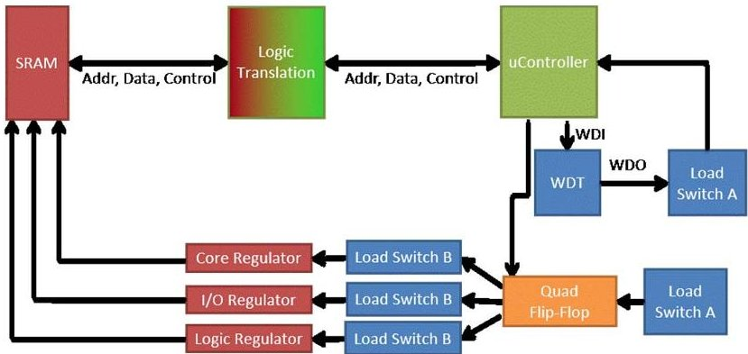
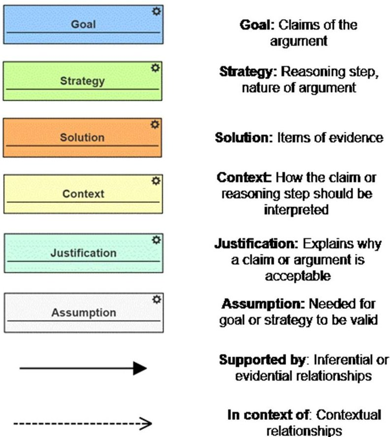
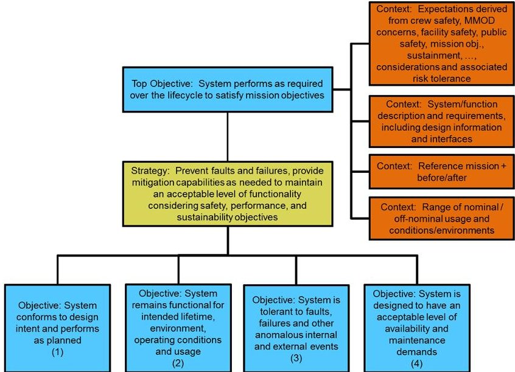
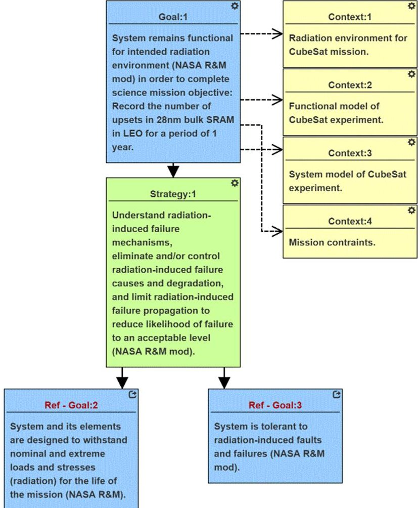
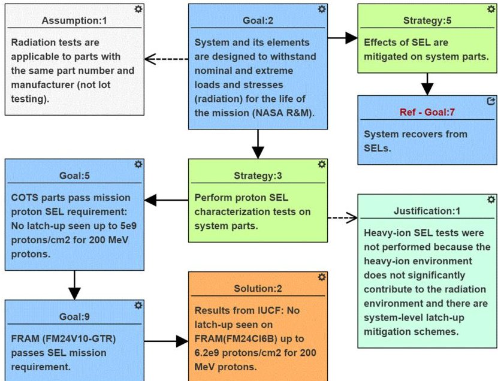
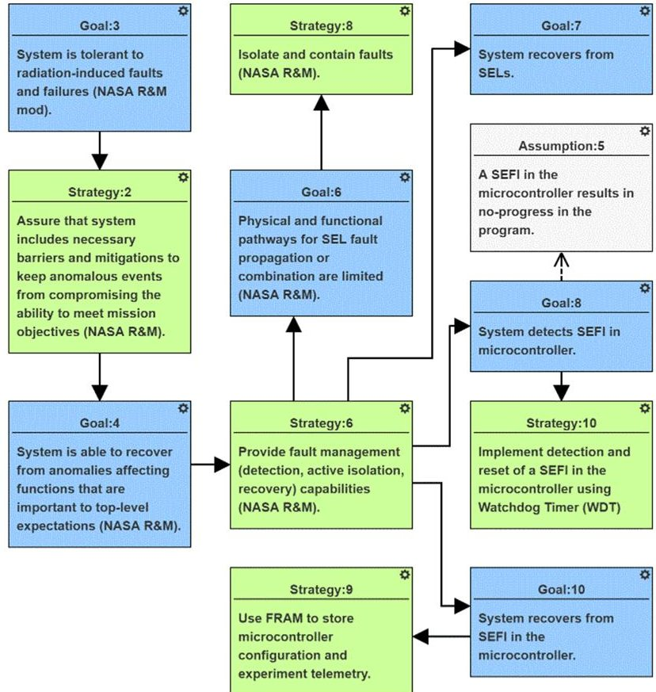

<!-- PDF_PAGE: 1 -->

# A CubeSat-Payload Radiation-Reliability Assurance Case using Goal Structuring Notation

Rebekah A. Austin, Vanderbilt University

Nagabhushan Mahadevan, Vanderbilt University

Brian D. Sierawski, PhD, Vanderbilt University

Gabor Karsai, PhD, Vanderbilt University

Arthur F. Witulski, PhD, Vanderbilt University

John Evans, PhD, NASA

Key Words: COTS, CubeSat, Goal Structuring Notation, Radiation Hardness Assurance, Reliability and Maintainability

## SUMMARY & CONCLUSIONS

CubeSats have become an attractive platform for universities, industry, and government space missions because they are cheaper and quicker to develop than full-scale satellites. One way CubeSats keep costs low is by using commercial off-the-shelf parts (COTS) instead of spacequalified parts. Space-qualified parts are often costlier, larger, and consume more power than their commercial counterparts precluding their use within the CubeSat form-factor. Given typical power budgets, monetary budgets, and timelines for CubeSat missions, conventional radiation hardness assurance, like the use of space-qualified parts and radiation testing campaigns of COTS parts, is not practical. Instead, a systemlevel approach to radiation effects mitigation is needed.

In this paper an assurance case for a system-level approach to mitigate radiation effects of a CubeSat science experiment is expressed using Goal Structuring Notation (GSN), a graphical argument standard. The case specifically looks at three main mitigation strategies for the radiation environment: total ionizing dose (TID) screening of parts, detection and recovery from single-event latch-ups (SEL) and single-event functional interrupts (SEFI). The graphical assurance case presented makes a qualitative argument for the radiation reliability of the CubeSat experiment using part and system-level mitigation strategies.

## 1 INTRODUCTION

Radiation Hardness Assurance (RHA) is the methodology for evaluating and assuring the radiation tolerance of electronic components to the space radiation environment [1], [2]. RHA activities assure that the designed system and its components will function over the lifetime of the mission. These activities include defining system requirements, defining the radiation environment, selecting and testing COTS, and designing for radiation-tolerance against mission goals. The activities focus on ensuring that the system can

carry out the mission, its electronics have non-destructive failure modes, and system mitigation or circumvention strategies handle radiation-induced errors and non-destructive radiation event failures. The result is system reliability for a mission in a particular space radiation environment.

When reviewing the RHA activities, it is important to document the part characterization and mitigation techniques in a concise and descriptive format. NASA's Office of Safety and Mission Assurance (OSMA) created the NASA Reliability & Maintainability (R&M) hierarchy to allow for the reliability and maintainability activities and decisions for a system to be presented in a graphical format [3]. In addition to simplifying the evaluation of system reliability, the R&M hierarchy accommodates reliability evaluation of systems developed with the Model-based System Engineering (MBSE) paradigm. MBSE is the application of models to support activities related to system requirements, design, analysis, verification, and validation through the entire life-cycle of a system [4].

This paper utilizes GSN and the R&M hierarchy to create an argument structure for system validation activities related to the radiation reliability of a CubeSat science payload. This argument structure is designed to incorporate reliability assurance into MBSE modeling systems.

Figure 1: Simplified Block Diagram of CubeSat Experiment Board modified from [10].

<!-- PDF_PAGE: 2 -->

The science objective for the CubeSat experiment is to evaluate models used for error rate predictions [5] by counting and reporting the number of radiation-induced errors in a 28nm commercial SRAM. This SRAM has been shown to be susceptible to errors from low-energy protons [6] and electrons [7], [8] in ground tests. The experiment board is part of a 1U CubeSat to be launched in 400 km to 800 km polar, low earth orbit (LEO) through NASA's CubeSat Launch Initiative on ELaNa-XIV. It will be among multiple CubeSats to be secondary payloads to JPSS-1, which launches in early 2017. An earlier version of this CubeSat experiment for a 65nm SRAM (RadFxSat) is orbiting on AO-85 and results were presented in [9]. The on-orbit results from both spacecraft will help determine if the contribution of low-energy protons and electrons to the error rate requires changes to current rate prediction methods.

In Figure 1, a simplified diagram of the CubeSat experiment board is presented. The input power from the spacecraft is a regulated 3V rail (blue boxes in Figure 1). This 3V primary power is divided to the different power domains by load switches to create a rail that supplies the parts in green and arail that supplies the part in orange. There are three regulators on the board to provide the three voltage domains for the SRAM and are the red boxes parts in Figure 1.The load switches provide current limiting to protect against SELs on the board. These load switches also prevent high current conditions from propagating to the rest of the satellite. Load Switch A has an auto restart capability after a high current event and Load Switch B toggles a flag signal after a high current event. The load switches result in 5 isolated power domains on the experiment board. The microcontroller handles reading and writing to the SRAM, counting the number of upsets, and reporting the science data and health of the board on an I2C bus. The watchdog timer (WDT) is tasked to recover the microcontroller from SEFIs.

The argument for the radiation reliability of the CubeSat experiment is supported by TID screening of COTS components, system-level SEL detection, isolation, and recovery, and SEFI recovery in the microcontroller. These mitigation strategies were chosen because of the radiation environment expected for the mission and the expected rate of single-event effects (SEEs) compared to the required uptime to complete the science mission objectives of the experiment. The result of this paper is a graphical assurance case specifically for the radiation reliability of a spacecraft system that uses COTS instead of rad-hard parts.

## 2 OVERVIEW OF RADIATION EFFECTS

The following section discusses common effects of radiation on spacecraft electronics and the strategies adopted to ensure system level radiation tolerance.

## 2.1 Total Ionizing Dose (TID)

Total Ionizing Dose (TID) is the accumulated charge deposited in device oxides over time [11]. This effect may lead to an increase in supply current for integrated chips (ICs) and eventual functional failure. TID is becoming less of a

reliability issue for digital complimentary metal-oxide semiconductor (CMOS) ICs as transistors decrease in size and the thickness of the gate oxides is reduced, meaning many COTS ICs can survive the dose accumulated for short low earth orbit (LEO) missions, 30 krads $ \mathrm{(S i O_{2})} $ or less [12].

## 2.2 Single Event Latch-up (SEL)

Single-Event Latch-up (SEL) is when a particle strike deposits enough charge to turn on a parasitic p-n-p-n junction (thyristor) in an IC [13]. Parasitic thyristors are inherent to the bulk CMOS process and are a concern for COTS which are mostly made with CMOS processes. The result of a latch-up is a self-sustaining electrical short circuit between the power and ground of the circuit yielding a large DC current flow. In addition to disrupting the proper operation of the circuit, if power is not quickly removed, the high current event will permanently damage and destroy the circuit, introduce latent damage, or drain a battery source. If the latch-up is detected quickly, the event can be non-destructive and power cycling the circuit will restore proper operation.

## 2.3 Single Event Upset (SEU) and Single Event Functional Interrupt (SEFI)

A Single-Event Upset (SEU) occurs when a particle strike deposits enough charge into a memory element to change the state of the memory, e.g., changing a stored 0 to a stored 1 [14]. The location where the SEU occurs in the memory of an IC or system determines the type of fault that is seen in a system. An SEU in the program counter register of a microcontroller will change the next instruction executed. This type of SEU is known as a Single-Event Functional Interrupt (SEFI) since the SEU in the control registers or program memory causes the microcontroller to execute the incorrect program order or instruction or stops program execution all together [15].

## 2.4 Mitigation Strategies for COTS Components

The use of COTS in spacecraft is not limited to CubeSats. NASA evaluates COTS for all types of missions when there are no rad-hard alternatives or when cost constraints limit the use of rad-hard electronics. In [12], the authors outline the radiation effects related issues with the use of COTS parts. In [16], the authors present a "Careful COTS" approach to using COTS in space systems. One strategy is to screen candidate COTS by performing TID testing up to 30 krads $ \mathrm{(S i O_{2})} $ . If the parts are still functional, they are selected for use.

In [17], the authors present system level mitigation schemes for SEEs including some that are used in the CubeSat experiment design. To mitigate SEL at the system level, current limiting and power cycling can be implemented with load switches. Watchdog timers (WDT) can be implemented as an "I'm okay" method of SEU detection in microcontroller [17]. In this scheme, the microcontroller periodically sends a pulse to a WDT as it goes through its normal operations. The WDT expects a pulse within a certain amount of time. If an SEFI occurs in the microcontroller that causes it to stop sending the pulse, the WDT times out and sends a reset signal

<!-- PDF_PAGE: 3 -->

to a load switch. Resetting the microcontroller causes it to reload configuration from an SEU-immune memory, like an FRAM, and should clear any errors in the configuration registers of the microcontroller.

Figure 2: Elements of GSN

## 3 OVERVIEW OF CUBESAT EXPERIMENT

CubeSats are 10cm x 10cm x 11cm and up to 1.3 kg satellites, originally developed at California Polytechnic State University in 1999 to make space flight achievable and affordable for universities and their students [18]. Using the Poly-Picosatellite Orbital Deployer (P-POD) to facilitate ride sharing and CubeSat deployment, 6 CubeSats were launched in 2003; in 2015, the 425th CubeSat was launched [19]. The platform was originally used as a training platform for undergraduate students to expose them to the challenges of real-engineering practices and system design. As the CubeSat platform matures, the mission goals for CubeSats expand beyond education to include science objectives and technology demonstrations [20]. In response to greater expectations the community has started to apply system engineering best practices to the platform.

The International Council on Systems Engineering (INCOSE) Space Systems Working Group (SSWG) has been investigating the applicability of MBSE to the CubeSats platform since 2011 with the goal of creating a CubeSat Reference Model. Their progress can be seen in [21]. In addition, NASA is applying MBSE to missions including Mars 2020, Europa Clipper, and Soil Moisture Active Passive (SMAP). Motivations for using MBSE include improving the quality of communications among development teams for

systems and subsystems with the ultimate goal of reducing failures [22].

## 4 GOAL STRUCTURING NOTATION

Goal Structuring Notation (GSN) is a graphical notation standard used to explicitly document an assurance case [23]. An assurance case is a reasoned and compelling argument supported by evidence that a system will operate as intended for a given, defined environment. An argument is a connected series of claims that support an overall claim. Assurance cases, and by extension a GSN argument structure, are means of documenting an argument and do not establish the truth of the argument. Acceptance of the case requires the argument to be reviewed by stakeholders of the system. GSN provides a way of documenting the assurance case that allows stakeholders to discuss, challenge, and review the argument it presents.

GSN provides a visual, hierarchical, structure to indicate how claims are supported by sub-claims. These claims in GSN are represented as goals. An example goal is "COTS electronics pass mission SEL requirement: No latch-up seen up to $ 5 \times 1 0^{9} $ protons/cm $ ^{2} $ for 200 MeV protons." A sub-goal, or child goal, is "FRAM passes proton SEL mission requirement." This child goal is more specific than the parent goal and supports the parent goal. The assertion of evidence to support the truth of a goal is represented by a solution. An example solution is "No latch-up seen on FRAM (FM24Cl6B) up to $ 6. 2 \times 1 0^{9} $ protons/cm $ ^{2} $ for 200 MeV protons."

The stakeholders reviewing the assurance case would then decide if that test result is evidence enough to support the goal of "FRAM passes proton SEL mission requirement." When documenting the reasoning between goals and child-goals, strategy elements are used. An example strategy is "Isolate and contain faults" which provides the reasoning step between the parent goal "Physical and functional pathways for fault propagation or combination are limited" and the child goal "Latch-up faults are isolated and contained close to the fault source." Goals, strategies, and solutions make up the base of the GSN structure and are connected with solid arrows and indicate inferential and evidential relationships. In summary, goals and strategies are alternately refined until the goal is specific enough to be supported by a solution element which links to the results of parts tests, system tests, simulations and analysis, literature review, etc.

An assurance case is made for a system operating within a certain environment. For a CubeSat, the environment can include radiation, thermal changes, budget, and development time. There are several ways in GSN to show how that environment interacts with the assurance case. The first way is with a context element which provides information on how a goal or strategy should be interpreted. An example context is "Radiation environment for mission" which provides information for the goal "System remains functional for the intended radiation environment." Details about the radiation environment asses the argument that the system functionality system not be compromised.

<!-- PDF_PAGE: 4 -->

Figure 3: R&M Hierarch based on GSN. Objectives take the place of goals and only objective, strategy, and context elements are used.

The second way of indicating the effect of the environment on the argument is through assumption elements. Assumptions are premises that need to be true in order for the goal or strategies to be valid. For example, the assumption "A SEFI in the microcontroller will cause it to stop sending the watchdog timer signal" is an assumption for the strategy "Implement detection and reset of a SEFI in the microcontroller using a watchdog timer." There are cases when a SEFI would not stop the watchdog timer signal and it is up to the stakeholders to determine if such an exception to the assumption is an acceptable risk in the system. Assumptions apply to all the child strategies and goals further down the evidential path from the point where the strategy or goal the assumption first appears. One advantage of the GSN approach is that assumptions are explicitly highlighted in the argument.

The last way is through a justification element. Justifications explain why a goal or strategy is acceptable. For example, the justification "Heavy-ion SEL tests were not performed because the heavy-ion environment does not significantly contribute to the radiation environment" is an explanation for the goal "System and its elements are designed to withstand nominal and extreme load and stresses related to radiation for the life of the mission." A reviewer might ask why heavy-ion SEL testing was not completed as it is a part of standard RHA activities and this explicitly states the reasoning for that decision. Assumptions, justifications, and context are connected to goal, strategies, and solutions with dotted arrows to indicate contextual relationships. In summary, assumptions, justifications, and context about the argument are linked to appropriate strategies or goals to further clarify the assurance case. In Figure 2, all of the elements of GSN are presented.

## 4.1 Reliability & Maintainability (R&M) Hierarchy

NASA's OSMA chose the GSN standard to create the NASA R&M Hierarchy that defines the top-level goals and

strategies for building assurance cases. The GSN assurance case presented here modifies the R&M hierarchy to be more specific to radiation reliability concerns and to allow for higher-risk mitigation schemes. Figure 3 shows the top-level of the R&M hierarchy. In this hierarchy, objectives, which are like goals in GSN, state the technical goals of the project. Objectives are defined as goals to be accomplished while goals in GSN are defined as claims of the argument. The GSN case presented in this paper uses goals because it is applied to a specific system and not a general guideline.

Strategies facilitate the accomplishment of the objective, which is a more narrow definition of strategy than in GSN but is still a way of explaining how a sub-objective is completing part of an objective. These two blocks are used in an alternating hierarchical fashion to create a template broad enough to apply to a wide range of projects. In this paper, this R&M hierarchy is applied to a specific project. Because the assurance case is being made for a specific project, all of the elements in GSN are used and are not limited to goals (objectives), strategies, and context elements. Goals and strategies that come from the R&M hierarchy are denoted in the elements with (NASA R&M) and annotated if they have been modified (NASA R&M mod).

## 5 CONSTRUCTION OF GSN ASSURANCE CASE FOR CUBESAT EXPERIMENT

The construction of the assurance case is done in WebGME, a web-based modeling tool that allows for the creation of domain-specific modeling languages [24]. While this paper focusses on the GSN models developed in WebGME, the reliability modeling environment supports other MBSE paradigms such as block diagram models with fault propagation, function requirements, and functional decomposition.

The GSN assurance case is a graphical presentation of the argument for the radiation-reliability of the system. This argument is supported by evidence expressed using GSN solution elements. The influence of the mission environment is shown through context, assumption, and justification elements. Other goals can be added to expand to other reliability concerns and to include the larger system that includes the CubeSat experiment board. Selections from the complete GSN case are presented below. The top-level goal as seen in Figure 4, is "System remains functional for intended radiation environment in order to complete science mission objective: Record the number of upsets in 28nm bulk SRAM in LEO for a period of 1 year." The first part of this goal is the same for all of our RadFxSat experiments and is the top-level objective in the R&M hierarchy. The mission objective changes for different experiments and changes the low-level goals based on what mitigation strategies are needed to complete the science mission in the mission environment. The contexts for this goal link to the other models, such as SysML, in the development environment as well as documents that describe the mission environment and constraints. These models and documents change for different experiments.

The overall strategy, Strategy 1, is "Understand radiation-

<!-- PDF_PAGE: 5 -->

induced failure mechanisms, eliminate and/or control radiation-induced failure causes and degradation, and limit radiation-induced failure propagation to reduce likelihood of failure to an acceptable level." Through understanding radiation-induced failure mechanisms, the mechanisms can be constrained to TID, SEL, and SEFIs. Two goals are used to mitigate these failure mechanisms. The system is "designed to withstand radiation-induced stresses for the life of the mission" (Goal 2) and the system "is tolerant to radiation-induced faults and failures" (Goal 3). Goal 2 presents tests that show each COTS part is either tolerant to the radiation environment or system-level mitigation applies when the part is not tolerant or the tolerance is unknown. Goal 3 presents system-level mitigation of radiation-induced faults on COTS parts.

Figure 4: Top-level GSN Hierarchy

To show that the system can withstand exposure to the radiation environment for the specific mission, part characterization tests are performed or SEL effects are mitigated as seen in Figure 5. Assumption 1 explicitly states that these tests are not lot tests. This differs from the radiation hardness assurances (RHA) best practices and introduces risk to the system. The risk from this assumption can be discussed at reviews since it is called out in the assurance case. Justification 1 explicitly states that heavy-ion SEL tests were not performed which again deviates from standard RHA campaigns and gives a reason for that decision.

Figure 5: Parts Characterization Hierarchy

Assumption 3 identifies when tests were performed on parts in the same family but not on the specific part number used in the system. Goal 7 describes the SEL mitigation strategies for the COTS that failed proton SEL testing or were not tested and is discussed later in this section when Goal 7 is referenced again when the SEL recovery strategies are described. This completes the argument made starting at Goal 2 in Figure 4.

Figure 6: System-level Mitigation Hierarchy

The argument started at Goal 3 (Fig. 4) describes the system level mitigation techniques for SEEs and is presented in Figure 6. Strategy 2 describes the approach taken to ensure that the system tolerant to faults. The radiation-induced faults

<!-- PDF_PAGE: 6 -->

need to be detected early and stopped to minimize the effect on the system. Goal 4 covers detection and recovery from SELs and the detection and recovery of SEFIs in the microcontroller.

## 6 CONCLUSION

A complete assurance case for the radiation reliability of a CubeSat experiment board is presented using Goal Structuring Notation. The CubeSat experiment board was mitigated against the radiation environment through COTS screening and system-level mitigation schemes. The assurance case for the CubeSat experiment modifies the NASA R&M Template [3] in order to address missions that use radiation-hardened parts, and provides a template for building the radiation-reliability assurance case for COTS-based systems. The case was created in WebGME software and includes support for system modeling, functional modeling, and fault propagation.

This assurance case included an argument for the use of COTS latch-up sensitive electronics with mitigation at the system level. This strategy was considered to present an acceptable amount of risk to the CubeSat experiment by the stakeholders for the system. The same strategy might not be acceptable for systems that must meet high-availability requirements and the SEL rate in the space environment is too high to accomplish the mission objective.

During the creation of the GSN radiation-reliability assurance case for the CubeSat experiment, several advantages of the approach over a document-based approach were discovered. Assumptions that are hidden within text arguments become visible through the assumption boxes. The structure of a GSN argument imposes rigor on the assurance case through the relationships between goals and solutions. Tests are linked with solutions in the assurance case and the goals that they support can be traced through the structure. By organizing the assurance case into goals and child-goals, the logic of the argument for radiation reliability is made explicit in the graphical structure. In addition, the structure allows for the mission assurance objectives to fit into the larger MBSE paradigm for system design. The end result of the GSN argument construction is an easy-to-follow graphical representation of factors affecting the radiation reliability of the CubeSat experiment that makes mitigation decisions and remaining risks transparent to a reliability review team. In the future, we plan to show how the reliability assurance case is supported by functional and system models of the system and how the assurance case informs design decisions by showing how the reliability of the system is related to the different parts of the system .In addition, we plan to investigate how to quantitatively evaluate the confidence in the assurance case.

## ACKNOWLEDGEMENTS

This work was supported by NASA Grant #NNX15AV48G. Thanks to Dr. Ron Schrimpf, Dr. Robert Reed, James Trippe, and Ken LaBel for guidance and support in the development of the model and methodology. Thanks also to Dr. Martin Feather from providing valuable feedback on this paper.

## REFERENCES

1. J. L. Barth et al., "Radiation assurance for the space environment," in Integrated Circuit Design and Technology, 2004, pp. 323-333.

2. C. Poivey, "Radiation Hardness Assurance for Space Systems," Notes from the 2002 IEEE Nuclear and Space Radiation Effects Short Course, Phoenix, AZ.

3. F. J. Groen et al., "A vision for spaceflight reliability: NASA's objectives based strategy," Reliability and Maintainability Symposium (RAMS), 2015 Annual, pp. 1- 6, 2015.

4. International Council on Systems Engineering (INCOSE), "System Engineering Vision 2020," INCOSE-TP-2004- 004-02, Sept. 2007.

5. M. Swartwout et al., "Argus: A flight campaign for modeling the effects of space radiation on modern electronics," Aerospace Conference, 2012 IEEE, Big Sky, MT, 2012, pp. 1-11.

6. N. A. Dodds et al., "The Contribution of Low-Energy Protons to the Total On-Orbit SEU Rate," IEEE Transactions on Nuclear Science, vol. 62, no. 6, pp. 2240- 2451, Dec. 2015.

7. M. P. King et al., "Electron-Induced Single-Event Upsets in Static Random Access Memory," IEEE Transactions on Nuclear Science, vol. 60, no. 6, pp. 4122-4129, Dec. 2013.

8. J. M. Trippe et al., "Electron-Induced Single Event Upsets in 28 nm and 45 nm Bulk SRAMs," IEEE Transactions on Nuclear Science, vol. 62, no. 6, pp. 2709-2716, Dec. 2015.

9. B. D. Sierawski et al., "Beyond Ground-Based Tests: Using CubeSats for Single Event Effects Hardness Assurance," Nuclear and Space Radiation Effects Conference, Portland, OR, 2016.

10. A. F. Witulski et al., "Goal Structuring Notation in a Radiation Hardening Assurance Case for COTS-Based Spacecraft," GOMACTech, Orlando FL, 2016.

11. J. R. Schwank et al., "Radiation Effects in MOS Oxides," IEEE Transactions on Nuclear Science, vol. 55, no. 4, pp. 1833-1853, Aug. 2008.

12. D. Sinclair and J. Dyer, "Radiation Effects and COTS Parts in SmallSats," Proceedings of the AIAA/USU Conference on Small Satellites, 2013.

13. A. H. Johnston, "The influence of VLSI technology evolution on radiation-induced latchup in space systems," IEEE Transactions on Nuclear Science, vol. 43, no. 2, pp. 505-521, Apr 1996.

14. P. E. Dodd and L. W. Massengill, "Basic mechanisms and modeling of single-event upset in digital microelectronics," IEEE Transactions on Nuclear Science, vol. 50, no. 3, pp. 583-602, June 2003.

15. P. V. Nekrasov et al., "Investigation of Single Event Functional Interrupts in Microcontroller with PIC17 Architecture," 2015 15th European Conference on Radiation and Its Effects on Components and Systems (RADECS), Moscow, 2015, pp. 1-4.

<!-- PDF_PAGE: 7 -->

16. K. A. LaBel et al.,"Emerging radiation hardness assurance (RHA) issues: a NASA approach for space flight programs," IEEE Transactions on Nuclear Science, vol. 45, no. 6, pp. 2727-2736, Dec 1998.

17. K. A. LaBel and M. M. Gates, "Single-event-effect mitigation from a system perspective," IEEE Transactions on Nuclear Science, vol. 43, no. 2, pp. 654-660, Apr 1996.

18. J. Puig-Suari et al., "Development of the standard CubeSat deployer and a CubeSat class PicoSatellite," Aerospace Conference, 2001, IEEE Proceedings, vol. 1, pp. 1/347-1/353, 2001.

19. M. Swartwout, "CubeSat Database," Saint Louis University, [Online]. Available: https://sites.google.com/a/slu.edu/swartwout/home/cubesat-database. [Accessed 20 June 2016].

20. National Academies of Sciences, Engineering, and Medicine, "Achieving Science with CubeSats: Thinking Inside the Box," The National Academies Press, Washington, DC, 2016.

21. D. Kaslow et al., "Developing a CubeSat Model-Based System Engineering (MBSE) Reference Model - Interim Status #2," 2016 IEEE Aerospace Conference, Big Sky, MT, 2016, pp. 1-16.

22. D. Nichols and C. Lin, "Integrated Model-Centric Engineering: The Application of MBSE at JPL Through the Life Cycle," INCOSE International MBSE Workshop, 2014.

23. GSN Community Standard Version 1, Origin Consulting (York) Limited, 2011.

24. M. Maroti et al., "Next Generation (Meta)Modeling: Web- and Cloud-based Collaborative Tool Infrastructure," 8th Multi-Paradigm Modeling Workshop, 2014.

## BIOGRAPHIES

Rebekah A. Austin Vanderbilt University Nashville, TN 37235

email: rebekah.a.austin@vanderbilt.edu

Rebekah Austin received her B.E. and M.S. degrees in Electrical Engineering from Vanderbilt University in 2014 and 2016. She is a part of the Radiation Effects and Reliability Group at Vanderbilt University as a graduate student focusing the design of CubeSat experiments to evaluate space radiation environment models. She is also a Pathways Intern with the NASA Goddard Space Flight Center since 2014.

Nagabhushan Mahadevan Institute for Software Integrated Systems Department of Electrical Engineering and Computer Science Vanderbilt University 1025 16th Av. South Suite 102 Nashville TN 37212

Nagabhushan Mahadevan earned his M.S. in Computer Engineering and Chemical Engineering from the University of South Carolina. He is a Systems Architect at the Institute for Software Integrated Systems, where he supports research and technology development geared towards resilient cyberphysical systems, model-based systems health management, real-time diagnosis, verification and validation of diagnosis systems and paradigms for assessing performance degradation and system reliability in radiation environments.

email: nag.mahadevan@vanderbilt.edu

Brian D. Sierawski, PhD Institute for Space and Defense Electronics Vanderbilt University 1025 16th Avenue South, Suite 200 Nashville, TN 37212

## email: brian.sierawski@vanderbilt.edu

Brian Sierawski earned his PhD in Electrical Engineering from Vanderbilt University and is currently a Research Assistant Professor there. He is an IEEE Senior Member and has authored or coauthored over 40 publications.

Gabor Karsai, PhD Institute for Software Integrated Systems Vanderbilt University 1025 16th Ave S Nashville, TN 37212

## Email: gabor.karsai@vandebilt.edu

Dr. Gabor Karsai is a Professor of Electrical Engineering and Computer Science at Vanderbilt University, and Associate Director of the Institute for Software-Integrated Systems at Vanderbilt. He received his Dr Techn degree from the Technical University of Budapest his PhD from Vanderbilt University. He conducts research in cyber-physical systems, model-integrated computing, and software platforms for distributed real-time embedded systems.

Arthur F. Witulski, PhD Institute of Space and Defense Electronics Department of Electrical Engineering and Computer Science Vanderbilt University 1025 16th Avenue South, Suite 200 Nashville, TN 37212

## email: arthur.f.witulski@vanderbilt.edu

Art Witulski earned his Ph.D. in Electrical Engineering from the University of Colorado, Boulder. He is currently a Research Associate Professor at Vanderbilt, where he specializes in research on the effects of radiation on electronic power circuits and devices, modeling the system-level effects of radiation of robots in nuclear disaster areas and spacecraft, and radiation reliability paradigms for systems with majority commercial electronic parts.

John Evans, PhD

Office of Safety and Mission Assurance

NASA

300 E St SW

<!-- PDF_PAGE: 8 -->

Washington, DC, 20546, USA

e-mail: john.w.evans@nasa.gov

John Evans earned his PhD in Materials Science and Engineering from Johns Hopkins University, and is the Program Manager for Reliability and Maintainability and

Program Executive for the NASA Electronic Parts and Packaging Program at NASA HQ Office of Safety and Mission Assurance. He has authored or coauthored 3 textbooks, a book chapter on electronic materials and over 50 publications.