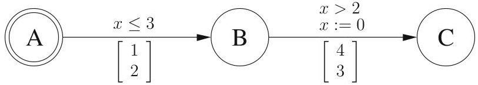
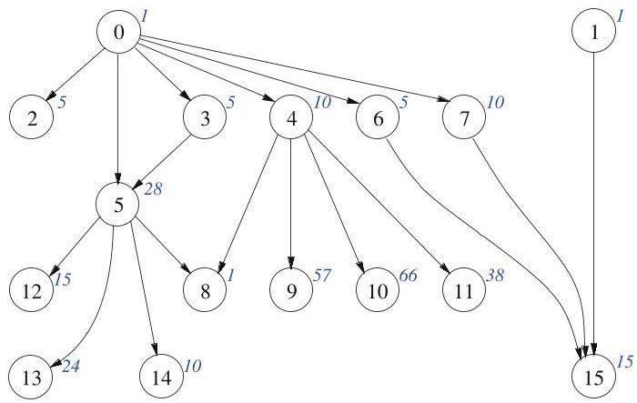
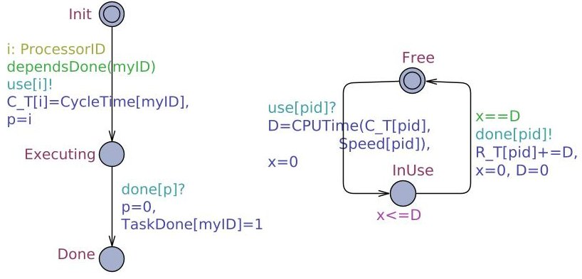
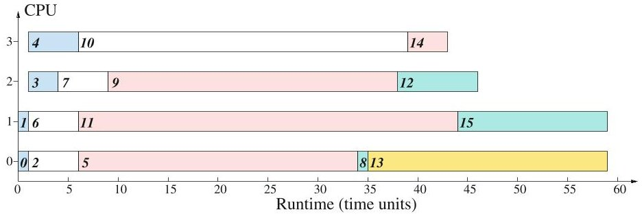
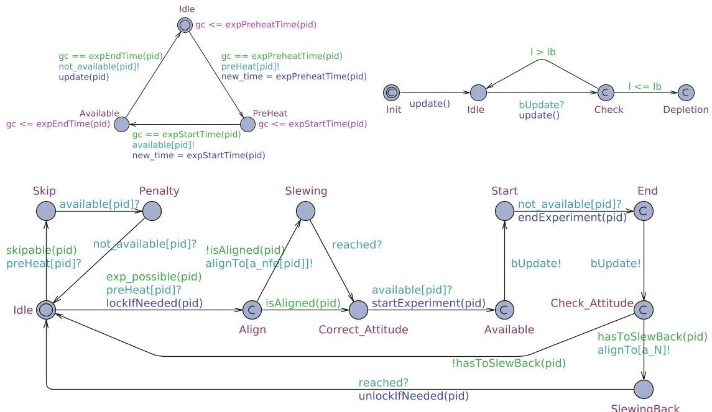
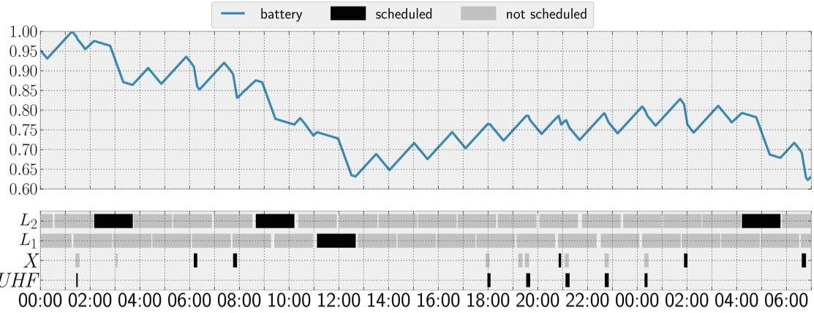

<!-- PDF_PAGE: 1 -->

# Pareto Optimal Reachability Analysis for Simple Priced Timed Automata

Zhengkui Zhang $ ^{1(\boxtimes)} $ , Brian Nielsen $ ^{1} $ , Kim Guldstrand Larsen $ ^{1} $ , Gilles Nies $ ^{2} $ Marvin Stenger $ ^{2} $ , and Holger Hermanns $ ^{2} $

$ ^{1} $ Department of Computer Science, Aalborg University, Aalborg, Denmark {zhzhang,bnielsen,kgl}@cs.aau.dk

$ ^{2} $ Department of Computer Science, Saarland University, Saarbrücken, Germany {nies,s9mnsten,hermanns}@cs.uni-saarland.de

Abstract. We propose Pareto optimal reachability analysis to solve multi-objective scheduling and planing problems using real-time model checking techniques. Not only the makespan of a schedule, but also other objectives involving quantities like performance, energy, risk, cost etc., can be optimized simultaneously in balance. We develop the Pareto optimal reachability algorithm for UPPAAL to explore the state-space and compute the goal states on which all objectives will reach a Pareto optimum. After that diagnostic traces are generated from the initial state to the goal states, and Pareto optimal schedules are obtainable from those traces. We demonstrate the usefulness of this new feature by two case studies.

## 1 Introduction

In reactive system design, engineers face the challenge of optimizing schedules regarding a variety of quantitative objectives like the makespan of a schedule, performance, energy consumption, resource intensiveness, risk assessment etc. Because in most cases a subset of these objectives are conflicting, there may not always exist any single solution that can simultaneously optimize all objectives, but advisable trade-offs ought to be made by human decision makers. This problem is generally called multi-objective optimization (MOO), which has been studied extensively in the areas such as economics, operation research, game theory, and control theory. Vilfredo Pareto (1848-1923) proposed the well-known concept of Pareto optimality as "the state of allocating resources where it is impossible to make any one individual better off without making at least one individual worse off." A solution is called Pareto optimal if none of the objectives can be improved in value without degrading some of the other objective values. Without additional preference information, all Pareto optimal solutions are considered equally good.

One of the most popular formalisms to model stimuli and behaviors of realtime reactive systems is timed automata (TA) [1], which was introduced by Alur and Dill in 1994 for the purpose of verification. It is capable of modeling guards,

<!-- PDF_PAGE: 2 -->

time constraints, instantaneous actions and time elapsing in a natural way. Real-time model checkers such as UPPaal [4] and KRONOS [11] based on the network of timed automata were developed. They have been successfully applied to solve enormous industrial verification case studies including but not limited to control protocols [7,20], schedulability analysis [10,13,19], etc.

Related Work. Pareto optimality concept is widely applied to solve many multi-objective scheduling problems [3,15,16]. In real-time system design, mature model checkers like UPPAAL and KRONOS have been successfully extended to do quantitative analysis. In particular, CORA aims at solving optimal scheduling and planning problems modeled by priced timed automata (PTA) [2,6]. PTA uses an additional observer clock to accumulate cost according to either discrete price annotations on transitions or price rates on locations. The scheduling problem boils down to a cost-optimal reachability problem. The reachability algorithm is also enhanced by branch and bound (B&B), which can effectively prune parts of the state-space that for sure will not to lead to an optimal solution, avoiding exploring the entire state-space. In [18] the optimal reachability analysis on the multi-priced timed automata (MPTA) was proved decidable. However, the model checking problem on MPTA was proven undecidable [12]. In [14], efficient algorithms for multi-objective probabilisitic model checking of a stochastic system were proposed and implemented in PRISM.

Contributions. Firstly we introduce simple priced timed automata (SPTA) a priced extension of TA to model a subset of multi-objective scheduling problems. Particularly we only allow discrete prices on transitions for multiple cost variables. There exist more general multi-priced timed automata (MPTA) which allow price rates on locations. However, data structures and reachability algorithms on MPTA are difficult to implement, because multiple cost variables with respect to price rates entail constructing high-dimensional priced zones and complex operations on priced zones. In contrast, SPTA only need a vector of integer variables to maintain different accumulated costs. Although price rate on locations are not supported, SPTA may also suffice for a number of classical scheduling cases, where the tasks' spans are pre-determined thus the energy consumption of every task can be approximated in advance, or the resources required by every task are not affected by the task's span at all. Secondly we provide the Pareto optimal reachability (POR) algorithms to compute Pareto optimal costs when reaching target goal states. Diagnostic traces are obtainable from the initial state to the goal states, and Pareto optimal schedules are obtainable from those traces. Thirdly we implement the semantics of SPTA and POR algorithms as a new feature in UPPAAL. Fourthly we demonstrate the usage of this feature using two case studies: (1) time-optimal and power-aware scheduling of a task graph; (2) power-aware scheduling of the GOMX-3 nano satellite.

Outline. The rest of the paper is organized as follows. Section 2 defines simple priced automata and Pareto optimality. Section 3 explains the Pareto optimal reachability algorithms and implementation. Section 4 gives the experiment results of two case studies. Section 5 concludes.

<!-- PDF_PAGE: 3 -->

## 2 Preliminaries

This section gives the formal definitions for simple priced timed automata (SPTA), and recalls the notition of Pareto optimality.

## 2.1 Simple Priced Timed Automata

Let $ X=\{x,y,\dots \} $ be a finite set of clocks. We define $ \mathcal{B}(X) $ as the set of clock constraints over X generated by grammar: $ g,g_{1},g_{2}::=x\bowtie n|x-y\bowtie n|g_{1}\wedge g_{2} $ where x,y $ \in X $ are clocks, n $ \in \mathbb{N} $ and $ \bowtie\in\{\leq,<,=,>,\geq\} $

Definition 1. A Timed Automaton (TA) [1] is a 6-tuple $ \mathcal{A}=\left(L,\ell_{0},X, \Sigma,E,Inv\right) $ , where: L is a finite set of locations; $ \ell_{0}\in L $ is the initial location; X is a finite set of non-negative real-valued clocks; $ \Sigma $ is a finite set of actions; $ E\subseteq L\times\mathcal{B}(X)\times\Sigma\times 2^{X}\times L $ is a finite set of edges, each of which contains a source location, a guard, an action, a set of clocks to be reset and a target location; Inv : $ L\to\mathcal{B}(X) $ sets an invariant for each location. For simplicity an edge $ (\ell,g,a,r,\ell^{\prime})\in E $ is written as $ \ell\overset{g,a,r}{\rightarrow}\ell^{\prime}. $

Let $ \bar{p}=[p_{1}, p_{2}, \dots, p_{k}]$ denote a finite vector of k prices, where $ p_{i} \in \mathbb{N}. $

Definition 2. A Simple Priced Timed Automaton (SPTA) extends TA as a 7-tuple $ \mathcal{S}=(\mathcal{A}, P), $ where: $ \mathcal{A} $ is timed automaton, $ P: E \to \mathbb{N}^{k} $ assigns vectors of prices $ \bar{p} $ to edges.

Definition 3. The semantics of a simple priced timed automaton $ \mathcal{S} $ is a priced timed transition system $ S_{\mathcal{S}}=(Q,Q_{0},\Sigma, \rightarrow) $ , where: $ Q=\{(\ell,v)|(\ell,v)\in L\times $ $ \mathbb{R}_{\geq 0}^{X} $ and $ v\models Inv(\ell) $ are states, $ Q_{0}=(\ell_{0},0) $ is the initial state, $ \Sigma $ is the finite set of actions, $ \rightarrow\subseteq Q\times(\Sigma\cup\mathbb{R}_{\geq 0})\times Q $ is the transition relation defined separately for action $ a\in\Sigma $ and delay $ d\in\mathbb{R}_{\geq 0} $ as:

(1) $ (\ell,v)\xrightarrow{a}_{\bar{p}}(\ell^{\prime},v^{\prime}) $ if there is an edge $ (\ell\xrightarrow{g,a,r}\ell^{\prime})\in E $ such that $ v\models g, $ $ v^{\prime}=v[r\mapsto 0],\ v^{\prime}\models Inv(\ell^{\prime}), $ and $ \bar{p}=P(\ell\xrightarrow{g,a,r}\ell^{\prime}) $ is the vector of prices for this edge;

(2) $ (\ell,v)\overset{d}{\longrightarrow}\bar{0} $ $ (\ell,v+d)$ such that $ v\models Inv(\ell),v+d\models Inv(\ell), $ and $ \bar{0} $ denotes the zero-price vector for delay.

Definition 4. A trace (or run) $ \rho $ of $ \mathcal{S} $ can be expressed in $ S_{\mathcal{S}} $ as a sequence of alternative delay and action transitions starting from the initial state: $ \rho= $ $ q_{0}\xrightarrow{d_{1}}_{\bar{0}}q_{0}^{\prime}\xrightarrow{a_{1}}_{\bar{p}_{1}}q_{1}\xrightarrow{d_{2}}_{\bar{0}}q_{1}^{\prime}\xrightarrow{a_{2}}_{\bar{p}_{2}}\dots \xrightarrow{d_{n}}_{\bar{0}}q_{n-1}^{\prime}\xrightarrow{a_{n}}_{\bar{p}_{n}}q_{n}\dots $ , where $ a_{i}\in\Sigma $ $ d_{i}\in\mathbb{R}_{\geq 0} $ , $ q_{i} $ is state $ (\ell_{i},v_{i}) $ , and $ q_{i}^{\prime} $ is reached from $ q_{i} $ after delay $ d_{i+1} $ . State q is reachable if there exists a finite trace with the final state of q.

Definition 5. The cost (or cost vector) of a finite trace $ \rho $ is defined as the finite sum of all the prices along the trace $ \mathrm{Cost}(\rho)=\Sigma_{i=1}^{n}\bar{p}_{i}. $ For a given location $ \ell $ multi-objective scheduling on SPTA is to minimize $ \mathrm{Cost}(\rho), $ where finite traces $ \rho $ end in $ (\ell,v) $ for all possible $ v. $

<!-- PDF_PAGE: 4 -->

Fig.1. An example of SPTA

An example SPTA (in Fig.1) has a single clock x, and each transition is decorated with a vector of two prices. A sample run $ ^{1} $ of this SPTA is for instance:

$$
(A, 0) \xrightarrow {\epsilon (2), \left[ \begin{array}{l} 0 \\ 0 \end{array} \right]} (A, 2) \xrightarrow {\tau , \left[ \begin{array}{l} 1 \\ 2 \end{array} \right]} (B, 2) \xrightarrow {\epsilon (0. 5), \left[ \begin{array}{l} 0 \\ 0 \end{array} \right]} (B, 2. 5) \xrightarrow {\tau , \left[ \begin{array}{l} 4 \\ 3 \end{array} \right]} ()
$$

The runtime of this trace to reach location C is 2.5 time units. The cost of this trace, which is $ [ 5, 5]^{T} $ , is the summary of all price vectors along the transitions. It is worth noting that only discrete prices on the transitions contribute to the final cost, while prices at locations during the delay stay at $ \bar{0} $ constantly and never accumulating with time elapsing.

## 2.2 Pareto Optimality

Multi-objective scheduling (MOS) tries to minimize a vector of costs. We resort to the concept of Pareto optimality to compute a set of Pareto optimal result cost vectors that are mutually incomparable. Then human decision makers can choose the most appropriate results that best fit and balance the problem objectives.

Definition 6. Let $ \bar{c}=[c_{1},c_{2},\ldots,c_{k}] $ $ \bar{b}=[b_{1},b_{2},\ldots,b_{k}] $ denote two cost vectors. $ \bar{c} $ Pareto dominates $ \bar{b} $ (written as $ \bar{c}\prec\bar{b} $ ), iff both the following conditions are true:

(1) $ \forall i \in \{1, \dots , k\} c_{i} \leq b_{i}; $

(2) $ \exists j \in \{1, \dots , k \} c_{j} < b_{j}. $

Definition 7. A result cost vector $ \bar{c} $ is Pareto optimal if there does not exist another cost vector $ \bar{b} $ such that $ \bar{b}\prec \bar{c} $ . The set of Pareto optimal results is called the Pareto frontier.

## 3 Pareto Optimal Reachability

The real-time model-checker UPPAAL works by exploring a finite symbolic reachability graph, where the nodes are symbolic states. A symbolic state of TA is a pair $ (\ell, Z) $ , where $ \ell \in L $ is a location, and $ Z=\{v \mid v \models g_{z}, g_{z} \in \mathcal{B}(X)\} $ is a convex set of clock valuations called zone [17], which is normally efficiently represented and stored in memory as difference bound matrices (DBM) [8].

<!-- PDF_PAGE: 5 -->

The symbolic state of SPTA extends that of TA as $ (\ell ,\langle Z,\bar{c}\rangle) $ ,where $ \bar{c} $ is the cost (or cost vector) of a finite trace $ \rho $ that ends in $ (\ell,v) $ and $ v\in Z $ . Therefore, symbolic states in SPTA with the same $ \ell $ and Z are discriminated by $ \bar{c} $ . We call $ \langle Z,\bar{c}\rangle $ the discrete priced zone of a symbolic state in SPTA. We further define Pareto dominance between discrete priced zones as: $ \langle G,\bar{u}\rangle\preceq \langle Z,\bar{c}\rangle $ iff $ Z\subseteq G\land(\bar{u}=\bar{c}\vee\bar{u}\prec\bar{c}). $

## 3.1 Pareto Optimum on Prices

Algorithm 1 shows the Pareto optimal reachability algorithm that computes the Pareto optimal cost vector at goal states satisfying the proposition Goal. WAITING and PASSED keep unexplored and explored symbolic states respectively; and WAITING has the initial state. FRONT maintains the Pareto frontier consisting of current Pareto optimal costs at goal states. Inside procedure Main, whenever WAITING is not empty, an unexplored state is popped from WAITING in a loop. If the state is a goal state, the current cost $ \bar{c} $ is passed into procedure Update to check for Pareto dominance with the existing solutions inside FRONT, and update FRONT if necessary. At line 10 all elements in FRONT that are Pareto dominated by $ \bar{c} $ are discarded. At line 12 $ \bar{c} $ is added into FRONT, if existing elements in FRONT do not Pareto dominate it.

If the state is not goal state, it is subject to both inclusion checking and B&B elimination at line 5, and discarded if either test satisfies. Procedure Included determines that a state is included, if a previously explored state in PASSED with the same location has its discrete priced zone dominate that of the current state (as $ \langle Z^{\prime},\bar{c}^{\prime}\rangle\preceq\langle Z,\bar{c}\rangle $ ). A state is eligible for pruning in procedure Prune, if $ \bar{c} $ is Pareto dominated by an element in FRONT. If the state endures the two tests at line 5, it is added to PASSED as already explored, and then its successor states are generated and added to WAITING. For simplicity we denote the action and delay transitions between symbolic states uniformly as $ \rightsquigarrow $ .

Let TS be the zone-based transition system of SPTA with V symbolic states and E transitions. Let n be the number of clocks and k be the number of price variables. The time complexity of Algorithm 1 is in $ \mathcal{O}((V+E)\cdot(n^{3}+k+k^{2})) $ where the first factor is the complexity for state-space exploration, the second factor is the complexity for Pareto inclusion checking as well as pruning.

## 3.2 Implementation Issues

Algorithm 1 resembles the normal reachability algorithm [8] for TA. The implementation extensions into existing UPPAAL are four folded as follows.

1. The symbolic state of SPTA is a pair of location and discrete prized zone as $ (\ell,\langle Z,\bar{c}\rangle) $ . A UPPAAL model may contain both cost variables (associated with $ \bar{c} $ ) and normal variables (nothing to do with $ \bar{c} $ ). Therefore UPPAAL should be able to identify cost variables automatically by analyzing pareto objectives in the query, because only cost variables will contribute to the objectives.

<!-- PDF_PAGE: 6 -->

Algorithm 1. Pareto Optimal Reachability

WAITING $ \longleftarrow \{(\ell_0, \langle Z_0, \bar{0} \rangle)\} $ , PASSED $ \longleftarrow \emptyset $ , FRONT $ \longleftarrow \emptyset $

Procedure Main()

while WAITING $ \neq \emptyset $ do

select $ (\ell, \langle Z, \bar{c} \rangle) $ from WAITING

if $ (\ell, \langle Z, \bar{c} \rangle) \models $ Goal then

Update( $ \bar{c} $ )

else if $ \neg $ Included( $ (\ell, \langle Z, \bar{c} \rangle) $ ) and $ \neg $ Prune( $ \bar{c} $ ) then

add $ (\ell, \langle Z, \bar{c} \rangle) $ to PASSED

forall $ (\ell', \langle Z', \bar{c}' \rangle) $ such that $ (\ell, \langle Z, \bar{c} \rangle) \rightsquigarrow (\ell', \langle Z', \bar{c}' \rangle) $ do

add $ (\ell', \langle Z', \bar{c}' \rangle) $ to WAITING

return FRONT

Procedure Update( $ \bar{c} $ )

FRONT $ \longleftarrow $ FRONT $ \setminus \{ \varphi \in $ FRONT $ | \bar{c} \prec \varphi \} $

if $ \forall \varphi \in $ FRONT $ s.t. \bar{c} \neq \varphi $ then

FRONT $ \longleftarrow $ FRONT $ \cup \{ \bar{c} \} $

Procedure Included( $ (\ell, \langle Z, \bar{c} \rangle) $ )

if $ \exists (\ell, \langle Z', \bar{c}' \rangle) \in $ PASSED $ s.t. Z \subseteq Z' \land (\bar{c}' = \bar{c} \vee \bar{c}' \prec \bar{c}) $ then return TRUE

return FALSE

Procedure Prune( $ \bar{c} $ )

if $ \exists \varphi \in $ FRONT, $ \varphi \prec \bar{c} $ then return TRUE

return FALSE

2. UPPAAL should apply Pareto dominance between discrete priced zones as: $ \langle G,\bar{u}\rangle\preceq\langle Z,\bar{c}\rangle $ iff $ Z\subseteq G\wedge(\bar{u}=\bar{c}\vee\bar{u}\prec\bar{c}). $ That is, $ \langle G,\bar{u}\rangle $ dominates $ \langle Z,\bar{c}\rangle $ if zone Z is included by or equal to zone G, and cost vector $ \bar{u} $ is equal to or Pareto dominates cost vector $ \bar{c}. $ During Pareto inclusion checking, for every new waiting state $ (\ell,\langle Z,\bar{c}\rangle), $ if $ \exists(\ell,\langle G,\bar{u}\rangle)\in $ PASSED s.t. $ \langle G,\bar{u}\rangle\preceq\langle Z,\bar{c}\rangle $ then $ (\ell,\langle Z,\bar{c}\rangle) $ is discarded for further exploration.

3. A global container named frontier maintains the Pareto optimal cost vectors at goal states. When a goal state is reached, the current cost at goal is checked for Pareto dominance with the solutions in the frontier, and the frontier is updated if necessary. In the pruning process, a state is discarded if its cost is dominated by a solution in the frontier.

4. The algorithm only returns the frontier. In UPPAAL, multiple traces, each of which corresponding to a Pareto optimal solution inside the frontier, are also computed and stored into different files.

## 3.3 Pareto Optimum on Objective Functions

We propose three extensions to make Algorithm 1 more powerful and flexible: (1) support formatting multi-objectives as a vector of objective functions $ F(\bar{c})= [ f_{1}(\bar{c}), f_{2}(\bar{c}), \dots , f_{n}(\bar{c}) ] $ parameterized by the cost vector $ \bar{c} $; (2) support a global

<!-- PDF_PAGE: 7 -->

clock (let us call it now) as a singular objective function to measure the makespan (accumulated delay on a finite trace); (3) support negative prices on action transitions. The first extension requires procedures Update and Prune to evaluate $ F(\bar{c}) $ , and Front to contain Pareto optimal outcomes of $ F(\bar{c}) $ on goal states. We define monotonically increasing for $ f\in F(\bar{c}) $ as: $ \bar{c}\prec\bar{c}^{\prime}\Rightarrow f(\bar{c})<f(\bar{c}^{\prime}) $ . These three extensions however, are applied under specific additional conditions:

Cond 1. For extension 1, if $ \exists f\in F(\bar{c}) $ is not monotonically increasing, Prune must be disabled, and the Pareto check of cost vectors $ \bar{c}^{\prime}\prec \bar{c} $ at line 13 in Included must be skipped.

Cond 2. For extension 2, clock now must not be reset nor tested in guards or invariants.

Cond 3. For extension 3, (1) the state-space graph of the model must be acyclic; (2) if $ \forall f\in F(\bar{c}) $ are monotonically increasing, Prune must be disabled; (3) if $ \exists f\in F(\bar{c}) $ is not monotonically increasing, do as in Cond 1.

B&B pruning and Pareto inclusion checking are valid only if the costs and evaluation results of objective functions are monotonically increasing. Conditions 1 & 3 are of utmost importance to notice, otherwise there is a risk to have incomplete results due to discarding some intermediate states prematurely that may lead to better results on goal states. The consequence of applying these two conditions is to explore the full state-space. Because the Pareto inclusion checking decays to normal inclusion checking as in the standard reachability algorithm, and the state-space is not pruned.

We extended UPPAAL to compute Pareto optimum on prices and objective functions of SPTA. The query to enable this new feature inside the verifier follows the syntax of:

$$
\mathrm {P O} \left(f _ {1}, f _ {2}, \dots , f _ {k}\right) \left[ - (\mathrm {L 1} | \mathrm {L 2}) \right]: \mathrm {E} < > \mathrm {G o a l},
$$

where PO is the keywords for Pareto optimum, $ f_{i} $ $ (i \in[1,k]) $ are objective functions or cost variables. Next comes the optional switch: $ [-\mathrm{L1}] $ disables pruning only, or $ [-\mathrm{L2}] $ disables both pruning and Pareto inclusion checking as in Cond 1. Following the colon is the normal reachability query. Goal is the proposition to specify the target goal states. If an objective is to be maximized, it is equivalent to put it in negative. But this typically turns a monotonically increasing objective function into decreasing, then $ [-\mathrm{L2}] $ is necessary.

## 4 Experiment Results

## 4.1 Case Study 1: Task Graph Scheduling

A task graph consists of a number of computation tasks with precedence constraints (predecessor tasks) such that a task can start only if all its predecessor tasks have completed. In this case study (Task-Graph-16), an embedded system has 16 tasks, whose precedence constraints are within [0, 3] and processing time are predictable and within the range of [1, 66] clock cycles. Those jobs can be

<!-- PDF_PAGE: 8 -->

scheduled on four processors with the speeds of [1,1,2,2] clock cycles per time unit and the power consumptions at busy state of [10,10,40,40] micro watts per time unit. We neglect the power for processors at idle state. The objective is to synthesize a non-preemptive schedule that can minimize the time for all tasks to terminate as well as the total power consumption by four processors.

Figure 2 depicts the dependency graph of 16 tasks. These precedence constraints are coded as a dependency matrix in the UPPAAL model. Figure 3 shows the templates for task and processor. Task is scheduled if the guard "dependsDone()" approves that all its predecessor tasks are completed. Once a processor is available, the task is bound to that processor. The predefined clock cycles for this task is also passed to that processor. Then the task starts executing until it is notified for termination by signal "done[p]". Processor transforms from Free to InUse once it is scheduled to handle a task, meanwhile "CPUTime()" calculates the expected execution time D in time units from clock cycles of a task and current processor speed. After delaying at InUse for D time units, Processor moves back to Free and notifies the binding task. R_T[pid], which keeps the accumulated elapsing time at InUse for each processor and acts as cost variables, is also increased by D.

Fig. 2. Task dependency graph. Task Ids are in the center of nodes. Predicted clock cycles of tasks are in blue italic font on the top right corner of nodes. (Color figure online)

$$
\begin{array}{l} \mathrm {P O} \left(1 0 * \left(\mathrm {R} _ {-} \mathrm {T} [ 0 ] + \mathrm {R} _ {-} \mathrm {T} [ 1 ]\right) + 4 0 * \left(\mathrm {R} _ {-} \mathrm {T} [ 2 ] + \mathrm {R} _ {-} \mathrm {T} [ 3 ]\right), \mathrm {n o w}\right): \\ \mathrm {E} < > \mathrm {f o r a l l} (\mathrm {i}: \mathrm {T a k I D}) \mathrm {T a k} (\mathrm {i}). D o n e \& \& \mathrm {n o w} < = 6 5 \\ \end{array}
$$

The original goal to minimize makespan and energy consumption is expressed as the query above. The Pareto optimality section contains two objective functions: the total energy consumption expressed as the linear combination of power and processor in-use time, and a global clock now measuring the makespan. The reachability proposition section specifies all tasks are to complete and the makespan is equal to or less than 65 time units. UPPAAL reports seven Pareto

<!-- PDF_PAGE: 9 -->

Fig. 3. Templates for Task (left) and Processor (right)

optimal outcomes as follows with the corresponding traces. Assuming we prefer the 3rd outcome (4700,59) with the energy consumption of 4700 micro joules and makespan of 59 time units, we can parse the trace into a visualizable schedule as shown in Fig. 4.

1. (4600, 63) 3. (4700, 59) 5. (4800, 54) 7. (4560, 65)

2. (4770, 55) 4. (4850, 51) 6. (4590, 64)

Fig. 4. Schedule for the 3rd outcome (4700, 59). Horizontal bar denotes tasks scheduled on a processor. The segments inside each bar denote individual tasks with the task ids in the front of each segment.

We experimented this model on a Ubuntu 14.04 PC with 6 GB memory and Intel Core i3 CPU at the frequency of 2.53 GHz. We made five runs for each search order: breadth-first search (BFS), depth-first search (DFS) and random depth-first search (RDFS). We measured the average runtime (RT) in seconds and the average maximum residence memory (RSS) in GB as in Table 1. BFS terminates the fastest, although the runtime of all three search orders are very close. The empirical explanation is that BFS is good at making large zones, while DFS/RDFS will cause higher degree of fragmentation of the underlying symbolic state-space requiring exploring more symbolic states [5].

<!-- PDF_PAGE: 10 -->

Table 1. Runtime (sec) and memory (GB) of Task-Graph-16

<table border="1"><tr><td></td><td>BFS</td><td>DFS</td><td>RDFS</td></tr><tr><td>RT</td><td>77.22</td><td>80.21</td><td>81.05</td></tr><tr><td>RSS</td><td>1.17</td><td>1.16</td><td>1.16</td></tr></table>

The bad news is that the UPPAAL engine cannot terminate on larger task graph with more than 16 tasks. BFS on an example task graph with 17 tasks consumed 5.22 GB memory, then the operating system started swapping, essentially blocking the exploration process. For fully exploring larger models, one may resort to parallel and distributed computing, or apply better guiding and heuristics. Sometimes the absolute optimal results may not be necessary, but near optimal results may suffice. In this case, random-depth-first search or swarm strategy may be promising options.

## 4.2 Case Study 2: Nano Satellite Scheduling

The GOMX-3 CubeSat is a 3L 3kg nano satellite commissioned by the European Space Agency (ESA). It was designed, delivered, and operated by GomSpace in Aalborg Denmark, and was launched from Japan aboard the HTV-5 cargo spacecraft on August 19th 2015. GOMX-3 was successfully deployed on October 5 2015. The satellite supports precise 3-axis rotation by gyroscopes and magnetorquers which enable the following main payloads: (1) in-flight tracking of ADS-B beacons emitted by commercial aircrafts, (2) monitoring signals from geostationary INMARSAT satellites by L-Band receiver, (3) high-speed downlinking collected data to stations in Toulouse (France) or Kourou (French Guiana) by X-Band transmitter and UHF radio module, (4) uplinking new instructions to and monitoring status of GOMX-3 from GomSpace by the UHF module.

The purposes of GOMX-3 are tracking commercial aircrafts, testing X-Band transmitters, and monitoring INMARSAT satellites. ESA and GomSpace want to maximize the amount of jobs (operations of payloads) without depleting the onboard battery. Power is the most critical sparse resource for a satellite in orbit. In particular when GOMX-3 passes into eclipse, the battery is the only source for it to draw power from. If battery voltage drops below 14.4 V, the satellite switches to the safe mode, where all non-essential hardware components are switched off, preventing the satellite from being productive. Since GOMX-3 follows an equatorial orbit, insolation periods and possible operation windows for different payloads are predictable over the time horizon of a few days, hence the power budget of jobs can be predicted.

In [9] a PTA model of GOMX-3 was analyzed by CORA to generate productive and power-aware schedules for GOMX-3 to carry out jobs over 20 orbits (about 31 h) around the earth. Three types of jobs were scheduled in the model: data collection by payloads (2), data downlink by payload (3), and satellite control by payload (4). The principle idea was to assign a penalty price rate $ R_{i} $ to each

<!-- PDF_PAGE: 11 -->

skipped job $ J_{i} $ $ (i \in[0,6]) $ . The satellite control jobs should always be scheduled whenever possible, and data downlink jobs are given the highest penalty price rate. If a job $ J_{k} $ is skipped, the integral of the $ R_{k} $ over the operation window $ W_{k} $ of this skipped job (equal $ R_{k} \times W_{k} $ ) contributes to the global penalty cost (or weighted sum of skipped jobs). Then CORA searches the entire state-space and finds the cost optimal trace which has the smallest penalty cost.

In this paper we adapt the original PTA model in [9] into a SPTA model, and use Pareto optimal reachability analysis to generate schedules that optimize the productivity of payloads and energy consumption simultaneously in a natural way. Instead of using penalty price rates, we directly record the number of operated jobs for data collection, data downlink and satellite control. Not only to maximize the different kinds of operated jobs, but also the data collection and downlink jobs are important to be kept in balance. We wish the remaining battery level is high enough too.

There are six template automata in the model (detailed description in [9]). Figure 5 shows the three principle ones. (1) Provider takes care of initiating and terminating jobs on each payload repeatedly. It waits at location Idle for every predicted operation window to come, notifies Experiment to start preheating and to start actual operation after preheating is completed, then moves back to Idle. (2) Battery represents a linear battery model with capacity. It can be charged/discharged with piecewise constant energy gain from solar panels or energy drain by payloads. If the battery level is below a threshold 1b which is 40% of the maximum capacity, a deadlock state is reached via the transition Check $ \rightarrow $ Depletion. (3) Experiment models two possible outcomes when it is

Fig. 5. Templates for Provider (top left), Battery (top right) and Experiment (bottom)

<!-- PDF_PAGE: 12 -->

notified of a job opportunity. A job can be skipped because of low priority or resource constrains. Otherwise, the job can execute by slewing to the predefined attitude, performing actual operation and slewing back to the normal attitude. We count the number of fully executed jobs on each individual payloads as cost variables. The remaining three templates are: (4) AttitudeControl for slewing GomX-3 to the predetermined attitude of each job, (5) Sun for switching on (off) energy harvesting from solar panels based on the predicted insolation and eclipse time, and (6) OrbitCounter for monitoring and counting the completed orbits of GomX-3.

PO（-getAllJobs（），-getCollectJobs（），-getDownlinkJobs（），-1)

[-L2] ：E<> n==20 && l>89856000 && ac_lock==0 && lastXband

Our goal to maximize the number of all executed jobs, data collection and downlink jobs, and remaining battery level over 20 orbits is expressed as the query above. Functions getAllJobs, getCollectJobs and getDownlinkJobs count the number of executions for all jobs and data collection jobs and data downlink jobs respectively, and 1 is the battery level. They are put in negative form because we want to get their maximum values. Realizing that prices on battery level 1 are negative $ ^{2} $ when discharging, and the former three objective functions are monotonically decreasing, switch $ [-\mathrm{L2}] $ is turned on (Sect. 3.3). The reachability proposition section specifies that the orbit count is to reach 20, the battery level $ ^{3} $ is above 55% of capacity, and two additional conditions proposed by GomSpace engineers.

<table border="1"><tr><td>1.</td><td>(-11，-4，-1，-124833863)</td><td>9.</td><td>(-14，-3，-5，-118593763)</td></tr><tr><td>2.</td><td>(-11，-3，-2，-138544388)</td><td>10.</td><td>(-14，-4，-4，-104763388)</td></tr><tr><td>3.</td><td>(-12，-3，-3，-133181973)</td><td>11.</td><td>(-14，-2，-6，-131801398)</td></tr><tr><td>4.</td><td>(-12，-4，-2，-118645643)</td><td>12.</td><td>(-15，-4，-5，-97648603)</td></tr><tr><td>5.</td><td>(-12，-5，-1，-100905253)</td><td>13.</td><td>(-15，-3，-6，-110989688)</td></tr><tr><td>6.</td><td>(-13，-4，-3，-112367463)</td><td>14.</td><td>(-15，-2，-7，-123752127)</td></tr><tr><td>7.</td><td>(-13，-3，-4，-126078388)</td><td>15.</td><td>(-16，-3，-7，-102940417)</td></tr><tr><td>8.</td><td>(-13，-5，-2，-96406878)</td><td></td><td></td></tr></table>

UPPAAL reports 15 Pareto optimal outcomes as follows with the corresponding traces. Assuming we prefer the 12th outcome (-15,-4,-5,-97648603) with 15 jobs in total, 4 data collection and 5 data downlink jobs, and remaining battery level at 97648603 milli joules. We can parse the trace and obtain the visualizable schedule as shown in Fig. 6.

We tested this model under the same experiment setting as in the 1st case study. All search orders behaved equally well as shown in Table 2.

<!-- PDF_PAGE: 13 -->

Fig. 6. Schedule for the 12th outcome (-15, -4, -5, -97648603) consisting of battery level plot (top) and payload operation plot (bottom). In the payload operation plot, $ L_{1} $ and $ L_{2} $ show 4 data collection jobs, X shows 5 data downlink jobs, and UHF shows 6 satellite control jobs. Data collection and downlink jobs are maximized and kept in balance.

Table 2. Runtime (sec) and memory (GB) of GomX-3

<table border="1"><tr><td></td><td>BFS</td><td>DFS</td><td>RDFS</td></tr><tr><td>RT</td><td>69.23</td><td>69.17</td><td>69.73</td></tr><tr><td>RSS</td><td>1.18</td><td>1.18</td><td>1.18</td></tr></table>

## 5 Conclusions

Pareto optimality is about optimizing conflicting quantitative objectives simultaneously in balance for multi-objective optimization problems. We proposed the Pareto optimal reachability analysis to solve a subset of multi-objective scheduling and planing problems modeled by simple priced timed automata (SPTA). We developed the algorithms for UPPAAL and performed two case studies.

SPTA can only support discrete prices on transitions, not price rate on locations. So this is a start work of Pareto optimality analysis of multi-priced timed automata (MPTA) models. Future directions include: (1) support price rate on locations by construction multi-priced zones in UPPAAL; (2) develop efficient data structures for Pareto inclusion checking and pruning; (3) support larger models using parallel and distributed computing.

## References

1. Alur, R., Dill, D.L.: A theory of timed automata. Theor. Comput. Sci. 126(2), 183-235 (1994)

2. Alur, R., La Torre, S., Pappas, G.J.: Optimal paths in weighted timed automata. Theor. Comput. Sci. 318(3), 297-322 (2004)

<!-- PDF_PAGE: 14 -->

3. Beegom, A.S.A., Rajasree, M.S.: A particle swarm optimization based pareto optimal task scheduling in cloud computing. In: Tan, Y., Shi, Y., Coello, C.A.C. (eds.) ICSI 2014. LNCS, vol. 8795, pp. 79-86. Springer, Cham (2014). doi:10.1007/978-3-319-11897-0_10

4. Behrmann, G., David, A., Larsen, K.G.: A tutorial on UPPAAL. In: Bernardo, M., Corradini, F. (eds.) SFM-RT 2004. LNCS, vol. 3185, pp. 200-236. Springer, Heidelberg (2004). doi:10.1007/978-3-540-30080-9_7

5. Behrmann, G., Hune, T., Vaandrager, F.: Distributing timed model checking how the search order matters. In: Emerson, E.A., Sistla, A.P. (eds.) CAV 2000. LNCS, vol. 1855, pp. 216-231. Springer, Heidelberg (2000). doi:10.1007/10722167_19

6. Behrmann, G., Larsen, K.G., Rasmussen, J.I.: Priced timed automata: algorithms and applications. In: de Boer, F.S., Bonsangue, M.M., Graf, S., de Roever, W.-P. (eds.) FMCO 2004. LNCS, vol. 3657, pp. 162-182. Springer, Heidelberg (2005). doi:10.1007/11561163_8

7. Bengtsson, J., Griffioen, W.O.D., Kristoffersen, K.J., Larsen, K.G., Larsson, F., Pettersson, P., Yi, W.: Automated verification of an audio-control protocol using UPPAAL. J. Logic Algebraic Program. 52-53, 163-181 (2002)

8. Bengtsson, J., Yi, W.: Timed automata: semantics, algorithms and tools. In: Desel, J., Reisig, W., Rozenberg, G. (eds.) ACPN 2003. LNCS, vol. 3098, pp. 87-124. Springer, Heidelberg (2004). doi:10.1007/978-3-540-27755-2_3

9. Bisgaard, M., Gerhardt, D., Hermanns, H., Krcál, J., Nies, G., Stenger, M.: Battery-aware scheduling in low orbit: the GOMX-3 case. In: Fitzgerald, J., Heitmeyer, C., Gnesi, S., Philippou, A. (eds.) FM 2016. LNCS, vol. 9995, pp. 559-576. Springer, Cham (2016). doi:10.1007/978-3-319-48989-6_34

10. Boudjadar, A., Kim, J.H., Larsen, K.G., Nyman, U.: Compositional schedulability analysis of an avionics system using UPPAAL. In: ICAASE, CEUR Workshop Proceedings, vol. 1294, pp. 140-147. CEUR-WS.org (2014)

11. Bozga, M., Daws, C., Maler, O., Olivero, A., Tripakis, S., Yovine, S.: Kronos: a model-checking tool for real-time systems. In: CAV, pp. 546-550 (1998)

12. Brihaye, T., Bruyere, V., Raskin, J.-F.: Model-checking for weighted timed automata. In: Lakhnech, Y., Yovine, S. (eds.) FORMATS/FTRTFT -2004. LNCS, vol. 3253, pp. 277-292. Springer, Heidelberg (2004). doi:10.1007/978-3-540-30206-3_20

13. Fehnker, A.: Scheduling a steel plant with timed automata. In: RTCSA, pp. 280- 286. IEEE Computer Society (1999)

14. Forejt, V., Kwiatkowska, M., Parker, D.: Pareto curves for probabilistic model checking. In: Chakraborty, S., Mukund, M. (eds.) ATVA 2012. LNCS, pp. 317- 332. Springer, Heidelberg (2012). doi:10.1007/978-3-642-33386-6_25

15. Kacem, I., Hammadi, S., Borne, P.: Pareto-optimality approach for flexible jobshop scheduling problems: hybridization of evolutionary algorithms and fuzzy logic. Math. Comput. Simul. 60(3-5), 245-276 (2002)

16. Khalesian, M., Delavar, M.R.: Wireless sensors deployment optimization using a constrained pareto-based multi-objective evolutionary approach. Eng. Appl. AI 53, 126-139 (2016)

17. Larsen, K.G., Pettersson, P., Yi, W.: Model-checking for real-time systems. In: Reichel, H. (ed.) FCT 1995. LNCS, vol. 965, pp. 62-88. Springer, Heidelberg (1995). doi:10.1007/3-540-60249-6_41

18. Larsen, K.G., Rasmussen, J.I.: Optimal reachability for multi-priced timed automata. Theor. Comput. Sci. 390(2-3), 197-213 (2008)

<!-- PDF_PAGE: 15 -->

19. Mikučionis, M., Larsen, K.G., Rasmussen, J.I., Nielsen, B., Skou, A., Palm, S.U., Pedersen, J.S., Hougaard, P.: Schedulability analysis using Uppaal: Herschel-Planck case study. In: Margaria, T., Steffen, B. (eds.) ISoLA 2010. LNCS, vol. 6416, pp. 175-190. Springer, Heidelberg (2010). doi:10.1007/978-3-642-16561-0_21

20. Schuts, M., Zhu, F., Heidarian, F., Vaandrager, F.W.: Modelling clock synchronization in the chess gmac WSN protocol. QFM. EPTCS 13, 41-54 (2009)